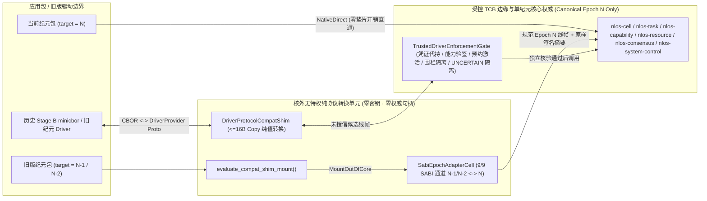

# E-SHIM-001：核外无特权 SABI 跨纪元转换垫片、`[DRV-SHIM-001]` 双边界拆分与 `RISK-E-02` 零旁路对抗验证证据（`W78-E2`）

- **Evidence ID**: `e-shim-001`
- **Wave / Lane**: `W78 / W78-E2-COMPAT-SHIM`（工作包 `E2` `E-COMPAT-SHIM`，里程碑 `M-E2` 左半片）
- **日期**: `2026-10-31`
- **基线提交（Base HEAD）**: `a12e1bafc3b2b02e2beba359a057112b6b36f629`
- **Assurance Level**: `H4`（单机确定性宿主单测、`11` 条 `v1.0` 黄金语料跨纪元重放、`6` 类妥协垫片对抗拦截与核心源码静态零分支审计；不声称 `H5`–`H7` 集群或生产环境证明）
- **状态**: `CANDIDATE`（单车道实现与门禁全绿，待 `W78-INT` 与并行右半片 `W78-E3` `nlos-migrate` 屏障合流复验后晋升 canonical `VERIFIED`）
- **权威规范与治理依据**:
  - [06-架构设计总纲-v0.5.md](../../design/06-架构设计总纲-v0.5.md) §4（核外兼容隔离）、§9（`COMPAT-VER-001`、`COMPAT-VER-002`、`COMPAT-DEPRECATE-001`、`SABI-AUTH-001`、`SABI-RECEIPT-001`）、§10（`KABI-IDEM-001`、`KABI-UNCERTAIN-001`）、§15（`DRV-SHIM-001`、`DRV-CRED-001`、`DRV-ACTIVE-001`、`DRV-BOUND-001`、`DRV-LIFE-001`、`TASK-PROVIDER-001`）、§28（阶段 E 路线图 `E2` / `M-E2`）
  - [ADR-0027：阶段 E SABI v1.0 长期兼容制度、核外兼容垫片与生态商店治理架构](../../management/adrs/0027-stage-e-sabi-long-term-compatibility-and-store-governance.md) §2.1、§2.2、§3.2、§3.3、§6.2（`RISK-E-02`）
  - [stage-e-progress.md](../../management/stage-e-progress.md) §E.2.1、§E.2.2（工作包 `E2` `E-COMPAT-SHIM`）、§E.3（风险登记簿 `RISK-E-02`、`RISK-B-05`）
  - 前置波次证据基线：[e-sabi-001-version-matrix-and-deprecation.md](./e-sabi-001-version-matrix-and-deprecation.md)、[e-sabi-002-five-lang-golden-corpus.md](./e-sabi-002-five-lang-golden-corpus.md)

---

## 1. 核外无特权挂载拓扑与 `[DRV-SHIM-001]` 双边界架构

依据 [ADR-0027](../../management/adrs/0027-stage-e-sabi-long-term-compatibility-and-store-governance.md) §2.2 与总纲 v0.5 §15 `[DRV-SHIM-001]`，[nlos-compat-shim](../../../crates/nlos-compat-shim/src/lib.rs) 将历史版本协议转换严格隔离在核心权威之外，并将兼容垫片拆分为**不可信核外纯字节转换层**与**受控 TCB 边缘强制执法门**两道正交边界：



核心结构模块划分：

1. **包级兼容声明与按需挂载（[manifest.rs](../../../crates/nlos-compat-shim/src/manifest.rs)、[mount.rs](../../../crates/nlos-compat-shim/src/mount.rs)）**：
   - `PackageCompatibilitySpec` 与 `parse_package_compatibility_manifest` 严格解析 `package.manifest` 中的 `target_sabi_epoch`、`target_sabi_minor`、`driver_abi_epoch`、`required_features`、`critical_extensions` 与 `non_critical_extensions`（强制执行 `MAX_COMPAT_MANIFEST_BYTES = 64 KiB`、`MAX_EXTENSION_IDS = 32`、`MAX_REQUIRED_FEATURES = 64` 边界）。
   - `evaluate_compat_shim_mount` 在 `target_sabi_epoch == host_epoch`（且无需旧版驱动桥接）时返回 `CompatShimMountDecision::NativeDirect`，热路径零额外分配与零协议重写开销；在 `N-1` / `N-2` 时按需实例化 `MountedCompatShim`；对 `0`、`> N`、`<= N-3`（已日落）或含未知 `critical_extensions` 的包一律 fail-closed 返回 `CompatMountRejection`（映射为 `SabiErrorCode::AbiVersion` + `RetryDirective::DoNotRetry`，并输出携带 `nlos-migrate` CLI 升级指令的诊断指引）。
2. **安全 TLV 扫描与外科手术式跨纪元重写（[wire.rs](../../../crates/nlos-compat-shim/src/wire.rs)、[sabi_adapter.rs](../../../crates/nlos-compat-shim/src/sabi_adapter.rs)）**：
   - 标准 `prost` 解码再重编码会丢失未知 Protobuf 字段。`wire::scan_tlvs` 在 `#![forbid(unsafe_code)]` 下直接对原始字节执行有界 TLV 扫描，仅对顶层或嵌套 `ExchangeRequest`/`ExchangeResponse` 内的 `SchemaIdentity.major` 执行最小重写，使全部未知 Protobuf tag（如 `a00607`）、`non_critical_extension_ids`、`request_id`/`idempotency_key`、`deadline_monotonic_ns`、`cancel_epoch` 与 `proposal_or_input_digest_sha256` 100% 逐字节无损保留。
3. **`[DRV-SHIM-001]` 双边界驱动隔离（[driver_cbor.rs](../../../crates/nlos-compat-shim/src/driver_cbor.rs)、[driver_shim.rs](../../../crates/nlos-compat-shim/src/driver_shim.rs)、[enforcement.rs](../../../crates/nlos-compat-shim/src/enforcement.rs)）**：
   - **不可信外侧 `DriverProtocolCompatShim`**：`Copy` 纯值结构（`size_of <= 16` 字节），不持有任何 API 密钥、私钥或核心权威引用，仅负责 Stage B `minicbor` 5 方法（`register`、`dispatch`、`complete`、`cancel`、`query_isolation`）与冻结 `nlos.sabi.DriverProvider` v1.0 Protobuf 帧的双向无状态转换及 `N-1`/`N-2 <-> N` 跨纪元重写。
   - **受控内侧 `TrustedDriverEnforcementGate`**：位于 TCB 边缘，代持脱敏外部凭证（`CustodiedCredentialRef` 仅向审计暴露 SHA-256 指纹与密钥标签，零明文泄露），并联合真实 `IdentityAuthority`、`CapabilityAuthority`、`ResourceAuthority` 与 `OperationMachine` 独立校验调用方 Ed25519 签名、`authorization_digest`、一次性绑定 `OperationId` 的 `ReservationActivationToken`、单调递增 `fencing_token` / `process_incarnation` / `deadline`、`[TASK-PROVIDER-001]` 隔离证明，以及崩溃后强制进入 `UNCERTAIN`（`EffectUnknown`）+ 资源预约 `Quarantined` + 同 `IdempotencyKey` 显式对账恢复。

---

## 2. 规范条款与风险项逐条映射矩阵

| 规范 / 风险 ID | 核心约束摘要 | 实现模块与关键符号 | 验证测试入口 |
| :--- | :--- | :--- | :--- |
| `COMPAT-VER-001` | 法定至少 `N / N-1 / N-2` 滚动兼容窗口；`N` 直通，`N-1`/`N-2` 核外挂载，`0`/`>N`/`<=N-3` fail-closed | [mount.rs](../../../crates/nlos-compat-shim/src/mount.rs) `evaluate_compat_shim_mount`；[sabi_adapter.rs](../../../crates/nlos-compat-shim/src/sabi_adapter.rs) `SabiEpochAdapterCell` | `golden_epoch_replay::all_11_epoch_v1_0_goldens_replay_across_n_minus_1_and_n_minus_2_deterministically`、`host_epoch_4_sunset_...` |
| `COMPAT-VER-002` | 未知 `critical_extension_ids` 必须拒绝；未知 `non_critical_extension_ids` 与未知 Protobuf tag 无损透传 | [wire.rs](../../../crates/nlos-compat-shim/src/wire.rs) `rewrite_top_level_schema_major`；[mount.rs](../../../crates/nlos-compat-shim/src/mount.rs) | `golden_epoch_replay::unknown_non_critical_extensions_and_trailing_protobuf_tag_a00607_survive_losslessly` |
| `COMPAT-DEPRECATE-001` | 弃用元素触发有界 `DeprecationWarningReceipt`（携带替代符号与迁移规则 ID）；`SUNSET`/`RESERVED` 元素与字段 tag 阻断 | [sabi_adapter.rs](../../../crates/nlos-compat-shim/src/sabi_adapter.rs) `DeprecationWarningReceipt`、`MAX_DEPRECATION_WARNINGS = 256` | `golden_epoch_replay::deprecation_manifest_emits_bounded_warning_receipts_and_blocks_sunset_or_reserved_elements` |
| `DRV-SHIM-001` | 协议转换垫片与能力/凭证/隔离/生命周期执法门双边界分离；核内零兼容分支 | [driver_shim.rs](../../../crates/nlos-compat-shim/src/driver_shim.rs) vs [enforcement.rs](../../../crates/nlos-compat-shim/src/enforcement.rs) | `risk_e02_adversarial_bypass` 全套 + `core_zero_compat_branch_audit` |
| `DRV-CRED-001` | 外部驱动凭证由受控网关代持注入；不可信垫片零密钥持有，收据仅留指纹 | [enforcement.rs](../../../crates/nlos-compat-shim/src/enforcement.rs) `CustodiedCredentialRef`、`register_credential` | `risk_e02_adversarial_bypass::vector_a_compromised_shim_cannot_read_forge_or_reflect_custodied_credentials` |
| `DRV-ACTIVE-001` | 一次性 `ReservationActivationToken` 与目标 `OperationId` 强绑定，禁止重放或跨操作挪用 | [enforcement.rs](../../../crates/nlos-compat-shim/src/enforcement.rs) `admit_dispatch` + `ResourceAuthority::activate` | `risk_e02_adversarial_bypass::vector_c_compromised_shim_cannot_replay_activation_token_or_misappropriate_across_operations` |
| `DRV-BOUND-001` | 严格校验 `deadline`、`process_incarnation` 与单调 `fencing_token`，阻断过期实例提交完成 | [enforcement.rs](../../../crates/nlos-compat-shim/src/enforcement.rs) `complete_dispatch`、`fencing_high_water` | `risk_e02_adversarial_bypass::vector_e_compromised_shim_cannot_commit_completion_with_stale_fencing_token_or_incarnation` |
| `DRV-LIFE-001` / `KABI-UNCERTAIN-001` | 已激活外部副作用在驱动崩溃/失联时必须转入 `UNCERTAIN`（`EffectUnknown`）并隔离预约，禁止静默归零或换键盲重试 | [enforcement.rs](../../../crates/nlos-compat-shim/src/enforcement.rs) `record_driver_crash`、`reconcile_uncertain`；[sabi_adapter.rs](../../../crates/nlos-compat-shim/src/sabi_adapter.rs) | `risk_e02_adversarial_bypass::vector_f_compromised_shim_cannot_skip_uncertain_after_crash_or_blind_retry_with_new_key`、`golden_epoch_replay::request_and_uncertain_response_goldens_...` |
| `KABI-IDEM-001` | 128-bit `request_id`/`idempotency_key` 跨纪元原样保留，禁止垫片重新生成或吞没冲突 | [sabi_adapter.rs](../../../crates/nlos-compat-shim/src/sabi_adapter.rs) `verify_envelope_invariants`；[enforcement.rs](../../../crates/nlos-compat-shim/src/enforcement.rs) | `golden_epoch_replay::request_and_uncertain_response_goldens_...`、`risk_e02_adversarial_bypass::vector_f_...` |
| `SABI-AUTH-001` / `CAP-UNFORGE-001` | 垫片严禁代签或重算授权摘要；篡改请求负载必触发签名/摘要失配并由核心权威拒绝 | [sabi_adapter.rs](../../../crates/nlos-compat-shim/src/sabi_adapter.rs)；[enforcement.rs](../../../crates/nlos-compat-shim/src/enforcement.rs) `compute_dispatch_auth_preimage` | `risk_e02_adversarial_bypass::vector_b_compromised_shim_cannot_forge_or_tamper_capability_or_authorization_digest` |
| `SABI-RECEIPT-001` | 跨纪元响应完整保留 `UNCERTAIN` 对账收据引用；缺失对账锚点的损坏 `UNCERTAIN` 帧 fail-closed 阻断 | [sabi_adapter.rs](../../../crates/nlos-compat-shim/src/sabi_adapter.rs) `verify_envelope_invariants` | `golden_epoch_replay::request_and_uncertain_response_goldens_preserve_idempotency_auth_and_reconciliation` |
| `TASK-PROVIDER-001` | 未完整具备四项隔离保证或摘要全零（`[0u8; 32]`）时强制降级标记 `PROVIDER_ISOLATION_UNVERIFIED` 或在 `RequireVerified` 策略下拒绝 | [enforcement.rs](../../../crates/nlos-compat-shim/src/enforcement.rs) `evaluate_isolation_posture`、`IsolationEnforcementPolicy` | `risk_e02_adversarial_bypass::vector_d_compromised_shim_cannot_spoof_verified_isolation_with_zero_digest_or_shared_cache` |
| `RISK-E-02` | 消除核外兼容垫片篡改转换语义绕过能力检查、幂等键、围栏纪元或伪造已验证隔离状态的风险 | [nlos-compat-shim](../../../crates/nlos-compat-shim/src/lib.rs) 全库 + 6 类对抗向量测试 | [risk_e02_adversarial_bypass.rs](../../../crates/nlos-compat-shim/tests/risk_e02_adversarial_bypass.rs)（`vector_a`..`vector_f` 全绿） |

---

## 3. 九通道 `v1.0` 黄金语料跨纪元重放、未知字段透传与弃用遥测审计

在 [golden_epoch_replay.rs](../../../crates/nlos-compat-shim/tests/golden_epoch_replay.rs) 中直接读取 [schema/golden/epochs/v1.0/manifest.json](../../../schema/golden/epochs/v1.0/manifest.json) 锁定的 **9/9 冻结通道、11 条不可变 `v1.0` 黄金向量**以及根级 `Envelope-common-request-v1.hex` / `Envelope-common-uncertain-v1.hex`，在宿主纪元 `host_epoch = 1`（`N`）、`host_epoch = 2`（`N-1`）与 `host_epoch = 3`（`N-2`）下执行全量双向重放：

| 验证维度 | 覆盖范围 | 实测断言结论 |
| :--- | :--- | :--- |
| `11` 条 `v1.0` 黄金向量双向重放 | `Envelope`（2 条）、`ServiceDirectory`、`OperationControl`、`SystemControl`、`TakeoverControl`、`WaitControl`、`PrincipalHandshake`（2 条）、`DriverProvider`、`ChannelControl` | `N-1`/`N-2 -> N` 上行转换后 `SchemaIdentity.major == host_epoch` 且全部通过 `nlos-schema` 通道级解码校验器；`N -> N-1`/`N-2` 下行还原与原始黄金字节 **100% 逐字节相等** |
| 未知非关键扩展与未知字段透传 | `nlos.sabi.Envelope-unknown-noncritical-v1.0.hex`（`non_critical=[42, 7001, 9999]` + 尾部未知 tag `a00607`） | 上下行跨越 `N-2 <-> N` 后，`retained_non_critical_extensions == [42, 7001, 9999]`，尾部未知 TLV `0xa0 0x06 0x07`（field `100`, varint `7`）原样保留零丢失 |
| 嵌套双层帧原子重写 | 外层 `nlos.sabi.Envelope`（`v1.1`）包裹内层 `nlos.sabi.DriverProviderRequest`（`v1.0`） | `translate_nested_envelope_to_canonical` 与 `translate_nested_envelope_from_canonical` 原子重写外层封套与内层通道 `major`，往返后内外双层均与 `v1.0` 黄金一致 |
| 幂等键、授权摘要与 `UNCERTAIN` 收据保持 | `Envelope-common-request-v1.hex`、`Envelope-common-uncertain-v1.hex` 及人为擦除对账引用的损坏 `UNCERTAIN` 帧 | `request_id`/`idempotency_key`、`deadline_monotonic_ns`、`cancel_epoch`、`proposal_or_input_digest_sha256`、`EFFECT_UNKNOWN` 与 `reconcile_operation_id` 零篡改；抹除对账锚点的 `UNCERTAIN` 帧被 `UncertainEnvelopeMissingReconciliationRef` 拦截 |
| 越界纪元与未知关键扩展拒绝 | `host_epoch = 4`（使 `v1.0` 成为 `N-3` 日落）、`target_sabi_epoch = 0`、`target_sabi_epoch = 5`、未知 `critical_extensions = [9001]` | 全部 fail-closed 返回 `SabiErrorCode::AbiVersion` + `RetryDirective::DoNotRetry`，且挂载拒绝指引显式包含 `nlos-migrate` 命令 |
| 弃用遥测环形缓冲与墓碑拦截 | 自定义 `DeprecationManifest`（含 `DEPRECATED` 符号、`SUNSET` 符号及永久 `RESERVED` 字段 tag `99`） | 连续 `300` 次弃用调用精确维持 `MAX_DEPRECATION_WARNINGS = 256` FIFO 上限，每条收据携带 `replacement_symbol` 与确定性 `migration_rule_id`；`SUNSET` 符号与线级 `RESERVED` 字段 `99` 均以 `AbiVersion` + `DoNotRetry` 阻断 |

---

## 4. `[DRV-SHIM-001]` 历史驱动桥接与 `RISK-E-02` 六向量对抗验证矩阵

在 [risk_e02_adversarial_bypass.rs](../../../crates/nlos-compat-shim/tests/risk_e02_adversarial_bypass.rs) 中，首先验证不可信 `DriverProtocolCompatShim` 对全部 5 个驱动方法（`Register`、`Dispatch`、`Complete`、`Cancel`、`QueryIsolation`）的 `StageBMinicbor <-> DriverProvider Protobuf` 往返无损转换及 `N-2 <-> N` 跨纪元转换，随后假设核外垫片**已被攻击者完全妥协（Compromised Untrusted Shim）**，逐一重放 6 类越权/绕过向量：

| 对抗向量 | 妥协垫片攻击手法 | TCB 边缘 `TrustedDriverEnforcementGate` + 核心权威拦截机制 | 实测结果 |
| :--- | :--- | :--- | :--- |
| **Vector A**（凭证窃取/反射） | 尝试从垫片内存读取 API Key、使用未注册凭证标签派发，或在驱动响应负载中原样回显机密字节 | `DriverProtocolCompatShim` 体积 `<= 16 B` 零密钥字段；未知凭证报 `UnknownCredentialLabel`；完成阶段扫描机密字节命中即报 `CredentialReflectionDetected` 并拒绝放行 | PASS（零明文泄露） |
| **Vector B**（能力伪造/摘要篡改） | 在用户签名后篡改 `DispatchOperationWire.callback_id`、伪造 64 字节签名，或将 `CapabilityTarget` 越权扩大至其他 `NamespaceId` | `IdentityAuthority::verify_with_public_key` 校验规范化 `authorization_digest`；`CapabilityAuthority::validate` 核验目标范围，依次拦截为 `AuthorizationDigestMismatch`、`IdentityVerificationFailed`、`CapabilityTargetMismatch` | PASS（零越权放行） |
| **Vector C**（激活令牌重放/挪用） | 重复提交已消费的一次性 `ReservationActivationToken`，或将 `op_beta` 的预约令牌挪用于 `op_c` | 网关消费集与 `ResourceAuthority::activate` 双重锁定一次性激活及 `token.operation == request.operation_id`，依次报 `ActivationTokenReplayed` 与 `ActivationTokenOperationMismatch` | PASS（零双花/挪用） |
| **Vector D**（伪造已验证隔离证明） | 注入 `tenant_isolated = true` 但 `attestation_digest = [0u8; 32]` 或 `cache_partitioned = false` 的伪造报告 | `TagReceiptFailClosed` 策略强制覆盖为 `PROVIDER_ISOLATION_UNVERIFIED`；`RequireVerified` 策略直接以 `UnverifiedProviderIsolation` 拒绝完成提交 | PASS（零伪造通过） |
| **Vector E**（过期围栏/旧实例提交） | 旧驱动实例以过期 `fencing_token`、错误 `process_incarnation` 或超时 `now_ms > deadline_ms` 抢占提交完成 | 单调水位线 `fencing_high_water`、实例化身比对与截止期门禁依次报 `StaleFencingToken`、`StaleProcessIncarnation`、`DispatchDeadlineExceeded` | PASS（零僵尸写回） |
| **Vector F**（崩溃抹除 `UNCERTAIN` / 换键盲重试） | 已激活派发崩溃后企图直接调用 `complete_dispatch` 伪装成功，或更换新 `IdempotencyKey` 盲目重派发，或提交错误键对账 | `record_driver_crash` 驱动 `OperationMachine` 进入 `Uncertain`（`EffectUnknown`）并调用 `ResourceAuthority::quarantine` 将预约置为 `Quarantined`；直接完成报 `OperationUncertainRequiresReconciliation`，异键重派报 `UncertainRetryRequiresSameIdempotencyKey`，唯有同键调用 `reconcile_uncertain` 方可闭合 | PASS（`UNCERTAIN` 闭环严密） |

---

## 5. 核心权威 Crate 零兼容分支静态源码审计

在 [core_zero_compat_branch_audit.rs](../../../crates/nlos-compat-shim/tests/core_zero_compat_branch_audit.rs) 中固化常驻自动化静态审计单测，对以下 **6 个核心权威 Crate** 的 `Cargo.toml` 与 `src/**/*.rs`（共 **67 个 Rust 源文件**）执行全量扫描：

| 核心权威 Crate | 扫描 `src/**/*.rs` 文件数 | `Cargo.toml` 依赖 `nlos-compat-shim` | 源码含 `nlos_compat_shim` / 历史纪元分支标记 | 审计结论 |
| :--- | ---: | :--- | :--- | :--- |
| `nlos-cell` | `6` | 无（`0`） | `0` 命中 | PASS |
| `nlos-task` | `19` | 无（`0`） | `0` 命中 | PASS |
| `nlos-capability` | `5` | 无（`0`） | `0` 命中 | PASS |
| `nlos-resource` | `2` | 无（`0`） | `0` 命中 | PASS |
| `nlos-consensus` | `6` | 无（`0`） | `0` 命中 | PASS |
| `nlos-system-control` | `29` | 无（`0`） | `0` 命中 | PASS |
| **合计** | **`67`** | **`0`** | **`0`** | **100% 单纪元纯净（Canonical Epoch `N` Only）** |

静态审计禁止词集涵盖：`nlos_compat_shim`、`SabiEpochAdapterCell`、`DriverProtocolCompatShim`、`OutOfCoreCompatShim`、`StageBMinicbor`、`LegacyDriverWireFormat`、`N_MINUS_1`、`N_MINUS_2`、`n_minus_1`、`n_minus_2`、`legacy_epoch`、`compat_epoch`。任何后续改动若试图将旧纪元 `if/else` 兼容分支渗入核心权威层，该测试将立即失败阻断。

---

## 6. 验证门禁执行记录、独占写集与诚实非声明边界（Honest Non-Claims）

### 6.1 本车道独占写集清单

1. [crates/nlos-compat-shim/src/lib.rs](../../../crates/nlos-compat-shim/src/lib.rs)（更新：导出核外兼容垫片完整公共契约，保持 `#![forbid(unsafe_code)]`）
2. [crates/nlos-compat-shim/src/manifest.rs](../../../crates/nlos-compat-shim/src/manifest.rs)（新增：`PackageCompatibilitySpec` 与 fail-closed 清单解析器）
3. [crates/nlos-compat-shim/src/mount.rs](../../../crates/nlos-compat-shim/src/mount.rs)（新增：`CompatShimMountPolicy`、`CompatShimMountDecision` 与携带 `nlos-migrate` 指引的拒绝映射）
4. [crates/nlos-compat-shim/src/wire.rs](../../../crates/nlos-compat-shim/src/wire.rs)（新增：纯安全 Rust 有界 Protobuf TLV 扫描器与未知字段无损重写器）
5. [crates/nlos-compat-shim/src/sabi_adapter.rs](../../../crates/nlos-compat-shim/src/sabi_adapter.rs)（新增：`9/9` SABI 通道跨纪元 `SabiEpochAdapterCell` 与 `256` 上限弃用告警收据缓冲）
6. [crates/nlos-compat-shim/src/driver_cbor.rs](../../../crates/nlos-compat-shim/src/driver_cbor.rs)（新增：历史 Stage B `Cancel` / `QueryIsolation` 确定性 `minicbor` 编解码器）
7. [crates/nlos-compat-shim/src/driver_shim.rs](../../../crates/nlos-compat-shim/src/driver_shim.rs)（新增：不可信 `Copy` 纯转换 `DriverProtocolCompatShim`）
8. [crates/nlos-compat-shim/src/enforcement.rs](../../../crates/nlos-compat-shim/src/enforcement.rs)（新增：TCB 边缘 `TrustedDriverEnforcementGate`）
9. [crates/nlos-compat-shim/tests/golden_epoch_replay.rs](../../../crates/nlos-compat-shim/tests/golden_epoch_replay.rs)（新增：`6` 项跨纪元黄金重放与弃用/日落集成测试）
10. [crates/nlos-compat-shim/tests/risk_e02_adversarial_bypass.rs](../../../crates/nlos-compat-shim/tests/risk_e02_adversarial_bypass.rs)（新增：`9` 项历史驱动协议往返与 `RISK-E-02` 六向量对抗测试）
11. [crates/nlos-compat-shim/tests/core_zero_compat_branch_audit.rs](../../../crates/nlos-compat-shim/tests/core_zero_compat_branch_audit.rs)（新增：`1` 项核心 `6` Crate / `67` 源文件零兼容分支静态审计测试）
12. `docs/evidence/stage-e/e-shim-001-out-of-core-epoch-adapter.md`（本文档；`crates/nlos-compat-shim/Cargo.toml` 与根级 `Cargo.lock` 保持零改动）

### 6.2 验证门禁实测命令与计数

在隔离工作树中依次执行以下门禁，退出码全部为 `0`：

1. **格式门禁**：
   ```console
   $ cargo fmt --all -- --check
   ```
   退出码 `0`（零格式差异）。
2. **Clippy 严格门禁（`clippy::all` + `clippy::pedantic` + `#![forbid(unsafe_code)]`）**：
   ```console
   $ cargo clippy --locked --config 'source.crates-io.replace-with="aliyun"' --config 'source.aliyun.registry="sparse+https://mirrors.aliyun.com/crates.io-index/"' -p nlos-compat-shim --all-targets --all-features -- -D warnings
   ```
   退出码 `0`（零警告、零错误，所有函数均满足 `<= 100` 行约束）。
3. **单元、黄金重放、对抗拦截与静态审计测试门禁**：
   ```console
   $ cargo test --locked --config 'source.crates-io.replace-with="aliyun"' --config 'source.aliyun.registry="sparse+https://mirrors.aliyun.com/crates.io-index/"' -p nlos-compat-shim
   ```
   退出码 `0`，共计 **`21` 项测试全部通过，`0` 失败**：
   - `src/lib.rs` 单元测试：`5` passed, `0` failed（`manifest` `2` + `wire` `1` + `mount` `2`）
   - `tests/core_zero_compat_branch_audit.rs`：`1` passed, `0` failed（扫描 `6` 个核心 Crate、`67` 个 `.rs` 源文件与 `6` 个 `Cargo.toml`）
   - `tests/golden_epoch_replay.rs`：`6` passed, `0` failed（覆盖 `11` 条 `v1.0` 黄金向量、`a00607` 透传、嵌套封套、`UNCERTAIN` 收据、越界拒绝与 `256` 条 FIFO 弃用告警）
   - `tests/risk_e02_adversarial_bypass.rs`：`9` passed, `0` failed（`3` 项 5 方法 CBOR/Proto 往返 + `6` 项 `RISK-E-02` 妥协垫片对抗拦截）

### 6.3 诚实非声明边界（Honest Non-Claims）

1. **验证等级上限声明（`H4 != H7`）**：本文档记录的所有证据均属于单机确定性宿主级契约、对抗与静态源码验证（`H4`），不声称多节点真实生产流量长稳压测或跨版本在线滚动升级的 `H7` 生产证明。
2. **并行右半片迁移工具边界（`W78-E2 != W78-E3`）**：本车道（`W78-E2`）实现了核外运行时转换垫片 `nlos-compat-shim` 并在越界挂载拒绝中输出 `nlos-migrate` CLI 升级指引，但源码/包配置自动迁移 CLI 工具 `tools/nlos-migrate` 及其干跑/回滚验证归属并行车道 `W78-E3`（工作包 `E3` `E-MIGRATE-TOOLING`），本文档不声称 `nlos-migrate` 已在本车道交付。
3. **里程碑与风险台账晋升边界（待 `W78-INT` / `W81` 合流）**：单车道完成不等于里程碑 `M-E2` 已达成 canonical `DONE`；`docs/management/stage-e-progress.md` 中 `E2`、`M-E2`、`RISK-E-02` 及 `RISK-B-05` 的权威状态翻转均由集成者车道 `W78-INT` 及后续 `W81`（`ROAD-E-001` 退出门禁与 SABI v1.0 永久冻结裁决）统一审定写入。
