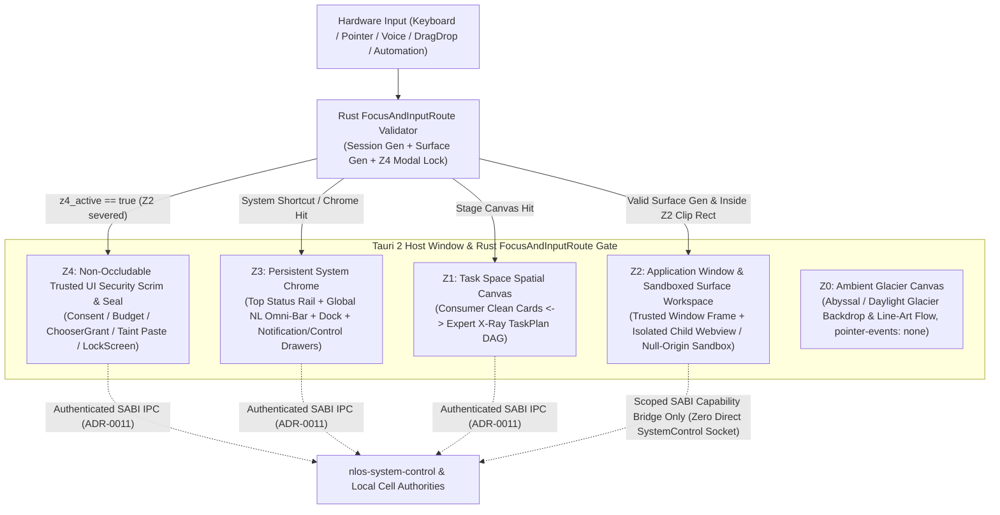

# ADR-0025：阶段 D 混合自然语言桌面合成层、双模透视与可信 UI 防伪边界

- 状态：`ACCEPTED（维护者于 2026-10-26 显式裁定 A1–A3 批准；本文件为 DESIGN 级架构定案，ACCEPTED ≠ VERIFIED，在阶段 D 实现与证据落档前不得声称完整桌面已实现）`
- 日期：2026-10-26
- Owner：`desktop/`（Tauri 2 混合桌面壳与合成器） / `nlos-system-control` / `nlos-application` / `nlos-search` / 阶段 D 工作包（`D-TOKENS-KIT`、`D-IPC-ENUM`、`D-COMPOSITOR-WM`、`D-OMNIBAR-MULTIMODAL`、`D-TASK-SPACE-DAG`、`D-TRUSTED-UI`、`D-NOTIFY-SEARCH-OFFLINE`、`D-CONTROL-SETTINGS-A11Y`）
- 关联 Requirement：[06-架构设计总纲-v0.5.md](../../design/06-架构设计总纲-v0.5.md) §24 `[NL-COMPILE-001]`、`[NL-PROPOSE-001]`、`[NL-AMBIG-001]`、`[NL-BIND-001]`、`[PLAN-DAG-001]`、`[PLAN-LAZY-001]`、`[PLAN-CHANGE-001]`、`[PLAN-OVERRIDE-001]`、`[TUI-CONSENT-001]`、`[TUI-CHOOSER-001]`、`[TUI-EXT-001]`、`[RCPT-EFFECT-001]`、`[RCPT-UNDO-001]`、`[RCPT-PARTIAL-001]`；§25 `[TASK-SPACE-001]`、`[TASK-STATE-001]`、`[TASK-VIS-001]`、`[TASK-NOTIFY-001]`、`[TASK-REOPEN-001]`、`[TASK-STATE-002]`、`[CTRL-PARITY-001]`、`[CTRL-HIER-001]`、`[CTRL-PRIORITY-001]`、`[CTRL-SAFETY-001]`、`[CTRL-PLAN-001]`、`[CTRL-RECOVERY-001]`、`[DUI-LAUNCH-001]`、`[DUI-CONTROL-001]`、`[DUI-WINDOW-001]`、`[DUI-INPUT-001]`、`[DUI-CHOOSER-001]`、`[DUI-ASSOC-001]`、`[DUI-CLIP-001]`、`[DUI-NOTIFY-001]`、`[DUI-SESSION-001]`、`[DUI-SETTINGS-001]`、`[DUI-OFFLINE-001]`；§14/§19 `[CONS-DECL-001]`、`[CONS-CTRL-001]`；§28.4 `[ROAD-D-001]`
- 关联 ADR 与设计文档：[ADR-0011](./0011-ipc-principal-auth-signature-passthrough.md)、[ADR-0013](./0013-cross-authority-verify-then-commit-contract.md)、[ADR-0014](./0014-schema-channel-freeze-v1-beta.md)、[ADR-0015](./0015-dual-layer-untrusted-execution-isolation.md)、[ADR-0016](./0016-task-plan-declaration-surface.md)、[ADR-0024](./0024-driver-provider-payload-codec-freeze.md)、[ADR-0026](./0026-cross-physical-host-transport-and-consensus-expansion.md)、[站点视觉设计系统 v10.6](../../site/DESIGN.md)、[阶段 D 权威进度单](../stage-d-progress.md)、[阶段 D 完整桌面视觉与交互规格](../../superpowers/specs/2026-10-26-stage-d-desktop-visual-and-ux-design.md)
- 复审触发器：以原生 OS 显示服务器合成器（Wayland Compositor / Windows DirectComposition / macOS SkyLight）替换 Tauri 2 宿主窗口内多 WebView 合成；引入第三方应用原生 GPU/Vulkan/wgpu 表面直通嵌入；阶段 E 跨设备多屏协同要求将 `FocusAndInputRoute` 与 `Z4` 安全确认层扩展至独立物理副屏或硬件安全显示通道

## 上下文

### 1. 阶段 B/C 开发者桌面壳基线与阶段 D 启动背景

在阶段 B 与阶段 C 前期（`W32-A..F`、`W33-F`、`W39-D`），仓库在 [`desktop/`](../../../desktop/README.md) 中交付了满足 `[TASK-SHELL-001]` 的最小可信开发者 Task Manager 外壳：

1. **真实控制面与字节级等价契约**：前端通过 Tauri 2 命令层（[`desktop/src-tauri/src/ipc.rs`](../../../desktop/src-tauri/src/ipc.rs)）全部经 [ADR-0011](./0011-ipc-principal-auth-signature-passthrough.md) challenge-response 认证通道（`dispatch_over_authenticated_socket`）连接真实 `nlos-system-control` 服务，所有回执统一投影为携带 `receipt_hex` 的 `ReceiptDto`（[`desktop/src-tauri/src/dto.rs`](../../../desktop/src-tauri/src/dto.rs)），并与 `system-control-cli` 保持逐字节一致（`W32-C`）。
2. **最小应用表面与生命周期切片**：`W32-F` 与 `W39-D` 落地了 `ApplicationAuthority` 声明表面只读呈现（`present_surfaces`，旧代际不进入可呈现集）及 [`SurfaceLifecycle`](../../../desktop/src-tauri/src/window_lifecycle.rs) 状态机（`REGISTERED → CREATED → PRESENTED ↔ HIDDEN → CLOSED`）。
3. **显式诚实边界**：当前 [`desktop/src/views/task-space/index.ts`](../../../desktop/src/views/task-space/index.ts) 仅是左侧 180px 标签栏下的开发者只读告警巡检面板，显式登记了三项 `TASK_SPACE_GAPS`（无全量任务/TaskGroup 枚举面、无 `application_id`/`plan_revision` 列表投影、无父级作用域下 Fiber/Operation 枚举面），且尚未包含窗口合成器、焦点与输入防伪路由、可信权限/选择器模态层、自然语言多模态输入栏、通知中心、非权威全局搜索 UI、四层设置域及双主题视觉体系。

根据维护者于 `2026-10-26` 作出的阶段治理裁定（**Ruling A4**）：阶段 C 保持 `IN_PROGRESS` 并扩充跨物理主机分布式扩展（[ADR-0026](./0026-cross-physical-host-transport-and-consensus-expansion.md)，`C-XHOST`），同时 **阶段 D：完整自然语言桌面**（[stage-d-progress.md](../stage-d-progress.md)）立即并行启动（`Stage D || C-XHOST`）。

在开启任何阶段 D 代码车道前，必须在架构层锁定三个不可逆的全局决策维度：
- **维度 A1（视觉设计系统）**：完整桌面采用何种色彩、材质、排版与明暗主题契约，才能既建立高度辨识的现代 OS 工程质感，又满足长期日间/夜间办公可读性？
- **维度 A2（空间与窗口范式）**：自然语言首要界面（Omni-Bar + `Task Space`）与多应用图形界面（`Window` / `Surface` + `ApplicationLauncher`）如何在同一视口中协同共存？
- **维度 A3（可信 UI 防伪边界与普通用户/专家双模透视）**：如何在同一 WebView/Tauri 技术栈上物理阻止不可信应用 `Surface` 伪造权限/预算提示或劫持焦点，同时兼顾 `[ROAD-D-001]`（非开发者无需理解 Agent 编排即可持续使用多应用与后台任务）与 `[CTRL-PLAN-001]`（专家可下钻 `TaskPlan` / `TaskAttempt` / `ExecutionFiber` 并手动调度）？

### 2. 不可破坏的规范性约束（Normative Constraints）

| Requirement ID | 权威章节 | 阶段 D 桌面架构硬约束 |
|---|---|---|
| `[ROAD-D-001]` | §28.4 | **阶段 D 退出门**：非开发者无需理解 Agent 编排即可持续使用多个 `Application` 和后台 `Task`。默认界面严禁把 `TaskNode`、`ExecutionFiber`、`CAS generation` 或 32B hex ID 强加给普通用户。 |
| `[CTRL-PARITY-001]` | §25.3 | 自然语言命令、桌面 GUI 按钮、CLI 与结构化 API 必须编译为语义等价的 `ControlCommand`，经过完全相同的 `Capability`、`generation` CAS、resource/effect fence 与 `ControlReceipt` 路径。 |
| `[CTRL-PLAN-001]` | §25.3 | `Task Space` 必须同时提供自动视图（普通用户看到 `Application`/`Task` 整体义务状态）与专家视图（高级用户下钻 `TaskPlan`、`TaskNode`、`TaskAttempt`、`Process`/`AgentInstance`/`ExecutionFiber`、`ResourceGroup`、`Topic`、`Operation` 并在授权范围内手动干预）。 |
| `[PLAN-OVERRIDE-001]` | §24.1.1 | 自动规划与图形化手工改计划（`[PLAN-CHANGE-001]`）必须收敛到同一 `TaskPlan`/`TaskNode` schema、`AdmissionPlan`、`Capability` 与 `Receipt`，禁止存在绕过准入的“GUI 管理员拖拽后门”。 |
| `[TUI-CONSENT-001]` | §24.2 | 权限与成本确认必须由 `Trusted UI` 渲染真实的 `Application`/`Principal`、目标、purpose、持续时间与成本上界；不可信应用绝不能伪造系统提示。 |
| `[TUI-CHOOSER-001]` / `[DUI-CHOOSER-001]` | §24.2 / §25.4 | Open/Save/Share 文件与 `Artifact` 选择器可发现用户可见对象，但只能向 `Application` 返回用户显式选定后的 scoped `Artifact` `Capability`（`ChooserGrant`），严禁泄露宿主全局路径或整个用户目录。 |
| `[DUI-LAUNCH-001]` | §25.4 | `ApplicationLauncher` 必须按 `ApplicationId` / `InstallationId` 激活应用，不得把 `PackageId` 或临时 `ProcessId` 当作应用身份。 |
| `[DUI-CONTROL-001]` | §25.4 | 桌面必须提供可信的 `SystemControlCenter` / `TaskManagerSurface` / `ResourceMonitorSurface`，使用 §25.3 `ControlCommand`/`Receipt`，严禁通过私有 UI RPC 绕过系统控制协议。 |
| `[DUI-WINDOW-001]` | §25.4 | `Surface` / `Window` 必须绑定 `Application` owner、`DesktopSession`、visibility、`FocusAndInputRoute`、accessibility tree 与 `generation`；过期代际（stale `Surface`）不得接收任何新输入。 |
| `[DUI-INPUT-001]` | §25.4 | 焦点、键盘、指针、语音与自动化输入必须经 `Trusted UI` 路由并标明来源；不可信 `Application` 不得伪造系统级输入或权限界面。 |
| `[DUI-CLIP-001]` | §25.4 | 剪贴板（`ClipboardItem`）与拖拽（`DragDropTransfer`）必须绑定 `content_type`、`source_application`、`taint`、`expiry` 与 `user_gesture`；敏感内容跨应用传递必须经策略或用户显式同意。 |
| `[DUI-NOTIFY-001]` | §25.4 | 通知交互动作（`NotificationAction`）必须绑定原 `Notification` / `Application` / `Task` 与一次性 `ActionToken`，防止其他应用伪造响应；后台状态变化不依赖聊天窗口保持打开（`[TASK-NOTIFY-001]`）。 |
| `[DUI-SESSION-001]` / `[DUI-SETTINGS-001]` | §25.4 | 多用户 `UserProfile`、`Workspace`、`DesktopSession`、`KeychainReference` 与应用数据容器隔离；锁屏/切换用户使旧会话输入与能力代际失效；设置按 `system/user/workspace/application` 四层 CAS + watch 管理，Keychain 仅返回句柄引用。 |
| `[DUI-OFFLINE-001]` | §25.4 | `LOCAL_SINGLE_NODE` 桌面离线时必须完整可用（Launcher、本地应用、Artifact、Task、Settings、本地 Search、Notification 历史）；仅依赖远程网络/远端 Cell 的动作单独标记 `WAITING_NETWORK` / `UNAVAILABLE`，严禁因断网锁死桌面。 |
| `[CONS-CTRL-001]` | §19 / §14 | 全局搜索基于只读非权威查询面（[`nlos-search`](../../../crates/nlos-search/src/lib.rs) `SearchUseRestrictions::NON_AUTHORITATIVE`，位掩码 `0x1F`），其候选命中严禁直接驱动 `Capability`、账本、任务提交、包更新或不可逆副作用，必须先回跳权威对象重验（`[TASK-SNAPSHOT-003]`）。 |

## 候选

### 维度 A1：桌面视觉设计系统与主题连续性

| 候选方案 | 核心特征 | 结论与理由 |
|---|---|---|
| **A1-a：演进 `DESIGN.md` v10.6 Glacier 双主题系统（Abyssal Glacier 默认深色 + Daylight Glacier 浅色切换）** | 继承站点实测单色纪律：`#030710` 极暗藏青底、`#0D1322` 区块带、`#7FC8FF` 冰蓝主标题与焦点色、低 tint（`α ≤ 0.07`）高透液态玻璃 + 1px 镜面描边、`300` 轻字重大标题、`≥ 12px` 等宽工程纹理标签、零装饰性紫蓝/彩虹渐变；同时原生内建 `#F2FAFF` / `#006DDD` **Daylight Glacier** 日间浅色主题与无障碍高对比不透明回退 | **采纳（Ruling A1）**：与 NLOS 品牌及架构站点形成 100% 统一的系统工程美学，单色纪律天然突显 `Z4` 安全防伪信号，同时深/浅双模覆盖全天候生产力与可访问性需求。 |
| **A1-b：沿用宿主默认样式或通用多彩渐变 SaaS 组件库** | 保持当前 `desktop/src/style.css` 无主题灰框，或引入带紫/青/琥珀多彩卡片与 `16px+` 大圆角的常规 Web UI 组件库 | **否决**：破坏 `DESIGN.md` 零装饰渐变纪律，模板化“AI 网页感”严重，且多彩装饰色会稀释权限风险等级与系统防伪印章的视觉信噪比。 |
| **A1-c：仅提供单一深色主题（拒绝浅色模式）** | 全局硬编码深色背景，不建立语义化双主题 CSS Token 层 | **否决**：在强环境光办公、长篇文档审阅及散光用户群体中易引发视觉疲劳，不符合 Windows/macOS 级通用现代桌面定位。 |

### 维度 A2：桌面空间组织与窗口交互范式

| 候选方案 | 核心特征 | 结论与理由 |
|---|---|---|
| **A2-a：AI-Native Hybrid Desktop（混合自然语言空间桌面）** | 以全局自然语言 **Omni-Bar** + 动态 **`Task Space` 空间画布（`Z1`）** 为桌面第一舞台，同屏原生支持多 `Application` 浮动/磁吸平铺 **`Window`/`Surface` 合成层（`Z2`）**、顶部系统状态轨与底部 **`ApplicationLauncher` Dock（`Z3`）** | **采纳（Ruling A2）**：既确立自然语言与持续任务（`[TASK-SPACE-001]`）的一等公民地位，又完整承载 §25.4 多应用图形窗口并发协作，满足 `[ROAD-D-001]`。 |
| **A2-b：纯对话流 / 单一 Agent Chat 画布** | 整个窗口仅保留对话流与内嵌消息卡片，无独立多应用窗口合成与 Dock | **否决**：将操作系统桌面退化为聊天客户端，违反 §25.4 完整桌面系统对象契约及 `[TASK-NOTIFY-001]`“不依赖原聊天窗口保持打开”的核心要求。 |
| **A2-c：传统 WIMP 空桌面图标墙 + 侧边栏 AI Copilot 挂件** | 照搬传统文件图标桌面，把自然语言意图与 `Task Space` 塞入右侧窄边栏附属插件 | **否决**：把跨应用任务义务、预算准入与自然语言编译降格为二等外挂，用户在多个应用窗口间迷失全局任务因果链。 |

### 维度 A3：可信 UI 防伪边界与普通用户/专家双模架构

| 候选方案 | 核心特征 | 结论与理由 |
|---|---|---|
| **A3-a：独立顶层合成安全幕布（`Z4` Security Scrim）+ 单一权威投影存储上的 Consumer / Expert X-Ray 双模切换** | 权限授予、预算审批、`ChooserGrant`、跨应用敏感粘贴同意与高风险确认独占最高平面 `Z4`，带冰蓝防伪光框、Gerono `∞` 动态 Canvas 印章与密码学身份徽标，不可信应用 `Surface` 被沙箱隔离在 `Z2` 内部且在 `Z4` 激活时物理切断输入路由；`Task Space` 基于同一份 `DesktopProjectionStore` 默认渲染零行话 **Consumer Clean Mode**，按 `⌘/Ctrl + Shift + E` 原地切换 **Expert X-Ray** 展开 DAG/Attempt/Fiber/`receipt_hex` | **采纳（Ruling A3）**：从合成层几何裁剪与 Rust 输入路由双端根除应用伪造权限弹窗与焦点劫持；单一权威状态投影兼顾 `[ROAD-D-001]` 零门槛体验与 `[CTRL-PLAN-001]` 专家级透明控制，零双状态库漂移。 |
| **A3-b：同一 DOM 树内普通 CSS `z-index` 模态框 + 直接内联挂载应用脚本** | 应用 `Surface` 与系统壳共享同一 WebView 文档上下文，仅靠 CSS `z-index: 9999` 弹出权限框 | **否决**：严重违反 `[TUI-CONSENT-001]`、`[DUI-INPUT-001]` 与 [ADR-0015](./0015-dual-layer-untrusted-execution-isolation.md)；应用可通过 DOM 注入、全屏遮盖或焦点抢占完全伪造系统级授权框。 |
| **A3-c：拆分为“消费者版桌面”与“专家版 Task Manager”两个独立进程/状态库** | 维护两套独立前端代码与各自轮询状态缓存 | **否决**：制造前端双主状态撕裂，用户从任务卡片下钻诊断时上下文丢失，维护成本翻倍。 |

## 评价标准

1. **防伪与隔离安全性（TCB Boundary）**：不可信或半可信 `Application` `Surface` 是否在几何边界、DOM/Origin 边界与输入事件流上均无法伪造 `Trusted UI`（`Z3`/`Z4`）或诱骗点击（Clickjacking）？
2. **控制面严格等价（Control Parity）**：所有桌面交互是否 100% 经由既有或标准扩展的 SABI `ControlCommand` / `TypedIntent` 认证通道，不引入任何未审计私有 UI RPC？
3. **渐进认知负荷（Progressive Disclosure）**：普通用户默认界面是否零系统内部术语即可完成多应用启动、任务委托、成本感知、撤销与离线使用（`[ROAD-D-001]`），而专家开启透视后能否零信息损失地观测和干预全部 10 个控制层级（`[CTRL-PLAN-001]`）？
4. **离线自治与跨主机容错（Offline & Multi-Cell Resilience）**：断网或远端物理机 `Cell` 分区（[ADR-0026](./0026-cross-physical-host-transport-and-consensus-expansion.md)）时，本地桌面是否零阻塞运行并诚实标注局部受限状态（`[DUI-OFFLINE-001]`）？
5. **跨平台一致性与退出成本**：方案能否在 Windows、macOS、Linux 三大桌面宿主上依托 Tauri 2 稳定交付，并为未来替换底层原生显示合成器保留清晰接口？

## 决定

### 决定 1：五平面 Z 轴合成隔离（5-Plane Z-Axis Compositor Isolation）与输入防伪路由

阶段 D 桌面壳（`llmos-desktop`）废除阶段 B 单一侧边栏表单布局，建立由 Rust 宿主合成控制器（`DesktopCompositor`）与特权壳层 WebView（`llmos-shell`）协同强制执行的 **五平面 Z 轴空间合成模型（`Z0 → Z4`）**：

各平面的职责与强制隔离机制定义如下：

1. **五平面职责划分**：
   - **`Z0` Ambient Glacier Canvas（环境画布层）**：承载深色极光细线流场或浅色冰川底布，`pointer-events: none`，零业务状态、零交互焦点。
   - **`Z1` `Task Space` Spatial Canvas（任务空间主舞台层）**：位于桌面底层中央工作区，持续呈现当前活跃、等待确认、暂停、完成与争议中的 `Task` 义务（`[TASK-SPACE-001]`）。运行于系统特权 `llmos-shell` 上下文中。
   - **`Z2` Sandboxed Application `Window` & `Surface` Workspace（受控应用窗口层）**：每个窗口由**外层可信系统窗框**（`WindowFrame`：由 `llmos-shell` 绘制标题栏、真实 `Application` 徽标、代际状态、磁吸控制与关闭按钮）与**内层沙箱隔离表面视口**（`SurfaceViewport`：承载应用包声明的 `entry_name` 载荷）组成。
   - **`Z3` Persistent System Chrome（常驻可信系统壳层）**：包含顶部 36px 系统状态轨（Top Status Rail）、全局自然语言 **Omni-Bar** 浮层、右侧滑出式通知中心 / `SystemControlCenter` 抽屉、全局非权威搜索面板以及底部 **Application Launcher Dock**。`Z2` 窗口的最大化与拖拽安全区被几何夹紧在 `Z3` 顶栏与底栏之间，永远无法遮盖 `Z3` 系统状态指示器。
   - **`Z4` Non-Occludable `Trusted UI` Security Scrim & Seal（不可遮挡可信安全确认层）**：系统最高特权平面。凡涉及权限授予（`[TUI-CONSENT-001]`）、超额预算/高风险 `ActionProposal` 批准（`[NL-PROPOSE-001]`）、高风险歧义澄清（`[NL-AMBIG-001]`）、文件/Artifact 选择器（`ChooserGrant`，`[DUI-CHOOSER-001]`）、跨应用污染剪贴板/拖拽放行（`[DUI-CLIP-001]`）、不可逆控制动作二次确认（`[CTRL-SAFETY-001]`）及会话锁屏（`DesktopSession=LOCKED`），一律且只能在 `Z4` 渲染。

2. **WebView / Tauri 2 双层容器隔离与防伪机制（物理阻断 `Z2 → Z3/Z4` 伪造与焦点劫持）**：
   - **源隔离与权限剥离**：系统特权壳 `llmos-shell` 独占 Tauri 主 WebView 与 `ADR-0011` 认证 IPC 命令表；第三方/用户态 `Application` 的 `Surface` 严禁注入 `llmos-shell` DOM。其内容仅允许运行于两类受限载体之一：
     - **标准隔离载体（Tauri 2 Multi-WebView 子表面）**：由宿主通过 `tauri::WebviewBuilder` 创建独立子 WebView，绑定唯一隔离源 `nlos-surface://<application_id>.<installation_generation>.localhost`，在 Tauri Capability 配置中剥离全部 `nlos-system-control` 管理命令，仅开放经宿主中介校验的受限应用通道。Rust 合成器实时将其物理像素视口裁剪在 `[y_min = rail_height, y_max = viewport_height - dock_zone_height]` 及对应 `Z2` 窗口内框矩形内；当 `Z4` 激活或侧栏抽屉覆盖该区域时，Rust 合成器立即调用宿主子视图隐藏/冻结（`hide()` / 位图快照占位），从原生合成顺序上根除子 WebView 压盖 `Z3`/`Z4` 的可能。
     - **轻量纯声明式载体（Null-Origin CSP Sandboxed Frame）**：对于无独立原生子视图需求的纯静态/受限小面板表面，允许在 `Z2` 窗框内使用 `<iframe sandbox="allow-scripts" csp="default-src 'none'; script-src 'unsafe-inline'; style-src 'unsafe-inline'; img-src blob: data:;">`（显式禁止 `allow-same-origin`、`allow-top-navigation`、`allow-popups`、`allow-modals`），外层容器强制 `overflow: clip; contain: strict; isolation: isolate`，通过受 `SurfaceId + generation` 围栏校验的单一 `MessageChannel` 通信。
   - **视觉防伪印章（Anti-Spoofing Ceremony）**：`Z4` 激活时，全视口覆盖冰川安全幕布，同时联动顶部 `Z3` 系统状态轨点亮不可被 `Z2` 触及的硬件级安全信标（`TRUSTED SECURITY PROMPT`）、动态绘制 **Gerono 双纽线 `∞` Canvas 防伪印章**、展示当前 `UserProfile` 私密防钓鱼徽记（用户自定义短语/几何图腾，不可信应用无法读取）以及经 `ApplicationAuthority` / `IdentityAuthority` 核验的真实 `ApplicationId`、`PrincipalId` 与 `manifest_digest` 摘要。任何在 `Z2` 内部伪造的“权限弹窗”既无法突破 `Z2` 窗口内框与“不受信任应用表面”标题栏，也无法联动 `Z3` 顶栏信标或获知用户防钓鱼徽记。
   - **输入路由与代际围栏（`FocusAndInputRoute`，`[DUI-INPUT-001]` / `[DUI-WINDOW-001]`）**：Rust 后端维护单一权威焦点路由表 `(focused_surface_id, focused_surface_generation, desktop_session_generation, z4_modal_lock)`。
     - 当 `z4_modal_lock == true` 时，宿主层直接切断发往所有 `Z2` 表面的键盘、指针、语音与自动化事件转发，并在 `Z4` 首次挂载后的 **350ms 安全武装窗口（Input Arming Guard）** 内忽略确认键点击/回车，彻底防御“诱导用户连续双击瞬间弹出权限框”的时间差劫持（Clickjacking / Keystroke Race）。
     - 当应用升级推进 `current_installation_generation` 或会话进入 `LOCKED`/`SUSPENDED` 时，旧代际 `Surface` 立即被标记为 `STALE_GENERATION`：前端将其视觉降饱和灰化并叠加上锁横幅，后端输入路由器对一切指向旧代际的事件直接返回类型化拒绝，绝不投递。

### 决定 2：单一类型化控制与意图编译主干（Single Typed Control & Intent Compilation Spine）

阶段 D 桌面严格遵守 `[CTRL-PARITY-001]`、`[DUI-CONTROL-001]` 与 `[PLAN-OVERRIDE-001]`，**零私有 UI RPC 后门、零前端自造状态变更**：

1. **GUI 控制动作完全等价于 CLI / API**：桌面中无论是 `Task Space` 卡片上的“暂停/取消/重试”按钮、`Expert X-Ray` 中的 `TaskNode` 手工调整、`TaskManagerSurface` 中的进程/协程限流回收、`NotificationAction` 快捷响应，还是 `SystemControlCenter` 与 `SettingsDomain` 修改，全部在 Rust 桥接层编译为标准 §25.3 `ControlCommand`（或 §24.1 `TaskPlan` 修订提议），携带新生成的 `control_command_id`、会话 `Principal` 签名与 `expected_generation_or_revision`，经唯一 `ADR-0011` 认证 socket/named-pipe 派发，返回携带 `receipt_hex` 的 `ControlReceipt`。
2. **自然语言与多模态输入编译链**：全局 Omni-Bar 接收文本、语音转写、截图或拖入文件引用后，首先调用 NL Compiler 生成版本化 `TypedIntent`（`[NL-COMPILE-001]`）并在输入栏实时渲染结构化意图预览芯片：
   - 若存在高风险歧义（`unresolved_ambiguities` 非空，`[NL-AMBIG-001]`），在提交执行前强制展开澄清对比卡，严禁静默选择更高权限或更高预算分支；
   - 若编译产物涉及新权限请求、预算预留或不可逆副作用，生成 `ActionProposal` / `TaskPlan` 摘要并提升至 `Z4` 请求用户签发 `AuthorizationReceipt`（`[NL-PROPOSE-001]`、`[NL-BIND-001]`）；
   - 在已获有效授权与配额范围内的纯局部计划调整（如未执行节点的非扩权排序），走受限 `ControlCommand`（`[PLAN-CHANGE-001]`）。
3. **全局搜索的严格非权威隔离（`[CONS-CTRL-001]`）**：Spotlight 搜索面板只调用 [`nlos-search`](../../../crates/nlos-search/src/lib.rs) 只读查询面，强制校验返回信封携带 `SearchUseRestrictions::NON_AUTHORITATIVE`（`0x1F`）。搜索结果组件在架构上不绑定任何直接写操作或授权回调，唯一允许的后续动作是通过候选对象 ID 触发权威读接口（`InspectTask` / `InspectApplication` / `SemanticAuthority::inspect_event`）完成快照重验后，在权威视图中打开对应实体。

### 决定 3：Consumer Clean View 与 Expert X-Ray 同源双模渐进披露

为同时满足 `[ROAD-D-001]` 与 `[CTRL-PLAN-001]`，阶段 D 前端采用 **单一规范化只读投影存储（`DesktopProjectionStore`）+ 双模纯函数视图投影（`Consumer` ↔ `Expert X-Ray`）**：

| 维度 | Consumer Clean Mode（默认消费者模式，`[ROAD-D-001]`） | Expert X-Ray Mode（专家透视模式，`⌘/Ctrl + Shift + E`，`[CTRL-PLAN-001]`） |
|---|---|---|
| **目标心智** | 面向日常非技术用户：只关心“我交代的目标进展如何、哪个应用在做、花了多少预算、能不能撤回、需不需要我拍板” | 面向系统开发者、运维与高级用户：完整审视意图编译、DAG 惰性物化、多 Attempt 竞速、Cell 分片租约与回执字节 |
| **`Task Space` 卡片形态** | 自然语言目标标题、真实 `Application` 图标与名称、人话阶段摘要、单条有界预算进度条、`REVERSIBLE / COMPENSATABLE / IRREVERSIBLE` 撤销属性徽章（`[RCPT-UNDO-001]`）、逐目标部分失败清单（`[RCPT-PARTIAL-001]`） | 原地展开交互式 `TaskPlan` DAG 画布（13 态 `TaskNode`、惰性物化窗口框 `[PLAN-LAZY-001]`、未执行节点增删暂停重排 `[PLAN-CHANGE-001]`）、`TaskAttempt` 竞速泳道与 `TaskHead` CAS 胜出标记 |
| **执行与分布式拓扑细节** | 隐藏 `FiberId`、`ProcessId`、`CellId`、`epoch`；跨主机断连仅温和提示“等待远端节点恢复（本地操作不受影响）” | 显式展示 `Process` / `AgentInstance` / `ExecutionFiber` 共享故障域徽标、所属 `CellId`、权威 `lease_epoch` / `fencing_token` 及 [ADR-0026](./0026-cross-physical-host-transport-and-consensus-expansion.md) 跨机通道健康度 |
| **审计与回执验证** | 展示简洁时间线与“查看可验证凭证”折叠入口 | 每张卡片与控制结果页脚常驻等宽 `control_command_id`、`correlation_id`、`receipt_hex` 一键复制按钮与内联 `GUI↔CLI Parity` 字节核验器 |
| **状态源一致性** | **完全共享同一个内存 `DesktopProjectionStore` 实例**：切换模式仅改变视图投影函数与 CSS 数据属性（`data-nlos-view-mode="consumer" \| "xray"`），耗时 `< 16ms`，不触发重复网络请求、不维护第二套状态树 | 同左 |

### 决定 4：Glacier 双主题视觉连续性（Abyssal Glacier + Daylight Glacier）

桌面视觉系统正式确立为 `docs/site/DESIGN.md` v10.6 的系统级超集，提取为 `--nlos-*` CSS 自定义属性契约（完整 Token 表见[阶段 D 完整桌面视觉与交互规格 §1](../../superpowers/specs/2026-10-26-stage-d-desktop-visual-and-ux-design.md)）：

1. **双主题内建与无闪烁切换**：
   - **Abyssal Glacier（默认深色）**：画布底 `#030710`、区块带 `#0D1322`、容器面 `#0A1220` / `#161F34`、主视觉冰蓝 `#7FC8FF`、正文 `#CCE9FF`、主操作底 `#E5F4FF`（字 `#030710`）、液态玻璃冰白折射 tint（`α ≤ 0.07`）配 `backdrop-filter: blur(16px) saturate(2.0)` 与 1px 上亮下暗镜面描边环。
   - **Daylight Glacier（内建浅色）**：画布底 `#F2FAFF`、容器面 `#FFFFFF`、主交互强调蓝 `#006DDD`、正文 `#030710`、边框 `rgba(3, 7, 16, 0.14)` / `0.24`、浅色高透白玻璃（`α = 0.62`）配细腻深色 hairline。
   - 主题状态持久化于 `SettingsDomain`（`user.appearance.theme = "abyssal" | "daylight" | "system"`），在 HTML 根节点通过 `data-nlos-theme` 同步切换，严禁出现深浅混杂残留（呼应 `DESIGN.md` v10.6.1 教训）。
2. **克制的单色工程纪律与状态语义色**：
   - 全局严禁装饰性紫蓝渐变、严禁三色渐变文字、严禁背景科技感方格网、严禁 `16px+` 浮夸大圆角（统一采用 `6px` 主圆角、`8px` 窗口/外框圆角与 `999px` 胶囊标签）。
   - 展示级标题采用 `300` 轻字重无衬线字体；所有系统对象标签、代际号、状态徽章、快捷键提示、资源上界数字与回执摘要一律采用 `≥ 12px` 等宽字体（`--nlos-font-mono`）构建“工程纹理”。
   - 语义状态色严格限制在胶囊点标与 1px 描边内（`RUNNING` 冰蓝、`WAITING_CONSENT` 冰白高亮、`WAITING_RESOURCE` 钢琥珀、`WAITING_NETWORK` 雾钢蓝、`QUARANTINED` 隔离赭橙、`DISPUTED` 争议冷紫钢、`COMPLETED` 冰薄荷、`FAILED` 尸检红 `#E5636C`），绝不将卡片整面刷成高饱和彩虹色块。
3. **无障碍与降级兜底**：原生支持 `prefers-reduced-motion: reduce`（一切入场位移与 Gerono `∞` 彗尾自动定格为静态高对比帧）与 `prefers-reduced-transparency: reduce` / 无 `backdrop-filter` 环境（自动回退为 `α ≥ 0.96` 纯色表面），双主题正文与交互控件对比度均满足 `WCAG 2.2 AA`（正文 `≥ 4.5:1`，UI 边界与状态图形 `≥ 3:1`）。

## 后果

### 正面影响

1. **根除可信 UI 伪造面**：通过 `Z0..Z4` 五平面分层、Tauri 2 子表面源隔离与 Rust `FocusAndInputRoute` 模态锁，从结构上兑现 `[TUI-CONSENT-001]`、`[DUI-WINDOW-001]` 与 `[DUI-INPUT-001]`，避免事后修补 DOM 注入漏洞。
2. **自然语言与图形多任务真正融合**：用户既能用一句话发起复杂跨应用任务并在 `Z1` 持续追踪，又能像熟悉 macOS/Windows 一样通过底部 Dock 启动应用、分屏平铺多个 `Z2` 窗口并在 `Z3` 控制中心手动干预。
3. **零双主状态税实现普通用户与专家同权**：Consumer 模式守住 `[ROAD-D-001]` 非开发者可用性底线，Expert X-Ray 零延迟揭示全部底层权威事实与 `receipt_hex`，继承阶段 B/C 严密的 CLI 等价审计传统。
4. **视觉心智高度统一**：从 `docs/site` 架构门户到真实运行的 `llmos-desktop` 桌面壳共享同一套 Glacier 设计语言与 Gerono `∞` 核心徽记。

### 代价与新增工程责任

1. **宿主多视图几何同步复杂度**：采用 Tauri 2 多 WebView 子表面承载 `Z2` 应用窗口时，窗口拖拽、磁吸缩放、最小化动画与 `Z3`/`Z4` 遮挡裁剪需要前端 `Z2` 窗框与 Rust 宿主窗口几何管理器精确同步 DPI 缩放坐标。
2. **只读枚举与订阅 IPC 补面工作量**：为闭合现有 `TASK_SPACE_GAPS` 并驱动实时桌面体验，`nlos-system-control` 与相关本地权威需按 [ADR-0014](./0014-schema-channel-freeze-v1-beta.md) additive 兼容纪律补齐有界分页枚举命令（`ListTasks`、`ListTaskGroups`、`ListApplications`、`ListExecutionFibers`、`ListOperations`）及带水位游标的桌面事件增量观察流（归入工作包 `D-IPC-ENUM`）。
3. **双主题与无障碍持续门禁**：后续所有新增桌面组件均须同时通过 `Abyssal Glacier` 与 `Daylight Glacier` 对比度审计、键盘无死角导航与 `zh-CN`/`en-US` 双语词条覆盖测试。

## 退出策略

1. **合成器宿主适配层解耦（`SurfaceHostAdapter`）**：在 `desktop/src-tauri/src/` 中将 `Z2` 应用表面的创建、几何裁剪、隐藏冻结与焦点投递封装为窄接口 `SurfaceHostAdapter`。当前默认实现为 Tauri 2 子 WebView / CSP 沙箱容器；未来若演进为独立 Wayland 合成器（如基于 Smithay）或 Windows DirectComposition 原生表面合成，`Z0..Z4` 平面协议、`FocusAndInputRoute` 状态机与前端 TypeScript 投影层均无需推倒重写。
2. **保留阶段 B/C 经典诊断视图兼容入口**：重构 `desktop/src/` 模块树时，既有 `W32-A..F` / `W33-F` / `W39-D` 集成测试所依赖的 Rust `#[tauri::command]` 命令签名（`inspect_health`、`submit_control`、`parity_check`、`present_surfaces` 等）保持 100% 向后兼容，并在 `TaskManagerSurface` 专家诊断页完整保留一致性自检探针，回滚风险可控。

## 验证与证据门（Verification Gates）

本 ADR 当前状态为 **`ACCEPTED`（DESIGN 定案）**。任何工作包在声称部分或全部实现本 ADR 前，必须提交下列对应可复现测试证据（落档于 `docs/evidence/stage-d/`）：

1. **`D-GATE-001`（五平面防伪与焦点围栏集成测试）**：构造恶意测试 `Application` `Surface` 试图（a）绘制越界全屏伪造权限框、（b）在 `Z4` 激活期间捕获键盘/指针输入、（c）在 `current_installation_generation` 升级后继续投递输入——断言 100% 被合成器裁剪与 `FocusAndInputRoute` 类型化拒绝（验证 `[TUI-CONSENT-001]`、`[DUI-WINDOW-001]`、`[DUI-INPUT-001]`）。
2. **`D-GATE-002`（GUI ↔ CLI 控制回执字节级等价回归）**：覆盖阶段 D 新增的计划节点编辑、窗口/应用生命周期控制、通知 `ActionToken` 响应与设置 CAS 更新，断言 GUI 经认证通道产出的 `receipt_hex` 与 `system-control-cli` / `nl` 逐字节相等（验证 `[CTRL-PARITY-001]`、`[DUI-CONTROL-001]`、`[PLAN-OVERRIDE-001]`）。
3. **`D-GATE-003`（`ChooserGrant` 与跨应用 Taint 剪贴板最小权限测试）**：验证文件/Artifact 选择器仅返回选定对象的 scoped `Capability` 且不暴露宿主路径；验证携带 `SENSITIVE` taint 的剪贴板跨应用粘贴必须经 `Z4` 显式放行并生成审计回执（验证 `[TUI-CHOOSER-001]`、`[DUI-CHOOSER-001]`、`[DUI-CLIP-001]`）。
4. **`D-GATE-004`（非权威搜索围栏测试）**：验证全局搜索面板对 `SearchUseRestrictions != 0x1F` 的异常响应执行 fail-closed 拒绝，且任何搜索结果交互均先经过权威 `Inspect*` 重验而非直接派发写操作（验证 `[CONS-CTRL-001]`）。
5. **`D-GATE-005`（本地断网自治与跨机 Cell 分区降级测试）**：在切断外部网络及模拟远端物理机 `Cell` 不可达（对齐 [ADR-0026](./0026-cross-physical-host-transport-and-consensus-expansion.md)）条件下，验证本地应用启动、本地 Task 执行、Artifact 读写、设置修改、通知历史与本地搜索全部正常可用，仅远端依赖项精确显示 `WAITING_NETWORK`（验证 `[DUI-OFFLINE-001]`）。
6. **`D-GATE-006`（`[ROAD-D-001]` 双模可用性、双主题对比度与 `WCAG 2.2 AA` 验收）**：验证 Consumer 模式下零内部编排术语泄漏即可完成多应用与后台任务全流程，Expert X-Ray 切换零状态丢失，且 Abyssal / Daylight 双主题通过自动化无障碍与 `zh-CN`/`en-US` 完整性检查。
