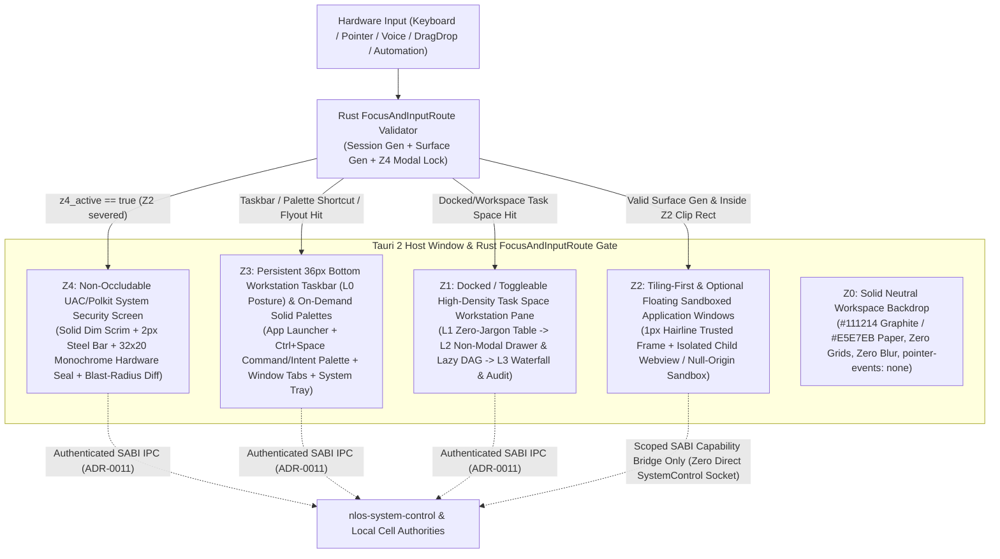

# ADR-0025：阶段 D 混合自然语言桌面合成层、L0–L3 渐进式披露、12 域显控同构与可信 UI 防伪边界

- 状态：`VERIFIED（2026-10-29 W74：维护者于 2026-10-26 初始批准，同日下达修订 1 [2026-10-26 W68-R1] 锁定 Graphite/Paper 中性工业工作站视觉与空间架构及修订 2 [2026-10-26 W68-R2] 确立 [UI-PARITY-001] 12 域显控同构、L0–L3 四级渐进式披露与六大工业级 SOTA 显示机制；经 W69–W74 全量落地 D-TOKENS-001 / D-IPC-001 / D-COMPOSITOR-001 / D-OMNIBAR-001 / D-TRUSTED-UI-001 / D-TASK-SPACE-001 / D-NOTIFY-SEARCH-001 / D-CONTROL-SETTINGS-001 / D-A11Y-I18N-001 / D-GUI-CAMPAIGN-001 / D-ROAD-001 并通过 W74 阶段 D 独立退出门终审 w74-stage-d-exit-gates.md [SATISFIED-WITH-BOUNDARIES, H4, P0=0] 实证闭环；原生 OS 内核级显示服务器替换与物理 macOS/Linux 触控硬件农场留归复审触发器边界）`
- 日期：2026-10-26（初版 `W68`；修订 1：`2026-10-26 W68-R1`；修订 2：`2026-10-26 W68-R2`；晋升 `VERIFIED`：`2026-10-29 W74`）
- 修订记录：
  - `初版（2026-10-26 W68）`：确立 `Z0–Z4` 五平面合成防伪模型、单一控制编译主干与同源双模投影存储。
  - `修订 1（2026-10-26 W68-R1）`：经维护者检视初版视觉原型后显式裁定，废止初版照搬营销站点的“黑底发光青蓝 + 液态毛玻璃 + 顶置常驻大输入框 + 悬浮胶囊 Dock + 彩虹胶囊”方案，全面切换为 **中性工业工作站（Neutral Industrial Workstation：`Graphite Workstation` 默认深色 + `Paper Workstation` 内置浅色，Windows 11 Pro / Zed IDE 工程标准）**、**平铺优先多窗口工作区 + `36px` 底部紧凑任务栏 + `Ctrl+Space` 按需唤起命令/意图面板** 以及 **UAC / Polkit 工作站级实心 `Z4` 系统安全确认屏（含凹陷硬件风 `32×20` 单色精密防伪印章）**；`v0.5` 全部五平面安全与控制不变量 100% 保持不变。
  - `修订 2（2026-10-26 W68-R2）`：经维护者于 `W69` 编码启动前作出的显控对称与工业级显示架构裁定，在 100% 保持 `W68-R1` 反 AI 塑料感实心工作站纪律不变的前提下：（1）确立阶段 D 桌面设计不变量 **`[UI-PARITY-001]`（12 域显控同构三大铁律：无盲控、无哑看、五大法定不可篡改禁区）**，一次性消除前后端代码盘点发现的四类显控失衡并将枚举契约扩充为 `IPC-D1..D8`；（2）废止粗糙的 `Standard ↔ Diagnostic` 全局二元模式断崖（`store/view-mode.ts`），升级为 **`L0 → L1 → L2 → L3` 四级渐进式披露与视口窗口化惰性取数模型（`store/disclosure-model.ts`）**；（3）锚定 `2026-10-26` 查询的对标 **CNCF Headlamp、Dagster、Temporal Web UI、HashiCorp Nomad、Sysinternals Process Explorer / System Informer、Perfetto UI + Terraform Plan Preview** 六大工业级 SOTA 显示机制。
- Owner：`desktop/`（Tauri 2 混合桌面壳与合成器） / `nlos-system-control` / `nlos-application` / `nlos-search` / 阶段 D 工作包（`D-TOKENS-KIT`、`D-IPC-ENUM`、`D-COMPOSITOR-WM`、`D-OMNIBAR-MULTIMODAL`、`D-TASK-SPACE-DAG`、`D-TRUSTED-UI`、`D-NOTIFY-SEARCH-OFFLINE`、`D-CONTROL-SETTINGS-A11Y`）
- 关联 Requirement：[06-架构设计总纲-v0.5.md](../../design/06-架构设计总纲-v0.5.md) §24 `[NL-COMPILE-001]`、`[NL-PROPOSE-001]`、`[NL-AMBIG-001]`、`[NL-BIND-001]`、`[PLAN-DAG-001]`、`[PLAN-LAZY-001]`、`[PLAN-CHANGE-001]`、`[PLAN-OVERRIDE-001]`、`[TUI-CONSENT-001]`、`[TUI-CHOOSER-001]`、`[TUI-EXT-001]`、`[RCPT-EFFECT-001]`、`[RCPT-UNDO-001]`、`[RCPT-PARTIAL-001]`；§25 `[TASK-SPACE-001]`、`[TASK-STATE-001]`、`[TASK-VIS-001]`、`[TASK-NOTIFY-001]`、`[TASK-REOPEN-001]`、`[TASK-STATE-002]`、`[CTRL-PARITY-001]`、`[CTRL-HIER-001]`、`[CTRL-PRIORITY-001]`、`[CTRL-SAFETY-001]`、`[CTRL-PLAN-001]`、`[CTRL-RECOVERY-001]`、`[DUI-LAUNCH-001]`、`[DUI-CONTROL-001]`、`[DUI-WINDOW-001]`、`[DUI-INPUT-001]`、`[DUI-CHOOSER-001]`、`[DUI-ASSOC-001]`、`[DUI-CLIP-001]`、`[DUI-NOTIFY-001]`、`[DUI-SESSION-001]`、`[DUI-SETTINGS-001]`、`[DUI-OFFLINE-001]`；§14/§19 `[CONS-DECL-001]`、`[CONS-CTRL-001]`；§28.4 `[ROAD-D-001]`
- 关联 ADR 与设计文档：[ADR-0011](./0011-ipc-principal-auth-signature-passthrough.md)、[ADR-0013](./0013-cross-authority-verify-then-commit-contract.md)、[ADR-0014](./0014-schema-channel-freeze-v1-beta.md)、[ADR-0015](./0015-dual-layer-untrusted-execution-isolation.md)、[ADR-0016](./0016-task-plan-declaration-surface.md)、[ADR-0024](./0024-driver-provider-payload-codec-freeze.md)、[ADR-0026](./0026-cross-physical-host-transport-and-consensus-expansion.md)、[站点视觉设计系统 v10.6（仅适用于外部营销门户，桌面 OS 显式分叉）](../../site/DESIGN.md)、[阶段 D 权威进度单](../stage-d-progress.md)、[阶段 D 完整桌面视觉与交互规格](../../superpowers/specs/2026-10-26-stage-d-desktop-visual-and-ux-design.md)
- 复审触发器：以原生 OS 显示服务器合成器（Wayland Compositor / Windows DirectComposition / macOS SkyLight）替换 Tauri 2 宿主窗口内多 WebView 合成；引入第三方应用原生 GPU/Vulkan/wgpu 表面直通嵌入；阶段 E 跨设备多屏协同要求将 `FocusAndInputRoute` 与 `Z4` 安全确认层扩展至独立物理副屏或硬件安全显示通道

## 上下文

### 1. 阶段 B/C 开发者桌面壳基线与阶段 D 启动背景

在阶段 B 与阶段 C 前期（`W32-A..F`、`W33-F`、`W39-D`），仓库在 [`desktop/`](../../../desktop/README.md) 中交付了满足 `[TASK-SHELL-001]` 的最小可信开发者 Task Manager 外壳：

1. **真实控制面与字节级等价契约**：前端通过 Tauri 2 命令层（[`desktop/src-tauri/src/ipc.rs`](../../../desktop/src-tauri/src/ipc.rs)）全部经 [ADR-0011](./0011-ipc-principal-auth-signature-passthrough.md) challenge-response 认证通道（`dispatch_over_authenticated_socket`）连接真实 `nlos-system-control` 服务，所有回执统一投影为携带 `receipt_hex` 的 `ReceiptDto`（[`desktop/src-tauri/src/dto.rs`](../../../desktop/src-tauri/src/dto.rs)），并与 `system-control-cli` 保持逐字节一致（`W32-C`）。
2. **最小应用表面与生命周期切片**：`W32-F` 与 `W39-D` 落地了 `ApplicationAuthority` 声明表面只读呈现（`present_surfaces`，旧代际不进入可呈现集）及 [`SurfaceLifecycle`](../../../desktop/src-tauri/src/window_lifecycle.rs) 状态机（`REGISTERED → CREATED → PRESENTED ↔ HIDDEN → CLOSED`）。
3. **显式诚实边界**：当前 [`desktop/src/views/task-space/index.ts`](../../../desktop/src/views/task-space/index.ts) 仅是左侧 180px 标签栏下的开发者只读告警巡检面板，显式登记了三项 `TASK_SPACE_GAPS`（无全量任务/TaskGroup 枚举面、无 `application_id`/`plan_revision` 列表投影、无父级作用域下 Fiber/Operation 枚举面），且尚未包含窗口合成器、焦点与输入防伪路由、可信权限/选择器模态层、自然语言多模态命令面板、通知中心、非权威全局搜索 UI、四层设置域及工业级双主题体系。

根据维护者于 `2026-10-26` 作出的阶段治理裁定（**Ruling A4**）：阶段 C 保持 `IN_PROGRESS` 并扩充跨物理主机分布式扩展（[ADR-0026](./0026-cross-physical-host-transport-and-consensus-expansion.md)，`C-XHOST`），同时 **阶段 D：完整自然语言桌面**（[stage-d-progress.md](../stage-d-progress.md)）立即并行启动（`Stage D || C-XHOST`）。

在开启任何阶段 D 代码车道前，必须在架构层锁定三个不可逆的全局决策维度：
- **维度 A1（视觉设计系统与材质纪律）**：完整桌面采用何种色彩、表面材质、排版与明暗主题契约，才能彻底杜绝廉价“AI 科幻网页感”，满足每日连续 10 小时高密度生产力办公的零眩光可读性？
- **维度 A2（空间与窗口范式）**：自然语言意图触发、持续任务视图（`Task Space`）与多应用图形界面（`Window` / `Surface` + `ApplicationLauncher`）如何在有限屏幕像素中高效共存而不互相抢占工作区？
- **维度 A3（可信 UI 防伪边界、12 域显控同构与 `L0–L3` 渐进式披露）**：如何在同一 WebView/Tauri 技术栈上物理阻止不可信应用 `Surface` 伪造权限/预算提示或劫持焦点，同时消除“有控无显 / 有显无控”失衡，兼顾 `[ROAD-D-001]`（非开发者在 `L0/L1` 零内部架构行话下持续使用多应用与后台任务）与 `[CTRL-PLAN-001]`（高级用户在 `L2/L3` 按需下钻 `TaskPlan` / `TaskAttempt` / `ExecutionFiber` / `Cell` 并执行受控手动调度）？

### 2. 修订 1（`2026-10-26 W68-R1`）：为何桌面 OS 视觉必须与营销门户 `docs/site/DESIGN.md` 分叉及“反 AI 塑料感”禁令

在 `W68` 初版视觉原型审阅后，维护者下达 **`W68-R1` 修订裁定**，明确驳回初版“AI 生成式科幻仪表盘”观感，并锁定 **中性工业工作站（Neutral Industrial Workstation，对标 Windows 11 Pro / Zed IDE）** 方向：

1. **桌面 OS 与外部营销门户的职责分叉（Why Desktop OS Diverges from `docs/site/DESIGN.md`）**：
   - 外部架构门户网站（[`docs/site/DESIGN.md`](../../site/DESIGN.md)）服务于访客 **30 秒品牌叙事与高戏剧反差**，故可采用深海黑藏青底（`#030710`）、发光冰蓝标题（`#7FC8FF`）与折射玻璃效果；
   - 操作系统桌面则是用户**每天连续驻留 8–12 小时的主力生产工具**。将营销页的藏青发光边框、毛玻璃模糊与大留白卡片搬入桌面 OS，不仅制造严重的视觉眩光、色彩偏色与 GPU 合成税，更使系统沦为典型的“AI 生成科幻概念仪表盘”。因此，阶段 D 桌面 OS 显式与 `docs/site/DESIGN.md` 解耦，确立独立、克制、零眩光的中性工业工作站规范。

2. **架构级显式封禁的七类“AI 味（AI Smell）”反模式（Banned Anti-Patterns）**：
   - **禁止黑底发光青蓝科幻控制台风**：严禁 `#030710` + `#7FC8FF` 发光标题/外框，严禁背景 `48px/56px` 科技网格线，严禁环境径向发光色斑（radial glow blobs），严禁 `0 0 28px` 霓虹发光投影；
   - **禁止毛玻璃/液态玻璃炫技**：桌面面板、任务栏、窗口、弹出菜单与安全对话框**全面禁止 `backdrop-filter: blur(...)`**，一律采用 **100% 实心不透明中性表面（Solid Opaque Neutral Surfaces）** 配合锐利 `1px` 结构分割细线（hairline border）；
   - **禁止 SaaS 网页式卡片墙与顶置巨型 AI 输入框**：严禁居中双列大卡片网格（`max-w-7xl` 卡片流），严禁在屏幕顶部常驻展开巨型 AI Prompt Box 霸占纵向工作区；
   - **禁止大圆角与胶囊气泡**：严禁 `12px–16px` 大圆角卡片或浮夸胶囊气泡——全局强制 **`0px`（底部任务栏 / 平铺分割区）、`4px`（控件 / 输入框 / 按钮 / 标签页 / 命令面板）、最大 `6px`（可选浮动窗口 / 模态对话框）**；
   - **禁止卡通 Emoji**：UI 任何位置严禁出现彩色或字符 Emoji 图标，一律使用 `1.25px–1.5px` 线宽的单色几何 SVG 描边图标；
   - **禁止彩虹多色相状态徽章**：严禁琥珀/紫/橙/薄荷绿多色胶囊混排——常态统一使用中性单色排版 + 微型 `6px` 几何状态点，仅保留克制琥珀色（`#D97706`）严格用于“需用户介入确认/输入”，克制深绯红（`#DC2626`）严格用于“失败 / 不可逆高危警告”；
   - **禁止在默认普通用户视图暴露内部架构行话（`[ROAD-D-001]`）**：默认 `L0`（底栏环境态势微摘要）与 `L1`（标准工作站高密度表格）严禁出现 `Z1`、`TypedIntent`、`0x1F`、`Quota`、`ROAD-D-001`、`ADR-0011`、`TaskAttempt`、`ExecutionFiber`、`receipt_hex` 等内部架构词——结构化步骤里程碑、可折叠惰性子图与三水位资源条在 `L2`（非模态详情抽屉）按需展开，全部底层拓扑 ID、Attempt/Fiber 相位瀑布条、Cell 租约与 `receipt_hex` 仅在下钻至 **`L3`（深度诊断与原始审计层，`Ctrl/⌘ + Shift + E`）** 时渲染。

### 3. 修订 2（`2026-10-26 W68-R2`）：消除四类显控失衡与“二元模式断崖”

在 `W69` 实现波次启动前，交叉盘点 [`crates/nlos-system-control/src/control.rs`](../../../crates/nlos-system-control/src/control.rs)、[`desktop/src-tauri/src/lib.rs`](../../../desktop/src-tauri/src/lib.rs)、[`desktop/src/types.ts`](../../../desktop/src/types.ts) 与 [v0.5 §25.3–§25.4](../../design/06-架构设计总纲-v0.5.md) 暴露出两项必须在设计基线锁定的深层架构缺口：

1. **四类历史显控失衡（Four Display-vs-Control Asymmetries）**：
   - **有写无列（盲控，Blind Control without `List*`）**：现有写命令依赖手工输入 32 字符十六进制 ID 与 `expectedRevision`，缺乏 `ListWorkspaces`、`ListProcesses`、`ListResourceReservations`、`ListTopics`、`ListNotifications`、`ListCells` 等有界分页枚举为其提供 `target_id`、CAS 令牌与 `[CTRL-HIER-001]` 后代爆炸半径预览；
   - **后端已实现而 Tauri/前端漏接（Unwired Backend Capabilities）**：`ControlCommand::InspectSearch` 与 `InspectNotification` 已在 `control.rs` 实现且 `types.ts` 已含 `OutcomeDto` 分支，但 `lib.rs` `generate_handler![]` 未注册对应命令；`DisableApplication` 与 `UninstallApplication` 已在后端实现，但前端 `ControlActionInput` 漏接对应动作分支；
   - **无类型 `*-operation` 重载遮蔽 12 域边界（Untyped `targetIdHex` Overloading）**：前端 `ControlActionInput` 将 `pause/resume/cancel/kill/throttle/reclaim-operation` 全部压在无类型 `targetIdHex` 上，未能按 `ControlScope` 区分 `Task`、`TaskGroup`、`TaskAttempt`、`Process`、`ExecutionFiber`、`ResourceGroup`、`Topic`、`Operation` 与 `Cell`；
   - **哑看行与法定不可篡改禁区混淆（Orphan Display vs Statutory Locks）**：只读展示行未区分“尚缺控制接线”与 `v0.5` 规范明令禁止篡改的五大法定禁区（`0x1F` 搜索候选、`IRREVERSIBLE` 回执、已执行 `TaskNode`、人工宣称 `TaskAttempt` 提交、`Operation(EFFECT_UNKNOWN)` 人工改判）。
2. **全局二元开关的认知与取数断崖（Binary Switch Cliff）**：`W68-R1` 初设的 `Standard ↔ Diagnostic` 二元开关存在明显断崖——普通办公与重度排障之间缺少“不离开表格上下文即可查看单任务子图、资源三水位与爆炸半径”的中间层（`L2`），且全局切入诊断模式若无视口惰性门控极易诱发全树 `N+1` 轮询风暴。故维护者于 `2026-10-26` 裁定引入 **`[UI-PARITY-001]` 12 域显控同构不变量** 与对标六大工业级 SOTA 系统（查询日期：`2026-10-26`）的 **`L0–L3` 四级渐进式披露模型**。

### 4. 不可破坏的规范性约束（Normative Constraints）

| Requirement ID | 权威章节 | 阶段 D 桌面架构硬约束 |
|---|---|---|
| `[ROAD-D-001]` | §28.4 | **阶段 D 退出门**：非开发者无需理解 Agent 编排即可持续使用多个 `Application` 和后台 `Task`。默认 `L0/L1` 界面严禁向普通用户暴露 `Z1`、`TypedIntent`、`0x1F`、`Quota`、`TaskNode`、`ExecutionFiber`、`CAS generation` 或 32B hex ID。 |
| `[CTRL-PARITY-001]` | §25.3 | 自然语言命令、桌面 GUI 按钮、CLI 与结构化 API 必须编译为语义等价的 `ControlCommand`，经过完全相同的 `Capability`、`generation` CAS、resource/effect fence 与 `ControlReceipt` 路径（派生阶段 D 桌面显控同构设计契约 **`[UI-PARITY-001]`**）。 |
| `[CTRL-PLAN-001]` | §25.3 | `Task Space` 与系统控制台必须提供从零行话自动视图（`L0/L1`）到单对象结构化检视抽屉（`L2`）再到全拓扑深度诊断层（`L3`，`Ctrl/⌘ + Shift + E`）的无损渐进下钻，覆盖 `TaskPlan`、`TaskNode`、`TaskAttempt`、`Process`/`AgentInstance`/`ExecutionFiber`、`ResourceGroup`、`Topic`、`Operation` 与 `Cell` 的授权手动干预。 |
| `[PLAN-OVERRIDE-001]` | §24.1.1 | 自动规划与图形化手工改计划（`[PLAN-CHANGE-001]`）必须收敛到同一 `TaskPlan`/`TaskNode` schema、`AdmissionPlan`、`Capability` 与 `Receipt`，禁止存在绕过准入的“GUI 管理员拖拽后门”。 |
| `[TUI-CONSENT-001]` | §24.2 | 权限与成本确认必须由 `Trusted UI` 渲染真实的 `Application`/`Principal`、目标、purpose、持续时间与成本上界；不可信应用绝不能伪造系统提示。 |
| `[TUI-CHOOSER-001]` / `[DUI-CHOOSER-001]` | §24.2 / §25.4 | Open/Save/Share 文件与 `Artifact` 选择器可发现用户可见对象，但只能向 `Application` 返回用户显式选定后的 scoped `Artifact` `Capability`（`ChooserGrant`），严禁泄露宿主全局路径或整个用户目录。 |
| `[DUI-LAUNCH-001]` | §25.4 | `ApplicationLauncher` 必须按 `ApplicationId` / `InstallationId` 激活应用，不得把 `PackageId` 或临时 `ProcessId` 当作应用身份。 |
| `[DUI-CONTROL-001]` | §25.4 | 桌面必须提供可信的 `SystemControlCenter` / `TaskManagerSurface` / `ResourceMonitorSurface`，使用 §25.3 `ControlCommand`/`Receipt`，严禁通过私有 UI RPC 绕过系统控制协议。 |
| `[DUI-WINDOW-001]` | §25.4 | `Surface` / `Window` 必须绑定 `Application` owner、`DesktopSession`、visibility、`FocusAndInputRoute`、accessibility tree 与 `generation`；过期代际（stale `Surface`）不得接收任何新输入。 |
| `[DUI-INPUT-001]` | §25.4 | 焦点、键盘、指针、语音与自动化输入必须经 `Trusted UI` 路由并标明来源；不可信 `Application` 不得伪造系统级输入或权限界面。 |
| `[DUI-CLIP-001]` | §25.4 | 剪贴板（`ClipboardItem`）与拖拽（`DragDropTransfer`）必须绑定 `content_type`、`source_application`、`taint`、`expiry` 与 `user_gesture`；敏感内容跨应用传递必须经策略或用户显式同意。 |
| `[DUI-NOTIFY-001]` | §25.4 | 通知交互动作（`NotificationAction`）必须绑定原 `Notification` / `Application` / `Task` 与一次性 `ActionToken`，防止其他应用伪造响应；后台状态变化不依赖聊天窗口保持打开（`[TASK-NOTIFY-001]`）。 |
| `[DUI-SESSION-001]` / `[DUI-SETTINGS-001]` | §25.4 | 多用户 `UserProfile`、`Workspace`、`DesktopSession`、`KeychainReference` 与应用数据容器隔离；锁屏/切换用户使旧会话输入与能力代际失效；设置按 `system/user/workspace/application` 四层 CAS + watch 管理，Keychain 仅返回句柄引用。 |
| `[DUI-OFFLINE-001]` | §25.4 | `LOCAL_SINGLE_NODE` 桌面离线时必须完整可用（Launcher、本地应用、Artifact、Task、Settings、本地 Search、Notification 历史）；仅依赖远程网络/远端 Cell 的动作单独标记 `WAITING_NETWORK` / `UNAVAILABLE`，严禁因断网锁死桌面。 |
| `[CONS-CTRL-001]` | §19 / §14 | 全局搜索基于只读非权威查询面（[`nlos-search`](../../../crates/nlos-search/src/lib.rs) `SearchUseRestrictions::NON_AUTHORITATIVE`，位掩码 `0x1F`），其候选命中严禁直接驱动 `Capability`、账本、任务提交、包更新或不可逆副作用，必须先回跳权威对象重验（`[TASK-SNAPSHOT-003]`）。 |

## 候选

### 维度 A1：桌面视觉设计系统与表面材质纪律

| 候选方案 | 核心特征 | 结论与理由 |
|---|---|---|
| **A1-a：中性工业工作站双主题系统（`Graphite Workstation` 默认深色 + `Paper Workstation` 内置浅色，Windows 11 Pro / Zed IDE 级）** | 100% 实心不透明中性灰阶表面（深色 `#111214 / #18191C / #1E2024 / #23252A`，浅色 `#E5E7EB / #FFFFFF / #F3F4F6`）、零 `backdrop-filter: blur(...)`、`1px` 结构分割细线、单一克制工程蓝功能色（`#2563EB / #3B82F6` 与浅色 `#1D4ED8`，仅用于焦点环、主按钮与 `2px` 激活指示条）、`0px / 4px / 6px` 工业圆角、`1.25px–1.5px` 单色几何 SVG 图标、双极克制警示色（琥珀 `#D97706` / 深绯红 `#DC2626`） | **采纳（W68-R1 锁定，W68-R2 100% 保持）**：消除眩光、偏色与廉价 AI 科幻感，完美契合每日 10 小时生产力驻留；中性底盘使 `Z4` 系统安全提示与双极风险信号具备最高信噪比。 |
| **A1-b：照搬营销站点 `DESIGN.md` v10.6 Glacier 液态玻璃与发光冰蓝深海色（初版 `W68` 候选）** | `#030710` 藏青黑底、`#7FC8FF` 发光标题与光框、`backdrop-filter: blur(16px)` 高透液态玻璃、`0 0 28px` 霓虹阴影与多色相状态胶囊 | **否决（W68-R1 显式驳回）**：原型实测呈现强烈“AI 生成科幻控制台”塑料感，毛玻璃叠加在密集文本多窗口上造成干扰眩光，违背严肃桌面操作系统人机工效学。 |
| **A1-c：多彩渐变 SaaS Web 组件库或仅提供单一硬编码深色主题** | 引入 `12px–16px` 大圆角多彩卡片、渐变按钮或缺乏日间浅色模式 | **否决**：Web 仪表盘模板味浓重，稀释安全警告语义，且缺乏浅色工作站模式无法覆盖强光环境与散光用户可读性。 |

### 维度 A2：桌面空间组织与窗口交互范式

| 候选方案 | 核心特征 | 结论与理由 |
|---|---|---|
| **A2-a：平铺优先多窗口工作站 + 停靠/可切换高密度 `Task Space` + `36px` 底部紧凑任务栏 + 按需唤起命令/意图面板（`Ctrl+Space`）** | 默认以 `4px` 锐利间隙边对边平铺真实应用窗口（`Z2`）与 Zed 式停靠/可切换高密度 `Task Space` 表格面板（`Z1`），支持双栏、三栏工作站分屏、四象限磁吸与可选 `6px` 浮动窗口；底部 `36px` 贴边实心工作站任务栏（`Z3`）承载应用启动器、`26px` 命令触发框（按需唤起居中 `4px` 圆角实心 Command & Intent Palette，默认隐藏不占屏）、扁平窗口标签页与系统托盘 | **采纳（W68-R1 锁定，W68-R2 100% 保持）**：将纵向可用工作区最大化至 `calc(100vh - 36px)`，既让多应用窗口真正作为桌面主角高效并排协作，又让自然语言意图与后台任务以零打扰、高密度工作站方式随叫随到。 |
| **A2-b：常驻顶置巨型 Omni-Bar + 居中双列大圆角卡片墙 + 底部 56px 悬浮毛玻璃胶囊 Dock（初版 `W68` 候选）** | 顶栏 + 常驻展开大输入框 + 底部悬浮胶囊 Dock 同时挤压视口，中央摆放 `max-w-7xl` 双列圆角任务卡片 | **否决（W68-R1 显式驳回）**：严重浪费屏幕纵向像素，形态酷似套壳 AI SaaS 网页而非真实多窗口操作系统。 |
| **A2-c：纯对话流单窗口聊天画布或传统桌面图标墙外挂窄边栏 Copilot** | 退化为单一聊天客户端，或把跨应用任务与预算准入塞入侧边栏附属插件 | **否决**：违反 §25.4 完整桌面系统对象契约及 `[TASK-NOTIFY-001]`“不依赖原聊天窗口保持打开”的核心要求。 |

### 维度 A3：可信 UI 防伪边界、12 域显控同构与渐进式披露架构

| 候选方案 | 核心特征 | 结论与理由 |
|---|---|---|
| **A3-a：UAC / Polkit 工作站级不可遮挡实心安全确认屏（`Z4`）+ 同源 `L0–L3` 四级渐进式披露（`disclosure-model.ts`）+ `[UI-PARITY-001]` 12 域显控同构 + 六大工业级 SOTA 显示机制** | `Z4` 独占最高平面（`rgba(10, 11, 13, 0.78)` 实心暗幕、`6px` 实心对话框、`2px` 钢蓝顶条、凹陷硬件风 `32×20` 单色精密 Gerono 示波印章、键值规格表、`+ / ~ / -` 爆炸半径预览与 `350ms` 防劫持门）并物理切断 `Z2` 输入；单一 `DesktopProjectionStore` 按 `L0`（底栏微摘要）→ `L1`（零行话表格）→ `L2`（单对象非模态抽屉 + 可折叠超节点 DAG + 三水位子弹微条）→ `L3`（Attempt/Fiber 瀑布条 + 12 域作业树 + `receipt_hex`）按视口游标惰性取数，并前置剪枝合法动作或展示法定禁改锁 | **采纳（W68-R2 修订升级定案）**：同时根除伪造权限框、消除四类显控失衡、抚平二元模式认知断崖，并将 IPC 开销严格约束在 `O(visible_rows)`。 |
| **A3-b：全局二元 `Standard ↔ Diagnostic` 一刀切开关（`W68-R1` 过渡方案，`view-mode.ts`）** | 仅提供全屏标准表格与全量诊断画布两档布尔切换，未定义单对象非模态 `L2` 抽屉与按级视口惰性取数边界 | **修订取代（W68-R2 升级并入 A3-a）**：二元跳变跨度过大且缺少 12 域显控对称门禁，由 `L0–L3` 四级模型平滑吸收。 |
| **A3-c：同一 DOM 树内普通 CSS `z-index` 模态框 + 直接内联挂载应用脚本** | 应用 `Surface` 与系统壳共享同一 WebView 文档上下文，仅靠 CSS `z-index: 9999` 弹出权限框 | **否决**：严重违反 `[TUI-CONSENT-001]`、`[DUI-INPUT-001]` 与 [ADR-0015](./0015-dual-layer-untrusted-execution-isolation.md)；应用可通过 DOM 注入、全屏遮盖或焦点抢占完全伪造系统级授权框。 |
| **A3-d：拆分为“普通用户桌面”与“专家 Task Manager”两个独立进程/状态库** | 维护两套独立前端代码与各自轮询状态缓存 | **否决**：制造前端双主状态撕裂，用户从任务行下钻诊断透视时上下文丢失，维护成本翻倍。 |

## 评价标准

1. **防伪与隔离安全性（TCB Boundary）**：不可信或半可信 `Application` `Surface` 是否在几何边界、DOM/Origin 边界与输入事件流上均无法伪造 `Trusted UI`（`Z3`/`Z4`）或诱骗点击（Clickjacking）？
2. **控制面严格等价与 12 域显控同构（Control & UI Parity）**：所有桌面交互是否 100% 经由认证 SABI `ControlCommand` / `TypedIntent` 通道，且全部 12 个资源与控制域满足“无盲控、无哑看、法定禁区物理锁定”（`[CTRL-PARITY-001]`、`[UI-PARITY-001]`）？
3. **长时工作站人机工效、平滑四级披露与有界取数（Workstation Ergonomics & `L0–L3` LOD）**：桌面材质是否 100% 实心零眩光、默认 `L0/L1` 零内部行话（`[ROAD-D-001]`），并能经 `L2` 非模态抽屉平滑过渡至 `L3` 全拓扑诊断（`[CTRL-PLAN-001]`），同时保持 IPC 负载严格有界于当前视口可见行 `O(visible_rows)`？
4. **离线自治与跨主机容错（Offline & Multi-Cell Resilience）**：断网或远端物理机 `Cell` 分区（[ADR-0026](./0026-cross-physical-host-transport-and-consensus-expansion.md)）时，本地桌面是否零阻塞运行并诚实标注局部受限状态与本地可证明租约水位（`[DUI-OFFLINE-001]`）？
5. **跨平台一致性与退出成本**：方案能否在 Windows、macOS、Linux 三大桌面宿主上依托 Tauri 2 稳定交付，并为未来替换底层原生显示合成器保留清晰接口？

## 决定

### 决定 1：五平面 Z 轴合成隔离（5-Plane Z-Axis Compositor Isolation）与工作站输入防伪路由

阶段 D 桌面壳（`llmos-desktop`）建立由 Rust 宿主合成控制器（`DesktopCompositor`）与特权壳层 WebView（`llmos-shell`）协同强制执行的 **五平面 Z 轴工作站合成模型（`Z0 → Z4`）**：

各平面的职责与强制隔离机制定义如下：

1. **五平面职责划分（工作站空间几何）**：
   - **`Z0` Solid Neutral Workspace Backdrop（纯色中性工作区底板层）**：纯实心 `#111214`（Graphite）或 `#E5E7EB`（Paper）工作区底布，仅在平铺窗口 `4px` 分割间隙或无最大化窗口时露出；`pointer-events: none`，零网格线、零环境光斑、零背景动画。
   - **`Z1` Docked / Toggleable `Task Space` Workstation Pane（高密度停靠/工作区任务面板层）**：运行于系统特权 `llmos-shell` 上下文中，作为 Zed IDE 风格的高密度停靠工作站面板（或一键展开的全工作区标签视图）与 `Z2` 应用窗口协同平铺，按 `L1 → L2 → L3` 渐进呈现活跃、待确认、暂停、完成与争议中的后台 `Task`（`[TASK-SPACE-001]`），严禁做成松散的网页双列大圆角卡片。
   - **`Z2` Tiling-First Sandboxed Application `Window` & `Surface` Workspace（平铺优先受控应用窗口层）**：默认按 `4px` 锐利间隙边对边平铺（支持双栏对半、三栏 IDE 工作站分割、四象限磁吸、工作区安全最大化，以及最大 `6px` 圆角的可选浮动窗口模式）。每个窗口由**外层可信系统窗框**（`WindowFrame`：由 `llmos-shell` 以 `100%` 实心 `#1E2024` / `#F3F4F6` 绘制 `30px` 紧凑标题栏、单色几何应用图标、平铺/浮动控制与关闭按钮）与**内层沙箱隔离表面视口**（`SurfaceViewport`：承载应用声明 `entry_name` 载荷）组成。
   - **`Z3` Bottom Compact Workstation Taskbar & On-Demand Solid Palettes（常驻 `36px` 底部紧凑工作站任务栏与按需实心浮层）**：底部贴边 `36px` 高、`0px` 圆角、`100%` 实心 `#1E2024` / `#F3F4F6` 任务栏（顶部 `1px` 结构分割线），承载 `L0` 环境态势微摘要，左起依次为：按 `(ApplicationId, InstallationId)` 激活的几何应用启动器（`[DUI-LAUNCH-001]`）、紧凑 `26px` 高命令/自然语言触发槽（点击或按 `Ctrl/⌘ + Space` 在屏幕中央按需唤起 `4px` 圆角实心 **Command & Intent Palette**，默认隐藏绝不霸屏）、带 `2px` 底部激活条的扁平矩形运行/固定窗口标签栏，以及右侧系统托盘（平铺布局选择器、主机/集群连接指示器 `[DUI-OFFLINE-001]`、`L0–L3` 披露层级指示与 `L3` 诊断开关 `Ctrl+Shift+E`、`Graphite/Paper` 主题切换、硬件麦克风/摄像头占用灯、携带 `ActionToken` 的通知抽屉触发器与等宽时钟）。`Z2` 窗口安全区严格夹紧在 `[y_min = 0, y_max = viewport_height - 36px]`，永远无法遮盖底部 `Z3` 系统任务栏。
   - **`Z4` Non-Occludable UAC / Polkit System Security Screen（不可遮挡工作站级系统安全确认屏）**：系统最高特权平面。凡涉及权限授予（`[TUI-CONSENT-001]`）、超额预算/高风险 `ActionProposal` 批准（`[NL-PROPOSE-001]`）、高风险歧义澄清（`[NL-AMBIG-001]`）、文件/Artifact 选择器（`ChooserGrant`，`[DUI-CHOOSER-001]`）、跨应用污染剪贴板/拖拽放行（`[DUI-CLIP-001]`）、不可逆或级联控制动作二次确认（`[CTRL-SAFETY-001]`，含 `+ / ~ / -` 爆炸半径预览）及会话锁屏（`DesktopSession=LOCKED`），一律且只能在 `Z4` 渲染。

2. **WebView / Tauri 2 双层容器隔离与防伪机制（物理阻断 `Z2 → Z3/Z4` 伪造与焦点劫持）**：
   - **源隔离与权限剥离**：系统特权壳 `llmos-shell` 独占 Tauri 主 WebView 与 `ADR-0011` 认证 IPC 命令表；第三方/用户态 `Application` 的 `Surface` 严禁注入 `llmos-shell` DOM。其内容仅允许运行于两类受限载体之一：
     - **标准隔离载体（Tauri 2 Multi-WebView 子表面）**：由宿主通过 `tauri::WebviewBuilder` 创建独立子 WebView，绑定唯一隔离源 `nlos-surface://<application_id>.<installation_generation>.localhost`，在 Tauri Capability 配置中剥离全部 `nlos-system-control` 管理命令，仅开放经宿主中介校验的受限应用通道。Rust 合成器实时将其物理像素视口裁剪在 `[y_min = 0, y_max = viewport_height - 36px]` 及对应 `Z2` 窗口内框矩形内；当 `Z4` 激活或 `Z3` 命令面板/托盘浮层覆盖该矩形时，Rust 合成器立即调用宿主子视图隐藏/冻结（`hide()` / 静态位图占位），从原生合成顺序上根除子 WebView 压盖 `Z3`/`Z4` 的可能。
     - **轻量纯声明式载体（Null-Origin CSP Sandboxed Frame）**：对于无独立原生子视图需求的纯静态/受限小面板表面，允许在 `Z2` 窗框内使用 `<iframe sandbox="allow-scripts" csp="default-src 'none'; script-src 'unsafe-inline'; style-src 'unsafe-inline'; img-src blob: data:;">`（显式禁止 `allow-same-origin`、`allow-top-navigation`、`allow-popups`、`allow-modals`），外层容器强制 `overflow: clip; contain: strict; isolation: isolate`，通过受 `SurfaceId + generation` 围栏校验的单一 `MessageChannel` 通信。
   - **UAC / Polkit 工作站级防伪仪式（Workstation Anti-Spoofing Ceremony）**：`Z4` 激活时，全视口覆盖不透明暗化幕布 `rgba(10, 11, 13, 0.78)`（零模糊炫光），中央呈现 `6px` 圆角实心安全对话框（`#23252A` / `#FFFFFF`），顶部带 **`2px` 实心钢蓝安全横梁**、内嵌硬件仪器风格的 **`32×20` 凹陷单色精密校验印章**（`1px` 数学 Gerono 双纽线示波轨迹，锐利单色无发光）、当前 `UserProfile` 私密防钓鱼标识（不可信应用无法读取）以及结构化键值规格表（请求应用、权限范围、资源上限、可撤销等级；`L3` 披露层可展开核对 `ApplicationId`、`PrincipalId` 与 `manifest_digest`）。任何在 `Z2` 内部伪造的弹窗既无法突破 `Z2` 窗口内框与系统窗框标题栏，也无法联动 `Z3` 底部任务栏安全锁态或获知用户防钓鱼标识。
   - **输入路由与代际围栏（`FocusAndInputRoute`，`[DUI-INPUT-001]` / `[DUI-WINDOW-001]`）**：Rust 后端维护单一权威焦点路由表 `(focused_surface_id, focused_surface_generation, desktop_session_generation, z4_modal_lock)`。
     - 当 `z4_modal_lock == true` 时，宿主层直接切断发往所有 `Z2` 表面的键盘、指针、语音与自动化事件转发，并在 `Z4` 首次挂载后的 **350ms 安全武装窗口（Input Arming Guard）** 内忽略确认键点击/回车，彻底防御时间差点击劫持（Clickjacking / Keystroke Race）。
     - 当应用升级推进 `current_installation_generation` 或会话进入 `LOCKED`/`SUSPENDED` 时，旧代际 `Surface` 立即标记为 `STALE_GENERATION`：前端将其视觉降饱和灰化并叠加实心只读提示条，后端输入路由器对一切指向旧代际的事件直接返回类型化拒绝，绝不投递。

### 决定 2：单一类型化控制与按需唤起命令/意图编译主干（Single Typed Control & Summonable Command/Intent Spine）

阶段 D 桌面严格遵守 `[CTRL-PARITY-001]`、`[DUI-CONTROL-001]` 与 `[PLAN-OVERRIDE-001]`，**零私有 UI RPC 后门、零前端自造状态变更、零无类型 `target_id` 重载**：

1. **GUI 控制动作携带显式 `ControlScope` 并逐字节等价于 CLI / API**：桌面中无论是 `Task Space` 表格行上的“暂停/取消/重试”按钮、`L2` 抽屉中的 `TaskNode` 手工调整与 `Materialize/Evict`、`TaskManagerSurface` 12 域树中的进程/协程/通道/Cell 干预、`NotificationAction` 快捷响应，还是 `SystemControlCenter` 与 `SettingsDomain` 修改，全部在桥接层显式绑定类型化 `ControlScope`（杜绝无类型 `targetIdHex` 混用），编译为标准 §25.3 `ControlCommand`（或 §24.1 `TaskPlan` 修订提议），携带新生成的 `control_command_id`、会话 `Principal` 签名与权威读回的 `expected_generation_or_revision`，经唯一 `ADR-0011` 认证 socket/named-pipe 派发，返回携带 `receipt_hex` 的 `ControlReceipt`。
2. **按需唤起命令与自然语言编译链（`Ctrl/⌘ + Space` Command & Intent Palette）**：点击底部 `36px` 任务栏中的紧凑 `26px` 触发框或按下 `Ctrl/⌘ + Space` 唤起居中实心 `4px` 圆角命令面板，接收文本、受控语音转写、截图或拖入文件引用后，调用 NL Compiler 生成版本化 `TypedIntent`（`[NL-COMPILE-001]`）并在面板内实时渲染结构化意图摘要行（`L1` 仅展示白话目标应用、操作范围、资源上限与可撤销性；`L2` 展示歧义对比与结构化参数；`L3` 额外展示 schema、`compiler_digest` 与目标 `installation_generation`）：
   - 若存在高风险歧义（`unresolved_ambiguities` 非空，`[NL-AMBIG-001]`），在提交执行前强制展开紧凑并列澄清选项表，严禁静默选择更高权限或更高预算分支；
   - 若编译产物涉及新权限请求、资源预留或不可逆副作用，生成 `ActionProposal` / `TaskPlan` 摘要并提升至 `Z4` 请求用户签发 `AuthorizationReceipt`（`[NL-PROPOSE-001]`、`[NL-BIND-001]`）；
   - 在已获有效授权与配额范围内的纯局部计划调整（如未执行节点的非扩权排序），走受限 `ControlCommand`（`[PLAN-CHANGE-001]`）。
3. **全局搜索的严格非权威隔离与法定只读锁（`[CONS-CTRL-001]`）**：`Ctrl/⌘ + K` 搜索面板只调用 [`nlos-search`](../../../crates/nlos-search/src/lib.rs) 只读查询面（并补齐 Tauri `inspect_search` 接线），前端解码层在代码级强制校验返回信封携带 `SearchUseRestrictions::NON_AUTHORITATIVE`（位掩码 `0x1F`，不匹配立即 fail-closed 丢弃）。`L1` 展示清晰无行话提示（`候选搜索结果 · 回车打开原记录核实`），`L3` 显式展示 `NON_AUTHORITATIVE · mask=0x1F`、一致性等级与分片明细；依 `[UI-PARITY-001]` 法定禁区铁律，搜索结果物理移除一切写操作按钮，唯一允许动作是 `JumpToAuthoritativeObject`（调用权威 `Inspect*` 完成快照重验后定位打开对应实体，`[TASK-SNAPSHOT-003]`）。

### 决定 3：`Graphite / Paper` 中性工业工作站双主题契约与无障碍纪律

桌面视觉系统建立为完全独立于外部营销站点的 `--nlos-*` CSS 自定义属性契约（完整 Token 表见[阶段 D 完整桌面视觉与交互规格 §1](../../superpowers/specs/2026-10-26-stage-d-desktop-visual-and-ux-design.md)）：

1. **双主题内建与 100% 实心表面纪律**：
   - **`Graphite Workstation`（默认深色，`[data-nlos-theme="graphite-workstation"]`）**：工作区底板 `#111214`、窗口与表格画布 `#18191C`、面板头/标题栏/`36px` 任务栏 `#1E2024`、弹出菜单/命令面板/`Z4` 对话框 `#23252A`、悬停 `#2A2D33`、结构细线 `1px solid #2E3138`、焦点窗口边框 `1px solid #4B515D`、主文本 `#ECEDEE`、次级文本 `#9DA3AE`、弱化辅助文本 `#6B7280`、单一克制工程蓝功能色 `#2563EB` / `#3B82F6`。
   - **`Paper Workstation`（内建浅色，`[data-nlos-theme="paper-workstation"]`）**：工作区底板 `#E5E7EB`、窗口与表格画布 `#FFFFFF`、面板头/标题栏/`36px` 任务栏 `#F3F4F6`、悬停 `#EAECEF`、结构细线 `1px solid #D1D5DB`、焦点窗口边框 `1px solid #9CA3AF`、主文本 `#111827`、次级文本 `#4B5563`、弱化辅助文本 `#6B7280`、单一工程蓝功能色 `#1D4ED8`。
   - 主题状态持久化于 `SettingsDomain`（`user.appearance.theme = "graphite-workstation" | "paper-workstation" | "system"`），通过根节点 `data-nlos-theme` 无闪烁切换。
2. **严格的圆角、图标与语义色收敛规则**：
   - **单一强调色边界**：工程蓝（`#2563EB` / `#3B82F6` / `#1D4ED8`）**仅允许用于键盘无障碍焦点环、主提交按钮与 `2px` 激活标签/安全横梁**，严禁用于发光外框或彩色大标题。
   - **三档工业圆角**：任务栏与平铺面板分割强制 `0px`；按钮、输入框、标签页与命令面板强制 `4px`；可选浮动窗口与 `Z4` 对话框上限 `6px`，全局严禁 `> 6px` 大圆角与胶囊气泡。
   - **单色几何图标与双极警示色**：全局仅允许 `1.25px–1.5px` 单色几何 SVG 线性图标（零 Emoji）；常规状态一律使用单色排版配 `6px` 几何符号，仅将克制琥珀色（`#D97706`）严格保留给“需用户介入处理”，将克制深绯红（`#DC2626`）严格保留给“失败 / 不可逆高危警告”。
   - **工程等宽排版**：数字指标、时间、资源读数统一启用 `tabular-nums`，`L2/L3` 披露层下的标识符与回执摘要等宽字号下限严格 `>= 12px`。
3. **无障碍兜底**：桌面原生即为 100% 不透明实心表面（天然满足 `prefers-reduced-transparency: reduce` 零退化需求）；原生支持 `prefers-reduced-motion: reduce`（一切过渡与 `Z4` `32×20` 示波印章自动定格为静态高对比帧），双主题正文与交互控件对比度均满足 `WCAG 2.2 AA`（正文 `>= 4.5:1`，UI 边界与几何状态符号 `>= 3:1`）。

### 决定 4：`L0–L3` 四级渐进式披露、`[UI-PARITY-001]` 12 域显控同构与六大工业级 SOTA 显示机制（`W68-R2` 修订裁定）

为消除四类显控失衡并取代粗糙的 `Standard ↔ Diagnostic` 二元开关，阶段 D 确立 **`[UI-PARITY-001]` 12 域显控同构不变量** 与 **`L0 → L1 → L2 → L3` 四级渐进式披露及视口按需惰性取数模型**（完整矩阵与交互规格见[阶段 D 完整桌面视觉与交互规格 §2A、§3.2、§3.7、§4.2](../../superpowers/specs/2026-10-26-stage-d-desktop-visual-and-ux-design.md)）：

1. **`[UI-PARITY-001]` 显控同构三大铁律（Three Laws of Display-Control Symmetry）**：
   - **铁律一：无盲控（No Blind Control）**：UI 暴露的每一个可变状态 `ControlCommand` **MUST** 以有界游标分页 `List*` + `Inspect*` 只读投影为前置支撑（见 `IPC-D1..D8`），由权威读侧直接供给目标实体身份、CAS 期望令牌（`expected_generation_or_revision`）与 `[CTRL-HIER-001]` 后代爆炸半径预检，彻底消灭 `L0–L2` 中的裸十六进制 ID 手填框（仅 `L3` 原始调试探针保留按 ID 直查）。
   - **铁律二：无哑看（No Orphan Display）**：`L0–L3` 渲染的每一行资源记录 **MUST** 在挂载前计算 `(object.state ∩ caller_capability)` 允许的精确合法 `ControlCommand` 动词集，要么直接挂载对应受控操作按钮，要么显式展示单色**法定只读 / 不可篡改原因锁标（Statutory Lock Reason）**，严禁出现语义不明的“无按钮死行”或点击后才报状态非法的伪激活按钮。
   - **铁律三：法定不可篡改禁区（Statutory Non-Tamperable Locks）**：严格对齐 `v0.5` 规范红线，对五类对象实施 UI 物理级写按钮剔除与原因明示：
     1. `0x1F` 非权威搜索命中（`[CONS-CTRL-001]`）→ **仅限** `JumpToAuthoritativeObject`（触发 `Inspect*` 重验），**零**写操作按钮；
     2. `IRREVERSIBLE` `ActionReceipt`（`[RCPT-UNDO-001]`）→ 物理省略 `Undo`，**仅限** `查看操作与效果凭证（View Effect Proof）`；
     3. `COMPLETED / ACTIVE` 历史或执行中 `TaskNode`（`[PLAN-CHANGE-001]`）→ DAG 拓扑结构只读锁定，禁止删改重连；
     4. `TaskAttempt`（`v0.5 §25.3` / `[TASK-COMMIT-001]`）→ **严禁人工宣称 commit 成功**，**仅限** `Cancel / Supersede / RequestReverify`；
     5. `Operation(EFFECT_UNKNOWN)`（`v0.5 §25.3` / `[TASK-EFFECT-003]`）→ **严禁人工改判为成功或未发生**，**仅限** `Reconcile / Compensate`。

2. **12 域显控同构覆盖总表（12-Domain Alignment Summary）**：

   | 域序号与名称 | 权威读侧投影（`List*` + `Inspect*`） | 对等受控写动作与法定锁边界（`ControlScope` 强类型） |
   |---|---|---|
   | **1. `System / Device`** | `InspectHealth / SemanticHealth / ResourceHealth` + `Export*Metrics` + `DevicePermissionState` | 性能档位切换、暂停后台等级、四类硬件权限一键切断、恢复告警 `Ack / Resume`（禁自授 `SYSTEM_CRITICAL`） |
   | **2. `Workspace / Tenant`** | `ListWorkspaces` + `InspectWorkspace`（`IPC-D6`） | 配额、默认 QoS、并发上限与通知策略 CAS 更新；工作区切换与 `Archive`（归档态锁定新准入） |
   | **3. `Application`** | `ListInstalledApplications`（`IPC-D4`）+ `InspectApplication` + `present_surfaces` | 按 `(ApplicationId, InstallationId)` 执行 `Launch / Activate / Terminate`、后台运行开关，并接通前端 `DisableApplication` & `UninstallApplication`（`IPC-D8`） |
   | **4. `Task`** | `ListTasks` + `InspectTask`（`IPC-D1/D2`） | 显式 `ControlScope::Task` 的 `Pause / Resume / Cancel`、`Retry`（新 `Attempt`）、`Refine`（新 `gen`）与预算/deadline 提议 |
   | **5. `TaskGroup / TaskNode`** | `ListTaskGroups / InspectTaskGroup` + `ListTaskNodes / InspectTaskNode`（`IPC-D1/D3`） | 组 `Pause / Resume / Seal`、`SetFanoutLimit`；经 `materialization_driver` 手工 `Materialize / Evict`；未执行节点改图（已执行节点法定只读锁） |
   | **6. `TaskAttempt`** | `ListTaskAttempts`（`IPC-D3`）+ 快照/隔离投影 | `Cancel / Supersede / RequestReverify`（**法定禁区：严禁人工宣称 commit 成功**） |
   | **7. `Process / AgentInstance / ExecutionFiber`** | `ListProcesses / InspectProcess`（`IPC-D6`）+ `ListExecutionFibers / InspectExecutionFiber`（`IPC-D3`） | 显式 `Process` `Suspend / Resume / Kill`（5s 武装 + 共享进程域影响预览）、`Fiber` `Cancel`、QoS/亲和性与共享故障域徽标 |
   | **8. `ResourceGroup / Context`** | `ListResourceReservations`（`IPC-D6`）+ `InspectResource / InspectResourceCost` + `Context` 驻留 | `Throttle`（`1..=100%`）、`Reclaim` 工作集、`Evict` 可重建 `Context`、`Requested vs Effective` 实时读回（禁删底层不可变 `Artifact`） |
   | **9. `Topic / Channel`** | `ListTopics`（`IPC-D6`）+ `InspectTopic` | `Pause / Throttle / Drain / Close`，以及强制确认并生成数据损失 `Receipt` 的 `Purge` |
   | **10. `Operation / Device`** | `ListOperations`（`IPC-D3`）+ `InspectOperation` | `Pause / Resume / Cancel / RetryIfSafe / Reconcile / Compensate / ResetDevice`（**法定禁区：`EFFECT_UNKNOWN` 禁人工改判成功/未发生**） |
   | **11. `Stage C Cell & Distributed Lease`** | `ListCells` + `InspectCellLeases`（`Quota / Capacity / ExclusiveDevice` & `PartitionAutonomyGate`，`IPC-D7`） | 经 `CellHost` 发起 `RequestProcessMigration` 与分区自治巡检（**法定禁区：未集齐回执前禁仅凭 TTL 解锁 `QUARANTINED` 租约**） |
   | **12. `Search & Notification`** | 接通 Tauri `InspectSearch` + `QuerySearchCandidates` & `ListNotifications` + `InspectNotification`（`IPC-D4/D6/D8`） | **Search 法定禁区：`0x1F` 仅限 `JumpToAuthoritativeObject`**；**Notification**：一次性 `ActionToken` 核销转译 `ControlCommand` |

3. **`L0 → L1 → L2 → L3` 四级渐进式披露与视口按需取数模型（`store/disclosure-model.ts`）**：
   基于单一内存 `DesktopProjectionStore` 实例（切换耗时 `< 16ms`，根节点同步 `data-nlos-disclosure="L0" | "L1" | "L2" | "L3"`），严格将认知密度与 IPC 扇出对齐至视口可见范围：
   - **`L0`（Ambient Posture，`36px` 底栏托盘微摘要）**：零内部行话展示活跃任务计数、待确认提醒与本地/集群连接态势；IPC **仅消费 `PollDesktopWatermarkEvents` 水位摘要**。
   - **`L1`（Workstation Table，`Z1` 默认高密度实心表格，`[ROAD-D-001]`）**：100% 零内部架构行话，展示白话任务名、应用名、三水位微条、可撤销性与前置剪枝后的合法行内按钮；IPC **仅拉取当前视口可见页 `ListTasks(limit <= 64)`**，零子图预取。
   - **`L2`（Scoped Inspector Drawer & Lazy DAG，点击行或按 `Space`/`Enter` 唤起）**：在不遮挡表格上下文的右侧/下侧实心非模态抽屉中呈现面包屑导航、紧凑步骤里程碑、可折叠惰性物化超节点 DAG 与 `+ / ~ / -` 级联影响预览；IPC **仅针对当前选中单任务拉取 `ListTaskNodes` 与 `InspectResourceCost`**。
   - **`L3`（Deep System Diagnostic & Raw Audit，`Ctrl/⌘ + Shift + E` 或抽屉 `L3` 页签，`[CTRL-PLAN-001]`）**：完整展开 `TaskAttempt` 竞速瀑布条、`ExecutionFiber` 五段相位瀑布条、12 域所有权树、跨机 `Cell` 租约、`0x1F` 掩码、`ControlScope` 与 `receipt_hex` CLI 字节核验器；IPC **按焦点父作用域游标分页拉取 `ListProcesses / Fibers / Operations / Cells`**。

4. **六大工业级 SOTA 显示机制锚定（外部工程参考查询日期：`2026-10-26`）**：
   全部视觉呈现均压入 `Graphite / Paper` 实心零模糊、`0/4/6px` 锐利圆角与单色/双极警示色纪律内：
   - **CNCF Headlamp（Kubernetes SIG UI，查询于 `2026-10-26`）**：渲染前基于能力与状态机动态剪枝 `AllowedVerbs`，配非模态右侧/下侧 **Inspector Drawer** 与 **Scope Breadcrumb Bar**（`System > Workspace > App > Task > Node > Attempt > Fiber`）；
   - **Dagster（10K+ Asset Lineage Graph，查询于 `2026-10-26`）**：自左向右（`LR`）正交 `1px` 连线 DAG，将 `[PLAN-LAZY-001]` 未物化子图折叠为 `1px dashed` 摘要超节点（`[+N 待物化步骤 · 0 活跃进程]`），根除十万节点毛线团；
   - **Temporal Web UI（查询于 `2026-10-26`）**：`L1/L2` 紧凑事件里程碑归并 + `L3` 按时间比例缩放的 `TaskAttempt` 竞速条与 `ExecutionFiber` 相位堆栈瀑布微条（`Active CPU | Scheduler Wait | External Wait | Backpressure`，`tabular-nums` ms）；
   - **HashiCorp Nomad（Cluster & Allocation Bars，查询于 `2026-10-26`）**：`72–96px × 6px` 实心单色**三水位子弹微条（`Actual Usage` / `Effective Granted Quota or Local Lease` / `Requested Ceiling`）**，直观映射 `[CTRL-PRIORITY-001]` 与 `ADR-0026` 分区租约上限；
   - **Sysinternals Process Explorer / System Informer（查询于 `2026-10-26`）**：`TaskManagerSurface` 可折叠作业归属树、行内微遥测与同进程共享故障域徽标（`SHARED_THREAD_LIKE`）；
   - **Perfetto UI + Terraform Plan Preview（查询于 `2026-10-26`）**：按 `L0–L3` 视口可见行 `O(visible_rows)` 游标惰性取数，并在执行级联/破坏性 `ControlCommand` 前渲染结构化 **`+ / ~ / -` 后代爆炸半径 Diff 预览表**（`[CTRL-HIER-001]`）。

## 后果

### 正面影响

1. **根除可信 UI 伪造面与视觉噪声**：通过 `Z0..Z4` 五平面分层、Tauri 2 子表面源隔离、Rust `FocusAndInputRoute` 模态锁以及 UAC/Polkit 级实心安全屏，从结构上兑现 `[TUI-CONSENT-001]`、`[DUI-WINDOW-001]` 与 `[DUI-INPUT-001]`，同时彻底消除“AI 科幻毛玻璃概念图”观感。
2. **全天候高密度多窗口生产力体验**：平铺优先工作区 + 底部 `36px` 紧凑任务栏 + `Ctrl+Space` 按需唤起命令面板把几乎全部屏幕面积归还给真实应用窗口与高密度任务面板，贴合 Windows 11 Pro / Zed IDE 重度用户肌肉记忆。
3. **12 域显控零失衡、平滑认知进阶与 `O(visible_rows)` 性能确定性**：`[UI-PARITY-001]` 彻底消灭盲控与哑看；`L0–L3` 四级渐进披露既严守 `L0/L1` 零行话红线兑现 `[ROAD-D-001]`，又通过 `L2` 非模态抽屉与 `L3` SOTA 瀑布/DAG 视图兑现 `[CTRL-PLAN-001]`，同时防止大规模逻辑节点下的 IPC 轮询雪崩。

### 代价与新增工程责任

1. **宿主多视图平铺与遮挡几何同步复杂度**：采用 Tauri 2 多 WebView 子表面承载 `Z2` 平铺/浮动窗口时，拖拽分割条（split sash）、平铺切换、最小化归槽及 `Z3` 弹出面板 / `Z4` 安全屏遮挡隐藏需要前端 `Z2` 窗框与 Rust 宿主窗口几何管理器精确同步 DPI 缩放像素坐标。
2. **12 域只读分页枚举、分布式租约投影与前后端对称补齐工作量**：为同时闭合 `TASK_SPACE_GAPS` 与四类显控失衡，`D-IPC-ENUM`（`W69`）需按 [ADR-0014](./0014-schema-channel-freeze-v1-beta.md) additive 兼容纪律一次性交付 `IPC-D1..D8`（涵盖 `ListTasks/TaskGroups/TaskNodes/TaskAttempts/ExecutionFibers/Operations/InstalledApplications`、`ListWorkspaces/Processes/ResourceReservations/Topics/Notifications`、`ListCells/InspectCellLeases`、`PollDesktopWatermarkEvents`，以及 Tauri `inspect_search`/`inspect_notification`、`disable/uninstall-application` 与显式 `ControlScope` 消歧接线）。
3. **反 AI 视觉套路、显控同构、双主题与无障碍持续门禁**：后续所有新增桌面组件均须通过反 AI 视觉纪律静态检查（零 `backdrop-filter`、零 `> 6px` 圆角、零 Emoji、零 `L0/L1` 内部行话）、`[UI-PARITY-001]` 三大铁律断言、`Graphite` / `Paper` 双主题对比度审计、全键盘无死角导航与 `zh-CN`/`en-US` 双语覆盖测试。

## 退出策略

1. **合成器宿主适配层解耦（`SurfaceHostAdapter`）**：在 `desktop/src-tauri/src/` 中将 `Z2` 应用表面的创建、平铺几何裁剪、隐藏冻结与焦点投递封装为窄接口 `SurfaceHostAdapter`。当前默认实现为 Tauri 2 子 WebView / CSP 沙箱容器；未来若演进为独立 Wayland 合成器（如基于 Smithay）或 Windows DirectComposition 原生表面合成，`Z0..Z4` 平面协议、`FocusAndInputRoute` 状态机与前端 TypeScript 投影层均无需推倒重写。
2. **保留阶段 B/C 经典诊断视图兼容入口**：重构 `desktop/src/` 模块树时，既有 `W32-A..F` / `W33-F` / `W39-D` 集成测试所依赖的 Rust `#[tauri::command]` 命令签名（`inspect_health`、`submit_control`、`parity_check`、`present_surfaces` 等）保持 100% 向后兼容，并在 `TaskManagerSurface` `L3` 深度诊断层完整保留一致性自检探针，回滚风险可控。

## 验证与证据门（Verification Gates）

本 ADR 当前状态为 **`ACCEPTED`（DESIGN 定案，含 `W68-R1` 修订 1 与 `W68-R2` 修订 2）**。任何工作包在声称部分或全部实现本 ADR 前，必须提交下列对应可复现测试证据（落档于 `docs/evidence/stage-d/`）：

1. **`D-GATE-001`（五平面防伪与焦点围栏集成测试）**：构造恶意测试 `Application` `Surface` 试图（a）绘制越界全屏伪造权限框或覆盖底部 `36px` `Z3` 任务栏、（b）在 `Z4` 激活期间捕获键盘/指针输入、（c）在 `current_installation_generation` 升级后继续投递输入——断言 100% 被合成器裁剪与 `FocusAndInputRoute` 类型化拒绝（验证 `[TUI-CONSENT-001]`、`[DUI-WINDOW-001]`、`[DUI-INPUT-001]`）。
2. **`D-GATE-002`（12 域显控同构 `[UI-PARITY-001]`、显式 `ControlScope` 与 GUI ↔ CLI 回执字节级等价回归）**：覆盖 `IPC-D1..D8` 全量 12 域枚举与控制动作（含新接线的 `inspect_search`、`inspect_notification`、`disable-application`、`uninstall-application`、`ListWorkspaces/Processes/ResourceReservations/Topics/Notifications/Cells`、`InspectCellLeases`、计划节点编辑、通知 `ActionToken` 核销与设置 CAS），断言：（a）`L1/L2` 零盲控（全部写命令均由 `List*`/`Inspect*` 提供身份、CAS 令牌与 `+ / ~ / -` 爆炸半径预览）；（b）零哑看且五大法定不可篡改禁区（`0x1F` 搜索、`IRREVERSIBLE` 回执、已执行 `TaskNode`、`TaskAttempt` 人工提交、`Operation(EFFECT_UNKNOWN)` 人工改判）100% 物理禁写；（c）GUI 经显式 `ControlScope` 与认证通道产出的 `receipt_hex` 与 `system-control-cli` / `nl` 逐字节相等（验证 `[CTRL-PARITY-001]`、`[CTRL-HIER-001]`、`[DUI-CONTROL-001]`、`[PLAN-OVERRIDE-001]`、`[UI-PARITY-001]`）。
3. **`D-GATE-003`（`ChooserGrant` 与跨应用 Taint 剪贴板最小权限测试）**：验证文件/Artifact 选择器仅返回选定对象的 scoped `Capability` 且不暴露宿主路径；验证携带 `SENSITIVE` taint 的剪贴板跨应用粘贴必须经 `Z4` 显式放行并生成审计回执（验证 `[TUI-CHOOSER-001]`、`[DUI-CHOOSER-001]`、`[DUI-CLIP-001]`）。
4. **`D-GATE-004`（非权威搜索围栏测试）**：验证全局搜索面板对 `SearchUseRestrictions != 0x1F` 的异常响应执行 fail-closed 拒绝，`L0/L1` 默认视图不泄露 `0x1F` 行话，且任何搜索结果交互均严格锁定为 `JumpToAuthoritativeObject`（经权威 `Inspect*` 重验而非直接派发写操作，验证 `[CONS-CTRL-001]`、`[ROAD-D-001]`、`[UI-PARITY-001]`）。
5. **`D-GATE-005`（本地断网自治与跨机 Cell 分区降级测试）**：在切断外部网络及模拟远端物理机 `Cell` 不可达（对齐 [ADR-0026](./0026-cross-physical-host-transport-and-consensus-expansion.md)）条件下，验证本地应用启动、本地 Task 执行、Artifact 读写、设置修改、通知历史与本地搜索全部正常可用，Nomad 三水位微条准确反映本地可证明剩余租约，仅远端依赖项精确显示等待网络状态（验证 `[DUI-OFFLINE-001]`）。
6. **`D-GATE-006`（`[ROAD-D-001]` `L0–L3` 渐进式披露、SOTA 显示机制、视口惰性取数、反 AI 视觉纪律与 `Graphite / Paper` `WCAG 2.2 AA` 验收）**：验证默认 `L0/L1` 视图零内部编排术语（无 `Z1`/`TypedIntent`/`0x1F`/`Quota`/`TaskAttempt`/`ExecutionFiber`/`receipt_hex` 泄漏）即可完成多应用平铺与后台任务全流程；验证 `L0 → L1 → L2 → L3`（`store/disclosure-model.ts`）切换 `< 16ms` 零状态丢失且严格遵守 `O(visible_rows)` 按需游标取数（处于 `L0/L1` 时零 `L3` 全树后台轮询）；验证 Dagster 惰性超节点折叠（`[PLAN-LAZY-001]`）、Nomad 三水位微条（`[CTRL-PRIORITY-001]`）与 Temporal `L3` 瀑布条正确渲染；验证 CSS/DOM 零 `backdrop-filter` / 零 `>6px` 圆角 / 零 Emoji 违规，且 `Graphite` / `Paper` 双主题通过自动化无障碍与 `zh-CN`/`en-US` 完整性检查。
