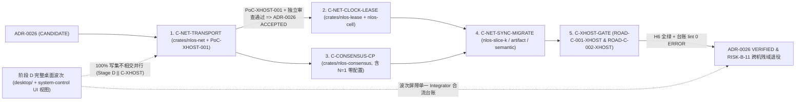

# ADR-0026：跨物理主机蜂窝网络传输、有界时钟偏斜与控制面复制基底扩展（阶段 C 跨机收官立项）

- **状态**：**`VERIFIED`（2026-10-28 `W73` 经 `W73-C-EXIT-REVIEW` 独立终审 [w73-stage-c-xhost-exit-review.md](../../evidence/stage-c/reviews/w73-stage-c-xhost-exit-review.md) 确认 `C-XHOST-001..005` 全部达成 `H5/H6` 验收标准；外部物理副作用清理边界按 `ADR-0019` R2.3 第 2 条与 `RISK-B-11` 诚实保留；历史演进：2026-10-26 依维护者裁定 A4 开档为 `CANDIDATE`，2026-10-27 `W69` 经 [C-XHOST-001](../../evidence/stage-c/c-xhost-001-mtls-transport-and-fence-handshake.md) 与 `W69-C-XHOST-REVIEW` 晋升 `ACCEPTED`）**
- **日期**：2026-10-26（2026-10-27 `W69` 晋升 `ACCEPTED`；2026-10-28 `W73` 晋升 `VERIFIED`）
- **Owner**：`C-XHOST`（阶段 C 跨物理主机收官扩展族：`C-NET-TRANSPORT` / `C-NET-CLOCK-LEASE` / `C-CONSENSUS-CP` / `C-NET-SYNC-MIGRATE` / `C-XHOST-GATE`；编排入口：[stage-c-progress.md](../stage-c-progress.md)，与阶段 D [stage-d-progress.md](../stage-d-progress.md) 双轨并行）
- **关联 Requirement**：[06-架构设计总纲-v0.5.md](../../design/06-架构设计总纲-v0.5.md) §2.3 `[PHIL-TRANSFER-002]`、§3.1 `[MODEL-ID-002]` / `[MODEL-ID-003]` / `[MODEL-TIME-001]`、§6.1 `[TCB-ENDPOINT-001]`、§10.5/§21 `[RESCROW-TIME-001]`、§11 `[DUR-ACK-001]` / `[DUR-ACK-002]` / `[DUR-SNAP-001]` / `[DUR-FAILCLOSED-001]`、§12 全部 `LEASE-*`（含 `[LEASE-GRANT-001]`、`[LEASE-SPEND-001]`、`[LEASE-TTL-001]`、`[LEASE-FENCE-001]`、`[LEASE-CLOSE-001]`、`[LEASE-LOSS-001]`、`[LEASE-MIGRATE-001]`、`[LEASE-ENFORCE-001]`、`[LEASE-WAL-001]`、`[LEASE-CAPACITY-001/002]`、`[LEASE-DEVICE-001]`、`[LEASE-PREACTIVE-001]`、`[LEASE-RECON-001]`、`[LEASE-PROTO-001]`）、§18 `[SEM-CHECKPOINT-001]`、§25.1 `[CONS-SCOPE-001]` / `[CONS-DECL-001]` / `[CONS-CTRL-001]` / `[TASK-SCALE-002]`、§26.1–§26.3（`[DIST-LOCAL-001]`、`[DIST-FAIL-001]`、`[DIST-NAME-001]`、`[DIST-TASK-001..004]`、`[DIST-EVENT-001]`、`[DIST-ART-001]`、`[DIST-AUDIT-001]`、`[DIST-MIGRATE-001]`、`[DIST-MIGRATE-002]`）、§27 `[PERF-BENCH-001]` / `[PERF-CONTROL-001]`、§28.3 `[ROAD-C-001]` / `[ROAD-C-002]`、§29.2 `[NLOS-DEFER-001]`
- **关联工作包与风险项**：新增阶段 C 补充收官五包 `C-NET-TRANSPORT`、`C-NET-CLOCK-LEASE`、`C-CONSENSUS-CP`、`C-NET-SYNC-MIGRATE`、`C-XHOST-GATE`；承接 `C-core` 九包单机多进程基线（[W67 退出门综合评审](../../evidence/stage-c/reviews/w67-stage-c-exit-gates.md) §1/§5.1/§6.1）并面向退役 [exit-unknown-risks.md](../exit-unknown-risks.md) / [risks.yaml](../risks.yaml) 中 `RISK-B-11`（`U-5`）的跨物理主机网络、时钟域与控制面共识残域；与阶段 D 完整桌面（[stage-d-progress.md](../stage-d-progress.md) / [ADR-0025](./0025-stage-d-hybrid-desktop-compositor-and-trusted-ui-layering.md)）保持 `100%` 写集不相交并行（`Stage D || C-XHOST`）
- **决策来源**：维护者 2026-10-26 裁定 A4——阶段 C **暂不翻转 `EXITED`**（继续保持 `IN_PROGRESS / NOT EXITED`），将跨物理主机扩展（`C-XHOST`）直接纳入阶段 C 作为补充收官波次，在阶段 C 正式退出前闭合真实网络套接字传输、跨硬件时钟域租约安全与复制控制面共识基底，同时并行启动阶段 D 完整自然语言桌面（`Stage D || C-XHOST`）
- **证据**：**`C-XHOST` 五大工作包（`W69–W72`）全部落盘验证（`H5/H6`）并通过 `W73` 独立终审**：① `C-NET-TRANSPORT`（`H5`）：[C-XHOST-001](../../evidence/stage-c/c-xhost-001-mtls-transport-and-fence-handshake.md)（`crates/nlos-net` `rustls` TLS 1.3 mTLS + TLS Exporter 五轴对端认证握手、64 MiB 窗口背压、`RemoteCallOutcome` 确定性映射、`N=1` 零监听）；② `C-NET-CLOCK-LEASE`（`H5`）：[C-XHOST-002](../../evidence/stage-c/c-xhost-002-conservative-clock-skew-and-remote-lease.md)（保守时钟偏斜包络 $\text{TTL}_{\text{holder}} = \text{TTL}_{\text{grant}} - 2\Delta_{\text{max\_skew}} - \Delta_{\text{safety}}$、`> 15,000` 组参数零重叠证明、单调存活窗口、`[LEASE-PROTO-001]` mTLS 远程三族租约协议与 `QuarantineDisposition` 诚实围栏边界）；③ `C-CONSENSUS-CP`（`H6`）：[C-XHOST-003](../../evidence/stage-c/c-xhost-003-embedded-raft-control-plane-consensus.md)（`crates/nlos-consensus` 嵌入式确定性 Raft 控制面多数派日志、双层 `[CONS-SCOPE-001]` 四族守卫、`[TASK-SCALE-002]` 独立 `ControlDomainId` 校验、`SQLite WAL+FULL`、`N=1` 零配置直通、真实子进程 `Child::kill()` 故障转移与 `CommittedControlIndexGate`）；④ `C-NET-SYNC-MIGRATE`（`H6`）：[C-XHOST-004](../../evidence/stage-c/c-xhost-004-streaming-sync-and-cross-host-migration.md)（跨网签名向量检查点增量收敛、分块可断点续传 `ArtifactTransferPackage` 流式传输、双主机零共享目录八步进程迁移、`N=3` Raft 多数派六端点接管屏障与 `IPC-D7` 检视注入）；⑤ `C-XHOST-GATE`（`H6`）：[C-XHOST-005](../../evidence/stage-c/c-xhost-005-chaos-proxy-and-h6-multi-machine-gate.md)（`ChaosTcpProxy` 三角形非对称分区/中段 `RST`/密文损坏/时钟偏斜越界注入、`ROAD-C-001-XHOST` 多进程混沌门禁、`ROAD-C-002-XHOST` 数据面 `0` Raft RPC 扩展与五故障矩阵、`scripts/xhost_cluster_harness.py`）；⑥ **独立终审报告**：[w73-stage-c-xhost-exit-review.md](../../evidence/stage-c/reviews/w73-stage-c-xhost-exit-review.md) 与单机多进程基线 [w67-stage-c-exit-gates.md](../../evidence/stage-c/reviews/w67-stage-c-exit-gates.md)
- **复审触发器**：见文末第 8 节

---

## 1. 上下文与复审触发器激活（Context & Trigger Activation）

### 1.1 `W67` 单机多进程域闭环事实

经 `W35–W67` 连续推进，[W67 阶段 C 退出门综合证据评审](../../evidence/stage-c/reviews/w67-stage-c-exit-gates.md)（§1、§3–§5）已在 [ADR-0018](./0018-single-host-multiprocess-dual-cell-topology.md) 界定的**单机多 OS 进程拓扑 + 独立本地磁盘 `SQLite WAL + synchronous=FULL` 持久层**上完成阶段 C 核心机制全量验证（最高证据等级 `H6`，未决 `P0 = 0`，全仓 35 个 workspace crate 零冻结/零退役）：

1. **`C-core` 九大工作包（`9/9 PARTIAL_PASS`）与两道退出门（`SATISFIED-WITH-BOUNDARIES`）**：
   - `[ROAD-C-001]`（[C-ROAD-001](../../evidence/stage-c/c-road-001-partition-restart-migration-gate.md)、[C-PARTITION-001](../../evidence/stage-c/c-partition-001-partition-autonomy-bounded-loss.md)、[C-LEASE-001](../../evidence/stage-c/c-lease-001-durable-three-family-reconciliation.md)、[C-SHARD-006](../../evidence/stage-c/c-shard-006-production-takeover-binding.md)、[C-SYNC-001](../../evidence/stage-c/c-sync-001-signed-event-set-merge.md)/[002](../../evidence/stage-c/c-sync-002-artifact-sync-policy.md)、[C-MIGRATE-002](../../evidence/stage-c/c-migrate-002-cell-host-process-migration.md)）：真实子 OS 进程双存活断网自治、硬强杀冷重启 `node_boot_generation` 推进、六类 canonical endpoint 签名接管屏障、双 `CellHost` 八步进程迁移、重复消息/一次性 `ActionToken` 幂等收敛及 `PartitionBoundedLossProof` 精确守恒已全部闭合。
   - `[ROAD-C-002]`（[C-BENCH-001](../../evidence/stage-c/c-bench-001-road-c002-distributed-benchmark.md)）：`1 -> 2 -> 4 -> 8` 独立子 OS 进程 `Cell` 分片无全局锁/无全局总序扩展（`--release` `4.44x`）、8-Cell `10K_LOGICAL` / `100K_LOGICAL`（`WAL+FULL`）以及五类并发故障注入全部 100% 通过。

### 1.2 `RISK-B-11` / `U-5` 跨物理主机残余边界为何仍保持 Open/Partial

按 `Claim <= Evidence`、`[EVID-SCOPE-001]` 与 [W67 评审 §6.1 边界 #1](../../evidence/stage-c/reviews/w67-stage-c-exit-gates.md)，单机多进程证据严格不等价于跨物理主机分布式保证，[exit-unknown-risks.md](../exit-unknown-risks.md) 中的 `RISK-B-11`（`P1/partial`）与 `U-5` 仍显式持有以下未证残域：

1. **共享宿主机内核与共享目录传输假定**：现行 `nlos-cell::federation` 通过单机共享文件系统原子重命名（`<root>/cells/*.cell`、`migration-intents/*.intent`、`checkpoints/*.ckpt`）交换联邦元数据；跨物理主机不存在共享 POSIX/NTFS 原子目录，必须具备真实网络套接字传输、多路复用流控与连接级密码学双向认证。
2. **共享硬件晶振 vs 跨物理主机独立时钟域**：同机多进程共享同一 OS 单调时钟与系统墙钟；跨物理主机拥有各自独立的硬件晶振（存在频率漂移、NTP 阶跃、虚拟化暂停偏斜），任何依赖对端墙钟（`SystemTime`、`heartbeat_ms`、`recorded_ms`）判断租约过期或接管安全的逻辑在跨机下均不成立。
3. **进程级阻断 vs 真实网络套接字故障谱系**：尚未覆盖网卡/交换机丢包、单向非对称路由黑洞（Cell A -> Cell B 可达而反向不可达，或三节点三角形非对称分区）、TCP 半开静默挂起、流中段 `RST` 断连以及大体积 `ArtifactTransferPackage` 分块流式背压。
4. **`ADR-0020` `S-B` 单写者控制面单点故障（SPOF）**：在单写者覆盖下，承载控制面的物理主机宕机即阻断全集群租约续期、`CellDirectory` 成员变更与 `TaskAuthorityAssignment` 新 term 签发，且 `consensus_commit_index` 尚无 `[DUR-ACK-002]` 规定的多副本多数派（quorum）提交语义。
5. **远端外部副作用物理清理边界（`ADR-0019` R2.3 第 2 条）**：本地或控制面推进 `epoch` 将失联额度/效果标为 `QUARANTINED` 仅证明权威拒绝与账面有界损耗，不等同于远端失联物理主机上的在途副作用已被物理擦除。

### 1.3 维护者裁定 A4（`2026-10-26`）与既有 ADR 演进衔接（零历史改写）

2026-10-26 维护者针对 `W67` 退出呈批包作出**裁定 A4**：

- **阶段 C 暂不翻转 `EXITED`**，阶段级状态继续保持 `IN_PROGRESS / NOT EXITED`；
- 将跨物理主机扩展（`C-XHOST`）直接并入阶段 C 作为**补充收官波次**，要求阶段 C 在翻转 `EXITED` 前实质性交付跨主机加密网络传输、跨硬件时钟域有界偏斜租约安全与嵌入式控制面复制共识基底；
- 同时按 [06-架构设计总纲-v0.5.md](../../design/06-架构设计总纲-v0.5.md) §28（`C || D` 并行拓扑），**并发推进阶段 D 完整自然语言桌面**（[stage-d-progress.md](../stage-d-progress.md) / [ADR-0025](./0025-stage-d-hybrid-desktop-compositor-and-trusted-ui-layering.md)）。

本 ADR 按既有契约预留的升级门精确衔接前序决策，**不改写、不推翻、不追溯作废任何既有 ADR 历史结论**：

| 既有权威 ADR | 原决定与预留升级门 | 本 ADR（`ADR-0026`）的衔接动作 |
|---|---|---|
| [ADR-0013](./0013-cross-authority-verify-then-commit-contract.md) | 决定 1 确立单机跨 authority `verify-then-commit + 有界收敛`；决定 3 将跨 Cell 提交登记为 reconciliation 扩展点 | 单机单 Cell 内跨 authority `verify-then-commit` 契约 **100% 原样保持有效**；跨主机仍走 reconciliation，不引入跨机 2PC |
| [ADR-0018](./0018-single-host-multiprocess-dual-cell-topology.md) | 决定 2 将跨机语义后置至单机双 Cell 证据齐备后；退出策略 3 规定「另开 ADR 把候选 (b) 升为下一拓扑」；触发器 2（单机证据落地）与触发器 4（要求真实网络分区/跨主机时钟） | **正式激活退出策略 3 与触发器 2/4**：在 `W67` 单机多进程证据闭环基础上开启跨物理主机多节点拓扑；`ADR-0018` 继续作为阶段 C 第一阶段单机回归拓扑保留有效，不改写其历史适用域 |
| [ADR-0019](./0019-cross-cell-commit-semantics-extension.md) | 修订 1 R1.2 确立跨 Cell 提交 = 单权威 term 内闭合 + `DIST-TASK-002` CAS 接管 + checkpoint trail 可见性；R1.4 **触发器 7** 挂出跨机再评估三项（`heartbeat_ms` 墙钟启发式、trail 排序轴与 `[SEM-CHECKPOINT-001]` 对齐、真分区下等待旧权威过期时限）；R2.3 界定 `QUARANTINE != 远端物理 cleanup` | **正式激活 R1.4 触发器 7**：在不改变 R1.2 reconciliation 接管模型与 schema `v47` 三 Record 身份的前提下，用接收端本地单调时钟 + 单调序号替换墙钟新鲜度、用签名向量检查点替换跨机墙钟文件名排序、用有界时钟偏斜包络重定「等待旧权威过期」下界，并严守 R2.3 第 2 条物理清理诚实红线 |
| [ADR-0020](./0020-control-plane-single-writer-and-consensus-timing.md) | 决定 2/3 先以 `S-B`（控制面单写者 + lease/fencing）覆盖 `consensus_commit_index`；退出策略 3 与 **触发器 3/5** 规定单机证据齐备且需要真实多机控制面 HA 时另文选型升级 `S-A` | **正式激活 `S-B -> S-A` 升级路径（触发器 3/5）**：立项嵌入式确定性控制面多数派日志 `crates/nlos-consensus`；在 `C-CONSENSUS-CP` 达到 `VERIFIED` 前，`ADR-0020` `S-B` 继续有效；达到 `VERIFIED` 后，`S-B` 退化保留为单机桌面 `N=1` 零配置特例 |

---

## 2. 不可退让的规范性硬不变量（Hard Normative Invariants Preserved）

跨物理主机扩展只替换底层通信介质、时钟安全包络与控制面复制引擎，**绝不放宽或篡改** [06-架构设计总纲-v0.5.md](../../design/06-架构设计总纲-v0.5.md) 的下列四条系统级硬不变量：

### 2.1 `[CONS-SCOPE-001]`：控制面多数派共识绝不侵入数据面（严禁跨 Cell 全局总序）

> **硬红线**：即便引入复制控制面共识组（`crates/nlos-consensus`），NLOS **MUST NOT** 在数据面 `spawn / message / commit` 路径上建立跨 Cell 全局总序、全局互斥锁或跨分片分布式 2PC（`[CONS-SCOPE-001]` 行 `4338`、`[ROAD-C-002]` 行 `4903`、[议题 15](../../discussions/15-分布式内核.md) 历史 rationale）。

控制面共识组（`LINEARIZABLE_AUTHORITY` + `[DUR-ACK-002]`）的管辖边界被**严格封死在低频控制面元数据**（对应 §26.1 控制面职责）：

1. `CellDirectory` 集群成员视图、节点路由端点提示（endpoint hint）与 Principal/Package 信任策略纪元；
2. 根账本向各 Cell 签发的 `QuotaLease` / `CapacityLease` / `ExclusiveDeviceLease` 划拨、epoch 推进与全局 fencing 登记；
3. `TaskAuthorityAssignment` 与 `TaskAuthorityTakeoverReceipt` 的分片权威归属与 `authority_term` 绑定（使该两类记录上的 `consensus_commit_index` 获得真实多数派已提交日志下标语义）；
4. 跨域 `MigrationIntent` 与 `ReconciliationCheckpoint` 控制面审计锚点。

**数据面持续保持蜂窝局部自治**：单个 `Task` 在任一 `authority_term` 内的 `TaskControlRecord` / `TaskHead` / `CommitPermit` 提交、Fiber 调度、`HierarchicalFanoutTree` 子组归约以及本地 `QuotaLease` 预扣（`[LEASE-SPEND-001]`）均在所属 Cell 本地 `SQLite WAL + FULL` 闭合，**零跨机共识 RTT**；跨分片/跨 Cell 传播继续仅使用 `SignedSemanticVectorCheckpoint`（`[SEM-CHECKPOINT-001]`）、durable outbox/saga 与显式 `PARTIAL` / `UNCERTAIN`（`[CONS-SCOPE-001]`）。同时严守 `[TASK-SCALE-002]`：控制面共识副本必须是独立物理/故障域节点（不同 `ControlDomain`），严禁在同一进程或同源 Agent 间复制实例伪造 quorum。

### 2.2 `[TCB-ENDPOINT-001]` 与 `[DIST-NAME-001]`：密码学对端身份强绑定（IP:Port 绝非身份）

1. **网络位置与对象身份彻底解耦（`[MODEL-ID-002]`、`[DIST-NAME-001]`）**：`CellIdentity`（`SchedulerDomainId` 16B）、`PrincipalId`、`TaskId`、`ProcessId` 与 `CapabilityId` 均保持纯不透明名义标识，**严禁编码 IPv4/IPv6 地址、DNS 主机名、TCP/UDP 端口号或网卡标识**。`CellDirectory` 中的 `SocketAddr`（`IP:port`）仅作为可随 DHCP/NAT/重连动态变更的**瞬态路由提示（ephemeral routing hint）**，由 `(node_boot_generation, epoch, heartbeat_seq)` 单调守卫防止陈旧路由覆盖。
2. **传输层双向密码学认证与五轴会话绑定（`[TCB-ENDPOINT-001]`、[ADR-0011](./0011-ipc-principal-auth-signature-passthrough.md) 跨机扩展）**：
   - 任何跨主机信道建立时 MUST 完成 **双向认证 TLS 1.3（mTLS）** 或等价前向安全加密握手，对端公钥必须锚定至 `IdentityAuthority` 已注册且未吊销的 `PrincipalId` 当前密钥代次（`KeyRevoked` / `PrincipalUnknown` 立即在握手阶段 fail-closed 断连）；
   - 在加密信道之上执行绑定 TLS 连接导出器材料（TLS Exporter，`RFC 8446` / `RFC 9266`）的挑战-应答握手，将对端 **`(CellIdentity, node_boot_generation, PrincipalId, Capability/CellEpoch, CellFencingToken)`** 密码学钉死在当前连接上下文中，彻底阻断 IP 复用、NAT 漂移、BGP/ARP 劫持或跨连接重放导致的旧实例复活；
   - 业务变更帧继续贯彻 [ADR-0010](./0010-signed-capability-commands.md) / [ADR-0011](./0011-ipc-principal-auth-signature-passthrough.md) 与 `[LEASE-PROTO-001]` 的命令级域分隔 Ed25519 签名与 `IdempotencyKey` 贯穿，服务端端点按 `[TCB-ENDPOINT-001]` 逐帧核验 `CellAuthority::admit`。

### 2.3 `[MODEL-TIME-001]` 与 `[LEASE-TTL-001]` / `[LEASE-FENCE-001]` / `[LEASE-LOSS-001]`：跨硬件时钟域的保守时钟偏斜包络（Conservative Clock-Skew Horizon Envelope）

> **硬禁令**：跨物理主机租约准入、TTL 到期裁决、`DIST-TASK-002` 旧权威过期等待窗口与 fencing 屏障 **MUST NEVER** 依赖对未同步远端墙钟时间戳（`SystemTime` / `UtcInstant` / 远端 `heartbeat_ms`）的直接大小比较！远端 `issued_at` / `recorded_ms` 仅作审计展示提示（`[MODEL-TIME-001]` 行 `286`）。

各物理主机仅以本机单调硬件时钟（OS `CLOCK_MONOTONIC` / `QueryPerformanceCounter` 驱动的本地单调计时器，配合 `nlos-clock::AuthorityClock` 持久化世代水位）度量经过时长（elapsed duration）。设集群时间策略（`QuotaLease.max_clock_skew` / `TimePolicy.max_clock_skew`）显式声明最大跨机时钟偏斜与单程传输不确定度上界 $\Delta_{\text{max\_skew}} > 0$，以及包含最大租赁期内硬件晶振最坏相对频偏裕量（如 $2 \cdot \rho_{\max} \cdot \text{TTL}_{\text{grant}}$）加调度抖动的安全裕度 $\Delta_{\text{safety}} > 0$，规定**保守时钟偏斜包络（Conservative Clock-Skew Horizon Envelope）**如下：

1. **持有端（Holder Cell）提前收缩的本地单调准入预算**：
   当控制面 Grantor 签发名义时长为 $\text{TTL}_{\text{grant}}$ 的租约（要求 $\text{TTL}_{\text{grant}} > 2 \cdot \Delta_{\text{max\_skew}} + \Delta_{\text{safety}}$，否则签发即以 `InvalidLeaseHorizon` fail-closed 拒绝），且持有端在发起续约/授权请求时的本地单调时刻为 $t^{\text{H}}_{\text{req}}$（保证 $t^{\text{H}}_{\text{req}}$ 早于或等于 Grantor 实际落盘授权时刻），持有端本地可使用的有效单调预算强制收缩为：

   $$\text{TTL}_{\text{holder}} = \text{TTL}_{\text{grant}} - 2 \cdot \Delta_{\text{max\_skew}} - \Delta_{\text{safety}}$$

   一旦持有端自 $t^{\text{H}}_{\text{req}}$ 起算的本地单调经过时间 $\Delta t^{\text{H}} \ge \text{TTL}_{\text{holder}}$，持有端 **MUST** 立即在本地执行 `ACTIVE -> FENCED` 冻结，停止一切新本地 `reserve`、新 `CommitPermit` 签发与新不可逆 `EffectPermit` 派发（`[DIST-LOCAL-001]`、`[LEASE-TTL-001]`）。

2. **授出端（Grantor / 控制面）延后等待下界与强制 `FenceBarrierAck` 门控**：
   - **接管过期等待下界（闭合 `ADR-0019` R1.4 触发器 7 第 3 项）**：当持有端跨机失联且 endpoint 不可在线 fence 时，授出端 / 继任协调者自租约落盘签发时的本地单调时刻 $t^{\text{G}}_{\text{grant}}$ 起算，在本地单调经过时间满足下式之前，**严禁**判定旧持有端本地租约已到期或启动过期后接管（`[DIST-TASK-002]`）：

     $$\Delta t^{\text{G}} > \text{TTL}_{\text{grant}} + \Delta_{\text{max\_skew}}$$

   - **`TTL` 绝不单独解锁额度重发（`[LEASE-TTL-001]` / `[LEASE-FENCE-001]` / `[LEASE-LOSS-001]`）**：即便 $\Delta t^{\text{G}} > \text{TTL}_{\text{grant}} + \Delta_{\text{max\_skew}}$ 已成立，授出端也**严禁**仅凭时间流逝将未对清的 `QuotaLease` 余额、`CapacityLease` 容量槽或 `ExclusiveDeviceLease` 设备头退回全局 `AVAILABLE` / `FREE` 或重新签发给其他节点！释放或重授未决资源 **MUST** 至少满足以下二项之一：
     1. 收到持有端签名的幂等关闭/对账回执（`LeaseCloseReceipt` / 三族 `ReconciliationReceipt`）；或
     2. 控制面已推进 `epoch` / `fencing_token`，并集齐对应 `fence_scope` 内**全部**真实成本网关/凭据签发器/参与端点的持久化 `FenceBarrierAck`（容量族另须 `CleanupAttestation`，独占设备族另须含 VRAM/密钥清零证明的 `DeviceResetReceipt`）。
     凡无法集齐上述密码学回执的失联额度、容量或设备，一律持久停留在 **`QUARANTINED`** 状态（宁可冻结，绝不超卖或双发）。

3. **偏斜越界与时钟回拨一律 Fail-Closed（`[RESCROW-TIME-001]` 同构纪律）**：
   若握手往返测得的单程不确定度上界 $\text{RTT}/2 > \Delta_{\text{max\_skew}}$、对端携带的单调纪元心跳包络违背偏斜界限、或宿主检测到本地单调时钟异常/持久化水位回退，节点 **MUST** 立即拒绝续约并将受影响租约/控制面链路打入 `QUARANTINED` / `Partitioned` fail-closed，严禁带着失准时钟继续放行跨机权威动作。

4. **闭合 `ADR-0019` R1.4 触发器 7 其余两项墙钟遗留假设**：
   - `CellDirectory` 存活探测不再读取远端自报的墙钟 `heartbeat_ms` 与本机墙钟求差，改为以**接收端本地单调接收时刻 `received_at_mono`** 度量静默窗口，并以 `(node_boot_generation, epoch, heartbeat_seq)` 单调递增抵御乱序重放（且该视图仍严格定性为发现启发式，非 fencing oracle）；
   - `ReconciliationCheckpoint` 与跨主机语义同步不再以跨机器不可比的 `(recorded_ms, pid, sequence)` 文件名做权威排序，而严格按每 Cell 独立的 `(CellIdentity, node_boot_generation, epoch, checkpoint_seq)` 单调链与 `[SEM-CHECKPOINT-001]` `SignedSemanticVectorCheckpoint` 因果向量对账。

### 2.4 `[DIST-FAIL-001]` 与 `ADR-0019` R2.3：真实套接字失败确定性映射与远端副作用诚实性

1. **真实网络 I/O 异常到 `RemoteCallOutcome` 的确定性映射契约**：
   跨主机传输层（`crates/nlos-net`）严禁将底层 `std::io::Error` 或 TLS 断连笼统折叠为模糊的字符串错误，必须按请求帧字节是否已进入内核发送缓冲区及 `RemoteCallContract.side_effecting` 属性，确定性映射至 `nlos-cell::partition::RemoteCallOutcome`（及其线级细化分类 `Unavailable` / `DeadlineExceeded` / `UncertainSideEffect`）：

   | 真实跨主机网络故障阶段与现象 | 远端副作用状态 | 确定性映射结果（`RemoteCallOutcome`） | 允许的重试指令（`RemoteRetryDirective`） |
   |---|---|---|---|
   | 路由不可达、TCP `connect()` 超时/`ECONNREFUSED`、mTLS 握手/Principal 认证失败（**业务请求帧首字节尚未写出**） | 零远端业务执行 | `RemoteCallOutcome::Unavailable` | 预算内 `SafeToRetryWithSameKey`（必须复用原 `IdempotencyKey`） |
   | 纯只读查询（`side_effecting == false`）在写出后遭遇读超时、TCP `RST` 或 TLS 截断 | 无状态变更副作用 | `RemoteCallOutcome::DeadlineExceededUncertain { side_effecting: false, .. }`（只读 `DeadlineExceeded`） | 预算内 `SafeToRetryWithSameKey` |
   | **含副作用调用（`side_effecting == true`）在请求帧首字节写入套接字后**遭遇读/写超时、半开连接保活超时、TCP `RST` 或 TLS 非正常关闭 | **远端是否已落盘执行完全未知（`UncertainSideEffect`）** | `RemoteCallOutcome::DeadlineExceededUncertain { side_effecting: true, .. }`（线级显式暴露 `UncertainSideEffect`） | **严禁自动盲目重试**（强制 `ReconcileBeforeRetry`；违者以 `UncertainSideEffectRequiresReconciliation` 拒绝） |
   | 多分片扇出或跨机联邦搜索部分节点套接字断连/超时 | 部分分片成功、部分未知/不可达 | `RemoteCallOutcome::Partial`（附域分隔 `SHA-256` `uncertainty_digest`） | 幂等分片 `RetryFailedShardsOnly`；非幂等副作用分片强制 `ReconcileBeforeRetry` |

2. **`QUARANTINE != 远端物理擦除`（`ADR-0019` R2.3 第 2 条跨机铁律）**：
   在真实网络分区或远端物理主机掉电/失联期间，控制面推进 `epoch` 并冻结旧租约（`QUARANTINED`）及旧 `TaskAuthorityAssignment`（`FENCED` / `QUARANTINED`），**只证明系统在权威账本与受控网关侧完成了围栏拒绝与损失封顶**，绝不声称失联宿主机上的孤儿 OS 进程已立即终止或外部不可逆副作用已物理回滚。只有当重连后收到**经签名的执行网关/Provider 幂等撤销回执、`CleanupAttestation`、`DeviceResetReceipt` 或远端宿主 Supervisor 实杀回收回执**时，审计记录与台账方可将该笔未决项从「围栏隔离（`QUARANTINED`）」核销为「物理清理已证实（`PHYSICALLY_CLEANED`）」。

---

## 3. 候选架构比较与五个阶段 C 跨机补充工作包（`C-XHOST`）

### 3.1 跨物理主机网络传输候选比较（Transport Candidates）

| 评估维度 | **T1（推荐候选）：`tokio::net::TcpStream` + `rustls`（TLS 1.3 mTLS）+ 长度前缀多路复用帧** | T2（备选可插拔后端）：QUIC（`quinn` + `rustls` over UDP） | T3（否决）：裸明文 TCP + 仅靠应用层 Ed25519 签名 | T4（否决）：重型外部 gRPC 栈（`tonic` + `hyper` + HTTP/2） |
|---|---|---|---|---|
| **安全性与 TCB（`[TCB-ENDPOINT-001]`）** | 纯 Rust `rustls` TLS 1.3 提供前向保密（ECDHE）+ 双向证书/裸公钥校验，叠加连接级 TLS Exporter 绑定 `CellFence` | 内置 TLS 1.3 双向认证；但 **0-RTT 存在重放风险**（若启用必须对变更命令硬禁用 0-RTT） | **否决**：无链路机密性与前向保密，暴露 `Artifact`/`Context`/`Capability` 元数据且易遭 TCP 会话注入劫持 | TLS 1.3 可配，但引入庞大 HTTP/2 / HPACK / Tower 中间件攻击面与供应链体积（触碰 `RISK-B-09`） |
| **失败语义透明度（`[DIST-FAIL-001]`）** | **极高**：帧写出前后边界清晰，可在用户态代理精确注入半开挂起、字节截断、`RST` 与单向丢包 | 较高，但 UDP 拥塞/路径探测/连接迁移状态机复杂，边界异常归因链路更长 | 虽易观察套接字，但无加密完整性帧保护 | HTTP/2 连接池与底层自动重试容易遮蔽「首字节是否已发出」的 `UncertainSideEffect` 判据 |
| **多流与队头阻塞（HoL）** | 单 TCP 连接存在内核级丢包 HoL；通过**控制面/RPC 高优帧与 `<= 64 KiB` 分块制品传输流分通道（双连接或帧级优先级调度 + 窗口背压）**有效隔离 | 原生多独立流无传输层 HoL 阻塞（适合未来高丢包广域网演进） | 同 T1 但无安全保障 | HTTP/2 应用层多路复用仍受底层单 TCP HoL 制约 |
| **跨平台与防火墙兼容性** | **最优**：Windows / macOS / Linux Loopback、局域网与三平台 CI 容器 100% 稳定支持，零 UDP 限速/防火墙丢弃隐患 | 部分企业网与 CI 虚拟网卡对 UDP 突发包存在静默限流或状态防火墙超时回收 | 不适用（安全否决） | 跨平台可用但编译与依赖维护成本高 |
| **与现有 `nlos-ipc` / `nlos-schema` 衔接** | 直接复用 `nlos-schema` 冻结 Protobuf 信封与 4B 大端长度前缀纪律，增量极小、遵循 `unsafe_code = "forbid"` | 可封装于同一 `CellTransport` trait 之下作为后续可选特性（feature-gated） | 不采纳 | 与 `nlos-ipc` 既有轻量帧协议重复建设 |

**传输层候选结论**：主推 **T1（`rustls` TLS 1.3 mTLS + 长度前缀多路复用与控制/大流双通道隔离）** 作为 `C-NET-TRANSPORT` 与 `PoC-XHOST-001` 的首用传输实现，同时在 `crates/nlos-net` 定义传输无关的异步接口（`CellRpcTransport` / `BulkStreamTransport`），为未来高丢包 WAN 场景按需挂载 **T2（`quinn` QUIC）** 留出零上层侵入的演进槽位；明确否决 **T3** 与 **T4**。

### 3.2 控制面复制与共识基底候选比较（Control-Plane Replication Candidates）

| 评估维度 | **C1（推荐候选）：嵌入式确定性多数派日志 `crates/nlos-consensus`（Raft 核心状态机 + `SQLite WAL+FULL`）** | C2（否决）：外部运维共识组件（`etcd` / `Consul` / `ZooKeeper`） | C3（多机 HA 否决，仅留 `N=1` 退化态）：维持 `ADR-0020` `S-B` 单写者无复制 | C4（永久禁止）：数据面全局共识 / 每 Task 或每 Blackboard 共识组 |
|---|---|---|---|---|
| **独立 OS 可移植性与单机体验（`[NLOS-GOAL-001]`）** | **零外部守护进程依赖**：Windows/macOS/Linux 单二进制内嵌；单 PC 桌面默认退化为 **`N=1` 本地直写模式**（零网络端口、零选举开销） | **否决**：强迫终端桌面或边缘节点额外部署运维 Go/JVM 外部集群，违背通用桌面 OS 自包含原则 | 单机零开销，但无法支撑多物理主机控制面容错 | 破坏单机与多机性能及复杂度预算 |
| **`[DUR-ACK-002]` 与多机控制面高可用** | `N=3` / `N=5` 跨主机多数派落盘 `SQLite WAL + FULL` 后才返回 commit ACK，容忍 $\lfloor (N-1)/2 \rfloor$ 台控制面主机硬崩溃或分区隔离 | 具备多机容错，但跨进程/跨协议栈状态同步与 NLOS `STRICT` SQLite 审计链割裂 | **多机否决**：控制面宿主宕机即造成全集群租约续期与权威分片重指派停摆（SPOF） | 不适用 |
| **确定性故障注入可测性（`H6`）** | 采用 **I/O 无关的纯确定性状态机核（`ConsensusCore::step`）** + 外层薄异步网络/存储驱动，支持毫秒级确定性乱序/丢包/双主分区模拟与真实子进程强杀 | 难以在单元/集成级执行细粒度确定性时钟与消息交错注入 | 无多副本选举与日志截断协议面 | 不适用 |
| **遵守 `[CONS-SCOPE-001]` 边界** | 严格只复制低频控制面四类元数据，`consensus_commit_index` 语义精确闭环，数据面零介入 | 易诱发把业务 KV 塞入外部存储的反模式 | 字段仅作本地单调游标，无复制共识保证 | **直接违反 `[CONS-SCOPE-001]` 与 `[ROAD-C-002]`** |

**控制面复制候选结论**：主推 **C1（自研轻量、I/O 解耦、确定性可验证的嵌入式 Raft 多数派日志 `crates/nlos-consensus`，底层复用工作区既有 `rusqlite` `WAL + synchronous=FULL`）**；明确否决外部组件依赖 **C2**、多机单点 **C3**（将其精确收敛为 `C1` 的 `N=1` 单节点退化特例）以及跨 Cell 全局数据面共识 **C4**。

### 3.3 五个阶段 C 跨机补充工作包定义与 `PoC-XHOST-001` 晋升门

五个补充工作包的具体范围、写集、规范锚点与验收门如下：

| # | 工作包 ID | 主要写集（Crate / 模块） | 核心交付内容 | 依赖关系与关键验收门（DoD / PoC） |
|---:|---|---|---|---|
| **1** | **`C-NET-TRANSPORT`** | `crates/nlos-net`（新增 crate） | ①基于 `tokio` + `rustls`（TLS 1.3 mTLS）的跨主机加密连接器与监听器；②绑定 TLS Exporter 的五轴对端认证握手 `(CellIdentity, node_boot_generation, PrincipalId, Capability/CellEpoch, CellFencingToken)` 与 IP 无关 `EndpointResolver`（`[TCB-ENDPOINT-001]`、`[DIST-NAME-001]`）；③4B 大端长度前缀多路复用帧（分离高优控制/RPC 流与有界窗口背压大体积数据流）；④套接字/TLS 异常到 `RemoteCallOutcome` 的确定性映射器（`[DIST-FAIL-001]`）。 | **前置**：`ADR-0026` 开档。 **核心门禁 `PoC-XHOST-001`**：实测双独立网络端点 mTLS 五轴认证、吊销密钥/旧 `boot_generation` 握手即拒、请求写出前断连 -> `Unavailable` vs 写出后 `RST`/超时 -> `DeadlineExceededUncertain`（`ReconcileBeforeRetry`）、以及 64 MiB 分块流背压零内存膨胀。**`PoC-XHOST-001` 通过 + 独立审查 clean 解锁本 ADR `CANDIDATE -> ACCEPTED`。** |
| **2** | **`C-NET-CLOCK-LEASE`** | `crates/nlos-lease`、`crates/nlos-cell`（及按需只读消费 `nlos-clock`） | ①落地 §2.3 保守时钟偏斜包络：持有端 $\text{TTL}_{\text{holder}} = \text{TTL}_{\text{grant}} - 2\Delta_{\text{max\_skew}} - \Delta_{\text{safety}}$ 本地单调准入收缩，授出端 $\Delta t^{\text{G}} > \text{TTL}_{\text{grant}} + \Delta_{\text{max\_skew}}$ 过期等待下界，以及无 `FenceBarrierAck` / `LeaseCloseReceipt` 严禁解冻 `QUARANTINED`；②跨主机单调纪元心跳与 `CellDirectory` 接收端单调存活窗口（闭合 `ADR-0019` 触发器 7 第 1/3 项）；③偏斜超界与时钟回拨自动 `QUARANTINED` 门控；④基于 `nlos-net` 的 `[LEASE-PROTO-001]` 远程三族租约协议端点。 | **前置**：`C-NET-TRANSPORT`（及 `ADR-0026` `ACCEPTED`）。 **验收门**：属性测试（property tests）遍历任意有界偏斜 $[-\Delta_{\text{max\_skew}}, +\Delta_{\text{max\_skew}}]$ 证明零时间窗双主重叠；越界偏斜注入（`> \Delta_{\text{max\_skew}}`）100% fail-closed 转 `QUARANTINED`；三族对账守恒等式全绿。 |
| **3** | **`C-CONSENSUS-CP`** | `crates/nlos-consensus`（新增 crate）+ 控制面状态机适配 | ①`unsafe_code = "forbid"` 的嵌入式确定性 Raft 多数派日志核（含 Pre-Vote 防孤岛扰动、term 绑定的 Leader 租约围栏、快照与 WAL 截断 `[DUR-SNAP-001]`），持久层绑定 `SQLite WAL + synchronous=FULL`（`[DUR-ACK-002]`）；②仅复制四类低频控制面元数据（`CellDirectory`、根三族 Lease 池与 epoch、`TaskAuthorityAssignment` / `TakeoverReceipt`、审计 `Checkpoint` 锚点），赋予 `consensus_commit_index` 真实多数派提交下标语义；③内置 **`N=1` 单节点零配置直通模式**（单 PC 零监听套接字、零选举定时器、单次本地 `WAL+FULL` 落盘）。 | **前置**：`C-NET-TRANSPORT`（与 `C-NET-CLOCK-LEASE` 写集不相交，**同波并行执行**）。 **验收门**：确定性模拟测试（乱序/丢包/Leader 强杀/日志冲突截断/脑裂旧 Leader 写请求被高 term 拒绝）+ 真实 `N=3` 进程 `SQLite WAL+FULL` 故障恢复测试 + `N=1` 零网络开销回归验证。本包 `VERIFIED` 后正式接替 `ADR-0020` `S-B` 单写者覆盖。 |
| **4** | **`C-NET-SYNC-MIGRATE`** | `crates/nlos-slice-k`、`crates/nlos-artifact`、`crates/nlos-semantic` | ①基于 `nlos-net` 流控通道的 `ArtifactTransferPackage` 分块流式传输、断点续传与落盘前全包 + 分块 `SHA-256` 验真（`[DIST-ART-001]`）；②跨主机 `SignedSemanticVectorCheckpoint` 差量拉取与三要素验签合并（`[DIST-EVENT-001]`、`[DIST-AUDIT-001]`、`[SEM-CHECKPOINT-001]`，闭合 `ADR-0019` 触发器 7 第 2 项）；③真实 TCP/TLS 双主机 `CellHost` 八步进程迁移（`[DIST-MIGRATE-001/002]`、`[LEASE-MIGRATE-001]`）与六类 canonical endpoint 跨主机 `DIST-TASK-002` 接管屏障驱动。 | **前置**：`C-NET-CLOCK-LEASE` + `C-CONSENSUS-CP`。 **验收门**：双主机/双网络命名空间真实套接字下完成大制品分块流式同步、篡改分块拒收、向量检查点因果收敛、`SourceFenced` 后断网 `QuarantinedPostFence` 零双活进程，以及旧主机 `term 1` 跨网提交被 `AuthorityLeaseFenced` 100% 拦截。 |
| **5** | **`C-XHOST-GATE`** | `crates/nlos-net`（故障代理模块）+ 跨机门禁测试套件 + `docs/evidence/stage-c/` | ①构建确定性套接字级混沌故障代理 `ChaosTcpProxy`：支持可编程丢包率、RTT 抖动、**单向/三角形非对称分区**、TCP 半开静默黑洞、帧中段 `RST`、`N=3` 控制面 Leader 硬强杀（`Child::kill()`）与合成跨机时钟偏斜超界注入；②执行 **`ROAD-C-001-XHOST`** 与 **`ROAD-C-002-XHOST`**（证明数据面分片 `spawn/message/commit` 完全绕开 `nlos-consensus` Leader 线性扩展，并在真实套接字上复现全部五类并发故障门禁）；③落盘 `H6` 跨机证据并提交补充退出评审。 | **前置**：`C-NET-SYNC-MIGRATE`。 **验收门**：`ROAD-C-001-XHOST` 与 `ROAD-C-002-XHOST` 在 `SQLite WAL+FULL` 下全绿；[claims.yaml](../claims.yaml) / [risks.yaml](../risks.yaml) / [evidence-index.yaml](../evidence-index.yaml) 同步且 `lint_claims.py` `0 ERROR`；正式退役 `RISK-B-11` / `U-5` 跨物理机网络、时钟域与控制面共识残域，解锁阶段 C 最终 `EXITED` 呈批。 |

---

## 4. 与阶段 D 完整桌面的零冲突双轨并行（Zero-Collision Parallelism: `Stage D || C-XHOST`）

依维护者裁定 A4 与 [渐进式披露规则 §6.1](../project-knowledge-progressive-disclosure.md#61-子-agent-编排与依赖感知并行)（`[PD-ORCH-002]` / `[PD-ORCH-003]`），自 `W69+` 起，`C-XHOST` 五个收官工作包与阶段 D 完整自然语言桌面（[stage-d-progress.md](../stage-d-progress.md)、[ADR-0025](./0025-stage-d-hybrid-desktop-compositor-and-trusted-ui-layering.md)）按**完全不相交的源码写集**双轨并行推进：

| 并行轨道 | 专属源码与证据写集（Write-Set） | 只读消费边界 | 冲突判定 |
|---|---|---|---|
| **轨道 1：阶段 C 跨机收官（`C-XHOST`）** | `crates/nlos-net/`（新）、`crates/nlos-consensus/`（新）、`crates/nlos-cell/`、`crates/nlos-lease/`、`crates/nlos-artifact/src/sync.rs`、`crates/nlos-semantic/`（跨网同步入口）、`crates/nlos-slice-k/src/{cell_host,partition_recovery,process_migration_drive,takeover_drive}.rs`、`crates/nlos-slice-k/tests/c_xhost_*`、`docs/evidence/stage-c/c-xhost-*` | 只读消费 `nlos-types`、`nlos-schema`、`nlos-identity`、`nlos-capability`、`nlos-clock`、`nlos-task`（已冻结 `v47`） | **与轨道 2 源码写集交集 = $\varnothing$（100% 零碰撞）** |
| **轨道 2：阶段 D 完整桌面（`Stage D`）** | `desktop/`（`desktop/src/`、`desktop/src-tauri/`）、`crates/nlos-system-control/src/*_inspector.rs` 及桌面枚举/控制投影视图、`crates/nlos-plan/` 计划预览与手工 override 投影、`docs/evidence/stage-d/*` | 只读消费 `nlos-schema` SABI DTO、`nlos-ipc` 本地认证通道及各底层 authority 查询面 | **与轨道 1 源码写集交集 = $\varnothing$（100% 零碰撞）** |
| **波次屏障共享文件（单一 Integrator 串行合流）** | 根 `Cargo.toml`（仅在新增 `nlos-net` / `nlos-consensus` workspace 成员时变更一次）、[stage-c-progress.md](../stage-c-progress.md)、[stage-d-progress.md](../stage-d-progress.md)、[docs/management/README.md](../README.md)、[claims.yaml](../claims.yaml)、[risks.yaml](../risks.yaml)、[evidence-index.yaml](../evidence-index.yaml)、[exit-unknown-risks.md](../exit-unknown-risks.md) | 各并行子车道严禁直接修改共享台账 | 由每波屏障的**唯一 Integrator** 按 CAS 纪律统一合并并运行 `lint_claims.py`（`[PD-ORCH-003]`） |

**故障隔离保障（`[PD-ORCH-004]`）**：`C-XHOST` 任一车道若在 `PoC-XHOST-001` 或套接字混沌测试中受阻，只阻塞 `C-XHOST` 下游依赖包，**绝不阻塞阶段 D 桌面车道推进与合入**；反之阶段 D 前端/Tauri 构建或交互战役问题亦绝不阻塞 `C-XHOST` 收官。

---

## 5. 决定（Decision Summary — `ACCEPTED` 范围，`ACCEPTED ≠ VERIFIED`）

经 `2026-10-27 W69` `crates/nlos-net` 实现、[C-XHOST-001](../../evidence/stage-c/c-xhost-001-mtls-transport-and-fence-handshake.md)（`PoC-XHOST-001` `11/11` 通过）及独立对抗式审查 `W69-C-XHOST-REVIEW`（复验 `PASS`），本 ADR 正式由 `CANDIDATE` 晋升为 **`ACCEPTED`**，并对范围、不变量红线、选定技术路线与后续 `W70–W73` 工作包分解作出如下架构裁定：

1. **立项与阶段门禁绑定**：正式推进 `C-XHOST` 五工作包（`C-NET-TRANSPORT` 已 `PARTIAL_PASS`；`C-NET-CLOCK-LEASE`、`C-CONSENSUS-CP`、`C-NET-SYNC-MIGRATE`、`C-XHOST-GATE` 自 `W70` 解锁实施）作为阶段 C 补充收官波次；在 `C-XHOST-GATE` 完成并经维护者最终批准前，阶段 C 维持 `IN_PROGRESS / NOT EXITED`。
2. **技术选型正式锁定（`T1 + C1`）**：采纳 **T1**（`tokio` + `rustls`（`ring` crypto provider，`default-features = false`）TLS 1.3 mTLS + TLS Exporter 五轴 `CellFence` 握手绑定 + 4B 大端长度前缀多路复用流与有界窗口背压）作为跨主机传输实现，采纳 **C1**（`crates/nlos-consensus` 嵌入式确定性 Raft 多数派日志 + `SQLite WAL+FULL` + `N=1` 零配置退化模式）作为 `W70` 控制面复制实现。
3. **四项硬不变量作为一票否决门**：任何破坏 `[CONS-SCOPE-001]`（在数据面引入跨 Cell 全局总序）、`[DIST-NAME-001]` / `[TCB-ENDPOINT-001]`（把 IP:port 当身份或跳过密码学对端绑定）、§2.3 保守时钟偏斜包络（用远端墙钟判租约安全或无 `FenceBarrierAck` 释放失联额度）、或 `[DIST-FAIL-001]` / `ADR-0019` R2.3（隐瞒 `UncertainSideEffect` 或把 `QUARANTINED` 冒充远端物理擦除）的设计或实现，在代码审查与门禁阶段一律一票否决。
4. **双轨零碰撞编排生效**：`C-XHOST` 与阶段 D 桌面按 §4 写集分区自下一波起并行调度，共享台账仅在波次屏障由单一 Integrator 更新。
5. **非目标（Explicit Non-Goals）**：
   - 不在阶段 C 实现全球跨组织联邦、跨主权域 BFT 清算或公共互联网开放节点市场（仍属 v0.5 §29.2 `[NLOS-DEFER-001]` 延后项）；
   - 不把 `nlos-consensus` 用于 Topic、SemanticEvent、Artifact 或普通 Task 提交的数据面排序；
   - 不实现客户机任意原生进程内存页热迁移（CRIU 级 OS 内核态透明迁移仍非目标，保持 §26.3 `[DIST-MIGRATE-001/002]` 检查点/制品级受控迁移契约）。

---

## 6. 后果、单机零开销兜底与退出策略（Consequences, `N=1` Fallback & Exit Strategy）

### 6.1 正面后果

- **阶段 C 名实相符收官**：在不虚标 `EXITED` 的前提下，把阶段 C 从「单机多进程分布式机制验证」平滑推进至「真实跨物理主机网络、有界时钟偏斜与多副本控制面高可用」完整闭环，正面消解 `RISK-B-11` / `U-5` 的核心跨机残域。
- **既有 35 个 crate 投资 100% 复用**：单机 `SQLite WAL+FULL` 权威存储、`nlos-task` schema `v47` 三 Record、`nlos-lease` 三族对账状态机、`nlos-semantic` 签名向量检查点与 `nlos-artifact` 内容寻址传输包全部原地复用，无需推倒重做任何阶段 B/C 已验证表结构。
- **不拖慢阶段 D 用户可见桌面进展**：`Stage D || C-XHOST` 双轨写集天然正交，最大化并行吞吐。

### 6.2 代价、技术债与新增运维/安全责任

- **新增外部密码学/TLS 依赖审查义务（`RISK-B-09`）**：引入 `rustls`（及底层密码学原语库）进入核心工作区前，必须在 `C-NET-TRANSPORT` 车道执行许可证（Apache-2.0 / MIT / ISC）、安全公告、传递依赖树最小化与 MSRV `1.97` 兼容性检查，并在 `Cargo.lock` 钉死版本。
- **证书/密钥生命周期治理**：跨主机 mTLS 要求集群内每个 `CellHost` 的节点身份密钥与 `nlos-capability::custody::SigningKeyCustodyVault`（`#17` [C-CUSTODY-001](../../evidence/stage-c/c-custody-001-key-custody-gateway-reconciliation.md)）闭环衔接，确保节点密钥轮换与吊销墓碑同步传播至控制面 `CellDirectory`。
- **保守时钟包络对最小 TTL 的约束**：由于 $\text{TTL}_{\text{holder}} = \text{TTL}_{\text{grant}} - 2\Delta_{\text{max\_skew}} - \Delta_{\text{safety}}$，跨物理机租约的名义 $\text{TTL}_{\text{grant}}$ 必须显著大于 $2\Delta_{\text{max\_skew}} + \Delta_{\text{safety}}$（例如当 $\Delta_{\text{max\_skew}} = 250\text{ ms}$、$\Delta_{\text{safety}} = 100\text{ ms}$ 时，$\text{TTL}_{\text{grant}}$ 至少为数秒级），亚秒级微租约在跨机模式下被显式禁止。

### 6.3 单机桌面零开销兜底（`N=1` Single-PC Zero-Overhead Fallback）与回滚路径

1. **单 PC 部署 `N=1` 零网络/零配置兜底（强制要求）**：
   NLOS 首先是一台个人电脑上开箱即用的现代桌面操作系统（`[NLOS-GOAL-001]`）。当用户在单台 Windows / macOS / Linux 机器上运行 NLOS（默认 `ClusterProfile::SingleHostDesktop`，`N=1`）时：
   - **默认零网络端口监听**：`nlos-net` 默认不绑定任何 `0.0.0.0` 或局域网 TCP/UDP 端口，桌面与守护进程通信继续 100% 走已验证的本地 `nlos-ipc`（Windows Named Pipe / Unix Domain Socket + [ADR-0011](./0011-ipc-principal-auth-signature-passthrough.md) 签名认证），零防火墙弹窗、零局域网暴露面；
   - **零 TLS 运维负担**：离线单机用户无需配置任何 CA、主机证书或节点发现种子；
   - **零后台共识开销**：`nlos-consensus` 在 `N=1` 退化态下关闭一切心跳定时器与选举协程，控制面变更直接退化为单次本地 `SQLite WAL + synchronous=FULL` 事务提交，延迟与阶段 B/C 单机基线逐微秒一致。
2. **传输层可替换退出路径**：
   `CellRpcTransport` / `BulkStreamTransport` trait 将 `rustls` TCP 实现封装在 `crates/nlos-net` 内部；若后续广域网测试暴露 TCP 队头阻塞不可接受，可在不改动 `nlos-cell` / `nlos-lease` / `nlos-consensus` / `nlos-slice-k` 一行状态机代码的前提下增挂 `quinn` QUIC 后端。
3. **未验证前安全回退路径**：
   在 `C-XHOST-GATE` 达到 `VERIFIED` 之前，既有 [ADR-0018](./0018-single-host-multiprocess-dual-cell-topology.md) 单机多进程路径与 [ADR-0020](./0020-control-plane-single-writer-and-consensus-timing.md) `S-B` 单写者接口保持 100% 绿灯可用；若任一 `C-XHOST` 候选实现被证伪，只需隔离或回退新增的 `crates/nlos-net` / `crates/nlos-consensus` 模块，对既有 35 个 crate 零破坏性 schema 迁移成本。

---

## 7. 验证准则与状态晋升门（Verification Criteria & Promotion Gates）

状态晋升严格执行两级硬门禁（[README.md §4.2](../README.md#42-技术决策)）：

1. **`CANDIDATE -> POC -> ACCEPTED` 晋升门（已于 `2026-10-27 W69` 由 `C-NET-TRANSPORT` / `PoC-XHOST-001` 达成）**：
   - 已在 `crates/nlos-net` 完成 `rustls 0.23.46`（`ring 0.17.14`，Apache-2.0 / MIT / ISC 许可证与供应链核查入档）TLS 1.3 mTLS + TLS Exporter 五轴 `CellFence` 绑定握手、套接字异常到 `RemoteCallOutcome` 的确定性分类测试、64 MiB 流式背压以及 `ConsensusCore` 三节点内存确定性状态机最小原型（见 [C-XHOST-001](../../evidence/stage-c/c-xhost-001-mtls-transport-and-fence-handshake.md)）；
   - 经独立代码与对抗式架构审查 `W69-C-XHOST-REVIEW` 发现并闭环 `F1–F4` 四项加固（验签前只读水位防投毒与 `CellIdentity <-> PrincipalId` 绑定、流首字节后异常强制销毁会话并登记 `PendingReconciliationTracker`、`ConnectionSocketGuard` 生命周期与有界审计环、服务端双随机数混合与重复 X.509 扩展拒止）后复验 `PASS`，由 `W69-INT` 单一 Integrator 将本 ADR 状态行更新为 `ACCEPTED`（解锁 `W70` `C-NET-CLOCK-LEASE` 与 `C-CONSENSUS-CP`）。
2. **`ACCEPTED -> VERIFIED` 晋升门（已于 `2026-10-28 W73` 经 `C-XHOST-GATE` 收官与 `W73-C-EXIT-REVIEW` 独立终审达成）**：
   - `C-NET-TRANSPORT`（[C-XHOST-001](../../evidence/stage-c/c-xhost-001-mtls-transport-and-fence-handshake.md)，`H5`）、`C-NET-CLOCK-LEASE`（[C-XHOST-002](../../evidence/stage-c/c-xhost-002-conservative-clock-skew-and-remote-lease.md)，`H5`）、`C-CONSENSUS-CP`（[C-XHOST-003](../../evidence/stage-c/c-xhost-003-embedded-raft-control-plane-consensus.md)，`H6`）、`C-NET-SYNC-MIGRATE`（[C-XHOST-004](../../evidence/stage-c/c-xhost-004-streaming-sync-and-cross-host-migration.md)，`H6`）、`C-XHOST-GATE`（[C-XHOST-005](../../evidence/stage-c/c-xhost-005-chaos-proxy-and-h6-multi-machine-gate.md)，`H6`）五包已全部落盘 `docs/evidence/stage-c/` 证据工件；
   - `ROAD-C-001-XHOST`（含 `ChaosTcpProxy` 单向/三角形非对称分区、半开挂起、`N=3` Leader 强杀切换、合成时钟偏斜越界、跨网 8 步迁移与有界损耗对账）与 `ROAD-C-002-XHOST`（多节点 `SQLite WAL+FULL` 数据面 `0` Raft RPC 无全局锁/无全局总序扩展 + 五类并发故障）实跑全绿，并经 `W73-C-EXIT-REVIEW` 独立复核（见 [w73-stage-c-xhost-exit-review.md](../../evidence/stage-c/reviews/w73-stage-c-xhost-exit-review.md)）；
   - `N=1` 单机模式（`ClusterProfile::SingleHostDesktop` / `SingleHostPassthroughNode`）零开放端口、零后台定时器、零 TLS 证书负担验证通过；
   - 由 `W73-INT` 同步更新 [claims.yaml](../claims.yaml)、[risks.yaml](../risks.yaml)（`RISK-B-11` 跨机网络/时钟/控制面共识半边退役，外部物理副作用擦除边界保留）、[evidence-index.yaml](../evidence-index.yaml) 与 [exit-unknown-risks.md](../exit-unknown-risks.md)，并通过 `scripts/lint_claims.py` `0 ERROR` 门禁。

---

## 8. 复审触发器（Review Triggers）

1. **`PoC-XHOST-001` 完成并申请晋升 `ACCEPTED`（已于 `W69` 触发并闭环） + `C-XHOST-GATE` 完成并申请晋升 `VERIFIED`（已于 `W73` 经 [w73-stage-c-xhost-exit-review.md](../../evidence/stage-c/reviews/w73-stage-c-xhost-exit-review.md) 触发并闭环）**：已完成 `rustls` 依赖树、TLS Exporter 五轴绑定、`RemoteCallOutcome` 分类、保守时钟偏斜包络、`nlos-consensus` Raft 状态机及 `ChaosTcpProxy` H6 门禁全链路独立终审。
2. **高丢包/高延迟链路下 TCP 队头阻塞（HoL）超标**：若 `ROAD-C-002-XHOST` 或跨网流式压测显示控制帧 `p99` 受大体积制品传输或丢包重传显著拖累，触发评估在 `nlos-net` 下激活备选 **T2（`quinn` QUIC）** 传输后端（且严禁对变更操作开启 0-RTT）。
3. **跨主机硬件时钟漂移或虚拟化暂停频繁触碰 $\Delta_{\text{max\_skew}}$ 隔离门**：若真实多机运行或长稳浸泡（soak）中因宿主 NTP 阶跃/VM 挂起导致非预期 `QUARANTINED` 频发，复审是否引入基于签名周期测距的动态 RTT/偏斜包络重协商或硬件 PTP/Roughtime 权威时钟源接入（联动 [ADR-0011](./0011-ipc-principal-auth-signature-passthrough.md) 外部时间源复审触发器）。
4. **单控制面共识组在超大规模集群（如 `>= 100` 物理 Cell）下成为元数据瓶颈**：复审将控制面按 `BudgetRoot` / `AuthorityShard` 拆分为多独立 `nlos-consensus` 复制组（Multi-Raft 控制面分片），同时继续严守 `[CONS-SCOPE-001]` 不建立跨 Cell 数据面全局总序。
5. **出现跨 Cell 数据面强原子提交新需求**：禁止静默扩大 `nlos-consensus` 职责去包裹业务数据面；必须联动重开 [ADR-0013](./0013-cross-authority-verify-then-commit-contract.md) 与 [ADR-0019](./0019-cross-cell-commit-semantics-extension.md) 复审触发器 4，专项评估 2PC / reconciliation 混合代价。
6. **启动阶段 E 跨组织全球联邦与多主权域清算（v0.5 §29.2 `[NLOS-DEFER-001]`）**：本 ADR 的 Raft 控制面仅适用于**同一 NLOS 主权域（Sovereignty Domain，§1.2）内的受信崩溃容错（CFT）节点集群**；跨不互信组织的联邦交互必须另立阶段 E 专项 ADR（基于跨域签名契约/Escrow/BFT 证明，绝不直接跨组织组建单一 Raft 组）。
