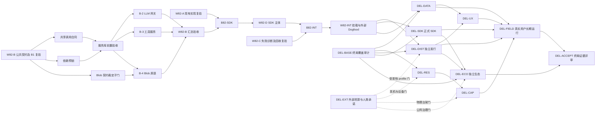

# 通往通用现代 NLOS 的总交付任务计划书

> 状态：`IN_PROGRESS`，2026-11-16。维护者已授权开始推进；首波为 `W82-A-VERIFY`、`W82-C-DIAG` 与 `W82-B-CONTRACT`。本文是管理层唯一总交付路线，执行获准不等于能力已实现，后续工作包仍须满足各自依赖与验收门。
> 编制：`ALIGN-20261114-PLAN / Attempt 1`；读取基线 `a3a1c007560306e6081d7dceff423b4ae8a33cb5`，其功能基线为 `d2a32de9fb02878584eaa85011cf5eaa64085180`。Owner：项目维护者；执行由各工作包具名责任人承担。
> 执行者：按 [项目并行与提交协议](./project-knowledge-progressive-disclosure.md#61-子-agent-编排与依赖感知并行) 使用子 Agent，结合 `superpowers:subagent-driven-development` 执行；未勾选项尚未通过完整验收，不是 DONE 回执。首波 Attempt 为 `20261116-1`，基线为 `6415600db5c165a828108709a3dc57602169abaf`；当前回执见[阶段 E 执行记录](./stage-e-progress.md#2026-11-16-首波执行)。

**目标**：沿既有 A–E 路线，把当前已验证基座交付为第三方可扩展、用户可长期使用、可持续升级的 Windows/macOS 级通用现代 NLOS。

**架构**：复用现有内核权威、分布式服务、桌面、兼容与商店基座；先关闭 W82 对外接入断层，再通过独立发行、真实应用/用户和长期运行暴露缺口，按证据补齐。宿主 OS、Wasm、数据库和成熟工具继续承担适合复用的机制。

**技术基线**：仓库固定的 Rust 工具链、SQLite authority、Protobuf SABI、Process + Wasmtime、Tauri、Python/TypeScript SDK；具体版本读取执行时锁文件，本文不建立第二套版本源。

**Spec**：[v0.5 §1、§27–§30](../design/06-架构设计总纲-v0.5.md)、[阶段 E 权威进度与 W82](./stage-e-progress.md#e618-w82-后续生态接入)、[W82-B 已裁定设计](./w82-b-design-draft.md)、[SDK 等级定义](./language-sdk-support-plan.md#2-支持一种语言的等级)。

## 1. 事实起点、权威归属与范围

- A–D 在各自验收边界内已 `EXITED`；E0–E7 为 8/8 工程完成，阶段 E 仍待维护者签字，不能代签 `EXITED` 或 SABI v1.0 长期冻结。
- W82 的 A 会话与 B1–B4 库级服务已完成三平台验收；`W82-C` 与 `W82-D` 已完成 macOS 本地验收（[W82-C](../evidence/stage-e/w82-c-acceptance-20261121.md)、[Python SDK](../evidence/stage-e/w82-d-py-sdk-20261121.md)、[TypeScript SDK](../evidence/stage-e/w82-d-ts-sdk-20261121.md)，三平台 CI 待补跑）；`W82-INT` 维持 `IN_PROGRESS / PARTIAL`（已完成 `nlos-compat-shim` 三保留名映射、Daemon 吊销联动进程树回收、14 处勘误清零，并在 `W82-R3` 完成 `GAP-2 Part A` 网关信封对齐修复 [W82-R3-GW-FIX](../evidence/stage-e/w82-r3-gateway-envelope-fix-20261121.md) 与起草 [ADR-0028](./adrs/0028-w82-int-service-authorization-and-wire-binding.md) `PROPOSED`，**待人类维护者批复 `1A/2A/3A/4` 以解锁 `W82-R4` `GAP-1/2B/3` 与全 8 通道 Daemon 实时挂载**；另 `DEL-BASE` 表 3A 首轮校准与 `DEL-RES` 12 维画像已入账，见 [W82-INT 预检与签认清册](../evidence/stage-e/w82-int-precheck-20261121.md)、[DEL-RES 资源边界画像](./del-res-resource-profile.md)）；`W82-R4-IND`（2026-11-22，`DEL-BASE` 后不阻塞于 `ADR-0028` 的 4 路独立工程加固波）已在单机 macOS 完成本地实测（[B-RUNTIME-U11](../evidence/stage-b/b-runtime-u11-o1-purge-and-wake-storm-20261122.md) `H4`、`nlos-runtime-tokio` `181 passed` & `100K` 唤醒风暴 `wake_settle=85.97ms`；[C-SCHED-002](../evidence/stage-c/c-sched-002-indexed-select-scale-20261122.md) `H4`、`nlos-plan` `select_bounded` `100K` 提速 `216x-750x`；[D-NOTIFY-ATTN-001](../evidence/stage-d/d-notify-attention-policy-20261122.md) `H4`、`nlos-notify` `42 passed`；[E-ECO-001](../evidence/stage-e/e-eco-001-road-a003-pure-code-no-model-20261122.md) `H4`、`nlos-slice-k` `ROAD-A-003` 无模型纯代码闭环 `129 passed`），台账同步至 `224` 份证据（`H8 = 0`、三平台 CI 与桌面/外部生态门仍保留）。
- 历史基线 `a3a1c007` 的 push CI 常规 9 作业成功，2 个规模作业跳过，Pages 部署成功。`d2a32de9` 的原 Worker E2E 失败已诊断并在首波集成代码的 `include-ignored` 作业复验通过，原负面证据保留。[历史 push CI](https://github.com/cty12356541/llmos/actions/runs/43571919333) · [历史 Pages](https://github.com/cty12356541/llmos/actions/runs/43571919328) · [C 诊断 Evidence](../evidence/stage-e/w82-c-diag-20261116.md)
- 当前 H8 为 0；H4/H7、同仓参考应用、三平台 CI 均不能替代生产用户、独立开发者或实际发行安装证据。动态数量和最新 CI 以[阶段 E 当前执行记录](./stage-e-progress.md)及原始台账为准。
- 本文负责跨能力交付顺序、工作包和终局验收；阶段进度归 `stage-*-progress.md`，需求归 v0.5，决策归 ADR，事实归源提交/Evidence，风险归 `risks.yaml`，声明归 `claims.yaml`。本计划不得覆盖这些对象。
- 后续 `DEL-*` 仅为管理工作包 ID，分别承接既有 B/C/D/E 能力；不新增正式阶段或 Requirement。全球联邦、完整硬件生态、消费级完善等按 §29.2 分包演进；裸机不是完成终局的前置条件。

## 2. 全局约束、派发和准出规则

1. 所有副作用共用 typed Intent/Action、Capability、Resource、Receipt；NL/GUI/CLI/API 无特权捷径。不能阻止旁路的部署按 `COOPERATIVE` 声明，不能宣称 strict。
2. 现有 v1.0 九通道与黄金语料零破坏；W82 三新通道保持已裁定的 64 KiB 编码载荷界、contract epoch 1、增量兼容与独立身份语义。设计冲突先形成裁定，不靠修改测试绕过。
3. 一个派发 = Task ID + 独立 Attempt + base HEAD + read-set + write-set + 验收与 Evidence 路径。以下 `R/W` 是允许范围，启动时收窄到实际文件清单；代码与对应测试归同一 owner。
4. 实现、普通核查、测试和文档默认 `gpt-6.1-sol / ultra`；跨模块契约、疑难诊断和独立安全/终审使用 `gpt-6-astra / ultra`。速度跟随主 Agent；人类签字、发行账号和真实用户不会由 Agent 角色替代。
5. `READY` 必须同时满足：依赖验收完成、契约无未决冲突、写集独占、工具/宿主可用、owner 接单。本文编制时所有包初始均为 `PROPOSED`；当前派发与验收状态见阶段进度单，“首批可派发”只表示条件齐备后可进入 READY。
6. 常规实现按“失败测试/复现 → 最小修改 → 目标验证 → 独立审查 → 集成复验”推进；只读复验不要求制造失败测试。每包独立提交，显式暂存写集；禁止顺带清理共享脏工作区。
7. 每个包输出 `docs/evidence/<所属既有阶段>/` 下的具名记录，含 SHA、环境、命令、原始输出/摘要、负例、范围和限制；管理计划本身不入 Evidence 索引。证据编号由 INT 查重后分配。
8. `VERIFIED` 需本包正向/失败/安全门及独立审查通过；`DONE` 另需最终树复验、入口/阶段进度/台账更新和提交回执。push、CI、发布、现场验证分别记录，不互相推断。

**重点审查输入**：多主体伪造/吊销竞态（B4/INT）；崩溃后不确定副作用与重复调用（B2/B3）；过界帧/大载荷/资源耗尽（A/B4）；干净宿主与空环境差异（C/D/DEL-DIST）；长时数据增长、离线与用户恢复（DEL-DATA/DEL-FIELD）。

## 3. 近端依赖图与并行屏障

- **首批并行**：A 复验、C 失败诊断、B 契约/B1 复核；槽位允许时 DEL-BASE 与签名/硬件/维护者资源调查可独立开展。现有三条旧派发工作树仅作追溯，重新核对 revision 后创建新 Attempt。
- **B 内下一波**：公共契约/B1 及 Blob schema 子门已通过。共享调用合同和依赖预锁独立验证，由 integrator 合流并通过前置验收后，B2/B3/B4 各自独占 driver/sandbox/capability 并行。安全首次打开属于 B4 的具名验收。B3 先验小参数路径，大参数引用联动留 INT，接口变化重过受影响屏障。[服务库前置](#w82-b-service-prerequisites服务库公共前置)
- **Windows 规模验证**：`CI-WINDOWS-SCALE-BARRIER` 独立修正 Regime B 探针的准备屏障，并在隔离 Windows runner 复验。该取证与 C 的 Unix Worker 原定时门分别跟踪，可与契约及服务库工作并行。
- **共享对象收口**：`schema/**`、`gen/**`、`crates/nlos-schema/**`、跨语言注册表/conformance 仅由 B integrator 按原 W82 归属集成。根、各 crate 和受影响独立工作区 Cargo 清单及锁由 integrator 串行处理。共享调用合同冻结后由各服务消费，B4 只写 capability 的 Blob 部分。daemon 会话槽位与撤销分派仅由 INT 在 A 验收后写。
- **既有屏障不变**：`B82-SDK = A + B` 验收；D 前置件复验可先行，D 主体在屏障后执行。`B82-INT = C + D` 验收；INT 再完成 C 吊销联动、三服务和真实消费者。
- 每个依赖子图独立过屏障。某车道失败仅阻塞依赖者；无关只读审计/外部资源准备继续。父 Agent 负责派发、审查、汇总，最终 canonical 由一个 integrator 更新。

## 4. W82 可派发工作包

### W82-A-VERIFY：已合并会话与五通道验收

**Owner**：IPC 验证 Sol；独立边界审查 Astra。**blocked-by**：读取最新合并基线；**blocks**：B82-SDK、INT daemon 写入。
**R/W**：R=`nlos-ipc`、`nlos-system-control` 及 PR #43；W=这两 crate 的 A 原有测试/实现子集与本包 Evidence。输入为已合并实现，输出为复验回执；无反例则不改代码。
- [x] Windows 候选验证明文/认证各单连接 1,000 轮、独立同连接五通道混合分派与 clock 写事务计数，覆盖空闲关闭、断连、半帧、超限/畸形拒帧、60s 窗口老化、窗口内第 9 次断连、身份与连接隔离。测试列表、计数和断言范围见 [A 复验 Evidence](../evidence/stage-e/w82-a-verify-20261116.md)。
- [x] Windows 候选执行 `cargo test -p nlos-ipc --test session_mux` 与 `cargo test -p nlos-system-control --features daemon --test daemon_session_mux`；真实 Named Pipe 用例分别为 2 项与 12 项。
- [x] 集成代码 `4fc70be1` 在三平台完成 IPC 12/12、daemon 17/17 与拒帧老化，含真实 Unix socket / Named Pipe。主树定向验证和独立审查通过，A 验收完成。B 汇总通过后已开放 B82-SDK。[集成验收](../evidence/stage-e/w82-a-verify-20261116.md#2026-11-16-集成代码三平台验收)

### W82-C-DIAG：定时失败根因与受管 Worker 回收

**Owner**：诊断 Astra、定界后修复/验证 Sol。**blocked-by**：旧失败日志与对应 SHA；**blocks**：B82-INT（不阻塞 B2/B3/B4）。
**R/W**：R=`crates/nlos-up/tests/workers_e2e.rs`、定时 workflow、C 已合并代码；W=`crates/nlos-up/**`、`crates/nlos-package/**`、`crates/nlos-process/**` 中具名最小修复集与 Evidence；workflow 改动先交 integrator。
- [x] 保存 43530982662 原日志，定位通用 READY 前缀允许在 brain 启动前返回的竞态；等待带 Worker 数量的完整行，保留确定性红绿结果。诊断、验收及环境差异见 [C 诊断 Evidence](../evidence/stage-e/w82-c-diag-20261116.md)。
- [x] Ubuntu 22.04 局部执行 `cargo test --locked -p nlos-up --test workers_e2e -- --nocapture`；Windows 执行 `cargo test -p nlos-process --test platform_kill`，见真实父子树与兄弟不误杀用例。
- [x] 清单启动 adapter/brain、最小环境、根 ID 格式及真实权威绑定、父退出后重启、安全回收已在 macOS 本机验收；[W82-INT](../evidence/stage-e/w82-int-precheck-20261121.md) 已落地 Daemon 令牌吊销联动进程树回收，三平台 CI 复跑与跨权限/breakaway 残域继续按 U-2 保留。[C 验收 Evidence](../evidence/stage-e/w82-c-acceptance-20261121.md)
- [x] 集成代码 `4fc70be1` 在 Ubuntu 26.04.1 的 `cargo test --workspace --no-fail-fast -- --include-ignored` 作业成功。原失败项 `workers_launch_env_whitelist_and_sigterm_reclaims_tree` 实测通过，关闭原定时失败的 C-DIAG 子门。[复验记录](../evidence/stage-e/w82-c-diag-20261116.md#2026-11-16-集成代码的-ubuntu-worker-复验)

### CI-WINDOWS-SCALE-BARRIER：Windows Regime B 规模探针准备屏障

**Owner**：规模探针实现与验证 Sol，关键计时审查 Astra。**blocked-by**：Windows 定时失败原始日志与分诊；与 C 的 Unix Worker 诊断分别验收。
- [x] 分诊发现旧 Windows 三轮均未过 Regime B 的 2→8 分片吞吐门。隔离回归在最后一笔预置 Group 事务前暂停分片时，父已可见 ready。该缺口对原吞吐失败的实际影响尚未证实。[原 Windows 作业](https://github.com/cty12356541/llmos/actions/runs/43649840304/job/132615620831)
- [x] 将各分片 ready 移到所有预置事务之后，并在分片早退时终止和回收仍等待 go 的同伴进程。独立复核通过，主树 6 项非性能用例通过。时序诊断记录准备、等待、工作时长、父墙钟和聚合跨度上下界，原持久化设置、阈值和尝试次数保留。见[准备屏障 Evidence](../evidence/stage-c/c-bench-readiness-20261116.md)。
- [x] `4fc70be1` 修后 Windows 主作业的原分片吞吐目标通过，外层套件 7 通过、1 忽略（内部入口）。成功日志未展示 Regime、吞吐或逐分片时序，旧失败因果与精确跨进程跨度待取证。[Windows 复验](../evidence/stage-c/c-bench-readiness-20261116.md#2026-11-16-修后-windows-目标复验)
- [x] 同源码在隔离 Ubuntu runner 原样运行目标并采样，首轮 Regime C 通过，原主作业长尾未复现。[Ubuntu 独立诊断](../evidence/stage-c/c-bench-readiness-20261116.md#2026-11-16-ubuntu-独立诊断)
- [ ] 在失败时收集同类 CPU、I/O、挂载和前序测试数据，或固定宿主配对测量完整前序测试与独立目标执行。保留现有吞吐门、工作负载和 WAL/FULL，待获得可比较数据后再决定修复。

### W82-B-CONTRACT：B1 复验与服务契约冻结前复核

**Owner**：B integrator + Astra 契约审查，机械复验 Sol。**blocked-by**：B1 合并树；**blocks**：公共子门阻塞 B2/B3/B4；Blob 子门仅阻塞 B4 和 D/INT 的相关能力，B82-SDK 汇总仍要求 B 完整验收。
**R/W**：R=已裁定 D1–D11、三新 proto、SDK/daemon 消费点；W=B 原有 schema/gen/注册表/黄金与 conformance 写集、设计冲突记录、Evidence；共享变更由此唯一 owner 集成。
- [x] 复核已合并 B1。维护者 2026-11-16 补充裁定见[设计 §5.5](./w82-b-design-draft.md#55-2026-11-16-补充裁定blob-可实施契约)：应用消息只传引用，Blob 服务逐块鉴权并返回对齐块或末尾短块；有效块上限 65,408 字节，完整编码载荷上限 65,536 字节；显式接收者绑定认证身份；重启后旧令牌失效，禁止按旧路径重开。字段、Rust 编码双界与边界向量见 [B 契约 Evidence](../evidence/stage-e/w82-b-contract-20261116.md)。
- [x] 库消费者按契约注入共享调用绑定与侧带证明。Blob reference ID 和裸 URI 与 holder/recipient 授权分离。当前授权、重启令牌失效、chunk 与资源界均有库级正负例。[B2 五维预算](../evidence/stage-e/w82-b2-llm-gateway-20261116.md) · [B3 工具执行](../evidence/stage-e/w82-b3-tool-service-20261116.md) · [B4 签名 Blob](../evidence/stage-e/w82-b4-blob-service-20261116.md)
- [x] 候选执行 `cargo test -p nlos-schema`、`npm run schema:lint`、`npm run schema:typecheck`、`python tools/check_golden_immutability.py`、`python -m unittest discover -s tests/conformance/schema -p "test_*.py"`，保存工作树回执。
- [x] B1 公共 schema/codec 和 Blob 契约子门通过独立审查。运行时共享调用合同与依赖预锁另由服务库前置工作项验收。
- [x] 提交至 `4fc70be1` 后，原 `npm run schema:check-generated` 退出 0，24 个生成文件与提交基线一致。见[阶段 E 首波回执](./stage-e-progress.md#2026-11-16-首波执行)。
- [x] 以新增 proto 前的可达提交 `6e9f0a9f^` 和候选树执行真实双版本 `sabi_compat_diff.py`，保存输入、JSON 与 digest，并通过黄金不可变检查。两次差异对照与制品见 [B 契约 Evidence](../evidence/stage-e/w82-b-contract-20261116.md)。
- [x] `4fc70be1` 在三平台运行 `sdk/go` 的 `go test ./... -count=1` 均通过，根目录的 `dotnet run --project sdk/csharp/llmos-sabi-probe/llmos-sabi-probe.csproj` 各 30/30。已合并 B1 的结果随历史基线保留。[三平台契约回执](./stage-e-progress.md#2026-11-16-首波执行)

真实 daemon slot、认证与 custody、签名输送、受信根及大参数 materializer 在 [INT 系统验收](#w82-int-dogfood-e2e系统挂载撤销联动与真实消费者) 逐项关闭。

### W82-B-SERVICE-PREREQUISITES：服务库公共前置

**Owner**：公共合同与依赖准备 Sol，独立审查 Astra，根与受影响独立 workspace 锁由 integrator 串行合流。**blocked-by**：B-CONTRACT 的公共 schema/codec 子门。**blocks**：B2/B3/B4 开工。

- [x] 共享调用合同通过独立审查和主树复验。默认拒绝，精确绑定调用身份、方法、目标、能力代际、摘要和时间。各服务自行取当前宿主时间并重新授权。
- [x] 预锁修复版本 `cap-std` / `cap-fs-ext` 4.0.3 与服务所需的 crate 依赖。六份锁、主树三个目标 MSRV 编译与供应链检查通过，冻结制品核验一致。rooted opener 的本机安全测试归 B4。[前置 Evidence](../evidence/stage-e/w82-service-prerequisites-20261116.md)

### W82-B-2：受控 LLM 五维预算网关

**Owner**：服务实现 Sol，预算/崩溃审查 Astra。**blocked-by**：服务库公共前置。**blocks**：B 汇总验收、D、INT。
**R/W**：R=`llm_gateway.proto`、D4/D8、`nlos-resource`；W=`crates/nlos-driver-llm-http/**` 与本包 Evidence，零直接写 `nlos-resource`/schema/daemon。输入已认证上下文，输出四方法服务库、持久预留 journal、报价/衰减及咨询对账。
- [x] 正向：`llm_chat/query_budget/attenuate_budget/record_external_usage`；先持久预留、后发包、权威 consume 唯一硬扣，父子五维不变量；CJK/报价从服务端推导，外部自报只入咨询区。
- [x] 失败：并发准入、provider 超时/断流、持久 settlement intent 后或 consume 后崩溃、SETTLE_REJECTED、重放/同键异摘要。安全：不足零发包、可信子会话绑定与账户 sidecar、咨询与子账户数量有界，原始凭据不出服务边界。
- [x] 执行 `cargo test -p nlos-driver-llm-http`，把上述情形加入该 crate 自动发现的具名测试；归档故障点、实际用量与 quote 差异、重放结果及三式断言。失败尝试 provider 真实计费和旁路调用限制必须保留。
- [x] 独立审查与最终三平台具名验收通过。当前交付为 OBSERVED 测试范围；真实 provider H5 与 STRICT 外部支出另行验收。[B2 最终回执](../evidence/stage-e/w82-b2-llm-gateway-20261116.md#最终三平台验收)

### W82-B-3：沙箱工具执行与持久 Operation

**Owner**：沙箱实现 Sol、安全/取消审查 Astra。**blocked-by**：服务库公共前置与已预锁 sha2。**blocks**：B 汇总、D、INT。大参数的真实引用联动归 INT。
**R/W**：R=`tool_sandbox.proto`、D9、Operation/Wait 契约；W=`crates/nlos-wasm-sandbox/**` 与 Evidence。输入已授权工具/参数，输出 `list_tools/invoke_tool` 服务库及可替换的持久 `ToolOperationStore`。
- [x] 正向：工具目录按 Wasm digest 缓存、per-call 独立宿主、结果可持久重放。失败：持久 dispatch 前取消、运行中 EffectUnknown、完成与取消竞态、deadline 和 journal 崩溃恢复。安全：未知工具与路径/网络逃逸拒绝，stdout 256 KiB、有界 stderr、逐调用写入 8 MiB，非零 epoch 下孤儿自灭。
- [x] 执行 `cargo test -p nlos-wasm-sandbox` 与 `cargo test -p nlos-wasm-sandbox --test escape_matrix`；补齐真实服务角色进程被杀后孤儿终止、同键冲突/不确定不盲重做和逐调用资源测试；记录三平台 spawn+run 分位耗时。
- [x] Evidence 收录三平台新增逃逸矩阵及隔离上界。MCP 外部 server 桥归 DriverProvider；本验证覆盖既有 WASI 导入与受控宿主。[B3 最终回执](../evidence/stage-e/w82-b3-tool-service-20261116.md#最终三平台验收)

### W82-B-4：Capability 约束的大载荷引用

**Owner**：能力实现 Sol，授权/TOCTOU/DoS 审查 Astra。**blocked-by**：服务库公共前置及 Blob schema/codec 子门。**blocks**：B 汇总、D、INT。
**R/W**：R=`blob_reference.proto`、D5 及[设计 §12](./w82-b-design-draft.md#12-l-015-选项-b-的-tcb-增量分析与内存dos-有界性安全论证必备件)、Capability 签名/吊销；W=`crates/nlos-capability/**` 与 Evidence，schema 变更只提给 B integrator。输入受控工作区文件和主体，输出 mint/read/release 库及 additive 令牌表。IdentityAuthority 当前 principal 查询已由独占增量适配并审查。
- [x] 正向：真实双主体授权传递、签名 mint/release、摘要/长度/分块校验、release/TTL 收敛。失败：中途吊销、过期、读次耗尽、进程重启/文件变更。安全：三平台从已授权根安全首次打开并验证替换竞态，覆盖 mint 后换靶、读间改写、越界与跨主体读取、并发 mint/read 耗尽。
- [x] 执行 `cargo test -p nlos-capability`；在既有 DDL/故障套件加入令牌表保护、fd 钉住/块校验、真实授权接收者与未授权主体对照；边界测试使用完整编码长度，不能只断言 chunk 长度。
- [x] Evidence 给出 TCB 增量、连接/令牌/fd/内存上界和永久审计行增长限制。库内 WAV 往返已验；qq-agent 落盘过渡退役归 INT。[B4 最终回执](../evidence/stage-e/w82-b4-blob-service-20261116.md#最终三平台验收)

### W82-B-SERVICES-ACCEPTANCE：三服务库汇总验收

**Owner**：单一 integrator，独立审查 Astra。**blocked-by**：B1、公共前置、B2/B3/B4 库正负例与持久/安全、TCB 和资源边界证据。**blocks**：W82-B DONE 与 B82-SDK。

- [x] 三服务候选与首轮修复经独立审查。B3 关闭取消与同步恢复专项，B4 关闭预留、截止时间、并发取时及受控 WAL 提交尾部专项。[B2 五维预算](../evidence/stage-e/w82-b2-llm-gateway-20261116.md) · [B3 工具执行](../evidence/stage-e/w82-b3-tool-service-20261116.md) · [B4 签名 Blob](../evidence/stage-e/w82-b4-blob-service-20261116.md)
- [x] 跨实例配额修复通过隔离复验与独立增量审查。冷目录和 invoke 共用 authority 配额，首个成功构造固定限额，后续冲突拒绝。[B3 配额证据](../evidence/stage-e/w82-b3-tool-service-20261116.md#同一-authority-的共享宿主配额)
- [x] 主树本机完成初验四包 tests/Clippy/MSRV、六锁和供应链，配额修复后三条沙箱变更受影响复验通过，含全 workspace fmt。初验和后修复的结果分别绑定源快照。[主树回执](./stage-e-progress.md#2026-11-16-三服务库验证)
- [x] 源码 `2b8d0683` 的原生三平台和具名门各 19/19，含工具 latency/escape、Windows 真实 symlink、Linux 正常 `openat2` 与实际注入 ENOSYS 的 fallback；三平台 workspace、ROAD-E-001、严格 Clippy 通过。[第四轮 Rust](https://github.com/cty12356541/llmos/actions/runs/43857200084) · [原生汇总](../evidence/stage-e/artifacts/w82-services-20261116/native-ci-fix3-20261116/ci-summary.json)
- [x] W82-B 库级验收 DONE，A+B 开放 `B82-SDK`。真实 daemon 权威接线、SDK 客户端、Worker 联动和外部 Dogfood 由后续工作包验收。

前三轮失败按原 SHA 保留。第四轮 macOS 持久重放已通过；第三轮 `Busy` 的具体打开阶段和锁持有者仍未知。[本轮回执](./stage-e-progress.md#2026-11-16-三服务库验证)

### W82-D-SDK：Python/TypeScript 完整窄腰与干净安装

**Owner**：SDK Sol；跨语言安全与错误语义审查 Astra。**入口**：B82-SDK 已开放；**blocks**：B82-INT、DEL-SDK。
**R/W**：R=A/B 定稿、已合并 wheel/认证前置件、SDK 等级定义；W=`sdk/python/**`、`sdk/typescript/**`、`tests/conformance/ipc/**` 与 Evidence。新增 `wait/operation/llm_gateway/tool_sandbox/blob_reference` 客户端模块，名称和类型从已合并生成物取得。
- [x] 正向与失败边界（目录协商、认证持久连接、Wait/Operation/LLM/Tool/Blob 客户端、wheel 树外安装与本地 socket 安全边界）已在 macOS 完成本地验收；Py/TS `SDK-3` 保持受限 `PARTIAL_PASS`（live daemon 暂缺三新服务挂载，见下节三项前置缺口）。[Python SDK Evidence](../evidence/stage-e/w82-d-py-sdk-20261121.md) · [TypeScript SDK Evidence](../evidence/stage-e/w82-d-ts-sdk-20261121.md)
- [x] `python3 -m unittest discover -s sdk/python/tests`、`npm run schema:typecheck`、`npm run ipc:test:typescript` / `directory:test:typescript` / `wait-control:test:typescript` / `sabi-v1-1:test:typescript` 与 Python 一致性脚本已在 macOS 接入并实跑通过。
- [x] `python3 sdk/python/scripts/verify_wheel.py` 已按宿主选择解释器并在源码树外、剥离 `PYTHONPATH` 验证 12 个 `*_pb2.py` 与 27Exports；三平台远端 CI 复验待跑。
- [ ] Evidence 已分列 SDK-0..4 与受测平台；wheel 可安装与新增客户端不等于 PyPI/npm 发布，也不自动晋升 SDK-4。

### W82-INT-DOGFOOD-E2E：系统挂载、撤销联动与真实消费者

**Owner**：单一 integrator Sol，整条安全/故障链独立终审 Astra；外部仓负责人维护 qq-agent。**blocked-by**：B82-INT + 三项前置契约/库/策略签认；**blocks**：W82 DONE、后续交付候选基线。
**R/W**：R=各车道回执；W=`crates/nlos-system-control/**`、`crates/nlos-compat-shim/src/sabi_adapter.rs`、Studio 徽标实际文件、根依赖/锁文件、W82 Evidence 与共享治理台账。qq-agent 是单独 Task/write-set，取得对应仓授权后执行，不隐式扩大本仓权限。
- [x] 预检阶段（`W82-INT-WAVE2` `IN_PROGRESS / PARTIAL`）已完成 `nlos-compat-shim` 三保留名映射、Daemon 令牌吊销联动进程树回收（`SystemControlDaemon::reclaim_revoked_capability_workers`）、14 处「13→14 导入」勘误清零与 4 份新证据入账；同时固化阻塞全 8 通道挂载的三项源码前置缺口（`BlobReferenceService` sidecar/非空摘要、`Gateway::handle_wire` schema 与 `attenuate_budget` `ChildSessionBinding`、`CapabilityRights` 分服务策略签认，见 [W82-INT 预检与签认清册](../evidence/stage-e/w82-int-precheck-20261121.md)）。
- [x] `W82-R3` 增量修复与架构定稿草案（`2026-11-21`）：已完成 `GAP-2 Part A` 网关 `Envelope` 编解码对齐修复（[W82-R3-GW-FIX](../evidence/stage-e/w82-r3-gateway-envelope-fix-20261121.md)，`H4`）并起草 [ADR-0028](./adrs/0028-w82-int-service-authorization-and-wire-binding.md)（`PROPOSED / DESIGN`，推荐方案 `1A/2A/3A/4`），待人类维护者显式签认后进入 `W82-R4` 实施 `GAP-1 / GAP-2 Part B / GAP-3`。
- [ ] 待维护者签认 [ADR-0028](./adrs/0028-w82-int-service-authorization-and-wire-binding.md) 并完成上述剩余前置修复后：挂载全 8 通道服务、认证 principal→会话槽位→权威 CapabilityId 与 C 根 ID，验证签名与 custody 输送、受信 workspace resolver、Blob 大参数 materializer 和重启接线，并完成双 Worker 快慢双脑与外部 `qq-agent` 消费闭环。
- [ ] 真实消费者验证零应用明文 provider key、自建预算库/防火墙/supervisor 可退役；逐个核对旧实现删改与替代路径。模拟消费者可以先验接口，不能代替 qq-agent 真实回执或独立生态。
- [ ] 执行 `cargo test -p nlos-system-control --features daemon`、`cargo test --workspace`、`python scripts/run_road_e001_upgrade_matrix.py`，核对 8 个 N-1 冻结包、16 份封存制品及零源码修改/重编译/重签；新服务失败、吊销、重启与旧客户端兼容必须同时覆盖。
- [ ] 补跑受影响 CI/定时门，运行 `python scripts/lint_claims.py`、`python tools/verify_stage_e_ledger_coverage.py --mode strict`、`git diff --check`。按最终 SHA 汇总每车道 Evidence，更新 stage E/claims/risks/index 与 L0，独立终审后才晋升 W82；E 正式退出仍是另一个人类决定。

## 5. 通往终局的后续交付包

以下包都是 `PROPOSED`，不以编号暗示新阶段。每包先复验现有能力，确认缺口后才实施；不确定方案的调查产物必须是可裁定方案、受测原型和下一步精确写集，不能只留下 TODO。

### DEL-BASE：规范到实际产品的覆盖审计（承接 B/C/D/E）

**Owner/依赖**：架构 Astra + 事实核验 Sol；可立即准备，与 W82 独立；阻塞后续包范围定稿。R=v0.5 最高目标/路线、现有进度/claims/risks/相关 Evidence；W=本计划各包输入及按权威对象分配的差距修订。
- [x] 已完成首轮只读覆盖审计产出 [DEL-BASE 规范到实际产品覆盖审计报告](./del-base-coverage-audit.md)，覆盖“需求→能力→现有 Evidence→缺口→本计划包→release profile”映射、逐条核对 U-1..U-14 与风险台账，并在本计划与 [README](./README.md) 挂接索引入口；**`W82-R3` 已完成表 3A 共享台账首轮校准**（注册 3 份新证据至 `220`、将 17 份零引用已入库证据回填至 `claims.yaml`、并同步校准 `ADR-0027` / `w82-b-design-draft` / `language-sdk-support-plan` / `risks` / `exit-unknown-risks`）；**`2026-11-22` `W82-R4-IND` 已同步 4 路独立工程加固实证至 `224` 份证据**（回填 `claims.yaml`、`risks.yaml`、`del-res-resource-profile.md`、`exit-unknown-risks.md`）。
- [ ] 待结合 [ADR-0028](./adrs/0028-w82-int-service-authorization-and-wire-binding.md)（`PROPOSED`，待人类维护者批复 `1A/2A/3A/4` 以解锁全 8 通道 Daemon 实时挂载）签认、`W82-R4` 实施复验与后续交付包启动窗口，按权威对象继续闭环表 3B 与架构缺口修订。验收：§1.1 十类完整性目标与 §28 全部 ROAD 门有归属，未知项有 owner/调查命令/裁定条件；`lint_claims.py` 与 strict 覆盖率通过。不得用全局百分比或同名第二份规范替代缺口。

### DEL-DIST：独立发行、安装和升级（承接 B/D/E）

**Owner/依赖**：发行 Sol，安装/供应链审查 Astra；依赖 W82-INT、DEL-BASE，签名子门依赖 DEL-EXT。R=现有 nlos-up、desktop、package/更新/回滚；W=实际发行脚本、CI、安装配置、用户文档及 Evidence，启动时收窄。
- [ ] 先清点现有制品/构建/更新链，定义 Windows/macOS/Linux 支持 profile；交付可校验制品、SBOM、干净宿主安装/首次启动/凭据托管/升级/回滚/卸载入口，无源码树和开发工具隐式依赖。
- [ ] 验收正向为三平台安装到用户完成应用任务；失败为断网、缺依赖、部分升级、低磁盘和恢复；安全为签名不符/降级/污染安装路径拒绝、卸载保护用户数据。复用 `npm --prefix desktop run build`、现有 Rust 门及升级矩阵，新增真实安装/升级 CI job。
- [ ] Evidence 记录制品 hash、OS/架构、安装日志、回滚前后数据 digest；无签名可作为明确标记的内部试用制品，不作正式签名发行 Claim。

### DEL-SDK：可独立消费的官方开发者平台（承接 B/E）

**Owner/依赖**：SDK/文档 Sol，契约审查 Astra；依赖 W82-D/INT、DEL-BASE，公开发布依赖账号/维护政策。R=SDK 等级与现有探针；W=SDK 发布元数据/CI、开发者文档和测试 kit。
- [ ] 交付固定 profile 的 Rust/TS/Python 包、发布/撤回/迁移策略、debug/trace/Receipt 教程及 conformance kit；Go/C# 先核既有黄金探针，只有真实消费需求与维护 owner 才补 IPC→SABI→SDK-4，其他语言按需求调查。
- [ ] 验收为独立临时项目仅使用发布制品开发、调试、打包应用；覆盖三平台错误/cancel/uncertain/版本协商和破坏性升级拒绝；登记包版本/注册表回执/摘要及支持矩阵。不得把 checked-in 生成物或本地 wheel 当正式发布。

### DEL-DATA：持久用户数据、检索与多模态工作流（承接 B/C/D）

**Owner/依赖**：数据 Sol、权限/同步审查 Astra；依赖 DEL-BASE，外部多媒体通路依赖 W82-B4/INT。R=Artifact/Context/Search/semantic/同步与已有数据 Evidence；W=确认缺口对应 crate、数据工具与测试，禁止未经审查引入第二数据权威。
- [ ] 复验文档、图片、音频/视频引用从导入→应用处理→搜索→共享→导出/删除/恢复的连续路径；调查并裁定索引失效、配额/GC、备份恢复、跨设备冲突和多媒体 codec 边界，再给出最小缺口修复。
- [ ] 验收覆盖离线/重连、重复同步、损坏 blob、并发 GC（U-12）、低磁盘、删除后索引撤回、权限变化后检索不可泄漏、出处/taint 保留；复用相关 artifact/search/semantic crate 测试并增加端到端数据 corpus。
- [ ] Evidence 给出前后 digest、恢复点/恢复时间、索引重建耗时及隐私边界；大文件和长期数据增长必须实测，样板小数据通过不作全容量声明。

### DEL-UX：非开发者完整桌面使用闭环（承接 D）

**Owner/依赖**：桌面 Sol、可访问性/可信 UI 审查 Astra，人类用户参与；依赖 DEL-BASE、DEL-DATA 接口，真实安装验收依赖 DEL-DIST。R=阶段 D 既有门；W=desktop 已定位缺口、用户文档、交互回归与 Evidence。
- [ ] 先复验窗口/通知/设置/搜索/Task Space/手工调度、NL 计划预览编辑、成本/权限、离线恢复、多模态、CJK 和无障碍；以用户任务发现缺口，不重做已验证工作站。
- [ ] 验收为无需编排知识完成多应用前后台任务、随时查看/暂停/撤销并得到一致 Receipt；失败包括 provider 离线/误解意图/授权拒绝/任务恢复；安全包括注入内容不能伪造 Z4、辅助技术与输入法不能误确认高风险动作。
- [ ] Evidence 录屏/任务记录须脱敏，区分自动化与真实用户；补足物理 macOS 手势、屏幕阅读器/键盘操作与安装后实际使用，现有 1,000 轮浸泡不替代持续用户研究。

### DEL-RES：现代资源与可控执行的生产边界（承接 B/C）

**Owner/依赖**：资源实现 Sol、跨宿主执法审查 Astra；依赖 DEL-BASE；硬件侧依赖 DEL-EXT。R=ResourceGroup/controller、ResourceAccount、Capacity/Device lease 与 RISK-B-03/10；W=定位后的 controller/driver 适配与测试。
- [x] 首轮产出 12 维 x 3 平台资源能力画像与基线审计（[DEL-RES 资源边界画像](./del-res-resource-profile.md) `IN_PROGRESS / DESIGN`、[B-RES-PROFILE-AUDIT](../evidence/stage-b/b-res-profile-audit-20261121.md) `H3`：`nlos-resource` `61` + `nlos-lease` `30` + `nlos-wasm-sandbox` `97` = `188` macOS 测试通过），实证零 OS `cgroup v2`/`JobObject`/`setrlimit` 宿主执行器实装并明确 `COOPERATIVE`/fail-closed 降档策略。
- [x] `2026-11-22` `W82-R4-IND / DEL-RES-ATTN-CTRL`（[D-NOTIFY-ATTN-001](../evidence/stage-d/d-notify-attention-policy-20261122.md)，`H4`）在 `crates/nlos-notify/src/attention.rs` 落地第 12 维人类注意力 `AttentionPolicyController` 边车策略引擎与 `attention-policy.db` v1（`WAL+FULL` 不可变审计、双队列隔离、跨午夜静默时段、同类聚合、单应用/全局频控、付费绕过/伪造 `ConsentPrompt` 拒接，`nlos-notify` `42 passed`）；桌面 Tauri `Z4`/UI 与分发总线真实连线（`DEL-UX`）及真实人类试用（`DEL-FIELD`, `H8=0`）仍未完成，整机/UI 端维持受限分级。
- [ ] 待按 `DEL-RES` `Lane-RES-1..4 & INT` 推进真实 OS `cgroup v2`/Windows `JobObject`（禁 breakaway `U-2`）/`setrlimit` 宿主执行器、`SystemStorageReservePool` 与 `B-CONTROL` `pause/resume/cancel` 深层接线；调查缺失 shim/部署策略并维持 fail-closed 降档。
- [ ] 验收包含争抢、pressure/reclaim/OOM、父子配额、取消/迟到回调、Windows breakaway/跨权限与设备租约失联；证明资源守恒和兄弟故障隔离，不能以 token 预算代替系统资源。
- [ ] Evidence 记录宿主权限与硬件、分维 meter/Receipt、旁路尝试和损失界；设备无法物理撤销时明确隔离/停用，不宣称物理副作用已擦除。

### DEL-CAP：容量、分布式可靠性与真实硬件（承接 C）

**Owner/依赖**：性能/可靠性 Sol，分布式终审 Astra；依赖 DEL-BASE、DEL-RES 可测 profile；真机/WAN/断电依赖 DEL-EXT。R=U-1/U-4/U-5/U-11、ScaleProfile 与 H6；W=对应探针/故障注入/最小性能修复和 Evidence。
- [x] `2026-11-22` `W82-R4-IND` 在单机 macOS `--release` 完成两项规模瓶颈加固（[B-RUNTIME-U11](../evidence/stage-b/b-runtime-u11-o1-purge-and-wake-storm-20261122.md) `H4`：`nlos-runtime-tokio` 终态 wait 清理 `O(n²)->O(k)`、`deliver` `O(1)`、`100K` 同时唤醒风暴 + 全量清理 `wake_settle=85.971ms` / `4` host threads、`batch_cancel` `100K/10K=0.58x`；[C-SCHED-002](../evidence/stage-c/c-sched-002-indexed-select-scale-20261122.md) `H4`：`nlos-plan` `SCHEMA_VERSION=9` 下新增 `plan_nodes_state_order` 覆盖索引与 `select_bounded` 6 路游标零 Temp B-Tree 归并，`100K` 并发提速 `216.32x–749.87x` / 单线程 `517.85x–744.63x` 且与 `select()` 100% 等价）。
- [ ] 先复验三平台 CI、Linux/macOS 8-Cell、`100K@50%` 完整细胞回收再入场、`nlos-system-control` `apply_plan_revision_ungated`/`UnlinkedReclaimResidency` 及 `2026-11-16` Regime B/C 根因；硬件允许后跑 1M，不将云 runner 或单机 macOS 推断为裸金属/WAN。
- [ ] 复用 workflow 的 `cargo test --release --no-fail-fast -p nlos-plan --test tasknode_scale_probe -- --include-ignored --nocapture` 及 task/runtime 探针；针对 stale epoch、双主、fanout storm、provider stall、迁移重启和真实 durability barrier 增补场景。
- [ ] 输出每节点 metadata、RSS/磁盘、p50/p95/p99、CPU/I/O、恢复扫描/控制可用性与损失界；保留原 `select()` 全量诊断接口与 `select_bounded` 分域对照，必要优化以 before/after 证据验收。物理断电、M4/M6/M8 校准、STONITH 各自独立取证，不用 Layer 2 代替。

### DEL-FIELD：真实多用户长期运行与运维（承接 C/D/E）

**Owner/依赖**：可靠性 Sol、隐私/生产准入审查 Astra，人类试点负责人；依赖 DEL-DIST/SDK/DATA/UX/RES/CAP 的受测 profile。R=部署/备份/恢复/审计与风险；W=运维工具、监测、runbook、脱敏 field Evidence。
- [ ] 调查并登记真实用户/组织、设备、数据授权和支持责任；交付用户/租户隔离、密钥轮换、备份恢复、诊断包、配额/告警、升级维护和事故处置链，在明确范围内持续运行。
- [ ] 验收覆盖多用户交叉访问拒绝、后台任务长时运行、provider 失效、网络分区、空间增长、值班接手和恢复演练；按实际服务 profile 记录可用性/延迟/成本/丢失界，不给全系统统一假 SLO。
- [ ] **待维护者确认的试点建议，非规范**：首轮连续 30 天；期间至少一次升级、回滚、凭据轮换、备份恢复与失联演练；已确认越权、不可恢复数据丢失、无法解释的重复副作用均须修复后重验。H8 仅授予实际现场验证过的 claim。

### DEL-ECO：独立第三方生态、兼容与治理（承接 E）

**Owner/依赖**：生态工具/文档 Sol，供应链/兼容审查 Astra，独立开发者与维护者；依赖 DEL-SDK/DIST、DEL-BASE，公网商店依赖 DEL-EXT/安全准入。R=现有样板/商店/PKI/认证/迁移；W=真实缺口对应生态工具、治理流程和 Evidence。
- [x] `2026-11-22` `W82-R4-IND / DEL-ECO-PURE-CODE`（[E-ECO-001](../evidence/stage-e/e-eco-001-road-a003-pure-code-no-model-20261122.md)，`H4`）在单机 macOS 交付仓内无头 `ROAD-A-003` 零模型纯代码 E2E 闭环（`crates/nlos-slice-k/tests/road_a003_pure_code_e2e.rs`，`cargo tree` 零 LLM/HTTP 客户端、双跳 `.env_clear()` 子进程零密钥/代理变量，完成签名安装、Fast 写 Artifact Rev 1、`SIGKILL` 恢复写 Rev 2、门控卸载与双版本保留，`nlos-slice-k` `129 passed / 18 ignored`）；Linux/Windows 实机与外部独立第三方团队正式交付验收（`H8=0`）仍待后续推进。
- [ ] 招募不掌握内核内部实现的开发者自行定义未预设应用，覆盖后台/交互/多组件/数据/驱动组合；记录遇到的协议缺口，优先公开 SABI 演进或核外扩展，不以为某应用定制内核通过验收。
- [ ] 验收贯通发现→安装→权限→组合→持续运行→撤回/升级/回滚/卸载；冻结第三方 N-1 制品后升级宿主，验证零整体重写；公开商店补恶意包/签名根轮换/举报撤回/灾备/审计，持续执行依赖维护与 CVE 复查。
- [ ] 显式覆盖无模型场景（外部独立团队 + 正式发行宿主）：在不配置模型 provider/凭据且封禁其访问的干净受测 profile 中，由独立第三方开发者安装确定性 pure-code 应用，运行本地代码/小 IPC Fast 路径、生成并持久化用户 Artifact，强制终止后恢复并核对数据 digest，最后卸载并核验后台/权限回收及用户数据保留。归档无 provider 调用的网络/审计记录与完整生命周期 Receipt；对应 [ROAD-A-003](../design/06-架构设计总纲-v0.5.md#281-阶段-a启动微内核)、[§27 Fast 路径](../design/06-架构设计总纲-v0.5.md#27-性能与工作负载类别)及 NLOS-GEN-001，这是场景覆盖而非用应用数量证明通用性。
- [ ] **待维护者确认的生态建议，非规范**：至少两个互不受同一实现控制域支配的真实开发者团队完成独立复现；数量只是样本下限，最终看未预见能力是否无需改内核、能力增长来源及跨版本存活证据，不以任意应用数冒充通用性。

### DEL-EXT：外部资源、长期承诺与维护接续（横切 C/D/E）

**Owner/依赖**：人类维护者负责账号/设备/组织，调查 Sol、信任边界审查 Astra；资源清点可先行，正式承诺需相应 Evidence。R=U-1..5/10、RISK-B-05/08/09；W=发行/硬件/交接清单与权威风险更新。
- [ ] 分别产出物理断电/WAN/设备复位台架方案、macOS 实机/原生签名资质路径、包注册表发布权限、生产 provider/TEE 信任边界和第二维护者接手计划；列负责人、获得条件、费用/凭据保管及不具备时允许的受限 profile。
- [ ] 各项验收用实际硬件报告、原生签名/公证结果、真实注册表回执或第二人类独立恢复/发布演练；Agent 数量不算组织去集中化。W81 签字材料可独立备齐，但不得由计划自动签字。
- [ ] 全球联邦/跨组织清算、完整设备生态与知识表达性证明分别先调查适用范围/信任模型/证明义务，交 ADR 候选和受测 PoC；未获方案裁定不承诺实现，不能将整个长期范围丢给一个无 owner 的“以后”。

## 6. 终局完成判据与滚动维护

### DEL-ACCEPT：逐项证据评审，不给整体虚假百分比

**Owner/依赖**：独立 Astra 技术终审 + 人类维护者发布裁定；依赖所有拟声明 profile 对应交付包，未纳入 profile 的外部边界须明确列出。W=发布 Claim、风险、Evidence 索引、进度及本计划路由；不替代实现 owner。
- [ ] 通用性：独立第三方能定义、开发、安装、运行未预设 Application，无需改内核；非聊天应用、多组件/后台/UI/数据/Driver 能组成完整任务。DEL-ECO 的 pure-code 场景须在模型未配置且不可访问时完成安装、Fast 路径运行、持久化、终止恢复和卸载，并有实际 Evidence，不能用多个依赖 LLM 的应用替代。
- [ ] 系统完整性：身份、能力、执行、资源、通信、状态、生命周期、副作用共用权威；分布式/多设备、数据、多模态桌面、自动和手工控制在声明 profile 内均有正负路径证据。
- [ ] 可交付性：干净三平台宿主安装和升级闭环、独立 SDK/开发文档、用户恢复与可访问性可复现；未发布注册表/未签名宿主包不能以本地构建替代。
- [ ] 长期品质：容量与工作负载分类可测，真实多用户长期运行积累范围明确的 H8；隐私/安全/兼容/可用性/性能/恢复分域审查，反例、残余风险和 unsupported profile 对用户可见。
- [ ] 生态持续性：第三方贡献成为新增能力的实际来源，N-1 升级不需整体重写，认证/吊销/事故与迁移制度运行；第二维护者具备独立接续能力。

每轮先读取当前 HEAD、台账、失败 Evidence 和外部资源状态；依赖/写集改变立即重划波次。派发、过审、修复、完成时更新 AgentDash ledger 并展示面板，hook 有效性只依事件判定。

新反例先持久化并降低受影响 Claim，再新增修复 Attempt；不删除失败记录。维护者裁定规划建议后，把正式参数写入对应权威对象，本文只同步链接。包准出时只更新本次受证支持的范围，不自动关闭 E-deferred 或所有风险。

本计划的文档验收是：链接和路径可定位、依赖无环、共享写集有唯一 integrator、每个长期缺口有 owner/下一验收门、阶段/实现/发布事实不混淆。2026-11-14 编制轮未运行功能门；2026-11-16 起逐包执行，实际结果以阶段进度与 Evidence 为准。
