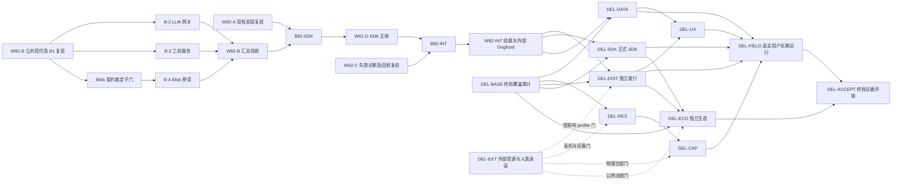

# 通往通用现代 NLOS 的总交付任务计划书

> 状态：`PROPOSED`，2026-11-14。本文是管理层唯一总交付路线，规划获排期不等于能力已实现；本轮只产出计划，不启动下列实现工作。
> 编制：`ALIGN-20261114-PLAN / Attempt 1`；读取基线 `a3a1c007560306e6081d7dceff423b4ae8a33cb5`，其功能基线为 `d2a32de9fb02878584eaa85011cf5eaa64085180`。Owner：项目维护者；执行由各工作包具名责任人承担。
> 执行者：按 [项目并行与提交协议](./project-knowledge-progressive-disclosure.md#61-子-agent-编排与依赖感知并行) 使用子 Agent，结合 `superpowers:subagent-driven-development` 执行；此处所有未勾选项均是候选工作，不是 DONE 回执。

**目标**：沿既有 A–E 路线，把当前已验证基座交付为第三方可扩展、用户可长期使用、可持续升级的 Windows/macOS 级通用现代 NLOS。

**架构**：复用现有内核权威、分布式服务、桌面、兼容与商店基座；先关闭 W82 对外接入断层，再通过独立发行、真实应用/用户和长期运行暴露缺口，按证据补齐。宿主 OS、Wasm、数据库和成熟工具继续承担适合复用的机制。

**技术基线**：仓库固定的 Rust 工具链、SQLite authority、Protobuf SABI、Process + Wasmtime、Tauri、Python/TypeScript SDK；具体版本读取执行时锁文件，本文不建立第二套版本源。

**Spec**：[v0.5 §1、§27–§30](../design/06-架构设计总纲-v0.5.md)、[阶段 E 权威进度与 W82](./stage-e-progress.md#e618-w82-后续生态接入)、[W82-B 已裁定设计](./w82-b-design-draft.md)、[SDK 等级定义](./language-sdk-support-plan.md#2-支持一种语言的等级)。

## 1. 事实起点、权威归属与范围

- A–D 在各自验收边界内已 `EXITED`；E0–E7 为 8/8 工程完成，阶段 E 仍待维护者签字，不能代签 `EXITED` 或 SABI v1.0 长期冻结。
- W82 已合并 A、B-1、C 主体及 D 的 wheel/Ed25519 前置件；整车道验收 0/5 DONE，B-2/B-3/B-4、SDK 主体与 INT 尚未收口。已有代码先复验，禁止重新实施同一成果。
- `a3a1c007` 的 [push CI](https://github.com/cty12356541/llmos/actions/runs/43571919333) 常规 9 作业成功、2 个规模作业跳过；[Pages](https://github.com/cty12356541/llmos/actions/runs/43571919328) 成功。`d2a32de9` 的 [定时运行 43530982662](https://github.com/cty12356541/llmos/actions/runs/43530982662/job/132248316365) Worker E2E 失败仍是待诊断反例，不能由常规 push 成功抵消。
- 当前 H8 为 0；H4/H7、同仓参考应用、三平台 CI 均不能替代生产用户、独立开发者或实际发行安装证据。动态数量和最新 CI 以[阶段 E 盘点](./stage-e-progress.md#2026-11-14-进度盘点)及原始台账为准。
- 本文负责跨能力交付顺序、工作包和终局验收；阶段进度归 `stage-*-progress.md`，需求归 v0.5，决策归 ADR，事实归源提交/Evidence，风险归 `risks.yaml`，声明归 `claims.yaml`。本计划不得覆盖这些对象。
- 后续 `DEL-*` 仅为管理工作包 ID，分别承接既有 B/C/D/E 能力；不新增正式阶段或 Requirement。全球联邦、完整硬件生态、消费级完善等按 §29.2 分包演进；裸机不是完成终局的前置条件。

## 2. 全局约束、派发和准出规则

1. 所有副作用共用 typed Intent/Action、Capability、Resource、Receipt；NL/GUI/CLI/API 无特权捷径。不能阻止旁路的部署按 `COOPERATIVE` 声明，不能宣称 strict。
2. 现有 v1.0 九通道与黄金语料零破坏；W82 三新通道保持已裁定的 64 KiB 编码载荷界、contract epoch 1、增量兼容与独立身份语义。设计冲突先形成裁定，不靠修改测试绕过。
3. 一个派发 = Task ID + 独立 Attempt + base HEAD + read-set + write-set + 验收与 Evidence 路径。以下 `R/W` 是允许范围，启动时收窄到实际文件清单；代码与对应测试归同一 owner。
4. 实现、普通核查、测试和文档默认 `gpt-6.1-sol / ultra`；跨模块契约、疑难诊断和独立安全/终审使用 `gpt-6-astra / ultra`。速度跟随主 Agent；人类签字、发行账号和真实用户不会由 Agent 角色替代。
5. `READY` 必须同时满足：依赖验收完成、契约无未决冲突、写集独占、工具/宿主可用、owner 接单。本文所有包初始均为 `PROPOSED`；“首批可派发”只表示条件齐备后可进入 READY。
6. 常规实现按“失败测试/复现 → 最小修改 → 目标验证 → 独立审查 → 集成复验”推进；只读复验不要求制造失败测试。每包独立提交，显式暂存写集；禁止顺带清理共享脏工作区。
7. 每个包输出 `docs/evidence/<所属既有阶段>/` 下的具名记录，含 SHA、环境、命令、原始输出/摘要、负例、范围和限制；管理计划本身不入 Evidence 索引。证据编号由 INT 查重后分配。
8. `VERIFIED` 需本包正向/失败/安全门及独立审查通过；`DONE` 另需最终树复验、入口/阶段进度/台账更新和提交回执。push、CI、发布、现场验证分别记录，不互相推断。

**重点审查输入**：多主体伪造/吊销竞态（B4/INT）；崩溃后不确定副作用与重复调用（B2/B3）；过界帧/大载荷/资源耗尽（A/B4）；干净宿主与空环境差异（C/D/DEL-DIST）；长时数据增长、离线与用户恢复（DEL-DATA/DEL-FIELD）。

## 3. 近端依赖图与并行屏障

- **首批并行**：A 复验、C 失败诊断、B 契约/B1 复核；槽位允许时 DEL-BASE 与签名/硬件/维护者资源调查可独立开展。现有三条旧派发工作树仅作追溯，重新核对 revision 后创建新 Attempt。
- **B 内下一波**：公共契约/B1 屏障通过后 B2/B3 可并行，Blob 歧义只阻塞 B4 及 D/INT 中依赖 Blob 的部分，不牵连无关服务。Blob 子门通过后 B4 加入并行，三者独占 driver/sandbox/capability；B3 先验小参数路径，大参数引用真实联动留 INT，接口变化重过受影响屏障。
- **共享对象收口**：`schema/**`、`gen/**`、`crates/nlos-schema/**`、跨语言注册表/conformance 仅由 B integrator 按原 W82 归属集成；根 Cargo 清单/锁文件仍由 INT 独占，B 提交变更请求。Capability 仅 B4 写；daemon 会话槽位/撤销分派仅 INT 在 A 验收后写。
- **既有屏障不变**：`B82-SDK = A + B` 验收；D 前置件复验可先行，D 主体在屏障后执行。`B82-INT = C + D` 验收；INT 再完成 C 吊销联动、三服务和真实消费者。
- 每个依赖子图独立过屏障。某车道失败仅阻塞依赖者；无关只读审计/外部资源准备继续。父 Agent 负责派发、审查、汇总，最终 canonical 由一个 integrator 更新。

## 4. W82 可派发工作包

### W82-A-VERIFY：已合并会话与五通道验收

**Owner**：IPC 验证 Sol；独立边界审查 Astra。**blocked-by**：读取最新合并基线；**blocks**：B82-SDK、INT daemon 写入。
**R/W**：R=`nlos-ipc`、`nlos-system-control` 及 PR #43；W=这两 crate 的 A 原有测试/实现子集与本包 Evidence。输入为已合并实现，输出为复验回执；无反例则不改代码。
- [ ] 正向：明文/认证各单连接 1,000 轮、五通道混合分派、按写事务数核 WAL；失败：空闲关闭、断连和半帧；安全：超限/畸形拒帧计数，60s 窗口超过 8 次断连，身份与连接隔离。
- [ ] 执行 `cargo test -p nlos-ipc --test session_mux` 与 `cargo test -p nlos-system-control --features daemon --test daemon_session_mux`；三平台真实 transport 分支均需非零用例回执。
- [ ] Evidence 记录测试列表、事务计数和拒帧边界，全部断言通过才交 B82-SDK；Windows 下零用例/跳过不得当 Unix 覆盖。

### W82-C-DIAG：定时失败根因与受管 Worker 回收

**Owner**：诊断 Astra、定界后修复/验证 Sol。**blocked-by**：旧失败日志与对应 SHA；**blocks**：B82-INT（不阻塞 B2/B3/B4）。
**R/W**：R=`crates/nlos-up/tests/workers_e2e.rs`、定时 workflow、C 已合并代码；W=`crates/nlos-up/**`、`crates/nlos-package/**`、`crates/nlos-process/**` 中具名最小修复集与 Evidence；workflow 改动先交 integrator。
- [ ] 保存 43530982662 原日志，在同 OS/解释器/并发条件复现 `workers_launch_env_whitelist_and_sigterm_reclaims_tree`；它是 Unix 普通测试，常规矩阵也可执行，但作业通过不能证明原定时负载条件下根因已解决。区分 Worker 启动、环境合成、读取等待、进程回收与测试夹具失效，禁止先延长 timeout/加重试掩盖。
- [ ] 正向：清单启动 adapter/brain、最小环境与根 ID 格式；失败：启动半途失败、父退出与重启；安全：父环境敏感值不泄漏、同机兄弟树不误杀。吊销触发实际回收留 INT，跨权限/breakaway 仍挂 U-2。
- [ ] Unix 执行 `cargo test -p nlos-up --test workers_e2e -- --nocapture`，再复验 `cargo test --workspace --no-fail-fast -- --include-ignored` 的原失败条件；Windows 执行 `cargo test -p nlos-process --test platform_kill`，不能以 cfg 空集冒充原案复现。
- [ ] Evidence 包含根因、确定性反例、修复前后结果及同条件复验；未稳定复现时记录诊断边界并继续采集，不关闭原失败。

### W82-B-CONTRACT：B1 复验与服务契约冻结前复核

**Owner**：B integrator + Astra 契约审查，机械复验 Sol。**blocked-by**：B1 合并树；**blocks**：公共子门阻塞 B2/B3/B4；Blob 子门仅阻塞 B4 和 D/INT 的相关能力，B82-SDK 汇总仍要求 B 完整验收。
**R/W**：R=已裁定 D1–D11、三新 proto、SDK/daemon 消费点；W=B 原有 schema/gen/注册表/黄金与 conformance 写集、设计冲突记录、Evidence；共享变更由此唯一 owner 集成。
- [ ] 复核已合并 B1，不重复生成新设计。`schema/nlos/sabi/v1/blob_reference.proto` 须做三项语义一致性复核：注释“载荷不入帧”与 `ReadReferenceResult.chunk` 的 bytes 如何统一；`ReadReferenceRequest.length_bytes <= 64 KiB` 如何计入完整编码开销；`MintReferenceRequest` 无接收主体字段时如何表达双主体传递授权。分别裁定引用/分块语义、有效块界和接收者授权路径，提供边界向量；这不是已证实的运行漏洞，改变已裁定语义时由维护者裁定后才开 B4。
- [ ] 明确 daemon slot→权威 CapabilityId、Blob reference ID 与持有者/接收者授权、重启后 fd/令牌恢复或失效、chunk 有效长度和资源上界；只持 URI/根 ID 不得获得授权。输出为精确接口清单、正负向向量与 B2/B3/B4/INT 消费签认。
- [ ] 执行 `cargo test -p nlos-schema`、`npm run schema:lint`、`npm run schema:check-generated`、`python tools/check_golden_immutability.py`、`python -m unittest discover -s tests/conformance/schema -p "test_*.py"`。
- [ ] 用新增 proto 前的可达提交 `6e9f0a9f^` 与候选树做真实双版本 `sabi_compat_diff.py`，保存两份输入/JSON/digest；同时执行 `python tools/check_golden_immutability.py --check-git-diff 6e9f0a9f^`。相同文件自 diff 不作为增量兼容证据。
- [ ] 在 `sdk/go` 运行 `go test ./... -count=1`，根目录运行 `dotnet run --project sdk/csharp/llmos-sabi-probe/llmos-sabi-probe.csproj`；当前 CI 已有两探针，不沿用旧设计“未入 CI”的历史描述。分别出具公共子门与 Blob 子门回执，只解锁已消除接口冲突的依赖者。

### W82-B-2：受控 LLM 五维预算网关

**Owner**：服务实现 Sol，预算/崩溃审查 Astra。**blocked-by**：B-CONTRACT 公共子门；**blocks**：B 汇总验收、D、INT。
**R/W**：R=`llm_gateway.proto`、D4/D8、`nlos-resource`；W=`crates/nlos-driver-llm-http/**` 与本包 Evidence，零直接写 `nlos-resource`/schema/daemon。输入已认证上下文，输出四方法服务库、持久预留 journal、报价/衰减及咨询对账。
- [ ] 正向：`llm_chat/query_budget/attenuate_budget/record_external_usage`；先持久预留、后发包、权威 consume 唯一硬扣，父子五维不变量；CJK/报价从服务端推导，外部自报只入咨询区。
- [ ] 失败：并发准入、provider 超时/断流、consume 后崩溃、SETTLE_REJECTED、重放/同键异摘要；安全：不足零发包、跨主体账户不可用、咨询与子账户数量有界，原始凭据不出服务边界。
- [ ] 执行 `cargo test -p nlos-driver-llm-http`，把上述情形加入该 crate 自动发现的具名测试；归档故障点、实际用量与 quote 差异、重放结果及三式断言。失败尝试 provider 真实计费和旁路调用限制必须保留。
- [ ] 独立审查通过且服务库可被 INT 调用后进入 B 汇总；库级测试不冒充真实 provider H5 或整车道 DONE。

### W82-B-3：沙箱工具执行与持久 Operation

**Owner**：沙箱实现 Sol、安全/取消审查 Astra。**blocked-by**：B-CONTRACT 公共子门与已预锁 sha2；**blocks**：B 汇总、D、INT；引用大参数子路径另依赖 Blob 子门。
**R/W**：R=`tool_sandbox.proto`、D9、Operation/Wait 契约；W=`crates/nlos-wasm-sandbox/**` 与 Evidence。输入已授权工具/参数，输出 `list_tools/invoke_tool` 服务库及可替换的持久 `ToolOperationStore`。
- [ ] 正向：工具目录按 Wasm digest 缓存、per-call 独立宿主、结果可重放；失败：取消前未执行/执行中 EffectUnknown/完成三态、deadline、journal 崩溃恢复；安全：未知工具拒绝、路径/网络逃逸拒绝、stdout 256 KiB 与逐调用写入 8 MiB 硬界、非零 epoch 下孤儿自灭。
- [ ] 执行 `cargo test -p nlos-wasm-sandbox` 与 `cargo test -p nlos-wasm-sandbox --test escape_matrix`；补齐 daemon 被杀后孤儿终止、同键冲突/不确定不盲重做和逐调用资源测试；记录三平台 spawn+run 分位耗时。
- [ ] Evidence 复用既有逃逸矩阵并追加新增攻击面；MCP 外部 server 桥仍归 DriverProvider，不借此扩大 WASI 导入或给未沙箱原生程序 strict 声明。

### W82-B-4：Capability 约束的大载荷引用

**Owner**：能力实现 Sol；授权/TOCTOU/DoS 审查 Astra。**blocked-by**：B-CONTRACT 明确三项歧义及恢复契约；**blocks**：B 汇总、D、INT。
**R/W**：R=`blob_reference.proto`、D5 及[设计 §12](./w82-b-design-draft.md#12-l-015-选项-b-的-tcb-增量分析与内存dos-有界性安全论证必备件)、Capability 签名/吊销；W=`crates/nlos-capability/**` 与 Evidence，schema 变更只提给 B integrator。输入受控工作区文件和主体，输出 mint/read/release 库及 additive 令牌表。
- [ ] 正向：真实双主体授权传递、摘要/长度/分块校验、release/TTL 收敛；失败：中途吊销、过期、读次耗尽、进程重启/文件变更；安全：日志泄漏 URI、伪造主体、越界路径、mint 后换靶、读间改写、跨主体读取、并发 mint/read 耗尽均 fail-closed。
- [ ] 执行 `cargo test -p nlos-capability`；在既有 DDL/故障套件加入令牌表保护、fd 钉住/块校验、真实授权接收者与未授权主体对照；边界测试使用完整编码长度，不能只断言 chunk 长度。
- [ ] Evidence 给出 TCB 增量、连接/令牌/fd/内存上界实测及永久审计行增长限制；qq-agent 落盘过渡退役由 INT 真测，库内 WAV 往返不冒充外部退役。

### W82-D-SDK：Python/TypeScript 完整窄腰与干净安装

**Owner**：SDK Sol；跨语言安全与错误语义审查 Astra。**blocked-by**：B82-SDK；**blocks**：B82-INT、DEL-SDK。
**R/W**：R=A/B 定稿、已合并 wheel/认证前置件、SDK 等级定义；W=`sdk/python/**`、`sdk/typescript/**`、`tests/conformance/ipc/**` 与 Evidence。新增 `wait/operation/llm_gateway/tool_sandbox/blob_reference` 客户端模块，名称和类型从已合并生成物取得。
- [ ] 正向：目录协商、认证持久连接、Wait/Operation/LLM/Tool/Blob 调用，脱离源码树安装并消费；失败：超时、半帧、poison、重连、uncertain 同键重试；安全：holder 错配、私钥/回执脱敏、未知 major/critical、上界拒绝。
- [ ] 运行 `python -m unittest discover -s sdk/python/tests`、`npm run schema:typecheck`、现有 `npm run ipc:test:typescript` / `directory:test:typescript` / `wait-control:test:typescript` 及 Python 对应脚本；新增三服务跨进程脚本纳入同一 CI 门，不能只做 mock 自测。
- [ ] 复用 `python sdk/python/scripts/verify_wheel.py`；当前脚本把 venv 解释器写死为 `bin/python`，先改为按宿主选 `Scripts/python.exe`/`bin/python`，并让 probe cwd 位于源码树外、清除 PYTHONPATH 后再算三平台独立安装通过。
- [ ] Evidence 分列 SDK-0..4、语言/平台/profile；wheel 可安装和新增客户端完成不等于已在 PyPI/npm 发布、也不自动晋升 SDK-4。

### W82-INT-DOGFOOD-E2E：系统挂载、撤销联动与真实消费者

**Owner**：单一 integrator Sol，整条安全/故障链独立终审 Astra；外部仓负责人维护 qq-agent。**blocked-by**：B82-INT；**blocks**：W82 DONE、后续交付候选基线。
**R/W**：R=各车道回执；W=`crates/nlos-system-control/**`、`crates/nlos-compat-shim/src/sabi_adapter.rs`、Studio 徽标实际文件、根依赖/锁文件、W82 Evidence 与共享治理台账。qq-agent 是单独 Task/write-set，取得对应仓授权后执行，不隐式扩大本仓权限。
- [ ] 挂载三服务、认证 principal→会话槽位→权威能力与 C 根 ID；正向双 Worker 快慢双脑、LLM/工具/富媒体闭环；失败含 daemon/worker/provider 故障；安全含令牌吊销触发进程树回收、下块拒读、伪造根 ID 拒绝、跨应用隔离与计费守恒。
- [ ] 真实消费者验证零应用明文 provider key、自建预算库/防火墙/supervisor 可退役；逐个核对旧实现删改与替代路径。模拟消费者可以先验接口，不能代替 qq-agent 真实回执或独立生态。
- [ ] 执行 `cargo test -p nlos-system-control --features daemon`、`cargo test --workspace`、`python scripts/run_road_e001_upgrade_matrix.py`，保留 16/16 N-1 包零源码修改/重编译/重签；新服务失败、吊销、重启与旧客户端兼容必须同时覆盖。
- [ ] 补跑受影响 CI/定时门，运行 `python scripts/lint_claims.py`、`python tools/verify_stage_e_ledger_coverage.py --mode strict`、`git diff --check`。按最终 SHA 汇总每车道 Evidence，更新 stage E/claims/risks/index 与 L0，独立终审后才晋升 W82；E 正式退出仍是另一个人类决定。

## 5. 通往终局的后续交付包

以下包都是 `PROPOSED`，不以编号暗示新阶段。每包先复验现有能力，确认缺口后才实施；不确定方案的调查产物必须是可裁定方案、受测原型和下一步精确写集，不能只留下 TODO。

### DEL-BASE：规范到实际产品的覆盖审计（承接 B/C/D/E）

**Owner/依赖**：架构 Astra + 事实核验 Sol；可立即准备，与 W82 独立；阻塞后续包范围定稿。R=v0.5 最高目标/路线、现有进度/claims/risks/相关 Evidence；W=本计划各包输入及按权威对象分配的差距修订。
- [ ] 输出“需求→能力→现有 Evidence→缺口→本计划包→release profile”映射，逐条核 U-1..U-14、过期风险描述、SDK 探针/正式支持区别；已闭合项仅设置复验触发器。
- [ ] 验收：§1.1 十类完整性目标与 §28 全部 ROAD 门有归属，未知项有 owner/调查命令/裁定条件；`lint_claims.py` 与 strict 覆盖率通过。不得用全局百分比或同名第二份规范替代缺口。

### DEL-DIST：独立发行、安装和升级（承接 B/D/E）

**Owner/依赖**：发行 Sol，安装/供应链审查 Astra；依赖 W82-INT、DEL-BASE，签名子门依赖 DEL-EXT。R=现有 nlos-up、desktop、package/更新/回滚；W=实际发行脚本、CI、安装配置、用户文档及 Evidence，启动时收窄。
- [ ] 先清点现有制品/构建/更新链，定义 Windows/macOS/Linux 支持 profile；交付可校验制品、SBOM、干净宿主安装/首次启动/凭据托管/升级/回滚/卸载入口，无源码树和开发工具隐式依赖。
- [ ] 验收正向为三平台安装到用户完成应用任务；失败为断网、缺依赖、部分升级、低磁盘和恢复；安全为签名不符/降级/污染安装路径拒绝、卸载保护用户数据。复用 `npm --prefix desktop run build`、现有 Rust 门及升级矩阵，新增真实安装/升级 CI job。
- [ ] Evidence 记录制品 hash、OS/架构、安装日志、回滚前后数据 digest；无签名可作为明确标记的内部试用制品，不作正式签名发行 Claim。

### DEL-SDK：可独立消费的官方开发者平台（承接 B/E）

**Owner/依赖**：SDK/文档 Sol，契约审查 Astra；依赖 W82-D/INT、DEL-BASE，公开发布依赖账号/维护政策。R=SDK 等级与现有探针；W=SDK 发布元数据/CI、开发者文档和测试 kit。
- [ ] 交付固定 profile 的 Rust/TS/Python 包、发布/撤回/迁移策略、debug/trace/Receipt 教程及 conformance kit；Go/C# 先核既有黄金探针，只有真实消费需求与维护 owner 才补 IPC→SABI→SDK-4，其他语言按需求调查。
- [ ] 验收为独立临时项目仅使用发布制品开发、调试、打包应用；覆盖三平台错误/cancel/uncertain/版本协商和破坏性升级拒绝；登记包版本/注册表回执/摘要及支持矩阵。不得把 checked-in 生成物或本地 wheel 当正式发布。

### DEL-DATA：持久用户数据、检索与多模态工作流（承接 B/C/D）

**Owner/依赖**：数据 Sol、权限/同步审查 Astra；依赖 DEL-BASE，外部多媒体通路依赖 W82-B4/INT。R=Artifact/Context/Search/semantic/同步与已有数据 Evidence；W=确认缺口对应 crate、数据工具与测试，禁止未经审查引入第二数据权威。
- [ ] 复验文档、图片、音频/视频引用从导入→应用处理→搜索→共享→导出/删除/恢复的连续路径；调查并裁定索引失效、配额/GC、备份恢复、跨设备冲突和多媒体 codec 边界，再给出最小缺口修复。
- [ ] 验收覆盖离线/重连、重复同步、损坏 blob、并发 GC（U-12）、低磁盘、删除后索引撤回、权限变化后检索不可泄漏、出处/taint 保留；复用相关 artifact/search/semantic crate 测试并增加端到端数据 corpus。
- [ ] Evidence 给出前后 digest、恢复点/恢复时间、索引重建耗时及隐私边界；大文件和长期数据增长必须实测，样板小数据通过不作全容量声明。

### DEL-UX：非开发者完整桌面使用闭环（承接 D）

**Owner/依赖**：桌面 Sol、可访问性/可信 UI 审查 Astra，人类用户参与；依赖 DEL-BASE、DEL-DATA 接口，真实安装验收依赖 DEL-DIST。R=阶段 D 既有门；W=desktop 已定位缺口、用户文档、交互回归与 Evidence。
- [ ] 先复验窗口/通知/设置/搜索/Task Space/手工调度、NL 计划预览编辑、成本/权限、离线恢复、多模态、CJK 和无障碍；以用户任务发现缺口，不重做已验证工作站。
- [ ] 验收为无需编排知识完成多应用前后台任务、随时查看/暂停/撤销并得到一致 Receipt；失败包括 provider 离线/误解意图/授权拒绝/任务恢复；安全包括注入内容不能伪造 Z4、辅助技术与输入法不能误确认高风险动作。
- [ ] Evidence 录屏/任务记录须脱敏，区分自动化与真实用户；补足物理 macOS 手势、屏幕阅读器/键盘操作与安装后实际使用，现有 1,000 轮浸泡不替代持续用户研究。

### DEL-RES：现代资源与可控执行的生产边界（承接 B/C）

**Owner/依赖**：资源实现 Sol、跨宿主执法审查 Astra；依赖 DEL-BASE；硬件侧依赖 DEL-EXT。R=ResourceGroup/controller、ResourceAccount、Capacity/Device lease 与 RISK-B-03/10；W=定位后的 controller/driver 适配与测试。
- [ ] 输出 CPU/内存/存储/I/O/网络/accelerator/energy/context/capacity/rate/attention 各维“已强制/仅计量/不支持”profile；复验已有控制器，调查缺失 shim/部署策略并保留 fail-closed/COOPERATIVE 降档。
- [ ] 验收包含争抢、pressure/reclaim/OOM、父子配额、取消/迟到回调、Windows breakaway/跨权限与设备租约失联；证明资源守恒和兄弟故障隔离，不能以 token 预算代替系统资源。
- [ ] Evidence 记录宿主权限与硬件、分维 meter/Receipt、旁路尝试和损失界；设备无法物理撤销时明确隔离/停用，不宣称物理副作用已擦除。

### DEL-CAP：容量、分布式可靠性与真实硬件（承接 C）

**Owner/依赖**：性能/可靠性 Sol，分布式终审 Astra；依赖 DEL-BASE、DEL-RES 可测 profile；真机/WAN/断电依赖 DEL-EXT。R=U-1/U-4/U-5/U-11、ScaleProfile 与 H6；W=对应探针/故障注入/最小性能修复和 Evidence。
- [ ] 先复验 10K/100K 与多 active 比例，补 Linux/macOS 8-Cell、100K@50%、调度器/PINNED/admission/cancel 缺口；硬件允许后跑 1M，不将云 runner 推断为裸金属/WAN。
- [ ] 复用 workflow 的 `cargo test --release --no-fail-fast -p nlos-plan --test tasknode_scale_probe -- --include-ignored --nocapture` 及 task/runtime 探针；针对 stale epoch、双主、fanout storm、provider stall、迁移重启和真实 durability barrier 增补场景。
- [ ] 输出每节点 metadata、RSS/磁盘、p50/p95/p99、CPU/I/O、恢复扫描/控制可用性与损失界；暴露 O(N/S) 扫描，必要优化以 before/after 证据验收。物理断电、M4/M6/M8 校准、STONITH 各自独立取证，不用 Layer 2 代替。

### DEL-FIELD：真实多用户长期运行与运维（承接 C/D/E）

**Owner/依赖**：可靠性 Sol、隐私/生产准入审查 Astra，人类试点负责人；依赖 DEL-DIST/SDK/DATA/UX/RES/CAP 的受测 profile。R=部署/备份/恢复/审计与风险；W=运维工具、监测、runbook、脱敏 field Evidence。
- [ ] 调查并登记真实用户/组织、设备、数据授权和支持责任；交付用户/租户隔离、密钥轮换、备份恢复、诊断包、配额/告警、升级维护和事故处置链，在明确范围内持续运行。
- [ ] 验收覆盖多用户交叉访问拒绝、后台任务长时运行、provider 失效、网络分区、空间增长、值班接手和恢复演练；按实际服务 profile 记录可用性/延迟/成本/丢失界，不给全系统统一假 SLO。
- [ ] **待维护者确认的试点建议，非规范**：首轮连续 30 天；期间至少一次升级、回滚、凭据轮换、备份恢复与失联演练；已确认越权、不可恢复数据丢失、无法解释的重复副作用均须修复后重验。H8 仅授予实际现场验证过的 claim。

### DEL-ECO：独立第三方生态、兼容与治理（承接 E）

**Owner/依赖**：生态工具/文档 Sol，供应链/兼容审查 Astra，独立开发者与维护者；依赖 DEL-SDK/DIST、DEL-BASE，公网商店依赖 DEL-EXT/安全准入。R=现有样板/商店/PKI/认证/迁移；W=真实缺口对应生态工具、治理流程和 Evidence。
- [ ] 招募不掌握内核内部实现的开发者自行定义未预设应用，覆盖后台/交互/多组件/数据/驱动组合；记录遇到的协议缺口，优先公开 SABI 演进或核外扩展，不以为某应用定制内核通过验收。
- [ ] 验收贯通发现→安装→权限→组合→持续运行→撤回/升级/回滚/卸载；冻结第三方 N-1 制品后升级宿主，验证零整体重写；公开商店补恶意包/签名根轮换/举报撤回/灾备/审计，持续执行依赖维护与 CVE 复查。
- [ ] 显式覆盖无模型场景：在不配置模型 provider/凭据且封禁其访问的干净受测 profile 中，独立安装确定性 pure-code 应用，运行本地代码/小 IPC Fast 路径、生成并持久化用户 Artifact，强制终止后恢复并核对数据 digest，最后卸载并核验后台/权限回收及用户数据保留。归档无 provider 调用的网络/审计记录与完整生命周期 Receipt；对应 [ROAD-A-003](../design/06-架构设计总纲-v0.5.md#281-阶段-a启动微内核)、[§27 Fast 路径](../design/06-架构设计总纲-v0.5.md#27-性能与工作负载类别)及 NLOS-GEN-001，这是场景覆盖而非用应用数量证明通用性。
- [ ] **待维护者确认的生态建议，非规范**：至少两个互不受同一实现控制域支配的真实开发者团队完成独立复现；数量只是样本下限，最终看未预见能力是否无需改内核、能力增长来源及跨版本存活证据，不以任意应用数冒充通用性。

### DEL-EXT：外部资源、长期承诺与维护接续（横切 C/D/E）

**Owner/依赖**：人类维护者负责账号/设备/组织，调查 Sol、信任边界审查 Astra；资源清点可先行，正式承诺需相应 Evidence。R=U-1..5/10、RISK-B-05/08/09；W=发行/硬件/交接清单与权威风险更新。
- [ ] 分别产出物理断电/WAN/设备复位台架方案、macOS 实机/原生签名资质路径、包注册表发布权限、生产 provider/TEE 信任边界和第二维护者接手计划；列负责人、获得条件、费用/凭据保管及不具备时允许的受限 profile。
- [ ] 各项验收用实际硬件报告、原生签名/公证结果、真实注册表回执或第二人类独立恢复/发布演练；Agent 数量不算组织去集中化。W81 签字材料可独立备齐，但不得由计划自动签字。
- [ ] 全球联邦/跨组织清算、完整设备生态与知识表达性证明分别先调查适用范围/信任模型/证明义务，交 ADR 候选和受测 PoC；未获方案裁定不承诺实现，不能将整个长期范围丢给一个无 owner 的“以后”。

## 6. 终局完成判据与滚动维护

### DEL-ACCEPT：逐项证据评审，不给整体虚假百分比

**Owner/依赖**：独立 Astra 技术终审 + 人类维护者发布裁定；依赖所有拟声明 profile 对应交付包，未纳入 profile 的外部边界须明确列出。W=发布 Claim、风险、Evidence 索引、进度及本计划路由；不替代实现 owner。
- [ ] 通用性：独立第三方能定义、开发、安装、运行未预设 Application，无需改内核；非聊天应用、多组件/后台/UI/数据/Driver 能组成完整任务。DEL-ECO 的 pure-code 场景须在模型未配置且不可访问时完成安装、Fast 路径运行、持久化、终止恢复和卸载，并有实际 Evidence，不能用多个依赖 LLM 的应用替代。
- [ ] 系统完整性：身份、能力、执行、资源、通信、状态、生命周期、副作用共用权威；分布式/多设备、数据、多模态桌面、自动和手工控制在声明 profile 内均有正负路径证据。
- [ ] 可交付性：干净三平台宿主安装和升级闭环、独立 SDK/开发文档、用户恢复与可访问性可复现；未发布注册表/未签名宿主包不能以本地构建替代。
- [ ] 长期品质：容量与工作负载分类可测，真实多用户长期运行积累范围明确的 H8；隐私/安全/兼容/可用性/性能/恢复分域审查，反例、残余风险和 unsupported profile 对用户可见。
- [ ] 生态持续性：第三方贡献成为新增能力的实际来源，N-1 升级不需整体重写，认证/吊销/事故与迁移制度运行；第二维护者具备独立接续能力。

每轮先读取当前 HEAD、台账、失败 Evidence 和外部资源状态；依赖/写集改变立即重划波次。派发、过审、修复、完成时更新 AgentDash ledger 并展示面板，hook 有效性只依事件判定。

新反例先持久化并降低受影响 Claim，再新增修复 Attempt；不删除失败记录。维护者裁定规划建议后，把正式参数写入对应权威对象，本文只同步链接。包准出时只更新本次受证支持的范围，不自动关闭 E-deferred 或所有风险。

本计划的文档验收是：链接和路径可定位、依赖无环、共享写集有唯一 integrator、每个长期缺口有 owner/下一验收门、阶段/实现/发布事实不混淆。功能验收命令均为后续执行任务，本轮未运行这些功能门。
