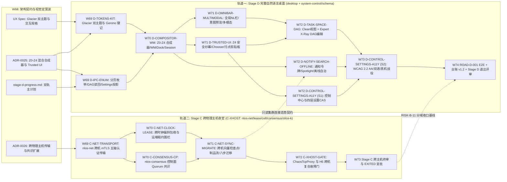

# 阶段 D 权威进度单（完整自然语言桌面）

> **状态：`IN_PROGRESS / NOT EXITED`（2026-10-26 维护者显式启动阶段 D 设计与并行推进，决策点 D0–D4 裁定落档；至 [§D.5.5](#d55-阶段-d-退出评审门) 全部退出条件满足并获维护者明确批准前不得翻 `EXITED`）。** 本文件为阶段 D（完整自然语言桌面，`SurfaceProfile=DESKTOP`）的单一权威进度与编排台账，由 [v0.5 §28.4 阶段 D 定义](../design/06-架构设计总纲-v0.5.md)、[§24–§25 系统体验与桌面契约](../design/06-架构设计总纲-v0.5.md)、阶段 B/C 移交清单（[stage-b-progress §6.5.6](./stage-b-progress.md) `#3`/`#15` 与 [stage-c-progress §C.3.2](./stage-c-progress.md)）及 2026-10-26 维护者四项显式架构裁定（`A1–A4`，落档为 [§D.4](#d4-维护者决策日志d0d42026-10-26) `D0–D4`）构造。起草快照基线 `HEAD = 3789cf2c8ba800929e65201ed1a8a5fa86e907f2`（`W68`，2026-10-26）。
>
> **W68 同波权威姊妹规范（交叉绑定）**：
> - 视觉与交互总规格：[2026-10-26-stage-d-desktop-visual-and-ux-design.md](../superpowers/specs/2026-10-26-stage-d-desktop-visual-and-ux-design.md)（承接并演进 [docs/site/DESIGN.md](../site/DESIGN.md) v10 `Abyssal Glacier` 与内置 `Daylight Glacier` 双主题系统）；
> - 桌面合成器分层与可信 UI 架构决策：[ADR-0025](./adrs/0025-stage-d-hybrid-desktop-compositor-and-trusted-ui-layering.md)（五平面 `Z0–Z4` 混合桌面合成器、`Z4` 不可遮挡安全纱幕、Gerono `∞` 防伪徽记与双层视图切换）；
> - 阶段 C 跨物理主机传输与共识扩展决策：[ADR-0026](./adrs/0026-cross-physical-host-transport-and-consensus-expansion.md)（与阶段 D 在 `W69–W74` 按严格写集互斥双轨并行推进，见 [§D.5](#d5-双轨依赖-dag-与-w69--w74-并行波次编排stage-d--stage-c-c-xhost)）。
>
> **评审与风险基线（只读引用）**：阶段 B 评审记录 [W31-G](../evidence/stage-b/reviews/w31g-road-b004-gates.md)、[W33-H](../evidence/stage-b/reviews/w33h-road-b001-b002.md)、[W34-A](../evidence/stage-b/reviews/w34a-six-gate-matrix.md)；阶段 C 退出门评审 [W67](../evidence/stage-c/reviews/w67-stage-c-exit-gates.md)；未知与残余风险清单 [exit-unknown-risks.md](./exit-unknown-risks.md)（重点关联 `RISK-B-06`、`RISK-B-11`、`U-3`、`U-5`、`U-7`、`U-8`）；机器台账 [ledger-schema.md](./ledger-schema.md)、[claims.yaml](./claims.yaml)、[risks.yaml](./risks.yaml)、[evidence-index.yaml](./evidence-index.yaml)。

---

## D.1 阶段目标与非目标（源自规范）

### D.1.1 阶段目标与规范需求全映射

阶段 D 把 NLOS 从阶段 B/C 已验证的「开发者/运维 Task Manager 薄壳 + 单机多进程分布式权威内核」推进为面向非开发者的**完整现代自然语言桌面（Complete Natural-Language Desktop，`SurfaceProfile=DESKTOP`）**。按 [v0.5 §28](../design/06-架构设计总纲-v0.5.md) 路线定义，阶段 C 与阶段 D 在阶段 B 之后**并行推进**（非串行瀑布），且安全、兼容与证据分级贯穿全部阶段。

[v0.5 §28.4](../design/06-架构设计总纲-v0.5.md) 规定阶段 D **必须交付**（逐字誊录）：

1. 完整 Task Space、窗口、通知、设置、搜索；
2. 多模态输入输出；
3. 可信权限与成本界面；
4. System Control Center、Task Manager、Resource Monitor 与各层级手动调度；
5. 自动 Planner 计划预览、图形化编辑、手工 override 与重新授权体验；
6. 离线/恢复体验；
7. 可访问性和本地化。

**阶段 D 退出门**（[v0.5 §28.4](../design/06-架构设计总纲-v0.5.md) 逐字誊录）：

- `[ROAD-D-001]` **非开发者无需理解 Agent 编排即可持续使用多个 Application 和后台 Task。**

**规范性需求全量映射表**（实现车道必须按 Requirement ID 落地 conformance / security / parity 测试与独立 Evidence，禁止脱离下表自造语义）：

| 规范章节 | Requirement ID | 规范核心不变量摘要 | 承接工作包 |
|---|---|---|---|
| §28.4 | `[ROAD-D-001]` | 非开发者无需理解 Agent 编排即可持续使用多个 Application 与后台 Task（Clean View 默认屏蔽底层 `TaskAttempt`/`Fiber`/`Cell` 术语，跨应用、后台通知、授权与恢复闭环自洽） | `D-TASK-SPACE-DAG`、`D-COMPOSITOR-WM`、`D-CONTROL-SETTINGS-A11Y`（E2E 终验） |
| §24.1 | `[NL-COMPILE-001]`、`[NL-PROPOSE-001]`、`[NL-AMBIG-001]`、`[NL-BIND-001]` | 版本化 `TypedIntent` 编译保留原请求摘要与歧义；授权前 `ActionProposal` 完整展示目标、权限、资源上界、副作用、撤销与溯源计划；高风险歧义强制澄清（禁静默扩权/扩成本）；`AuthorizationReceipt` 逐字段精确绑定目标代际与摘要 | `D-OMNIBAR-MULTIMODAL`、`D-TRUSTED-UI` |
| §24.1.1 | `[PLAN-CHANGE-001]` | 用户可在可信 Task Space 手工增加、删除、暂停、合并、重排或替换**尚未执行**的 `TaskNode`；改变目标语义、授权对象、不可逆副作用、成本上界、deadline 或验收条件的修改必须重编译并重新授权；纯 placement、显示顺序或不扩权资源降级可走受限 `ControlCommand` | `D-TASK-SPACE-DAG`、`D-IPC-ENUM` |
| §24.1.1 | `[PLAN-OVERRIDE-001]` | 自动规划与手工规划必须收敛到同一 `TaskPlan`/`TaskNode` schema、`AdmissionPlan`、`Capability` 与 `Receipt`；严禁维护绕过系统约束的「高级自然语言路径」或「管理员拖拽路径」（协同 `[PLAN-UNTRUSTED-001]`、`[PLAN-DAG-001]`、`[PLAN-LAZY-001]`、`[PLAN-DEPENDENCY-001]`） | `D-TASK-SPACE-DAG`、`D-OMNIBAR-MULTIMODAL` |
| §24.2 | `[TUI-CONSENT-001]` | 权限确认必须由 Trusted UI（`Z4`）渲染真实 `Application`/`Principal`、目标、purpose、持续时间与成本；不可信应用不得遮挡、拦截或伪造系统提示 | `D-TRUSTED-UI`、`D-TOKENS-KIT` |
| §24.2 | `[TUI-CHOOSER-001]` | 文件/Artifact chooser 可发现用户可见对象，但仅向 Application 返回经用户明确选择后的 scoped capability | `D-TRUSTED-UI`、`D-IPC-ENUM` |
| §24.2 | `[TUI-EXT-001]` | UI `Surface`/`Package` schema 必须为本地化、可访问性、多模态、通知、深链接和内容类型关联保留版本化扩展 | `D-CONTROL-SETTINGS-A11Y`、`D-OMNIBAR-MULTIMODAL`、`D-IPC-ENUM` |
| §24.3 | `[RCPT-UNDO-001]`、`[RCPT-PARTIAL-001]` | 每个 Action 明确标注 `REVERSIBLE` / `COMPENSATABLE` / `IRREVERSIBLE`，禁止用 UI「撤销」假象掩盖不可逆外部副作用；多目标操作逐目标报告结果，禁止单一布尔值隐藏 partial failure | `D-TRUSTED-UI`、`D-TASK-SPACE-DAG`、`D-CONTROL-SETTINGS-A11Y` |
| §25 | `[TASK-SPACE-001]` | 提供用户可见的持续 Task Space，完整覆盖运行、等待授权、等待输入/资源/网络、暂停、恢复中、失败、完成、部分完成与 disputed 任务（对齐 16 态 `[TASK-STATE-001]`、`[TASK-STATE-002]`、`[TASK-REOPEN-001]`） | `D-TASK-SPACE-DAG`、`D-IPC-ENUM` |
| §25 | `[TASK-VIS-001]` | 用户可查看每个 Task 的 `Application`、`Process`、权限、预算、输入、输出、provenance 与可取消性 | `D-TASK-SPACE-DAG`、`D-IPC-ENUM` |
| §25.1 | `[TASK-VIS-002]` | Task Space 严格区分 `Task` 与各 `TaskAttempt`，展示 input snapshot、consistency mode、isolation/enforcement profile、resource group/account、当前 `Cell`、winner/commit、冲突、取消传播与 `PROVIDER_ISOLATION_UNVERIFIED` 状态 | `D-TASK-SPACE-DAG`（`Expert X-Ray` 层） |
| §25 | `[TASK-NOTIFY-001]` | 后台 Task 的重要状态变化通过 `NotificationService` 持续可见，不依赖原聊天窗口或发起表面保持打开 | `D-NOTIFY-SEARCH-OFFLINE` |
| §25.3 | `[CTRL-PARITY-001]` | 自然语言暂停、GUI 任务管理器点击暂停、CLI 发送 pause 与结构化 API 调用必须编译为语义等价的 `ControlCommand`，走同一 `Capability`、generation CAS、resource/effect fence 与 `ControlReceipt` 路径（协同 `[CTRL-HIER-001]`、`[CTRL-PRIORITY-001]`、`[CTRL-SAFETY-001]`） | `D-IPC-ENUM`、`D-CONTROL-SETTINGS-A11Y`、`D-TASK-SPACE-DAG` |
| §25.3 | `[CTRL-PLAN-001]` | Task Space 同时提供自动视图（Consumer Clean View）与专家视图（`Expert X-Ray`）：普通用户看 `Application`/`Task` 整体目标进度；高级用户可一键下钻 `TaskPlan`、`TaskNode`、`TaskAttempt`、`Process`/`AgentInstance`/`ExecutionFiber`、`ResourceGroup`、`Topic` 与 `Operation` 并在授权范围内手动干预 | `D-TASK-SPACE-DAG`、`D-CONTROL-SETTINGS-A11Y` |
| §25.3 | `[CTRL-RECOVERY-001]` | 控制命令超时或客户端断开时，UI 必须按 `ControlCommandId` 查询权威状态；严禁把 `UNKNOWN` 当作未执行盲目重发；批量控制必须逐目标报告成功、拒绝、等待与 unknown | `D-IPC-ENUM`、`D-CONTROL-SETTINGS-A11Y` |
| §25.4 | `[DUI-LAUNCH-001]` | `ApplicationLauncher`（Dock / Launcher）必须按 `ApplicationId` / `InstallationId` 激活 Application，严禁将 `PackageId` 或某个瞬态 `ProcessId` 当作应用身份 | `D-COMPOSITOR-WM`、`D-IPC-ENUM` |
| §25.4 | `[DUI-CONTROL-001]` | Desktop 提供可信 `SystemControlCenter` / `TaskManagerSurface` / `ResourceMonitorSurface`，支持按 `System`、`Workspace`、`Application`、`Task`、`TaskGroup`、`Process`/`AgentInstance`/`ExecutionFiber`、`ResourceGroup`、`Topic`/`Channel`、`Operation`/`Device` 层级浏览与调度，严格复用 §25.3 `ControlCommand`/`ControlReceipt`，禁止私有未认证 UI RPC 绕过系统控制协议 | `D-CONTROL-SETTINGS-A11Y`、`D-IPC-ENUM` |
| §25.4 | `[DUI-WINDOW-001]` | `Surface`/`Window` 必须绑定 `Application` owner、`DesktopSession`、visibility、`FocusAndInputRoute`、accessibility tree 与 `generation`；stale `Surface` 严禁接收任何新输入 | `D-COMPOSITOR-WM`、`D-CONTROL-SETTINGS-A11Y` |
| §25.4 | `[DUI-INPUT-001]` | focus、keyboard、pointer、voice 与 automation input 必须经 Trusted UI 路由并显式标明输入源（`InputSource`）；不可信 Application 不得伪造系统级输入或权限界面 | `D-COMPOSITOR-WM`、`D-TRUSTED-UI`、`D-OMNIBAR-MULTIMODAL` |
| §25.4 | `[DUI-CHOOSER-001]` | Open / Save / Share chooser 必须返回 scoped Artifact `Capability`（`ChooserGrant`），严禁向应用泄露宿主全局文件系统路径或整个用户目录 | `D-TRUSTED-UI`、`D-IPC-ENUM` |
| §25.4 | `[DUI-ASSOC-001]` | `ContentTypeAssociation`（内容类型与默认 Application 关联）必须是用户可查看、可修改、可撤销的 `Settings` 数据；`Package` 只能声明提议，不得静默夺取默认关联 | `D-CONTROL-SETTINGS-A11Y`、`D-IPC-ENUM` |
| §25.4 | `[DUI-CLIP-001]` | `ClipboardItem` 与 `DragDropTransfer` 必须绑定 content type、source `Application`、`taint`、`expiry` 与真实 `user gesture`；敏感或带污点内容跨 Application 传递必须经 policy / Trusted UI 显式确认 | `D-TRUSTED-UI` |
| §25.4 | `[DUI-NOTIFY-001]` | `NotificationAction` 必须强绑定原 `NotificationId`、`ApplicationId`、`TaskId` 与一次性 `ActionToken`（SHA-256 防重放核销），防止其他 Application 伪造通知响应 | `D-NOTIFY-SEARCH-OFFLINE` |
| §25.4 | `[DUI-SESSION-001]` | 多用户 `UserProfile`、`Workspace`、`DesktopSession`、`Keychain` 与 Application 数据容器严格隔离；执行 `LOCKED` 锁屏或切换用户后，旧 Session 的 input route 与会话态 capability generation 必须立即失效或降权 | `D-COMPOSITOR-WM`、`D-CONTROL-SETTINGS-A11Y` |
| §25.4 | `[DUI-SETTINGS-001]` | `SettingsDomain` 按 `system / user / workspace / application` 四层作用域分层，支持版本化 CAS（compare-exchange）与变更订阅（watch）；`KeychainReference` 只向 Application 提供 use-by-reference 句柄，零明文密钥导出 | `D-CONTROL-SETTINGS-A11Y`、`D-IPC-ENUM` |
| §25.4 / §22 | `[DUI-OFFLINE-001]`、`[CONS-DECL-001]`、`[CONS-CTRL-001]` | `LOCAL_SINGLE_NODE` 桌面在离线或控制面断连时完整保持 Launcher、本地 Artifact、Task、Settings、Search、Notification 历史与本地应用操作可用；依赖远程能力的 Action 显式呈现 `WAITING_NETWORK` / `UNAVAILABLE`，绝不拖垮桌面整体；Spotlight 搜索强制携带 `0x1F` `NON_AUTHORITATIVE` 守卫，严禁直接驱动权限/账本/提交门 | `D-NOTIFY-SEARCH-OFFLINE` |

### D.1.2 显式非目标（源自规范与阶段边界，严禁越界）

1. **不替代宿主 OS 内核、显示服务器或 GPU 驱动（[v0.5 §29.1](../design/06-架构设计总纲-v0.5.md)）**：阶段 D 基于 Tauri 2 WebView2 / WKWebView / WebKitGTK 宿主窗口承载 `SurfaceProfile=DESKTOP` 合成画布（[ADR-0001](./adrs/0001-stage-b-core-language-and-runtime.md)、[ADR-0025](./adrs/0025-stage-d-hybrid-desktop-compositor-and-trusted-ui-layering.md)），不编写裸机帧缓冲、Wayland/Quartz/DWM 替代品或内核级显卡驱动。
2. **禁止建立绕过 `ControlCommand` 的私有未认证 GUI RPC（`[DUI-CONTROL-001]`、`[CTRL-PARITY-001]`）**：桌面前端与 Tauri Rust 宿主层严禁直接打开权威 SQLite 库做静默写操作或新增绕过 `ADR-0011` 认证通道、能力校验、代际 CAS 与 `ControlReceipt` 的私有 Tauri mutation 命令；一切状态变更与控制调度必须收敛至可核验的 `ControlCommand` / 授权协议路径。
3. **不捆绑阶段 E 应用商店治理与商业市场（[v0.5 §28.5 / §29.2](../design/06-架构设计总纲-v0.5.md)）**：长期二进制 SABI v1.0 兼容承诺、第三方 Publisher 认证体系、生产级 Application Store 审核/分发治理、跨组织商业清算与全球联邦留归阶段 E（`ROAD-E-001`）；阶段 D 的 Launcher 与应用管理仅消费本地 `ApplicationAuthority` 已安装/已验签应用目录。
4. **不强制所有 Application 退化为聊天窗口，也不把自然语言作为唯一接口（[v0.5 §29.1](../design/06-架构设计总纲-v0.5.md)）**：阶段 D 采用 AI-Native Hybrid Desktop（`D2` 裁定），既提供全局 NL Omni-Bar 与空间化 `Task Space`，也完整支持结构化 GUI 窗口、表单、快捷键、Dock 与系统控制面板。
5. **与阶段 C 跨物理主机轨道（`C-XHOST`）权责清晰解耦（`D4` 裁定）**：跨物理主机网络传输、跨机时钟不确定度租约与控制面复制状态机共识属阶段 C 收官扩展包（[stage-c-progress.md](./stage-c-progress.md) + [ADR-0026](./adrs/0026-cross-physical-host-transport-and-consensus-expansion.md)）；阶段 D 桌面只消费只读的 Cell/集群连接态势、断连自治状态（`PartitionAutonomyGate`）与节点放置事实（`[TASK-VIS-002]`、`[DUI-OFFLINE-001]`），不得用桌面 UI 指示器冒充分布式共识证据。

---

## D.2 基线盘点与状态语义（阶段 B/C 已验证基线 vs 阶段 D 待建范围）

### D.2.1 状态语义与证据分级纪律

完全沿用 [stage-b-progress §2](./stage-b-progress.md) 与 [stage-c-progress §C.2](./stage-c-progress.md) 的状态机（`DONE` / `PARTIAL_PASS` / `IN_PROGRESS` / `READY` / `BLOCKED` / `NOT_STARTED`）及 v0.5 H0–H8 证据阶梯：

| 阶段级状态 | 含义 |
|---|---|
| `IN_PROGRESS / NOT EXITED` | **当前态（2026-10-26 `W68` 启动）**：决策点 `D0–D4` 已由维护者显式裁定，视觉规格与 [ADR-0025](./adrs/0025-stage-d-hybrid-desktop-compositor-and-trusted-ui-layering.md) 入库；`D-core` 八大工作包当前均处于 `DESIGN` / `NOT_STARTED`（实施自 `W69` 按写集互斥波次启动）。在 [§D.5.5](#d55-阶段-d-退出评审门) 六项退出门全部达成且维护者明确批准前，严禁将本状态改为 `EXITED` |
| `EXITED` | `[ROAD-D-001]` 与八大工作包独立证据评审通过、机器台账 `ledger-schema v1.2`（`stage: "D"`）全量回填且 `lint_claims.py` 零错误、`P0=0`、未知风险清单同步、获维护者明确批准后方可翻转 |

**铁律（AGENTS.md 第 7 条）**：设计完成 ≠ 已实现；编译通过 ≠ 已验证；单点集成测试 ≠ 真机可用性（`U-3`）。在对应测试与 `docs/evidence/stage-d/` 证据落库前，任何工作包不得从 `DESIGN` / `IN_PROGRESS` 升格为 `PARTIAL_PASS` 或 `DONE`。

### D.2.2 诚实基线盘点表（阶段 B/C 已实现并验证 vs 阶段 D 待建范围）

现有 [desktop/](../../desktop/README.md)（独立 Tauri 2 工作区）与后端控制面在阶段 B（`W32-A..F`、`W33-F`）和阶段 C（`W39-D`、`W44-F2`、`W52`、`W65`、`W66`）已积累扎实的可信底座，但距离 `v0.5 §25.4 / §28.4` 完整消费级自然语言桌面仍有明确代差。下表逐域如实界定起点与缺口：

| 能力域 | 阶段 B/C 已实现并验证的事实（`PARTIAL_PASS` / `VERIFIED` 基线） | 既有代码与证据锚点 | 阶段 D 待建范围（当前 `DESIGN` / `NOT_STARTED`） | 对应 `D-core` 包 |
|---|---|---|---|---|
| **认证 IPC 与控制协议对等** | Tauri 2 Rust 命令层全量走 `ADR-0011` 挑战-响应认证通道（Unix Socket + `W52` Windows Named Pipe 跨平台互通，Ubuntu/macOS/Windows 三平台 CI 常设绿）；读写路径 `ControlReceipt` 与 `system-control-cli` / in-process 字节级 `receipt_hex` 一致（`parity_check` / `parity_check_write`）；支持三域告警 `ack`/`resume`、操作 `pause/resume/cancel/kill/throttle/reclaim`（含 `kill` 5 秒两步确认）与应用 `disable/uninstall` | [desktop/README.md](../../desktop/README.md)、[desktop/src/ipc.ts](../../desktop/src/ipc.ts)、[b-gui-001-task-manager-shell.md](../evidence/stage-b/b-gui-001-task-manager-shell.md) | 补齐全量分页枚举与变更订阅（watch）投影面；补齐超时/断连后按 `ControlCommandId` 权威状态对账恢复（`[CTRL-RECOVERY-001]`）；补齐批量操作逐目标回执视图与 §25.3 全十层控制面 UI | `D-IPC-ENUM`、`D-CONTROL-SETTINGS-A11Y` |
| **视觉系统与组件原语** | 开发者运维表单式侧边栏 + 基础暗色 CSS（[desktop/src/main.ts](../../desktop/src/main.ts) 12 个平铺 tab），尚无设计 token 体系、双主题切换或品牌防伪视觉锚点 | `desktop/src/style.css`、[docs/site/DESIGN.md](../site/DESIGN.md) v10（仅站点侧已落地） | 将站点 v10 `Abyssal Glacier (#030710 + #7FC8FF)` 高透玻璃 + 等宽工程纹理体系下沉为桌面原生 Token 库，内置 `Daylight Glacier (#F2FAFF + #006DDD)` 浅色模式、`prefers-reduced-motion` 静态兜底及参数化 Gerono 双纽线 `∞` Canvas 防伪徽记 | `D-TOKENS-KIT` |
| **桌面会话、窗口合成与启动器** | `W32-F` 实现应用声明表面只读卡片投影（[surfaces.rs](../../desktop/src-tauri/src/surfaces.rs)，跨代际过滤 stale 表面）；`W39-D` 实现 [window_lifecycle.rs](../../desktop/src-tauri/src/window_lifecycle.rs) `SurfaceLifecycle`（`REGISTERED → CREATED → PRESENTED ↔ HIDDEN → CLOSED`）纯状态机与当前代际进程/后台任务投影 | `desktop/src-tauri/tests/surface_presentation_side.rs`、`window_lifecycle_side.rs` | `DesktopSession`（`LOCKED/ACTIVE/SUSPENDED/CLOSED`）与多用户 `Workspace` 隔离及锁屏代际失效；五平面 `Z0–Z4` 空间合成器；真实应用载荷沙箱视图渲染、多窗口浮动/磁吸分屏（snap-tiling）`Window` 管理器；底部 `ApplicationLauncher` Dock（按 `ApplicationId`/`InstallationId` 激活）；带代际栅栏的 `FocusAndInputRoute` | `D-COMPOSITOR-WM` |
| **自然语言入口与多模态交互** | 后端 `nlos-system-control` 支持受控中英文 NL 前缀命令解析（CLI/API 路径）；桌面端尚无全局自然语言输入栏、意图预览或多模态托盘 | `crates/nlos-system-control/`、[C-UNFREEZE-001](../evidence/stage-c/c-unfreeze-001-search-notify-production-wiring.md) | `Z3` 全局唤醒 NL Omni-Bar；`TypedIntent` → `ActionProposal` → `TaskPlan` 实时编译预览卡；`[NL-AMBIG-001]` 高风险歧义交互澄清卡；语音输入波形/转写、图像与 Artifact 拖入/富媒体产出多模态托盘 | `D-OMNIBAR-MULTIMODAL` |
| **Task Space 与计划图（DAG）编辑** | `W33-F` 实现最小只读 `Task Space`（[desktop/src/views/task-space/index.ts](../../desktop/src/views/task-space/index.ts)，聚合三域 escalated 告警 + 手动关注 `plan_id`）；`W39-D` 接通按已知单点 ID 查询 `TaskGroup` / `TaskNode` / `ExecutionFiber` / `Topic` / `Operation`；文件头部静态诚实登记三项 `TASK_SPACE_GAPS` | `desktop/src/views/task-space/index.ts`（第 45–61 行 `TASK_SPACE_GAPS`）、`task_space_layer_inspect_side.rs` | 闭合全部三项 `TASK_SPACE_GAPS`；构建 `Z1` 双模空间画布——默认面向普通用户的 Consumer Clean View（`[ROAD-D-001]` 16 态任务流）+ 一键切换 `Expert X-Ray` 交互式 `TaskPlan` DAG 编辑器（未执行节点增删/暂停/重排/合并/替换、受限 `ControlCommand` vs 重编译重授权 diff 判定、`TaskAttempt` 竞争与 `Cell` 放置透视） | `D-IPC-ENUM`、`D-TASK-SPACE-DAG` |
| **可信权限 UI、选择器与剪贴板** | `W32-D` 实现会话连接授权事实展示与**已结清**预留 `ResourceCostReceipt` 五字段只读核对（`inspect_resource_cost` / `cost_fact_check`）；能力账本、实时报价审批、文件选择器与剪贴板门控均以静态缺口表登记缺席 | `desktop/src-tauri/tests/authenticated_permission_side.rs`、[b-gui-001-task-manager-shell.md](../evidence/stage-b/b-gui-001-task-manager-shell.md) | `Z4` 不可遮挡安全纱幕（Gerono `∞` 防伪徽记 + 密码学签名徽标）；授权前实时报价/预算上界与 `REVERSIBLE/COMPENSATABLE/IRREVERSIBLE` 徽标确认；只返回衰减 Capability 而不泄露宿主路径的 `ChooserGrant` 选择器；绑定污点/过期/手势的跨应用 `ClipboardItem` 与 `DragDropTransfer` 门控 | `D-TRUSTED-UI` |
| **通知中心、Spotlight 搜索与离线自治** | `W65` + `W66` 已在后端完整实现 `nlos-notify` v2（16 态生命周期通知、SHA-256 一次性 `ActionToken`、离线分页历史）与 `nlos-search`（签名向量检查点查询、`0x1F` `NON_AUTHORITATIVE` 五门禁用守卫、多 Cell 候选归并），并在 `SystemControlDaemon` 及桌面 DTO 层接通单次 `InspectNotification` / `InspectSearch` | [C-SEARCH-001](../evidence/stage-c/c-search-001-non-authoritative-checkpoint-search.md)、[C-NOTIFY-001](../evidence/stage-c/c-notify-001-task-lifecycle-action-token.md)、[C-UNFREEZE-001](../evidence/stage-c/c-unfreeze-001-search-notify-production-wiring.md) | 原生通知中心抽屉与横幅推送、一键消费一次性 `ActionToken` 快捷响应；全局快捷键唤起 Spotlight 联邦搜索浮层（强视觉标注非权威属性并物理阻断越权控制绑定）；`[DUI-OFFLINE-001]` 离线/断连自治模式横幅、`WAITING_NETWORK` 优雅降级态与跨主机 `Cell` 集群态势指示器 | `D-NOTIFY-SEARCH-OFFLINE` |
| **系统设置、密钥引用、无障碍与真机战役** | `W32-E` 实现三恢复域 OpenMetrics 拉取式资源监控表；`Config` 页仅支持会话内存级连接参数配置（不落盘）；无分层 `SettingsDomain`、无 `ContentTypeAssociation`、无 `KeychainReference` UI、无系统级无障碍/双语包；真机 computer-use 战役（`#3` / `U-3`）为 `NOT_STARTED` | `desktop/src-tauri/tests/resource_monitor_metrics_side.rs`、[exit-unknown-risks.md](./exit-unknown-risks.md)（`RISK-B-06`、`U-3`） | 完整 `SystemControlCenter` 与升级版 `TaskManagerSurface` / `ResourceMonitorSurface`；四层作用域 `SettingsDomain` CAS + watch、用户可撤销 `ContentTypeAssociation` 与 `KeychainReference` 按引用凭据管理；`WCAG 2.2 AA` 无障碍语义树与 `zh-CN / en-US` 本地化；Windows/macOS 真机 GUI 战役与 `[ROAD-D-001]` 非开发者端到端验收 | `D-CONTROL-SETTINGS-A11Y` |

---

## D.3 阶段 D 核心工作包总览（`D-core` 八大工作包与移交收敛项）

### D.3.1 `D-core` 工作包矩阵（阶段 D 本体）

| ID | 工作包名称 | 规范与 ADR 锚点 | 主要写集边界（Write-Set Scope） | 计划波次 | 当前状态 |
|---|---|---|---|---|---|
| `D-TOKENS-KIT` | Glacier 双主题视觉系统、基础玻璃原语与 Gerono `∞` 防伪徽记组件库 | [DESIGN.md](../site/DESIGN.md) v10、[Stage D UX Spec](../superpowers/specs/2026-10-26-stage-d-desktop-visual-and-ux-design.md)、[ADR-0025](./adrs/0025-stage-d-hybrid-desktop-compositor-and-trusted-ui-layering.md)、`[TUI-EXT-001]` | `desktop/src/styles/`、`desktop/src/ui/`、`docs/evidence/stage-d/d-tokens-001-*.md` | `W69` | `DESIGN` / `NOT_STARTED` |
| `D-IPC-ENUM` | 系统控制面分页枚举、DAG 读回、设置/选择器投影与 4 入口等价扩展（闭合 `TASK_SPACE_GAPS`） | §25.3 `[CTRL-PARITY-001]`、`[CTRL-RECOVERY-001]`；§25.4 `[DUI-LAUNCH/CONTROL/CHOOSER/ASSOC/SETTINGS-001]`；[ADR-0011](./adrs/0011-ipc-principal-auth-signature-passthrough.md)、[ADR-0014](./adrs/0014-schema-channel-freeze-v1-beta.md) | `schema/nlos/sabi/v1/`（纯 additive）、`gen/`、`crates/nlos-schema/`、`crates/nlos-plan/`（只读投影）、`crates/nlos-system-control/`、`docs/evidence/stage-d/d-ipc-001-*.md` | `W69` | `DESIGN` / `NOT_STARTED` |
| `D-COMPOSITOR-WM` | 五平面 `DesktopSession` 空间合成器、`Window`/`Surface` 浮动与磁吸分屏窗口管理器、Dock 启动器与代际输入路由 | §25.4 `[DUI-LAUNCH-001]`、`[DUI-WINDOW-001]`、`[DUI-INPUT-001]`、`[DUI-SESSION-001]`；[ADR-0025](./adrs/0025-stage-d-hybrid-desktop-compositor-and-trusted-ui-layering.md) | `desktop/src/{compositor,wm,dock}/`、`desktop/src/{main.ts,ipc.ts,types.ts}`、`desktop/src-tauri/src/{window_lifecycle.rs,surfaces.rs,session.rs,ipc.rs,dto.rs,lib.rs}`、`docs/evidence/stage-d/d-compositor-001-*.md` | `W70` | `DESIGN` / `NOT_STARTED` |
| `D-OMNIBAR-MULTIMODAL` | `Z3` 全局自然语言 Omni-Bar、`TypedIntent`/`ActionProposal` 实时编译预览、歧义澄清卡与多模态输入输出托盘 | §24.1 `[NL-COMPILE/PROPOSE/AMBIG/BIND-001]`；§24.2 `[TUI-EXT-001]`；§25.4 `[DUI-INPUT-001]`；§28.4 多模态 I/O | `desktop/src/views/omnibar/`、`desktop/src/multimodal/`、`desktop/src-tauri/src/omnibar.rs`、`docs/evidence/stage-d/d-omnibar-001-*.md` | `W71` | `DESIGN` / `NOT_STARTED` |
| `D-TRUSTED-UI` | `Z4` 不可遮挡安全纱幕、实时成本/权限确认、可逆性徽标、`ChooserGrant` 受限选择器与污点感知剪贴板/拖拽门控 | §24.2 `[TUI-CONSENT-001]`、`[TUI-CHOOSER-001]`；§24.3 `[RCPT-UNDO/PARTIAL-001]`；§25.4 `[DUI-INPUT/CHOOSER/CLIP-001]`；[ADR-0025](./adrs/0025-stage-d-hybrid-desktop-compositor-and-trusted-ui-layering.md) | `desktop/src/trusted-ui/`、`desktop/src-tauri/src/trusted_ui.rs`、`docs/evidence/stage-d/d-trusted-ui-001-*.md` | `W71` | `DESIGN` / `NOT_STARTED` |
| `D-TASK-SPACE-DAG` | `Z1` 双模 `Task Space`（Consumer Clean View + `Expert X-Ray` 交互式 `TaskPlan` DAG 编辑器、手工 override、重授权 diff 与 `TaskAttempt`/`Cell` 透视） | §24.1.1 `[PLAN-CHANGE-001]`、`[PLAN-OVERRIDE-001]`；§25 `[TASK-SPACE-001]`、`[TASK-VIS-001/002]`；§25.3 `[CTRL-PLAN-001]`；`[ROAD-D-001]` | `desktop/src/views/task-space/`、`desktop/src-tauri/src/plan_editor.rs`、`docs/evidence/stage-d/d-task-space-001-*.md` | `W72` | `DESIGN` / `NOT_STARTED` |
| `D-NOTIFY-SEARCH-OFFLINE` | 原生通知中心（一次性 `ActionToken` 核销）、Spotlight 非权威搜索浮层（`0x1F` 守卫）与离线/分区自治模式 + 跨主机 Cell 态势指示 | §22 `[CONS-DECL/CTRL-001]`；§25 `[TASK-NOTIFY-001]`；§25.4 `[DUI-NOTIFY-001]`、`[DUI-OFFLINE-001]` | `desktop/src/views/{notifications,spotlight,offline-cluster}/`、`desktop/src-tauri/src/notify_search_offline.rs`、`docs/evidence/stage-d/d-notify-search-001-*.md` | `W72` | `DESIGN` / `NOT_STARTED` |
| `D-CONTROL-SETTINGS-A11Y` | `SystemControlCenter`、升级版任务/资源管理器、四层 `SettingsDomain` CAS/`ContentTypeAssociation`/`KeychainReference`、`WCAG 2.2 AA` 无障碍、`zh-CN/en-US` 双语、`#3` 真机战役与 `[ROAD-D-001]` E2E 验收 | §24.2 `[TUI-EXT-001]`；§25.3 `[CTRL-PARITY/PLAN/RECOVERY-001]`；§25.4 `[DUI-CONTROL/WINDOW/ASSOC/SESSION/SETTINGS-001]`；`[ROAD-D-001]` | `desktop/src/views/{control-center,settings}/`、`desktop/src/{i18n,a11y}/`、`desktop/src-tauri/src/settings_keychain.rs`、`desktop/e2e/`、`docs/evidence/stage-d/d-{control-settings,a11y-i18n,gui-campaign,road}-*.md` | `W72–W74` | `DESIGN` / `NOT_STARTED` |

#### 各工作包关键验收契约（摘要）

1. **`D-TOKENS-KIT`**：
   - 完整落地 `Abyssal Glacier`（底色 `#030710`、带区 `#0D1322`、容器 `#161F34`、冰蓝主强调 `#7FC8FF`、正文 `#CCE9FF`、细描边 `#2F4B68`）与 `Daylight Glacier`（浅底 `#F2FAFF`、深蓝强调 `#006DDD`、正文 `#030710`）双套语义 CSS Custom Properties，严格遵守单色相家族纪律（零装饰性多色渐变，封闭玻璃仅用于系统对象、窗口边界与交互控件）；
   - 封装参数化 Gerono 双纽线 `∞`（`x = A * cos(t), y = B * sin(2t)`，双中心反演对称彗尾，4.8s 周期）独立高帧率/零布局抖动 Canvas 原语，内置 `prefers-reduced-motion: reduce` 静态高光与纯数学 `∞` 字符无 Canvas 兜底；
   - 提供统一的无障碍焦点环、等宽十六进制/摘要徽章（`receipt_hex` / `generation` / `epoch`）与图标系统。

2. **`D-IPC-ENUM`**：
   - 在严格遵守 [ADR-0014](./adrs/0014-schema-channel-freeze-v1-beta.md) 纯增量演进前提下，在 `nlos-schema` 与 `nlos-system-control` 扩充有界游标分页枚举与增量版本号/水位订阅视图：活跃与历史 `Task` / `TaskGroup` 列表（补齐 `TaskSpec v44` `application_id`、`plan_revision` 与聚合 `TaskLifecycleState`）、`TaskPlan` 节点与依赖边只读图快照、活跃 `ExecutionFiber` / `Operation` 枚举（显式区分「行不存在」与「陈旧代际 stale generation」）、已安装 `Application` 启动目录、四层 `SettingsDomain` CAS/watch、`ContentTypeAssociation`、`KeychainReference` 元数据句柄及 `ChooserGrant` 受限 Capability 签发桥；
   - 一次性消除 [desktop/src/views/task-space/index.ts](../../desktop/src/views/task-space/index.ts) 顶部登记的全部 3 项 `TASK_SPACE_GAPS`；
   - 新增按 `ControlCommandId` 查询命令权威执行状态的幂等恢复端点（`[CTRL-RECOVERY-001]`），并保持 `TRUSTED_GUI` / `NL_SHELL` / `CLI` / `STRUCTURED_API` 四入口回执语义与字节等价（`[CTRL-PARITY-001]`）。

3. **`D-COMPOSITOR-WM`**：
   - 按 [ADR-0025](./adrs/0025-stage-d-hybrid-desktop-compositor-and-trusted-ui-layering.md) 实现五平面严格 Z 序合成器：`Z0` Glacier 画布背景层 → `Z1` `Task Space` 空间画布层 → `Z2` 多应用 `Window`/`Surface` 浮动与边缘/分屏磁吸（snap-tiling）窗口层 → `Z3` 系统全局 Chrome 层（顶部状态栏、全局 NL Omni-Bar、底部 `ApplicationLauncher` Dock）→ `Z4` 不可遮挡 Trusted UI 安全纱幕层；
   - 完整实现 `DesktopSession`（`LOCKED → ACTIVE ↔ SUSPENDED → CLOSED`）、`Workspace`（`CREATED → ACTIVE ↔ ARCHIVED → CLOSED`）、`Window`（`CREATED → VISIBLE ↔ MINIMIZED → CLOSING → CLOSED`）与 `Surface` 四套状态机；
   - `ApplicationLauncher` Dock 严格以 `ApplicationId` / `InstallationId` 激活应用实例（`[DUI-LAUNCH-001]`，严禁混用 `PackageId` 或 `ProcessId`）；
   - `FocusAndInputRoute` 绑定 `(session_generation, window_id, surface_generation, input_source)`：任何会话锁屏/切换用户（`[DUI-SESSION-001]`）或应用升级导致代际推进（`[DUI-WINDOW-001]`）后，飞向旧代际表面的键盘/指针/语音/自动化事件一律在合成器边界确定性丢弃并记审计计数。

4. **`D-OMNIBAR-MULTIMODAL`**：
   - 全局快捷键与顶部/中部可唤起的 `Z3` NL Omni-Bar，实时展示用户自然语言目标编译出的版本化 `TypedIntent`、`ActionProposal` 摘要（目标对象、所需权限、资源上界、副作用与可逆性）及候选 `TaskPlan` 概览（`[NL-COMPILE-001]`、`[NL-PROPOSE-001]`）；
   - 当编译器检出 `unresolved_ambiguities` 且涉及高风险副作用、跨应用数据流或预算上浮时，自动弹出 `[NL-AMBIG-001]` 结构化消歧卡片，未经用户明确点选澄清前禁止进入授权或执行；
   - 提供语音流式采集/转写指示（显式打标 `InputSource::Voice`）、图像/文件/Artifact 拖入预览与多模态结果卡片托盘（`[DUI-INPUT-001]`、`[TUI-EXT-001]`）。

5. **`D-TRUSTED-UI`**：
   - `Z4` 安全纱幕由桌面壳 TCB 独占挂载于最高合成平面（DOM/CSS 层叠上下文物理隔离 + 合成器输入独占锁），顶部恒显动态 Gerono `∞` 防伪徽记、请求方真实 `ApplicationId`/`PrincipalId` 与 `proposal_digest` / `AuthorizationReceipt` 验签徽标，防止任何 `Z2` 不可信应用表面伪造、局部覆盖或点击劫持（clickjacking）系统授权框（`[TUI-CONSENT-001]`）；
   - 授权卡片强制披露实时报价/资源预留上界、有效期限、purpose 以及醒目的 `REVERSIBLE` / `COMPENSATABLE` / `IRREVERSIBLE` 与多目标 partial-failure 风险标签（`[RCPT-UNDO-001]`、`[RCPT-PARTIAL-001]`）；
   - 内置系统级 Open / Save / Share `ChooserGrant` 选择器，仅向目标 Application 签发带代际与权限衰减的 scoped Artifact `Capability` 句柄，零宿主裸路径泄露（`[TUI-CHOOSER-001]`、`[DUI-CHOOSER-001]`）；
   - 实现跨应用 `ClipboardItem` 与 `DragDropTransfer` 守卫：绑定 `content_type`、`source_application`、`taint`、`expiry` 与真实用户手势令牌，高污点/敏感内容跨应用粘贴或拖放强制触发 `Z4` 策略/同意门（`[DUI-CLIP-001]`）。

6. **`D-TASK-SPACE-DAG`**：
   - **Consumer Clean View（默认层，对标 `[ROAD-D-001]`）**：以清晰的目标卡、时间线、产出物预览、预算进度条与一键暂停/取消/重试动作呈现全部 16 态 `Task`，零底层分布式/协程术语噪音；终态任务重试与需求微调严格遵循 `[TASK-REOPEN-001]`（失败重试派生新 `TaskAttempt`，语义变更派生新 `Task` generation，完整保留旧回执谱系）；
   - **`Expert X-Ray`（专家透视与图形化计划编辑层，对标 `[CTRL-PLAN-001]`、`[TASK-VIS-002]`、`[PLAN-CHANGE-001]`、`[PLAN-OVERRIDE-001]`）**：一键展开交互式 `TaskPlan` 节点 DAG 画布，显示每个 `TaskNode` 的驻留等级（`METADATA_ONLY..PINNED`）、`TaskAttempt` 竞争与 `TaskHead` CAS 胜出者、`LogicalEffect` 历史、`PROVIDER_ISOLATION_UNVERIFIED` 警告与所在 `Cell`；支持对**尚未执行**节点手工增加、删除、暂停、合并、重排或替换，并由后端确定性分类器自动分流「纯放置/显示/资源降级受限 `ControlCommand`」与「触发新 `plan_digest` 重编译 + `Z4` diff 重新授权」两条受控路径，严禁任何跳过 `AdmissionPlan` 的后门。

7. **`D-NOTIFY-SEARCH-OFFLINE`**：
   - 原生通知中心抽屉与非模态状态横幅，对接 `nlos-notify` v2，实时呈现后台 `Task` 关键跃迁（等待授权、等待输入、完成、失败、争议，`[TASK-NOTIFY-001]`），通知内嵌快捷动作按钮严格携带并一次性核销绑定 `(NotificationId, ApplicationId, TaskId)` 的 `ActionToken`（`[DUI-NOTIFY-001]`，重放与跨应用冒用双拒绝）；
   - 全局 Spotlight 搜索浮层对接 `nlos-search` 签名 `SemanticVectorCheckpoint` 快照查询与多 Cell 联邦归并，UI 恒显一致性姿态与 `NON_AUTHORITATIVE (0x1F)` 徽标，且代码层禁止把搜索命中直接传入权限授予、账本扣减、任务提交或应用更新（`[CONS-DECL-001]`、`[CONS-CTRL-001]`）；
   - 完整落地 `[DUI-OFFLINE-001]`：当处于 `LOCAL_SINGLE_NODE` 离线环境或 `PartitionAutonomyGate == Partitioned` 时，Launcher、本地 Artifact、Task 浏览/本地任务、Settings、本地 Search 与通知历史 100% 正常交互；依赖远端 Provider 或跨主机不可达 Cell 的动作精确显示 `WAITING_NETWORK` / `UNAVAILABLE` 及本地剩余租约额度，并提供只读跨主机 `Cell` 集群健康面板。

8. **`D-CONTROL-SETTINGS-A11Y`**：
   - 构建统一 `SystemControlCenter` 并升级 `TaskManagerSurface` / `ResourceMonitorSurface`（`[DUI-CONTROL-001]`），贯通 §25.3 全部十个控制层级（`System/Device`、`Workspace/Tenant`、`Application`、`Task`、`TaskGroup/TaskNode`、`TaskAttempt`、`Process/AgentInstance/Fiber`、`ResourceGroup/Context`、`Topic/Channel`、`Operation/Device`），下发破坏性控制前强制预览结构化后代传播范围（`[CTRL-HIER-001]`），区分 `requested` 与 `effective` 优先级/配额（`[CTRL-PRIORITY-001]`），断连超时后按 `ControlCommandId` 权威对账（`[CTRL-RECOVERY-001]`）；
   - 实现 `system / user / workspace / application` 四层 `SettingsDomain` CAS 编辑与实时 watch 同步、用户可审查/可一键撤销的 `ContentTypeAssociation` 默认应用关联表（`[DUI-ASSOC-001]`）及零明文泄露的 `KeychainReference` 凭据管理面板（`[DUI-SETTINGS-001]`）；
   - 全表面落地 `WCAG 2.2 AA` 对比度、ARIA 无障碍语义树（`[DUI-WINDOW-001]`）、全键盘无死角导航（Tab / Arrow / Escape / 全局快捷键）与版本化 `zh-CN` / `en-US` 双语资源包（`[TUI-EXT-001]`）；
   - 执行跨平台（Windows + macOS）真机 computer-use GUI 战役（闭合移交 `#3 C-GUI-CAMPAIGN`、`U-3` 与 `RISK-B-06`）及面向非开发者的 `[ROAD-D-001]` 多应用 + 后台任务全流程验收测试。

### D.3.2 跨阶段移交与未知风险收敛映射

| 来源台账 | 条目 ID | 原始未决问题摘要 | 在阶段 D 的权威归宿与退役路径 |
|---|---|---|---|
| [stage-b-progress §6.5.6](./stage-b-progress.md) / [stage-c-progress §C.3.2](./stage-c-progress.md) | `#3 C-GUI-CAMPAIGN` / `U-3` / `RISK-B-06` | Tauri 壳在真实用户机（Windows/macOS）的点按、权限弹窗、多窗口、中文输入法（IME）与长时运行可用性未经过真机战役验证 | 由 `D-CONTROL-SETTINGS-A11Y` 在 `W73-D-GUI-CAMPAIGN` 车道专项执行自动化 + 真机 computer-use 清单并产出 `d-gui-campaign-001`，作为阶段 D 退出门前置证据退役 `U-3` 并重评 `RISK-B-06` |
| [stage-c-progress §C.3.2](./stage-c-progress.md) | `#15 C-MULTICELL`（后半「完整桌面」） | 决策点 3 已裁定将「完整桌面（Task Space 全量枚举 IPC 面、五层 desktop 派发与窗口体系）」归入 D 册追踪 | 由本进度单 `D-core` 八大工作包全量承接（`D-IPC-ENUM` + `D-COMPOSITOR-WM` + `D-TASK-SPACE-DAG` + `D-CONTROL-SETTINGS-A11Y`） |
| [desktop/src/views/task-space/index.ts](../../desktop/src/views/task-space/index.ts) | `TASK_SPACE_GAPS`（1–3） | ①无 Task/`TaskGroup` 全量分页枚举 IPC；②`InspectTask` 未投影 `application_id`/`plan_revision`；③无 `ExecutionFiber`/`Operation` 列表及缺失 vs stale 代际区分 | 在 `W69-D-IPC-ENUM` 一次性补齐后端投影与 SABI additive 视图，并在 `W72-D-TASK-DAG` 清零前端静态缺口卡 |
| [exit-unknown-risks.md](./exit-unknown-risks.md) | `U-7` / `U-8`（桌面交互半边） | `WAITING_AUTHORIZATION` 计划授权解除交互与 typed selector 版本/代际句柄绑定在用户界面层的可核查展示（禁止把搜索结果或 `latest` 当已授权依赖，`[PLAN-DEPENDENCY-001]`） | `D-OMNIBAR-MULTIMODAL`、`D-TRUSTED-UI` 与 `D-TASK-SPACE-DAG` 在 UI/IPC 层强制展示已解析句柄摘要与授权门状态（底层跨生态 selector 权威仍与 `C-SELECTOR` 边界保持一致，不越权虚报） |

---

## D.4 维护者决策日志（`D0–D4`，2026-10-26）

> **裁定效力**：以下五项决策由维护者于 `2026-10-26`（`W68` 启动前）显式拍板定案，不存在「控制器代定待否决」悬置状态；后续若因实现证据发现新约束需调整，须按 [渐进式披露规则 §7.3](./project-knowledge-progressive-disclosure.md) 提交新 ADR 修订并同步本节。

| 决策 ID | 议题 | 考虑的候选方案 | 维护者显式裁定（2026-10-26 `ACCEPTED`） | 落档权威载体与工程约束 |
|---|---|---|---|---|
| **D0** | 阶段 D 启动时序与治理入口 | (a) 等阶段 C 跨物理机全部结束并翻 `EXITED` 后再串行启动阶段 D；(b) 立即开立 `stage-d-progress.md`（`IN_PROGRESS / NOT EXITED`），在 `W68` 先完成视觉规格与双 ADR 定案，自 `W69` 起双轨并行实施 | **裁定 (b)**：立即启动阶段 D，建立 `docs/management/stage-d-progress.md` 为唯一阶段 D 进度权威，`W68` 零业务代码改动先行固化契约 | 本文件（`stage-d-progress.md`）；至 [§D.5.5](#d55-阶段-d-退出评审门) 满足并获维护者明确批准前保持 `IN_PROGRESS / NOT EXITED` |
| **D1（`A1`）** | 桌面视觉设计系统（Visual System） | (a) 沿用现有运维后台朴素深灰表单；(b) 引入全新多色消费级圆角拟物风格；(c) 继承并演进站点 [DESIGN.md](../site/DESIGN.md) v10 单色相冰川工程美学 + 内置浅色主题 | **裁定 (c)**：继承并演进 `docs/site/DESIGN.md` v10——暗色默认 **`Abyssal Glacier (#030710 + #7FC8FF)`** 高透玻璃 + 等宽工程标签纹理 + 内置一等公民浅色模式 **`Daylight Glacier (#F2FAFF + #006DDD)`** | [2026-10-26-stage-d-desktop-visual-and-ux-design.md](../superpowers/specs/2026-10-26-stage-d-desktop-visual-and-ux-design.md)；封闭玻璃仅表征系统对象/窗口边界/可交互控件，强制支持 `prefers-reduced-motion` |
| **D2（`A2`）** | 桌面空间交互范式（Spatial Paradigm） | (a) 纯对话流单窗口聊天壳（Chat-only Shell）；(b) 传统 Windows/macOS 桌面克隆外挂侧边 Copilot；(c) **AI-Native Hybrid Desktop**（全局 NL Omni-Bar + 空间化 `Task Space` 主画布 + 多应用浮动/磁吸分屏窗口管理器 + 底部应用启动器 Dock） | **裁定 (c)**：采用 **AI-Native Hybrid Desktop**，以持续 `Task Space` 空间画布（`Z1`）为视觉与工作流中枢，同屏融合多应用浮动/磁吸窗口层（`Z2`）、全局 NL Omni-Bar 与底部 `ApplicationLauncher` Dock（`Z3`） | [2026-10-26-stage-d-desktop-visual-and-ux-design.md](../superpowers/specs/2026-10-26-stage-d-desktop-visual-and-ux-design.md) + [ADR-0025](./adrs/0025-stage-d-hybrid-desktop-compositor-and-trusted-ui-layering.md)；满足 `[ROAD-D-001]` 与 `§29.1`「不要求所有应用都是聊天界面」 |
| **D3（`A3`）** | 可信安全界面与双层心智视图（Trusted UI & Dual-Layer View） | (a) 应用内嵌授权弹窗 + 单一高密度专家控制台；(b) 独立外部弹窗进程 + 纯极简隐藏全部系统细节；(c) **`Z4` 不可遮挡安全纱幕（含 Gerono `∞` 防伪徽记与密码学签名徽标）+ 默认 Consumer Clean View 与一键 `Expert X-Ray` 透视切换** | **裁定 (c)**：建立 `Z4` 最高优先级不可遮挡 Trusted UI 安全纱幕（Gerono `∞` 动态防伪印记 + 签名回执徽标），同时默认呈现零术语噪音的 Consumer Clean View，支持一键切换 `Expert X-Ray`（下钻 `TaskPlan` DAG、`TaskAttempt`、`ExecutionFiber`、`Cell`、`receipt_hex`） | [ADR-0025](./adrs/0025-stage-d-hybrid-desktop-compositor-and-trusted-ui-layering.md)；同时闭合 `[TUI-CONSENT-001]`、`[ROAD-D-001]`、`[CTRL-PLAN-001]` 与 `[TASK-VIS-002]` |
| **D4（`A4`）** | 与阶段 C 跨物理主机扩展的双轨调度关系（Dual-Track Scheduling） | (a) 先就地批准阶段 C 单机多进程退出，把跨物理机留到阶段 E；(b) 暂停阶段 D 等待阶段 C 跨物理机完成；(c) **保持阶段 C `IN_PROGRESS / NOT EXITED` 并追入跨物理主机收官波（`C-XHOST`，`ADR-0026`），同时立即并行推进阶段 D（`D-*`），在同一波次（`W69–W74`）按严格写集互斥编排双轨车道** | **裁定 (c)**：双轨同波并行！阶段 C 维持 `IN_PROGRESS / NOT EXITED` 直至 `C-XHOST` 在 `W73` 完成收官评审后呈批翻转；阶段 D 与 `C-XHOST` 在 `W69–W74` 共享波次屏障但写集 100% 正交隔离 | [ADR-0026](./adrs/0026-cross-physical-host-transport-and-consensus-expansion.md) + [§D.5](#d5-双轨依赖-dag-与-w69--w74-并行波次编排stage-d--stage-c-c-xhost)；严格遵守 `[PD-ORCH-001..006]` 与单一 integrator 屏障合并纪律 |

**诚实与派发纪律（承 [stage-c-progress §C.4](./stage-c-progress.md) 全部 7 条，逐条有效）**：
1. **Claim ≤ Evidence**（`EVID-SCOPE-001`、`EVID-NEG-001`）；
2. **机器台账门禁**：每波屏障必跑 `python scripts/lint_claims.py`，阶段 D 证据统一归入 `docs/evidence/stage-d/`，退出前完成 `ledger-schema.md v1.1 -> v1.2`（新增 `stage: "D"` 与 `RISK-D-NN`）纯增量升级；
3. **VERIFIED 解锁**：前置工作包定向测试、clippy/fmt/tsc 与独立 Evidence 全部通过审查（`VERIFIED`）后才解锁下游依赖车道；
4. **写集互斥锁（`[PD-ORCH-003]`）**：同波并行车道的声明写集交集必须严格为空集（`WriteSet_i ∩ WriteSet_j = ∅`）；共享入口文件（如根 `Cargo.toml`/`Cargo.lock`、`desktop/src/main.ts`、`desktop/src-tauri/src/lib.rs`、`docs/management/*.yaml` 与进度单）一律收归波末**单一 integrator（`W*-INT`）**串行合并；
5. **波次屏障固定动作（`[PD-ORCH-004]`）**：全仓 `cargo fmt --all -- --check` + `cargo clippy --workspace --all-targets -- -D warnings` + `cargo test --workspace --no-fail-fast` + `desktop`（`npx tsc --noEmit`、`vite build`、`src-tauri` `fmt/clippy/cargo test --features dev-fixture`）+ `lint_claims.py` + 常设门复查（夜间 `scale-probe` 绿、`P0=0`）。

---

## D.5 双轨依赖 DAG 与 `W69 → W74` 并行波次编排（`Stage D || Stage C C-XHOST`）

### D.5.1 双轨总体依赖图（Mermaid `flowchart LR`）

下图同时刻画阶段 D 八大核心工作包（`D-*`）与阶段 C 跨物理主机收官扩展五工作包（`C-NET-TRANSPORT`、`C-NET-CLOCK-LEASE`、`C-CONSENSUS-CP`、`C-NET-SYNC-MIGRATE`、`C-XHOST-GATE`，定义见 [ADR-0026](./adrs/0026-cross-physical-host-transport-and-consensus-expansion.md)）在 `W68 → W74` 的真数据依赖与跨轨只读汇合边：

### D.5.2 `W68 → W74` 逐波并行排程与写集严格互斥证明

> **排程铁律**：每一波次启动前，控制器必须按本表核验所有并发子 Agent 车道的声明写集两两不相交（`∩ = ∅`）。凡涉及跨车道共享入口文件（`desktop/src/main.ts`、`desktop/src-tauri/src/lib.rs`、根 `Cargo.toml`/`Cargo.lock`、`docs/management/*.yaml` 及两份阶段进度单）的粘合改动，**严禁下放给并发功能车道**，一律由每波屏障处的单一集成器 `W*-INT` 串行合入并跑全仓门禁。

| 波次 | 并行车道 ID | 所属轨道 / 工作包 | 严格受限写集（Exclusive Write-Set） | 关键交付与定向验收门 | 同波写集互斥证明（Pairwise Disjointness） |
|---|---|---|---|---|---|
| **`W68`**（设计定案波，2026-10-26） | `W68-UX-SPEC` | Stage D 视觉/UX | `docs/superpowers/specs/2026-10-26-stage-d-desktop-visual-and-ux-design.md` | Glacier 双主题、`Z0–Z4` 空间布局、Clean/X-Ray 双视图交互规格与相对链接校验 | 四条并发车道各自只创建 1 个全新独立 Markdown 文件，两两交集严格为 `∅`；共享索引（`docs/management/README.md`、`stage-c-progress.md`）仅由 `W68-INT` 屏障后串行更新 |
| **`W68`** | `W68-ADR-0025` | Stage D 架构 ADR | `docs/management/adrs/0025-stage-d-hybrid-desktop-compositor-and-trusted-ui-layering.md` | 五平面合成器、`Z4` 安全纱幕、输入代际路由与防伪徽记 ADR 定案 | 同上（独立新文件） |
| **`W68`** | `W68-ADR-0026` | Stage C `C-XHOST` ADR | `docs/management/adrs/0026-cross-physical-host-transport-and-consensus-expansion.md` | 跨物理主机认证传输、有界时钟偏斜租约与控制面 Quorum 共识 ADR 定案 | 同上（独立新文件） |
| **`W68`** | `W68-STAGE-D-PLAN` | Stage D 权威台账 | `docs/management/stage-d-progress.md` | 本文件（需求全映射、基线盘点、8 工作包、`D0–D4`、`W68–W74` 互斥编排与退出门） | 同上（独立新文件） |
| **`W69`**（底座与传输/枚举波） | `W69-D-TOKENS` | Stage D / `D-TOKENS-KIT` | `desktop/src/styles/**`、`desktop/src/ui/**`、`docs/evidence/stage-d/d-tokens-001-*.md` | `Abyssal` + `Daylight` Glacier CSS Tokens、高透玻璃/焦点环原语、Gerono `∞` Canvas 组件（含 `prefers-reduced-motion` 测试）与 `tsc` 零错误 | `desktop/src/{styles,ui}` vs `{schema,gen,nlos-schema,nlos-plan,nlos-system-control}` vs `crates/nlos-net`：前端样式原语、控制面枚举 schema、底层跨机加密传输新 crate 三域完全正交，`∩ = ∅`；根 `Cargo.toml`/`Cargo.lock` 挂接由 `W69-INT` 统一处理 |
| **`W69`** | `W69-D-IPC-ENUM` | Stage D / `D-IPC-ENUM` | `schema/nlos/sabi/v1/**`（additive）、`gen/**`、`crates/nlos-schema/**`、`crates/nlos-plan/src/inspect.rs`、`crates/nlos-system-control/**`、`docs/evidence/stage-d/d-ipc-001-*.md` | 闭合全部 3 项 `TASK_SPACE_GAPS`（Task/Group 分页、DAG 读回、Fiber/Op 枚举与 stale 区分）、Launcher 目录、四层 Settings CAS/watch、`ChooserGrant` 与 `ControlCommandId` 状态恢复；四入口字节对等与黄金向量全绿 | 同上（纯后端控制面/schema 写集，零 `desktop/`、`nlos-net`、`nlos-cell` 写入） |
| **`W69`** | `W69-C-TRANSPORT` | Stage C / `C-NET-TRANSPORT` | `crates/nlos-net/**`（新增 crate）、`docs/evidence/stage-c/c-xhost-001-*.md` | 跨物理主机 TLS 1.3 mTLS + TLS Exporter 五轴对端认证握手、长度前缀多路复用帧、`RemoteCallOutcome` 确定性映射与 `PoC-XHOST-001` 门禁（通过后晋升 `ADR-0026` `CANDIDATE -> ACCEPTED`） | 同上（纯新 crate `crates/nlos-net` 写集，零 `nlos-system-control`/`desktop` 写入） |
| **`W70`**（合成器与跨机时钟/共识波） | `W70-D-COMPOSITOR` | Stage D / `D-COMPOSITOR-WM` | `desktop/src/{compositor,wm,dock}/**`、`desktop/src/{main.ts,ipc.ts,types.ts}`、`desktop/src-tauri/src/{window_lifecycle.rs,surfaces.rs,session.rs,ipc.rs,dto.rs,lib.rs}`、`desktop/src-tauri/tests/compositor_wm_side.rs`、`docs/evidence/stage-d/d-compositor-001-*.md` | `Z0–Z4` 五平面挂载骨架、`DesktopSession`/`Workspace`/`Window` 全状态机、浮动与磁吸分屏 WM、`ApplicationLauncher` Dock（按 `ApplicationId`/`InstallationId` 激活）与 stale surface 输入代际拦截集成测试 | 本波仅设 1 条 `desktop/` 车道，独占前端与 `src-tauri` 合成骨架；其余两条 `C-XHOST` 车道分别落在 `{nlos-lease, nlos-cell}` 与 `{nlos-consensus, nlos-takeover-control}`，三者 `∩ = ∅` |
| **`W70`** | `W70-C-CLOCK-LEASE` | Stage C / `C-NET-CLOCK-LEASE` | `crates/nlos-lease/**`、`crates/nlos-cell/**`、`docs/evidence/stage-c/c-xhost-002-*.md` | 跨主机保守时钟偏斜包络（$\text{TTL}_{\text{holder}} = \text{TTL}_{\text{grant}} - 2\Delta_{\text{max\_skew}} - \Delta_{\text{safety}}$）、远端网络 `FenceBarrierAck` 与偏斜越界自动 `QUARANTINED` 属性测试 | 独占 `nlos-lease` 与 `nlos-cell`（只读消费 `nlos-clock`），不触碰 `nlos-consensus`、`nlos-takeover-control` 或 `desktop/` |
| **`W70`** | `W70-C-CONSENSUS` | Stage C / `C-CONSENSUS-CP` | `crates/nlos-consensus/**`（新增 crate）、`crates/nlos-takeover-control/**`、`docs/evidence/stage-c/c-xhost-003-*.md` | 嵌入式确定性 Raft 控制面多数派日志（`SQLite WAL+FULL`、`N=3` 多数派提交四类低频控制面元数据、`N=1` 单机零配置零网络开销直通模式，严守 `[CONS-SCOPE-001]` 不侵入数据面） | 独占 `nlos-consensus` 与 `nlos-takeover-control`，与 `nlos-lease`/`nlos-cell`/`desktop` 零交集 |
| **`W71`**（Omni-Bar/可信 UI 与跨机同步迁移波） | `W71-D-OMNIBAR` | Stage D / `D-OMNIBAR-MULTIMODAL` | `desktop/src/views/omnibar/**`、`desktop/src/multimodal/**`、`desktop/src-tauri/src/omnibar.rs`、`desktop/src-tauri/tests/omnibar_multimodal_side.rs`、`docs/evidence/stage-d/d-omnibar-001-*.md` | `Z3` 全局 NL Omni-Bar、`TypedIntent`/`ActionProposal` 实时预览、`[NL-AMBIG-001]` 消歧卡与语音/图像/Artifact 多模态托盘（不改 `main.ts`/`lib.rs`，留归 `W71-INT` 挂载） | `desktop/src/{views/omnibar,multimodal}` + `omnibar.rs` vs `desktop/src/trusted-ui` + `trusted_ui.rs` vs `{nlos-semantic,nlos-artifact,nlos-slice-k}`：全部子目录与测试二进制严格隔离，`∩ = ∅`；壳入口两行注册由 `W71-INT` 串行合入 |
| **`W71`** | `W71-D-TRUSTED-UI` | Stage D / `D-TRUSTED-UI` | `desktop/src/trusted-ui/**`、`desktop/src-tauri/src/trusted_ui.rs`、`desktop/src-tauri/tests/trusted_ui_scrim_chooser_clip_side.rs`、`docs/evidence/stage-d/d-trusted-ui-001-*.md` | `Z4` 不可遮挡安全纱幕（防遮挡/防伪造越权负路径测试）、报价/成本与 `REVERSIBLE/COMPENSATABLE/IRREVERSIBLE` 确认框、`ChooserGrant` 受限选择器、污点感知剪贴板与拖拽门控 | 同上（独占 `trusted-ui/` 与 `trusted_ui.rs`） |
| **`W71`** | `W71-C-SYNC-MIGRATE` | Stage C / `C-NET-SYNC-MIGRATE` | `crates/nlos-semantic/src/net_sync.rs`、`crates/nlos-semantic/src/lib.rs`、`crates/nlos-artifact/src/net_transfer.rs`、`crates/nlos-artifact/src/lib.rs`、`crates/nlos-slice-k/src/{net_cell_host.rs,net_migration_drive.rs,lib.rs}`、`crates/nlos-slice-k/tests/cross_host_sync_and_migration.rs`、`docs/evidence/stage-c/c-xhost-004-*.md` | 跨网络套接字的签名向量检查点增量拉取、内容寻址 `ArtifactTransferPackage` 分块流式验签传输与跨机双 `CellHost` 八步进程迁移端到端闭环 | 同上（独占 `nlos-semantic`、`nlos-artifact`、`nlos-slice-k` 网络扩展模块） |
| **`W72`**（空间画布/通知搜索/设置与跨机 H6 门禁波） | `W72-D-TASK-DAG` | Stage D / `D-TASK-SPACE-DAG` | `desktop/src/views/task-space/**`、`desktop/src-tauri/src/plan_editor.rs`、`desktop/src-tauri/tests/task_space_dag_override_side.rs`、`docs/evidence/stage-d/d-task-space-001-*.md` | `Z1` Consumer Clean View + `Expert X-Ray` 交互式 `TaskPlan` DAG 编辑器（未执行节点手工增删/重排/暂停、受限命令 vs 重编译重授权 diff 流、`TaskAttempt` 与 `Cell` 透视，移除 `TASK_SPACE_GAPS` 缺口卡） | 三条 `desktop` 车道按独立视图子目录 + 独立 `src-tauri/src/*.rs` 模块 + 独立集成测试文件切分，第四条 `C-XHOST` 车道仅写 `crates/nlos-net` 故障代理与 `crates/{nlos-slice-k,nlos-runtime-tokio}/tests/c_xhost_*`；四车道两两 `∩ = ∅`，`main.ts`/`lib.rs` 挂载归 `W72-INT` |
| **`W72`** | `W72-D-NOTIFY-SEARCH` | Stage D / `D-NOTIFY-SEARCH-OFFLINE` | `desktop/src/views/{notifications,spotlight,offline-cluster}/**`、`desktop/src-tauri/src/notify_search_offline.rs`、`desktop/src-tauri/tests/notify_token_search_offline_side.rs`、`docs/evidence/stage-d/d-notify-search-001-*.md` | 原生通知中心 + 一次性 `ActionToken` 按钮核销、Spotlight 搜索浮层（`0x1F` `NON_AUTHORITATIVE` 门禁验证）、`[DUI-OFFLINE-001]` 离线自治/`WAITING_NETWORK` 降级与只读跨主机 `Cell` 态势卡 | 同上（独占 `notifications`、`spotlight`、`offline-cluster` 子目录与 `notify_search_offline.rs`） |
| **`W72`** | `W72-D-SETTINGS-CTRL` | Stage D / `D-CONTROL-SETTINGS-A11Y`（Slice 1） | `desktop/src/views/{control-center,settings}/**`、`desktop/src-tauri/src/settings_keychain.rs`、`desktop/src-tauri/tests/control_center_settings_cas_side.rs`、`docs/evidence/stage-d/d-control-settings-001-*.md` | `SystemControlCenter`（§25.3 十层控制、后代传播范围预览、`ControlCommandId` 断连恢复）、四层 `SettingsDomain` CAS/watch、用户可撤销 `ContentTypeAssociation` 与 `KeychainReference` UI | 同上（独占 `control-center`、`settings` 子目录与 `settings_keychain.rs`） |
| **`W72`** | `W72-C-XHOST-GATE` | Stage C / `C-XHOST-GATE` | `crates/nlos-net/src/chaos_proxy.rs`、`crates/nlos-net/src/lib.rs`、`crates/nlos-slice-k/tests/c_xhost_h6_multi_machine_gate.rs`、`crates/nlos-runtime-tokio/tests/c_xhost_bench_scale.rs`、`scripts/xhost_cluster_harness.py`、`docs/evidence/stage-c/c-xhost-005-*.md` | `ChaosTcpProxy` 混沌代理（可编程丢包、RTT 抖动、单向/三角形非对称分区、TCP 半开黑洞、帧中段 `RST`、`N=3` Leader 强杀与偏斜越界注入）+ `ROAD-C-001-XHOST` / `ROAD-C-002-XHOST` 跨机复合门禁 | 同上（独占 `nlos-net` 混沌代理、`c_xhost_*` 测试与集群探针脚本） |
| **`W73`**（Stage C 跨机收官呈批与桌面无障碍/真机战役波） | `W73-C-EXIT-REVIEW` | Stage C 收官评审 | `docs/evidence/stage-c/reviews/w73-stage-c-xhost-exit-review.md`、`docs/management/adrs/{0020-control-plane-single-writer-and-consensus-timing.md,0026-cross-physical-host-transport-and-consensus-expansion.md}` | 阶段 C 单机 + 跨物理主机完整证据终审报告（更新 `ADR-0020/0026` 验证状态，核定 `RISK-B-11` / `U-5` 跨机网络/共识半边退役，仅保留外部物理副作用擦除边界） | Stage C 评审文档/ADR vs `desktop/src/{i18n,a11y}` vs `desktop/e2e` + `desktop/scripts/gui-campaign`：三车道写集完全不相交，`∩ = ∅`；由 `W73-INT` 串行回填 `claims.yaml`/`risks.yaml`/`exit-unknown-risks.md`/`stage-c-progress.md` 并呈请维护者翻转阶段 C `EXITED` |
| **`W73`** | `W73-D-A11Y-I18N` | Stage D / `D-CONTROL-SETTINGS-A11Y`（Slice 2） | `desktop/src/{i18n,a11y}/**`、`desktop/src-tauri/tests/a11y_i18n_conformance_side.rs`、`docs/evidence/stage-d/d-a11y-i18n-001-*.md` | 全桌面 `WCAG 2.2 AA` 对比度与 ARIA 语义树校验、全键盘焦点遍历闭环、`prefers-reduced-motion` 全局审计与版本化 `zh-CN / en-US` 双语切换（`[TUI-EXT-001]`） | 同上（独占 `i18n`/`a11y` 目录与无障碍一致性测试） |
| **`W73`** | `W73-D-GUI-CAMPAIGN` | Stage D / `#3 C-GUI-CAMPAIGN` | `desktop/e2e/**`、`desktop/scripts/gui-campaign/**`、`docs/evidence/stage-d/d-gui-campaign-001-*.md` | Windows 与 macOS 真机 computer-use 交互战役全清单实跑（多窗口拖拽/分屏、中文输入法、`Z4` 授权点按、离线断网恢复、长稳无内存泄漏），产出截图/录屏摘要与回执链，闭合 `U-3` | 同上（独占 `desktop/e2e`、`desktop/scripts/gui-campaign` 与真机战役证据） |
| **`W74`**（`ROAD-D-001` 终验、台账 `v1.2` 与 Stage D 退出评审波） | `W74-D-ROADD001` | Stage D / `[ROAD-D-001]` 退出门实证 | `desktop/src-tauri/tests/d_road_001_non_dev_multi_app_e2e.rs`、`docs/evidence/stage-d/d-road-001-*.md` | 模拟非开发者零编排术语端到端旅程：多应用并发启动 → Omni-Bar 自然语言下达跨应用目标 → 歧义澄清与 `Z4` 成本授权 → 后台任务推进与通知 `ActionToken` 交互 → 手工暂停/调整未执行计划节点并重授权 → 断网离线自治与恢复 → 产出物经 `ChooserGrant` 保存与可逆性校验 | E2E 测试与证据 vs `ledger-schema.md` + `scripts/*lint_claims.py` vs 独立评审文档 `w74-stage-d-exit-gates.md`：三车道写集严格互斥，`∩ = ∅`；最终由 `W74-INT` 串行回填 `claims.yaml`（`stage: "D"`）、`risks.yaml`、`exit-unknown-risks.md`、`evidence-index.yaml` 与本文件 `§D.5.5.1`，呈请维护者退出批准 |
| **`W74`** | `W74-SCHEMA-V12` | 治理机器台账升级 | `docs/management/ledger-schema.md`、`scripts/lint_claims.py`、`scripts/test_lint_claims.py` | 机器台账 Schema `v1.1 -> v1.2` 纯 additive 升级（开放 `stage: "D"`、`stage-d-progress.md` 来源引用、`RISK-D-NN` 编号与 `docs/evidence/stage-d/` 双向索引单测，保持 `stage: B/C` 100% 向后兼容） | 同上（独占 `ledger-schema.md` 与 `lint_claims` 脚本/单测） |
| **`W74`** | `W74-D-EXIT-REVIEW` | Stage D 独立退出门终审 | `docs/evidence/stage-d/reviews/w74-stage-d-exit-gates.md` | 逐条对照 `v0.5 §28.4` 七大交付物、`[ROAD-D-001]` 与 [§D.1.1](#d11-阶段目标与规范需求全映射) 全部 23+ 条 Requirement ID 开展独立审计、复跑安全负路径/对等门禁并核查相对链接 0 断链 | 同上（独占独立评审报告文件） |

---

### D.5.5 阶段 D 退出评审门

将 [§D.2.1](#d21-状态语义与证据分级纪律) 阶段级状态从 `IN_PROGRESS / NOT EXITED` 翻转为 `EXITED`，**必须同时满足以下全部六项条件**（结构严格对齐 [stage-c-progress §C.5.5](./stage-c-progress.md) 与 [管理机制 §7](./README.md#7-评审与决策机制)）：

1. **`[ROAD-D-001]` 与全量桌面安全/一致性门具有独立 Evidence Review 记录，且 `P0 = 0`**：
   - `[ROAD-D-001]` 具备可干净复现的端到端自动化与真机交互证据（非开发者无需接触 `TaskAttempt`/`Fiber`/`Cell` 等编排概念即可完成多应用切换、自然语言目标下达、后台任务跟进、通知交互、受控重授权与离线恢复）；
   - `Z4` 可信 UI 与桌面边界具备专门的 threat review 与负路径旁路测试（bypass tests），实证不可信 `Z2` 表面无法遮挡 `Z4` 授权框、陈旧代际表面无法接收输入（`[DUI-WINDOW-001]`）、锁屏/切用户立即废止旧会话输入与能力代际（`[DUI-SESSION-001]`）、`ChooserGrant` 不泄露宿主裸路径（`[DUI-CHOOSER-001]`）、污点剪贴板跨应用受控（`[DUI-CLIP-001]`）、通知 `ActionToken` 拒绝重放与跨应用冒用（`[DUI-NOTIFY-001]`）、Spotlight 搜索严格遵守 `0x1F` 非权威守卫（`[CONS-CTRL-001]`）；
   - 四个控制入口（`TRUSTED_GUI` / `NL_SHELL` / `CLI` / `STRUCTURED_API`）的 `ControlCommand` 编译与 `ControlReceipt` 对等测试全绿（`[CTRL-PARITY-001]`、`[DUI-CONTROL-001]`），计划图形化编辑与手工 override 100% 收敛至同一 `TaskPlan` / `AdmissionPlan` / 重新授权链路（`[PLAN-CHANGE-001]`、`[PLAN-OVERRIDE-001]`）；
   - 阶段 D 及全仓范围内**无任何未闭环 P0 风险（`P0 = 0`）**。
2. **机器台账 Schema 升至 `v1.2`（`stage: "D"`）并完成全量回填与机械校验**：
   - 先按 [ledger-schema.md](./ledger-schema.md) `FROZEN-additive` 规则完成 `v1.1 -> v1.2` 纯增量扩展（`claims.yaml` 的 `stage` 枚举新增 `"D"`、`source` 允许引用 `stage-d-progress.md`、`risks.yaml` 允许 `RISK-D-NN`、`evidence-index.yaml` 双向覆盖 `docs/evidence/stage-d/` 及其 `reviews/` 子目录）；
   - 阶段 D 全部 Requirement ID、`D-core` 八大工作包与 `[ROAD-D-001]` 均已按实际证据等级如实录入 [claims.yaml](./claims.yaml)（`PARTIAL_PASS` 条目必填非空 `limitations`），`python scripts/lint_claims.py` 与 `python -m unittest scripts.test_lint_claims` 双双零错误通过（`Claim ≤ Evidence`）。
3. **未知与残余风险清单同源同步**：
   - [risks.yaml](./risks.yaml) 与 [exit-unknown-risks.md](./exit-unknown-risks.md) 完成同波更新，明确给出阶段 B/C 继承项 `RISK-B-06`（`runtime-ui-lockin`）、`U-3`（GUI 真机可用性）、`U-7` / `U-8`（桌面计划授权门与 selector 展示边界）及阶段 D 新发现残余项（如 OS 原生安装包代码签名公证、客户机 Wasm/ELF 任意字节码 UI 沙箱等）的退役或分域保留裁定，每项均有明确 owner 与缓解措施。
4. **[管理机制 §7](./README.md#7-评审与决策机制)「Stage 退出三件套」齐全并获维护者明确批准**：
   - 独立退出门综合证据评审（`docs/evidence/stage-d/reviews/w74-stage-d-exit-gates.md`）+ 更新后的未知风险清单 + **维护者显式退出批准**三者齐备；任何 Agent 严禁自行将阶段状态翻转为 `EXITED`。
5. **波次车道与三平台 CI 常设门全部收口**：
   - [§D.5.2](#d52-w68--w74-逐波并行排程与写集严格互斥证明) 登记的全部阶段 D 车道达到 `DONE`（或经维护者批准显式移交阶段 E 并登记在册）；Ubuntu / macOS / Windows 三平台 `desktop` CI 矩阵（`tsc` + `vite build` + `src-tauri` `fmt/clippy/test`）与主工作区测试矩阵、夜间 `scale-probe` 常设门保持全绿。
6. **历史移交项与静态缺口清零核对**：
   - `desktop/src/views/task-space/index.ts` 中的 `TASK_SPACE_GAPS`、`desktop/README.md` 登记的阶段 B 最小壳缺口卡、以及阶段 B/C 移交 `#3 C-GUI-CAMPAIGN` 与 `#15` 完整桌面余量均已有对应生产实现与可复现证据，或将属于阶段 E 生态治理的剩余边界显式移交至阶段 E 台账。

---

## D.6 初始波次日志（`W68`）与关联权威入口

### D.6.1 `W68` 波次登记（2026-10-26，架构契约与主计划开立波）

起草与派发快照基线：`HEAD = 3789cf2c8ba800929e65201ed1a8a5fa86e907f2`（执行期间并流合入根 README 文档对齐提交 `69905188ceb5f44a9ade88e32d82bab1abf2379c`，经 `[PD-COMMIT-001]` 复核与本波读/写集零交集）。维护者下达 `A1–A4` 四项架构裁定（见 [§D.4](#d4-维护者决策日志d0d42026-10-26) `D0–D4`），并发派发三条写集严格互斥的子代理设计车道（产出 4 份新权威文档）并由单一集成器收口，零业务代码修改：

| 车道 ID | 任务角色 | 声明写集 | 交付摘要与证据等级 |
|---|---|---|---|
| `W68-D-VISUAL-UX-SPEC`（文件 1） | 阶段 D 视觉与交互规格起草 | `docs/superpowers/specs/2026-10-26-stage-d-desktop-visual-and-ux-design.md` | 落地 [Stage D 视觉与 UX 设计规格](../superpowers/specs/2026-10-26-stage-d-desktop-visual-and-ux-design.md)：演进站点 v10 `Abyssal Glacier` + `Daylight Glacier` 双主题、五平面空间合成布局、Omni-Bar/Clean View/`Expert X-Ray`/`Z4` 安全纱幕交互细则（等级：`DESIGN`） |
| `W68-D-VISUAL-UX-SPEC`（文件 2） | 混合合成器与可信 UI 分层 ADR | `docs/management/adrs/0025-stage-d-hybrid-desktop-compositor-and-trusted-ui-layering.md` | 落地 [ADR-0025](./adrs/0025-stage-d-hybrid-desktop-compositor-and-trusted-ui-layering.md)：确立 `Z0–Z4` 五平面合成器、`Z4` 不可遮挡安全纱幕、Gerono `∞` 防伪徽记、代际输入路由与 Clean/X-Ray 双模切换架构决定（状态：`ACCEPTED`，等级：`DESIGN`） |
| `W68-C-XHOST-ADR` | 跨物理主机传输与共识扩展 ADR | `docs/management/adrs/0026-cross-physical-host-transport-and-consensus-expansion.md` | 落地 [ADR-0026](./adrs/0026-cross-physical-host-transport-and-consensus-expansion.md)：立项阶段 C 收官扩展 `C-XHOST` 五工作包，锁定 mTLS 五轴认证传输、保守时钟偏斜包络与控制面 Quorum 共识验证方向（状态：`CANDIDATE`，待 `PoC-XHOST-001` 通过晋升 `ACCEPTED`，等级：`DESIGN`） |
| `W68-STAGE-D-PLAN` | 阶段 D 权威进度单与双轨排程 | `docs/management/stage-d-progress.md` | 创建本权威进度单：全量映射 `v0.5 §28.4` 与 `§24–§25` 需求，诚实盘点阶段 B/C 桌面基线与缺口，定义 `D-core` 八大工作包，落档 `D0–D4` 裁定，编排 `W69 → W74` `Stage D || Stage C C-XHOST` 写集严格互斥并行波次与 §D.5.5 退出门（状态：`IN_PROGRESS / NOT EXITED`，等级：`DESIGN`） |
| `W68-INT`（波末单一集成器） | L0/L1 路由同步与屏障核验 | `docs/management/README.md`、`docs/management/stage-c-progress.md`（及本波 4 份新文档集成提交） | 将 `stage-d-progress.md`、`ADR-0025`、`ADR-0026` 与 Stage D UX 规格挂入管理 L0 入口，同步阶段 C 双轨收官说明，执行全量 Markdown 相对链接、`lint_claims.py` 与工作区状态核验 |

**`W68` 诚实边界声明**：
- `W68` 为纯架构设计与编排立项波，**零 Rust / TypeScript 生产代码变更**；
- `D-core` 八大工作包与 `C-XHOST` 五大工作包在 `W68` 结束时均处于 **`DESIGN` / `NOT_STARTED`**，未向 `claims.yaml` 新增任何已实现能力声明；
- 阶段 C 与阶段 D 状态均严格维持 **`IN_PROGRESS / NOT EXITED`**。

### D.6.2 进度更新协议

承接 [stage-b-progress §7](./stage-b-progress.md) 与 [stage-c-progress §C.6](./stage-c-progress.md) 全部更新纪律：

1. 任一 `D-core` 工作包或 `W69–W74` 车道状态变化时，必须在同一波屏障集成提交（`W*-INT`）中同步更新本文件 §D.3.1 状态列、§D.5.2 波次执行结果与 §D.6 增量日志，禁止把进度只留在聊天或 PR 描述中；
2. 凡触及阶段 B/C 移交项（`#3 C-GUI-CAMPAIGN`、`#15` 完整桌面）或 `TASK_SPACE_GAPS` 的闭合进展，必须同波同步 [stage-b-progress.md](./stage-b-progress.md) §6.5.6 与 [stage-c-progress.md](./stage-c-progress.md) §C.3.2 对应行；
3. 发现任何安全旁路、UI 伪造风险、跨入口回执不一致或真机可用性反例时，立即按 `[EVID-NEG-001]` 追加反例 Evidence 并降级对应状态，严禁掩盖或删除反例。

### D.6.3 关联权威入口

- **当前系统架构规范**：[架构设计总纲 v0.5](../design/06-架构设计总纲-v0.5.md)（§24 Intent→Action→Receipt 与可信 UI、§25 Task Space 与 Desktop 系统对象契约、§28.4 阶段 D 交付物与 `[ROAD-D-001]`、§29 永久非目标）
- **视觉与交互设计权威**：[Stage D 桌面视觉与 UX 设计规格](../superpowers/specs/2026-10-26-stage-d-desktop-visual-and-ux-design.md)、[NLOS 站点设计系统 v10](../site/DESIGN.md)
- **阶段进度与治理规则**：[项目管理机制 README.md](./README.md)、[项目知识渐进式披露与自动 CRUD 规则](./project-knowledge-progressive-disclosure.md)、[stage-b-progress.md](./stage-b-progress.md)、[stage-c-progress.md](./stage-c-progress.md)
- **核心架构决策记录（ADR）**：
  - 阶段 D 直接依赖：[ADR-0025（混合桌面合成器与可信 UI 分层）](./adrs/0025-stage-d-hybrid-desktop-compositor-and-trusted-ui-layering.md)、[ADR-0001（核心语言与 Tauri 宿主选型）](./adrs/0001-stage-b-core-language-and-runtime.md)、[ADR-0011（IPC Principal 认证与签名透传）](./adrs/0011-ipc-principal-auth-signature-passthrough.md)、[ADR-0014（SABI 通道冻结与纯增量演进）](./adrs/0014-schema-channel-freeze-v1-beta.md)、[ADR-0015（双层不可信执行隔离）](./adrs/0015-dual-layer-untrusted-execution-isolation.md)、[ADR-0016（TaskPlan 声明面）](./adrs/0016-task-plan-declaration-surface.md)、[ADR-0024（DriverProvider 载荷通道冻结）](./adrs/0024-driver-provider-payload-codec-freeze.md)
  - 双轨并行阶段 C 关联：[ADR-0026（跨物理主机传输与共识扩展）](./adrs/0026-cross-physical-host-transport-and-consensus-expansion.md)、[ADR-0018](./adrs/0018-single-host-multiprocess-dual-cell-topology.md)、[ADR-0019](./adrs/0019-cross-cell-commit-semantics-extension.md)、[ADR-0020](./adrs/0020-control-plane-single-writer-and-consensus-timing.md)
- **现有桌面代码与阶段 B/C 桌面证据基线**：[desktop/README.md](../../desktop/README.md)、[desktop/src/views/task-space/index.ts](../../desktop/src/views/task-space/index.ts)、[B-GUI-001](../evidence/stage-b/b-gui-001-task-manager-shell.md)、[C-SEARCH-001](../evidence/stage-c/c-search-001-non-authoritative-checkpoint-search.md)、[C-NOTIFY-001](../evidence/stage-c/c-notify-001-task-lifecycle-action-token.md)、[C-UNFREEZE-001](../evidence/stage-c/c-unfreeze-001-search-notify-production-wiring.md)
- **机器台账与风险基线**：[ledger-schema.md](./ledger-schema.md)、[claims.yaml](./claims.yaml)、[risks.yaml](./risks.yaml)、[evidence-index.yaml](./evidence-index.yaml)、[exit-unknown-risks.md](./exit-unknown-risks.md)、[W67 阶段 C 退出门评审](../evidence/stage-c/reviews/w67-stage-c-exit-gates.md)
