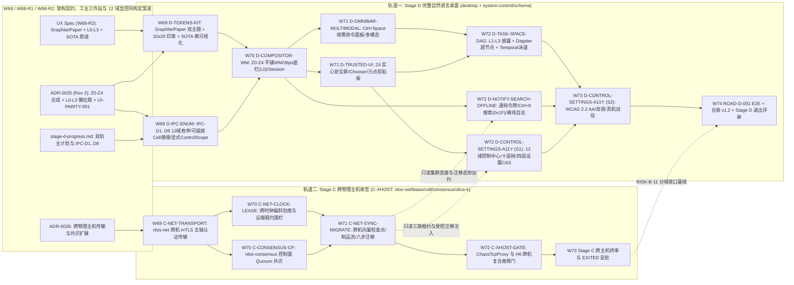

# 阶段 D 权威进度单（完整自然语言桌面）

> **状态：`IN_PROGRESS / NOT EXITED`（2026-10-26 维护者显式启动阶段 D 设计与并行推进，决策点 D0–D5 裁定落档，并经同日 `W68-R1` 中性工业工作站视觉纠偏与 `W68-R2` 12 域显控同构、`L0–L3` 四级渐进式披露及工业级 SOTA 显示原语深化锁定契约；至 [§D.5.5](#d55-阶段-d-退出评审门) 全部退出条件满足并获维护者明确批准前不得翻 `EXITED`）。** 本文件为阶段 D（完整自然语言桌面，`SurfaceProfile=DESKTOP`）的单一权威进度与编排台账，由 [v0.5 §28.4 阶段 D 定义](../design/06-架构设计总纲-v0.5.md)、[§24–§25 系统体验与桌面契约](../design/06-架构设计总纲-v0.5.md)、阶段 B/C 移交清单（[stage-b-progress §6.5.6](./stage-b-progress.md) `#3`/`#15` 与 [stage-c-progress §C.3.2](./stage-c-progress.md)）及 2026-10-26 维护者显式架构裁定（`A1–A4`、`W68-R1` 视觉/空间纠偏及 `W68-R2` 12 域显控同构与 SOTA 披露深化裁定，落档为 [§D.4](#d4-维护者决策日志d0d52026-10-26) `D0–D5`）构造。起草快照基线 `HEAD = 3789cf2c8ba800929e65201ed1a8a5fa86e907f2`（`W68`），`W68-R1` 修订基线 `HEAD = 3c85fcc4a603d707ac1ebc44d822c27beaff4396`（2026-10-26），`W68-R2` 深化基线 `HEAD = a576ead25cb624ee8506a2d8e7172de555456ba6`（2026-10-26）。
>
> **W68 / W68-R1 / W68-R2 同波权威姊妹规范（交叉绑定）**：
> - 视觉与交互总规格：[2026-10-26-stage-d-desktop-visual-and-ux-design.md](../superpowers/specs/2026-10-26-stage-d-desktop-visual-and-ux-design.md)（`W68-R1` 确立 `Graphite Workstation` 默认深色与 `Paper Workstation` 内置浅色 100% 实心零眩光中性工业工作站双主题系统，显式取代初版 Glacier 液态玻璃方案并与外部营销门户 [docs/site/DESIGN.md](../site/DESIGN.md) 职责解耦；`W68-R2` 进一步固化 `L0–L3` 四级渐进式披露、`[UI-PARITY-001]` 12 域显控同构矩阵与六大工业级 SOTA 显示原语）；
> - 桌面合成器分层与可信 UI 架构决策：[ADR-0025](./adrs/0025-stage-d-hybrid-desktop-compositor-and-trusted-ui-layering.md)（五平面 `Z0–Z4` 平铺优先工作站合成器、`36px` 底部紧凑任务栏、`Ctrl+Space` 按需唤起命令/意图面板、`Z4` UAC/Polkit 不可遮挡实心安全确认屏与凹陷硬件风 `32×20` 单色精密防伪印章、`L0 → L1 → L2 → L3` 按需懒拉取架构及 `[UI-PARITY-001]` 12 域显控同构与法定不可篡改禁区）；
> - 阶段 C 跨物理主机传输与共识扩展决策：[ADR-0026](./adrs/0026-cross-physical-host-transport-and-consensus-expansion.md)（与阶段 D 在 `W69–W74` 按严格写集互斥双轨并行推进，见 [§D.5](#d5-双轨依赖-dag-与-w69--w74-并行波次编排stage-d--stage-c-c-xhost)）。
>
> **评审与风险基线（只读引用）**：阶段 B 评审记录 [W31-G](../evidence/stage-b/reviews/w31g-road-b004-gates.md)、[W33-H](../evidence/stage-b/reviews/w33h-road-b001-b002.md)、[W34-A](../evidence/stage-b/reviews/w34a-six-gate-matrix.md)；阶段 C 退出门评审 [W67](../evidence/stage-c/reviews/w67-stage-c-exit-gates.md)；未知与残余风险清单 [exit-unknown-risks.md](./exit-unknown-risks.md)（重点关联 `RISK-B-06`、`RISK-B-11`、`U-3`、`U-5`、`U-7`、`U-8`）；机器台账 [ledger-schema.md](./ledger-schema.md)、[claims.yaml](./claims.yaml)、[risks.yaml](./risks.yaml)、[evidence-index.yaml](./evidence-index.yaml)。

---

## D.1 阶段目标与非目标（源自规范）

### D.1.1 阶段目标与规范需求全映射

阶段 D 把 NLOS 从阶段 B/C 已验证的「开发者/运维 Task Manager 薄壳 + 单机多进程分布式权威内核」推进为面向非开发者的**完整现代自然语言桌面（Complete Natural-Language Desktop，`SurfaceProfile=DESKTOP`）**。按 [v0.5 §28](../design/06-架构设计总纲-v0.5.md) 路线定义，阶段 C 与阶段 D 在阶段 B 之后**并行推进**（非串行瀑布），且安全、兼容与证据分级贯穿全部阶段。

[v0.5 §28.4](../design/06-架构设计总纲-v0.5.md) 规定阶段 D **必须交付**（逐字誊录）：

1. 完整 Task Space、窗口、通知、设置、搜索；
2. 多模态输入输出；
3. 可信权限与成本界面；
4. System Control Center、Task Manager、Resource Monitor 与各层级手动调度；
5. 自动 Planner 计划预览、图形化编辑、手工 override 与重新授权体验；
6. 离线/恢复体验；
7. 可访问性和本地化。

**阶段 D 退出门**（[v0.5 §28.4](../design/06-架构设计总纲-v0.5.md) 逐字誊录）：

- `[ROAD-D-001]` **非开发者无需理解 Agent 编排即可持续使用多个 Application 和后台 Task。**

**规范性需求全量映射表**（实现车道必须按 Requirement ID 落地 conformance / security / parity 测试与独立 Evidence，禁止脱离下表自造语义）：

| 规范章节 | Requirement ID | 规范核心不变量摘要 | 承接工作包 |
|---|---|---|---|
| §28.4 | `[ROAD-D-001]` | 非开发者无需理解 Agent 编排即可持续使用多个 Application 与后台 Task（默认 `L0/L1` 标准工作站层严禁暴露 `Z1`/`TypedIntent`/`0x1F`/`Quota`/`TaskAttempt`/`Fiber`/`Cell`/`receipt_hex` 等内部架构术语，`L2` 单行按需展开步骤依赖与配额卡点无需开启全局专家模式，跨应用、后台通知、授权与恢复闭环自洽） | `D-TASK-SPACE-DAG`、`D-COMPOSITOR-WM`、`D-CONTROL-SETTINGS-A11Y`（E2E 终验） |
| §24.1 | `[NL-COMPILE-001]`、`[NL-PROPOSE-001]`、`[NL-AMBIG-001]`、`[NL-BIND-001]` | 版本化 `TypedIntent` 编译保留原请求摘要与歧义；授权前 `ActionProposal` 完整展示目标、权限、资源上界、副作用、撤销与溯源计划；高风险歧义强制澄清（禁静默扩权/扩成本）；`AuthorizationReceipt` 逐字段精确绑定目标代际与摘要 | `D-OMNIBAR-MULTIMODAL`、`D-TRUSTED-UI` |
| §24.1.1 | `[PLAN-CHANGE-001]` | 用户可在可信 Task Space 手工增加、删除、暂停、合并、重排或替换**尚未执行**的 `TaskNode`；改变目标语义、授权对象、不可逆副作用、成本上界、deadline 或验收条件的修改必须重编译并重新授权；纯 placement、显示顺序或不扩权资源降级可走受限 `ControlCommand` | `D-TASK-SPACE-DAG`、`D-IPC-ENUM` |
| §24.1.1 | `[PLAN-OVERRIDE-001]` | 自动规划与手工规划必须收敛到同一 `TaskPlan`/`TaskNode` schema、`AdmissionPlan`、`Capability` 与 `Receipt`；严禁维护绕过系统约束的「高级自然语言路径」或「管理员拖拽路径」（协同 `[PLAN-UNTRUSTED-001]`、`[PLAN-DAG-001]`、`[PLAN-LAZY-001]`、`[PLAN-DEPENDENCY-001]`） | `D-TASK-SPACE-DAG`、`D-OMNIBAR-MULTIMODAL` |
| §24.2 | `[TUI-CONSENT-001]` | 权限确认必须由 Trusted UI（`Z4`）渲染真实 `Application`/`Principal`、目标、purpose、持续时间与成本；不可信应用不得遮挡、拦截或伪造系统提示 | `D-TRUSTED-UI`、`D-TOKENS-KIT` |
| §24.2 | `[TUI-CHOOSER-001]` | 文件/Artifact chooser 可发现用户可见对象，但仅向 Application 返回经用户明确选择后的 scoped capability | `D-TRUSTED-UI`、`D-IPC-ENUM` |
| §24.2 | `[TUI-EXT-001]` | UI `Surface`/`Package` schema 必须为本地化、可访问性、多模态、通知、深链接和内容类型关联保留版本化扩展 | `D-CONTROL-SETTINGS-A11Y`、`D-OMNIBAR-MULTIMODAL`、`D-IPC-ENUM` |
| §24.3 | `[RCPT-UNDO-001]`、`[RCPT-PARTIAL-001]` | 每个 Action 明确标注 `REVERSIBLE` / `COMPENSATABLE` / `IRREVERSIBLE`，禁止用 UI「撤销」假象掩盖不可逆外部副作用；多目标操作逐目标报告结果，禁止单一布尔值隐藏 partial failure | `D-TRUSTED-UI`、`D-TASK-SPACE-DAG`、`D-CONTROL-SETTINGS-A11Y` |
| §25 | `[TASK-SPACE-001]` | 提供用户可见的持续 Task Space，完整覆盖运行、等待授权、等待输入/资源/网络、暂停、恢复中、失败、完成、部分完成与 disputed 任务（对齐 16 态 `[TASK-STATE-001]`、`[TASK-STATE-002]`、`[TASK-REOPEN-001]`） | `D-TASK-SPACE-DAG`、`D-IPC-ENUM` |
| §25 | `[TASK-VIS-001]` | 用户可查看每个 Task 的 `Application`、`Process`、权限、预算、输入、输出、provenance 与可取消性 | `D-TASK-SPACE-DAG`、`D-IPC-ENUM` |
| §25.1 | `[TASK-VIS-002]` | Task Space 严格区分 `Task` 与各 `TaskAttempt`，展示 input snapshot、consistency mode、isolation/enforcement profile、resource group/account、当前 `Cell`、winner/commit、冲突、取消传播与 `PROVIDER_ISOLATION_UNVERIFIED` 状态 | `D-TASK-SPACE-DAG`（`L3` 内核与分布式取证层，`Ctrl/⌘ + Shift + E` 直达） |
| §25 | `[TASK-NOTIFY-001]` | 后台 Task 的重要状态变化通过 `NotificationService` 持续可见，不依赖原聊天窗口或发起表面保持打开 | `D-NOTIFY-SEARCH-OFFLINE` |
| §25.3 | `[CTRL-PARITY-001]` | 自然语言暂停、GUI 任务管理器点击暂停、CLI 发送 pause 与结构化 API 调用必须编译为语义等价的 `ControlCommand`（带显式 `ControlScope`），走同一 `Capability`、generation CAS、resource/effect fence 与 `ControlReceipt` 路径（协同 `[CTRL-HIER-001]`、`[CTRL-PRIORITY-001]`、`[CTRL-SAFETY-001]`） | `D-IPC-ENUM`、`D-CONTROL-SETTINGS-A11Y`、`D-TASK-SPACE-DAG` |
| §25.3 | `[CTRL-PLAN-001]` | Task Space 采用 `L0 → L1 → L2 → L3` 四级渐进式披露：普通用户在 `L1` 查看 `Application`/`Task` 整体目标进度，在 `L2` 按需单行展开步骤依赖与配额卡点（无需开启全局专家模式）；高级用户直达 `L3`（`Ctrl/⌘ + Shift + E`）下钻 `TaskPlan`、`TaskNode`、`TaskAttempt`、`Process`/`AgentInstance`/`ExecutionFiber`、`ResourceGroup`、`Topic`、`Operation` 与 `Cell` 并在授权范围内手动干预 | `D-TASK-SPACE-DAG`、`D-CONTROL-SETTINGS-A11Y` |
| §25.3 | `[CTRL-RECOVERY-001]` | 控制命令超时或客户端断开时，UI 必须按 `ControlCommandId` 查询权威状态；严禁把 `UNKNOWN` 当作未执行盲目重发；批量控制必须逐目标报告成功、拒绝、等待与 unknown | `D-IPC-ENUM`、`D-CONTROL-SETTINGS-A11Y` |
| §25.3–§25.4 / `ADR-0025`（`W68-R2`） | `[UI-PARITY-001]` | 12 域有界展示（`List* + Inspect*`）与受控写入（`ControlCommand` 显式 `ControlScope`）同构对齐（覆盖 §25.3 十层 + 阶段 C 跨 `Cell`/三族租约/`PartitionAutonomyGate` + 非权威搜索 `0x1F`/一次性通知 `ActionToken`），硬锁四大法定不可篡改禁区（`0x1F` 零写、`IRREVERSIBLE` 无撤销、`TaskAttempt` 禁手工标提交、`EFFECT_UNKNOWN` 禁手工标成功），前端按可见层级与游标窗口 `O(visible_rows)` 惰性拉取 | `D-IPC-ENUM`、`D-TOKENS-KIT`、`D-TASK-SPACE-DAG`、`D-CONTROL-SETTINGS-A11Y`、`D-NOTIFY-SEARCH-OFFLINE` |
| §25.4 | `[DUI-LAUNCH-001]` | `ApplicationLauncher`（底部工作站任务栏启动器与应用菜单）必须按 `ApplicationId` / `InstallationId` 激活 Application，严禁将 `PackageId` 或某个瞬态 `ProcessId` 当作应用身份 | `D-COMPOSITOR-WM`、`D-IPC-ENUM` |
| §25.4 | `[DUI-CONTROL-001]` | Desktop 提供可信 `SystemControlCenter` / `TaskManagerSurface` / `ResourceMonitorSurface`，支持按 §25.3 十层及阶段 C `Cell` 拓扑/租约浏览与受控调度，严格复用 §25.3 `ControlCommand`/`ControlReceipt`，禁止私有未认证 UI RPC 绕过系统控制协议 | `D-CONTROL-SETTINGS-A11Y`、`D-IPC-ENUM` |
| §25.4 | `[DUI-WINDOW-001]` | `Surface`/`Window` 必须绑定 `Application` owner、`DesktopSession`、visibility、`FocusAndInputRoute`、accessibility tree 与 `generation`；stale `Surface` 严禁接收任何新输入 | `D-COMPOSITOR-WM`、`D-CONTROL-SETTINGS-A11Y` |
| §25.4 | `[DUI-INPUT-001]` | focus、keyboard、pointer、voice 与 automation input 必须经 Trusted UI 路由并显式标明输入源（`InputSource`）；不可信 Application 不得伪造系统级输入或权限界面 | `D-COMPOSITOR-WM`、`D-TRUSTED-UI`、`D-OMNIBAR-MULTIMODAL` |
| §25.4 | `[DUI-CHOOSER-001]` | Open / Save / Share chooser 必须返回 scoped Artifact `Capability`（`ChooserGrant`），严禁向应用泄露宿主全局文件系统路径或整个用户目录 | `D-TRUSTED-UI`、`D-IPC-ENUM` |
| §25.4 | `[DUI-ASSOC-001]` | `ContentTypeAssociation`（内容类型与默认 Application 关联）必须是用户可查看、可修改、可撤销的 `Settings` 数据；`Package` 只能声明提议，不得静默夺取默认关联 | `D-CONTROL-SETTINGS-A11Y`、`D-IPC-ENUM` |
| §25.4 | `[DUI-CLIP-001]` | `ClipboardItem` 与 `DragDropTransfer` 必须绑定 content type、source `Application`、`taint`、`expiry` 与真实 `user gesture`；敏感或带污点内容跨 Application 传递必须经 policy / Trusted UI 显式确认 | `D-TRUSTED-UI` |
| §25.4 | `[DUI-NOTIFY-001]` | `NotificationAction` 必须强绑定原 `NotificationId`、`ApplicationId`、`TaskId` 与一次性 `ActionToken`（SHA-256 防重放核销），防止其他 Application 伪造通知响应 | `D-NOTIFY-SEARCH-OFFLINE` |
| §25.4 | `[DUI-SESSION-001]` | 多用户 `UserProfile`、`Workspace`、`DesktopSession`、`Keychain` 与 Application 数据容器严格隔离；执行 `LOCKED` 锁屏或切换用户后，旧 Session 的 input route 与会话态 capability generation 必须立即失效或降权 | `D-COMPOSITOR-WM`、`D-CONTROL-SETTINGS-A11Y` |
| §25.4 | `[DUI-SETTINGS-001]` | `SettingsDomain` 按 `system / user / workspace / application` 四层作用域分层，支持版本化 CAS（compare-exchange）与变更订阅（watch）；`KeychainReference` 只向 Application 提供 use-by-reference 句柄，零明文密钥导出 | `D-CONTROL-SETTINGS-A11Y`、`D-IPC-ENUM` |
| §25.4 / §22 | `[DUI-OFFLINE-001]`、`[CONS-DECL-001]`、`[CONS-CTRL-001]` | `LOCAL_SINGLE_NODE` 桌面在离线或控制面断连时完整保持 Launcher、本地 Artifact、Task、Settings、Search、Notification 历史与本地应用操作可用；依赖远程能力的 Action 显式呈现 `WAITING_NETWORK` / `UNAVAILABLE`，绝不拖垮桌面整体；Spotlight 搜索强制携带 `0x1F` `NON_AUTHORITATIVE` 守卫，严禁直接驱动权限/账本/提交门 | `D-NOTIFY-SEARCH-OFFLINE` |

### D.1.2 显式非目标（源自规范与阶段边界，严禁越界）

1. **不替代宿主 OS 内核、显示服务器或 GPU 驱动（[v0.5 §29.1](../design/06-架构设计总纲-v0.5.md)）**：阶段 D 基于 Tauri 2 WebView2 / WKWebView / WebKitGTK 宿主窗口承载 `SurfaceProfile=DESKTOP` 合成画布（[ADR-0001](./adrs/0001-stage-b-core-language-and-runtime.md)、[ADR-0025](./adrs/0025-stage-d-hybrid-desktop-compositor-and-trusted-ui-layering.md)），不编写裸机帧缓冲、Wayland/Quartz/DWM 替代品或内核级显卡驱动。
2. **禁止建立绕过 `ControlCommand` 的私有未认证 GUI RPC（`[DUI-CONTROL-001]`、`[CTRL-PARITY-001]`、`[UI-PARITY-001]`）**：桌面前端与 Tauri Rust 宿主层严禁直接打开权威 SQLite 库做静默写操作或新增绕过 `ADR-0011` 认证通道、能力校验、代际 CAS 与 `ControlReceipt` 的私有 Tauri mutation 命令；一切状态变更与控制调度必须收敛至可核验的 `ControlCommand` / 授权协议路径，并硬锁四大法定不可篡改禁区。
3. **不捆绑阶段 E 应用商店治理与商业市场（[v0.5 §28.5 / §29.2](../design/06-架构设计总纲-v0.5.md)）**：长期二进制 SABI v1.0 兼容承诺、第三方 Publisher 认证体系、生产级 Application Store 审核/分发治理、跨组织商业清算与全球联邦留归阶段 E（`ROAD-E-001`）；阶段 D 的 Launcher 与应用管理仅消费本地 `ApplicationAuthority` 已安装/已验签应用目录。
4. **不强制所有 Application 退化为聊天窗口，也不把自然语言作为唯一接口（[v0.5 §29.1](../design/06-架构设计总纲-v0.5.md)）**：阶段 D 采用平铺优先混合自然语言工作站桌面（`D2` `W68-R1` 修订裁定），既提供按需唤起的 `Ctrl+Space` 命令/意图面板与停靠式高密度表格 `Task Space`，也完整支持边对边平铺/浮动多应用 GUI 窗口、表单、快捷键、底部 `36px` 紧凑工作站任务栏与系统控制面板。
5. **与阶段 C 跨物理主机轨道（`C-XHOST`）权责清晰解耦（`D4` / `D5` 裁定）**：跨物理主机网络传输、跨机时钟不确定度租约与控制面复制状态机共识属阶段 C 收官扩展包（[stage-c-progress.md](./stage-c-progress.md) + [ADR-0026](./adrs/0026-cross-physical-host-transport-and-consensus-expansion.md)）；阶段 D 桌面通过可插拔只读投影消费 `Cell`/集群连接态势、三族租约水位（`ListCells` / `InspectCellLeases`）、断连自治状态（`PartitionAutonomyGate`）并通过标准 `ControlCommand` 发起受控迁移请求（`RequestProcessMigration`），不得用桌面 UI 指示器冒充分布式共识证据。

---

## D.2 基线盘点与状态语义（阶段 B/C 已验证基线 vs 阶段 D 待建范围）

### D.2.1 状态语义与证据分级纪律

完全沿用 [stage-b-progress §2](./stage-b-progress.md) 与 [stage-c-progress §C.2](./stage-c-progress.md) 的状态机（`DONE` / `PARTIAL_PASS` / `IN_PROGRESS` / `READY` / `BLOCKED` / `NOT_STARTED`）及 v0.5 H0–H8 证据阶梯：

| 阶段级状态 | 含义 |
|---|---|
| `IN_PROGRESS / NOT EXITED` | **当前态（2026-10-26 `W68` 启动，`W68-R1` / `W68-R2` 修订固化）**：决策点 `D0–D5` 已由维护者显式裁定，视觉规格与 [ADR-0025](./adrs/0025-stage-d-hybrid-desktop-compositor-and-trusted-ui-layering.md) 入库；`D-core` 八大工作包当前均处于 `DESIGN` / `NOT_STARTED`（实施自 `W69` 按写集互斥波次启动）。在 [§D.5.5](#d55-阶段-d-退出评审门) 六项退出门全部达成且维护者明确批准前，严禁将本状态改为 `EXITED` |
| `EXITED` | `[ROAD-D-001]` 与八大工作包独立证据评审通过、机器台账 `ledger-schema v1.2`（`stage: "D"`）全量回填且 `lint_claims.py` 零错误、`P0=0`、未知风险清单同步、获维护者明确批准后方可翻转 |

**铁律（AGENTS.md 第 7 条）**：设计完成 ≠ 已实现；编译通过 ≠ 已验证；单点集成测试 ≠ 真机可用性（`U-3`）。在对应测试与 `docs/evidence/stage-d/` 证据落库前，任何工作包不得从 `DESIGN` / `IN_PROGRESS` 升格为 `PARTIAL_PASS` 或 `DONE`。

### D.2.2 诚实基线盘点表（阶段 B/C 已实现并验证 vs 阶段 D 待建范围）

现有 [desktop/](../../desktop/README.md)（独立 Tauri 2 工作区）与后端控制面在阶段 B（`W32-A..F`、`W33-F`）和阶段 C（`W39-D`、`W44-F2`、`W52`、`W65`、`W66`）已积累扎实的可信底座，但距离 `v0.5 §25.4 / §28.4` 完整消费级自然语言桌面及 `[UI-PARITY-001]` 12 域显控同构仍有明确代差。下表逐域如实界定起点与缺口（确保 `W69` 启动前零孤儿缺口）：

| 能力域 | 阶段 B/C 已实现并验证的事实（`PARTIAL_PASS` / `VERIFIED` 基线） | 既有代码与证据锚点 | 阶段 D 待建范围（当前 `DESIGN` / `NOT_STARTED`） | 对应 `D-core` 包 |
|---|---|---|---|---|
| **认证 IPC 与 12 域显控同构** | Tauri 2 Rust 命令层全量走 `ADR-0011` 挑战-响应认证通道（Unix Socket + `W52` Windows Named Pipe 跨平台互通，三平台 CI 常设绿）；读写路径 `ControlReceipt` 与 `system-control-cli` / in-process 字节级 `receipt_hex` 一致（`parity_check` / `parity_check_write`）；GUI 已接通三域告警 `ack`/`resume` 与操作 `pause/resume/cancel/kill/throttle/reclaim`（含 `kill` 5 秒两步确认）。**存量断头路事实**：后端 `nlos-system-control` 已实现 `DisableApplication`/`UninstallApplication`（`W35-P11`）及 `InspectSearch`/`InspectNotification`（`W66`，且 `OutcomeDto` 已声明变体），但 Tauri `invoke_handler`（`lib.rs`）与前端 `ipc.ts` / `ControlActionInput` 尚未挂载；写侧动作仍借壳无类型 `targetIdHex` 字符串；多域有 `Inspect*` 无 `List*` 枚举，且阶段 C `Cell`/租约未入桌面契约 | [desktop/README.md](../../desktop/README.md)、[desktop/src/ipc.ts](../../desktop/src/ipc.ts)、[desktop/src-tauri/src/lib.rs](../../desktop/src-tauri/src/lib.rs)、[b-gui-001-task-manager-shell.md](../evidence/stage-b/b-gui-001-task-manager-shell.md) | 落地 **`IPC-D1..D8`**，建立 `[UI-PARITY-001]` 12 域显控同构：补齐有界游标枚举（`ListWorkspaces`、`ListTasks`、`ListTaskGroups`、`ListApplications`、`ListProcesses`、`ListExecutionFibers`/`ListOperations`、`ListResourceReservations`、`ListTopics`、`ListNotifications` 及阶段 C `ListCells` / `InspectCellLeases` 可插拔只读接缝）；接通 `inspect_search`/`inspect_notification` Tauri 句柄与 `disable-application`/`uninstall-application` 绑定；固化显式 `ControlScope` 类型化寻址、级联爆炸半径 dry-run 预览（`[CTRL-HIER-001]`）、`ControlCommandId` 对账恢复（`[CTRL-RECOVERY-001]`）与四大法定不可篡改禁区 | `D-IPC-ENUM`、`D-CONTROL-SETTINGS-A11Y` |
| **视觉系统、组件原语与 SOTA 微型可视化** | 开发者运维表单式侧边栏 + 基础暗色 CSS（[desktop/src/main.ts](../../desktop/src/main.ts) 12 个平铺 tab），尚无设计 token 体系、双主题切换、SOTA 密度原语或防伪印章 | `desktop/src/style.css`、[Stage D UX Spec](../superpowers/specs/2026-10-26-stage-d-desktop-visual-and-ux-design.md)（`W68-R1` / `W68-R2`） | 构建 `Graphite Workstation (#111214 / #18191C / #1E2024 + #2563EB)` 默认深色与 `Paper Workstation (#E5E7EB / #FFFFFF / #F3F4F6 + #1D4ED8)` 内置浅色 100% 实心不透明中性工业工作站 Token 库（零 `backdrop-filter: blur`、零发光外框、`0px/4px/6px` 工业圆角、`1.25px–1.5px` 单色几何 SVG 图标、双极警示色 `#D97706`/`#DC2626`、凹陷硬件风 `32×20` 单色 Gerono 示波防伪印章），并封装 **`W68-R2` 四大 SOTA 微型可视化组件**（`Nomad` 三水位子弹微缩条 `Usage/Effective/Requested`、`Temporal/Perfetto` 单色分段耗时瀑布条、`Headlamp` 作用域面包屑与右侧非模态 Inspector 抽屉壳、`Terraform` 风格 `+ / ~ / -` 爆炸半径差异预览表） | `D-TOKENS-KIT` |
| **桌面会话、窗口合成与 `L0` 环境感知** | `W32-F` 实现应用声明表面只读卡片投影（[surfaces.rs](../../desktop/src-tauri/src/surfaces.rs)，跨代际过滤 stale 表面）；`W39-D` 实现 [window_lifecycle.rs](../../desktop/src-tauri/src/window_lifecycle.rs) `SurfaceLifecycle`（`REGISTERED → CREATED → PRESENTED ↔ HIDDEN → CLOSED`）纯状态机与当前代际进程/后台任务投影 | `desktop/src-tauri/tests/surface_presentation_side.rs`、`window_lifecycle_side.rs` | `DesktopSession`（`LOCKED/ACTIVE/SUSPENDED/CLOSED`）与多用户 `Workspace` 隔离及锁屏代际失效；五平面 `Z0–Z4` 工作站合成器；`4px` 间隙平铺优先多窗口管理器（`30px` 实心窗框承载 `L0` 应用归属与代际环境感知，支持双栏/三栏/四象限平铺 + 可选 `6px` 浮动窗口）；`36px` 底部贴边实心工作站任务栏（`L0` 全局环境感知、按 `ApplicationId`/`InstallationId` 激活的 `ApplicationLauncher`、`26px` 命令触发框、`2px` 激活底条窗口标签与系统托盘）；带代际栅栏的 `FocusAndInputRoute` | `D-COMPOSITOR-WM` |
| **自然语言入口与多模态交互** | 后端 `nlos-system-control` 支持受控中英文 NL 前缀命令解析（CLI/API 路径）；桌面端尚无按需命令/意图面板、意图预览或多模态附件通道 | `crates/nlos-system-control/`、[C-UNFREEZE-001](../evidence/stage-c/c-unfreeze-001-search-notify-production-wiring.md) | 底部任务栏 `26px` 紧凑触发框与 `Ctrl+Space` 按需居中唤起的 `4px` 圆角实心 **Command & Intent Palette**（平时隐藏零霸屏）；按披露层级呈现意图编译预览（`L1/L2` 白话目标与资源摘要，`L3` 显示版本化 `TypedIntent`）；`[NL-AMBIG-001]` 高风险歧义澄清表；受控语音转写、截图与 Artifact 拖入附件及即时结果预览 | `D-OMNIBAR-MULTIMODAL` |
| **Task Space、`L1–L3` 渐进式披露与计划图（DAG）编辑** | `W33-F` 实现最小只读 `Task Space`（[desktop/src/views/task-space/index.ts](../../desktop/src/views/task-space/index.ts)，聚合三域 escalated 告警 + 手动关注 `plan_id`）；`W39-D` 接通按已知单点 ID 查询 `TaskGroup` / `TaskNode` / `ExecutionFiber` / `Topic` / `Operation`；文件头部静态诚实登记三项 `TASK_SPACE_GAPS` | `desktop/src/views/task-space/index.ts`（第 45–61 行 `TASK_SPACE_GAPS`）、`task_space_layer_inspect_side.rs` | 闭合全部三项 `TASK_SPACE_GAPS`；实现 `L1 → L2 → L3` 四级渐进式披露状态模型（`store/disclosure-model.ts`）与视口游标懒拉取 `IPC-D1..D3`（`O(visible_rows)`）：`L1` 零行话高密度实心任务承诺表（`[ROAD-D-001]` 16 态任务流）→ `L2` 单行按需展开右侧非模态步骤依赖与 Nomad 配额瓶颈抽屉（无需开启全局专家模式）→ `L3`（`Ctrl/⌘ + Shift + E` 直达）**Dagster** 左到右正交 `TaskPlan` DAG 编辑器（含 `[PLAN-LAZY-001]` `+N 待物化步骤 · 0 进程` 折叠超节点、未执行节点增删/暂停/重排/合并/替换与重授权 diff 判定）及 **Temporal** 按时间比例渲染的 `TaskAttempt` 竞速泳道与 `ExecutionFiber` 四段耗时瀑布条 | `D-IPC-ENUM`、`D-TASK-SPACE-DAG` |
| **可信权限 UI、选择器与剪贴板** | `W32-D` 实现会话连接授权事实展示与**已结清**预留 `ResourceCostReceipt` 五字段只读核对（`inspect_resource_cost` / `cost_fact_check`）；能力账本、实时报价审批、文件选择器与剪贴板门控均以静态缺口表登记缺席 | `desktop/src-tauri/tests/authenticated_permission_side.rs`、[b-gui-001-task-manager-shell.md](../evidence/stage-b/b-gui-001-task-manager-shell.md) | `Z4` UAC / Polkit 工作站级不可遮挡实心系统安全确认屏（`rgba(10,11,13,0.78)` 暗幕、`6px` 实心框、`2px` 钢蓝顶条、凹陷硬件风 `32×20` 单色 Gerono 示波印章、四行结构化键值规格表与 `350ms` 防劫持门）；只返回衰减 Capability 而不泄露宿主路径的 `ChooserGrant` 选择器；绑定污点/过期/手势的跨应用 `ClipboardItem` 与 `DragDropTransfer` 门控 | `D-TRUSTED-UI` |
| **通知中心、Spotlight 搜索与离线自治** | `W65` + `W66` 已在后端完整实现 `nlos-notify` v2（16 态生命周期通知、SHA-256 一次性 `ActionToken`、离线分页历史）与 `nlos-search`（签名向量检查点查询、`0x1F` `NON_AUTHORITATIVE` 五门禁用守卫、多 Cell 候选归并），并在 `SystemControlDaemon` 及桌面 DTO 层接通单次 `InspectNotification` / `InspectSearch`（待补 Tauri `invoke_handler` 与分页列表 `ListNotifications`） | [C-SEARCH-001](../evidence/stage-c/c-search-001-non-authoritative-checkpoint-search.md)、[C-NOTIFY-001](../evidence/stage-c/c-notify-001-task-lifecycle-action-token.md)、[C-UNFREEZE-001](../evidence/stage-c/c-unfreeze-001-search-notify-production-wiring.md) | 右下角实心通知弹出面板与横幅推送（消费 `ListNotifications` + 一次性 `ActionToken` 快捷核销）；`Ctrl+K` 实心候选搜索面板（代码级硬锁 `0x1F` 法定零写禁区 + `L1` 零行话候选提示 + 强制权威回跳重验）；`[DUI-OFFLINE-001]` 本地断网自治与底栏 `L0` 托盘 `Cell`/集群 `PartitionAutonomyGate` 连接态势指示器 | `D-IPC-ENUM`、`D-NOTIFY-SEARCH-OFFLINE` |
| **12 域系统控制中心、设置、无障碍与真机战役** | `W32-E` 实现三恢复域 OpenMetrics 拉取式资源监控表；`Config` 页仅支持会话内存级连接参数配置（不落盘）；无十层归属树、无 `Cell` 迁移控制、无分层 `SettingsDomain`、无 `ContentTypeAssociation`、无 `KeychainReference` UI、无系统级无障碍/双语包；真机 computer-use 战役（`#3` / `U-3`）为 `NOT_STARTED` | `desktop/src-tauri/tests/resource_monitor_metrics_side.rs`、[exit-unknown-risks.md](./exit-unknown-risks.md)（`RISK-B-06`、`U-3`） | 升级 `SystemControlCenter` / `TaskManagerSurface` / `ResourceMonitorSurface`（**System Informer** 十层父子归属树与共享故障域徽标 + 阶段 C `Cell` 三族租约检视与受控 `RequestProcessMigration` + **Nomad** 三水位资源条 + **Headlamp** 权限/状态机动作裁剪与四大法定不可篡改锁 + **Terraform Plan** `+ / ~ / -` 级联爆炸半径差异预览表）；四层作用域 `SettingsDomain` CAS + watch、用户可撤销 `ContentTypeAssociation` 与 `KeychainReference` 按引用凭据管理；`WCAG 2.2 AA` 无障碍语义树与 `zh-CN / en-US` 本地化；Windows/macOS 真机 GUI 战役与 `[ROAD-D-001]` 非开发者端到端验收 | `D-CONTROL-SETTINGS-A11Y` |

---

## D.3 阶段 D 核心工作包总览（`D-core` 八大工作包与移交收敛项）

### D.3.1 `D-core` 工作包矩阵（阶段 D 本体）

| ID | 工作包名称 | 规范与 ADR 锚点 | 主要写集边界（Write-Set Scope） | 计划波次 | 当前状态 |
|---|---|---|---|---|---|
| `D-TOKENS-KIT` | `Graphite / Paper` 实心工业工作站双主题系统、单色几何 SVG 图标、`32×20` 防伪印章与 SOTA 微型可视化原语库 | [Stage D UX Spec](../superpowers/specs/2026-10-26-stage-d-desktop-visual-and-ux-design.md)（`W68-R1`/`W68-R2`）、[ADR-0025](./adrs/0025-stage-d-hybrid-desktop-compositor-and-trusted-ui-layering.md)、`[UI-PARITY-001]`、`[TUI-EXT-001]` | `desktop/src/styles/`、`desktop/src/ui/`、`docs/evidence/stage-d/d-tokens-001-*.md` | `W69` | **`PARTIAL_PASS`**（2026-10-27 `W69`，[D-TOKENS-001](../evidence/stage-d/d-tokens-001-workstation-tokens-and-sota-kit.md)，`H3`：`10` 套件 `697` 项断言与 `ANTI-AI-01..07`、`WCAG 2.2 AA` 全绿；待 `W70–W73` 在真实桌面表面挂载并经真机战役收口） |
| `D-IPC-ENUM` | `IPC-D1..D8` 12 域有界枚举、可插拔 `Cell` 检视接缝、存量 Tauri 显控断头路闭合与显式 `ControlScope` 对等扩展 | §25.3 `[CTRL-PARITY-001]`、`[CTRL-HIER-001]`、`[CTRL-RECOVERY-001]`、`[UI-PARITY-001]`；§25.4 `[DUI-LAUNCH/CONTROL/CHOOSER/ASSOC/SETTINGS-001]`；[ADR-0011](./adrs/0011-ipc-principal-auth-signature-passthrough.md)、[ADR-0014](./adrs/0014-schema-channel-freeze-v1-beta.md) | `schema/nlos/sabi/v1/`（纯 additive）、`gen/`、`crates/nlos-schema/`、`crates/nlos-plan/`（只读投影）、`crates/nlos-system-control/`（含可插拔 `Cell` 只读 inspector trait）、`desktop/src/{ipc.ts,types.ts}`、`desktop/src-tauri/src/{ipc.rs,dto.rs}`、`docs/evidence/stage-d/d-ipc-001-*.md` | `W69` | **`PARTIAL_PASS`**（2026-10-27 `W69`，[D-IPC-001](../evidence/stage-d/d-ipc-001-twelve-domain-enum-and-symmetry.md)，`H4`：`IPC-D1..D8` 全量闭合，跨平台认证 IPC 四入口字节对等、五大法定禁区与 Tauri 25 项新句柄注册全绿；真实跨机 `CellHost` 只读注入与前端视图消费在 `W70–W72` 汇合） |
| `D-COMPOSITOR-WM` | 五平面 `DesktopSession` 工作站合成器、`4px` 平铺优先窗口管理器、`36px` 底部贴边任务栏（`L0`）与代际输入路由 | §25.4 `[DUI-LAUNCH-001]`、`[DUI-WINDOW-001]`、`[DUI-INPUT-001]`、`[DUI-SESSION-001]`；[ADR-0025](./adrs/0025-stage-d-hybrid-desktop-compositor-and-trusted-ui-layering.md) | `desktop/src/{compositor,wm,dock,store}/`、`desktop/src/styles/planes-layout.css`、`desktop/src/{main.ts,style.css,ipc.ts,types.ts}`、`desktop/src-tauri/src/{window_lifecycle.rs,surfaces.rs,session.rs,compositor.rs,input_router.rs,ipc.rs,dto.rs,lib.rs}`、`docs/evidence/stage-d/d-compositor-001-*.md` | `W70` | **`PARTIAL_PASS`**（2026-10-27 `W70`，[D-COMPOSITOR-001](../evidence/stage-d/d-compositor-001-five-plane-tiling-wm-and-session.md)，`H4`：五平面 `Z0–Z4` 合成器、`4px` 五模式平铺求解、`30px` 可信窗框、`36px` 底部任务栏、`[DUI-LAUNCH/INPUT/SESSION-001]`、`L0–L3` `<16ms` 披露 Store、`compositor_wm_side` `7/0` 与 `compositor-wm.test.ts` `733` 断言全绿；下游 `W71–W73` 面板按预留槽位挂载） |
| `D-OMNIBAR-MULTIMODAL` | `Z3` 按需唤起 `Ctrl+Space` 实心命令/意图面板、分层意图预览、歧义澄清表与多模态附件通道 | §24.1 `[NL-COMPILE/PROPOSE/AMBIG/BIND-001]`；§24.2 `[TUI-EXT-001]`；§25.4 `[DUI-INPUT-001]`；§28.4 多模态 I/O | `desktop/src/views/omnibar/`、`desktop/src/multimodal/`、`desktop/src-tauri/src/omnibar.rs`、`docs/evidence/stage-d/d-omnibar-001-*.md` | `W71` | `DESIGN` / `NOT_STARTED` |
| `D-TRUSTED-UI` | `Z4` UAC/Polkit 实心系统安全确认屏、四行键值规格表、`ChooserGrant` 受限选择器与污点感知剪贴板/拖拽门控 | §24.2 `[TUI-CONSENT-001]`、`[TUI-CHOOSER-001]`；§24.3 `[RCPT-UNDO/PARTIAL-001]`；§25.4 `[DUI-INPUT/CHOOSER/CLIP-001]`；[ADR-0025](./adrs/0025-stage-d-hybrid-desktop-compositor-and-trusted-ui-layering.md) | `desktop/src/trusted-ui/`、`desktop/src-tauri/src/trusted_ui.rs`、`docs/evidence/stage-d/d-trusted-ui-001-*.md` | `W71` | `DESIGN` / `NOT_STARTED` |
| `D-TASK-SPACE-DAG` | `Z1` `L1 → L2 → L3` 渐进式披露 `Task Space`、Dagster 待物化折叠超节点正交 DAG、Temporal 竞速泳道与视口懒拉取 | §24.1.1 `[PLAN-CHANGE-001]`、`[PLAN-OVERRIDE-001]`、`[PLAN-LAZY-001]`；§25 `[TASK-SPACE-001]`、`[TASK-VIS-001/002]`；§25.3 `[CTRL-PLAN-001]`、`[UI-PARITY-001]`；`[ROAD-D-001]` | `desktop/src/store/disclosure-model.ts`、`desktop/src/views/task-space/`、`desktop/src-tauri/src/plan_editor.rs`、`docs/evidence/stage-d/d-task-space-001-*.md` | `W72` | `DESIGN` / `NOT_STARTED` |
| `D-NOTIFY-SEARCH-OFFLINE` | 右下角实心通知弹出面板（一次性 `ActionToken` 核销）、`Ctrl+K` 实心搜索面板（硬锁 `0x1F` 法定零写禁区）与离线自治 + `Cell` 连接态势 | §22 `[CONS-DECL/CTRL-001]`；§25 `[TASK-NOTIFY-001]`；§25.4 `[DUI-NOTIFY-001]`、`[DUI-OFFLINE-001]`；`[UI-PARITY-001]` | `desktop/src/views/{notifications,spotlight,offline-cluster}/`、`desktop/src-tauri/src/notify_search_offline.rs`、`docs/evidence/stage-d/d-notify-search-001-*.md` | `W72` | `DESIGN` / `NOT_STARTED` |
| `D-CONTROL-SETTINGS-A11Y` | 12 域 `SystemControlCenter`（System Informer 十层树 + `Cell` 迁移 + Headlamp 动作裁剪 + `+ / ~ / -` 爆炸半径预览）、四层 `SettingsDomain` CAS、`WCAG 2.2 AA`、双语、`#3` 真机战役与 `[ROAD-D-001]` 终验 | §24.2 `[TUI-EXT-001]`；§25.3 `[CTRL-PARITY/HIER/PRIORITY/PLAN/RECOVERY-001]`、`[UI-PARITY-001]`；§25.4 `[DUI-CONTROL/WINDOW/ASSOC/SESSION/SETTINGS-001]`；`[ROAD-D-001]` | `desktop/src/views/{control-center,settings}/`、`desktop/src/{i18n,a11y}/`、`desktop/src-tauri/src/settings_keychain.rs`、`desktop/e2e/`、`docs/evidence/stage-d/d-{control-settings,a11y-i18n,gui-campaign,road}-*.md` | `W72–W74` | `DESIGN` / `NOT_STARTED` |

#### 各工作包关键验收契约（摘要）

1. **`D-TOKENS-KIT`**：
   - 按 `W68-R1` 中性工业工作站规范完整落地 `Graphite Workstation`（底板 `#111214`、窗口画布 `#18191C`、面板/底栏 `#1E2024`、弹出面 `#23252A`、悬停 `#2A2D33`、`1px` 细线 `#2E3138`/`#4B515D`、主文本 `#ECEDEE`、单一工程蓝 `#2563EB`/`#3B82F6`）与 `Paper Workstation`（底板 `#E5E7EB`、窗口画布 `#FFFFFF`、面板/底栏 `#F3F4F6`、`1px` 细线 `#D1D5DB`/`#9CA3AF`、主文本 `#111827`、单一工程蓝 `#1D4ED8`）双套 100% 实心不透明语义 CSS Custom Properties；严守反 AI 视觉禁令（零 `backdrop-filter: blur`、零发光外框、严格 `0px/4px/6px` 圆角、零 Emoji、双极克制警示色 `#D97706`/`#DC2626`）；
   - 按 `W68-R2` 封装四大工业级 SOTA 微型可视化原语（严格遵循实心中性 `Graphite/Paper`、零模糊、零 Emoji、`0/4/6px` 圆角约束）：① **Nomad 三水位子弹微缩条**（`Usage / Effective / Requested`，单行直观映射实际消耗、资源权威有效授予或本地 `ResourceSubpoolLease` 水位、以及用户请求上限，`[CTRL-PRIORITY-001]`）；② **Temporal / Perfetto 单色分段阶段耗时瀑布条**（按墙钟比例渲染 `ExecutionFiber` 的 `activeCpuMs / schedulerWaitMs / externalWaitMs / backpressureWaitMs` 与挂起段）；③ **CNCF Headlamp 作用域面包屑（Scope Breadcrumb）与右侧非模态 Inspector 抽屉壳**（承载 `L2/L3` 局部下钻且不打断主表浏览）；④ **Terraform Plan 风格 `+ / ~ / -` 爆炸半径差异预览表组件**（下发级联或破坏性控制前清晰对比新增、变更、终止与豁免后代对象，`[CTRL-HIER-001]`）；
   - 封装凹陷硬件仪器风 `32×20` 单色精密校验印章（`1px` 数学 Gerono 双纽线 `x = Cx + A * cos(t), y = Cy + B * sin(2t)` 示波轨迹，零霓虹发光），内置 `prefers-reduced-motion: reduce` 静态闭合帧与纯数学 `∞`（`U+221E`）无 Canvas 兜底；提供 `1.25px–1.5px` 单色几何 SVG 线性图标集、无障碍焦点环与 `L3` 专用等宽取证摘要组件（`receipt_hex` / `generation` / `epoch`）。

2. **`D-IPC-ENUM`（扩充为 `IPC-D1..D8`，闭合 `[UI-PARITY-001]` 12 域显控同构与存量断头路）**：
   - 在严格遵守 [ADR-0014](./adrs/0014-schema-channel-freeze-v1-beta.md) 纯增量演进前提下，与 [Stage D UX Spec §4.2](../superpowers/specs/2026-10-26-stage-d-desktop-visual-and-ux-design.md) 及 [ADR-0025](./adrs/0025-stage-d-hybrid-desktop-compositor-and-trusted-ui-layering.md) 逐号对齐交付 **`IPC-D1..D8`**（支持 `O(visible_rows)` 视口按需拉取、版本水位 watch 与类型化控制寻址）：
     - **`IPC-D1`**：`ListTasks`、`ListTaskGroups` 有界游标分页（`limit <= 64`，闭合 `TASK_SPACE_GAPS #1`）；
     - **`IPC-D2`**：扩充 `TaskSummaryProjection`（携带 `TaskSpec v44` `application_id`、`installation_generation`、`plan_revision`、16 态 `task_state`、`undo_class`、`reservation_id?`、`cell_id?`，闭合 `TASK_SPACE_GAPS #2`）；
     - **`IPC-D3`**：`ListTaskNodes`（含 `[PLAN-LAZY-001]` 未物化子图折叠超节点计数摘要）、`ListTaskAttempts`、`ListExecutionFibers`、`ListOperations` 有界枚举，显式区分 `NOT_FOUND` 与 `STALE_GENERATION`（附当前权威代际），保留 `SHARED_THREAD_LIKE` 共享故障域归属与阶段耗时指标（闭合 `TASK_SPACE_GAPS #3`）；
     - **`IPC-D4`**：`ListInstalledApplications`（按 `ApplicationId`/`InstallationId` 索引已验签应用）与 `QuerySearchCandidates`（原样透传 `0x1F` 非权威限制掩码、达成一致性等级与失败分片）；
     - **`IPC-D5`**：`PollDesktopWatermarkEvents` 单调水位增量唤醒摘要，以及支撑四层 `SettingsDomain` CAS/watch、`ContentTypeAssociation`、`KeychainReference` 元数据句柄与 `ChooserGrant` 受限 Capability 的基础查询/签发桥；
     - **`IPC-D6`**：补齐此前仅有单点 `Inspect*` 而无列表枚举的 `ListWorkspaces`（配 `InspectWorkspace`）、`ListProcesses`、`ListResourceReservations`（含 `usage`/`effective`/`requested` Nomad 三水位与 `Context` 驻留）、`ListTopics` 与 `ListNotifications`（离线分页历史），每行直接携带对应写命令所需的 CAS 令牌；
     - **`IPC-D7`（阶段 C `Cell` 与三族租约可插拔只读检视接缝）**：新增 `ListCells`（含节点可达性与 `PartitionAutonomyGate` 态势）、`InspectCellLeases`（`Quota / Capacity / ExclusiveDevice` 对应 `ExecutionLease` / `ResourceSubpoolLease` / `CapabilityEpochLease` 剩余 TTL、epoch 与偏斜水位只读快照）及受控 `RequestProcessMigration` 命令契约；**关键写集隔离设计（Pluggable Inspector Seam）**：严格复用 `crates/nlos-system-control/` 既有 `SearchInspector` / `NotificationInspector` 可插拔只读 trait 架构，在 `nlos-system-control` 内定义 `CellTopologyInspector` / `CellLeaseInspector` trait 及夹具实现（避免在 `W69` 跨界修改 `crates/nlos-cell/` 或 `crates/nlos-slice-k/`，真实跨机 `CellHost` 注入在 `W71/W72` 汇合），从而使后端核心写集 100% 保持在 `schema/nlos/sabi/v1/` + `gen/` + `crates/{nlos-schema,nlos-plan,nlos-system-control}/` 之内，严格保证 **`WriteSet(W69-D-IPC-ENUM) ∩ WriteSet(W69-C-TRANSPORT) = ∅`**（且对 `W70` 的 `nlos-cell`/`nlos-lease` 零提前侵入）；
     - **`IPC-D8`（存量后端↔前端显控断头路闭合、显式 `ControlScope` 寻址与法定禁区校验）**：在 Tauri IPC 桥（`desktop/src-tauri/src/{ipc.rs,dto.rs}` + `desktop/src/{ipc.ts,types.ts}`，由 `W69-INT` 同步挂载 `lib.rs` `invoke_handler`）完整补齐后端已实现但前端漏接的 `inspect_search`、`inspect_notification` 句柄与 `disable-application`、`uninstall-application` 动作绑定；重构无类型 `*-operation` `targetIdHex` 为显式类型化 `ControlScope`、提供 `+ / ~ / -` 级联爆炸半径 dry-run 预览（`PreviewControlBlastRadius`）、按 `ControlCommandId` 查询权威执行状态的幂等恢复端点（`[CTRL-RECOVERY-001]`）及五大法定不可篡改禁区校验（`0x1F` 搜索零写、`IRREVERSIBLE` 回执零伪撤销、`COMPLETED/ACTIVE` `TaskNode` 图只读锁、`TaskAttempt` 禁手工标 commit、`Operation(EFFECT_UNKNOWN)` 禁手工标成功），确保四入口字节级回执等价（`[CTRL-PARITY-001]`）。

3. **`D-COMPOSITOR-WM`**：
   - 按 [ADR-0025](./adrs/0025-stage-d-hybrid-desktop-compositor-and-trusted-ui-layering.md)（`W68-R1` / `W68-R2`）实现五平面严格 Z 序工作站合成器：`Z0` 实心中性工作区底板层 → `Z1` 停靠/可切换高密度表格 `Task Space` 面板层 → `Z2` `4px` 间隙平铺优先（双栏/三栏/四象限，`30px` 实心标题栏承载 `L0` 窗口级应用身份与代际感知）与可选 `6px` 浮动应用窗口层 → `Z3` `36px` 底部贴边实心工作站任务栏（`L0` 全局环境感知）与按需实心弹出面板层 → `Z4` UAC/Polkit 不可遮挡系统安全确认屏层；
   - 完整实现 `DesktopSession`（`LOCKED → ACTIVE ↔ SUSPENDED → CLOSED`）、`Workspace`（`CREATED → ACTIVE ↔ ARCHIVED → CLOSED`）、`Window`（`CREATED → VISIBLE ↔ MINIMIZED → CLOSING → CLOSED`）与 `Surface` 四套状态机；
   - 底部 `36px` 工作站任务栏集成 `ApplicationLauncher`（消费 `IPC-D4` `ListApplications`，严格以 `ApplicationId` / `InstallationId` 激活应用实例 `[DUI-LAUNCH-001]`，严禁混用 `PackageId` 或 `ProcessId`）、`26px` 命令触发框、带 `2px` 激活底条的扁平窗口标签与右侧单色几何系统托盘；
   - `FocusAndInputRoute` 绑定 `(session_generation, window_id, surface_generation, input_source)`：任何会话锁屏/切换用户（`[DUI-SESSION-001]`）或应用升级导致代际推进（`[DUI-WINDOW-001]`）后，飞向旧代际表面的键盘/指针/语音/自动化事件一律在合成器边界确定性丢弃并记审计计数。

4. **`D-OMNIBAR-MULTIMODAL`**：
   - 由底部任务栏 `26px` 触发框或 `Ctrl+Space` 按需居中唤起的 `4px` 圆角实心 **Command & Intent Palette**（平时默认隐藏，严禁在屏幕顶部常驻巨型输入框），按渐进式披露层级实时展示自然语言目标编译摘要（默认 `L1/L2` 仅展示零行话目标应用、操作范围、费用上限与可撤销性；`L3` 展开版本化 `TypedIntent` 与 `ActionProposal` 摘要，`[NL-COMPILE-001]`、`[NL-PROPOSE-001]`）；
   - 当编译器检出 `unresolved_ambiguities` 且涉及高风险副作用、跨应用数据流或预算上浮时，自动展开 `[NL-AMBIG-001]` 紧凑澄清对比表，未经用户明确点选澄清前禁止进入授权或执行；
   - 提供语音流式采集/转写指示（显式打标 `InputSource::Voice` 并在底栏 `L0` 托盘点亮硬件占用指示器）、截图/文件/Artifact 拖入 `4px` 实心附件标签与即时结果预览区（`[DUI-INPUT-001]`、`[TUI-EXT-001]`）。

5. **`D-TRUSTED-UI`**：
   - `Z4` UAC / Polkit 工作站级系统安全确认屏由桌面壳 TCB 独占挂载于最高合成平面（`rgba(10,11,13,0.78)` 实心暗化幕布 + 合成器输入独占锁 + `350ms` 防劫持武装门），采用 `6px` 圆角实心框、`2px` 钢蓝安全顶条、凹陷硬件风 `32×20` 单色精密 Gerono 示波印章与用户私密防钓鱼标识，防止任何 `Z2` 不可信应用表面伪造、局部覆盖或点击劫持系统授权框（`[TUI-CONSENT-001]`）；
   - 核心区采用四行结构化键值规格表（请求应用、授权范围、资源上限、可撤销等级），明确标识可无损撤销/可补偿回滚/深绯红 `#DC2626` 不可逆警告（硬锁 `IRREVERSIBLE` 动作零伪撤销入口）与多目标部分失败风险（`[RCPT-UNDO-001]`、`[RCPT-PARTIAL-001]`）；
   - 内置系统级 Open / Save / Share `ChooserGrant` 选择器，仅向目标 Application 签发带代际与权限衰减的 scoped Artifact `Capability` 句柄，零宿主裸路径泄露（`[TUI-CHOOSER-001]`、`[DUI-CHOOSER-001]`）；
   - 实现跨应用 `ClipboardItem` 与 `DragDropTransfer` 守卫：绑定 `content_type`、`source_application`、`taint`、`expiry` 与真实用户手势令牌，高污点/敏感内容跨应用粘贴或拖放强制触发 `Z4` 确认门（`[DUI-CLIP-001]`）。

6. **`D-TASK-SPACE-DAG`（`L1 → L2 → L3` 渐进式披露、Dagster 折叠超节点与 Temporal 泳道）**：
   - 落地统一披露状态模型 `desktop/src/store/disclosure-model.ts`，前端 IPC 严格按当前可见披露层级与视口游标窗口惰性拉取 `IPC-D1..D3`（`O(visible_rows)`，同构 `[PLAN-LAZY-001]`，严禁在 `L1` 预拉全量 `L3` 图谱）；
   - **`L1` 任务承诺总览层（对标 `[ROAD-D-001]`）**：以 Zed 风格高密度实心表格行（`6px` 几何状态符、白话任务目标、所属应用、Nomad 单色微型水位条、可撤销性列、逐目标部分失败摘要与受状态机裁剪的行内操作键）呈现全部 16 态 `Task`，按 Temporal 语义阶段折叠次要生命周期事件，**严禁暴露 `Z1`/`TypedIntent`/`0x1F`/`Quota`/`TaskAttempt`/`Fiber`/`Cell`/`receipt_hex` 等内部架构行话**；终态任务重试与微调严格遵循 `[TASK-REOPEN-001]`；
   - **`L2` 单行局部归因抽屉层（零全局专家开关门槛）**：点击 `L1` 任意任务行即可在右侧非模态 Headlamp Inspector 抽屉中按需展开该任务的关键步骤依赖进度、当前阻塞/等待原因（等待授权/网络/资源）与 Nomad 三水位配额瓶颈明细，普通用户与高级用户无需开启全局专家模式即可定位日常卡点；
   - **`L3` 内核与分布式取证及图形化 DAG 编辑层（`Ctrl/⌘ + Shift + E` 直达，对标 `[CTRL-PLAN-001]`、`[TASK-VIS-002]`、`[PLAN-CHANGE-001]`、`[PLAN-OVERRIDE-001]`）**：展开 **Dagster** 风格从左到右正交连线 `TaskPlan` 节点 DAG 画布，将 `[PLAN-LAZY-001]` 尚未物化的惰性窗口聚合渲染为可按需展开的折叠超节点（`+N 待物化步骤 · 0 进程`），并集成 **Temporal** 风格按时间比例渲染的 `TaskAttempt` 多尝试竞速泳道（清晰对比 input snapshot、isolation profile、`TaskHead` CAS 胜出者、被取代候选及 `PROVIDER_ISOLATION_UNVERIFIED` 徽标，硬锁禁止手工标记 `Attempt` 提交成功）、`ExecutionFiber` 四段耗时瀑布条、`Cell` 拓扑与 `receipt_hex`；支持对**尚未执行**节点手工增加、删除、暂停、合并、重排或替换，由后端确定性分类器分流「受限 `ControlCommand`」与「新 `plan_digest` 重编译 + `Z4` diff 重新授权」两条受控路径，严禁任何跳过 `AdmissionPlan` 的后门。

7. **`D-NOTIFY-SEARCH-OFFLINE`**：
   - 右下角实心通知弹出面板与横幅，对接 `nlos-notify` v2（消费 `IPC-D6` `ListNotifications` 与 `IPC-D8` `inspect_notification`），实时呈现后台 `Task` 关键跃迁（`[TASK-NOTIFY-001]`），通知内嵌快捷动作按钮严格携带并一次性核销绑定 `(NotificationId, ApplicationId, TaskId)` 的 `ActionToken`（`[DUI-NOTIFY-001]`，重放与跨应用冒用双拒绝）；
   - `Ctrl+K` 实心搜索面板对接 `nlos-search` 签名 `SemanticVectorCheckpoint` 快照查询与多 Cell 联邦归并（消费 `IPC-D4` `QuerySearchCandidates` 与 `IPC-D8` `inspect_search`），代码层硬锁 `0x1F` 法定零写禁区（`L1` 展示清晰日常候选提示，`L3` 显示 `NON_AUTHORITATIVE · mask=0x1F`），物理禁止把搜索命中直接传入权限授予、账本扣减、任务提交或应用更新（`[CONS-DECL-001]`、`[CONS-CTRL-001]`、`[UI-PARITY-001]`）；
   - 完整落地 `[DUI-OFFLINE-001]`：当处于 `LOCAL_SINGLE_NODE` 离线环境或 `PartitionAutonomyGate == Partitioned` 时，Launcher、本地 Artifact、Task 浏览/本地任务、Settings、本地 Search 与通知历史 100% 正常交互；依赖远端 Provider 或跨主机不可达 Cell 的动作精确显示 `WAITING_NETWORK` / `UNAVAILABLE`，并在底栏 `L0` 托盘通过 `IPC-D7` `ListCells` 提供主机/集群连接态势指示器。

8. **`D-CONTROL-SETTINGS-A11Y`（12 域显控中心、System Informer 十层树、设置与真机战役）**：
   - 构建统一 `SystemControlCenter` 并全面升级 `TaskManagerSurface` / `ResourceMonitorSurface`（`[DUI-CONTROL-001]`、`[UI-PARITY-001]`）：
     - 采用 **System Informer (Process Explorer)** 风格十层父子归属树（贯通 `System/Device → Workspace/Tenant → Application → Task → TaskGroup/TaskNode → TaskAttempt → Process/AgentInstance/ExecutionFiber`，并列联动 `ResourceGroup/Context`、`Topic/Channel`、`Operation/Device`）、行内单色微型指标条与共享 `Process`/`Fiber` 故障域徽标；
     - 纳管阶段 C 跨 `Cell` 分布式资源域（第 11 域）：消费 `ListCells` / `InspectCellLeases` 展示节点连接态势、三族租约（`ExecutionLease` / `ResourceSubpoolLease` / `CapabilityEpochLease`）剩余 TTL/偏斜水位与 `PartitionAutonomyGate`，并通过显式 `ControlScope` 下发受控进程迁移请求 `RequestProcessMigration`；
     - 在资源监控与配额面板全量采用 **Nomad** 三水位子弹微缩条（`Usage / Effective / Requested`）直观对照请求值与有效授予值（`[CTRL-PRIORITY-001]`）；
     - 实施 **CNCF Headlamp** 权限与权威状态机驱动的动作裁剪（越权或非法状态跃迁置灰并显示精确策略原因）并硬锁四大法定不可篡改禁区（`0x1F` 搜索零写、`IRREVERSIBLE` 动作无撤销、`TaskAttempt` 禁手工标 commit、`Operation` `EFFECT_UNKNOWN` 禁手工标成功）；
     - 下发级联或破坏性控制命令（`pause/cancel/kill/purge/reset/migrate`）前，强制弹出 **Terraform Plan** 风格 `+ / ~ / -` 爆炸半径差异预览表，逐项列出将被冻结/终止的后代对象与被豁免的 detached/系统关键对象（`[CTRL-HIER-001]`），超时或断连后一律按 `ControlCommandId` 查询权威对账状态（`[CTRL-RECOVERY-001]`）；
   - 实现 `system / user / workspace / application` 四层 `SettingsDomain` CAS 编辑与实时 watch 同步、用户可审查/可一键撤销的 `ContentTypeAssociation` 默认应用关联表（`[DUI-ASSOC-001]`）及零明文泄露的 `KeychainReference` 凭据管理面板（`[DUI-SETTINGS-001]`）；
   - 全表面落地 `WCAG 2.2 AA` 对比度、ARIA 无障碍语义树（`[DUI-WINDOW-001]`）、全键盘无死角导航（Tab / Arrow / Escape / 全局快捷键）与版本化 `zh-CN` / `en-US` 双语资源包（`[TUI-EXT-001]`）；
   - 执行跨平台（Windows + macOS）真机 computer-use GUI 战役（闭合移交 `#3 C-GUI-CAMPAIGN`、`U-3` 与 `RISK-B-06`）及面向非开发者的 `[ROAD-D-001]` 多应用 + 后台任务全流程验收测试。

### D.3.2 跨阶段移交与未知风险收敛映射

| 来源台账 | 条目 ID | 原始未决问题摘要 | 在阶段 D 的权威归宿与退役路径 |
|---|---|---|---|
| [stage-b-progress §6.5.6](./stage-b-progress.md) / [stage-c-progress §C.3.2](./stage-c-progress.md) | `#3 C-GUI-CAMPAIGN` / `U-3` / `RISK-B-06` | Tauri 壳在真实用户机（Windows/macOS）的点按、权限弹窗、多窗口、中文输入法（IME）与长时运行可用性未经过真机战役验证 | 由 `D-CONTROL-SETTINGS-A11Y` 在 `W73-D-GUI-CAMPAIGN` 车道专项执行自动化 + 真机 computer-use 清单并产出 `d-gui-campaign-001`，作为阶段 D 退出门前置证据退役 `U-3` 并重评 `RISK-B-06` |
| [stage-c-progress §C.3.2](./stage-c-progress.md) | `#15 C-MULTICELL`（后半「完整桌面」） | 决策点 3 已裁定将「完整桌面（Task Space 全量枚举 IPC 面、五层 desktop 派发与窗口体系）」归入 D 册追踪 | 由本进度单 `D-core` 八大工作包全量承接（`D-IPC-ENUM` + `D-COMPOSITOR-WM` + `D-TASK-SPACE-DAG` + `D-CONTROL-SETTINGS-A11Y`） |
| [desktop/src/views/task-space/index.ts](../../desktop/src/views/task-space/index.ts) + [desktop/src-tauri/src/lib.rs](../../desktop/src-tauri/src/lib.rs) | `TASK_SPACE_GAPS`（1–3）及 `[UI-PARITY-001]` 12 域显控断头路 | ①无 Task/`TaskGroup`/Workspace/Process/Resource/Topic/Notification/`Cell` 有界分页枚举 IPC；②`InspectTask` 未投影 `application_id`/`plan_revision`；③无 `ExecutionFiber`/`Operation` 列表及缺失 vs stale 代际区分；④后端已有 `Disable/UninstallApplication` 与 `InspectSearch/Notification` 但 Tauri/TS 漏接，且写侧共用无类型 `targetIdHex` | **后端投影、SABI additive 契约与 Tauri/TS IPC 桥已于 2026-10-27 `W69-D-IPC-ENUM`（[D-IPC-001](../evidence/stage-d/d-ipc-001-twelve-domain-enum-and-symmetry.md)）全量闭合**；前端视图消费与静态 `TASK_SPACE_GAPS` 卡片清零在 `W72` 完成 |
| [exit-unknown-risks.md](./exit-unknown-risks.md) | `U-7` / `U-8`（桌面交互半边） | `WAITING_AUTHORIZATION` 计划授权解除交互与 typed selector 版本/代际句柄绑定在用户界面层的可核查展示（禁止把搜索结果或 `latest` 当已授权依赖，`[PLAN-DEPENDENCY-001]`） | `D-OMNIBAR-MULTIMODAL`、`D-TRUSTED-UI` 与 `D-TASK-SPACE-DAG` 在 UI/IPC 层强制展示已解析句柄摘要与授权门状态（底层跨生态 selector 权威仍与 `C-SELECTOR` 边界保持一致，不越权虚报） |

---

## D.4 维护者决策日志（`D0–D5`，2026-10-26）

> **裁定效力**：以下六项决策（`D0–D5`）由维护者于 `2026-10-26` 显式拍板——其中 `D0–D4` 立项于 `W68`，`D1–D3` 经同日 `W68-R1` 中性工业工作站视觉与空间纠偏裁定（Superseding Revision）修订，**`D3` 进一步升级并新增 `D5` 于同日 `W68-R2` 12 域显控同构与 SOTA 披露深化裁定**；后续若因实现证据发现新约束需调整，须按 [渐进式披露规则 §7.3](./project-knowledge-progressive-disclosure.md) 提交新 ADR 修订并同步本节。

| 决策 ID | 议题 | 考虑的候选方案 | 维护者显式裁定（2026-10-26 `ACCEPTED`，含 `W68-R1` / `W68-R2` 修订） | 落档权威载体与工程约束 |
|---|---|---|---|---|
| **D0** | 阶段 D 启动时序与治理入口 | (a) 等阶段 C 跨物理机全部结束并翻 `EXITED` 后再串行启动阶段 D；(b) 立即开立 `stage-d-progress.md`（`IN_PROGRESS / NOT EXITED`），在 `W68` 先完成视觉规格与双 ADR 定案，自 `W69` 起双轨并行实施 | **裁定 (b)**：立即启动阶段 D，建立 `docs/management/stage-d-progress.md` 为唯一阶段 D 进度权威，`W68` / `W68-R1` / `W68-R2` 零业务代码改动先行固化全部契约与显控边界 | 本文件（`stage-d-progress.md`）；至 [§D.5.5](#d55-阶段-d-退出评审门) 满足并获维护者明确批准前保持 `IN_PROGRESS / NOT EXITED` |
| **D1（`A1`）** | 桌面视觉设计系统（Visual System） | (a) 沿用现有运维后台朴素深灰表单；(b) `W68` 初版：照搬营销站点 [DESIGN.md](../site/DESIGN.md) v10 Glacier 液态玻璃与发光冰蓝黑藏青（`#030710 + #7FC8FF`）；(c) **`W68-R1` 方案：中性工业工作站双主题系统（`Graphite Workstation` 默认深色 + `Paper Workstation` 内置浅色，Windows 11 Pro / Zed IDE 级）** | **`W68-R1` 修订裁定 (c)（取代初版 (b)）**：显式驳回初版“AI 生成科幻控制台”观感（封禁 `#030710+#7FC8FF` 发光框、科技方格网、径向光斑、`backdrop-filter` 毛玻璃、`12–16px` 大圆角、Emoji 与彩虹徽章），锁定 **100% 实心不透明中性表面（深色 `#111214/#18191C/#1E2024/#23252A` + 浅色 `#E5E7EB/#FFFFFF/#F3F4F6`）+ `1px` 细线边界 + 单一克制工程蓝（`#2563EB/#1D4ED8`）+ `0px/4px/6px` 圆角**，明确桌面 OS（日均 10 小时驻留）与营销站点（30 秒高反差叙事）职责分叉 | [2026-10-26-stage-d-desktop-visual-and-ux-design.md](../superpowers/specs/2026-10-26-stage-d-desktop-visual-and-ux-design.md) §0.1/§1 + [ADR-0025](./adrs/0025-stage-d-hybrid-desktop-compositor-and-trusted-ui-layering.md) 修订 1；自动化门禁强制零 `backdrop-filter`、零 `>6px` 圆角、零 Emoji |
| **D2（`A2`）** | 桌面空间交互范式（Spatial Paradigm） | (a) 纯对话流单窗口聊天壳；(b) `W68` 初版：顶置常驻巨型 Omni-Bar + 居中双列圆角卡片墙 + 底部 56px 悬浮毛玻璃胶囊 Dock；(c) **`W68-R1` 方案：平铺优先多窗口工作站 + 停靠/可切换高密度表格 `Task Space` + `36px` 底部紧凑工作站任务栏 + `Ctrl+Space` 按需唤起命令/意图面板** | **`W68-R1` 修订裁定 (c)（取代初版 (b)）**：废止顶置常驻大输入框、网页双列大卡片与悬浮胶囊 Dock，默认以 `4px` 锐利间隙边对边平铺真实应用窗口（`Z2`）与高密度实心表格 `Task Space`（`Z1`），底部 `36px` 贴边实心任务栏（`Z3`）集成应用启动器、`26px` 紧凑触发槽（`Ctrl+Space` 按需居中弹出 `4px` 圆角实心 Command & Intent Palette，平时隐藏零霸屏）、扁平窗口标签与系统托盘 | [2026-10-26-stage-d-desktop-visual-and-ux-design.md](../superpowers/specs/2026-10-26-stage-d-desktop-visual-and-ux-design.md) §2/§3 + [ADR-0025](./adrs/0025-stage-d-hybrid-desktop-compositor-and-trusted-ui-layering.md)；将工作区纵向视口最大化至 `calc(100vh - 36px)` |
| **D3（`A3`）** | 可信安全界面与 `L0–L3` 四级渐进式披露（Trusted UI & `L0–L3` Progressive Disclosure） | (a) 应用内嵌授权弹窗 + 单一高密度专家控制台；(b) `W68` 初版：模糊玻璃光晕 `Z4` 纱幕 + 默认视图混杂部分技术徽标；(c) `W68-R1` 方案：UAC/Polkit 实心安全屏（`Z4`）+ 二元 `Standard <-> Diagnostic` 全局模态切换；(d) **`W68-R2` 升级方案：UAC/Polkit 实心安全确认屏（`Z4`，含 `32×20` 单色防伪印章）+ `L0 → L1 → L2 → L3` 四级渐进式披露与按需懒拉取架构** | **`W68-R2` 升级裁定 (d)（在 `W68-R1` 基础上深化）**：① `Z4` 保持 `rgba(10,11,13,0.78)` 实心暗幕、`6px` 实心对话框、`2px` 钢蓝顶条、凹陷硬件风 `32×20` 单色 Gerono 示波印章、四行键值规格表与 `350ms` 防劫持门；② 从二元全局开关升级为 **`L0 → L1 → L2 → L3` 四级渐进式披露**：`L0`（`36px` 底栏/`30px` 窗框单色环境感知）→ `L1`（零内部行话应用窗口与任务承诺表，严禁暴露 `Z1`/`TypedIntent`/`0x1F`/`Quota`/`TaskAttempt`/`Fiber`/`Cell`/`receipt_hex`）→ `L2`（在 `L1` 任意单行按需展开右侧非模态步骤依赖、阻塞原因与配额瓶颈抽屉，**无需开启全局专家模式**）→ `L3`（十层内核控制面、分布式 `Cell`/租约、`TaskAttempt` 竞速泳道与密码学 `receipt_hex` 取证及图形化 DAG 编辑，`Ctrl/⌘ + Shift + E` 作为直达 `L3` 快捷键）；③ 前端 IPC 严格按当前可见披露层级与视口游标窗口惰性拉取（`O(visible_rows)`，同构 `[PLAN-LAZY-001]`） | [ADR-0025](./adrs/0025-stage-d-hybrid-desktop-compositor-and-trusted-ui-layering.md) + [Stage D UX Spec](../superpowers/specs/2026-10-26-stage-d-desktop-visual-and-ux-design.md)；闭合 `[TUI-CONSENT-001]`、`[ROAD-D-001]`、`[CTRL-PLAN-001]`、`[PLAN-LAZY-001]` 与 `[TASK-VIS-002]` |
| **D4（`A4`）** | 与阶段 C 跨物理主机扩展的双轨调度关系（Dual-Track Scheduling） | (a) 先就地批准阶段 C 单机多进程退出，把跨物理机留到阶段 E；(b) 暂停阶段 D 等待阶段 C 跨物理机完成；(c) **保持阶段 C `IN_PROGRESS / NOT EXITED` 并追入跨物理主机收官波（`C-XHOST`，`ADR-0026`），同时立即并行推进阶段 D（`D-*`），在同一波次（`W69–W74`）按严格写集互斥编排双轨车道** | **裁定 (c)**：双轨同波并行！阶段 C 维持 `IN_PROGRESS / NOT EXITED` 直至 `C-XHOST` 在 `W73` 完成收官评审后呈批翻转；阶段 D 与 `C-XHOST` 在 `W69–W74` 共享波次屏障但写集 100% 正交隔离 | [ADR-0026](./adrs/0026-cross-physical-host-transport-and-consensus-expansion.md) + [§D.5](#d5-双轨依赖-dag-与-w69--w74-并行波次编排stage-d--stage-c-c-xhost)；严格遵守 `[PD-ORCH-001..006]` 与单一 integrator 屏障合并纪律 |
| **D5（`W68-R2`）** | `[UI-PARITY-001]` 12 域显控同构对齐与工业级 SOTA 显示方案采纳（外部参考查询日期 `2026-10-26`） | (a) 各桌面面板各自维护零散 Tauri 查询，写侧继续共用无类型 `target_id` 字符串；(b) 仅补齐 `Task Space` 三个列表，忽略后端已有的应用/搜索/通知孤儿端点与阶段 C `Cell` 资源；(c) **强制建立 12 域 `List* + Inspect* ↔ ControlCommand` 显控同构契约 + 硬锁四大法定不可篡改禁区 + 采纳六大工业级 SOTA 显示原语** | **`W68-R2` 裁定 (c)**：① **12 域显控同构（`[UI-PARITY-001]`）**：对齐 `v0.5 §25.3` 全部十层 + 阶段 C 跨 `Cell`/三族租约/`PartitionAutonomyGate` + 非权威搜索 `0x1F`/一次性通知 `ActionToken` 的有界枚举（`List*`）、单点检视（`Inspect*`）与类型化写入（显式 `ControlScope` `ControlCommand`），彻底消除“后端已有 `Disable/UninstallApplication` 与 `InspectSearch/Notification` 但前端漏接”、“有 `Inspect*` 无 `List*` 枚举”、“写侧借壳无类型 `target_id`”及“阶段 C 分布式资源未入桌面契约”四类错位，并硬锁四大法定不可篡改禁区（`0x1F` 零写、`IRREVERSIBLE` 无撤销、`Attempt` 禁手工标提交、`EFFECT_UNKNOWN` 禁手工标成功）；② **采纳六大相似场景工业级 SOTA 显示原语（查询日期 `2026-10-26`，严守 `Graphite/Paper` 实心、零模糊、零 Emoji、`0/4/6px` 圆角）**：**CNCF Headlamp**（权限/状态机驱动动作裁剪 + 右侧非模态 Inspector 抽屉与作用域面包屑）、**Dagster**（左到右正交 DAG + `[PLAN-LAZY-001]` `+N 待物化步骤 · 0 进程` 待物化子图折叠超节点）、**Temporal Web UI**（`L1/L2` 事件分组折叠 + `L3` 按时间比例渲染的 `TaskAttempt` 竞速泳道 / `ExecutionFiber` 四段耗时瀑布条）、**HashiCorp Nomad**（`实际用量 / 有效授予配额或本地租约 / 请求上限` 三水位子弹微缩条，直观呈现 `[CTRL-PRIORITY-001]`）、**System Informer (Process Explorer)**（十层父子归属树、行内微型指标条与共享故障域徽标）、**Perfetto UI + Terraform Plan**（视口游标虚拟化按需拉取 `O(visible_rows)` + 级联控制前 `+ / ~ / -` 爆炸半径差异预览表 `[CTRL-HIER-001]`） | [Stage D UX Spec](../superpowers/specs/2026-10-26-stage-d-desktop-visual-and-ux-design.md) + [ADR-0025](./adrs/0025-stage-d-hybrid-desktop-compositor-and-trusted-ui-layering.md) + 本文件 [§D.3.1](#d31-d-core-工作包矩阵阶段-d-本体)（`IPC-D1..D8` 与 `D-TOKENS-KIT`/`D-TASK-SPACE-DAG`/`D-CONTROL-SETTINGS-A11Y` 验收契约） |

**诚实与派发纪律（承 [stage-c-progress §C.4](./stage-c-progress.md) 全部 7 条，逐条有效）**：
1. **Claim ≤ Evidence**（`EVID-SCOPE-001`、`EVID-NEG-001`）；
2. **机器台账门禁**：每波屏障必跑 `python scripts/lint_claims.py`，阶段 D 证据统一归入 `docs/evidence/stage-d/`，退出前完成 `ledger-schema.md v1.1 -> v1.2`（新增 `stage: "D"` 与 `RISK-D-NN`）纯增量升级；
3. **VERIFIED 解锁**：前置工作包定向测试、clippy/fmt/tsc 与独立 Evidence 全部通过审查（`VERIFIED`）后才解锁下游依赖车道；
4. **写集互斥锁（`[PD-ORCH-003]`）**：同波并行车道的声明写集交集必须严格为空集（`WriteSet_i ∩ WriteSet_j = ∅`）；共享入口文件（如根 `Cargo.toml`/`Cargo.lock`、`desktop/src/main.ts`、`desktop/src-tauri/src/lib.rs`、`docs/management/*.yaml` 与进度单）一律收归波末**单一 integrator（`W*-INT`）**串行合并；
5. **波次屏障固定动作（`[PD-ORCH-004]`）**：全仓 `cargo fmt --all -- --check` + `cargo clippy --workspace --all-targets -- -D warnings` + `cargo test --workspace --no-fail-fast` + `desktop`（`npx tsc --noEmit`、`vite build`、`src-tauri` `fmt/clippy/cargo test --features dev-fixture`）+ `lint_claims.py` + 常设门复查（夜间 `scale-probe` 绿、`P0=0`）。

---

## D.5 双轨依赖 DAG 与 `W69 → W74` 并行波次编排（`Stage D || Stage C C-XHOST`）

### D.5.1 双轨总体依赖图（Mermaid `flowchart LR`）

下图同时刻画阶段 D 八大核心工作包（`D-*`）与阶段 C 跨物理主机收官扩展五工作包（`C-NET-TRANSPORT`、`C-NET-CLOCK-LEASE`、`C-CONSENSUS-CP`、`C-NET-SYNC-MIGRATE`、`C-XHOST-GATE`，定义见 [ADR-0026](./adrs/0026-cross-physical-host-transport-and-consensus-expansion.md)）在 `W68 → W74` 的真数据依赖与跨轨只读汇合边：

### D.5.2 `W68 → W74` 逐波并行排程与写集严格互斥证明

> **排程铁律**：每一波次启动前，控制器必须按本表核验所有并发子 Agent 车道的声明写集两两不相交（`∩ = ∅`）。凡涉及跨车道共享入口文件（`desktop/src/main.ts`、`desktop/src-tauri/src/lib.rs`、根 `Cargo.toml`/`Cargo.lock`、`docs/management/*.yaml` 及两份阶段进度单）的粘合改动，**严禁下放给并发功能车道**，一律由每波屏障处的单一集成器 `W*-INT` 串行合入并跑全仓门禁。

| 波次 | 并行车道 ID | 所属轨道 / 工作包 | 严格受限写集（Exclusive Write-Set） | 关键交付与定向验收门 | 同波写集互斥证明（Pairwise Disjointness） |
|---|---|---|---|---|---|
| **`W68`**（设计定案波，2026-10-26） | `W68-UX-SPEC` | Stage D 视觉/UX | `docs/superpowers/specs/2026-10-26-stage-d-desktop-visual-and-ux-design.md` | 初版视觉与空间交互规格与相对链接校验（后经同日 `W68-R1` 修订升级为中性工业工作站规范） | 四条并发车道各自只创建 1 个全新独立 Markdown 文件，两两交集严格为 `∅`；共享索引（`docs/management/README.md`、`stage-c-progress.md`）仅由 `W68-INT` 屏障后串行更新 |
| **`W68`** | `W68-ADR-0025` | Stage D 架构 ADR | `docs/management/adrs/0025-stage-d-hybrid-desktop-compositor-and-trusted-ui-layering.md` | 五平面合成器、`Z4` 安全防伪、输入代际路由与双模切换 ADR 定案 | 同上（独立新文件） |
| **`W68`** | `W68-ADR-0026` | Stage C `C-XHOST` ADR | `docs/management/adrs/0026-cross-physical-host-transport-and-consensus-expansion.md` | 跨物理主机认证传输、有界时钟偏斜租约与控制面 Quorum 共识 ADR 定案 | 同上（独立新文件） |
| **`W68`** | `W68-STAGE-D-PLAN` | Stage D 权威台账 | `docs/management/stage-d-progress.md` | 本文件（需求全映射、基线盘点、8 工作包、`D0–D4`、`W68–W74` 互斥编排与退出门） | 同上（独立新文件） |
| **`W68-R1`**（维护者审阅纠偏波，2026-10-26） | `W68R1-WORKSTATION-SPEC` | Stage D 工业工作站修订 | `docs/management/adrs/0025-stage-d-hybrid-desktop-compositor-and-trusted-ui-layering.md`、`docs/superpowers/specs/2026-10-26-stage-d-desktop-visual-and-ux-design.md`、`docs/management/stage-d-progress.md` | 落实维护者 `W68-R1` 裁定：废止初版 Glacier 液态玻璃科幻风，全面切换为 `Graphite/Paper` 实心中性工业工作站、平铺优先 WM、`36px` 底部紧凑任务栏、`Ctrl+Space` 按需命令面板与 UAC/Polkit `Z4` 实心安全屏 | 单一规范修订车道独占上述 3 份阶段 D 权威文档，其余并发原型车道不触碰 `docs/`，波末由 `W68R1-INT` 串行校验提交 |
| **`W68-R2`**（显控同构与 SOTA 披露深化波，2026-10-26） | `W68R2-UX-SPEC` / `W68R2-ADR-0025` / `W68R2-STAGE-D-PLAN` | Stage D `D3`/`D5` 契约深化 | 三条并发车道各自独占单文件：`docs/superpowers/specs/2026-10-26-stage-d-desktop-visual-and-ux-design.md` vs `docs/management/adrs/0025-stage-d-hybrid-desktop-compositor-and-trusted-ui-layering.md` vs `docs/management/stage-d-progress.md` | 落实维护者 `W68-R2` 裁定：升级 `D3` 为 `L0 → L1 → L2 → L3` 四级渐进式披露与 `O(visible_rows)` 按需懒拉取；新增 `D5`（`[UI-PARITY-001]` 12 域显控同构、四大法定不可篡改禁区、六大工业级 SOTA 显示原语），同步扩充 `IPC-D1..D8` 与 `W69–W74` 契约（确保 `W69` 前零孤儿缺口） | 三条并发规范车道各自严格独占 1 个 Markdown 文件，两两交集 `∩ = ∅`；L0/L1 管理索引（`docs/management/README.md`、`stage-c-progress.md`）及原子提交由波屏障单一集成器 `W68R2-INT` 串行完成 |
| **`W69`**（底座与传输/枚举波，**2026-10-27 已完成**） | `W69-D-TOKENS` | Stage D / `D-TOKENS-KIT` | `desktop/src/styles/**`、`desktop/src/ui/**`、`docs/evidence/stage-d/d-tokens-001-*.md` | **`PARTIAL_PASS`（`H3`，[D-TOKENS-001](../evidence/stage-d/d-tokens-001-workstation-tokens-and-sota-kit.md)）**：`Graphite` + `Paper` 实心工业工作站 CSS Tokens、`1.25px–1.5px` 单色几何 SVG 图标集、凹陷硬件风 `32×20` 单色 Gerono 防伪印章（含 `prefers-reduced-motion` 测试）、四大 SOTA 微型可视化原语（Nomad 三水位子弹条、Temporal/Perfetto 分段瀑布条、Headlamp 作用域面包屑/非模态抽屉壳、Terraform `+ / ~ / -` 爆炸半径差异表）；`10` 套件 `697` 项断言与 `tsc` 全绿 | `desktop/src/{styles,ui}` vs `{schema,gen,crates/{nlos-schema,nlos-plan,nlos-system-control},desktop/src/{ipc.ts,types.ts},desktop/src-tauri/src/{ipc.rs,dto.rs}}` vs `crates/nlos-net`：三车道路径集合两两 `∩ = ∅`；根 `Cargo.toml`/`Cargo.lock` 与 `desktop/src-tauri/src/lib.rs` 注册由 `W69-INT` 串行合入 |
| **`W69`** | `W69-D-IPC-ENUM` | Stage D / `D-IPC-ENUM` | `schema/nlos/sabi/v1/**`（additive）、`gen/**`、`crates/nlos-schema/**`、`crates/nlos-plan/src/inspect.rs`、`crates/nlos-system-control/**`（含可插拔 `Cell` 只读 inspector trait）、`desktop/src/{ipc.ts,types.ts}`、`desktop/src-tauri/src/{ipc.rs,dto.rs}`、`desktop/src-tauri/tests/ipc_enum_symmetry_side.rs`、`docs/evidence/stage-d/d-ipc-001-*.md` | **`PARTIAL_PASS`（`H4`，[D-IPC-001](../evidence/stage-d/d-ipc-001-twelve-domain-enum-and-symmetry.md)）**：落地 `IPC-D1..D8`，闭合全部 `TASK_SPACE_GAPS` 与 12 域有界枚举、接通 `inspect_search`/`inspect_notification` Tauri 句柄与 `disable/uninstall-application` 绑定、固化显式 `ControlScope`、`PreviewControlBlastRadius`、`ControlCommandId` 对账恢复与五大法定不可篡改禁区；四入口字节对等全绿（`nlos-system-control` `156/0`，`desktop/src-tauri` `25/0`） | 同上（借由 `nlos-system-control` 内置可插拔 `CellTopologyInspector`/`CellLeaseInspector` 只读接缝，零 `nlos-cell`/`nlos-slice-k`/`nlos-net` 写入，严格维持 `WriteSet(W69-D-IPC-ENUM) ∩ WriteSet(W69-C-TRANSPORT) = ∅` 且与 `W69-D-TOKENS` 零交集） |
| **`W69`** | `W69-C-TRANSPORT` | Stage C / `C-NET-TRANSPORT` | `crates/nlos-net/**`（新增 crate）、`docs/evidence/stage-c/c-xhost-001-*.md` | **`PARTIAL_PASS`（`H5`，[C-XHOST-001](../evidence/stage-c/c-xhost-001-mtls-transport-and-fence-handshake.md)）**：跨物理主机 TLS 1.3 mTLS + TLS Exporter 五轴对端认证握手、长度前缀多路复用帧、`RemoteCallOutcome` 确定性映射、64 MiB 背压与三节点确定性 `ConsensusCore` 原型（`11/0`）+ 独立对抗式审查 `W69-C-XHOST-REVIEW` `PASS`，晋升 `ADR-0026` `CANDIDATE -> ACCEPTED` | 同上（纯新 crate `crates/nlos-net` 写集，零 `nlos-system-control`/`desktop` 写入） |
| **`W70`**（合成器与跨机时钟/共识波，**2026-10-27 已完成**） | `W70-D-COMPOSITOR` | Stage D / `D-COMPOSITOR-WM` | `desktop/src/styles/planes-layout.css`、`desktop/src/store/**`、`desktop/src/{compositor,wm,dock}/**`、`desktop/src/{main.ts,style.css,ipc.ts,types.ts}`、`desktop/src-tauri/src/{window_lifecycle.rs,surfaces.rs,session.rs,compositor.rs,input_router.rs,ipc.rs,dto.rs,lib.rs}`、`desktop/src-tauri/tests/compositor_wm_side.rs`、`docs/evidence/stage-d/d-compositor-001-*.md` | **`PARTIAL_PASS`（`H4`，[D-COMPOSITOR-001](../evidence/stage-d/d-compositor-001-five-plane-tiling-wm-and-session.md)）**：`Z0–Z4` 五平面挂载骨架、`DesktopSession`/`Workspace`/`CoupledWindowSurface` 状态机、`4px` 五模式平铺优先 + `30px` 可信窗框、`36px` 底部贴边工作站任务栏（`L0` 感知、`[DUI-LAUNCH-001]` 启动器、`26px` 命令触发框、`2px` 激活底条窗口标签与系统托盘）、`L0–L3` `<16ms` 披露 Store、`[DUI-INPUT-001]` 五输入源代际防伪路由与 `Z4` `350ms` 武装门（`src-tauri` `32/0`、`compositor-wm.test.ts` `733` 断言全绿） | 本波仅设 1 条 `desktop/` 车道，独占前端与 `src-tauri` 合成骨架及 `desktop/src/store/`；其余两条 `C-XHOST` 车道分别落在 `{nlos-lease, nlos-cell}` 与 `{nlos-consensus, nlos-takeover-control}`，三者 `∩ = ∅`；根 `Cargo.toml` 成员挂载由 `W70-INT` 串行完成 |
| **`W70`** | `W70-C-CLOCK-LEASE` | Stage C / `C-NET-CLOCK-LEASE` | `crates/nlos-lease/**`、`crates/nlos-cell/**`、`docs/evidence/stage-c/c-xhost-002-*.md` | **`PARTIAL_PASS`（`H5`，[C-XHOST-002](../evidence/stage-c/c-xhost-002-conservative-clock-skew-and-remote-lease.md)）**：跨主机保守时钟偏斜包络（$\text{TTL}_{\text{holder}} = \text{TTL}_{\text{grant}} - 2\Delta_{\text{max\_skew}} - \Delta_{\text{safety}}$，`> 15,000` 组属性扫描 `0` 重叠）、`AuditWallTimeHint` 禁比较守卫、`QuarantineDisposition` 账本围栏 vs 物理清理分离、单调跨宿主存活判定与基于 `nlos-net` mTLS 的 12 命令远程三族租约协议 `[LEASE-PROTO-001]`（`nlos-cell` `43/0`、`nlos-lease` `30/0`） | 独占 `nlos-lease` 与 `nlos-cell`（只读消费 `nlos-clock`），不触碰 `nlos-consensus`、`nlos-takeover-control` 或 `desktop/` |
| **`W70`** | `W70-C-CONSENSUS` | Stage C / `C-CONSENSUS-CP` | `crates/nlos-consensus/**`（新增 crate）、`crates/nlos-takeover-control/**`、`docs/evidence/stage-c/c-xhost-003-*.md` | **`PARTIAL_PASS`（`H6`，[C-XHOST-003](../evidence/stage-c/c-xhost-003-embedded-raft-control-plane-consensus.md)）**：嵌入式确定性 Raft 控制面多数派日志（`SQLite WAL+FULL`、`N=3/5` 独立 `ControlDomainId` 多数派、Pre-Vote、Figure 8、分块 `InstallSnapshot`、真实 `Child::kill()` 故障转移、`N=1` 零套接字/零定时器/零证书直通、双层 `[CONS-SCOPE-001]` 守卫）与 `nlos-takeover-control` `CommittedControlIndexGate`（`nlos-consensus` `14/0 + 2/0 ignored`、`nlos-takeover-control` `15/0`） | 独占 `nlos-consensus` 与 `nlos-takeover-control`，与 `nlos-lease`/`nlos-cell`/`desktop` 零交集 |
| **`W71`**（按需命令面板/可信 UI 与跨机同步迁移波） | `W71-D-OMNIBAR` | Stage D / `D-OMNIBAR-MULTIMODAL` | `desktop/src/views/omnibar/**`、`desktop/src/multimodal/**`、`desktop/src-tauri/src/omnibar.rs`、`desktop/src-tauri/tests/omnibar_multimodal_side.rs`、`docs/evidence/stage-d/d-omnibar-001-*.md` | `Z3` 按需唤起 `Ctrl+Space` `4px` 圆角实心 Command & Intent Palette（默认隐藏零霸屏）、分层意图预览（`L1/L2` 零行话，`L3` 显示 `TypedIntent`）、`[NL-AMBIG-001]` 澄清表与语音/图像/Artifact 附件（不改 `main.ts`/`lib.rs`，留归 `W71-INT` 挂载） | `desktop/src/{views/omnibar,multimodal}` + `omnibar.rs` vs `desktop/src/trusted-ui` + `trusted_ui.rs` vs `{nlos-semantic,nlos-artifact,nlos-slice-k}`：全部子目录与测试二进制严格隔离，`∩ = ∅`；壳入口两行注册由 `W71-INT` 串行合入 |
| **`W71`** | `W71-D-TRUSTED-UI` | Stage D / `D-TRUSTED-UI` | `desktop/src/trusted-ui/**`、`desktop/src-tauri/src/trusted_ui.rs`、`desktop/src-tauri/tests/trusted_ui_scrim_chooser_clip_side.rs`、`docs/evidence/stage-d/d-trusted-ui-001-*.md` | `Z4` UAC/Polkit 不可遮挡实心系统安全确认屏（防遮挡/防伪造越权负路径测试、`2px` 钢蓝顶条、`32×20` 凹陷单色印章、四行键值规格表、`350ms` 防劫持门、`IRREVERSIBLE` 零伪撤销）、`ChooserGrant` 受限选择器、污点感知剪贴板与拖拽门控 | 同上（独占 `trusted-ui/` 与 `trusted_ui.rs`） |
| **`W71`** | `W71-C-SYNC-MIGRATE` | Stage C / `C-NET-SYNC-MIGRATE` | `crates/nlos-semantic/src/net_sync.rs`、`crates/nlos-semantic/src/lib.rs`、`crates/nlos-artifact/src/net_transfer.rs`、`crates/nlos-artifact/src/lib.rs`、`crates/nlos-slice-k/src/{net_cell_host.rs,net_migration_drive.rs,lib.rs}`、`crates/nlos-slice-k/tests/cross_host_sync_and_migration.rs`、`docs/evidence/stage-c/c-xhost-004-*.md` | 跨网络套接字的签名向量检查点增量拉取、内容寻址 `ArtifactTransferPackage` 分块流式验签传输与跨机双 `CellHost` 八步进程迁移端到端闭环 | 同上（独占 `nlos-semantic`、`nlos-artifact`、`nlos-slice-k` 网络扩展模块） |
| **`W72`**（停靠任务面板/通知搜索/12 域控制与跨机 H6 门禁波） | `W72-D-TASK-DAG` | Stage D / `D-TASK-SPACE-DAG` | `desktop/src/store/disclosure-model.ts`、`desktop/src/views/task-space/**`、`desktop/src-tauri/src/plan_editor.rs`、`desktop/src-tauri/tests/task_space_dag_override_side.rs`、`docs/evidence/stage-d/d-task-space-001-*.md` | `Z1` `L1 → L2 → L3` 渐进式披露 `Task Space`（`L1` 零行话承诺表 → `L2` 单行按需非模态步骤/配额抽屉 → `L3` `Ctrl+Shift+E` Dagster 待物化折叠超节点正交 DAG、Temporal `TaskAttempt` 竞速泳道与四段瀑布条、视口游标懒拉取 `IPC-D1..D3`、未执行节点 override 与 `Z4` 重授权 diff，清零 `TASK_SPACE_GAPS`） | 三条 `desktop` 车道按独立状态/视图子目录 + 独立 `src-tauri/src/*.rs` 模块 + 独立集成测试文件切分，第四条 `C-XHOST` 车道仅写 `crates/nlos-net` 故障代理与 `crates/{nlos-slice-k,nlos-runtime-tokio}/tests/c_xhost_*`；四车道两两 `∩ = ∅`，`main.ts`/`lib.rs` 挂载归 `W72-INT` |
| **`W72`** | `W72-D-NOTIFY-SEARCH` | Stage D / `D-NOTIFY-SEARCH-OFFLINE` | `desktop/src/views/{notifications,spotlight,offline-cluster}/**`、`desktop/src-tauri/src/notify_search_offline.rs`、`desktop/src-tauri/tests/notify_token_search_offline_side.rs`、`docs/evidence/stage-d/d-notify-search-001-*.md` | 右下角实心通知弹出面板（`ListNotifications` + 一次性 `ActionToken` 按钮核销）、`Ctrl+K` 实心搜索面板（硬锁 `0x1F` 法定零写禁区 + `L1` 零行话提示）、`[DUI-OFFLINE-001]` 离线自治与底栏 `L0` 托盘 `Cell`/集群 `PartitionAutonomyGate` 连接态势指示器 | 同上（独占 `notifications`、`spotlight`、`offline-cluster` 子目录与 `notify_search_offline.rs`） |
| **`W72`** | `W72-D-SETTINGS-CTRL` | Stage D / `D-CONTROL-SETTINGS-A11Y`（Slice 1） | `desktop/src/views/{control-center,settings}/**`、`desktop/src-tauri/src/settings_keychain.rs`、`desktop/src-tauri/tests/control_center_settings_cas_side.rs`、`docs/evidence/stage-d/d-control-settings-001-*.md` | 12 域 `SystemControlCenter` / `TaskManagerSurface` / `ResourceMonitorSurface`（System Informer 十层父子归属树与共享故障域徽标、阶段 C `Cell` 租约检视与 `RequestProcessMigration`、Nomad 三水位资源条、Headlamp 权限/状态动作裁剪与四大法定不可篡改锁、Terraform `+ / ~ / -` 爆炸半径预览、`ControlCommandId` 对账恢复）、四层 `SettingsDomain` CAS/watch、`ContentTypeAssociation` 与 `KeychainReference` UI | 同上（独占 `control-center`、`settings` 子目录与 `settings_keychain.rs`） |
| **`W72`** | `W72-C-XHOST-GATE` | Stage C / `C-XHOST-GATE` | `crates/nlos-net/src/chaos_proxy.rs`、`crates/nlos-net/src/lib.rs`、`crates/nlos-slice-k/tests/c_xhost_h6_multi_machine_gate.rs`、`crates/nlos-runtime-tokio/tests/c_xhost_bench_scale.rs`、`scripts/xhost_cluster_harness.py`、`docs/evidence/stage-c/c-xhost-005-*.md` | `ChaosTcpProxy` 混沌代理（可编程丢包、RTT 抖动、单向/三角形非对称分区、TCP 半开黑洞、帧中段 `RST`、`N=3` Leader 强杀与偏斜越界注入）+ `ROAD-C-001-XHOST` / `ROAD-C-002-XHOST` 跨机复合门禁 | 同上（独占 `nlos-net` 混沌代理、`c_xhost_*` 测试与集群探针脚本） |
| **`W73`**（Stage C 跨机收官呈批与桌面无障碍/真机战役波） | `W73-C-EXIT-REVIEW` | Stage C 收官评审 | `docs/evidence/stage-c/reviews/w73-stage-c-xhost-exit-review.md`、`docs/management/adrs/{0020-control-plane-single-writer-and-consensus-timing.md,0026-cross-physical-host-transport-and-consensus-expansion.md}` | 阶段 C 单机 + 跨物理主机完整证据终审报告（更新 `ADR-0020/0026` 验证状态，核定 `RISK-B-11` / `U-5` 跨机网络/共识半边退役，仅保留外部物理副作用擦除边界） | Stage C 评审文档/ADR vs `desktop/src/{i18n,a11y}` vs `desktop/e2e` + `desktop/scripts/gui-campaign`：三车道写集完全不相交，`∩ = ∅`；由 `W73-INT` 串行回填 `claims.yaml`/`risks.yaml`/`exit-unknown-risks.md`/`stage-c-progress.md` 并呈请维护者翻转阶段 C `EXITED` |
| **`W73`** | `W73-D-A11Y-I18N` | Stage D / `D-CONTROL-SETTINGS-A11Y`（Slice 2） | `desktop/src/{i18n,a11y}/**`、`desktop/src-tauri/tests/a11y_i18n_conformance_side.rs`、`docs/evidence/stage-d/d-a11y-i18n-001-*.md` | 全桌面 `WCAG 2.2 AA` 对比度与 ARIA 语义树校验、全键盘焦点遍历闭环、`prefers-reduced-motion` 全局审计与版本化 `zh-CN / en-US` 双语切换（`[TUI-EXT-001]`） | 同上（独占 `i18n`/`a11y` 目录与无障碍一致性测试） |
| **`W73`** | `W73-D-GUI-CAMPAIGN` | Stage D / `#3 C-GUI-CAMPAIGN` | `desktop/e2e/**`、`desktop/scripts/gui-campaign/**`、`docs/evidence/stage-d/d-gui-campaign-001-*.md` | Windows 与 macOS 真机 computer-use 交互战役全清单实跑（多窗口拖拽/分屏、中文输入法、`Z4` 授权点按、离线断网恢复、长稳无内存泄漏），产出截图/录屏摘要与回执链，闭合 `U-3` | 同上（独占 `desktop/e2e`、`desktop/scripts/gui-campaign` 与真机战役证据） |
| **`W74`**（`ROAD-D-001` 终验、台账 `v1.2` 与 Stage D 退出评审波） | `W74-D-ROADD001` | Stage D / `[ROAD-D-001]` 退出门实证 | `desktop/src-tauri/tests/d_road_001_non_dev_multi_app_e2e.rs`、`docs/evidence/stage-d/d-road-001-*.md` | 模拟非开发者零内部架构行话端到端旅程：多应用并排平铺启动 → `Ctrl+Space` 命令面板自然语言下达跨应用目标 → 歧义澄清与 `Z4` 实心安全确认屏授权 → `L1` 承诺表后台任务推进、`L2` 单行按需查看步骤/配额归因与通知 `ActionToken` 交互 → `L3` 调整未执行计划节点并重授权 → 断网离线自治与恢复 → 产出物经 `ChooserGrant` 保存与可逆性校验 | E2E 测试与证据 vs `ledger-schema.md` + `scripts/*lint_claims.py` vs 独立评审文档 `w74-stage-d-exit-gates.md`：三车道写集严格互斥，`∩ = ∅`；最终由 `W74-INT` 串行回填 `claims.yaml`（`stage: "D"`）、`risks.yaml`、`exit-unknown-risks.md`、`evidence-index.yaml` 与本文件 [§D.5.5](#d55-阶段-d-退出评审门)，呈请维护者退出批准 |
| **`W74`** | `W74-SCHEMA-V12` | 治理机器台账升级 | `docs/management/ledger-schema.md`、`scripts/lint_claims.py`、`scripts/test_lint_claims.py` | 机器台账 Schema `v1.1 -> v1.2` 纯 additive 升级（开放 `stage: "D"`、`stage-d-progress.md` 来源引用、`RISK-D-NN` 编号与 `docs/evidence/stage-d/` 双向索引单测，保持 `stage: B/C` 100% 向后兼容） | 同上（独占 `ledger-schema.md` 与 `lint_claims` 脚本/单测） |
| **`W74`** | `W74-D-EXIT-REVIEW` | Stage D 独立退出门终审 | `docs/evidence/stage-d/reviews/w74-stage-d-exit-gates.md` | 逐条对照 `v0.5 §28.4` 七大交付物、`[ROAD-D-001]`、`[UI-PARITY-001]` 与 [§D.1.1](#d11-阶段目标与规范需求全映射) 全部 24+ 条 Requirement ID 开展独立审计、复跑安全负路径/对等门禁并核查相对链接 0 断链 | 同上（独占独立评审报告文件） |

---

### D.5.5 阶段 D 退出评审门

将 [§D.2.1](#d21-状态语义与证据分级纪律) 阶段级状态从 `IN_PROGRESS / NOT EXITED` 翻转为 `EXITED`，**必须同时满足以下全部六项条件**（结构严格对齐 [stage-c-progress §C.5.5](./stage-c-progress.md) 与 [管理机制 §7](./README.md#7-评审与决策机制)）：

1. **`[ROAD-D-001]`、`[UI-PARITY-001]` 与全量桌面安全/一致性门具有独立 Evidence Review 记录，且 `P0 = 0`**：
   - `[ROAD-D-001]` 具备可干净复现的端到端自动化与真机交互证据（非开发者在 `L0/L1` 无需接触 `TaskAttempt`/`Fiber`/`Cell` 等编排概念、在 `L2` 无需开启全局专家模式即可完成多应用切换、自然语言目标下达、后台任务跟进与局部卡点归因、通知交互、受控重授权与离线恢复）；
   - `Z4` 可信 UI、桌面合成边界与四大法定不可篡改禁区具备专门的 threat review 与负路径旁路测试（bypass tests），实证不可信 `Z2` 表面无法遮挡 `Z4` 授权框、陈旧代际表面无法接收输入（`[DUI-WINDOW-001]`）、锁屏/切用户立即废止旧会话输入与能力代际（`[DUI-SESSION-001]`）、`ChooserGrant` 不泄露宿主裸路径（`[DUI-CHOOSER-001]`）、污点剪贴板跨应用受控（`[DUI-CLIP-001]`）、通知 `ActionToken` 拒绝重放与跨应用冒用（`[DUI-NOTIFY-001]`）、Spotlight 搜索严格遵守 `0x1F` 法定零写禁区（`[CONS-CTRL-001]`）、`IRREVERSIBLE` 动作无伪撤销、`TaskAttempt` 无法手工标 commit、`EFFECT_UNKNOWN` 无法手工标成功；
   - 12 域显控同构（`[UI-PARITY-001]`）与四个控制入口（`TRUSTED_GUI` / `NL_SHELL` / `CLI` / `STRUCTURED_API`）的显式 `ControlScope` `ControlCommand` 编译与 `ControlReceipt` 对等测试全绿（`[CTRL-PARITY-001]`、`[DUI-CONTROL-001]`），计划图形化编辑与手工 override 100% 收敛至同一 `TaskPlan` / `AdmissionPlan` / 重新授权链路（`[PLAN-CHANGE-001]`、`[PLAN-OVERRIDE-001]`）；
   - 阶段 D 及全仓范围内**无任何未闭环 P0 风险（`P0 = 0`）**。
2. **机器台账 Schema 升至 `v1.2`（`stage: "D"`）并完成全量回填与机械校验**：
   - 先按 [ledger-schema.md](./ledger-schema.md) `FROZEN-additive` 规则完成 `v1.1 -> v1.2` 纯增量扩展（`claims.yaml` 的 `stage` 枚举新增 `"D"`、`source` 允许引用 `stage-d-progress.md`、`risks.yaml` 允许 `RISK-D-NN`、`evidence-index.yaml` 双向覆盖 `docs/evidence/stage-d/` 及其 `reviews/` 子目录）；
   - 阶段 D 全部 Requirement ID、`D-core` 八大工作包与 `[ROAD-D-001]` 均已按实际证据等级如实录入 [claims.yaml](./claims.yaml)（`PARTIAL_PASS` 条目必填非空 `limitations`），`python scripts/lint_claims.py` 与 `python -m unittest scripts.test_lint_claims` 双双零错误通过（`Claim ≤ Evidence`）。
3. **未知与残余风险清单同源同步**：
   - [risks.yaml](./risks.yaml) 与 [exit-unknown-risks.md](./exit-unknown-risks.md) 完成同波更新，明确给出阶段 B/C 继承项 `RISK-B-06`（`runtime-ui-lockin`）、`U-3`（GUI 真机可用性）、`U-7` / `U-8`（桌面计划授权门与 selector 展示边界）及阶段 D 新发现残余项（如 OS 原生安装包代码签名公证、客户机 Wasm/ELF 任意字节码 UI 沙箱等）的退役或分域保留裁定，每项均有明确 owner 与缓解措施。
4. **[管理机制 §7](./README.md#7-评审与决策机制)「Stage 退出三件套」齐全并获维护者明确批准**：
   - 独立退出门综合证据评审（`docs/evidence/stage-d/reviews/w74-stage-d-exit-gates.md`）+ 更新后的未知风险清单 + **维护者显式退出批准**三者齐备；任何 Agent 严禁自行将阶段状态翻转为 `EXITED`。
5. **波次车道与三平台 CI 常设门全部收口**：
   - [§D.5.2](#d52-w68--w74-逐波并行排程与写集严格互斥证明) 登记的全部阶段 D 车道达到 `DONE`（或经维护者批准显式移交阶段 E 并登记在册）；Ubuntu / macOS / Windows 三平台 `desktop` CI 矩阵（`tsc` + `vite build` + `src-tauri` `fmt/clippy/test`）与主工作区测试矩阵、夜间 `scale-probe` 常设门保持全绿。
6. **历史移交项与静态缺口清零核对**：
   - `desktop/src/views/task-space/index.ts` 中的 `TASK_SPACE_GAPS`、`desktop/src-tauri/src/lib.rs` / `desktop/src/ipc.ts` 的存量显控断头路、`desktop/README.md` 登记的阶段 B 最小壳缺口卡、以及阶段 B/C 移交 `#3 C-GUI-CAMPAIGN` 与 `#15` 完整桌面余量均已有对应生产实现与可复现证据，或将属于阶段 E 生态治理的剩余边界显式移交至阶段 E 台账。

---

## D.6 初始波次日志（`W68` / `W68-R1` / `W68-R2`）与关联权威入口

### D.6.1 `W68` 波次登记与 `W68-R1` / `W68-R2` 维护者审阅深化记录（2026-10-26）

1. **`W68` 初始立项波（快照基线 `HEAD = 3789cf2c8ba800929e65201ed1a8a5fa86e907f2`）**：执行期间并流合入根 README 文档对齐提交 `69905188ceb5f44a9ade88e32d82bab1abf2379c`（与读/写集零交集）。维护者下达 `A1–A4` 四项架构裁定，并发派发三条写集严格互斥的子代理设计车道（产出 4 份新权威文档）并由 `W68-INT` 单一集成器收口（提交 `3c85fcc4a603d707ac1ebc44d822c27beaff4396`）。
2. **`W68-R1` 维护者视觉与空间纠偏波（快照基线 `HEAD = 3c85fcc4a603d707ac1ebc44d822c27beaff4396`）**：维护者在审阅初版视觉原型后下达显式 `W68-R1` 裁定，驳回“AI 生成式科幻毛玻璃仪表盘”风格，锁定 **中性工业工作站（Neutral Industrial Workstation：`Graphite Workstation` 深色 + `Paper Workstation` 浅色，Windows 11 Pro / Zed IDE 级）** 与 **平铺优先多窗口 + `36px` 底部紧凑任务栏 + `Ctrl+Space` 按需唤起命令面板 + UAC/Polkit 实心 `Z4` 系统安全确认屏**，同步修订全部 3 份阶段 D 权威文档并合入提交 `a576ead25cb624ee8506a2d8e7172de555456ba6`。
3. **`W68-R2` 12 域显控同构、`L0–L3` 渐进式披露与工业级 SOTA 显示方案深化波（快照基线 `HEAD = a576ead25cb624ee8506a2d8e7172de555456ba6`，2026-10-26）**：在进入 `W69` 代码实施前，维护者下达 `W68-R2` 深化裁定（落档为 `D3` 升级与 `D5` 新增，外部参考查询日期 `2026-10-26`）——将二元视图开关升级为 **`L0 → L1 → L2 → L3` 四级渐进式披露与 `O(visible_rows)` 按需懒拉取架构**，强制建立 **`[UI-PARITY-001]` 12 域显控同构矩阵与四大法定不可篡改禁区**（扩充 `D-IPC-ENUM` 为 `IPC-D1..D8` 并通过 `nlos-system-control` 可插拔 `Cell` 只读 inspector 接缝保持与 `C-NET-TRANSPORT` 写集零交集），并采纳 **CNCF Headlamp / Dagster / Temporal Web UI / HashiCorp Nomad / System Informer / Perfetto UI + Terraform Plan** 六大相似场景工业级 SOTA 显示原语：

| 车道 ID | 任务角色 | 声明写集 | 交付摘要与证据等级 |
|---|---|---|---|
| `W68-D-VISUAL-UX-SPEC`（经 `W68-R1` / `W68-R2` 连续修订） | 阶段 D 视觉、渐进披露与 SOTA 交互规格 | `docs/superpowers/specs/2026-10-26-stage-d-desktop-visual-and-ux-design.md` | `W68-R1` 重构为 `Graphite / Paper` 实心中性工业工作站 Token 与平铺线框规范；`W68-R2` 进一步补入 `L0–L3` 四级渐进式披露、12 域显控同构交互表与 Headlamp/Dagster/Temporal/Nomad/System Informer/Terraform 六大 SOTA 显示组件规格（等级：`DESIGN`） |
| `W68-ADR-0025`（经 `W68-R1` / `W68-R2` 连续修订） | 混合合成器、可信 UI 与显控同构 ADR | `docs/management/adrs/0025-stage-d-hybrid-desktop-compositor-and-trusted-ui-layering.md` | 落地 [ADR-0025](./adrs/0025-stage-d-hybrid-desktop-compositor-and-trusted-ui-layering.md) 并记录 `W68-R1`（工业工作站合成与 `Z4` 实心安全屏）与 `W68-R2`（`L0–L3` 按需懒拉取、`[UI-PARITY-001]` 12 域同构与四大法定不可篡改禁区）两次权威修订（状态：`ACCEPTED`，等级：`DESIGN`） |
| `W68-C-XHOST-ADR` | 跨物理主机传输与共识扩展 ADR | `docs/management/adrs/0026-cross-physical-host-transport-and-consensus-expansion.md` | 落地 [ADR-0026](./adrs/0026-cross-physical-host-transport-and-consensus-expansion.md)：立项阶段 C 收官扩展 `C-XHOST` 五工作包，锁定 mTLS 五轴认证传输、保守时钟偏斜包络与控制面 Quorum 共识验证方向（状态：`CANDIDATE`，待 `PoC-XHOST-001` 通过晋升 `ACCEPTED`，等级：`DESIGN`） |
| `W68-STAGE-D-PLAN` / `W68R2-STAGE-D-PLAN` | 阶段 D 权威进度单与双轨排程 | `docs/management/stage-d-progress.md` | 创建并经 `W68-R1`、`W68-R2` 同步本权威进度单：全量映射 `v0.5 §28.4`、`§24–§25` 与 `[UI-PARITY-001]`，固化 `D0–D5`、`IPC-D1..D8`（含可插拔 `Cell` 只读检视接缝）、`D-core` 八工作包 SOTA 验收契约、`W69 → W74` 写集严格互斥排程与 §D.5.5 退出门（状态：`IN_PROGRESS / NOT EXITED`，等级：`DESIGN`） |
| `W68-INT` / `W68R1-INT` / `W68R2-INT`（波末单一集成器） | L0/L1 路由同步与屏障核验 | `docs/management/README.md`、`docs/management/stage-c-progress.md`（及波次权威文档集成提交） | 将阶段 D 权威文档与 `W68-R1`/`W68-R2` 修订摘要同步至管理 L0/L1 入口，执行全量 Markdown 相对链接、零 Emoji、`lint_claims.py` 与工作区写集核验 |

**`W68` / `W68-R1` / `W68-R2` 诚实边界声明**：
- `W68`、`W68-R1` 与 `W68-R2` 均为架构设计与编排契约修订波，**不声称任何阶段 D 新生产能力已实现或通过验证**；
- `D-core` 八大工作包与 `C-XHOST` 五大工作包在 `W68` 结束时均处于 `DESIGN / NOT_STARTED`，自 `W69` 起按写集互斥波次进入代码实现与取证；
- 阶段 C 与阶段 D 状态均严格维持 **`IN_PROGRESS / NOT EXITED`**。

### D.6.1.2 `W69` 波次执行与屏障集成记录（2026-10-27）

于基线 `17fb534b`（执行期间并流合入外部营销门户提交 `a8bbfa219d37a2e7032a57e390be82533c6fdd5a`，经 `[PD-COMMIT-001]` 复核与本波读/写集 100% 零交集）并发派发三条写集严格互斥的子代理实现车道 + 一条独立对抗式架构审查车道，由 `W69-INT` 单一集成器完成工作区挂载、Tauri 句柄注册与全仓屏障验收：

| 车道 ID | 子代理 | 声明写集 | 交付摘要与证据等级 |
|---|---|---|---|
| `W69-D-TOKENS` | `09813904` | `desktop/src/{styles,ui}/**`、`docs/evidence/stage-d/d-tokens-001-workstation-tokens-and-sota-kit.md` | **`D-TOKENS-KIT`（`PARTIAL_PASS`，`H3`）**：落地 `Graphite` / `Paper` 100% 实心工业工作站双主题 CSS Tokens、单色几何 SVG 图标集、凹陷 `32×20` 单色 Gerono 防伪印章与 Nomad/Temporal/Headlamp/Terraform 四大 SOTA 微型可视化原语；`tokens-and-primitives.test.ts` `10` 套件 `697` 项断言（含 `ANTI-AI-01..07` 与 `WCAG 2.2 AA` 对比度审计）及 `tsc` 全绿，落地 [D-TOKENS-001](../evidence/stage-d/d-tokens-001-workstation-tokens-and-sota-kit.md) |
| `W69-D-IPC-ENUM` | `832189ca` | `schema/nlos/sabi/v1/system_control.proto`、`gen/`、`crates/{nlos-schema,nlos-system-control}/`、`desktop/src/{ipc.ts,types.ts}`、`desktop/src-tauri/src/{ipc.rs,dto.rs}`、`desktop/src-tauri/tests/ipc_enum_symmetry_side.rs`、`docs/evidence/stage-d/d-ipc-001-twelve-domain-enum-and-symmetry.md` | **`D-IPC-ENUM`（`PARTIAL_PASS`，`H4`）**：纯增量交付 `IPC-D1..D8`（12 域 `limit <= 64` 游标枚举、可插拔 `CellTopologyInspector`/`CellLeaseInspector`、补齐 `inspect_search`/`inspect_notification` 与 `disable/uninstall-application` Tauri 桥、显式 `ControlScope`、`PreviewControlBlastRadius`、`ControlCommandId` 对账恢复及五大法定不可篡改禁区）；四入口 `receipt_hex` 字节级对等全绿（`nlos-schema` `40/0`、`nlos-system-control --all-features` `156/0`、`desktop/src-tauri` `25/0`），落地 [D-IPC-001](../evidence/stage-d/d-ipc-001-twelve-domain-enum-and-symmetry.md) |
| `W69-C-TRANSPORT` + `W69-C-XHOST-REVIEW` | `b3713c77` + 独立审查 `c14f4756` | `crates/nlos-net/**`、`docs/evidence/stage-c/c-xhost-001-mtls-transport-and-fence-handshake.md` | **`C-NET-TRANSPORT` / `PoC-XHOST-001`（`PARTIAL_PASS`，`H5`）**：构建 `crates/nlos-net`（`rustls` `ring` TLS 1.3 mTLS + TLS Exporter 五轴对端认证握手、控制/大流双优先级多路复用与 64 MiB 窗口背压、`RemoteCallOutcome` / `PendingReconciliationTracker` 确定性映射、`N=1` 零监听退化及三节点确定性 `ConsensusCore` 原型），闭环独立审查 `F1–F4` 全部四项加固并复验 `PASS`（`nlos-net` `11/0`），落地 [C-XHOST-001](../evidence/stage-c/c-xhost-001-mtls-transport-and-fence-handshake.md)，解锁 `ADR-0026` `CANDIDATE -> ACCEPTED` |
| `W69-INT`（单一集成器） | 主控 | 根 `Cargo.toml`/`Cargo.lock`、`desktop/src-tauri/src/lib.rs`、`docs/management/{README.md,evidence-index.yaml,stage-b-progress.md,stage-c-progress.md,stage-d-progress.md,adrs/0026-*.md}` | 统一注册 `crates/nlos-net` 工作区成员与 `desktop/src-tauri/src/lib.rs` 全部 25 项新增 Tauri 句柄，登记 `evidence-index: 172/172`（`lint_claims.py` `0 ERROR`），晋升 `ADR-0026` 为 `ACCEPTED` 并完成全仓屏障验证（`cargo fmt/clippy` `0` 警告、全仓测试 `2126 passed / 0 failed / 44 ignored`、`desktop` `tsc` + `vite build` + `src-tauri` `25/0` 全绿） |

**`W69` 诚实边界声明**：`D-TOKENS-KIT`、`D-IPC-ENUM` 与 `C-NET-TRANSPORT` 均按实际验证范围登记为 `PARTIAL_PASS`（桌面五平面合成与前端视图挂载在 `W70–W73` 实施；跨物理主机时钟偏斜租约、持久 Raft 控制面、同步迁移与混沌门禁在 `W70–W72` 实施；`claims.yaml` 在 `W74` `ledger-schema v1.2` 升级后统一回填 `stage: "D"`），阶段 C 与阶段 D 继续保持 `IN_PROGRESS / NOT EXITED`。

### D.6.1.3 `W70` 波次执行与屏障集成记录（2026-10-27）

于 `W69` 屏障提交 `c09c54b3b62b41c81ef55a793abe6afd0bc2ea41` 上并发派发三条写集两两严格互斥的子代理实现车道，全部一次通过各自领域定向验证后，由 `W70-INT` 单一集成器完成 `crates/nlos-consensus` 根工作区合入、机器证据索引登记与全仓屏障门禁：

| 车道 ID | 子代理 | 声明写集 | 交付摘要与证据等级 |
|---|---|---|---|
| `W70-D-COMPOSITOR` | `d1ad83e9` | `desktop/src/styles/planes-layout.css`、`desktop/src/{store,wm,dock,compositor}/**`、`desktop/src/{main.ts,style.css,ipc.ts,types.ts}`、`desktop/src-tauri/src/{window_lifecycle.rs,surfaces.rs,session.rs,compositor.rs,input_router.rs,ipc.rs,dto.rs,lib.rs}`、`desktop/src-tauri/tests/compositor_wm_side.rs`、`docs/evidence/stage-d/d-compositor-001-five-plane-tiling-wm-and-session.md` | **`D-COMPOSITOR-WM`（`PARTIAL_PASS`，`H4`）**：落地五平面 `Z0–Z4` 工作站宿主合成器、`DesktopSession`/`Workspace`/`CoupledWindowSurface` 状态机、`4px` 五模式平铺求解器、`30px` 可信标题栏与 `<iframe sandbox="allow-scripts">` 裁剪、`36px` 底部贴边任务栏（`L0`）与 `[DUI-LAUNCH-001]` 应用启动器、`L0–L3` `<16ms` 披露模型与 `O(visible_rows)` `<=64` 归一化 `DesktopProjectionStore`、`[UI-PARITY-001]` 动作裁剪器、`[CTRL-RECOVERY-001]` 命令对账器、`[DUI-INPUT-001]` 代际与五输入源防伪路由及 `Z4` `350ms` 武装门；`desktop/src-tauri` `32/0`、`compositor-wm.test.ts` `733` 项断言与 `tokens-and-primitives.test.ts` `698` 项断言全绿，落地 [D-COMPOSITOR-001](../evidence/stage-d/d-compositor-001-five-plane-tiling-wm-and-session.md) |
| `W70-C-CLOCK-LEASE` | `68a7b9e5` | `crates/nlos-cell/**`、`crates/nlos-lease/**`、`Cargo.lock`、`docs/evidence/stage-c/c-xhost-002-conservative-clock-skew-and-remote-lease.md` | **`C-NET-CLOCK-LEASE`（`PARTIAL_PASS`，`H5`）**：落地跨硬件时钟域保守非重叠数学包络（`> 15,000` 组参数属性扫描 `overlap_violations == 0`）、禁比较 `AuditWallTimeHint`、`AuthorityClockHorizonGuard`、`QuarantineDisposition`（严格区分账本围栏与远端物理清理证明，`ADR-0019` R2.3 #2）、单调跨宿主存活判定器与基于 `nlos-net` TLS 1.3 mTLS 的 12 命令远程三族租约协议 `[LEASE-PROTO-001]`（`nlos-cell` `43/0`、`nlos-lease` `30/0`），落地 [C-XHOST-002](../evidence/stage-c/c-xhost-002-conservative-clock-skew-and-remote-lease.md) |
| `W70-C-CONSENSUS` | `9e24799b` | `crates/nlos-consensus/**`、`crates/nlos-takeover-control/{src,tests}/**`、`docs/evidence/stage-c/c-xhost-003-embedded-raft-control-plane-consensus.md` | **`C-CONSENSUS-CP`（`PARTIAL_PASS`，`H6`）**：新建 `crates/nlos-consensus`（零新增第三方 crate，双层 `[CONS-SCOPE-001]` 四族结构化守卫拒绝数据面帧、`[TASK-SCALE-002]` 奇数 `N >= 3` 独立 `ControlDomainId` 名册、Pre-Vote、Figure 8、单调 `TermBoundLeaderLease` + `ReadIndex`、分块 `InstallSnapshot`、`SQLite WAL + FULL` 先刷盘后应答 `[DUR-ACK-002]`、`N = 1` 零套接字/零定时器/零证书直通、mTLS 复制驱动与真实 OS `Child::kill()` 故障转移）及 `nlos-takeover-control` `CommittedControlIndexGate`（`nlos-consensus` `14/0 + 2/0 ignored`、`nlos-takeover-control` `15/0`），落地 [C-XHOST-003](../evidence/stage-c/c-xhost-003-embedded-raft-control-plane-consensus.md) |
| `W70-INT`（单一集成器） | 主控 | 根 `Cargo.toml`/`Cargo.lock`、`crates/nlos-consensus/Cargo.toml`、`docs/management/{README.md,evidence-index.yaml,stage-b-progress.md,stage-c-progress.md,stage-d-progress.md}` | 移除 `nlos-consensus` 临时独立 `[workspace]` 并合入根工作区成员列表，登记 `evidence-index: 175/175`（`lint_claims.py` `0 ERROR`），执行全仓 `fmt`/`clippy`/`test`（含裸跑 `-- --ignored`）与 `desktop` 全栈屏障门禁 |

**`W70` 诚实边界声明**：`D-COMPOSITOR-WM`、`C-NET-CLOCK-LEASE` 与 `C-CONSENSUS-CP` 均按实际验证范围登记为 `PARTIAL_PASS`，解锁 `W71` 三条并行车道（`W71-D-OMNIBAR` ‖ `W71-D-TRUSTED-UI` ‖ `W71-C-SYNC-MIGRATE`）；阶段 C 与阶段 D 维持 `IN_PROGRESS / NOT EXITED`。

### D.6.2 进度更新协议

承接 [stage-b-progress §7](./stage-b-progress.md) 与 [stage-c-progress §C.6](./stage-c-progress.md) 全部更新纪律：

1. 任一 `D-core` 工作包或 `W69–W74` 车道状态变化时，必须在同一波屏障集成提交（`W*-INT`）中同步更新本文件 §D.3.1 状态列、§D.5.2 波次执行结果与 §D.6 增量日志，禁止把进度只留在聊天或 PR 描述中；
2. 凡触及阶段 B/C 移交项（`#3 C-GUI-CAMPAIGN`、`#15` 完整桌面）、`TASK_SPACE_GAPS` 或 `[UI-PARITY-001]` 存量断头路的闭合进展，必须同波同步 [stage-b-progress.md](./stage-b-progress.md) §6.5.6 与 [stage-c-progress.md](./stage-c-progress.md) §C.3.2 对应行；
3. 发现任何安全旁路、UI 伪造风险、法定不可篡改禁区失守、跨入口回执不一致或真机可用性反例时，立即按 `[EVID-NEG-001]` 追加反例 Evidence 并降级对应状态，严禁掩盖或删除反例。

### D.6.3 关联权威入口

- **当前系统架构规范**：[架构设计总纲 v0.5](../design/06-架构设计总纲-v0.5.md)（§24 Intent→Action→Receipt 与可信 UI、§25 Task Space 与 Desktop 系统对象契约、§28.4 阶段 D 交付物与 `[ROAD-D-001]`、§29 永久非目标）
- **视觉、渐进披露与显控设计权威**：[Stage D 桌面视觉与 UX 设计规格（`Graphite / Paper` 工业工作站 + `L0–L3` 渐进披露 + `[UI-PARITY-001]` 12 域 SOTA 原语，`W68-R2`）](../superpowers/specs/2026-10-26-stage-d-desktop-visual-and-ux-design.md)；对照参考（仅适用于外部营销门户，桌面 OS 已按 `ADR-0025` 修订 1 解耦）：[NLOS 站点设计系统 v10](../site/DESIGN.md)
- **阶段进度与治理规则**：[项目管理机制 README.md](./README.md)、[项目知识渐进式披露与自动 CRUD 规则](./project-knowledge-progressive-disclosure.md)、[stage-b-progress.md](./stage-b-progress.md)、[stage-c-progress.md](./stage-c-progress.md)
- **核心架构决策记录（ADR）**：
  - 阶段 D 直接依赖：[ADR-0025（混合桌面合成器、可信 UI 分层、`L0–L3` 渐进式披露与 12 域显控同构，`W68-R2`）](./adrs/0025-stage-d-hybrid-desktop-compositor-and-trusted-ui-layering.md)、[ADR-0001（核心语言与 Tauri 宿主选型）](./adrs/0001-stage-b-core-language-and-runtime.md)、[ADR-0011（IPC Principal 认证与签名透传）](./adrs/0011-ipc-principal-auth-signature-passthrough.md)、[ADR-0014（SABI 通道冻结与纯增量演进）](./adrs/0014-schema-channel-freeze-v1-beta.md)、[ADR-0015（双层不可信执行隔离）](./adrs/0015-dual-layer-untrusted-execution-isolation.md)、[ADR-0016（TaskPlan 声明面）](./adrs/0016-task-plan-declaration-surface.md)、[ADR-0024（DriverProvider 载荷通道冻结）](./adrs/0024-driver-provider-payload-codec-freeze.md)
  - 双轨并行阶段 C 关联：[ADR-0026（跨物理主机传输与共识扩展）](./adrs/0026-cross-physical-host-transport-and-consensus-expansion.md)、[ADR-0018](./adrs/0018-single-host-multiprocess-dual-cell-topology.md)、[ADR-0019](./adrs/0019-cross-cell-commit-semantics-extension.md)、[ADR-0020](./adrs/0020-control-plane-single-writer-and-consensus-timing.md)
- **现有桌面代码与阶段 B/C 桌面证据基线**：[desktop/README.md](../../desktop/README.md)、[desktop/src/ipc.ts](../../desktop/src/ipc.ts)、[desktop/src-tauri/src/lib.rs](../../desktop/src-tauri/src/lib.rs)、[desktop/src/views/task-space/index.ts](../../desktop/src/views/task-space/index.ts)、[B-GUI-001](../evidence/stage-b/b-gui-001-task-manager-shell.md)、[C-SEARCH-001](../evidence/stage-c/c-search-001-non-authoritative-checkpoint-search.md)、[C-NOTIFY-001](../evidence/stage-c/c-notify-001-task-lifecycle-action-token.md)、[C-UNFREEZE-001](../evidence/stage-c/c-unfreeze-001-search-notify-production-wiring.md)
- **机器台账与风险基线**：[ledger-schema.md](./ledger-schema.md)、[claims.yaml](./claims.yaml)、[risks.yaml](./risks.yaml)、[evidence-index.yaml](./evidence-index.yaml)、[exit-unknown-risks.md](./exit-unknown-risks.md)、[W67 阶段 C 退出门评审](../evidence/stage-c/reviews/w67-stage-c-exit-gates.md)
