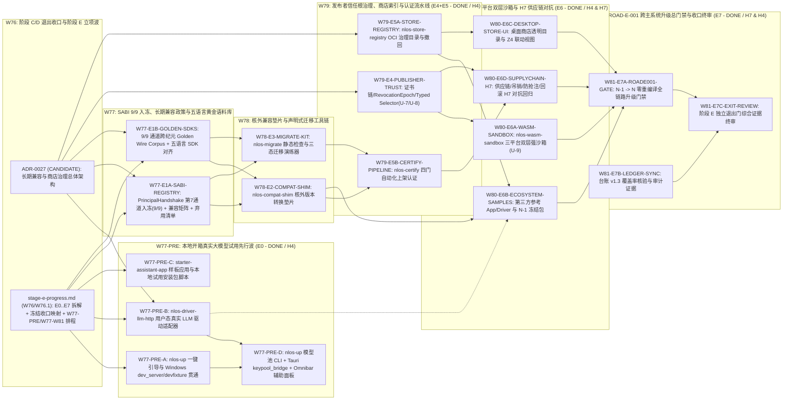

# 阶段 E 权威进度单（兼容制度与生态规模化）

> **状态：`IN_PROGRESS / NOT EXITED`（2026-10-29 `W76` 立项启动，2026-10-30 `W76.1` 增量纳管剩余协议契约冻结收口与 `E0` 先行波；2026-10-30 `W77-PRE` / `W77-PRE.1` 已完成先行开箱试用工作包 `E0` / 里程碑 `M-E0.5` 并落盘 `H4` 证据 [E-TRIAL-001](../evidence/stage-e/e-trial-001-llm-http-driver.md) 与 [E-TRIAL-002](../evidence/stage-e/e-trial-002-quickstart-and-starter-app.md)；2026-10-30 `W77` 已完成核心工作包 `E1` / 里程碑 `M-E1` 并落盘 `H4` 证据 [E-SABI-001](../evidence/stage-e/e-sabi-001-version-matrix-and-deprecation.md) 与 [E-SABI-002](../evidence/stage-e/e-sabi-002-five-lang-golden-corpus.md)——达成 `9/9` SABI 通道全量入冻、`N / N-1 / N-2` 兼容矩阵、`deprecation-manifest.yaml` 弃用遥测与五语言 `v1.0` 黄金不可变语料库；2026-10-31 `W78` 已完成核心工作包 `E2` 与 `E3` / 里程碑 `M-E2` 并落盘 `H4` 证据 [E-SHIM-001](../evidence/stage-e/e-shim-001-out-of-core-epoch-adapter.md) 与 [E-MIGRATE-001](../evidence/stage-e/e-migrate-001-static-checker-and-rollbacks.md)——交付核外无特权兼容垫片 `crates/nlos-compat-shim`、声明式契约检查/三态迁移回滚沙箱 `crates/nlos-migrate` 与 `tools/sabi-compat-diff`，并触发 `ADR-0027` 晋升 `ACCEPTED`；2026-10-31 `W79` 已完成核心工作包 `E4` 与 `E5` / 里程碑 `M-E3` 并落盘 `H4` 证据 [E-TRUST-001](../evidence/stage-e/e-trust-001-publisher-pki-revocation-and-selectors.md)、[E-STORE-001](../evidence/stage-e/e-store-001-oci-index-and-entitlement-ledger.md) 与 [E-CERTIFY-001](../evidence/stage-e/e-certify-001-automated-conformance-and-uninstall-gate.md)——交付三级发布者 PKI 信任链与单调 `RevocationEpoch` 吊销账本 `crates/nlos-publisher-trust`、跨生态 7 类选择器不可变句柄解析与 G3 `WaitingAuthorization` 条件授权物化门 `crates/nlos-plan/src/ecosystem_selector.rs`（正式闭合 `U-7` 与 `U-8`）、OCI 内容寻址商店治理目录 `crates/nlos-store-registry`、以及四门自动化上架认证流水线与纯 Rust SPDX/锁文件供应链审计器 `crates/nlos-certify` + `tests/conformance/schema/test_lockfile_supply_chain_gate.py`（推进 `RISK-B-09` `open -> partial`）；2026-11-01 `W80` 已完成核心工作包 `E6` / 里程碑 `M-E4` 并落盘 `H4` 证据 [E-SANDBOX-001](../evidence/stage-e/e-sandbox-001-cross-platform-wasm-process-isolation.md)、[E-MARKET-001](../evidence/stage-e/e-market-001-reference-apps-and-drivers.md)、[E-MARKET-002](../evidence/stage-e/e-market-002-desktop-store-transparency-ui.md) 与 `H7` 证据 [E-SECURITY-001](../evidence/stage-e/e-security-001-h7-supply-chain-and-revocation-adversarial.md)——交付三平台双层不可信 Wasm 强沙箱 `crates/nlos-wasm-sandbox`（`54/54` 逃逸对抗矩阵，正式闭合 `U-9`）、两个解耦工作区第三方参考 App/Driver 市场样板（`examples/ecosystem-apps`、`examples/ecosystem-drivers`）与 16 份字节确定性封存 `N-1` 基准制品、桌面商店透明目录与证书链实时复验及 `Z4` 联动面板（`desktop/src-tauri/src/store_catalog.rs` + `desktop/src/views/store-catalog/`）、以及六类供应链与吊销 `H7` 对抗回归矩阵（`crates/nlos-certify/tests/h7_supply_chain_adversarial.rs`，`17/17`）；2026-11-02 `W81` 已完成最终收官工作包 `E7` / 里程碑 `M-E5` 并落盘 `H7` 证据 [E-ROAD-001](../evidence/stage-e/e-road-001-zero-recompile-host-upgrade-gate.md)、`H4` 证据 [E-LEDGER-001](../evidence/stage-e/e-ledger-001-v13-conformance-audit.md) 与 `H7` 独立终审报告 [w81-stage-e-exit-gates.md](../evidence/stage-e/reviews/w81-stage-e-exit-gates.md)——达成 `[ROAD-E-001]` 主系统 `N-1 -> N` 零重编译跨版本升级全链路门禁、`ledger-schema v1.3` 阶段 E 机器台账全量回填（`169 claims / 17 risks / 204 evidence-index`，`0 ERROR`）并触发 `ADR-0027` 晋升 `VERIFIED`，技术退出门禁 1–5 全数闭环进入 `READY_FOR_MAINTAINER_SIGNOFF` 候批态；阶段 C 与阶段 D 已于 `W76` 经维护者正式批复 `EXITED` 并完成向阶段 E 的基线交接；严守 `AGENTS.md` 第 7 条与 [§E.5.5](#e55-阶段-e-退出门禁检查表) 门禁 6，在获人类维护者显式签字批准前，严禁将本状态改为 `EXITED`）。** 本文件为阶段 E（兼容制度与生态规模化）的唯一权威进度、工作包拆解与依赖感知并行编排台账，依据 [06-架构设计总纲-v0.5.md](../design/06-架构设计总纲-v0.5.md) §28.5、§9、§15、§23、§29、§30，结合前序阶段 B/C/D 交接清单（[stage-b-progress.md](./stage-b-progress.md)、[stage-c-progress.md](./stage-c-progress.md)、[stage-d-progress.md](./stage-d-progress.md)）及未知与残余风险清单 [exit-unknown-risks.md](./exit-unknown-risks.md) 编制。立项快照基线 `HEAD = 626e46d`（含 `W75` 远端全绿基线 `481ae0f` 及 `W76` 前序提交 `6141dd1..626e46d`，2026-10-29），`W76.1` 增量规划修订基线 `HEAD = 3507631`（2026-10-30），`W77-PRE` 收口集成基线 `HEAD = ccf119e`（2026-10-30），`W77-PRE.1` 直连 `glm-5.3` 锁定与桌面 `Z3` Omnibar 主入口接线校准基线 `HEAD = 44fd32e`（2026-10-30），`W77` 双车道合流基线 `HEAD = 0d1ccce`（2026-10-30），`W78` 功能合流基线 `HEAD = 85ca119`（2026-10-31），`W79` 三车道功能合流基线 `HEAD = 3429b14`（2026-10-31），`W80` 四车道收口基线 `HEAD = a44d4cd`（含 `0436b78..48964eb`，远端三平台 CI Run `41324113255` `9/9 PASS`，2026-11-01），`W81` 三车道合流基线 `HEAD = 85926e9`（含 `2670f6f` / `d2e90c0` / `6620a81` / `85926e9`，2026-11-02）。
>
> **机器台账口径绑定**：绑定 [ledger-schema.md](./ledger-schema.md) **`v1.3`**（`ledger-schema.md` `v1.2 -> v1.3` 与 `scripts/lint_claims.py` / `scripts/test_lint_claims.py` 纯增量升级已于 `W76` `W76-SCHEMA-V13` 提交 `ed64ae3` 提前落地，`44/44` 单测通过；`2026-11-02 W81` 已由 `W81-E7B` 交付纯标准库覆盖率核验器 [tools/verify_stage_e_ledger_coverage.py](../../tools/verify_stage_e_ledger_coverage.py)（`13/13` 篡改自检通过）并由 `W81-INT` 完成阶段 E 机器台账全量回填：[claims.yaml](./claims.yaml) 共 **`169`** 条声明（`B:71 + C:35 + D:10 + E:53`，阶段 E 全量 `45` 项规范 Requirement ID + `8` 项工作包均为 `PARTIAL_PASS`，`44 H4 + 9 H7`，严守 `Claim <= Evidence`）、[risks.yaml](./risks.yaml) 共 **`17`** 条风险（含 `RISK-E-01..05` `P1 / partial`，`open_P0 = 0`）、[evidence-index.yaml](./evidence-index.yaml) 共 **`204/204`** 条双向索引证据（含阶段 E 全部 `16` 份证据：`13 H4 + 3 H7`），`lint_claims.py` 与 `verify_stage_e_ledger_coverage.py --mode strict` 双双 **`0 ERROR`**）。
>
> **同波权威总体架构决策记录（交叉绑定）**：
> - 阶段 E 总体架构决策记录：[ADR-0027](./adrs/0027-stage-e-sabi-long-term-compatibility-and-store-governance.md)（状态：**`VERIFIED`**，2026-10-31 `W78` 晋升 `ACCEPTED`、2026-11-02 `W81` 依 `ADR-0027 §6.1` 触发条件经 [W81 独立终审](../evidence/stage-e/reviews/w81-stage-e-exit-gates.md) 正式晋升 **`VERIFIED`**；`E0` 用户态模型驱动与开箱试用边界、`E1` `9/9` SABI 通道冻结/版本兼容/弃用矩阵与五语言 `v1.0` 黄金语料库、`E2` 核外无特权兼容垫片 `nlos-compat-shim`、`E3` `nlos-migrate` 静态检查器/三态迁移沙箱、`E4` `nlos-publisher-trust` 三级发布者信任链/单调 `RevocationEpoch` + `nlos-plan` 7 类生态选择器/G3 条件授权门（闭合 `U-7`/`U-8`）、`E5` `nlos-store-registry` OCI 商店治理目录 + `nlos-certify` 四门自动化认证流水线/纯 Rust SPDX 供应链审计（推进 `RISK-B-09` `open -> partial`）、`E6` `nlos-wasm-sandbox` 双层强沙箱（闭合 `U-9`）/解耦第三方参考样板与字节冻结 `N-1` 基准包/桌面商店透明面（`H4`）+ 六类供应链与吊销对抗回归矩阵（`H7`）以及 **`E7` `[ROAD-E-001]` 主系统 `N-1 -> N` 零重编译跨版本升级全链路门禁（`H7`）+ `ledger-schema v1.3` 全量台账覆盖核验（`H4`）+ 独立退出终审（`H7`）** 已于 `W77-PRE` / `W77`–`W81` 全部达成验证；同时依决策点 `E2` 与 `AGENTS.md` 第 7 条保留人类维护者对 `SABI v1.0` 长期冻结承诺（闭合 `RISK-B-05`）及阶段 E `EXITED` 的显式签字护栏）。
>
> **前序阶段收官评审与风险基线（只读引用）**：阶段 B 收官评审 [W31-G](../evidence/stage-b/reviews/w31g-road-b004-gates.md)、[W33-H](../evidence/stage-b/reviews/w33h-road-b001-b002.md)、[W34-A](../evidence/stage-b/reviews/w34a-six-gate-matrix.md)；阶段 C 单机与跨物理主机收官终审 [W67](../evidence/stage-c/reviews/w67-stage-c-exit-gates.md)、[W73](../evidence/stage-c/reviews/w73-stage-c-xhost-exit-review.md)；阶段 D 完整自然语言桌面收官终审 [D-ROAD-001](../evidence/stage-d/d-road-001-non-developer-multi-app-e2e-gate.md)、[W74](../evidence/stage-d/reviews/w74-stage-d-exit-gates.md)；机器台账与风险基线 [claims.yaml](./claims.yaml)、[risks.yaml](./risks.yaml)、[evidence-index.yaml](./evidence-index.yaml)、[exit-unknown-risks.md](./exit-unknown-risks.md)。

---

## E.1 定位、前序阶段（B / C / D）交接基线

### E.1.1 阶段定位与规范性需求全量映射

阶段 E 将 NLOS 从「阶段 B/C/D 同仓同步编译的一方完整分布式桌面系统」推进为**具备长期二进制/线协议兼容承诺与受治理第三方应用/驱动市场的现代通用操作系统生态**。按 [06-架构设计总纲-v0.5.md](../design/06-架构设计总纲-v0.5.md) §28 路线拓扑，阶段 E 汇聚承接阶段 C（分布式现代系统）与阶段 D（完整自然语言桌面）两路成果。

[v0.5 §28.5](../design/06-架构设计总纲-v0.5.md) 规定阶段 E **必须交付**（逐字誊录）：

1. 长期 SABI/Package/Driver 兼容政策；
2. Application Store 与 publisher 治理；
3. 认证、迁移、兼容层和生态工具；
4. 第三方 Driver/Application 市场。

**阶段 E 退出门**（[v0.5 §28.5](../design/06-架构设计总纲-v0.5.md) 逐字誊录）：

- `[ROAD-E-001]` **系统能力增长主要来自第三方生态，升级无需生态整体重写。**

**工程化可证伪判据**：主系统核心（`N-1 -> N`）原地升级不得破坏历史稳定接口承诺——针对 `N-1` 纪元构建并经商店认证冻结签名的第三方多组件 Application 与用户态 Driver 包，在**零源码修改、零重新编译、零重新签名**条件下，必须在升级后的 `N` 主系统上完整通过既有持久状态恢复、`Z4` 策略授权、SABI IPC 调用、核外兼容垫片协议桥接、热插拔/崩溃对账、事务更新回滚与零残留卸载全链路契约验证。

**规范性需求全量映射表**（阶段 E 实现车道必须逐条绑定 Requirement ID 交付 conformance / adversarial 测试与独立 Evidence）：

| 规范章节 | Requirement ID | 规范核心不变量摘要 | 承接工作包 |
|---|---|---|---|
| §28.5 | `ROAD-E-001` | 系统能力增长主要来自第三方生态，主系统升级无需第三方生态整体重写或重编译 | `E7`（总门禁终验），`E0`、`E1`..`E6` 共同支撑 |
| §9 | `COMPAT-VER-001`、`COMPAT-VER-002` | 每个 envelope/schema 包含 `(name, major, minor)` 与扩展规则；未知 `major` 或未知 `critical` 字段/flag 强制拒绝，未知 `non-critical` 扩展安全忽略但完整保留 round-trip 语义 | `E1`、`E2`、`E7` |
| §9 | `COMPAT-DEPRECATE-001` | 稳定契约明确定义弃用期（`ACTIVE -> DEPRECATED -> SUNSET`，最少双周期预告）、能力协商、迁移路径与 conformance 黄金向量 | `E1`、`E3`、`E7` |
| §9.1–§9.2 | `KABI-IDEM-001`、`KABI-HANDLE-001`、`KABI-SVC-001`、`KABI-ERR-001`、`KABI-UNCERTAIN-001` | KABI 严守最小受控能力边界，禁止新增 provider-specific syscall；第三方生态与外部模型驱动统一经 SABI 与 generic I/O 编程；`E_UNCERTAIN` 严禁换新幂等键盲目重做 | `E0`、`E1`、`E2`、`E5` |
| §9.3 | `SABI-DISC-001`、`SABI-COMMON-001`、`SABI-RECEIPT-001`、`SABI-AUTH-001`、`SABI-TRANSPORT-001`、`SABI-CONFORM-001` | 第三方应用强制经 `ServiceDirectory` + 版本/特性协商获取服务；完整继承 capability、异步 `Operation`、取消、幂等、不可变 `Receipt` 与授权摘要绑定；`APPLICATION_PLATFORM` 与 `DESKTOP` 完整满足最小服务族一致性 | `E0`、`E1`、`E2`、`E5`、`E7` |
| §15.1 | `DRV-NEGO-001`、`DRV-BOUND-001`、`DRV-ACTIVE-001`、`DRV-CRED-001`、`DRV-PROTO-001`、`DRV-LIFE-001`、`DRV-SHIM-001`、`DRV-DISC-001` | 用户态 Driver 特性协商与 `EffectDescriptor` 声明；可信 `EnforcementShim`（托管凭据、校验权限/预留激活令牌/围栏）与不可信 `ProviderAdapter` 及核外协议转换垫片物理分离；驱动崩溃后未决操作默认置 `UNCERTAIN` 直至对账；MCP/A2A/OpenAI 兼容接口封装为版本化扩展 | `E0`、`E2`、`E5`、`E6`、`E7` |
| §23.1–§23.2 | `PKG-SEP-001`、`PKG-IMM-001`、`PKG-SEED-001`、`PKG-UPDATE-001`、`PKG-UNINSTALL-001`、`PKG-OCI-001`、`PKG-MULTI-001`、`PKG-APPID-001` | 内容寻址不可变签名包（零烘焙可变记忆/密钥）；`PackageId` / `ApplicationId` / `InstallationId` 严格分离与防抢注；更新强制支持迁移分类、健康检查与原子回滚（不可逆迁移须预备份并经 `Z4` 确认）；卸载彻底清理后台/权限/缓存并保护用户数据；OCI 仅作内容寻址层，商店治理独立承担发布者身份、审核、权限透明与恶意撤回；支持多组件复合包 | `E0`、`E3`、`E4`、`E5`、`E6`、`E7` |
| §6 / §7 / §24.2 | `TCB-BYPASS-001`、`TCB-EGRESS-001`、`TCB-DOWNGRADE-001`、`CAP-UNFORGE-001`、`CAP-ATTEN-001`、`CAP-REVOKE-001`、`TUI-CONSENT-001` | 第三方不可信负载默认拒绝网络外发且零原始凭据暴露；未完全中介路径强制降档并在回执与 `Z4` 可信 UI 显式提示；包吊销或卸载立即触发关联 Capability 撤销 | `E0`、`E4`、`E5`、`E6` |
| §29 / §30 | `NLOS-DEFER-001`、`EVID-SCOPE-001`、`EVID-NONLINEAR-001`、`EVID-NEG-001`、`EVID-REPRO-001`、`EVID-GEN-001` | 延后项不等于从接口删除；兼容、安全、性能证据按 `H0–H8` 分域独立登记，反例与适用限制同等持久化 | `E1`、`E7` |

### E.1.2 前序阶段（B / C / D）已验证基座接收盘点

阶段 E 直接构建在前序阶段已落盘验证的生产级模块之上，严禁重复造轮子或绕开既有权威路径：

1. **阶段 B 基座（`W34-D` `EXITED`）**：[crates/nlos-schema](../../crates/nlos-schema) 有界编解码与 [ADR-0014](./adrs/0014-schema-channel-freeze-v1-beta.md) 通道冻结注册表、四语言 [sdk/](../../sdk) 线协议探针（[B-SCHEMA-002](../evidence/stage-b/b-schema-002-cross-language-generation.md)）、[crates/nlos-package](../../crates/nlos-package) 与 [crates/nlos-application](../../crates/nlos-application) 包生命周期引擎、以及 [ADR-0015](./adrs/0015-dual-layer-untrusted-execution-isolation.md) 双层沙箱选型基线（[B-SANDBOX-001](../evidence/stage-b/b-sandbox-001-isolation-comparison.md)）。
2. **阶段 C 基座（`W76` 经维护者批复 `EXITED`）**：单机多进程与跨物理主机蜂窝集群控制面（[W67](../evidence/stage-c/reviews/w67-stage-c-exit-gates.md) + [W73](../evidence/stage-c/reviews/w73-stage-c-xhost-exit-review.md)，[ADR-0026](./adrs/0026-cross-physical-host-transport-and-consensus-expansion.md)）、[crates/nlos-capability](../../crates/nlos-capability) KEK 托管签名库 `SigningKeyCustodyVault`（[C-CUSTODY-001](../evidence/stage-c/c-custody-001-key-custody-gateway-reconciliation.md)）、[crates/nlos-driver-mock](../../crates/nlos-driver-mock) 跨进程 `OutOfProcessProviderDriver` 与 [ADR-0024](./adrs/0024-driver-provider-payload-codec-freeze.md) `DriverProvider` v1.0 冻结通道（[C-PROVIDER-001](../evidence/stage-c/c-provider-001-real-process-provider-codec.md)）、以及 [examples/sample-app/README.md](../../examples/sample-app/README.md) 载荷执行闭环（[C-APP-PAYLOAD-001](../evidence/stage-c/c-app-payload-001-sample-cli-execution.md)）。
3. **阶段 D 基座（`W76` 经维护者批复 `EXITED`）**：[desktop/README.md](../../desktop/README.md) 五平面 `Z0–Z4` 中性工业工作站桌面（[ADR-0025](./adrs/0025-stage-d-hybrid-desktop-compositor-and-trusted-ui-layering.md)）、`[UI-PARITY-001]` 12 域显控同构脊柱、`Z4` UAC/Polkit 实心安全确认屏、`ChooserGrant` 受限选择器、离线自治表面及 `[ROAD-D-001]` 非开发者多应用端到端门禁（[D-ROAD-001](../evidence/stage-d/d-road-001-non-developer-multi-app-e2e-gate.md) + [W74](../evidence/stage-d/reviews/w74-stage-d-exit-gates.md)）。

### E.1.3 前序阶段诚实延续边界与跨阶段移交台账（严禁遗漏或夸大）

遵循 `AGENTS.md` 第 7 条与 [exit-unknown-risks.md](./exit-unknown-risks.md) 口径，阶段 C 与阶段 D 退出时显式登记的全部残余风险与未知边界均原样结转至阶段 E 视野下管理，逐项定性如下（严禁把既有局部证据外推为全量闭合）：

| 来源条目与风险 ID | 已验证事实边界（阶段 B/C/D 已闭合部分） | 延续至阶段 E 期间的真实未决残域 | 阶段 E 处置归属与诚实护栏 |
|---|---|---|---|
| **`#16 C-POWER-LOSS` / `U-4`（`RISK-B-02` `durable-state-loss`）** | Layer-1（APFS 语义校准）与 Layer-2（`dm-flakey` 块层故障注入，CI 常设每日守护含自然 `schedule` Run `40798612701` 与 `workflow_dispatch` Run `40868450278` 双双 `success`）已验证通过 | **Layer-3+ 真实双机/真盘物理掉电台架与 M4/M6/M8 物理存储介质校准**尚未执行 | **保留为独立物理硬件台架专项（`E-deferred` 常设硬件门）**：在具备真实可编程电源/物理双机真盘台架后专项补齐；严禁以进程 `kill -9` 或虚拟块设备故障冒充真实物理断电证据 |
| **`U-1` / `#5 C-SCALE-RELEASE`（`RISK-B-07` `scale-impersonation`）** | [B-SCALE-RELEASE-001](../evidence/stage-b/b-scale-release-001.md) §6.1 已于 `W76`（`e77c094`，Run `40868357139`）完成 Ubuntu / macOS / Windows 三平台 CI `--release` 五探针实测数字回填（闭合 `U-1` 多平台 CI `--release` 基线半边），且 [C-BENCH-001](../evidence/stage-c/c-bench-001-road-c002-distributed-benchmark.md) Windows `--release` 8-Cell `10K/100K_LOGICAL`（`SQLite WAL+FULL`）实盘基线已闭环 | **`1M_LOGICAL` 裸金属/真实跨机 WAN 大规模集群实测**、Linux/macOS 8-Cell 分片基准及单分片 `O(N/S)` 扫描二级索引化尚未完成 | **保留为硬件集群规模专项（`E-deferred` 规模实证门）**：继续严格维持无边界生产容量口号禁令，严禁以共享云端 CI runner 测试结果冒充百万级逻辑对象实证 |
| **`RISK-B-05`（`premature-format-freeze`）** | [crates/nlos-schema](../../crates/nlos-schema) `REGISTRY` 共 9 个已注册 SABI 通道已 **全部 9/9 为 `frozen: true`**（[E-SABI-001](../evidence/stage-e/e-sabi-001-version-matrix-and-deprecation.md)、[E-SABI-002](../evidence/stage-e/e-sabi-002-five-lang-golden-corpus.md)），核外无特权兼容垫片 [crates/nlos-compat-shim](../../crates/nlos-compat-shim)（`40/40` 测试，[E-SHIM-001](../evidence/stage-e/e-shim-001-out-of-core-epoch-adapter.md)）与声明式契约检查/三态迁移沙箱 [crates/nlos-migrate](../../crates/nlos-migrate) + [tools/sabi-compat-diff](../../tools/sabi-compat-diff)（`18/18` Rust + `8/8` Python 测试，[E-MIGRATE-001](../evidence/stage-e/e-migrate-001-static-checker-and-rollbacks.md)）已于 `W78` 达成 `DONE / H4`，且 `[ROAD-E-001]` 16 份冻结签名 `N-1` 第三方参考 App/Driver 跨主系统 `N-1 -> N`（`HostEpoch 1 -> 2`）零重编译、零重打包、零重签全链路门禁已于 `2026-11-02 W81` 达成 **`DONE / H7`**（[E-ROAD-001](../evidence/stage-e/e-road-001-zero-recompile-host-upgrade-gate.md)、[W81 独立终审](../evidence/stage-e/reviews/w81-stage-e-exit-gates.md)，触发 `ADR-0027` 晋升 `VERIFIED`） | 全部技术实证前提已 100% 闭环，仅余**人类维护者对 `SABI v1.0` 正式长期冻结承诺的显式签字批复**（依决策点 `E2` 与 `AGENTS.md` 第 7 条，Agent 不单方面代签闭合） | **技术闭环候批（`W77` + `W78` + `W81` 全部 `DONE` / `H4` & `H7`）**：继续审慎维持 `RISK-B-05 = partial`（`Ready for Maintainer SABI v1.0 Freeze Sign-Off`），待人类维护者审阅 `W81` 终审报告并显式签字后正式翻转为 `closed` |
| **`U-7` / `U-8`（`#7 C-SELECTOR` 生态 Typed Selector 扩展与授权门）** | 阶段 B/C 已闭合 `Application` / `Artifact` typed selector 前片，阶段 D 已在桌面 `L2/L3` 展示已解析句柄摘要；**`2026-10-31 W79`（`E4` + `E5` / `M-E3`）已在 [ecosystem_selector.rs](../../crates/nlos-plan/src/ecosystem_selector.rs) 补齐全部 7 类跨生态实体（`Package / Skill / Tool / Model / Artifact / Topic / ExternalService`）不可变句柄解析（阻断 `latest`/`*` 浮动版本与未锁定搜索结果）及 G3 `WaitingAuthorization` 四门条件物化门控，并与商店上架/撤回完成端到端联动（[E-TRUST-001](../evidence/stage-e/e-trust-001-publisher-pki-revocation-and-selectors.md)、[e2e_trust_store_certify_pipeline.rs](../../crates/nlos-certify/tests/e2e_trust_store_certify_pipeline.rs)）** | **已于 `2026-10-31 W79` 正式闭环**（无未决软件残域；`H7` 供应链对抗矩阵在 `W80` 常设回归） | **已在阶段 E `E-core`（`W79` `E4` + `E5`，`DONE / H4`）正式闭合**：同步在 [exit-unknown-risks.md](./exit-unknown-risks.md) §3 标记 `U-7` 与 `U-8` 已闭环 |
| **`U-9`（`#2 C-APP-PAYLOAD` 第三方不可信负载强沙箱隔离）** | `examples/sample-app` CLI 全周期与确定性驱动回执已闭环；阶段 B `exp8` 完成 macOS 单平台 Wasmtime 对比初测；**`2026-11-01 W80`（`0436b789` + `3e21f187`）已在 [crates/nlos-wasm-sandbox](../../crates/nlos-wasm-sandbox) 落地 `#![forbid(unsafe_code)]` 三平台「L1 专职宿主子进程 `nlos-wasm-sandbox-host` `env_clear()`/显式 argv/墙钟死线 `kill()` 硬杀 + L2 `pub(crate)` 引擎层手写 13 导入 WASI 白名单/零 socket 导入/词法与 `canonicalize` 双重路径围栏/`PageLimiter` 64KiB 页硬限/确定性 fuel 与 epoch 墙钟中断」双层强隔离沙箱，并通过 Windows 11 本机 `54/54` 单元与真实子进程逃逸对抗矩阵（[E-SANDBOX-001](../evidence/stage-e/e-sandbox-001-cross-platform-wasm-process-isolation.md)）** | **已于 `2026-11-01 W80` 正式闭环**（Linux/macOS `#[cfg(unix)]` 符号链接逃逸分支实跑由远端三平台 CI 守护；`canonicalize` 至 `open` 理论 TOCTOU 边界按 [E-SANDBOX-001 §2.3](../evidence/stage-e/e-sandbox-001-cross-platform-wasm-process-isolation.md) 如实维持） | **已在阶段 E `E-core`（`W80` `E6A` `nlos-wasm-sandbox`，`DONE / H4`）正式闭合**：同步在 [exit-unknown-risks.md](./exit-unknown-risks.md) §3 标记 `U-9` 已闭环；依决策点 `E3` 继续严禁任意不可信第三方原生 ELF/PE/Mach-O 二进制免沙箱裸跑 |
| **`RISK-B-06` / `U-3` 发行残域 + `RISK-B-09`（供应链与桌面原生签名公证）** | 跨平台五阶段工业工作站交互战役、CJK IME 探针与 1,000 轮零泄漏浸泡已在阶段 D 闭合 `U-3` 主体；`W76`（`6141dd1` / `6dc79eb`，经三平台 CI Run `40868357139` 13/13 验证）已合入并清零全部 6 个存量 Dependabot PR（`#30/#31/#35/#36/#37/#38`）；**`2026-10-31 W79`（`E4`/`E5`）已落地内部三级发布者 PKI/单调 `RevocationEpoch`/三级撤回联动，并交付纯 Rust SPDX 许可证与锁文件完整性审计器 [supply_chain_audit.rs](../../crates/nlos-certify/src/supply_chain_audit.rs)（实测根工作区 166 Cargo + 119 npm 及 desktop 78 npm 包 0 BLOCKER）与常设 CI 自动发现门禁 [test_lockfile_supply_chain_gate.py](../../tests/conformance/schema/test_lockfile_supply_chain_gate.py)（[E-CERTIFY-001](../evidence/stage-e/e-certify-001-automated-conformance-and-uninstall-gate.md)）；`2026-11-01 W80`（`0436b789` + `2ff0b45c`，远端 CI Run `41324113255` `9/9 PASS`）已完成 `wasmtime 50.0.1` 预锁门禁核验与 `H7` 六类供应链/吊销/防抢注/回滚/卸载残留对抗回归矩阵 `17/17` 拦截实证（[E-SECURITY-001](../evidence/stage-e/e-security-001-h7-supply-chain-and-revocation-adversarial.md)）；`2026-11-02 W81` 已完成阶段 E 发布门总合流与常设 CI 接线（[E-ROAD-001](../evidence/stage-e/e-road-001-zero-recompile-host-upgrade-gate.md)、[E-LEDGER-001](../evidence/stage-e/e-ledger-001-v13-conformance-audit.md)）** | 桌面宿主 OS 原生安装器商业代码签名/公证（Windows Authenticode / Apple Developer ID Notarization）、物理 macOS 触控板人工巡检、以及 `RISK-B-09` 每四个周期上游依赖树停止维护/突发 CVE 制度化复审仍保留 | **分域治理**：内部 `llmos.package` 发布者证书链、吊销、四门认证、`H7` 六类对抗矩阵及 `W81` 发布门总合流均已落地；`RISK-B-09` 诚实保持 **`partial`**（保留每四周期上游维护状态复审）；外部商业 CA 硬件令牌的宿主 OS 安装器公证列为 `E-deferred` 发行凭据边界（严禁将内部 Ed25519 包签名冒充 Apple/Microsoft 原生公证） |
| **`RISK-B-11` / `U-5` 物理残域、`RISK-B-10` / `U-2` 残域、`RISK-B-08`** | 跨主机 mTLS/偏斜包络/Raft 共识、同权限 Windows 进程树实杀、全库知识外化均已验证 | 远端失联主机不可逆外部物理副作用擦除（需硬件 STONITH/设备重置）、Windows 跨权限/Job Object breakaway 回收、单人维护集中度（`RISK-B-08`） | **原样诚实保留于 [exit-unknown-risks.md](./exit-unknown-risks.md)**：第三方 Driver 认证在 `E5` 强制核查 `EffectDescriptor` 可逆性声明与 `QuarantineDisposition` 边界，绝不掩盖不可逆外部副作用 |

#### 冻结与软件层挂起遗留项一站式收口映射表（`W76.1` 维护者指令排期）

为确保全部软件层可闭合的协议契约冻结项、跨阶段挂起遗留项与本机开箱真实可试用缺口均具备唯一、机械可追踪的承接车道，同时与依赖外部物理硬件、商业资质或组织人力的 `E-deferred` 边界严格区分，汇总一站式收口映射如下：

| 类别与序号 | 待收口契约冻结 / 软件挂起遗留项 | 代码与台账当前真实状态 | 绑定收口波次、工作包与专属车道 | 闭合机械验收判据 | 规划态当前状态 |
|---|---|---|---|---|---|
| **软件可闭合 (0)** | **本机连接真实外部/本地大模型的开箱可试用“最后一公里”（关联 `U-10` 用户态真实 LLM HTTP 适配面）** | `W77-PRE` 已交付 `nlos-up`（含 `pool-status`/`chat`/`intent`）、Windows Named Pipe `devfixture`/`dev_server`、`nlos-driver-llm-http`、桌面 `keypool_bridge`/Omnibar 辅助面板与 `starter-assistant-app` | **`W77-PRE`**（`E0`：`W77-PRE-0-SCAFFOLD` / `W77-PRE-A` / `W77-PRE-B` / `W77-PRE-C` / `W77-PRE-D` + `W77-PRE-INT`） | 跨平台一键初始化 `~/.llmos` 并唤起桌面/CLI；`nlos-driver-llm-http` 经 `LlmEnforcementShim` 托管脱敏凭据与 `nlos-resource` v8 五维 Token 预算回执连通本机 `127.0.0.1:8317` `glm-keypool` / OpenAI-compatible 端点；桌面 Omnibar 支持 `[DUI-OFFLINE-001]` 离线回退与 `[NL-AMBIG-001]` 破坏性升级；内置样板应用跑通多步 `TaskPlan` 与 `Artifact` 因果读写 | **`DONE`**（`W77-PRE`，保障等级：`H4`；[E-TRIAL-001](../evidence/stage-e/e-trial-001-llm-http-driver.md)、[E-TRIAL-002](../evidence/stage-e/e-trial-002-quickstart-and-starter-app.md)） |
| **软件可闭合 (1)** | **`SABI_PRINCIPAL_HANDSHAKE_V1`（第 7 通道 `nlos.sabi.PrincipalHandshake`）`frozen: false -> true`** | `W77`（`8c4ad8c2a` + `0d1ccce5b`）已完成 `PrincipalHandshake` 双握手消息扩展槽与 `3,911 B` 帧余量审计，翻转 `SABI_PRINCIPAL_HANDSHAKE_V1.frozen = true`，并锁定五语言（Rust/TS/Python/Go/C#）`v1.0` 九通道黄金语料库与 `check_golden_immutability.py` | **`W77`**（`E1`：`W77-E1A-SABI-REGISTRY` + `W77-E1B-GOLDEN-SDKS` + `W77-INT`） | 完成 peer attestation 扩展槽审查与 Rust/TS/Python/Go/C# 五语言握手黄金向量钉死，翻转 `SABI_PRINCIPAL_HANDSHAKE_V1.frozen = true`，达成 **9/9 SABI 通道全量入冻** | **`DONE`**（`W77`，保障等级：`H4`；[E-SABI-001](../evidence/stage-e/e-sabi-001-version-matrix-and-deprecation.md)、[E-SABI-002](../evidence/stage-e/e-sabi-002-five-lang-golden-corpus.md)） |
| **软件可闭合 (2)** | **`SABI v1-beta -> v1.0` 正式长期冻结与 `RISK-B-05` 收口** | `W77`（9/9 通道入冻 + `deprecation-manifest.yaml` + 五语言 `v1.0` 黄金语料库，`H4`）、`W78`（核外无特权 `nlos-compat-shim` + `nlos-migrate` 迁移回滚工具链，`H4`）与 `W81`（`[ROAD-E-001]` 16 份冻结签名 `N-1` 样板跨 `HostEpoch 1 -> 2` 零重编译升级门禁，`H7`，触发 `ADR-0027` 晋升 `VERIFIED`）均已达成 `DONE`；`RISK-B-05` 按决策点 `E2` 审慎护栏维持 `partial` 候批 | **`W77 -> W78 -> W81`**（`E1` + `E2`/`E3` + `E7` + **决策点 `E2`**） | 依次跑通五语言跨纪元黄金语料库与弃用清单（`W77`，已完成）、核外 `nlos-compat-shim` 与 `nlos-migrate`（`W78`，已完成）、`[ROAD-E-001]` `N-1 -> N` 零重编译升级门禁（`W81`，已完成）并获维护者签字，正式晋升 `SABI v1.0` 长期冻结承诺并闭合 `RISK-B-05` | **`READY_FOR_MAINTAINER_SIGNOFF`**（`W77` + `W78` `H4` 及 `W81` `[ROAD-E-001]` `H7` 技术实证全数 `DONE`，`ADR-0027` 晋升 `VERIFIED`；[E-ROAD-001](../evidence/stage-e/e-road-001-zero-recompile-host-upgrade-gate.md)、[W81 独立终审](../evidence/stage-e/reviews/w81-stage-e-exit-gates.md)；仅待人类维护者显式签字闭合 `RISK-B-05`） |
| **软件可闭合 (3)** | **`U-7` / `U-8` 生态 Typed Selector 不可变句柄锁定与 `WAITING_AUTHORIZATION` 负路径门** | `W79`（`c0e70d5` + `W79-INT`）已在 `crates/nlos-plan/src/ecosystem_selector.rs` 落地全部 7 类跨生态选择器不可变句柄锁定与 G3 `WaitingAuthorization` 四门条件物化门控，并在 `e2e_trust_store_certify_pipeline.rs` 与 `nlos-store-registry` 完成上架/撤回全链路联动（`nlos-plan` `120/120`、`nlos-certify` `11/11` 通过） | **`W79`**（`E4` `W79-E4-PUBLISHER-TRUST` + `E5` `W79-E5A/E5B` + `W79-INT`） | 落地跨生态 Typed Selector -> `(PackageDigest, GenerationHandle)` 权威解析（拒绝 `latest` 浮动标签冒充已授权依赖）与 `WAITING_AUTHORIZATION` 物化门负路径强制拦截测试 | **`DONE`**（`W79`，保障等级：`H4`；正式闭合 `U-7` / `U-8`；[E-TRUST-001](../evidence/stage-e/e-trust-001-publisher-pki-revocation-and-selectors.md)） |
| **软件可闭合 (4)** | **`U-9` 三平台 `Process + Wasmtime` 双层 Wasm 强沙箱直跑** | `W80`（`0436b789` + `3e21f187` + `W80-INT`）已落地 `#![forbid(unsafe_code)]` `crates/nlos-wasm-sandbox`（L1 专职宿主子进程 `env_clear()`/显式 argv/墙钟 `kill()` 硬杀 + L2 `pub(crate)` 手写 13 导入 WASI 白名单/零 socket 导入/`PageLimiter` 64KiB 页硬限/确定性 fuel 与 epoch 墙钟中断），Windows 11 本机 `54/54` 单元与真实子进程逃逸对抗矩阵通过（Linux/macOS `#[cfg(unix)]` 分支由远端三平台 CI 守护） | **`W80`**（`E6` `W80-E6A-WASM-SANDBOX`，`crates/nlos-wasm-sandbox`） | Windows / macOS / Linux 三平台落地「独立宿主 Process + Wasmtime WASI 白名单 + 内存页/CPU fuel 硬限 + 零宿主环境继承」并跑通路径/网络/配额逃逸对抗矩阵 | **`DONE`**（`W80`，保障等级：`H4`；正式闭合 `U-9`；[E-SANDBOX-001](../evidence/stage-e/e-sandbox-001-cross-platform-wasm-process-isolation.md)） |
| **软件可闭合 (5)** | **`RISK-B-09` 第三方依赖许可证与供应链自动化 CI 审计门** | 锁文件在库且 `W76` 已清空全部 6 个存量 Dependabot PR；`W79`（`3429b14` + `W79-INT`）已落地纯 Rust 锁文件哈希/SPDX 许可证审计器 `nlos-certify::supply_chain_audit`（实测根工作区 166 Cargo + 119 npm 及 desktop 78 npm 包 0 BLOCKER）与常设 CI 自动发现门禁 `tests/conformance/schema/test_lockfile_supply_chain_gate.py`（`20/20`），`RISK-B-09` 已由 `open` 降级为 `partial`；`W80`（`0436b789` + `2ff0b45c`）已验证预锁 `wasmtime 50.0.1` 过锁文件门禁并完成 `H7` 六类供应链与吊销对抗回归 `17/17`；`W81` 已完成阶段 E 发布门总合流与常设 CI 门禁接线 | **`W79 -> W80 -> W81`**（`E5` `W79-E5B-CERTIFY-PIPELINE` / `W79-INT` + `E6` `W80-E6D-SUPPLYCHAIN-H7` + `E7` `W81-E7B-LEDGER-SYNC` / `W81-INT`） | 落地 Cargo / npm 第三方依赖树许可证、漏洞与锁文件一致性常设 CI 自动化审计门及上架包供应链纯净度扫描，同步复审收口 `RISK-B-09` | **`DONE`（技术门禁） / `partial`（周期复审保留）**（`W79` `H4` + `W80` `H7` + `W81` 发布门常设 CI 接线已全部完成；[E-CERTIFY-001](../evidence/stage-e/e-certify-001-automated-conformance-and-uninstall-gate.md)、[E-SECURITY-001](../evidence/stage-e/e-security-001-h7-supply-chain-and-revocation-adversarial.md)、[E-LEDGER-001](../evidence/stage-e/e-ledger-001-v13-conformance-audit.md)；保留每四周期上游维护状态复审故诚实维持 `partial`） |
| **外部物理/资质/组织边界 (`E-deferred`)** | **(a) `C-POWER-LOSS`/`U-4` 真机断电台架；(b) `U-1` 多机裸金属 `1M_LOGICAL` WAN；(c) 商业 CA 硬件令牌安装包公证签名；(d) `RISK-B-08` 单人维护依赖** | Layer-2 `dm-flakey`、三平台 CI `--release` 五探针、内部 Ed25519 包签名与全库 204 份证据（`169 claims / 17 risks`）外化均已就位；上述 4 项分别受制于专用可编程断电硬件、多机裸金属 WAN 台架、外部商业 CA 付费 USB 硬件令牌及第二人类维护者接入 | **诚实挂入 `E-deferred` / [exit-unknown-risks.md](./exit-unknown-risks.md) 常设边界**（不伪造软件替代闭合） | 严禁以虚拟断电、共享云 runner、内部自签证书或本地试用未公证安装包冒充上述四项外部物理/商业/组织实证；待对应外部硬件台架、商业凭据或第二维护者到位后专项退役 | 诚实分域保留（`P0 = 0`） |

---

## E.2 `E-core` 与 `E-deferred` 范围切分

### E.2.1 状态语义与证据分级纪律

完全沿用 [stage-b-progress.md](./stage-b-progress.md)、[stage-c-progress.md](./stage-c-progress.md) 与 [stage-d-progress.md](./stage-d-progress.md) 的工作项状态机（`DONE` / `PARTIAL_PASS` / `IN_PROGRESS` / `READY` / `BLOCKED` / `NOT_STARTED`）及 `v0.5 §30` `H0–H8` 证据阶梯（阶段 E 核心终验等级为 **`H7` 安全/兼容 conformance**）。

**铁律（`AGENTS.md` 第 7 条）**：截至 `2026-11-02 W81`，阶段 E 八大核心工作包 **`E0`（`E-TRIAL-BOOTSTRAP`）**、**`E1`（`E-SABI-POLICY-CORPUS`）**、**`E2`（`E-COMPAT-SHIM`）**、**`E3`（`E-MIGRATE-KIT`）**、**`E4`（`E-PUBLISHER-TRUST`）**、**`E5`（`E-STORE-CERTIFY`）**、**`E6`（`E-MARKET-SANDBOX-H7`）** 与最终收官包 **`E7`（`E-UPGRADE-GATE-ROADE001`）** 已全部达成 **`DONE`**，并落盘十六份实测与终审证据（13 份 `H4` + 3 份 `H7`：[E-TRIAL-001](../evidence/stage-e/e-trial-001-llm-http-driver.md)、[E-TRIAL-002](../evidence/stage-e/e-trial-002-quickstart-and-starter-app.md)、[E-SABI-001](../evidence/stage-e/e-sabi-001-version-matrix-and-deprecation.md)、[E-SABI-002](../evidence/stage-e/e-sabi-002-five-lang-golden-corpus.md)、[E-SHIM-001](../evidence/stage-e/e-shim-001-out-of-core-epoch-adapter.md)、[E-MIGRATE-001](../evidence/stage-e/e-migrate-001-static-checker-and-rollbacks.md)、[E-TRUST-001](../evidence/stage-e/e-trust-001-publisher-pki-revocation-and-selectors.md)、[E-STORE-001](../evidence/stage-e/e-store-001-oci-index-and-entitlement-ledger.md)、[E-CERTIFY-001](../evidence/stage-e/e-certify-001-automated-conformance-and-uninstall-gate.md)、[E-SANDBOX-001](../evidence/stage-e/e-sandbox-001-cross-platform-wasm-process-isolation.md)、[E-MARKET-001](../evidence/stage-e/e-market-001-reference-apps-and-drivers.md)、[E-MARKET-002](../evidence/stage-e/e-market-002-desktop-store-transparency-ui.md)、[E-SECURITY-001](../evidence/stage-e/e-security-001-h7-supply-chain-and-revocation-adversarial.md)、[E-ROAD-001](../evidence/stage-e/e-road-001-zero-recompile-host-upgrade-gate.md)、[E-LEDGER-001](../evidence/stage-e/e-ledger-001-v13-conformance-audit.md)、[W81 独立终审](../evidence/stage-e/reviews/w81-stage-e-exit-gates.md)）；严守 `AGENTS.md` 第 7 条与 [§E.5.5](#e55-阶段-e-退出门禁检查表) 门禁 6，在获人类维护者显式签字前，阶段顶部状态继续如实保持 `IN_PROGRESS / NOT EXITED`（`READY_FOR_MAINTAINER_SIGNOFF`），不越权宣称 `EXITED` 或单方面闭合 `RISK-B-05`。

### E.2.2 `E-core` 八大核心工作包矩阵（`E0` + `E1`..`E7`）

| 工作包 ID | 工作包名称 | 映射 `v0.5` Requirement ID | 目标产物 Crate / 目录范围 | 目标证据阶梯 | 计划波次 | 当前状态与保障等级 |
|---|---|---|---|---|---|---|
| **`E0`**（`E-TRIAL-BOOTSTRAP`） | 本地开箱真实大模型试用闭环：一键本机初始化与跨平台联调启动器（`nlos-up` + Windows Named Pipe 开发夹具贯通 + Windows GNU UCRT64 桌面编译环境注入）、真实外部/本地 LLM HTTP 用户态驱动适配器（`default_model` 与 `fast_intent_model` 统一直锁 `glm-5.3`）、桌面 `Z3` 命令面板主入口模型池实盘桥接与辅助拆解卡片、开箱生产力样板应用与本地试用安装包构建配置 | `KABI-SVC-001`、`SABI-DISC-001`、`SABI-AUTH-001`、`SABI-RECEIPT-001`、`DRV-NEGO-001`、`DRV-CRED-001`、`DRV-PROTO-001`、`DRV-LIFE-001`、`DRV-SHIM-001`、`PKG-IMM-001`、`PKG-MULTI-001`、`TCB-EGRESS-001`、`TUI-CONSENT-001` | `crates/nlos-up/`、`desktop/src-tauri/examples/dev_server.rs`、`desktop/src-tauri/src/devfixture.rs`、`crates/nlos-driver-llm-http/`、`desktop/src-tauri/src/keypool_bridge.rs`、`desktop/src/main.ts`、`desktop/src/views/omnibar/`、`examples/starter-assistant-app/`、`desktop/scripts/build-trial-bundle.*`、`docs/developers/quickstart-trial.md`、`docs/evidence/stage-e/e-trial-001-llm-http-driver.md`、`docs/evidence/stage-e/e-trial-002-quickstart-and-starter-app.md` | `DESIGN -> H3 -> H4` | `W77-PRE` / `W77-PRE.1`（`2026-10-30` 已先行收口） | **`DONE`**（保障等级：`H4`；证据：[E-TRIAL-001](../evidence/stage-e/e-trial-001-llm-http-driver.md)、[E-TRIAL-002](../evidence/stage-e/e-trial-002-quickstart-and-starter-app.md)） |
| **`E1`**（`E-SABI-POLICY-CORPUS`） | 第 7 通道 `PrincipalHandshake` 入冻补齐 9/9 通道冻结、SABI v1.0 长期兼容规范、跨纪元五语言黄金线协议语料库与机器可读弃用清单机制 | `COMPAT-VER-001`、`COMPAT-VER-002`、`COMPAT-DEPRECATE-001`、`KABI-SVC-001`、`SABI-DISC-001`、`SABI-COMMON-001`、`SABI-CONFORM-001`、`EVID-GEN-001` | `schema/nlos/sabi/v1/deprecation-manifest.yaml`、`schema/golden/epochs/v1.0/`、`crates/nlos-schema/`（含 `SABI_PRINCIPAL_HANDSHAKE_V1` `frozen: true`、`version_matrix.rs`、`deprecation.rs`）、`crates/nlos-service-directory/`、`sdk/{typescript,python,go,csharp}/`、`tests/conformance/`、`tools/check_golden_immutability.py`、`docs/evidence/stage-e/e-sabi-{001,002}-*.md` | `DESIGN -> H2 -> H4 -> H7` | `W77`（`2026-10-30` 已收口） | **`DONE`**（保障等级：`H4`；证据：[E-SABI-001](../evidence/stage-e/e-sabi-001-version-matrix-and-deprecation.md)、[E-SABI-002](../evidence/stage-e/e-sabi-002-five-lang-golden-corpus.md)） |
| **`E2`**（`E-COMPAT-SHIM`） | 核外版本化兼容垫片（`nlos-compat-shim`：SABI Epoch Adapter Cell 与 `DRV-SHIM-001` 驱动协议转换层） | `DRV-NEGO-001`、`DRV-PROTO-001`、`DRV-SHIM-001`、`DRV-BOUND-001`、`DRV-CRED-001`、`SABI-DISC-001`、`SABI-TRANSPORT-001`、`COMPAT-VER-002` | `crates/nlos-compat-shim/`（新建核外无特权转换 crate）、`docs/evidence/stage-e/e-shim-001-out-of-core-epoch-adapter.md` | `DESIGN -> H3 -> H4 -> H7` | `W78`（`2026-10-31` 已收口） | **`DONE`**（保障等级：`H4`；证据：[E-SHIM-001](../evidence/stage-e/e-shim-001-out-of-core-epoch-adapter.md)） |
| **`E3`**（`E-MIGRATE-KIT`） | 声明式契约升级静态检查器、包清单审计与三态数据容器迁移演练工具链（`nlos-migrate`） | `COMPAT-DEPRECATE-001`、`PKG-UPDATE-001`、`PKG-SEED-001`、`PKG-MULTI-001`、`DRV-LIFE-001` | `crates/nlos-migrate/`（新建 CLI 与库 crate）、`tools/sabi-compat-diff/`、`docs/evidence/stage-e/e-migrate-001-static-checker-and-rollbacks.md` | `DESIGN -> H3 -> H4` | `W78`（`2026-10-31` 已收口） | **`DONE`**（保障等级：`H4`；证据：[E-MIGRATE-001](../evidence/stage-e/e-migrate-001-static-checker-and-rollbacks.md)） |
| **`E4`**（`E-PUBLISHER-TRUST`） | 三级发布者信任域、Ed25519 分层证书链、单调吊销纪元（`RevocationEpoch`）与生态 Typed Selector 锁定（闭合 `U-7`/`U-8`） | `PKG-IMM-001`、`PKG-APPID-001`、`CAP-UNFORGE-001`、`CAP-ATTEN-001`、`CAP-REVOKE-001`、`TCB-DOWNGRADE-001` | `crates/nlos-publisher-trust/`（新建 crate，衔接 `nlos-capability::custody`）、`crates/nlos-plan/src/ecosystem_selector.rs`、`crates/nlos-plan/tests/ecosystem_selector_gate.rs`、`docs/evidence/stage-e/e-trust-001-publisher-pki-revocation-and-selectors.md` | `DESIGN -> H4 -> H7` | `W79`（`2026-10-31` 已收口） | **`DONE`**（保障等级：`H4`；正式闭合 `U-7` / `U-8`；证据：[E-TRUST-001](../evidence/stage-e/e-trust-001-publisher-pki-revocation-and-selectors.md)） |
| **`E5`**（`E-STORE-CERTIFY`） | OCI 内容寻址商店治理注册表（`nlos-store-registry`）与四门自动化上架认证流水线（`nlos-certify`） | `PKG-OCI-001`、`PKG-MULTI-001`、`PKG-SEP-001`、`PKG-UPDATE-001`、`PKG-UNINSTALL-001`、`SABI-CONFORM-001`、`DRV-LIFE-001`、`DUI-ASSOC-001` | `crates/nlos-store-registry/`（新建 crate）、`crates/nlos-certify/`（新建 crate，含 `tests/e2e_trust_store_certify_pipeline.rs`）、`tests/conformance/schema/test_lockfile_supply_chain_gate.py`、`docs/evidence/stage-e/e-store-001-oci-index-and-entitlement-ledger.md`、`docs/evidence/stage-e/e-certify-001-automated-conformance-and-uninstall-gate.md` | `DESIGN -> H4 -> H7` | `W79`（`2026-10-31` 已收口） | **`DONE`**（保障等级：`H4`；推进 `RISK-B-09` `open -> partial`；证据：[E-STORE-001](../evidence/stage-e/e-store-001-oci-index-and-entitlement-ledger.md)、[E-CERTIFY-001](../evidence/stage-e/e-certify-001-automated-conformance-and-uninstall-gate.md)） |
| **`E6`**（`E-MARKET-SANDBOX-H7`） | 跨平台双层 Wasm 强沙箱生产接线（闭合 `U-9`）、解耦第三方参考 App/Driver 市场样板包、桌面商店透明视图与供应链 `H7` 对抗回归 | `DRV-PROTO-001`、`DRV-LIFE-001`、`DRV-DISC-001`、`PKG-MULTI-001`、`TCB-BYPASS-001`、`TCB-EGRESS-001`、`TCB-DOWNGRADE-001`、`TUI-CONSENT-001` | `crates/nlos-wasm-sandbox/`、`examples/ecosystem-apps/`、`examples/ecosystem-drivers/`、`desktop/src/views/store-catalog/`、`desktop/src-tauri/src/store_catalog.rs`、`desktop/src-tauri/tests/store_catalog_trust_side.rs`、`crates/nlos-certify/tests/h7_supply_chain_adversarial.rs`、`docs/evidence/stage-e/e-sandbox-001-cross-platform-wasm-process-isolation.md`、`docs/evidence/stage-e/e-market-{001,002}-*.md`、`docs/evidence/stage-e/e-security-001-h7-supply-chain-and-revocation-adversarial.md` | `DESIGN -> H4 -> H5 -> H7` | `W80`（`2026-11-01` 已收口） | **`DONE`**（保障等级：沙箱/样板/商店 UI `H4`、供应链对抗 `H7`；正式闭合 `U-9`；证据：[E-SANDBOX-001](../evidence/stage-e/e-sandbox-001-cross-platform-wasm-process-isolation.md)、[E-MARKET-001](../evidence/stage-e/e-market-001-reference-apps-and-drivers.md)、[E-MARKET-002](../evidence/stage-e/e-market-002-desktop-store-transparency-ui.md)、[E-SECURITY-001](../evidence/stage-e/e-security-001-h7-supply-chain-and-revocation-adversarial.md)） |
| **`E7`**（`E-UPGRADE-GATE-ROADE001`） | `[ROAD-E-001]` 主系统 `N-1 -> N` 零重编译跨版本升级全链路门禁、`ledger-schema v1.3` 阶段 E 台账覆盖审计回填与独立退出终审 | `ROAD-E-001`、`COMPAT-VER-001`、`COMPAT-VER-002`、`COMPAT-DEPRECATE-001`、`DRV-SHIM-001`、`PKG-UPDATE-001`、`PKG-UNINSTALL-001`、`EVID-SCOPE-001`、`EVID-REPRO-001` | `tests/stage_e_road_e001_upgrade_gate/`、`scripts/run_road_e001_upgrade_matrix.py`、`tools/verify_stage_e_ledger_coverage.py`、`tests/conformance/schema/test_stage_e_ledger_and_roade001_gate.py`、`docs/evidence/stage-e/e-ledger-001-v13-conformance-audit.md`、`docs/evidence/stage-e/e-road-001-*.md`、`docs/evidence/stage-e/reviews/w81-stage-e-exit-gates.md`（注：`ledger-schema v1.3` 与 `lint_claims.py` 增量升级已于 `W76` `ed64ae3` 提前落地） | `DESIGN -> H7` | `W81`（`2026-11-02` 已收口） | **`DONE`**（保障等级：升级门禁与独立终审 `H7`、台账覆盖核验 `H4`；触发 `ADR-0027` 晋升 `VERIFIED`；证据：[E-ROAD-001](../evidence/stage-e/e-road-001-zero-recompile-host-upgrade-gate.md)、[E-LEDGER-001](../evidence/stage-e/e-ledger-001-v13-conformance-audit.md)、[W81 独立终审](../evidence/stage-e/reviews/w81-stage-e-exit-gates.md)） |

#### 各工作包关键验收契约（摘要）

0. **`E0`（`E-TRIAL-BOOTSTRAP`，先行波次 `W77-PRE` / `W77-PRE.1` — `DONE` / `H4`）**：
   - 已交付一键本机初始化与跨平台联调启动器 [crates/nlos-up](../../crates/nlos-up)（`init | env | daemon | desktop | pool-status | chat | intent`，`15/15` 测试通过，含 `W77-PRE.1` `5fbe33b` Windows GNU MSYS2 UCRT64 `windres`/`gcc` 环境变量自动注入 `augment_desktop_child_env` 与首次缺失 `node_modules` 时的 `npm ci` 预检），并补齐 [desktop/src-tauri/examples/dev_server.rs](../../desktop/src-tauri/examples/dev_server.rs) 与 [desktop/src-tauri/src/devfixture.rs](../../desktop/src-tauri/src/devfixture.rs) 的 Windows Named Pipe 开发夹具支持（`llmos-desktop --lib --features dev-fixture` `21/21` 通过，消除 `#[cfg(unix)]` 平台断层）；
   - 已交付真实外部/本地 LLM HTTP/1.1 用户态驱动适配器 [crates/nlos-driver-llm-http](../../crates/nlos-driver-llm-http)（`13/13` 测试通过，零新增第三方依赖；`W77-PRE.1` `5fbe33b` 经 `resolve_primary_model` 将 `default_model` 与 `fast_intent_model` 统一直接锁定为 `glm-5.3`，默认选型阶段自动跳过 `*-flash`）及桌面端桥接 [desktop/src-tauri/src/keypool_bridge.rs](../../desktop/src-tauri/src/keypool_bridge.rs)（`4/4` 测试通过）、桌面主入口 [desktop/src/main.ts](../../desktop/src/main.ts) `Z3` `OmnibarPaletteController` 实盘直连 `inspectLlmKeyPoolStatus` / `assistIntentWithKeyPool`（`d2f4989`）与 [desktop/src/views/omnibar](../../desktop/src/views/omnibar) 实心 `4px` 模型池状态条/辅助拆解卡片（Suites `1..10` `727` 项断言 + `tsc && vite build` 全绿）：严格遵循 [ADR-0024](./adrs/0024-driver-provider-payload-codec-freeze.md) 与 `KABI-SVC-001` / `DRV-CRED-001` / `DRV-SHIM-001`（由 `LlmEnforcementShim` 托管脱敏凭据并联动 `nlos-resource` v8 五维 `LlmTokenBudget` 包含式 `reasoning_tokens` 守恒回执、诚实打标 `PROVIDER_ISOLATION_UNVERIFIED`、强制执行 `[NL-AMBIG-001]` 破坏性升级与 `[DUI-OFFLINE-001]` 离线确定性回退），并在本机 `http://127.0.0.1:8317` `glm-keypool`（纯 `glm-5.3` 零 `--model` 标志覆盖）完成 6 步脱敏实盘冒烟闭环（`seq 1..3`，`cumulative_total_tokens: 796 -> 1397 -> 1894`，[E-TRIAL-001](../evidence/stage-e/e-trial-001-llm-http-driver.md)）；
   - 已交付零私有内核依赖参考生产力样板应用包 [examples/starter-assistant-app](../../examples/starter-assistant-app/README.md)（`v1.0.0` / `v1.1.0` `CONFORMANT` 包树、多步 `TaskPlan` + 五维 `LlmTokenBudget` + `ArtifactStore` 因果血缘 + `SameMajor` 热升级与干净卸载，`5/5` 测试通过）、Tauri 本地未公证试用打包与预检脚本 `desktop/scripts/build-trial-bundle.{ps1,sh}`（含 Windows GNU UCRT64 `windres`/`gcc` 自动注入）及跨平台双模式 GUI 试用指南 [quickstart-trial.md](../developers/quickstart-trial.md)（[E-TRIAL-002](../evidence/stage-e/e-trial-002-quickstart-and-starter-app.md)）。

1. **`E1`（`E-SABI-POLICY-CORPUS`）**：
   - 完成 `crates/nlos-schema` `REGISTRY` 中唯一仍为 `frozen: false` 的第 7 通道 `nlos.sabi.PrincipalHandshake`（`SABI_PRINCIPAL_HANDSHAKE_V1`）peer attestation 扩展槽审查与五语言握手黄金向量钉死，将其翻转为 `frozen: true`，达成 **9/9 SABI 通道全量入冻**；
   - 建立 `schema/nlos/sabi/v1/deprecation-manifest.yaml` 机器可读弃用登记表，实现 `ACTIVE -> DEPRECATED -> SUNSET`（强制 `earliest_sunset_epoch >= deprecated_in_epoch + 2`）状态校验与协商期 `DeprecationWarningReceipt` 遥测；
   - 建立 `schema/golden/epochs/v1.0/` 只读快照黄金向量库及防篡改 CI lint，覆盖 Rust、TypeScript、Python、Go、C# 五套编解码器对未知 `noncritical_extensions` 字节无损 round-trip 保留及未知 `major` / 未知 `critical_extensions` 的确定性 `E_ABI_VERSION` / fail-closed 拒绝（`COMPAT-VER-001`、`COMPAT-VER-002`）。

2. **`E2`（`E-COMPAT-SHIM`，波次 `W78` — `DONE` / `H4`）**：
   - 已在核心权威 crate 之外独立交付 `#![forbid(unsafe_code)]` 无特权转换层 [crates/nlos-compat-shim](../../crates/nlos-compat-shim)（`mount.rs` / `proto_unknown.rs` / `sabi_adapter.rs` / `driver_shim.rs` / `boundary.rs`，零新增外部第三方依赖），静态审计证明 `nlos-cell` / `nlos-task` / `nlos-capability` / `nlos-resource` / `nlos-consensus` / `nlos-system-control` / `nlos-identity` / `nlos-operation` 八个核心 TCB crate `Cargo.toml` 零反向依赖、零历史包版本分支污染；
   - 根据 `llmos.package` 声明的 `target_sabi_epoch` 与 `DRV-NEGO-001` 协商结果按需挂载 `N` 零跳直通或 `N-1` / `N-2` 双向信封升级/降级（保持 128-bit `request_id`/`IdempotencyKey` 与 `[COMPAT-VER-002]` 未知非关键扩展/原始 Protobuf wire tag 无损往返）及 Stage B `minicbor <-> nlos.sabi.DriverProvider` 四方法 1:1 桥接（强制 `[TASK-PROVIDER-001]` `PROVIDER_ISOLATION_UNVERIFIED` 防提权），并通过真实 SQLite 多权威对抗隔离测试证明转换垫片零凭据持有、零秘密字节线泄漏、无法伪造 `Capability` / `Reservation` / `SignedMeteredUsageProof`，崩溃转 `EffectUnknown`/`Quarantined` 并支持同 128-bit 幂等键对账（`40/40` 测试通过：`1` 单测 + `15` 挂载/协议转换 + `24` 多权威对抗隔离，[E-SHIM-001](../evidence/stage-e/e-shim-001-out-of-core-epoch-adapter.md)）。

3. **`E3`（`E-MIGRATE-KIT`，波次 `W78` — `DONE` / `H4`）**：
   - 已交付 `#![forbid(unsafe_code)]` 声明式契约静态检查器与 CLI [crates/nlos-migrate](../../crates/nlos-migrate)（`manifest_audit.rs` / `scanner.rs` / `prescription.rs` / `report.rs` / `sandbox.rs` / `main.rs`，零新增外部第三方依赖，100% 兼容 `starter-assistant-app` `v1.0.0`/`v1.1.0` 清单，覆盖 `[PKG-MULTI-001]` 多角色组件、`[DRV-LIFE-001]` `EffectDescriptor` 与 `reconcile` 审计、`[PKG-SEED-001]`/`[PKG-IMM-001]` SQLite/WAL 魔数与脱敏明文密钥扫描、`[COMPAT-DEPRECATE-001]` `UpgradePrescription` 与 `DeprecationWarningReceipt`）以及纯 Python 3 标准库跨纪元差异检查工具 [tools/sabi-compat-diff](../../tools/sabi-compat-diff)（`8/8` Python 单测通过）；
   - 已交付 `PKG-UPDATE-001` 三种数据迁移模式沙箱演练器（`nlos-migrate drill`）：实证 `BackwardCompatibleWindow` 健康探针失败回滚、`SnapshotAssistedRollback` 崩溃后 100% SHA-256 字节全等恢复与零残留临时文件、以及 `Irreversible` 强制 `PreUpgradeBackupReceipt` + `IdentityAuthority` Ed25519 `Z4TrustedUiConsentReceipt` 双门禁拦截（`nlos-migrate` `18/18` Rust 测试通过：`5` 单测 + `7` 静态检查 + `6` 迁移沙箱，[E-MIGRATE-001](../evidence/stage-e/e-migrate-001-static-checker-and-rollbacks.md)）。

4. **`E4`（`E-PUBLISHER-TRUST`，波次 `W79` — `DONE` / `H4`）**：
   - 已基于 `SigningKeyCustodyVault` 交付 `#![forbid(unsafe_code)]` 三级信任域（`PlatformCore` / `CertifiedPublisher` / `CommunitySandboxed` 防提权）Ed25519 证书链校验器 [crates/nlos-publisher-trust](../../crates/nlos-publisher-trust)（零新增外部第三方依赖）、双模式密钥代际轮换回执（`RetireVerifyOnly` / `RevokeCompromised`）与单调递增 `RevocationEpoch` 签名吊销列表（SQLite `trust_revocation_state_no_rollback` 触发器防回滚重放，并显式区分在线安装/升级 `RevocationMetadataStale` TUF 防冻结与 `[DUI-OFFLINE-001]` 已装应用离线启动自治，`11/11` 测试通过）；
   - 已实现 `(PublisherId, ApplicationId)` 首次注册归属锁定与三方联合签名转移收据以阻断同名应用劫持（`PKG-APPID-001`、`PKG-SEP-001`），并在 [ecosystem_selector.rs](../../crates/nlos-plan/src/ecosystem_selector.rs)（`SqlitePlanAuthority` v9 零侵入）补齐全部 7 类跨生态实体（`Package / Skill / Tool / Model / Artifact / Topic / ExternalService`）Typed Selector 到不可变摘要/代际句柄的权威解析（拦截 `latest`/`*` 浮动版本与未锁定搜索结果，闭合 `U-8`）及 G3 `WaitingAuthorization -> Materializing` 四门条件授权物化门控（闭合 `U-7`，`nlos-plan` `120/120` 测试通过，[E-TRUST-001](../evidence/stage-e/e-trust-001-publisher-pki-revocation-and-selectors.md)）。

5. **`E5`（`E-STORE-CERTIFY`，波次 `W79` — `DONE` / `H4`）**：
   - 已交付 `#![forbid(unsafe_code)]` [crates/nlos-store-registry](../../crates/nlos-store-registry)（零新增外部第三方依赖）：在 `LocalOciCasStore` 双重 SHA-256/字节长度校验与治理物理解耦层（`PKG-OCI-001`）之上实现 SQLite `WAL+FULL` 商店治理目录、五槽位多组件复合包清单（`PKG-MULTI-001`）、权限与目的透明度账本及跨版本提权 `requires_tui_reconsent` 差异引擎（`TUI-CONSENT-001`）、`CommunityTrack` / `Stable` 双轨隔离、不透明 `SignedEntitlementToken` 本地离线验签与精确一次幂等席位核销（`NLOS-DEFER-001`，零商业计费越界）、以及驱动真实 `CapabilityAuthority::revoke_signed` 与 `ApplicationAuthority::disable_application` 的三级 `SignedRecallAdvisory` 撤回联动（`10/10` 测试通过，[E-STORE-001](../evidence/stage-e/e-store-001-oci-index-and-entitlement-ledger.md)）；
   - 已交付 `#![forbid(unsafe_code)]` [crates/nlos-certify](../../crates/nlos-certify) 四门自动化认证流水线与 CLI（零新增外部第三方依赖）：依次执行 Gate 1 SABI/Driver 协议与副作用完备性校验、Gate 2 最小权限/零内嵌密钥/零静默关联篡改扫描及纯 Rust SPDX 许可证与锁文件供应链审计器（实测根工作区 166 Cargo + 119 npm 及 desktop 78 npm 包 0 BLOCKER，连同常设 CI 自动发现门禁 [test_lockfile_supply_chain_gate.py](../../tests/conformance/schema/test_lockfile_supply_chain_gate.py) `20/20` 推进 `RISK-B-09` `open -> partial`）、Gate 3 健康探针失败与中途崩溃 SHA-256 字节全等原子回滚沙箱（`PKG-UPDATE-001`）、以及 Gate 4 活跃任务门控与后台/权限/缓存零残留卸载审计（`PKG-UNINSTALL-001`），全部通过后经 `SigningKeyCustodyVault` 签发域分离 `StoreCertificationReceipt`，并通过 [e2e_trust_store_certify_pipeline.rs](../../crates/nlos-certify/tests/e2e_trust_store_certify_pipeline.rs) 跨四 crate 全链路端到端集成测试（`nlos-certify` `11/11` 测试通过，[E-CERTIFY-001](../evidence/stage-e/e-certify-001-automated-conformance-and-uninstall-gate.md)）。

6. **`E6`（`E-MARKET-SANDBOX-H7`，波次 `W80` — `DONE` / `H4` & `H7`）**：
   - 已交付 `#![forbid(unsafe_code)]` [crates/nlos-wasm-sandbox](../../crates/nlos-wasm-sandbox)（消费 `W80-0-SCAFFOLD` 预锁 `wasmtime 50.0.1`）：落地 L1 专职宿主子进程 `nlos-wasm-sandbox-host`（`env_clear()` 空环境块 + 显式 argv + 墙钟死线 `kill()` 硬杀终途 + `NLOS-HOST-R1` 结构化报告）+ L2 `pub(crate)` 引擎层（手写 13 个 `wasi_snapshot_preview1` 白名单导入、零 socket 导入注册、词法与 `canonicalize` 双重路径围栏、`PageLimiter` 64KiB 页硬限、确定性 fuel 配额与 epoch 墙钟中断），Windows 11 本机 `54/54` 测试（`41` 单元 + `13` 真实子进程逃逸对抗矩阵）全部通过，正式闭合 `U-9`（Linux/macOS `#[cfg(unix)]` 分支由远端三平台 CI 守护，[E-SANDBOX-001](../evidence/stage-e/e-sandbox-001-cross-platform-wasm-process-isolation.md)，`H4`）；
   - 已在两个解耦独立 Cargo 工作区 [examples/ecosystem-apps](../../examples/ecosystem-apps/README.md) 与 [examples/ecosystem-drivers](../../examples/ecosystem-drivers/README.md)（零内核私有依赖、零新增第三方依赖）交付 2 个 6-entry 多组件参考 Application（`knowledge-observatory-app`、`field-survey-app`，`11/11` 测试）与 2 个用户态版本化扩展 Driver（`mcp-bridge-driver` 四类 `EffectDescriptor` + 崩溃 `UNCERTAIN` 同幂等键对账、`openai-compat-driver` 同步/SSE 流式 + 五维 `ResourceAuthority` 计量，含共享 `ecosystem-driver-kit` 共 `31/31` 测试），并通过 `seal-n1-baseline.sh` / `n1-baseline-sealer` 产出 `16/16` 字节确定性封存 `N-1`（`target_sabi_epoch = 1`）基准制品（`8` 个 `.nlos-pkg` + `4` 份 `4/4 GATES PASS` `.certify.json` + `4` 份 `Candidate -> Stable` `.store-seal.txt`）供 `W81` `[ROAD-E-001]` 直接消费（[E-MARKET-001](../evidence/stage-e/e-market-001-reference-apps-and-drivers.md)，`H4`）；
   - 已在桌面端遵循 [ADR-0025](./adrs/0025-stage-d-hybrid-desktop-compositor-and-trusted-ui-layering.md) `Graphite / Paper` 实心工业工作站规范交付 [desktop/src-tauri/src/store_catalog.rs](../../desktop/src-tauri/src/store_catalog.rs) 4 个 Tauri 命令桥接（100% 投影自 `nlos-store-registry` 数据面与 `nlos-publisher-trust` 三级 PKI/CRL 在线复验，敏感动作 `INSTALL` / `IRREVERSIBLE_UPGRADE` / `DOWNGRADE_SANDBOX` fail-closed 仅投影既有 `trusted_ui::Z4ConsentChallengeRequest`，`23/23` lib + `5/5` `store_catalog_trust_side` 集成测试）与 [desktop/src/views/store-catalog](../../desktop/src/views/store-catalog) `L1/L2/L3` 透明目录/提权阻断面板（`zh-CN`/`en-US` 双语零行话零 Emoji，`8` 套件 `1933` 断言 + `tsc && vite build` 全绿，经 `W80-INT` 完成 `lib.rs` / `main.ts` / `style.css` 三处壳层接线，[E-MARKET-002](../evidence/stage-e/e-market-002-desktop-store-transparency-ui.md)，`H4`）；
   - 已在不修改被测生产 crate 源码前提下交付 [crates/nlos-certify/tests/h7_supply_chain_adversarial.rs](../../crates/nlos-certify/tests/h7_supply_chain_adversarial.rs) 六类确定性本地宿主对抗性负向集成测试（篡改 OCI blob、伪造叶证书、重放/裸 SQLite 篡改 `RevocationEpoch`、跨发布者抢注 `ApplicationId`、恶意升级崩溃回滚与卸载权限/缓存残留，`nlos-certify` `17/17` 全部通过，[E-SECURITY-001](../evidence/stage-e/e-security-001-h7-supply-chain-and-revocation-adversarial.md)，`H7`）。

7. **`E7`（`E-UPGRADE-GATE-ROADE001`，波次 `W81` — `DONE` / `H7` & `H4`）**：
   - 已在独立工作区 [tests/stage_e_road_e001_upgrade_gate](../../tests/stage_e_road_e001_upgrade_gate/Cargo.toml) 与编排脚本 [scripts/run_road_e001_upgrade_matrix.py](../../scripts/run_road_e001_upgrade_matrix.py) 落地 `[ROAD-E-001]` 可复现跨版本升级总门禁：在 `N-1`（`HostEpoch = 1`）基线安装运行 `16` 份字节确定性封存签名（`pre == post` SHA-256 100% 不变，零私有内核依赖）的第三方参考多组件 Application（`knowledge-observatory-app`、`field-survey-app`）与用户态 Driver（`mcp-bridge-driver`、`openai-compat-driver`）并建立 `SQLite WAL+FULL` 持久态 -> 原地升级主系统至 `N`（`HostEpoch = 2`，含 KABI 内部演进、SABI `N-1 -> N` 核外垫片桥接与 `DeprecationWarningReceipt` 协商，第三方 `.nlos-pkg` 零重编译、零重打包、零重签）-> 验证持久恢复、`Z4` 授权、SABI IPC 调用、热插拔/崩溃 `UNCERTAIN` 同 128-bit 幂等键对账、事务更新回滚与零残留卸载 **`6/6` Rust 正向+`H7` 对抗测试与 `5/5` Python 自检 100% 通过**（[E-ROAD-001](../evidence/stage-e/e-road-001-zero-recompile-host-upgrade-gate.md)，`H7`）；
   - 已基于 `W76`（`W76-SCHEMA-V13`，`ed64ae3`，`44/44` 单测）落地的 `ledger-schema.md` `v1.3` 与 `lint_claims.py`，交付阶段 E 台账覆盖率机械核验器 [tools/verify_stage_e_ledger_coverage.py](../../tools/verify_stage_e_ledger_coverage.py)（`13/13` 正负向篡改单测，[E-LEDGER-001](../evidence/stage-e/e-ledger-001-v13-conformance-audit.md)，`H4`），由 `W81-INT` 完成 `claims.yaml`（`169` 条，含 `stage: "E"` 全量 `53` 条）、`risks.yaml`（`17` 条，含 `RISK-E-01..05`）与 `evidence-index.yaml`（`204/204`，含 `docs/evidence/stage-e/` `16` 份）全量回填（`0 ERROR`），产出独立退出门综合证据终审报告 [w81-stage-e-exit-gates.md](../evidence/stage-e/reviews/w81-stage-e-exit-gates.md)（`H7`），并触发 [ADR-0027](./adrs/0027-stage-e-sabi-long-term-compatibility-and-store-governance.md) 晋升 `VERIFIED`。

### E.2.3 `E-deferred` 显式延后与阶段外边界（`NLOS-DEFER-001`）

依据 [06-架构设计总纲-v0.5.md](../design/06-架构设计总纲-v0.5.md) §29.1 永久非目标与 §29.2 延后目标，以下事项明确划出阶段 E 核心阻塞范围（同时严守 `NLOS-DEFER-001` 保留可扩展契约接缝，不从对象模型中删除）：

| 边界项 | 定性与排除/延后依据 | 保留的系统契约接缝 |
|---|---|---|
| **商业收银台、法币支付网关、税务发票与广告竞价后台** | `v0.5 §29.1` 永久非目标（不把商业定价与市场运营规则硬编码进内核） | `nlos-store-registry` 保留不透明签名 `EntitlementToken` 核验接口，不绑定任何外部支付通道 |
| **全球跨组织主权联邦清算与多商店根 CA 政治互认治理** | `v0.5 §29.2` 延后目标 | `nlos-publisher-trust` 支持配置化信任锚集合（Trust Anchor Set），默认单平台根 CA 闭环 |
| **宿主硬件内核级（Ring-0）设备驱动与裸机引导（Bare-Metal Boot）** | `v0.5 §29.1` / `§29.2` | 全部第三方驱动遵循 §15 用户态 `DriverProvider` + `EnforcementShim` 模型 |
| **Apple Developer ID 在线公证 / Microsoft EV 硬件令牌商业发行签名** | 依赖外部商业 CA 付费账户与物理硬件 USB Token，属发行工程凭据门（`RISK-B-06` 发行残域） | 构建脚本预留外部签名钩子，内部严格使用 `nlos-publisher-trust` Ed25519 校验包完整性 |
| **Layer-3+ 物理真机断电台架（`U-4`）与裸金属跨机 `1M_LOGICAL` WAN 压测（`U-1`）** | 依赖专用可编程断电硬件与多机裸金属集群物理台架 | Layer-2 `dm-flakey` 与三平台 CI `scale-probe` 常设门持续运行，台账诚实维持范围限定声明 |

---

## E.3 波次规划（`W77-PRE` 先行波 + `W77`–`W81`）与互斥写集编排

### E.3.1 阶段 E 依赖感知并行拓扑（Mermaid `flowchart LR`）

遵循 [项目知识渐进式披露与自动 CRUD 规则 §6.1](./project-knowledge-progressive-disclosure.md#61-子-agent-编排与依赖感知并行)（`[PD-ORCH-001..006]`），阶段 E 自 `W76` / `W76.1` 规划锁定后，设置一个可按维护者优先级先行实施（或与 `W77` 正交推进）的本地开箱试用先行波（`W77-PRE`）及五个写集严格正交的兼容与生态治理主线波次（`W77 -> W81`）：

### E.3.2 `W76` / `W77-PRE` / `W77`–`W81` 逐波并行排程与写集严格互斥表

> **多轨编排硬约束（`[PD-ORCH-003]` / `[PD-ORCH-004]`）**：同波并行子 Agent 均在独立 Git Worktree 中执行，其声明写集必须满足两两交集为空（`WriteSet_i ∩ WriteSet_j = empty`）。凡触及共享入口文件（根 `Cargo.toml` / `Cargo.lock`、`desktop/src/main.ts`、`desktop/src-tauri/src/lib.rs`、`docs/management/README.md`、`claims.yaml`、`risks.yaml`、`evidence-index.yaml`、`exit-unknown-risks.md` 及本进度单）的粘合更新，**一律严禁下放给并发功能车道**，统一由每波屏障处的单一集成器（`W*-INT` / `Z-integrator`）串行合并并执行全仓验证门。

| 波次 | 并行车道 ID | 归属工作包 | 严格独占写集（Exclusive Write-Set） | 核心交付与定向验收门 | 同波写集互斥证明 |
|---|---|---|---|---|---|
| **`W76`**（立项波） | `W76-STAGE-E-PLAN` | Stage E 立项与总体设计 | `docs/management/stage-e-progress.md`、`docs/management/adrs/0027-stage-e-sabi-long-term-compatibility-and-store-governance.md` | 新建阶段 E 权威进度单与 `ADR-0027`（`CANDIDATE` / `DESIGN`）；零 Emoji、100% 本地相对链接存在性自检与 `git diff --check` 零空白错误 | 仅新建 2 个阶段 E 专属文档，不触碰 `README.md`、`stage-c/d-progress.md`、`claims.yaml` 等共享文件（由 `Z-integrator` 统一合流） |
| **`W76.1`**（当前计划修订子波） | `W76R1-STAGE-E-PLAN` | 冻结收口映射与 `E0` 先行波排期纳管 | `docs/management/stage-e-progress.md`、`docs/management/adrs/0027-stage-e-sabi-long-term-compatibility-and-store-governance.md`、`docs/management/README.md`、`docs/management/risks.yaml`、`docs/management/exit-unknown-risks.md` | 显式纳管 `PrincipalHandshake` 第 7 通道入冻（9/9）与 `SABI v1-beta -> v1.0`（`RISK-B-05`）收口排期、软件层挂起遗留项一站式映射表，以及 `E0`（`W77-PRE`）本地开箱真实大模型试用先行波（全量维持 `NOT_STARTED` / `DESIGN`） | 独占阶段 E 规划与管理/风险同步 5 文件，不触碰 `claims.yaml`、`evidence-index.yaml` 或任何代码目录 |
| **`W77-PRE`**（本地开箱试用先行波：**`DONE`** / `H4`，`f6b94f5..ccf119e` + `W77-PRE-INT`） | `W77-PRE-A`（前置骨架 `W77-PRE-0-SCAFFOLD` `f6b94f5`；实现 `1dcdf8c`） | `E0`（一键本机初始化与跨平台联调启动器） | `crates/nlos-up/**`、`desktop/src-tauri/examples/dev_server.rs`、`desktop/src-tauri/src/devfixture.rs` | **已完成（`DONE`）**：交付一键引导 CLI `nlos-up`（`init | env | daemon | desktop`），补齐 `devfixture.rs` 与 `dev_server.rs` Windows Named Pipe 支持（`llmos-desktop --lib --features dev-fixture` `21/21` 通过） | 并行阶段 `A` / `B` / `C` 三车道分别独占 `crates/nlos-up` + `devfixture`/`dev_server`、`crates/nlos-driver-llm-http`、`examples/starter-assistant-app` + `desktop/scripts/build-trial-bundle.*` + `quickstart-trial.md`，交集严格为空；跨层桥接车道 `W77-PRE-D` 在 `A+B` 合流屏障后串行启动，最终由 `W77-PRE-INT` 独占更新证据索引、进度单与双语 `README` |
| **`W77-PRE`**（**`DONE`** / `H4`） | `W77-PRE-B`（`1aba801` + `e481bed`） | `E0`（真实外部/本地 LLM HTTP/1.1 用户态驱动适配器） | `crates/nlos-driver-llm-http/**`、`docs/evidence/stage-e/e-trial-001-llm-http-driver.md` | **已完成（`DONE`）**：纯安全 Rust `#![forbid(unsafe_code)]` RFC 8259 JSON + Tokio HTTP/1.1 驱动、4 层 `glm-keypool` v2 自动发现 `/api/coding/paas/v4`、`DirectKeyPoolScheduler`、`LlmEnforcementShim` 凭据脱敏与五维 `LlmTokenBudget` 包含式 `reasoning_tokens` 守恒回执、`PROVIDER_ISOLATION_UNVERIFIED`、`[NL-AMBIG-001]` 硬护栏与 `nlos-llm-pool-cli`（`13/13` 测试通过，[E-TRIAL-001](../evidence/stage-e/e-trial-001-llm-http-driver.md)） | 同上（独占 `crates/nlos-driver-llm-http/**` 与 `e-trial-001-llm-http-driver.md`） |
| **`W77-PRE`**（**`DONE`** / `H4`） | `W77-PRE-C`（`da1db75`） | `E0`（开箱生产力样板应用与本地试用安装包构建配置） | `examples/starter-assistant-app/**`、`desktop/scripts/build-trial-bundle.*`、`docs/developers/quickstart-trial.md`、`docs/evidence/stage-e/e-trial-002-quickstart-and-starter-app.md` | **已完成（`DONE`）**：交付 `starter-assistant-app`（`v1.0.0` / `v1.1.0` `CONFORMANT` 包树、多步 `TaskPlan` + 五维 `LlmTokenBudget` + `ArtifactStore` 因果血缘 + `SameMajor` 热升级与干净卸载，`5/5` 测试通过）、`build-trial-bundle.{ps1,sh}` 与 `quickstart-trial.md`（[E-TRIAL-002](../evidence/stage-e/e-trial-002-quickstart-and-starter-app.md)） | 同上（独占 `examples/starter-assistant-app/**`、`desktop/scripts/build-trial-bundle.*`、`docs/developers/quickstart-trial.md` 与 `e-trial-002` 证据） |
| **`W77-PRE` / `W77-PRE.1`**（**`DONE`** / `H4`） | `W77-PRE-D`（`a66e916` + `ccf119e`）+ `W77-PRE-INT`（`57b0475`）+ `W77-PRE.1`（`5fbe33b` + `d2f4989` + `W77-PRE1-INT`） | `E0`（CLI/Tauri 模型池五维预算桥接、`Z3` Omnibar 主入口实盘直连、纯 `glm-5.3` 默认锁定与本机实盘冒烟收口） | `crates/nlos-up/**`、`crates/nlos-driver-llm-http/**`、`desktop/src-tauri/src/{keypool_bridge.rs,lib.rs}`、`desktop/src-tauri/tests/keypool_bridge_side.rs`、`desktop/src/{main.ts,types.ts,ipc.ts,views/omnibar/**}`；波末 `W77-PRE-INT` / `W77-PRE1-INT` 独占治理/证据索引文件 | **已完成（`DONE`）**：`nlos-up` 新增 `pool-status | chat | intent` 与 Windows GNU UCRT64 `windres`/`gcc` 桌面环境自动注入（`15/15` 通过）；`resolve_primary_model` 将 `default_model` 与 `fast_intent_model` 统一直锁 `glm-5.3`（跳过 `*-flash` 自动选取）；Tauri 注册 `llm_keypool_inspect_status` / `llm_keypool_assist_intent` / `llm_keypool_chat`（`keypool_bridge_side` `4/4` 通过，支持 `[DUI-OFFLINE-001]` 离线确定性回退）；`desktop/src/main.ts` 将 `Z3` Omnibar 主入口直连接线至 `keypool_bridge`（`727` 断言 + `tsc && vite build` 全绿）；`W77-PRE1-INT` 完成本机 `127.0.0.1:8317` `glm-keypool` 纯 `glm-5.3`（零 `--model` 标志）6 步脱敏实盘联调（`seq 1..3`，`cumulative_total_tokens: 796 -> 1397 -> 1894`）与 `evidence-index.yaml`（`190/190`）校验 | 在 `W77-PRE-A..C` 合流屏障后串行执行，`W77-PRE.1` `A/B` 车道写集严格不相交并由 `W77-PRE1-INT` 独占收口 |
| **`W77`**（9/9 入冻、兼容策略与黄金语料波：**`DONE`** / `H4`，`8c4ad8c2a..0d1ccce5b` + `W77-INT`） | `W77-E1A-SABI-REGISTRY`（`8c4ad8c2a`） | `E1`（前半） | `schema/nlos/sabi/v1/deprecation-manifest.yaml`、`crates/nlos-schema/**`、`crates/nlos-service-directory/**`、`docs/evidence/stage-e/e-sabi-001-version-matrix-and-deprecation.md` | **已完成（`DONE`）**：完成第 7 通道 `nlos.sabi.PrincipalHandshake`（`SABI_PRINCIPAL_HANDSHAKE_V1`）对端证明扩展槽与 `3,911 B` 帧余量审查并翻转为 `frozen: true`（达成 **9/9 SABI 通道全量入冻**）；落地 `N / N-1 / N-2` `VersionCompatibilityPolicy`、`COMPAT-VER-002` 未知关键扩展拒绝与未知非关键扩展无损透传、纯安全 Rust `deprecation-manifest.yaml` 状态机校验器与 `nlos-service-directory` 有界 `DeprecationWarningReceipt` 遥测（`nlos-schema` `49/49`、`nlos-service-directory` `10/10` 通过，[E-SABI-001](../evidence/stage-e/e-sabi-001-version-matrix-and-deprecation.md)） | `crates/{nlos-schema,nlos-service-directory}` + `deprecation-manifest.yaml` vs `schema/golden/epochs` + `sdk/` + `tests/conformance` + `tools/check_golden_immutability.py`：两车道路径完全不相交；波末由 `W77-INT` 串行合流跨车道 Rust 黄金校验、CI 门禁与共享治理台账 |
| **`W77`**（**`DONE`** / `H4`） | `W77-E1B-GOLDEN-SDKS`（`0d1ccce5b`） | `E1`（后半） | `schema/golden/epochs/**`、`sdk/{typescript,python,go,csharp}/**`、`tests/conformance/**`、`tools/check_golden_immutability.py`、`docs/evidence/stage-e/e-sabi-002-five-lang-golden-corpus.md` | **已完成（`DONE`）**：建立 `schema/golden/epochs/v1.0/` 全 9/9 通道 11 条黄金向量与双哈希 `manifest.json`（同时锁定 7 个根级历史黄金零漂移），补齐 `PrincipalHandshake` 双握手消息与其余全通道在 Rust/TS/Python/Go 1.27.0（`30/30`）/C# .NET 8.0.424（`30/30`）五语言的正向确定性编码、解码往返、未知字段 `a00607` 保持与 `COMPAT-VER-002` 对抗矩阵，并交付 `tools/check_golden_immutability.py`（`7/7` 篡改拦截单测，[E-SABI-002](../evidence/stage-e/e-sabi-002-five-lang-golden-corpus.md)） | 同上（独立 Git Worktree 执行，独占 `schema/golden/epochs/`、`sdk/`、`tests/conformance/` 与防篡改脚本） |
| **`W78`**（核外兼容垫片与迁移工具波：**`DONE`** / `H4`，`d6d4828..85ca119` + `W78-INT`） | `W78-E2-COMPAT-SHIM`（前置骨架 `W78-0-SCAFFOLD` `d6d4828`，根 workspace crate `39 -> 41`；实现 `bd8cf7a`） | `E2` | `crates/nlos-compat-shim/**`、`docs/evidence/stage-e/e-shim-001-out-of-core-epoch-adapter.md` | **已完成（`DONE`）**：交付 `#![forbid(unsafe_code)]` 核外无特权转换 crate `nlos-compat-shim`（`N` 零跳直通、`N-1 / N-2 <-> N` 双向信封升级/降级、128-bit `request_id`/`IdempotencyKey` 与未知 wire tag 无损往返、Stage B `minicbor <-> DriverProvider` 四方法 1:1 桥接、`PROVIDER_ISOLATION_UNVERIFIED` 防提权、`ADR-0027` §2.2.2 四层特权隔离与 8 个核心 TCB crate `Cargo.toml` 零反向依赖静态审计，`40/40` 测试通过，[E-SHIM-001](../evidence/stage-e/e-shim-001-out-of-core-epoch-adapter.md)） | 前置 `W78-0-SCAFFOLD`（`d6d4828`）在根 `Cargo.toml` 注册两空骨架后，两个独立 Git Worktree 车道分别独占 `crates/nlos-compat-shim` vs `crates/nlos-migrate` + `tools/sabi-compat-diff` 及各自证据文件，交集严格为空；`ADR-0027` 晋升 `ACCEPTED`、跨平台 CI 接线与共享台账同步由 `W78-INT` 串行收口 |
| **`W78`**（**`DONE`** / `H4`） | `W78-E3-MIGRATE-KIT`（`85ca119`） | `E3` | `crates/nlos-migrate/**`、`tools/sabi-compat-diff/**`、`docs/evidence/stage-e/e-migrate-001-static-checker-and-rollbacks.md` | **已完成（`DONE`）**：交付 `#![forbid(unsafe_code)]` `nlos-migrate` CLI 与库（`check | drill`：100% 兼容 `starter-assistant-app` `v1.0.0`/`v1.1.0` 清单、`EffectDescriptor`/`reconcile` 审计、SQLite/WAL 魔数与脱敏明文密钥扫描、`UpgradePrescription` 及 `PKG-UPDATE-001` 三态迁移回滚沙箱，`18/18` Rust 测试通过）与纯 Python 3 跨纪元差异检查器 `tools/sabi-compat-diff`（`8/8` Python 单测通过，[E-MIGRATE-001](../evidence/stage-e/e-migrate-001-static-checker-and-rollbacks.md)） | 同上（独占 `crates/nlos-migrate`、`tools/sabi-compat-diff` 与 `e-migrate-001` 证据） |
| **`W79`**（发布者治理与商店认证波：**`DONE`** / `H4`，`f87febe..3429b14` + `W79-INT`） | `W79-E4-PUBLISHER-TRUST`（前置骨架 `W79-0-SCAFFOLD` `f87febe`，根 workspace crate `41 -> 44` 并冻结共享契约 `nlos-publisher-trust/src/types.rs` 与 `nlos-plan/src/lib.rs`；实现 `c0e70d5`） | `E4` | `crates/nlos-publisher-trust/**`、`crates/nlos-plan/src/ecosystem_selector.rs`、`crates/nlos-plan/tests/ecosystem_selector_gate.rs`、`docs/evidence/stage-e/e-trust-001-publisher-pki-revocation-and-selectors.md` | **已完成（`DONE`）**：交付 `#![forbid(unsafe_code)]` 三级发布者 Ed25519 证书链（`SigningKeyCustodyVault` KEK 托管中继 CA + 双态密钥轮换）、单调 `RevocationEpoch` 防回滚/防冻结吊销列表（兼容 `[DUI-OFFLINE-001]` 已装应用离线启动）、`(PublisherId, ApplicationId)` 首次注册防抢注与三方联合签名归属转移（`11/11` 测试），并在 `nlos-plan` 落地全部 7 类跨生态 Typed Selector 不可变句柄解析与 G3 `WaitingAuthorization` 四门条件物化门控（正式闭合 `U-7`/`U-8`，`nlos-plan` `120/120` 测试，[E-TRUST-001](../evidence/stage-e/e-trust-001-publisher-pki-revocation-and-selectors.md)） | 前置 `W79-0-SCAFFOLD`（`f87febe`）在根 `Cargo.toml` 注册三个空骨架并冻结 `PublisherTrustVerifier` 共享接口后，三条并行独立 Git Worktree 车道分别独占 `nlos-publisher-trust`（含 `nlos-plan` 两个新文件）、`nlos-store-registry`、`nlos-certify`，写集两两交集严格为空；跨四 crate 端到端集成测试 `e2e_trust_store_certify_pipeline.rs`、常设 Python 供应链门禁 `test_lockfile_supply_chain_gate.py` 与共享治理台账同步由 `W79-INT` 串行收口 |
| **`W79`**（**`DONE`** / `H4`） | `W79-E5A-STORE-REGISTRY`（`4c61d8f`） | `E5`（前半） | `crates/nlos-store-registry/**`、`docs/evidence/stage-e/e-store-001-oci-index-and-entitlement-ledger.md` | **已完成（`DONE`）**：交付 `#![forbid(unsafe_code)]` 基于 `LocalOciCasStore` 双重 SHA-256/长度校验（`PKG-OCI-001`）的 SQLite `WAL+FULL` 商店治理目录：五类组件复合包索引（`PKG-MULTI-001`）、权限/用途透明度与跨版本提权 `requires_tui_reconsent` 差异引擎、`CommunityTrack`/`Stable` 双轨隔离、不透明 `SignedEntitlementToken` 幂等席位核销（`NLOS-DEFER-001`）及驱动真实 `CapabilityAuthority` 与 `ApplicationAuthority` 的三级 `SignedRecallAdvisory` 撤回状态机（`10/10` 测试，[E-STORE-001](../evidence/stage-e/e-store-001-oci-index-and-entitlement-ledger.md)） | 同上（独占 `crates/nlos-store-registry` 与 `e-store-001` 证据） |
| **`W79`**（**`DONE`** / `H4`） | `W79-E5B-CERTIFY-PIPELINE`（`3429b14`）+ `W79-INT` | `E5`（后半 + 波屏障合流） | `crates/nlos-certify/**`、`tests/conformance/schema/test_lockfile_supply_chain_gate.py`、`docs/evidence/stage-e/e-certify-001-automated-conformance-and-uninstall-gate.md`（波末 `W79-INT` 独占跨 crate 端到端集成与共享台账同步） | **已完成（`DONE`）**：交付 `#![forbid(unsafe_code)]` `nlos-certify` 四门自动化认证流水线与 CLI（SABI/Driver conformance、最小权限/包纯度扫描与纯 Rust 锁文件哈希/SPDX 许可证供应链审计器——推进 `RISK-B-09` `open -> partial`、健康检查失败与崩溃原子回滚沙箱、活跃任务门控与零残留卸载审计、`SigningKeyCustodyVault` 签名 `StoreCertificationReceipt`），并在 `W79-INT` 新增 `e2e_trust_store_certify_pipeline.rs`（`nlos-certify` `11/11` 测试通过）与 `test_lockfile_supply_chain_gate.py`（`20/20` Python 测试通过，[E-CERTIFY-001](../evidence/stage-e/e-certify-001-automated-conformance-and-uninstall-gate.md)） | 同上（`W79-E5B` 独占 `crates/nlos-certify` 与 `e-certify-001` 证据；波末由 `W79-INT` 串行合流跨 crate 测试与共享治理台账） |
| **`W80`**（第三方市场样板、强沙箱与 `H7` 对抗波：**`DONE`** / `H4` & `H7`，`0436b789..2ff0b45c` + `W80-INT`） | `W80-E6A-WASM-SANDBOX`（前置骨架 `W80-0-SCAFFOLD` `0436b789`，根 workspace crate `44 -> 45` 并预锁 `wasmtime 50.0.1` 过锁文件门禁；实现 `3e21f187`） | `E6`（沙箱） | `crates/nlos-wasm-sandbox/**`、`docs/evidence/stage-e/e-sandbox-001-cross-platform-wasm-process-isolation.md` | **已完成（`DONE`）**：交付 `#![forbid(unsafe_code)]` 三平台双层不可信 Wasm 强沙箱 `crates/nlos-wasm-sandbox`（L1 专职宿主子进程 `nlos-wasm-sandbox-host` `env_clear()` 空环境块 + 显式 argv + 墙钟死线 `kill()` 硬杀终途 + `NLOS-HOST-R1` 结构化报告；L2 `pub(crate)` 引擎层手写 13 导入 WASI 白名单、零 socket 导入注册、词法与 `canonicalize` 双重路径围栏、`PageLimiter` 64KiB 页硬限、确定性 fuel 与 epoch 墙钟中断），Windows 11 本机 `54/54` 测试（`41` 单元 + `13` 真实子进程逃逸对抗矩阵）全部通过，正式闭合 `U-9`（[E-SANDBOX-001](../evidence/stage-e/e-sandbox-001-cross-platform-wasm-process-isolation.md)，`H4`） | 前置 `W80-0-SCAFFOLD`（`0436b789`）在根 `Cargo.toml`/`Cargo.lock` 注册第 45 个工作区 crate 并预声明 `desktop/src-tauri/src/lib.rs` `store_catalog` 模块后，四条并行独立 Git Worktree 车道分别独占 `crates/nlos-wasm-sandbox`、`examples/ecosystem-*`、`desktop/{src/views/store-catalog,src-tauri/src/store_catalog.rs}`（加 `desktop/src-tauri/Cargo.{toml,lock}` 两行一方 path 依赖，见 §E.6.1.6）、`crates/nlos-certify/tests/h7_*`，写集两两交集严格为空；桌面壳 `lib.rs` / `main.ts` / `style.css` 三处挂接与共享治理台账同步由 `W80-INT` 串行收口 |
| **`W80`**（**`DONE`** / `H4`） | `W80-E6B-ECOSYSTEM-SAMPLES`（`c399bd72`） | `E6`（样板包） | `examples/ecosystem-apps/**`、`examples/ecosystem-drivers/**`、`docs/evidence/stage-e/e-market-001-reference-apps-and-drivers.md` | **已完成（`DONE`）**：在两个解耦独立 Cargo 工作区（零内核私有依赖、零新增第三方依赖）交付 2 个 6-entry 多组件参考 Application（`knowledge-observatory-app`、`field-survey-app`，`11/11` 测试）与 2 个用户态版本化扩展 Driver（`mcp-bridge-driver` 四类 `EffectDescriptor` + 崩溃 `UNCERTAIN` 同幂等键对账、`openai-compat-driver` 同步/SSE 流式 + 五维 `ResourceAuthority` 计量，含共享 `ecosystem-driver-kit` 共 `31/31` 测试），并经 `seal-n1-baseline.sh` 产出 `16/16` 字节确定性封存 `N-1`（`target_sabi_epoch = 1`）基准制品（`8` 个 `.nlos-pkg` + `4` 份 `.certify.json` `4/4 PASS` + `4` 份 `.store-seal.txt` `Candidate -> Stable`，[E-MARKET-001](../evidence/stage-e/e-market-001-reference-apps-and-drivers.md)，`H4`） | 同上（独占 `examples/ecosystem-apps`、`examples/ecosystem-drivers` 与 `e-market-001` 证据） |
| **`W80`**（**`DONE`** / `H4`） | `W80-E6C-DESKTOP-STORE-UI`（`154f8556`）+ `W80-INT-SHELL` | `E6`（桌面商店面） | `desktop/src/views/store-catalog/**`、`desktop/src-tauri/src/store_catalog.rs`、`desktop/src-tauri/tests/store_catalog_trust_side.rs`、`desktop/src-tauri/Cargo.{toml,lock}`、`docs/evidence/stage-e/e-market-002-desktop-store-transparency-ui.md`（波末 `W80-INT` 独占 `lib.rs` / `main.ts` / `style.css` 三处壳层接线） | **已完成（`DONE`）**：落地 `Graphite / Paper` 实心（零毛玻璃、零 Emoji）桌面商店 `L1/L2/L3` 透明目录、发布者三级 PKI/CRL 在线复验与跨版本提权阻断面板；4 个 Tauri 命令 100% 投影自 `nlos-store-registry` / `nlos-publisher-trust` 数据面，敏感动作 `INSTALL` / `IRREVERSIBLE_UPGRADE` / `DOWNGRADE_SANDBOX` fail-closed 仅投影既有 `trusted_ui::Z4ConsentChallengeRequest`（`23/23` lib + `5/5` 集成测试 + 前端 `8` 套件 `1933` 断言 + `tsc && vite build` 全绿，经 `W80-INT` 完成壳层三处挂接，[E-MARKET-002](../evidence/stage-e/e-market-002-desktop-store-transparency-ui.md)，`H4`） | 同上（独占 `store-catalog/`、`store_catalog.rs` 与 `e-market-002` 证据；桌面独立工作区 `Cargo.toml` 增补两行一方 path 依赖零跨车道冲突） |
| **`W80`**（**`DONE`** / `H7`） | `W80-E6D-SUPPLYCHAIN-H7`（`2ff0b45c`）+ `W80-INT-DOC` | `E6`（`H7` 对抗 + 波屏障治理收口） | `crates/nlos-certify/tests/h7_supply_chain_adversarial.rs`、`docs/evidence/stage-e/e-security-001-h7-supply-chain-and-revocation-adversarial.md`（波末 `W80-INT-DOC` 独占四份证据转正、`U-9` 闭环与共享治理台账同步） | **已完成（`DONE`）**：在不改被测生产 crate 源码前提下执行六类确定性本地宿主对抗性负向集成测试：篡改 OCI blob、伪造叶证书、重放/裸 SQLite 篡改 `RevocationEpoch`、跨发布者抢注 `ApplicationId`、恶意升级崩溃逐位回滚与卸载权限/缓存残留攻击测试（`nlos-certify` `17/17` 全部通过，每条负路径断言具体错误变体，[E-SECURITY-001](../evidence/stage-e/e-security-001-h7-supply-chain-and-revocation-adversarial.md)，`H7`） | 同上（`W80-E6D` 独占 `crates/nlos-certify/tests/h7_supply_chain_adversarial.rs` 与 `e-security-001` 证据；波末由 `W80-INT` 串行合流共享壳层接线与 `201/201` 治理台账） |
| **`W81`**（`[ROAD-E-001]` 终验与阶段收口波：**`DONE`** / `H7` & `H4`，`2670f6fc..85926e9c` + `W81-INT`） | `W81-E7A-ROADE001-GATE`（`2670f6fc`） | `E7`（退出门实证） | `tests/stage_e_road_e001_upgrade_gate/**`、`scripts/run_road_e001_upgrade_matrix.py`、`docs/evidence/stage-e/e-road-001-zero-recompile-host-upgrade-gate.md` | **已完成（`DONE`）**：落地并实跑 `[ROAD-E-001]` 主系统 `N-1 -> N`（`HostEpoch 1 -> 2`）零重编译跨版本升级全链路门禁：16 份冻结签名 `N-1` 样板制品 `pre == post` SHA-256 100% 字节不变、零私有内核清单依赖，完整通过 7 阶段正向升级恢复/授权/IPC/`nlos-compat-shim` 垫片协商/热插拔崩溃 `UNCERTAIN` 对账/`v1.0.0 -> v1.1.0` 升级与故障回滚/零残留卸载及 5 类 `H7` 对抗攻击拦截（`6/6` Rust 测试 + `5/5` Python 自检通过，[E-ROAD-001](../evidence/stage-e/e-road-001-zero-recompile-host-upgrade-gate.md)，`H7`） | 端到端升级测试树 vs `tools/verify_stage_e_ledger_coverage.py` + `e-ledger-001` 审计证据 vs 独立终审报告：三车道写集严格互斥；最终由 `W81-INT` 基于 `ledger-schema v1.3` 串行回填 `claims.yaml`（`169` 条，含 `stage: "E"` `53` 条）、`risks.yaml`（`17` 条，含 `RISK-E-01..05`）、`exit-unknown-risks.md`、`evidence-index.yaml`（`204/204`）、`ADR-0027`（晋升 `VERIFIED`）及常设 CI 门禁接线，呈请维护者批复 `EXITED` |
| **`W81`**（**`DONE`** / `H4`） | `W81-E7B-LEDGER-SYNC`（`d2e90c00`） | `E7`（台账覆盖核验） | `tools/verify_stage_e_ledger_coverage.py`、`docs/evidence/stage-e/e-ledger-001-v13-conformance-audit.md` | **已完成（`DONE`）**：交付零第三方依赖阶段 E `ledger-schema v1.3` 覆盖率核验与候选生成器 `tools/verify_stage_e_ledger_coverage.py`（`--mode strict | pre-backfill`、`--emit-candidates`、`--self-test` `13/13` 正负向篡改单测全部通过，覆盖 45 项规范 Requirement ID + 8 项工作包 + `RISK-E-01..05` + `16/16` 阶段 E 证据双向索引 + 零 Emoji 与 `973` 条相对链接审计，[E-LEDGER-001](../evidence/stage-e/e-ledger-001-v13-conformance-audit.md)，`H4`） | 同上（独占 `tools/verify_stage_e_ledger_coverage.py` 与 `e-ledger-001-v13-conformance-audit.md`，不触碰共享 `claims.yaml`/`risks.yaml`/`evidence-index.yaml`） |
| **`W81`**（**`DONE`** / `H7`） | `W81-E7C-EXIT-REVIEW`（`85926e9c`）+ `W81-INT` | `E7`（独立终审 + 波屏障收口） | `docs/evidence/stage-e/reviews/w81-stage-e-exit-gates.md`（波末 `W81-INT` 独占共享台账全量回填、`ADR-0027` 晋升 `VERIFIED`、常设 CI 接线与治理同步） | **已完成（`DONE`）**：独立核查 `v0.5 §28.5` 四大交付物、`[ROAD-E-001]`、`E0` + `E1`..`E7` 全部 16 份证据（`13 H4 + 3 H7`）、零 Emoji 与全仓断链扫描、`P0 = 0` 及 [§E.5.5](#e55-阶段-e-退出门禁检查表) 六项退出门满足度，出具 **`SATISFIED-WITH-BOUNDARIES`（`H7`，`P0 = 0`）** 综合结论（[W81 独立终审](../evidence/stage-e/reviews/w81-stage-e-exit-gates.md)），并由 `W81-INT` 完成台账回填与常设 CI 门禁接线 | 同上（`W81-E7C` 独占阶段 E 独立终审报告文件；波末由 `W81-INT` 串行合流共享机器台账与常设 CI 门禁） |

---

## E.4 关键架构决策点（`E0`–`E4`）

为防止实现车道在未决边界上自行发明规范，阶段 E 设立五项关键架构决策点（`E0`–`E4`），在未获更新裁定前一律强制执行**默认审慎护栏（Default Prudent Guardrail）**：

| 决策点 ID | 决策议题 | 触发时机与前置条件 | 候选路径 | 默认审慎护栏与当前状态 |
|---|---|---|---|---|
| **`E0`** | 阶段 E 立项治理、开箱试用先行波隔离与 `ADR-0027` 基线 | `W76` 阶段 C / 阶段 D 获批 `EXITED` 启动阶段 E 及 `W76.1` 维护者指令排入计划时触发 | (a) 直接进入零散代码开发或把厂商 LLM API 硬编码进内核；(b) 先行落地 `stage-e-progress.md` 与 `ADR-0027`（`CANDIDATE` / `DESIGN`），锁定 `E0` + `E1..E7` 八工作包与 `W77-PRE` / `W77–W81` 互斥车道后再进入编码，且 `E0` 真实 LLM 驱动严格运行于用户态 `DriverProvider` + `EnforcementShim` 边界之外 | **已按路径 b 全程落地闭环（`2026-10-30 W77-PRE` -> `2026-11-02 W81`）**：`E0`..`E7` 八大工作包均已在微内核零厂商 API 侵入（`KABI-SVC-001`）与受控权威边界下全部达成 **`DONE`（`H4` / `H7`）**，[ADR-0027](./adrs/0027-stage-e-sabi-long-term-compatibility-and-store-governance.md) 已依触发条件正式晋升 **`VERIFIED`**；阶段顶部状态继续严守 `AGENTS.md` 第 7 条保持 `IN_PROGRESS / NOT EXITED`（`READY_FOR_MAINTAINER_SIGNOFF`），待人类维护者显式签字后方翻转为 `EXITED` |
| **`E1`** | SABI 历史兼容滚动窗口深度与核外垫片驻留形态 | `W77` / `W78` 启动前触发 | (a) 仅支持 `N-1` 单版本窗口；(b) 支持 `N-1 / N-2` 最少双发布周期兼容窗口，协议转换统一运行于核外无特权 `nlos-compat-shim` 进程/Cell；(c) 将历史兼容解析写进 `nlos-cell` 核心权威 | **已按路径 b 落地验证（`2026-10-31 W78`，严禁路径 c）**：承诺不少于 `N-1 / N-2` 双周期向后兼容与弃用预告，`W78` 已独立交付核外无特权 `crates/nlos-compat-shim`（`40/40` 测试，[E-SHIM-001](../evidence/stage-e/e-shim-001-out-of-core-epoch-adapter.md)），静态审计锁定 8 个核心权威 TCB crate 零反向依赖，垫片严格置于 `TrustedEnforcementGate` 不可信外侧（`DRV-SHIM-001`） |
| **`E2`** | `PrincipalHandshake` 第 7 通道入冻与 `SABI v1-beta -> v1.0` 正式长期冻结审定门（`RISK-B-05` 收口门） | 第一步于 `W77` 完成 `nlos.sabi.PrincipalHandshake`（`SABI_PRINCIPAL_HANDSHAKE_V1`）扩展槽审查与五语言黄金向量；第二步于 `W77` 五语言跨纪元黄金语料、`W78` `nlos-compat-shim` 核外垫片与 `W81` `[ROAD-E-001]` `N-1 -> N` 零重编译回归矩阵全部实测通过后触发 | (a) 在 `W77` 将 `PrincipalHandshake` 翻转为 `frozen: true`（达成 9/9 通道入冻）时即单方面宣布 `SABI v1.0` 永久冻结；(b) `W77` 先达成 `REGISTRY` 9/9 通道级入冻但维持 `ADR-0014` `v1-beta` / `v1.0-rc` 候选锁，直至 `W78` 核外垫片与 `W81` 第三方参考包 `N-1 -> N` 零重编译实证全部通过并经维护者签字后，再正式晋升为 `SABI v1.0` 长期冻结承诺并闭合 `RISK-B-05` | **技术门禁全数闭环，呈请维护者签字（路径 b 持续生效）**：`W77` 已达成 9/9 通道级入冻，`W78` 已落地核外无特权 `crates/nlos-compat-shim`（[E-SHIM-001](../evidence/stage-e/e-shim-001-out-of-core-epoch-adapter.md)，`40/40`）与 `crates/nlos-migrate`（[E-MIGRATE-001](../evidence/stage-e/e-migrate-001-static-checker-and-rollbacks.md)，`18/18` Rust + `8/8` Python），`W81` 已通过 16 份冻结签名 `N-1` 样板跨 `HostEpoch 1 -> 2` 零重编译、零重打包、零重签升级门禁（[E-ROAD-001](../evidence/stage-e/e-road-001-zero-recompile-host-upgrade-gate.md)，`6/6` Rust + `5/5` Python，`H7`）与独立终审（[W81 独立终审](../evidence/stage-e/reviews/w81-stage-e-exit-gates.md)，`H7`）并晋升 `ADR-0027` 为 **`VERIFIED`**；严守 `AGENTS.md` 第 7 条**继续保持 `RISK-B-05 = partial`（`Ready for Maintainer SABI v1.0 Freeze Sign-Off`）**，待人类维护者显式签字后正式闭合 |
| **`E3`** | 社区未认证包（`COMMUNITY_SANDBOXED`）执行沙箱准入门禁 | `W79` 商店策略与 `W80` `nlos-wasm-sandbox`（`U-9`）落地前触发 | (a) 允许未认证第三方包经弹窗警告后直接以宿主原生二进制裸跑；(b) 强制所有 `COMMUNITY_SANDBOXED` 与未授信组件仅允许在「独立宿主 Process + Wasmtime WASI 白名单」双层强沙箱内执行 | **已按路径 b 落地验证（`2026-11-01 W80`，严禁路径 a）**：`W80` 已交付 `#![forbid(unsafe_code)]` 双层强隔离沙箱 [crates/nlos-wasm-sandbox](../../crates/nlos-wasm-sandbox)（L1 专职宿主子进程 `env_clear()`/显式 argv/墙钟 `kill()` 硬杀 + L2 `pub(crate)` 手写 13 导入 WASI 白名单/零 socket 导入/`PageLimiter`/确定性 fuel 与 epoch 墙钟中断，`54/54` 测试通过，正式闭合 `U-9`，[E-SANDBOX-001](../evidence/stage-e/e-sandbox-001-cross-platform-wasm-process-isolation.md)），并在桌面商店透明面 `store_prepare_sensitive_action` 对 `DOWNGRADE_SANDBOX` 强制走 `Z4` 实心安全确认屏（[E-MARKET-002](../evidence/stage-e/e-market-002-desktop-store-transparency-ui.md)）；同时继续严格拒绝未认证第三方原生 ELF/PE/Mach-O 裸进程执行，任何受控原生驱动桥接若未完全中介强制打标 `TCB-DOWNGRADE-001` |
| **`E4`** | 发布者根信任轮换、吊销列表新鲜度与离线桌面自治平衡 | `W79` `E4` / `E5` 实施时触发 | (a) 每次启动应用强制联网查询中心化 OCSP，断网即拒绝启动本地应用；(b) 离线根 CA + 单调 `RevocationEpoch` 本地缓存签名吊销包（兼容 `[DUI-OFFLINE-001]` 离线自治），联网同步高危 `RecallAdvisory` 后立即本地隔离并撤销 Capability | **已按路径 b 落地验证（`2026-10-31 W79`，严禁路径 a）**：`nlos-publisher-trust` 显式区分 `OnlineInstallOrUpgrade`（`RevocationMetadataStale` TUF 防冻结）与 `OfflineInstalledLaunch`（`[DUI-OFFLINE-001]` 已装应用离线启动自治 + 本地 CRL 与 SQLite `trust_revocation_state_no_rollback` 防回滚硬门禁），`nlos-store-registry` 三级 `SignedRecallAdvisory` 在同步高危撤回后立即联动真实 `CapabilityAuthority::revoke_signed` 与 `ApplicationAuthority::disable_application` 本地隔离（[E-TRUST-001](../evidence/stage-e/e-trust-001-publisher-pki-revocation-and-selectors.md)、[E-STORE-001](../evidence/stage-e/e-store-001-oci-index-and-entitlement-ledger.md)） |

---

## E.5 里程碑路线、预登记风险与退出门禁

### E.5.1 阶段 E 里程碑路线（`M-E0` / `M-E0.5` / `M-E1`–`M-E5`）

| 里程碑 | 对应波次 | 核心可验证标志 | 当前状态 |
|---|---|---|---|
| **`M-E0`** | `W76` / `W76.1` | 阶段 E 权威进度单与 [ADR-0027](./adrs/0027-stage-e-sabi-long-term-compatibility-and-store-governance.md)（`CANDIDATE` -> `W78 ACCEPTED` -> `W81 VERIFIED`）立项入库，完成 B/C/D 交接边界、契约冻结与挂起项一站式收口映射及 `E0`（`W77-PRE`）先行波排期锁定 | **`DONE`（`2026-10-30 W76`/`W76.1` 立项基线锁死，保障等级：`DESIGN`）** |
| **`M-E0.5`** | `W77-PRE` | `E0` 本地开箱真实大模型试用闭环：`nlos-up` 一键本机初始化与 Windows/Unix 开发夹具贯通、`nlos-driver-llm-http` 用户态真实 LLM 驱动（`LlmEnforcementShim` 托管脱敏凭据 + `nlos-resource` v8 五维 Token 扣减）与桌面 `keypool_bridge`/Omnibar 辅助面板跑通、`starter-assistant-app` 多步 `TaskPlan`/`Artifact` 读写与本地未公证试用安装包脚本验收落盘 | **`DONE`（`2026-10-30 W77-PRE` 达成，保障等级：`H4`；[E-TRIAL-001](../evidence/stage-e/e-trial-001-llm-http-driver.md)、[E-TRIAL-002](../evidence/stage-e/e-trial-002-quickstart-and-starter-app.md)）** |
| **`M-E1`** | `W77` | `nlos.sabi.PrincipalHandshake` 第 7 通道翻转为 `frozen: true`（达成 **9/9 SABI 通道全量入冻**）、`SABI` 版本兼容矩阵、`ACTIVE -> DEPRECATED -> SUNSET` 机器清单与 Rust/TS/Python/Go/C# 五语言跨纪元 Golden Wire Corpus 全绿 | **`DONE`（`2026-10-30 W77` 达成，保障等级：`H4`；[E-SABI-001](../evidence/stage-e/e-sabi-001-version-matrix-and-deprecation.md)、[E-SABI-002](../evidence/stage-e/e-sabi-002-five-lang-golden-corpus.md)）** |
| **`M-E2`** | `W78` | 核外无特权兼容垫片 `nlos-compat-shim` 与 `nlos-migrate` 静态检查/三态数据迁移回滚演练器验证通过，`ADR-0027` 晋升 `ACCEPTED` | **`DONE`（`2026-10-31 W78` 达成，保障等级：`H4`；`ADR-0027` 晋升 `ACCEPTED`；[E-SHIM-001](../evidence/stage-e/e-shim-001-out-of-core-epoch-adapter.md)、[E-MIGRATE-001](../evidence/stage-e/e-migrate-001-static-checker-and-rollbacks.md)）** |
| **`M-E3`** | `W79` | 三级发布者证书链、单调 `RevocationEpoch`、生态 Typed Selector（闭合 `U-7`/`U-8`）、`nlos-store-registry` 与 `nlos-certify` 四门认证流水线闭环 | **`DONE`（`2026-10-31 W79` 达成，保障等级：`H4`；正式闭合 `U-7` / `U-8`，推进 `RISK-B-09` `open -> partial`；[E-TRUST-001](../evidence/stage-e/e-trust-001-publisher-pki-revocation-and-selectors.md)、[E-STORE-001](../evidence/stage-e/e-store-001-oci-index-and-entitlement-ledger.md)、[E-CERTIFY-001](../evidence/stage-e/e-certify-001-automated-conformance-and-uninstall-gate.md)）** |
| **`M-E4`** | `W80` | 三平台 `nlos-wasm-sandbox` 双层强沙箱（闭合 `U-9`）、解耦第三方参考 App/Driver 样板包、桌面商店权限透明视图与 `H7` 供应链对抗矩阵全绿 | **`DONE`（`2026-11-01 W80` 达成，保障等级：`H4` / `H7`；正式闭合 `U-9`，封存 16 份 `N-1` 基准制品；[E-SANDBOX-001](../evidence/stage-e/e-sandbox-001-cross-platform-wasm-process-isolation.md)、[E-MARKET-001](../evidence/stage-e/e-market-001-reference-apps-and-drivers.md)、[E-MARKET-002](../evidence/stage-e/e-market-002-desktop-store-transparency-ui.md)、[E-SECURITY-001](../evidence/stage-e/e-security-001-h7-supply-chain-and-revocation-adversarial.md)）** |
| **`M-E5`** | `W81` | `[ROAD-E-001]` 主系统 `N-1 -> N` 零重编译跨版本升级总门禁通过、基于 `ledger-schema v1.3`（`W76` `ed64ae3` 已落地）完成阶段 E 机器台账全量回填且 `lint_claims.py` `0 ERROR`、独立终审完成并呈请维护者批复 `EXITED` | **`DONE`（`2026-11-02 W81` 达成，保障等级：`H7` / `H4`；`169 claims / 17 risks / 204 evidence-index` `0 ERROR`，`ADR-0027` 晋升 `VERIFIED`，技术门禁 1–5 闭环呈请维护者批复 `EXITED`；[E-ROAD-001](../evidence/stage-e/e-road-001-zero-recompile-host-upgrade-gate.md)、[E-LEDGER-001](../evidence/stage-e/e-ledger-001-v13-conformance-audit.md)、[W81 独立终审](../evidence/stage-e/reviews/w81-stage-e-exit-gates.md)）** |

### E.5.2 阶段 E 专项风险预登记台账（`RISK-E-01`–`RISK-E-05`）

以下阶段 E 专项风险按 [管理机制 §9](./README.md#9-风险管理) 九大风险类别登记于此，并已于 `2026-11-02 W81`（`W81-E7B` + `W81-INT`）基于 `ledger-schema v1.3` 同源回填写入 [risks.yaml](./risks.yaml) 与 [exit-unknown-risks.md](./exit-unknown-risks.md)（全仓 `17` 项风险，`open_P0 = 0`）：

| 风险 ID | 风险类别（`README §9`） | 当前严重度 / 台账状态 | 风险描述 | 已落地缓解、证据引用与退役门禁 |
|---|---|---|---|---|
| `RISK-E-01` | `premature-format-freeze` | `P1` / `partial` | 在多语言边界与跨代演进场景未充分暴露前仓促锁定 `SABI v1.0`，导致后续演进被迫破坏二进制契约（联动 `RISK-B-05`） | `W77` 五语言 `v1.0` Golden Wire Corpus + `COMPAT-VER-002` 分流（[E-SABI-001](../evidence/stage-e/e-sabi-001-version-matrix-and-deprecation.md)、[E-SABI-002](../evidence/stage-e/e-sabi-002-five-lang-golden-corpus.md)）+ `W78` `sabi-compat-diff` + `W81` `[ROAD-E-001]` `N-1 -> N` 零重编译门禁（[E-ROAD-001](../evidence/stage-e/e-road-001-zero-recompile-host-upgrade-gate.md)，`H7`）均已闭环；按决策点 `E2` 保持 `partial` 待人类维护者显式签字冻结 `SABI v1.0` |
| `RISK-E-02` | `security-bypass` | `P1` / `partial` | 核外协议兼容垫片（`nlos-compat-shim`）在翻译旧版请求时被构造畸形扩展帧诱导越权或绕过配额预扣 | `W78` 严守 `DRV-SHIM-001` 将无特权 `nlos-compat-shim` 置于可信 `EnforcementShim` 外侧（零凭据托管、8 个核心 TCB crate 零反向依赖，`40/40` 测试，[E-SHIM-001](../evidence/stage-e/e-shim-001-out-of-core-epoch-adapter.md)），`W81` `[ROAD-E-001]` 补齐垫片越权伪造 `H7` 对抗拦截（[E-ROAD-001](../evidence/stage-e/e-road-001-zero-recompile-host-upgrade-gate.md)）；每次新增纪元转换规则常设复审 |
| `RISK-E-03` | `third-party-supply-chain` | `P1` / `partial` | 商店元数据遭遇旧索引重放攻击、发布者私钥失窃恶意推包或跨发布者抢注热门 `ApplicationId`（联动 `RISK-B-09`） | 分层 Ed25519 证书链 + 单调 `revocation_epoch` + `(PublisherId, ApplicationId)` 首次注册密码学锁定 + `RecallAdvisory` 紧急吊销（`W79` [E-TRUST-001](../evidence/stage-e/e-trust-001-publisher-pki-revocation-and-selectors.md)/[E-STORE-001](../evidence/stage-e/e-store-001-oci-index-and-entitlement-ledger.md) `H4`、`W80` [E-MARKET-002](../evidence/stage-e/e-market-002-desktop-store-transparency-ui.md) 在线证书链/CRL 实时复验与 [E-SECURITY-001](../evidence/stage-e/e-security-001-h7-supply-chain-and-revocation-adversarial.md) `H7` `17/17`、以及 `W81` [E-ROAD-001](../evidence/stage-e/e-road-001-zero-recompile-host-upgrade-gate.md) `H7` 均已验证；公网多租户云市场与跨商店根 CA 联邦属 `E-deferred` 故保持 `partial`） |
| `RISK-E-04` | `security-bypass` | `P1` / `partial` | 第三方不可信社区包利用宿主 OS 差异或 WASI 垫片边界缺陷逃逸沙箱（联动 `U-9`） | `W80` 已预锁 `wasmtime 50.0.1` 并落地 `nlos-wasm-sandbox`（[E-SANDBOX-001](../evidence/stage-e/e-sandbox-001-cross-platform-wasm-process-isolation.md) `H4`：L1 `env_clear()`/显式 argv/墙钟 `kill()` + L2 手写 13 导入 WASI 白名单/零 socket/`PageLimiter`/fuel 与 epoch 中断，`54/54` 逃逸对抗矩阵通过并闭合 `U-9`，远端三平台 CI Run `41324113255` `9/9 PASS` 已核验 Linux/macOS/Windows 全平台）；保留跨平台 `canonicalize -> open` 理论 TOCTOU 边界与第三方原生二进制免沙箱禁令（决策点 `E3`）故保持 `partial` |
| `RISK-E-05` | `durable-state-loss` | `P1` / `partial` | 第三方包跨版本升级时数据容器迁移半途崩溃导致用户数据损坏，或将不可逆 schema 变更伪报为可自动回滚 | `nlos-migrate` 与 `nlos-certify` 门 3 强制演练健康检查失败原子回滚，并对 `IRREVERSIBLE` 迁移强制预备份 + `Z4` 用户确认（`W78`–`W80` [E-MIGRATE-001](../evidence/stage-e/e-migrate-001-static-checker-and-rollbacks.md)/[E-CERTIFY-001](../evidence/stage-e/e-certify-001-automated-conformance-and-uninstall-gate.md)/[E-SECURITY-001](../evidence/stage-e/e-security-001-h7-supply-chain-and-revocation-adversarial.md) `H7` 及 `W81` [E-ROAD-001](../evidence/stage-e/e-road-001-zero-recompile-host-upgrade-gate.md) `H7` 跨主系统升级故障回滚与伪报不可逆迁移拦截均已通过；Layer-3+ 真机物理掉电仍绑定 `U-4` / `RISK-B-02` `E-deferred` 边界故保持 `partial`） |

---

### E.5.5 阶段 E 退出门禁检查表

对标 [stage-c-progress.md](./stage-c-progress.md) §C.5.5 与 [stage-d-progress.md](./stage-d-progress.md) §D.5.5，将阶段 E 顶部状态从 `IN_PROGRESS / NOT EXITED` 翻转为 `EXITED`，**必须同时满足下列全部六项硬性退出门禁**：

| 门禁编号 | 硬性退出门禁条款 | 验收证据与机械判据要求 | 当前状态（`W81` 收口基线） |
|---|---|---|---|
| **门禁 1** | **`[ROAD-E-001]` 主系统 `N-1 -> N` 零重编译跨版本升级零破坏实证** | 针对 `N-1` 纪元编译并冻结签名的第三方多组件 Application（`>= 2`）与用户态 Driver（`>= 2`）`.nlos-pkg` 制品包，在**未重编译、未重打包、未重签**条件下，跨主系统原地升级至 `N` 后完整通过持久态与 `UserData` 恢复、`Z4` 授权、SABI IPC 调用、`nlos-compat-shim` 核外转换、`DRV-LIFE-001` 驱动崩溃 `UNCERTAIN` 对账与热插拔、事务更新回滚及零残留卸载端到端自动化验证（证据落盘 `docs/evidence/stage-e/e-road-001-*.md`） | **`VERIFIED`（`H7`）**：`W81` `2670f6fc` 已在独立工作区 `tests/stage_e_road_e001_upgrade_gate` 与 `scripts/run_road_e001_upgrade_matrix.py` 对 16 份冻结签名 `N-1` 样板（2 个 6-entry 多组件 App + 2 个用户态 Driver，`pre == post` SHA-256 100% 不变、零私有内核依赖）跑通 `HostEpoch 1 -> 2` 全链路 7 阶段正向与 5 类对抗门禁（`6/6` Rust + `5/5` Python 通过，[E-ROAD-001](../evidence/stage-e/e-road-001-zero-recompile-host-upgrade-gate.md)） |
| **门禁 2** | **`H7` 供应链、沙箱隔离与兼容对抗回归全部通过** | 完整通过 `H7` 级安全与兼容负向测试：未知 `major` / 未知 `critical` 扩展 fail-closed 拒绝（`COMPAT-VER-002`）、五语言历史黄金向量零篡改、伪造发布者证书/篡改 OCI 层/重放旧 `RevocationEpoch`/抢注 `ApplicationId` 100% 拦截、`nlos-certify` 四门坏包拒绝、以及三平台双层 Wasm 沙箱逃逸拦截（闭合 `U-7`、`U-8`、`U-9`） | **`VERIFIED`（`H7`）**：五语言 `v1.0` 黄金防篡改（[E-SABI-002](../evidence/stage-e/e-sabi-002-five-lang-golden-corpus.md)）、`U-7`/`U-8` 7 类生态选择器与 G3 条件授权门（[E-TRUST-001](../evidence/stage-e/e-trust-001-publisher-pki-revocation-and-selectors.md)）、`U-9` 三平台 `nlos-wasm-sandbox` `54/54` 逃逸对抗矩阵（[E-SANDBOX-001](../evidence/stage-e/e-sandbox-001-cross-platform-wasm-process-isolation.md)，经远端三平台 CI Run `41324113255` `9/9 PASS` 核验）、六类供应链与吊销 `H7` 对抗矩阵 `17/17`（[E-SECURITY-001](../evidence/stage-e/e-security-001-h7-supply-chain-and-revocation-adversarial.md)）及跨主系统升级 5 类 `H7` 对抗测试（[E-ROAD-001](../evidence/stage-e/e-road-001-zero-recompile-host-upgrade-gate.md)）全部通过 |
| **门禁 3** | **基于 `ledger-schema v1.3` 完成阶段 E 机器台账全量回填并达成 `lint_claims.py` `0 ERROR`** | 在 `W76`（`W76-SCHEMA-V13`，`ed64ae3`，`44/44` 单测）已按 `FROZEN-additive` 规则落地 [ledger-schema.md](./ledger-schema.md) `v1.3` 与 `lint_claims.py` 扩域（支持 `stage: "E"`、`RISK-E-NN` 与 `docs/evidence/stage-e/` 双向索引）基础上，阶段 E 全部 Requirement ID、`E0` + `E1`..`E7`、`ROAD-E-001`、`RISK-E-01`..`05` 与 `docs/evidence/stage-e/` 如实回填 [claims.yaml](./claims.yaml)、[risks.yaml](./risks.yaml) 与 [evidence-index.yaml](./evidence-index.yaml)，`python scripts/lint_claims.py` 与 `python -m unittest scripts.test_lint_claims` 双双 `0 ERROR`（`Claim <= Evidence`） | **`VERIFIED`（`H4`）**：`W81` 已全量回填 `claims.yaml`（`169` 条：`B:71 + C:35 + D:10 + E:53`，`44 H4 + 9 H7`）、`risks.yaml`（`17` 条，含 `RISK-E-01..05`）与 `evidence-index.yaml`（`204/204`，含阶段 E `16/16`），`lint_claims.py`（`0 ERROR, 0 INFO`）、`test_lint_claims`（`44/44`）与 `verify_stage_e_ledger_coverage.py --mode strict`（`13/13` 自检 + strict `PASS`）全绿（[E-LEDGER-001](../evidence/stage-e/e-ledger-001-v13-conformance-audit.md)） |
| **门禁 4** | **全仓开放 `P0` 风险为 `0` 且未知/残余风险清单同源同步** | 全仓范围内未决 `P0` 风险严格等于 `0`；[risks.yaml](./risks.yaml) 与 [exit-unknown-risks.md](./exit-unknown-risks.md) 同波完成 `RISK-B-05`、`RISK-B-09`、`U-7`、`U-8`、`U-9` 及 `RISK-E-01`..`RISK-E-05` 的退役或分域保留裁定，且对未具备物理台架的硬件专项（如 `U-1`、`U-4`）保持诚实边界声明，零夸大、零掩盖 | **`VERIFIED`（`open_P0 = 0`）**：全仓 `17` 项风险 `open_P0 = 0`；`U-7`/`U-8`/`U-9` `3/3` 已正式闭环，`RISK-E-01..05`（`P1 / partial`）、`RISK-B-09`（`partial`，保留四周期复审）与 `RISK-B-05`（`partial`，技术门禁全绿呈请维护者冻结签字）均已在 `risks.yaml` 与 `exit-unknown-risks.md` 同源同步，`U-1`/`U-4`/`U-5`/`RISK-B-06`/`RISK-B-08` 外部边界诚实保留 |
| **门禁 5** | **远端三平台 CI 与常设门全绿** | Ubuntu / macOS / Windows 远端 GitHub Actions 全仓 Rust 工作区测试、`desktop`（`tsc` + `vite build` + `src-tauri` 测试）、五语言 SDK Golden Conformance 门禁与夜间 `scale-probe` 常设门保持全绿，并回填可核查的 CI run 记录 | **`VERIFIED`（`W80` 生产代码基线 `a44d4cd4` Run [41324113255](https://github.com/cty12356541/llmos/actions/runs/41324113255) `9/9 PASS` + Pages Run [41324113252](https://github.com/cty12356541/llmos/actions/runs/41324113252) `success`；`W81-INT` 将 `verify_stage_e_ledger_coverage.py --mode strict` 与 `run_road_e001_upgrade_matrix.py` 接入三平台常设 CI 门禁并推送远端核验）** |
| **门禁 6** | **管理机制 §7 三件套齐备并获维护者显式批准退出** | 阶段 E 独立退出门综合证据终审报告（`docs/evidence/stage-e/reviews/w81-stage-e-exit-gates.md`）+ 同源更新后的未知风险清单 + **维护者显式退出批准（Maintainer Explicit Sign-Off）**全部齐备；任何 Agent 严禁自行将阶段状态翻转为 `EXITED` | **`READY_FOR_MAINTAINER_SIGNOFF`**：阶段 E 独立退出门终审报告 [w81-stage-e-exit-gates.md](../evidence/stage-e/reviews/w81-stage-e-exit-gates.md)（`SATISFIED-WITH-BOUNDARIES`，`H7`，`P0 = 0`）与同源更新后的 [exit-unknown-risks.md](./exit-unknown-risks.md) 已 100% 齐备；严守 `AGENTS.md` 第 7 条，呈请人类维护者显式签字后方可将阶段顶部状态翻转为 `EXITED` |

---

## E.6 波次增量日志与关联权威入口

### E.6.1 `W76` 阶段 E 立项与总体设计记录（2026-10-29）

于 `W75` 远端全绿基线 `481ae0f`（Run [40843567735](https://github.com/cty12356541/llmos/actions/runs/40843567735) 9/9 全绿）上，经维护者显式批复（「都可以做，不过你做好顺序安排」与「继续」）正式翻转阶段 C 与阶段 D 为 `EXITED` 并启动阶段 E，`W76` 全波次互斥车道、云端验证与 Windows 双缺陷根治收口如下：

| 车道 ID | 任务角色 | 声明写集 | 交付摘要与诚实保障等级 |
|---|---|---|---|
| `W76-DEPS-CARGO` | Rust 存量 Dependabot 补丁更新合入（`6141dd1`） | 根 `Cargo.toml`、`Cargo.lock`、`fuzz/Cargo.lock` | 合入 PR `#30`/`#35`/`#36`/`#38`（`protoc-bin-vendored 3.3.0`、`sha2 0.11.1`、`minicbor 2.3.1`、`tokio 1.54.1`、`rust-version = "1.97"`）并同步双锁文件 |
| `W76-DEPS-NPM` | npm 存量 Dependabot 工具链升级合入（`6dc79eb`） | `package.json`、`package-lock.json` | 合入 PR `#31`/`#37`（`@types/node 26.6.5`、`@bufbuild/buf 1.75.0`），跨语言生成物零漂移；GitHub 全部 6 个存量 Dependabot PR 清零 |
| `W76-SCHEMA-V13` | 机器台账 Schema 与校验器 `v1.2 -> v1.3` 纯增量扩域（`ed64ae3`） | `docs/management/ledger-schema.md`、`scripts/lint_claims.py`、`scripts/test_lint_claims.py` | 按 `FROZEN-additive` 纪律新增 `stage: "E"`、`stage-e-progress.md` 来源引用、`RISK-E-NN` 与 `docs/evidence/stage-e/` 双向索引支持，`test_lint_claims` `44/44 OK` |
| `W76-STAGE-E-PLAN` | 阶段 E 权威进度单与总体架构 ADR 起草（`bbaa1e6`） | `docs/management/stage-e-progress.md`、`docs/management/adrs/0027-stage-e-sabi-long-term-compatibility-and-store-governance.md` | 起草本进度单（承接 B/C/D 基座与 `U-1`/`U-4`/`RISK-B-05`/`U-7`/`U-8`/`U-9` 延续边界，切分 `E1`..`E7` 与 `E-deferred`，编排 `W77–W81` 互斥写集车道，确立 `E0–E4` 决策护栏与 `§E.5.5` 六项退出门禁）及 [ADR-0027](./adrs/0027-stage-e-sabi-long-term-compatibility-and-store-governance.md) 四大架构支柱（状态：`CANDIDATE`，保障等级：`DESIGN`） |
| `W76-CLOUD-DISPATCH` | 四条云端 GitHub Actions 工作流全绿实证（基线 `ed64ae3`） | 远端 CI 执行与日志采证（零仓库文件直接写入） | `Deploy to GitHub Pages` Run [40868267903](https://github.com/cty12356541/llmos/actions/runs/40868267903) `success`、`Schema fuzz smoke` Run [40868267928](https://github.com/cty12356541/llmos/actions/runs/40868267928) `success`、`Power-loss simulation (Layer 2)` 自然 `schedule` Run [40798612701](https://github.com/cty12356541/llmos/actions/runs/40798612701) 与 `workflow_dispatch` Run [40868450278](https://github.com/cty12356541/llmos/actions/runs/40868450278) 双 `success`、`Rust cross-platform verification` `workflow_dispatch` Run [40868357139](https://github.com/cty12356541/llmos/actions/runs/40868357139) **13/13 全部 `completed / success`**（含三平台 `Scale probe release` 与 `Scale probe (include-ignored)`；诚实标注 `workflow_dispatch` 不冒充夜间 `schedule` 事件） |
| `W76-SCALE-BACKFILL` | 三平台 CI `--release` 规模探针实测数字回填（`e77c094`） | `docs/evidence/stage-b/b-scale-release-001.md` | 将 Run `40868357139` Ubuntu / macOS / Windows 三平台 `--release` 五探针 `--nocapture` 实测数字完整回填至 [B-SCALE-RELEASE-001](../evidence/stage-b/b-scale-release-001.md) §6.1，闭合 `U-1` 多平台 CI `--release` 五探针基线半边（维持无边界生产容量口号禁令与 `1M_LOGICAL` 边界） |
| `W76-EXIT-CD-INT` | 阶段 C/D 正式 `EXITED` 翻转、阶段 E 立项合流与机器台账同步（`bbaa1e6`） | `docs/management/{stage-e-progress.md,adrs/0027-*.md,stage-c-progress.md,stage-d-progress.md,stage-b-progress.md,README.md,exit-unknown-risks.md,risks.yaml,claims.yaml,evidence-index.yaml}` | 按维护者显式退出批复将 [stage-c-progress.md](./stage-c-progress.md) 与 [stage-d-progress.md](./stage-d-progress.md) 正式翻转为 `EXITED`，合入阶段 E 立项双文档并接入 `README.md` `§11.3`，同源同步风险清单与机器台账 `v1.3`（`116 claims / 12 risks / 188 evidence-index`，`0 ERROR`） |
| `W76-CBENCH-CTRL-FIX` | C-BENCH 控制面尾部延迟预算同轮 `fsync` 校准与重试汇入（`df47801`） | `crates/nlos-task/tests/c_bench_task_sharded_scale.rs` | 针对推送 `bbaa1e6` 触发 Run [40879356457](https://github.com/cty12356541/llmos/actions/runs/40879356457)（Ubuntu/macOS/MSRV 全绿，Pages Run [40879356540](https://github.com/cty12356541/llmos/actions/runs/40879356540) 全绿）在 `windows-latest` 暴露的 4-vCPU 云盘冷启动 `FlushFileBuffers` 尖峰首轮误 panic：提取 `control_budget_satisfied` 汇入 `scaling_regime_satisfied` 三轮扫掠重试环，保留非 `fsync` 键域点查中位数硬上限 `p50_us < 25_000` 零放宽，并将含 50% `SQLite WAL+FULL` 持久化取消事务的 `p95`/`p99` 尾部按 [B-RUNTIME-002](../evidence/stage-b/b-runtime-002-fiber-scale.md) §6.18 校准为 `max(150ms/500ms, 1.25x 同轮 commit_lat)`，补齐正负向单测 |
| `W76-WIN-PIPE-ACCEPT-FIX` | Windows 命名管道 `accept` 空闲超时保活与反抢注所有权修复（`626e46d`） | `crates/nlos-ipc/src/windows.rs`、`crates/nlos-ipc/tests/windows_named_pipe.rs`、`desktop/src-tauri/tests/ipc_enum_symmetry_side.rs` | 针对同轮 Run `40879356457` `windows-latest` 暴露的监听缺陷：修复 `NamedPipeListenerAdapter::accept` 在 `server.connect().await` 前过早 `self.next.take()` 导致空闲满 5s（`Timeout(Accept)`）或 future 取消时丢弃唯一监听句柄、丢失 `first_pipe_instance` 反抢注所有权并在单线程 `#[tokio::test]` 引发零 yield 死旋卡死的问题；连接成功后先创建并 `replace` 下一实例再读取客户端 PID，新增实机命名管道回归测试 `accept_timeout_and_cancellation_preserve_listener_and_anti_squat_ownership` 与测试监听循环 10ms 退避防护（远端最终 push CI 待本次治理同步合入推送后实跑验证） |

**`W76` 诚实边界声明**：
- 本波次仅完成阶段 E 立项规划、总体架构决策草案及前序基线跨平台缺陷修复（`df47801` / `626e46d`），**零新增阶段 E 运行时功能代码，不声称任何阶段 E 工作包已实现或已验证**；
- `E1`..`E7` 全部处于 `NOT_STARTED`（保障等级 `DESIGN`），`ADR-0027` 处于 `CANDIDATE`；
- 共享管理路由与前序阶段进度单收口翻转（`docs/management/README.md`、`stage-c-progress.md`、`stage-d-progress.md`、`stage-b-progress.md`、`exit-unknown-risks.md`、`risks.yaml`、`claims.yaml`、`evidence-index.yaml`）已由 `W76-EXIT-CD-INT` 单一治理集成车道同提交合流闭环（严禁新增任何 `stage: "E"` 空产声明）。

### E.6.1.1 `W76.1` 冻结收口与本地开箱试用先行波纳管记录（2026-10-30）

于基线 `3507631` 上，维护者审阅剩余协议契约冻结项、软件层挂起遗留项与“本地开箱连接真实大模型试用最后一公里”缺口后，下达明确指令将其正式排入阶段 E 权威计划（先排入计划，严守诚实分级铁律）：

| 车道 ID | 任务角色 | 严格独占写集 | 增量规划纳管摘要与诚实保障等级 |
|---|---|---|---|
| `W76R1-STAGE-E-PLAN` | 阶段 E 契约冻结收口映射与 `E0`（`W77-PRE`）先行波规划修订 | `docs/management/stage-e-progress.md`、`docs/management/adrs/0027-stage-e-sabi-long-term-compatibility-and-store-governance.md`、`docs/management/README.md`、`docs/management/risks.yaml`、`docs/management/exit-unknown-risks.md` | (1) 显式核明 `crates/nlos-schema` `REGISTRY` 9 通道中 8 个已为 `frozen: true`，将唯一 `frozen: false` 的第 7 通道 `nlos.sabi.PrincipalHandshake`（`SABI_PRINCIPAL_HANDSHAKE_V1`）排入 `W77`（`W77-E1A/E1B`）达成 **9/9 SABI 通道全量入冻**，并将 `ADR-0014` `v1-beta -> SABI v1.0` 正式长期冻结（闭合 `RISK-B-05`）绑定至 `W77 -> W78 -> W81`（决策点 `E2`）；(2) 于 §E.1.3 建立冻结与软件层挂起遗留项一站式收口映射表（对比列明 4 项诚实挂在 `E-deferred` 的物理硬件/商业资质/组织边界）；(3) 新增工作包 `E0`（`E-TRIAL-BOOTSTRAP`）、先行波次 `W77-PRE`（`W77-PRE-A` / `W77-PRE-B` / `W77-PRE-C` 三条互斥写集车道）与里程碑 `M-E0.5`；全量新增与修订项均如实标为 **`NOT_STARTED`**（保障等级：**`DESIGN`**），`ADR-0027` 保持 `CANDIDATE`，零 `claims.yaml` / `evidence-index.yaml` 投机录入 |

### E.6.1.2 `W77-PRE` 与 `W77-PRE.1`（`E0`）本地开箱真实大模型（本机 `glm-keypool` 直锁 `glm-5.3`）试用先行波收口记录（2026-10-30）

于 `W76.1` 规划与双语 `README` 同步基线 `bcea13c` 上，按 `[PD-ORCH-001..006]` 依赖感知多轨编排推进先行波次 `W77-PRE` 及校准子波 `W77-PRE.1`（工作包 `E0` `E-TRIAL-BOOTSTRAP` / 里程碑 `M-E0.5`），依次完成前置工作区骨架、三条写集严格互斥并行实现车道（`A/B/C`）、端到端桌面/CLI 桥接车道（`D`）、思维链包含式 Token 守恒实盘校准、纯 `glm-5.3` 默认与快意图模型直锁、桌面主入口 `Z3` Omnibar 实盘接线与 `W77-PRE1-INT` 波屏障 6 步治理收口：

| 车道 ID 与提交 | 任务角色 | 严格独占写集 | 核心交付、验证门与保障等级 |
|---|---|---|---|
| `W77-PRE-0-SCAFFOLD`（`f6b94f5`） | 工作区新 crate 骨架注册 | 根 `Cargo.toml`、`crates/nlos-driver-llm-http/**`（空骨架）、`crates/nlos-up/**`（空骨架） | 在根工作区注册 `crates/nlos-driver-llm-http` 与 `crates/nlos-up`，根 workspace crate 总数由 `37` 增至 **`39`**，**零新增外部第三方依赖** |
| `W77-PRE-A`（`1dcdf8c`） | 跨平台零配置试用引导器与 Windows 开发夹具贯通 | `crates/nlos-up/**`、`desktop/src-tauri/src/devfixture.rs`、`desktop/src-tauri/examples/dev_server.rs` | 实现 `nlos-up`（`init | env | daemon | desktop`：幂等初始化状态根、试用 Ed25519 身份/operator 密钥、默认五维 `LlmTokenBudget`、可选 `--seed-sample-app` 与跨平台守护进程/桌面会话拉起）；补齐 `devfixture.rs` 与 `dev_server.rs` Windows Named Pipe 支持（消除 `#[cfg(unix)]` 平台断层，`llmos-desktop --lib --features dev-fixture` `21/21` 通过） |
| `W77-PRE-B`（`1aba801` + `e481bed`） | 用户态本地 KeyPool HTTP/1.1 模型驱动与五维预算门控垫片 | `crates/nlos-driver-llm-http/**`、`docs/evidence/stage-e/e-trial-001-llm-http-driver.md` | `#![forbid(unsafe_code)]` 纯安全 Rust 有界 RFC 8259 JSON + Tokio HTTP/1.1 客户端、4 层 `glm-keypool` v2 自动发现（`bigmodel.cn` 自动派生 `/api/coding/paas/v4`）与 `DirectKeyPoolScheduler`（粘性会话 + `429`/`401`/`403`/`5xx` 冷却切换）、`SecretCredential` 与 16-hex `SHA-256` 槽位指纹全链路脱敏、`LlmEnforcementShim` 联动 `ResourceAuthority` 五维 `LlmTokenBudget` 预检及 OpenAI/BigModel 包含式 `reasoning_tokens` 守恒回执、`PROVIDER_ISOLATION_UNVERIFIED` 诚实打标、`[NL-AMBIG-001]` 破坏性关键词与思维链截断保底升级、`nlos-llm-pool-cli`（`13/13` 测试通过，[E-TRIAL-001](../evidence/stage-e/e-trial-001-llm-http-driver.md)，保障等级：`H4`） |
| `W77-PRE-C`（`da1db75`） | 参考生产力样板应用、本地试用打包脚本与开箱手册 | `examples/starter-assistant-app/**`、`desktop/scripts/build-trial-bundle.{ps1,sh}`、`docs/developers/quickstart-trial.md`、`docs/evidence/stage-e/e-trial-002-quickstart-and-starter-app.md` | 交付零私有内核依赖生产力样板包 `starter-assistant-app`（`v1.0.0` 双节点与 `v1.1.0` 三节点 `TaskPlan` 模板、`nlos-package` `CONFORMANT` 验签、五维 `LlmTokenBudget` 扣减、`ArtifactStore` 三修订 `ProvenanceSourceTriple` 因果血缘、`SameMajor` 热升级与干净卸载，`5/5` 单测通过）、双平台未公证试用打包预检脚本 `build-trial-bundle.{ps1,sh}` 与开箱指南 `quickstart-trial.md`（[E-TRIAL-002](../evidence/stage-e/e-trial-002-quickstart-and-starter-app.md)，保障等级：`H4`） |
| `W77-PRE-D`（`a66e916` + `ccf119e`） | 一站式模型池 CLI、Tauri 五维预算桥接与 Omnibar 意图辅助面板 | `crates/nlos-up/**`、`desktop/src-tauri/src/{keypool_bridge.rs,lib.rs}`、`desktop/src-tauri/tests/keypool_bridge_side.rs`、`desktop/src/{types.ts,ipc.ts,views/omnibar/**}` | `nlos-up` 新增 `pool-status | chat | intent` 子命令（`11/11` 测试通过，`clippy::pedantic` 零告警）；`desktop/src-tauri` 注册 `llm_keypool_inspect_status`、`llm_keypool_assist_intent`、`llm_keypool_chat`（`keypool_bridge_side` `4/4` 通过，支持 `[DUI-OFFLINE-001]` 离线确定性回退与后台线程池非阻塞执行）；`desktop/src/views/omnibar` 接入实心 `4px` 本地模型池状态条与非权威“模型辅助拆解 / Model Assist”卡片（Suites `1..10` 共 `726` 项断言 + `tsc && vite build` 全绿） |
| `W77-PRE-INT`（`57b0475`） | 首轮本机 `127.0.0.1:8317` `glm-keypool` 冒烟与治理台账入账 | `docs/evidence/stage-e/e-trial-001-llm-http-driver.md`、`docs/developers/quickstart-trial.md`、`docs/management/{evidence-index.yaml,stage-e-progress.md,README.md,adrs/0027-*.md}`、`README.md`、`README.zh-CN.md` | 完成首轮本机 `127.0.0.1:8317` `glm-keypool` 5 步脱敏冒烟并同步 `evidence-index.yaml`（`190/190`，`lint_claims.py` `0 ERROR`，`44/44 OK`）、本进度单（仅将 `E0` / `W77-PRE` / `M-E0.5` 升为 `DONE` `H4`）与双语根 `README` |
| `W77-PRE1-A`（`5fbe33b`） | 号池 `default_model` / `fast_intent_model` 直锁 `glm-5.3` 与跨平台桌面环境修复 | `crates/nlos-driver-llm-http/**`、`crates/nlos-up/**`、`desktop/src-tauri/tests/keypool_bridge_side.rs` | `resolve_primary_model` 将 `default_model` 与 `fast_intent_model` 统一直接锁定为 `glm-5.3`（跳过 `*-flash` 自动选取）；`nlos-up desktop` 新增 `augment_desktop_child_env` 在 Windows GNU MSYS2 UCRT64 环境下自动注入 `windres` `PATH` 与 `gcc` `RUSTFLAGS` 及缺失 `node_modules` `npm ci` 预检（`nlos-up` `15/15` 通过）；收窄 Unix `#[cfg(not(unix))]` 导入并缩短 macOS `SUN_LEN` 临时套接字路径前缀 |
| `W77-PRE1-B`（`d2f4989`） | 桌面主入口 `Z3` Omnibar 直连 `keypool_bridge` 与双模式 GUI 指南同步 | `desktop/src/main.ts`、`desktop/src/views/omnibar/__tests__/omnibar-multimodal.test.ts`、`desktop/scripts/build-trial-bundle.ps1`、`docs/developers/quickstart-trial.md`、`README.md`、`README.zh-CN.md` | 在 `desktop/src/main.ts` 将 `Z3` `OmnibarPaletteController` 直连接入 `inspectLlmKeyPoolStatus` 与 `assistIntentWithKeyPool`（Tauri 在线启动预热状态条，纯浏览器离线预览按 `[DUI-OFFLINE-001]` 零未捕获异常回退，Suites `1..10` `727` 项断言全绿）；`build-trial-bundle.ps1` 同步注入 Windows GNU UCRT64 `windres`/`gcc` 参数；更新双语 `README` 与 `quickstart-trial.md` |
| `W77-PRE1-INT`（波屏障纯 `glm-5.3` 实盘复验与台账校准） | 本机 `127.0.0.1:8317` 纯 `glm-5.3`（零 `--model` 标志）6 步实盘冒烟与证据同步 | `docs/evidence/stage-e/e-trial-001-llm-http-driver.md`、`docs/management/stage-e-progress.md` | 在本机真实运行中的 `http://127.0.0.1:8317` `glm-keypool`（`default_model = glm-5.3`、`fast_intent_model = glm-5.3`，`40/44` 活跃槽位，全程零 `--model` 覆盖）跑通 6 步脱敏实盘冒烟（`pool-status --require-live` -> `chat` `model=glm-5.3` `seq=1` `796` tokens (`25+107+664`) -> 只读 `intent` `model=glm-5.3` `seq=2` `601` tokens (`cumulative=1397`) -> 破坏性 `intent` `model=glm-5.3` `[NL-AMBIG-001]` `IRREVERSIBLE` `seq=3` `497` tokens (`cumulative=1894`) -> `desktop --seed-sample-app --dry-run` Windows Named Pipe `STOPPED service=system_control mode=dry-run` -> `nlos-llm-pool-cli status` `REACHABLE`），同步更新 [E-TRIAL-001](../evidence/stage-e/e-trial-001-llm-http-driver.md) 与本进度单 |

**`W77-PRE` 诚实边界声明**：
- **仅 `E0` / `W77-PRE` / `M-E0.5` 达成 `DONE`（`H4`）**：阶段 E 兼容制度与生态规模化主线工作包 **`E1`..`E7`**（波次 `W77`..`W81`、里程碑 `M-E1`..`M-E5` 与 [§E.5.5](#e55-阶段-e-退出门禁检查表) 全部六项退出门禁）**均保持 `NOT_STARTED` / `OPEN`（`DESIGN`）**，`ADR-0027` 保持 `CANDIDATE`，`claims.yaml` 零 `stage: "E"` 越级声明；
- **外部/本地 HTTP 模型隔离未验证标记（`ADR-0024` / `[TASK-PROVIDER-001]`）**：本机 `glm-keypool`、本地 Ollama 及外部 OpenAI-compatible HTTP 端点不具备硬件飞地证明或零数据留存密码学证明，全链路回执与桌面 `L3` 诊断面如实保留 `PROVIDER_ISOLATION_UNVERIFIED`；
- **本地未公证桌面试用包与商业公证分离（`E-deferred` / `RISK-B-06`）**：`desktop/scripts/build-trial-bundle.{ps1,sh}` 生成的 `--no-sign` 安装包仅限本机开发试用，严禁冒充经 Apple Developer ID 或 Microsoft EV 硬件令牌商业 CA 公证的正式发行安装包。

### E.6.1.3 `W77`（`E1` / 里程碑 `M-E1`）SABI 9/9 通道全量入冻、版本兼容/弃用矩阵与五语言黄金不可变语料库收口记录（2026-10-30）

于 `W77-PRE.1` 基线 `44fd32e` 上，按 `[PD-ORCH-001..006]` 与 `.agentdash/ledger.json` v1.1 双独立 Git Worktree 并行派发 `W77-E1A-SABI-REGISTRY` 与 `W77-E1B-GOLDEN-SDKS`，经屏障 `B77-INT` 单一集成器 `W77-INT` 合流并执行全仓五语言验证收口：

| 车道 ID 与提交 | 任务角色 | 严格独占写集 | 核心交付、验证门与保障等级 |
|---|---|---|---|
| `W77-E1A-SABI-REGISTRY`（`8c4ad8c2a`） | 第 7 通道 `PrincipalHandshake` 9/9 冻结、`N / N-1 / N-2` 兼容矩阵与弃用清单遥测 | `schema/nlos/sabi/v1/deprecation-manifest.yaml`、`crates/nlos-schema/**`、`crates/nlos-service-directory/**`、`docs/evidence/stage-e/e-sabi-001-version-matrix-and-deprecation.md` | 审计 `PrincipalHandshakeChallenge`（字段号 `>= 3` 空闲）、`PrincipalHandshakeAttestation`（字段号 `>= 6` 空闲）与 `185 B / 4096 B`（`3,911 B` 增量余量），将 `SABI_PRINCIPAL_HANDSHAKE_V1.frozen` 翻转为 `true` 达成 **9/9 SABI 通道全冻结**；新增 `MIN_SABI_COMPATIBILITY_WINDOW_EPOCHS = 2`、`MAX_EXTENSION_IDS = 32`、`VersionCompatibilityPolicy`、`COMPAT-VER-002` 未知关键扩展 fail-closed（映射 `SabiErrorCode::AbiVersion` + `RetryDirective::DoNotRetry`）与未知非关键扩展无损往返；新增 `deprecation-manifest.yaml`（9/9 通道 + 26 条契约条目）与零外部依赖 `#![forbid(unsafe_code)]` 纯安全 Rust 状态机校验器（拦截 `InsufficientDeprecationWindow` / `PrematureSunset` / `ReservedSlotReuse`）；在 `nlos-service-directory` 新增 `negotiate_resolve_wire` / `resolve_wire_with_policy` 与有界 `MAX_DEPRECATION_WARNINGS = 256` `DeprecationWarningReceipt` 遥测（`nlos-schema` `48` 项 + `nlos-service-directory` `10` 项 + `buf lint` 全绿，[E-SABI-001](../evidence/stage-e/e-sabi-001-version-matrix-and-deprecation.md)，保障等级：`H4`） |
| `W77-E1B-GOLDEN-SDKS`（`0d1ccce5b`） | `v1.0` 九通道黄金不可变语料库、五语言 SDK 对齐与篡改拦截门禁 | `schema/golden/epochs/v1.0/**`、`sdk/{typescript,python,go,csharp}/**`、`tests/conformance/**`、`tools/check_golden_immutability.py`、`docs/evidence/stage-e/e-sabi-002-five-lang-golden-corpus.md` | 新建 `schema/golden/epochs/v1.0/` 全 9/9 通道 11 条确定性 `.hex` 黄金向量与双哈希 `manifest.json`（同时锁定全部 7 个根级历史 `.hex` 文件零漂移）；在 TypeScript、Python、Go `1.27.0`（`30/30` PASS）、C# `.NET 8.0.424`（`30/30` PASS）补齐 9/9 通道正向确定性编码、解码字段断言、重编码往返、跨九通道未知字段 `a00607` 保持与 `COMPAT-VER-002` 对抗矩阵；新增 `tools/check_golden_immutability.py`（支持 `--check-git-diff`）与 `test_golden_immutability.py` `7/7` 正反向篡改单测（[E-SABI-002](../evidence/stage-e/e-sabi-002-five-lang-golden-corpus.md)，保障等级：`H4`） |
| `W77-INT`（波屏障合流与治理收口） | 跨车道 Rust 黄金语料常设单测、CI 不可变门禁接线与 `M-E1` 台账同步 | `crates/nlos-schema/tests/epoch_v1_0_golden_corpus.rs`、`.github/workflows/rust-cross-platform.yml`、`docs/evidence/stage-e/e-sabi-{001,002}-*.md`、`docs/management/{stage-e-progress.md,adrs/0027-*.md,evidence-index.yaml,risks.yaml,exit-unknown-risks.md,README.md}`、`README.md`、`README.zh-CN.md` | 新增 `epoch_v1_0_golden_corpus.rs` 在 `cargo test --workspace` 常设守护 11 条 `v1.0` 黄金向量与 `nlos-schema` 9/9 冻结注册表及 `VersionCompatibilityPolicy` 双向一致（`nlos-schema` `49/49` 通过）；将 `check_golden_immutability.py` 与篡改单测接入跨平台 CI `rust-cross-platform.yml`；完成主仓五语言全套门禁、`evidence-index.yaml`（`192/192`）与 `lint_claims.py`（`0 ERROR`、`44/44 OK`）收口，达成里程碑 **`M-E1`（`DONE` / `H4`）** |

**`W77` 诚实边界声明**：
- **仅 `E0` 与 `E1`（`M-E0.5` / `M-E1`）达成 `DONE`（`H4`）**：后续工作包 **`E2`..`E7`**（波次 `W78`..`W81`、里程碑 `M-E2`..`M-E5` 与 [§E.5.5](#e55-阶段-e-退出门禁检查表) 六项退出门禁）仍保持 **`NOT_STARTED` / `OPEN`（`DESIGN`）**；
- **严守决策点 `E1` 与 `E2` 审慎护栏**：核外转换沙箱 `crates/nlos-compat-shim` 留待 `W78` 实现；`W77` 达成 `REGISTRY` 9/9 通道级 `frozen: true` 不等于 `SABI v1.0` 永久冻结终审完结，`ADR-0027` 维持 `CANDIDATE`、`RISK-B-05` 维持 `partial`，直至 `W78` 核外垫片与 `W81` `[ROAD-E-001]` `N-1 -> N` 零重编译回归实证通过并获维护者签字；
- **Go 与 C# 探针边界诚实声明**：`sdk/go` 与 `sdk/csharp/llmos-sabi-probe` 已覆盖全部 9/9 通道 `v1.0` 黄金语料确定性编解码与 `COMPAT-VER-002` 校验，但其定位仍为零第三方依赖线协议一致性探针，不含 `LocalRpcService` IPC 传输栈。

### E.6.1.4 W78（E2 + E3 / 里程碑 M-E2）核外无特权兼容垫片、声明式迁移检查器与三态迁移回滚沙箱收口记录（2026-10-31）

于远端基线 `2a47cb1` 上，按 `[PD-ORCH-001..006]` 与 `.agentdash/ledger.json` v1.1 先由前置骨架车道 `W78-0-SCAFFOLD` 注册两个新工作区 crate 以消除根 `Cargo.toml` 共享冲突，随后在两个独立 Git Worktree 中并行派发 `W78-E2-COMPAT-SHIM` 与 `W78-E3-MIGRATE-KIT`，经屏障 `B78-INT` 单一集成器 `W78-INT` 合流复验并完成 `ADR-0027` 晋升 `ACCEPTED`、跨平台 CI 接线与共享台账同步：

| 车道 ID 与提交 | 任务角色 | 严格独占写集 | 核心交付、验证门与保障等级 |
|---|---|---|---|
| `W78-0-SCAFFOLD`（`d6d4828`） | 工作区新 crate 空骨架前置注册 | 根 `Cargo.toml`、`crates/nlos-compat-shim/**`（空骨架）、`crates/nlos-migrate/**`（空骨架） | 在根 `Cargo.toml` 注册 `crates/nlos-compat-shim` 与 `crates/nlos-migrate`，根 workspace crate 总数由 `39` 增至 **`41`**，**零新增外部第三方依赖** |
| `W78-E2-COMPAT-SHIM`（`bd8cf7a`） | 核外无特权版本转换垫片与 `[DRV-SHIM-001]` 四层特权隔离验证（工作包 `E2`） | `crates/nlos-compat-shim/**`、`docs/evidence/stage-e/e-shim-001-out-of-core-epoch-adapter.md` | 实现 `#![forbid(unsafe_code)]` 核外无特权转换 crate `crates/nlos-compat-shim`（`mount.rs` / `proto_unknown.rs` / `sabi_adapter.rs` / `driver_shim.rs` / `boundary.rs`）：支持 `N` 零跳直通、`N-1 / N-2 <-> N` 双向信封升级/降级、128-bit `request_id`/`IdempotencyKey` 保持、`[COMPAT-VER-002]` 未知非关键扩展与原始 Protobuf wire tag 无损往返、Stage B `minicbor <-> nlos.sabi.DriverProvider` 四方法 1:1 桥接、`[TASK-PROVIDER-001]` `PROVIDER_ISOLATION_UNVERIFIED` 防提权、`ADR-0027` §2.2.2 四层特权隔离（真实 SQLite 多权威 + `TrustedEnforcementGate` + `SecretCredential` 零秘密线泄漏 + `SignedMeteredUsageProof` + 崩溃转 `EffectUnknown`/`Quarantined` 与同 128-bit 幂等键对账）及 8 个核心 TCB crate `Cargo.toml` 零反向依赖静态审计；`cargo test --offline -p nlos-compat-shim` **`40/40` 全部通过**（`1` 单测 + `15` 挂载/协议转换 + `24` 多权威对抗隔离，[E-SHIM-001](../evidence/stage-e/e-shim-001-out-of-core-epoch-adapter.md)，保障等级：`H4`） |
| `W78-E3-MIGRATE-KIT`（`85ca119`） | 声明式契约静态检查器、跨纪元差异检查与三态迁移回滚沙箱（工作包 `E3`） | `crates/nlos-migrate/**`、`tools/sabi-compat-diff/**`、`docs/evidence/stage-e/e-migrate-001-static-checker-and-rollbacks.md` | 实现 `#![forbid(unsafe_code)]` `crates/nlos-migrate`（`nlos-migrate check | drill`：100% 兼容 `starter-assistant-app` `v1.0.0`/`v1.1.0` `package.manifest`，覆盖 `[PKG-MULTI-001]` 多角色组件、`[DRV-LIFE-001]` `EffectDescriptor` 与 `reconcile` 审计、`[PKG-SEED-001]`/`[PKG-IMM-001]` SQLite/WAL 魔数与脱敏明文密钥扫描、`[COMPAT-DEPRECATE-001]` `UpgradePrescription` 与 `DeprecationWarningReceipt`、以及 `[PKG-UPDATE-001]` `BackwardCompatibleWindow` / `SnapshotAssistedRollback` 100% SHA-256 字节全等恢复 / `Irreversible` `PreUpgradeBackupReceipt` + `IdentityAuthority` Ed25519 `Z4TrustedUiConsentReceipt` 双门禁，`cargo test --offline -p nlos-migrate` **`18/18` 全部通过**：`5` 单测 + `7` 静态检查 + `6` 迁移沙箱）与纯 Python 3 标准库跨纪元差异检查器 `tools/sabi-compat-diff/sabi_compat_diff.py`（**`8/8` Python 单测通过**，[E-MIGRATE-001](../evidence/stage-e/e-migrate-001-static-checker-and-rollbacks.md)，保障等级：`H4`） |
| `W78-INT`（波屏障合流与治理收口） | 双车道证据转正、`ADR-0027` 晋升 `ACCEPTED`、跨平台 CI 接线与 `M-E2` 台账同步 | `tests/conformance/schema/test_sabi_compat_diff_gate.py`、`docs/evidence/stage-e/e-{shim,migrate}-001-*.md`、`docs/management/{stage-e-progress.md,adrs/0027-*.md,evidence-index.yaml,risks.yaml,exit-unknown-risks.md,README.md}`、`README.md`、`README.zh-CN.md` | 将 `E-SHIM-001` 与 `E-MIGRATE-001` 正式翻转为 `VERIFIED` 并入账 `evidence-index.yaml`（**`194/194`**，`lint_claims.py` `0 ERROR`，`44/44 OK`）；依触发条件将 [ADR-0027](./adrs/0027-stage-e-sabi-long-term-compatibility-and-store-governance.md) 正式晋升为 **`ACCEPTED`**；通过 `tests/conformance/schema/test_sabi_compat_diff_gate.py` 将 `tools/sabi-compat-diff` 单测与冻结基线自对账门禁接入跨平台 CI `rust-cross-platform.yml` 常设 `unittest discover` 步骤；同步 `RISK-B-05`、未知风险清单、管理路由与双语根 `README`，达成里程碑 **`M-E2`（`DONE` / `H4`）** |

**`W78` 诚实边界声明**：
- **仅 `E0`..`E3`（`M-E0.5` / `M-E1` / `M-E2`）达成 `DONE`（`H4`）**：下游商店治理、强沙箱与升级总门禁工作包 **`E4`..`E7`**（波次 `W79`..`W81`、里程碑 `M-E3`..`M-E5` 与 [§E.5.5](#e55-阶段-e-退出门禁检查表) 全部六项退出门禁）**仍严格保持 `NOT_STARTED` / `OPEN`（`DESIGN`）**，严禁在 `W78` 提前录入任何 `stage: "E"` 空产声明；
- **`ADR-0027` `ACCEPTED != VERIFIED`**：`W78` 完成了核外无特权兼容垫片与迁移工具链的 `H4` 原型与多权威对抗实证，满足 `ADR-0027` 晋升 `ACCEPTED` 的触发条件，但 `ADR-0027` 晋升 `VERIFIED` 须待 `W79`–`W81` 完成商店认证、双层 Wasm 强沙箱、`H7` 供应链对抗与 `[ROAD-E-001]` 跨主系统零重编译升级终审；
- **严守决策点 `E2` 审慎护栏**：`RISK-B-05` 继续保持 `partial`，直至 `W81` `[ROAD-E-001]` `N-1 -> N` 零重编译跨主系统升级门禁实证通过并获维护者显式签字后方正式闭合。

### E.6.1.5 W79（E4 + E5 / 里程碑 M-E3）三级发布者信任链、生态 7 类选择器/G3 条件授权门、OCI 商店治理目录与四门自动化认证流水线收口记录（2026-10-31）

于 `W78` 收口基线之上，按 `[PD-ORCH-001..006]` 与 `.agentdash/ledger.json` v1.1 先由前置骨架车道 `W79-0-SCAFFOLD`（`f87febe`）在根 `Cargo.toml` 注册三个新工作区 crate 并冻结跨车道共享接口 `nlos-publisher-trust::types`（`PublisherTrustVerifier` trait）与 `nlos-plan/src/lib.rs` 模块导出以消除共享写冲突，随后在三个独立 Git Worktree 中并行派发 `W79-E4-PUBLISHER-TRUST`、`W79-E5A-STORE-REGISTRY` 与 `W79-E5B-CERTIFY-PIPELINE`，经屏障 `B79-INT` 单一治理集成器 `W79-INT` 合流并完成跨四 crate 端到端全链路集成、常设 Python 供应链门禁接线、`U-7`/`U-8` 正式闭环、`RISK-B-09` 分域降级（`open -> partial`）与 `197` 项证据台账同步：

| 车道 ID 与提交 | 任务角色 | 严格独占写集 | 核心交付、验证门与保障等级 |
|---|---|---|---|
| `W79-0-SCAFFOLD`（`f87febe`） | 工作区新 crate 骨架与冻结共享契约前置注册 | 根 `Cargo.toml`、`Cargo.lock`、`crates/nlos-plan/src/lib.rs`、`crates/nlos-publisher-trust/**`（含冻结 `types.rs`）、`crates/nlos-store-registry/**`（空骨架）、`crates/nlos-certify/**`（空骨架） | 在根 `Cargo.toml` 注册 `crates/nlos-publisher-trust`、`crates/nlos-store-registry` 与 `crates/nlos-certify`，根 workspace crate 总数由 `41` 增至 **`44`**，冻结跨车道 `PublisherTrustVerifier` 共享接口，**零新增外部第三方依赖** |
| `W79-E4-PUBLISHER-TRUST`（`c0e70d5`） | 三级发布者 PKI、单调 `RevocationEpoch`、`ApplicationId` 防抢注与 7 类生态选择器/G3 条件授权门（工作包 `E4`） | `crates/nlos-publisher-trust/src/{lib,schema,pki,revocation,ownership,authority}.rs`、`crates/nlos-publisher-trust/tests/publisher_trust_gate.rs`、`crates/nlos-plan/src/ecosystem_selector.rs`、`crates/nlos-plan/tests/ecosystem_selector_gate.rs`、`docs/evidence/stage-e/e-trust-001-publisher-pki-revocation-and-selectors.md` | 实现 `#![forbid(unsafe_code)]` `crates/nlos-publisher-trust`（`OfflinePlatformRootCa -> StoreIntermediateCertificate -> PublisherLeafCertificate` 三级证书链与防提权、`SigningKeyCustodyVault` KEK 托管中继签发、双模式密钥轮换、单调 `RevocationEpoch` SQLite 防回滚触发器、`OnlineInstallOrUpgrade` vs `[DUI-OFFLINE-001]` `OfflineInstalledLaunch` 分流、`[PKG-APPID-001]`/`[PKG-SEP-001]` `ApplicationId` 首次注册防抢注与三方联合签名归属转移，**`11/11` 测试全部通过**）+ `crates/nlos-plan/src/ecosystem_selector.rs`（`SqlitePlanAuthority` v9 零侵入，覆盖全部 7 类跨生态实体不可变句柄锁定——拦截 `latest`/`*` 浮动版本与未锁定搜索结果以闭合 `U-8`，及联动真实 `CapabilityAuthority` 与 `SqliteTaskAuthority` 的 G3 `WaitingAuthorization -> Materializing` 四门条件物化门控以闭合 `U-7`，`nlos-plan` **`120/120` 测试全部通过**，[E-TRUST-001](../evidence/stage-e/e-trust-001-publisher-pki-revocation-and-selectors.md)，保障等级：`H4`） |
| `W79-E5A-STORE-REGISTRY`（`4c61d8f`） | 内容寻址 OCI 校验层、持久化商店治理目录、许可令牌核销缝与三级恶意包撤回账本（工作包 `E5` 前半） | `crates/nlos-store-registry/src/**`、`crates/nlos-store-registry/tests/store_registry_gate.rs`、`docs/evidence/stage-e/e-store-001-oci-index-and-entitlement-ledger.md` | 实现 `#![forbid(unsafe_code)]` `crates/nlos-store-registry`：`[PKG-OCI-001]` `LocalOciCasStore` 双重 SHA-256/长度逐位校验与治理物理解耦、`[PKG-MULTI-001]` 五槽位复合包 SQLite `WAL+FULL` 目录、`[PKG-APPID-001]` 跨发布者防劫持回滚、`CommunityTrack`/`Stable` 双轨隔离与四门禁 `0b1111` 签名证明晋升、`[TUI-CONSENT-001]`/`[TCB-EGRESS-001]` 跨版本权限提权 `requires_tui_reconsent` 差异引擎、`[NLOS-DEFER-001]` `SignedEntitlementToken` 离线验签与精确一次幂等席位核销（零法币计费越界）、以及驱动真实 `CapabilityAuthority::revoke_signed` 与 `ApplicationAuthority::disable_application` 的三级 `SignedRecallAdvisory` 撤回联动（**`10/10` 测试全部通过**，[E-STORE-001](../evidence/stage-e/e-store-001-oci-index-and-entitlement-ledger.md)，保障等级：`H4`） |
| `W79-E5B-CERTIFY-PIPELINE`（`3429b14`） | 应用商店四门自动化一致性认证流水线、纯 Rust SPDX/锁文件供应链审计与签名收据签发器（工作包 `E5` 后半） | `crates/nlos-certify/src/**`、`crates/nlos-certify/tests/certify_pipeline_gate.rs`、`docs/evidence/stage-e/e-certify-001-automated-conformance-and-uninstall-gate.md` | 实现 `#![forbid(unsafe_code)]` `crates/nlos-certify` 四门流水线与 CLI：Gate 1 SABI/Driver 协议与副作用完备性（100% 兼容 `starter-assistant-app` `v1.0.0`/`v1.1.0`）、Gate 2 最小权限/包纯度与纯 Rust 锁文件哈希/递归下降 SPDX 许可证供应链审计器（实测根工作区 `166` Cargo + `119` npm 及 `desktop` `78` npm 包 `0 BLOCKER`）、Gate 3 `PKG-UPDATE-001` 健康探针失败与中途崩溃 SHA-256 字节全等原子回滚沙箱、Gate 4 `PKG-UNINSTALL-001` 活跃任务门控与零残留卸载/即时能力吊销沙箱、以及 `SigningKeyCustodyVault` 域分离签名 `StoreCertificationReceipt`（`certify_pipeline_gate` **`10/10` 测试全部通过**，[E-CERTIFY-001](../evidence/stage-e/e-certify-001-automated-conformance-and-uninstall-gate.md)，保障等级：`H4`） |
| `W79-INT`（波屏障合流与治理收口） | 跨四 crate 端到端全链路集成、常设 Python 供应链门禁、`U-7`/`U-8` 闭环、`RISK-B-09` 降级与 `M-E3` 台账同步 | `crates/nlos-certify/Cargo.toml`、`Cargo.lock`、`crates/nlos-certify/tests/e2e_trust_store_certify_pipeline.rs`、`tests/conformance/schema/test_lockfile_supply_chain_gate.py`、`docs/evidence/stage-e/e-{trust,store,certify}-001-*.md`、`docs/management/{stage-e-progress.md,adrs/0027-*.md,evidence-index.yaml,risks.yaml,exit-unknown-risks.md,README.md}`、`README.md`、`README.zh-CN.md` | 新增跨四 crate 端到端全链路测试 `e2e_trust_store_certify_pipeline.rs`（串联 `nlos-publisher-trust` + `nlos-certify` + `nlos-store-registry` + `nlos-plan::ecosystem_selector` 与真实 SQLite 多权威，`nlos-certify` **`11/11` 测试全部通过**）；新增纯标准库常设门禁 `tests/conformance/schema/test_lockfile_supply_chain_gate.py`（跨平台 CI 自动发现，`schema` 一致性套件 **`20/20` 全部通过**，零 `.github/workflows/**` 改动）；将 `E-TRUST-001`、`E-STORE-001`、`E-CERTIFY-001` 翻转为 `VERIFIED` 并入账 `evidence-index.yaml`（**`197/197`**，`lint_claims.py` `0 ERROR`，`44/44 OK`）；在 `exit-unknown-risks.md` 正式标记 **`U-7` 与 `U-8` 已闭环**，并在 `risks.yaml` / `exit-unknown-risks.md` 将 **`RISK-B-09` 由 `open` 分域降级为 `partial`**；同步 `ADR-0027`（维持 `ACCEPTED`）、管理路由与双语根 `README`（`44` 个根 workspace crate，`197` 条证据索引），达成里程碑 **`M-E3`（`DONE` / `H4`）** |

**`W79` 诚实边界声明**：
- **仅 `E0`..`E5`（`M-E0.5` / `M-E1` / `M-E2` / `M-E3`）达成 `DONE`（`H4`）**：下游跨平台双层 Wasm 强沙箱、第三方参考市场样板包、桌面商店透明视图、`H7` 供应链对抗矩阵及 `[ROAD-E-001]` 跨主系统升级总门禁工作包 **`E6`..`E7`**（波次 `W80`..`W81`、里程碑 `M-E4`..`M-E5` 与 [§E.5.5](#e55-阶段-e-退出门禁检查表) 全部六项退出门禁）**仍严格保持 `NOT_STARTED` / `OPEN`（`DESIGN`）**，阶段 E 总体状态保持 `IN_PROGRESS / NOT EXITED`，`claims.yaml` 保持零 `stage: "E"` 空产声明；
- **`ADR-0027` `ACCEPTED != VERIFIED` 且 `H4 != H7`**：`W79` 完成了发布者 PKI、7 类生态选择器/G3 条件授权门、OCI 商店治理目录与四门自动化认证的 `H4` 多权威实证，但 `H7` 供应链对抗矩阵与三平台 `Process + Wasmtime` 双层强沙箱（闭合 `U-9`）排入 `W80`，`ADR-0027` 晋升 `VERIFIED` 与 `RISK-B-05` 闭合须待 `W81` `[ROAD-E-001]` 跨主系统零重编译升级终审通过并获维护者显式签字；
- **`RISK-B-09` 分域 `partial` 诚实保留**：`W79` 已落地离线确定性锁文件哈希/SPDX 许可证审计器与常设 CI 门禁，将 `RISK-B-09` 由 `open` 降级为 `partial`；残余阶段 E 发布门总合流（`W81` `E7`）与每四个周期上游停止维护依赖树人工/制度复审在未完成前诚实维持 `partial`，且内部 `Ed25519` 发布者证书绝不冒充外部商业 CA 硬件令牌的宿主 OS 安装器公证（`RISK-B-06` `E-deferred`）。

### E.6.1.6 W80（E6 / 里程碑 M-E4）跨平台双层 Wasm 强沙箱、第三方参考市场样板与冻结 N-1 基准包、桌面商店透明面及 H7 供应链对抗回归收口记录（2026-11-01）

于 `W79` 收口基线 `b622ee50` 之上，按 `[PD-ORCH-001..006]` 与 `.agentdash/ledger.json` v1.1 先由前置骨架车道 `W80-0-SCAFFOLD`（`0436b789`）在根 `Cargo.toml` 注册第 45 个工作区 crate `crates/nlos-wasm-sandbox`、预锁 `wasmtime 50.0.1`（通过 `test_lockfile_supply_chain_gate` `3/3`）并预声明 `desktop/src-tauri/src/lib.rs` `pub mod store_catalog;` 占位以消除共享入口写冲突，随后在四个独立 Git Worktree 中并行派发 `W80-E6A-WASM-SANDBOX`、`W80-E6B-ECOSYSTEM-SAMPLES`、`W80-E6C-DESKTOP-STORE-UI` 与 `W80-E6D-SUPPLYCHAIN-H7`，经屏障 `B80-INT` 完成桌面壳层三处接线、四份证据转正、`U-9` 正式闭环与 `201` 项证据台账同步：

| 车道 ID 与提交 | 任务角色 | 严格独占写集 | 核心交付、验证门与保障等级 |
|---|---|---|---|
| `W80-0-SCAFFOLD`（`0436b789`） | 工作区第 45 个 crate 骨架、Wasmtime 供应链预锁与桌面模块占位注册 | 根 `Cargo.toml`、`Cargo.lock`、`crates/nlos-wasm-sandbox/**`（空骨架）、`desktop/src-tauri/src/{lib.rs,store_catalog.rs}` | 注册 `crates/nlos-wasm-sandbox`（根 workspace crate 总数由 `44` 增至 **`45`**），在根 `Cargo.lock` 预锁 `wasmtime 50.0.1` 并通过 `test_lockfile_supply_chain_gate` `3/3` SPDX/校验和审计，在 `desktop/src-tauri/src/lib.rs` 预挂接 `pub mod store_catalog;` |
| `W80-E6A-WASM-SANDBOX`（`3e21f187`） | 三平台双层不可信 Wasm 强沙箱与逃逸对抗矩阵（工作包 `E6` 沙箱面，闭合 `U-9`） | `crates/nlos-wasm-sandbox/src/**`、`crates/nlos-wasm-sandbox/tests/escape_matrix.rs`、`docs/evidence/stage-e/e-sandbox-001-cross-platform-wasm-process-isolation.md` | 实现 `#![forbid(unsafe_code)]` `crates/nlos-wasm-sandbox`（零新增第三方依赖）：L1 专职宿主二进制 `nlos-wasm-sandbox-host`（`env_clear()` 空环境块、显式 argv、墙钟死线 `kill()` 硬杀终途与 `NLOS-HOST-R1` 单行结构化报告）+ L2 `pub(crate)` 引擎运行器（手写 13 个 `wasi_snapshot_preview1` 白名单导入、零 socket 导入注册、词法与 `canonicalize` 双重路径围栏、`PageLimiter` 64KiB 页硬限、确定性 fuel 配额与 epoch ticker 墙钟中断）；Windows 11 本机 `cargo test -p nlos-wasm-sandbox` **`54/54` 全部通过**（`41` 单元 + `13` `escape_matrix` 真实子进程逃逸对抗集成，覆盖 21 类正负向场景且全部断言具体错误变体，正式闭合 `U-9`，[E-SANDBOX-001](../evidence/stage-e/e-sandbox-001-cross-platform-wasm-process-isolation.md)，保障等级：`H4`） |
| `W80-E6B-ECOSYSTEM-SAMPLES`（`c399bd72`） | 解耦第三方参考 App/Driver 市场样板与字节冻结签名 `N-1` 基准包（工作包 `E6` 样板面） | `examples/ecosystem-apps/**`、`examples/ecosystem-drivers/**`、`docs/evidence/stage-e/e-market-001-reference-apps-and-drivers.md` | 建立两个解耦独立 Cargo 工作区（零内核私有依赖、零新增第三方依赖）：`examples/ecosystem-apps` 含 2 个 6-entry 多组件 Application（`knowledge-observatory-app`、`field-survey-app`：任务 DAG、五维 `LlmTokenBudget`、因果 `ArtifactStore`、`SameMajor` `v1.0.0 -> v1.1.0` 升级与计划 rev2）及 `n1-baseline-sealer`（**`11/11` 测试通过**）；`examples/ecosystem-drivers` 含共享 `ecosystem-driver-kit`、`mcp-bridge-driver`（JSON-RPC 2.0 stdio、四类 `EffectDescriptor`、崩溃 `UNCERTAIN` 同幂等键对账）与 `openai-compat-driver`（同步 + SSE 流式、五维 `ResourceAuthority` 计量）（**`31/31` 测试通过**）；`seal-n1-baseline.sh` 连续双跑产出 **`16/16` 字节全等**的 `N-1`（`target_sabi_epoch = 1`）基准制品（`8` 个 `.nlos-pkg` + `4` 份 `4/4 GATES PASS` `.certify.json` + `4` 份 `Candidate -> Stable` `.store-seal.txt`）并完成 `nlos-package install/run/update/uninstall` 全链路实跑（[E-MARKET-001](../evidence/stage-e/e-market-001-reference-apps-and-drivers.md)，保障等级：`H4`） |
| `W80-E6C-DESKTOP-STORE-UI`（`154f8556`） | 桌面商店透明目录、发布者证书链实时复验与 `Z4` 联动面板（工作包 `E6` 桌面面） | `desktop/src/views/store-catalog/**`、`desktop/src-tauri/src/store_catalog.rs`、`desktop/src-tauri/tests/store_catalog_trust_side.rs`、`desktop/src-tauri/Cargo.{toml,lock}`、`docs/evidence/stage-e/e-market-002-desktop-store-transparency-ui.md` | 实现 `desktop/src-tauri/src/store_catalog.rs` 4 个 Tauri 命令（100% 投影自 `SqliteStoreRegistry` 与 `SqlitePublisherTrustAuthority` 在线三级 PKI/CRL 实时复验 `VERIFIED` / `TRUST_DB_UNAVAILABLE` / `VERIFICATION_FAILED`，敏感动作 `INSTALL` / `IRREVERSIBLE_UPGRADE` / `DOWNGRADE_SANDBOX` fail-closed 仅投影既有 `trusted_ui::Z4ConsentChallengeRequest`；`cargo test --lib` **`23/23`** + `store_catalog_trust_side` **`5/5` 通过**；在桌面独立工作区 `Cargo.toml` 追加两行一方 path 依赖零外部供应链新增）+ `desktop/src/views/store-catalog/` `Graphite / Paper` 实心 `L1/L2/L3` 视图（`zh-CN`/`en-US` 双语零行话零 Emoji、HTML 转义与静态反 AI 审计 **`8` 套件 `1933` 断言** + `tsc && vite build` 通过，[E-MARKET-002](../evidence/stage-e/e-market-002-desktop-store-transparency-ui.md)，保障等级：`H4`） |
| `W80-E6D-SUPPLYCHAIN-H7`（`2ff0b45c`） | 供应链与吊销 `H7` 六类攻击对抗回归矩阵（工作包 `E6` 安全对抗面） | `crates/nlos-certify/tests/h7_supply_chain_adversarial.rs`、`docs/evidence/stage-e/e-security-001-h7-supply-chain-and-revocation-adversarial.md` | 在不修改被测生产 crate 源码前提下针对真实 `nlos-publisher-trust` + `LocalOciCasStore` + `SqliteStoreRegistry` + `nlos-certify` 夹具新增 6 项确定性本地宿主对抗性负向集成测试：篡改 OCI blob 层字节/长度/缺失摘要、伪造自签/非授信中间 CA/替换密钥/未知发布者叶证书、重放旧 `RevocationEpoch` 与裸 SQLite `UPDATE`/`DELETE` `RAISE(ABORT)` 触发器防回滚防反吊销、跨发布者抢注已归属 `ApplicationId` 三门联防、恶意升级 `HealthCheckFailed`/`MidStepFault` SHA-256 逐位回滚及漂移注入捕获、卸载零能力/后台/私有缓存残留及故障注入捕获（`cargo test -p nlos-certify` **`17/17` 全部通过**，[E-SECURITY-001](../evidence/stage-e/e-security-001-h7-supply-chain-and-revocation-adversarial.md)，保障等级：`H7`） |
| `W80-INT`（`W80-INT-SHELL` + `W80-INT-DOC`，波屏障合流与治理收口） | 桌面商店三处壳层接线、四份证据转正、`U-9` 闭环与 `M-E4` 台账同步 | `desktop/src-tauri/src/lib.rs`、`desktop/src/{main.ts,style.css}`、`docs/evidence/stage-e/e-{sandbox-001,market-001,market-002,security-001}-*.md`、`docs/management/{stage-e-progress.md,adrs/0027-*.md,evidence-index.yaml,risks.yaml,exit-unknown-risks.md,README.md}`、`README.md`、`README.zh-CN.md` | 完成 `desktop/src-tauri/src/lib.rs` `invoke_handler`、`desktop/src/main.ts` `store-catalog` 视图路由与 `Z4` 控制器接线、`desktop/src/style.css` 中央 `@import` 三处壳层装配并复验桌面 Rust/前端全套件与构建门禁；将 `E-SANDBOX-001`、`E-MARKET-001`、`E-MARKET-002`、`E-SECURITY-001` 正式转正为 `VERIFIED` 并入账 `evidence-index.yaml`（**`201/201`**，`lint_claims.py` `0 ERROR`，`44/44 OK`）；在 `exit-unknown-risks.md` 正式标记 **`U-9` 已闭环**，同步更新 `RISK-B-01` / `RISK-B-08` / `RISK-B-09`、`ADR-0027`（维持 `ACCEPTED`）、管理路由与双语根 `README`（`45` 个根 workspace crate，`201` 条证据索引），达成里程碑 **`M-E4`（`DONE` / `H4` & `H7`）** |

**`W80` 诚实边界声明**：
- **`E0`..`E6`（`M-E0.5` / `M-E1`..`M-E4`）已达成 `DONE`（`H4` / `H7`），但唯一收官工作包 `E7` 与阶段退出仍未完成**：`[ROAD-E-001]` 主系统 `N-1 -> N` 零重编译跨版本升级总门禁、阶段 E 机器台账全量回填及独立退出终审工作包 **`E7`**（波次 `W81`、里程碑 `M-E5` 与 [§E.5.5](#e55-阶段-e-退出门禁检查表) 六项退出门禁）**仍严格保持 `NOT_STARTED` / `OPEN`（`DESIGN`）**，阶段 E 总体状态保持 `IN_PROGRESS / NOT EXITED`，`claims.yaml` 保持零 `stage: "E"` 空产声明、`risks.yaml` 不提前录入 `RISK-E-01..05`（归 `W81-E7B` / `W81-INT`）；
- **平台实跑与沙箱残余边界如实声明**：`W80` 全部四车道本地验证均在 Windows 11 宿主完成，Linux / macOS（含 `nlos-wasm-sandbox` `#[cfg(unix)]` 符号链接逃逸分支）实跑由远端三平台 CI 矩阵守护；`nlos-wasm-sandbox` 词法 + `canonicalize` 围栏在跨平台无 `openat2`/`O_NOFOLLOW` 原语下的理论 TOCTOU 竞速窗口按 [E-SANDBOX-001 §2.3](../evidence/stage-e/e-sandbox-001-cross-platform-wasm-process-isolation.md) 如实维持，且依决策点 `E3` 继续严禁未沙箱化第三方原生 ELF/PE/Mach-O 二进制直跑；
- **`H7` 对抗回归与 `ADR-0027` 晋升边界如实声明**：[E-SECURITY-001](../evidence/stage-e/e-security-001-h7-supply-chain-and-revocation-adversarial.md) 的 `H7` 等级严格限定为安全/兼容 conformance 阶梯下的确定性本地宿主对抗性负向集成测试（不冒充线上渗透测试、模糊测试或整库文件替换物理攻击防御）；`ADR-0027` 继续保持 `ACCEPTED`（`ACCEPTED != VERIFIED`），`RISK-B-05` 与 `RISK-B-09` 继续保持 `partial`，直至 `W81` `[ROAD-E-001]` 终审通过并获维护者显式签字。

### E.6.1.7 W81（E7 / 里程碑 M-E5）ROAD-E-001 跨主系统零重编译升级总门禁、台账 v1.3 全量回填与阶段退出独立终审收口记录（2026-11-02）

于 `W80-INT` 远端三平台全绿基线 `a44d4cd4`（`Rust cross-platform verification` Run [41324113255](https://github.com/cty12356541/llmos/actions/runs/41324113255) `9/9 PASS`、`Deploy to GitHub Pages` Run [41324113252](https://github.com/cty12356541/llmos/actions/runs/41324113252) `success`）之上，按 `[PD-ORCH-001..006]` 与 `.agentdash/ledger.json` v1.1 先在两个独立 Git Worktree 中并行派发 `W81-E7A-ROADE001-GATE` 与 `W81-E7B-LEDGER-SYNC`，经屏障 `B81-REV` 合流后在第三个独立 Git Worktree 中派发独立终审车道 `W81-E7C-EXIT-REVIEW`，最终经屏障 `B81-INT` 由单一治理集成器 `W81-INT` 完成证据转正、阶段 E 机器台账 `v1.3` 全量回填、`ADR-0027` 晋升 `VERIFIED`、常设 CI 门禁接线与退出签字呈报：

| 车道 ID 与提交 | 任务角色 | 严格独占写集 | 核心交付、验证门与保障等级 |
|---|---|---|---|
| `W81-E7A-ROADE001-GATE`（`2670f6fc`） | `[ROAD-E-001]` 主系统 `N-1 -> N` 零重编译跨版本升级全链路门禁与 `H7` 对抗回归（工作包 `E7` 退出门面） | `tests/stage_e_road_e001_upgrade_gate/**`、`scripts/run_road_e001_upgrade_matrix.py`、`docs/evidence/stage-e/e-road-001-zero-recompile-host-upgrade-gate.md` | 建立 `#![forbid(unsafe_code)]` 独立测试工作区 `tests/stage_e_road_e001_upgrade_gate` 与零依赖矩阵编排器 `scripts/run_road_e001_upgrade_matrix.py`：直接消费 `W80-E6B` 封存的 `16` 份 `N-1`（`target_sabi_epoch = 1`）签名制品（`2` 个 6-entry 多组件参考 App + `2` 个用户态版本化扩展 Driver），前后双快照校验 **`16/16` 文件 `pre == post` SHA-256 100% 字节不变**且 `7` 份生态 `Cargo.toml` **`0` 私有内核违规**；跑通 `HostEpoch = 1` 安装/建态 -> 主系统原地升级 `HostEpoch = 2`（KABI 内部演进 + SABI additive 扩列 + `nlos-compat-shim` 双向桥接 + `DeprecationWarningReceipt` 协商）-> 持久态与因果 `ArtifactStore` 恢复、`Z4` 授权、SABI IPC、`DRV-LIFE-001` 驱动崩溃 `UNCERTAIN` 同 128-bit 幂等键对账、`v1.0.0 -> v1.1.0` `SameMajor` 热升级与故障注入逐位回滚、以及零残留卸载全 7 阶段正向验证，外加 5 类 `H7` 对抗攻击拦截（**`6/6` Rust 测试 + `5/5` Python 自检全部通过**，[E-ROAD-001](../evidence/stage-e/e-road-001-zero-recompile-host-upgrade-gate.md)，保障等级：`H7`） |
| `W81-E7B-LEDGER-SYNC`（`d2e90c00`） | 阶段 E `ledger-schema v1.3` 覆盖率机械核验器与候选回填清单生成（工作包 `E7` 台账审计面） | `tools/verify_stage_e_ledger_coverage.py`、`docs/evidence/stage-e/e-ledger-001-v13-conformance-audit.md` | 交付纯 Python 3 标准库机械核验器 `tools/verify_stage_e_ledger_coverage.py`（复用 `scripts/lint_claims.py` YAML 子集解析与支撑格比较，`--mode strict | pre-backfill`、`--emit-candidates`、`--self-test` **`13/13` 正负向篡改单测全部通过**）：动态提取本进度单 §E.1.1（`44` 项）+ §E.2.2（`DUI-ASSOC-001`，共 `45` 项规范 Requirement ID）+ `8` 项工作包（共 `53` 条阶段 E 必检声明）、§E.5.2 `RISK-E-01..05` 类别/严重度、`16/16` 阶段 E 证据双向索引、`open_P0 == 0` 以及 `18` 份阶段 E 治理/证据 Markdown 文档零 Emoji 与 `973` 条本地相对链接完整性（[E-LEDGER-001](../evidence/stage-e/e-ledger-001-v13-conformance-audit.md)，保障等级：`H4`） |
| `W81-E7C-EXIT-REVIEW`（`85926e9c`，父合流 `6620a81e`） | 阶段 E 退出门禁独立综合证据终审（工作包 `E7` 独立终审面） | `docs/evidence/stage-e/reviews/w81-stage-e-exit-gates.md` | 在 `E7A + E7B` 合流快照上独立逐项核验 `v0.5 §28.5` 四大交付物、`[ROAD-E-001]`、`E0` + `E1`..`E7` 全部 `16` 份阶段 E 证据（`13 H4 + 3 H7`）、前序移交项（`U-7`/`U-8`/`U-9` `3/3 CLOSED`，`RISK-B-05`/`RISK-B-09`/`RISK-E-01..05` 分域保留，`open_P0 = 0`）与 [§E.5.5](#e55-阶段-e-退出门禁检查表) 六项退出门禁，出具综合终审结论 **`SATISFIED-WITH-BOUNDARIES`（最高实证等级：`H7`，开放 `P0 = 0`）**（[w81-stage-e-exit-gates.md](../evidence/stage-e/reviews/w81-stage-e-exit-gates.md)，保障等级：`H7`） |
| `W81-INT`（波屏障合流、台账全量回填、常设 CI 接线与退出签字呈报） | 三份证据转正、`claims/risks/evidence-index` 全量回填、`ADR-0027` 晋升 `VERIFIED`、三平台常设 CI 接线与治理同步 | `docs/evidence/stage-e/{e-road-001-*,e-ledger-001-*,reviews/w81-*}.md`、`docs/management/{claims.yaml,risks.yaml,evidence-index.yaml,exit-unknown-risks.md,adrs/0027-*.md,stage-e-progress.md,README.md}`、`README.md`、`README.zh-CN.md`、`tests/conformance/schema/test_stage_e_ledger_and_roade001_gate.py`、`.github/workflows/rust-cross-platform.yml` | 将 `E-ROAD-001` 与 `E-LEDGER-001` 正式转正为 `VERIFIED` 并连同 `W81` 终审报告入账 `evidence-index.yaml`（**`204/204`**）；全量回填 `claims.yaml` `53` 条 `stage: E` 声明（全仓 **`169`** 条，`44 H4 + 9 H7`）与 `risks.yaml` `RISK-E-01..05`（全仓 **`17`** 条，`open_P0 = 0`），`lint_claims.py` 与 `verify_stage_e_ledger_coverage.py --mode strict` 双双 **`0 ERROR`**；依 `ADR-0027 §6.1` 触发条件将 [ADR-0027](./adrs/0027-stage-e-sabi-long-term-compatibility-and-store-governance.md) 正式晋升为 **`VERIFIED`**；新增 `test_stage_e_ledger_and_roade001_gate.py` 并在 `rust-cross-platform.yml` 接入三平台常设 `[ROAD-E-001]` 升级门禁/Clippy/Rustfmt 步骤；达成里程碑 **`M-E5`（`DONE` / `H7` & `H4`）**，进入 **`READY_FOR_MAINTAINER_SIGNOFF`** 候批态 |

**`W81` 诚实边界与退出签字呈报声明**：
- **技术退出门禁 1–5 已 100% 闭环，门禁 6 严格等候人类维护者显式签字**：依据 `AGENTS.md` 第 7 条与 [§E.5.5](#e55-阶段-e-退出门禁检查表) 门禁 6，任何 Agent 严禁自行将阶段顶部状态翻转为 `EXITED` 或单方面将 `RISK-B-05` 翻转为 `closed`；当前阶段 E 保持 `IN_PROGRESS / NOT EXITED`（`READY_FOR_MAINTAINER_SIGNOFF`），待人类维护者审阅 [W81 独立终审报告](../evidence/stage-e/reviews/w81-stage-e-exit-gates.md) 与 [exit-unknown-risks.md](./exit-unknown-risks.md) 并显式批复后，即可一键执行状态翻转；
- **`E-deferred` 外部物理/商业/组织边界零夸大保留**：Layer-3+ 真机可编程断电台架（`U-4` / `RISK-B-02`）、多机裸金属 `1M_LOGICAL` WAN 压测（`U-1` / `RISK-B-07`）、远端失联主机不可逆外部物理副作用擦除（`U-5` / `RISK-B-11`）、外部商业 CA 硬件令牌宿主 OS 安装器公证（`RISK-B-06`）、公网多租户云商店/法币计费（`NLOS-DEFER-001`）以及单人维护集中度与四周期上游依赖复审（`RISK-B-08` / `RISK-B-09`）均按实证边界诚实保留。

### E.6.1.8 W82（后续生态打通：IN_PROGRESS / EXECUTING（2026-11-02 维护者指示启动，Phase 1 三车道 A/B/C 已并行派发），保障等级：DESIGN）跨工作区 qq-agent Dogfood 二期与 SABI 最小完备「窄腰（Narrow Waist）」波次规划（L-008 ~ L-015）

于 `W81` 收官与退出签字候批基线 `fbb993fd` 之上，承接首个外部真实常驻双脑应用 `qq-agent`（`W1 -> W4` 跨工作区架构审计移交简报，接续 [W73-DOGFOOD-001](../evidence/stage-c/w73-qq-agent-dogfood-closure.md) 已闭合的 `L-001` ~ `L-007`），在不打断 `W81` 阶段 E 退出终审与 `SABI v1.0` 正式长期冻结签字的前提下，正式立项后续生态破壁波次 **`W82`（跨工作区 Dogfood 二期与外部多语言 Agent SABI 最小完备「窄腰」打通波次，当前状态：`IN_PROGRESS / EXECUTING`（2026-11-02 维护者指示启动，Phase 1 三车道 A/B/C 并行派发于隔离 worktree 分支），保障等级：`DESIGN`，对应 [W81 独立终审 `BOUND-E-06`](../evidence/stage-e/reviews/w81-stage-e-exit-gates.md) 与 [language-sdk-support-plan.md](./language-sdk-support-plan.md)）**：

1. **真实外部常驻 Agent 验证出的三大系统护城河与生态试金石**：
   - **根治「糊涂代理人（Confused Deputy）」安全死结**：将外部 API 明文密钥与网络/文件沙箱收归 `llmos` 内核/沙箱态，使外部 Python/TypeScript 推理进程仅持单向衰减 `Capability` 令牌；
   - **解耦「7x24 连接/在途状态寿命」与「高频热迭代的大脑代码寿命」**：通道、持久回执、等待句柄与定时器下沉至常驻 `SystemControlDaemon`，上层大脑进程崩溃或热升级不断长连接、不丢消息、副作用幂等不重放；
   - **将「五维 LLM Token / 微美元预算」变为内核级硬资源**：跨主脑、后台慢脑子 Agent 与多应用的发包前预扣与 Fail-Closed 硬熔断；
   - **唯一验收试金石**：严守 [ADR-0027](./adrs/0027-stage-e-sabi-long-term-compatibility-and-store-governance.md) 微内核隔离纪律（水下约 35 个内部权威 crate——Raft、mTLS、Lease、CommitCoordinator、Outbox、底层 Store/Clock、PKI、商店审计、Tauri 渲染——**永不向外部应用敞开**），仅凭最小完备 SABI 窄腰让下一个外部开发者编写 `qq-agent` / `tg-agent` 时**删掉 `>= 60%` 的系统脏活**（零明文 `.env` `LLM_API_KEY`、零自建预算 SQLite、零手搓 DNS SSRF 防火墙、零自写多进程 `supervisor`）。

2. **`L-008` ~ `L-015` 最小完备窄腰拆解（「0 新 `.proto` 接通现成 4 项断层」+「`SABI v1.1` 纯增量新增 2 个薄通道 ~7 个方法」+「1 项大载荷传递原语 `L-015`」+「1 项受管 Worker 环境变量注入约定」）**：

| 台账编号 | 性质与 SABI 版本影响 | 现成资产锚点 | 当前断层症状 | `W82` 目标收口动作 |
|---|---|---|---|---|
| **`L-008`** | **0 新 `.proto`**（传输会话层） | [daemon.rs](../../crates/nlos-system-control/src/daemon.rs) `serve_plain_endpoint` / `serve_authenticated_endpoint` | 每条连接仅执行单次 `serve_one` 即断开，常驻外部客户端被迫高频重连与重握手（实机 30 分钟刷出 `4.1 MB` `clock-authority.db-wal`） | 支持单条已握手（及 plain）连接上的有界循环多轮 `exchange`（直至客户端关闭或空闲超时 fail-closed） |
| **`L-009`** | **0 新 `.proto`**（已入冻 `v1.0` 通道接线） | [wait_control.proto](../../schema/nlos/sabi/v1/wait_control.proto) + `crates/nlos-wait` | `.proto` 已入冻且权威已实现，但未挂入 `SystemControlDaemon` 分派表，Python `nlos_sdk` 缺客户端，迫使消费者 `50ms` 轮询 `receive` | 在 `SystemControlDaemon` 挂载 `service = "wait_control"` 并在 `nlos_sdk` 导出 `WaitClient` |
| **`L-011`** | **0 新 `.proto`**（已入冻 `v1.0` 通道接线） | [service_directory.proto](../../schema/nlos/sabi/v1/service_directory.proto) + [principal_handshake.proto](../../schema/nlos/sabi/v1/principal_handshake.proto) + [operation_control.proto](../../schema/nlos/sabi/v1/operation_control.proto) | daemon 入口未暴露 `ServiceDirectory.negotiate` 与 `OperationControl`；Python `nlos_sdk` 缺 `--auth-socket` Ed25519 challenge-response 握手客户端与 `OperationClient` | daemon 暴露目录协商与操作控制；`nlos_sdk` 补齐 `PrincipalHandshake` 认证持久会话与 `OperationClient`（`query`/`cancel`） |
| **`L-012`** | **0 新 `.proto`**（Python SDK 独立打包） | [sdk/python/pyproject.toml](../../sdk/python/pyproject.toml) + `gen/python/` | `pip/uv install` 独立安装 `nlos-sdk` 时漏打包 `gen/python/nlos/sabi/v1/*_pb2.py`，脱离源码树即无法导入 | 构建/打包配置纳入 `nlos.sabi.v1` 生成模块，实现真正零源码树耦合安装与跨工作区引用 |
| **`L-010` + `L-013`** | **`SABI v1.1` 纯增量薄通道 A**（~4 个 RPC 方法，既有 9 通道零字节改动） | [crates/nlos-driver-llm-http](../../crates/nlos-driver-llm-http)（`glm-keypool` + `LlmEnforcementShim`）+ [openai-compat-driver](../../examples/ecosystem-drivers/openai-compat-driver/src/lib.rs) + `nlos-resource` v8 | 水下号池调度与五维 Token/微美元预算账本（`L-005`）尚未对外部跨进程 Agent 暴露委托调用面 | 新增受控模型与五维预算网关薄通道（`llm_chat`、`query_budget`、`attenuate_budget`、`record_external_usage`），彻底消除应用层明文 `LLM_API_KEY` 与自建预算 SQLite |
| **`L-014`** | **`SABI v1.1` 纯增量薄通道 B**（~3 个 RPC 方法，既有 9 通道零字节改动） | [crates/nlos-wasm-sandbox](../../crates/nlos-wasm-sandbox) + [mcp-bridge-driver](../../examples/ecosystem-drivers/mcp-bridge-driver/src/lib.rs) + `Z4` / `G3` 门控 | 水下双层 Wasm 强沙箱（`W80`）与 MCP 驱动桥尚未向外部 Agent 暴露按 `CapabilityHandle` 委托执行工具的窄腰入口 | 新增沙箱工具 / MCP 委托执行薄通道（`list_tools`、`invoke_tool` 并协同 `OperationControl` / `WaitControl`），彻底消除应用层手搓 DNS SSRF 防火墙与同进程高危工具执行 |
| **`L-015`** | **`SABI v1.1` 纯增量大载荷原语**（2026-11-02 维护者裁定纳入，**以绝对安全为设计宗旨**；路线 A/B 待 `W82-B` 设计定稿） | [lib.rs](../../crates/nlos-schema/src/lib.rs) `MAX_CHANNEL_CONTROL_PAYLOAD_BYTES = 64 KiB`（`ADR-0014` / `W73` `L-002` 冻结契约）+ [ADR-0010](./adrs/0010-signed-capability-commands.md) / [ADR-0022](./adrs/0022-operator-root-capability-issuance.md) 能力体系 + [E-DOGFOOD-001](../evidence/stage-e/e-dogfood-001-qq-agent-l015-channel-payload-bound.md) | 富媒体（语音/大图）base64 逼近/超 `64 KiB` 单帧上界，协议层无分帧/旁路原语，外部应用被迫自建「落盘 + 回灌 + 非标 URI + 缓存清理」过渡（qq-agent `_spill_large_voice_uri`） | 在 `W82-B` 内提供与 `Capability` 体系一致的大载荷传递原语（按安全宗旨登记选项 B 引用传递为默认优先路线；选项 A 分帧重组须附等强 TCB/DoS 安全论证），并使 qq-agent 落盘中转过渡退役 |
| **托管约定 C** | **0 新 `.proto`**（受管进程环境变量契约） | `crates/nlos-up` / `crates/nlos-package` / `crates/nlos-process` | 外部多语言应用仍需手写 `ManagedLlmosDaemon` 与三进程 `supervisor` | 按清单拉起受管外部 Python/TS 组件进程（如 `adapter` / `brain`）并自动注入 `LLMOS_AUTH_ENDPOINT`、`LLMOS_PROCESS_IDENTITY_SEED`、`LLMOS_ROOT_CAPABILITY_SLOT` |

   **`L-015`（2026-11-02 立项后新增外部上报，同日维护者裁定 `RULED_INTO_W82_B`——纳入 `W82` 范围并入 `W82-B` 车道，裁定原则「依旧以绝对安全为系统设计宗旨」；裁定后仍零代码、零 `claims.yaml` 录入，待 `W82` 开工执行）**：外部常驻双脑应用 `qq-agent` 在 TTS 语音管线联调中上报（受理登记与双侧锚点核验见 [E-DOGFOOD-001](../evidence/stage-e/e-dogfood-001-qq-agent-l015-channel-payload-bound.md)）——`SABI v1.0` 冻结的 `ChannelControl` 单帧 `64 KiB` payload 上界（[lib.rs](../../crates/nlos-schema/src/lib.rs) `MAX_CHANNEL_CONTROL_PAYLOAD_BYTES`，`ADR-0014` / `W73` `L-002` 冻结契约）首次被真实外部富媒体场景顶到：语音 WAV base64 后常见 `>16 KB`、稍长语音逼近乃至超过单帧上界，协议层无大载荷分帧重组或旁路传递原语，一切富媒体出站应用被迫自建「落盘 + 回灌 + 非标 URI + 缓存清理」应用侧脏活（恰为本节第 1 点要消灭的类型）。收口路线约束（维护者裁定原则的受理侧登记，`W82-B` 设计定稿时终确认）：选项 B（`Capability` 作用域 Blob/文件句柄引用传递，帧内只传引用、大载荷不经通道明文透传、可衰减可吊销，与 `ADR-0010` / `ADR-0022` 一致）为**默认优先路线**；选项 A（传输层分帧重组）须附等强 TCB 增量与内存/DoS 有界性安全论证方可替代；选项 C（上调单帧上界）维持否定——破坏 `v1.0` 冻结与 golden 11 向量零漂移门禁。若最终采纳选项 A，其触及 `crates/nlos-ipc` / `crates/nlos-system-control`、与 `W82-A` 写集交叠，须串行或拆分车道。

3. **`W82` 依赖感知互斥写集多轨 DAG 编排蓝图（5 车道 + 2 屏障，供 `W81` 签字收官后直接装填 `.agentdash/ledger.json`）**：

| 波次阶段 / 屏障 | 车道 ID | 角色与闭合项 | 严格独占写集（Write-Set `∩ = ∅`） | 车道准出验收门禁 |
|---|---|---|---|---|
| **Phase 1（三轨并行）** | `W82-A-IPC-SESSION-MUX` | 单连接多轮复用与已入冻 5 通道常驻分派（`L-008` + `L-009`/`L-011` 守护进程侧） | `crates/nlos-ipc/**`、`crates/nlos-system-control/src/{auth.rs,daemon.rs,wait_control.rs,operation_control.rs,directory_control.rs}`、`crates/nlos-system-control/tests/**` | 单条认证/明文连接连续 1,000 轮跨通道 `exchange` 零断连且 `clock-authority.db-wal` 无异常暴涨；`ServiceDirectory` + `WaitControl` + `OperationControl` + `ChannelControl` + `SystemControl` 五通道同连接多路分派测试全绿 |
| **Phase 1（三轨并行）** | `W82-B-SABI-V11-THIN-WAIST` | `SABI v1.1` 两个薄通道（受控 LLM 五维预算网关 + 沙箱工具委托）契约与核外服务层（`L-010`/`L-013`/`L-014`）+ `L-015` 大载荷传递原语（绝对安全宗旨，2026-11-02 裁定纳入） | `schema/nlos/sabi/v1/{llm_gateway.proto,tool_sandbox.proto,deprecation-manifest.yaml}`、`crates/nlos-schema/**`、`gen/**`、`crates/nlos-driver-llm-http/**`、`crates/nlos-wasm-sandbox/**`、`crates/nlos-capability/**`（`L-015` 选项 B 路线时） | `check_golden_immutability.py` 验证既有 `epochs/v1.0` 11 向量 **100% 零字节漂移**；`sabi_compat_diff.py` 确认纯 `minor` additive 合规；发包前五维预扣硬熔断、子 Agent 预算衰减与双层沙箱工具隔离单测全绿；`L-015` 大载荷原语附 TCB 增量分析与内存/DoS 有界性验证，qq-agent 落盘中转过渡（`_spill/_rehydrate_voice_uri`）可退役 |
| **Phase 1（三轨并行）** | `W82-C-MANAGED-WORKER-ENV` | 受管外部 Python/TS Worker 拉起与最小权限环境变量注入（托管约定 C） | `crates/nlos-up/**`、`crates/nlos-package/**`、`crates/nlos-process/**` | 按包清单拉起外部多进程组件并注入 `LLMOS_AUTH_ENDPOINT` / `LLMOS_PROCESS_IDENTITY_SEED` / `LLMOS_ROOT_CAPABILITY_SLOT`，主进程退出或吊销时子进程树干净回收 |
| **屏障 `B82-SDK` 后 Phase 2** | `W82-D-PY-TS-SDK-WAIST` | `nlos-sdk` 零源码树独立 wheel 打包与完整窄腰客户端（`L-012` + Python/TS 客户端全集） | `sdk/python/**`、`sdk/typescript/**`、`tests/conformance/ipc/**` | 在脱离 `D:\llmos` 的全新临时虚拟环境 `pip/uv install` wheel 后直接导入 `nlos_sdk` 与 `nlos.sabi.v1` 成功；`--auth-socket` 持久认证连接、`WaitClient`、`OperationClient`、`LlmGatewayClient`、`ToolSandboxClient` 跨进程 Conformance 全绿 |
| **屏障 `B82-INT` 后 Phase 3** | `W82-INT-DOGFOOD-E2E` | `SystemControlDaemon` 全窄腰合流、双脑外部 Agent 参考端到端验收与 `[ROAD-E-001]` 回归 | `crates/nlos-system-control/**`（挂载薄通道 A/B）、`docs/evidence/stage-e/**`（新增 `W82` Dogfood 窄腰闭环证据）、共享治理台账 | 外部双进程 Python Agent（`adapter` + `brain`）在零明文 API Key、零本地预算 SQLite、零手搓 SSRF 防火墙、零自建 `supervisor` 下跑通快慢双脑 + 沙箱工具全链路；重跑 `run_road_e001_upgrade_matrix.py` 确认 `16/16` 封存 `N-1` 包在 `SABI v1.1` 宿主上依旧 **100% 零重编译通过** |

**`W82` 立项诚实护栏声明**：
- `W82` 当前严格处于 **`PLANNED / NOT_STARTED`（保障等级：`DESIGN`）**：在 `W82` 各车道代码、跨进程 Conformance 测试与证据文件真实落盘前，**零 `claims.yaml` 预支录入**，绝不将规划冒充已实现事实（`AGENTS.md` 第 7 条）；
- **与 `W81` 阶段 E 收官及 `SABI v1.0` 冻结正交无冲突**：`W82` 严守既有 `9/9` `SABI v1.0` 冻结通道零破坏性改动红线，不阻塞人类维护者对 `W81` 阶段 E `EXITED` 与 `SABI v1.0` 正式长期冻结（`RISK-B-05`）的终批签字；同时严格遵循工作树卫生纪律，始终按显式写集暂存提交，绝不将任何外部实机运行态未跟踪目录（如 `data/`）纳入版本库。

### E.6.2 进度更新协议

严格沿用 [stage-b-progress.md](./stage-b-progress.md) §7、[stage-c-progress.md](./stage-c-progress.md) §C.6 与 [stage-d-progress.md](./stage-d-progress.md) §D.6.2 更新纪律：

1. 任一 `E0`..`E7` 工作包或 `W77-PRE` / `W77–W81` 车道状态变化时，必须在同一波屏障集成提交（`W*-INT`）中同步更新本文件 §E.2.2 状态列、§E.3.2 波次执行结果、§E.5 里程碑/门禁表与 §E.6 增量日志，严禁将结论只留在聊天记录或临时文件中；
2. 凡触及阶段 B/C/D 延续边界项（`RISK-B-05`、`RISK-B-09`、`U-7`、`U-8`、`U-9` 等）的实质验证进展，必须同波同步 [exit-unknown-risks.md](./exit-unknown-risks.md) 与 [risks.yaml](./risks.yaml)；
3. 一旦在跨版本升级回归、核外垫片转换、沙箱隔离或供应链对抗测试中发现反例，必须立即按 `[EVID-NEG-001]` 持久化记录反例 Evidence 并降级对应状态，严禁删除反例或带病晋升。

### E.6.3 关联权威入口

- **当前系统架构规范**：[06-架构设计总纲-v0.5.md](../design/06-架构设计总纲-v0.5.md)（§9 兼容契约、§15 Device 与 Driver ABI、§23 Application/Package 与更新模型、§28.5 阶段 E 交付物与 `[ROAD-E-001]`、§29 永久非目标与延后目标、§30 Claim/Evidence 晋升）
- **阶段 E 总体架构决策记录**：[ADR-0027（阶段 E SABI v1.0 长期兼容制度、核外兼容垫片与生态商店治理架构）](./adrs/0027-stage-e-sabi-long-term-compatibility-and-store-governance.md)
- **前序阶段进度与项目管理基线**：[项目管理机制 README.md](./README.md)、[项目知识渐进式披露与自动 CRUD 规则](./project-knowledge-progressive-disclosure.md)、[stage-b-progress.md](./stage-b-progress.md)、[stage-c-progress.md](./stage-c-progress.md)、[stage-d-progress.md](./stage-d-progress.md)
- **直接关联的前序架构决策记录（ADR）**：[ADR-0001](./adrs/0001-stage-b-core-language-and-runtime.md)、[ADR-0003](./adrs/0003-stage-b-idl-and-canonical-encoding.md)、[ADR-0011](./adrs/0011-ipc-principal-auth-signature-passthrough.md)、[ADR-0013](./adrs/0013-cross-authority-verify-then-commit-contract.md)、[ADR-0014](./adrs/0014-schema-channel-freeze-v1-beta.md)、[ADR-0015](./adrs/0015-dual-layer-untrusted-execution-isolation.md)、[ADR-0022](./adrs/0022-operator-root-capability-issuance.md)、[ADR-0024](./adrs/0024-driver-provider-payload-codec-freeze.md)、[ADR-0025](./adrs/0025-stage-d-hybrid-desktop-compositor-and-trusted-ui-layering.md)、[ADR-0026](./adrs/0026-cross-physical-host-transport-and-consensus-expansion.md)
- **既有相关代码、开箱试用与阶段 E 全量证据入口**：[crates/nlos-up](../../crates/nlos-up)、[crates/nlos-driver-llm-http](../../crates/nlos-driver-llm-http)、[crates/nlos-compat-shim](../../crates/nlos-compat-shim)、[crates/nlos-migrate](../../crates/nlos-migrate)、[crates/nlos-publisher-trust](../../crates/nlos-publisher-trust)、[crates/nlos-store-registry](../../crates/nlos-store-registry)、[crates/nlos-certify](../../crates/nlos-certify)、[crates/nlos-wasm-sandbox](../../crates/nlos-wasm-sandbox)、[tools/sabi-compat-diff](../../tools/sabi-compat-diff)、[tools/verify_stage_e_ledger_coverage.py](../../tools/verify_stage_e_ledger_coverage.py)、[scripts/run_road_e001_upgrade_matrix.py](../../scripts/run_road_e001_upgrade_matrix.py)、[tests/stage_e_road_e001_upgrade_gate](../../tests/stage_e_road_e001_upgrade_gate/Cargo.toml)、[examples/starter-assistant-app/README.md](../../examples/starter-assistant-app/README.md)、[examples/ecosystem-apps/README.md](../../examples/ecosystem-apps/README.md)、[examples/ecosystem-drivers/README.md](../../examples/ecosystem-drivers/README.md)、[quickstart-trial.md](../developers/quickstart-trial.md)、[E-TRIAL-001](../evidence/stage-e/e-trial-001-llm-http-driver.md)、[E-TRIAL-002](../evidence/stage-e/e-trial-002-quickstart-and-starter-app.md)、[E-SABI-001](../evidence/stage-e/e-sabi-001-version-matrix-and-deprecation.md)、[E-SABI-002](../evidence/stage-e/e-sabi-002-five-lang-golden-corpus.md)、[E-SHIM-001](../evidence/stage-e/e-shim-001-out-of-core-epoch-adapter.md)、[E-MIGRATE-001](../evidence/stage-e/e-migrate-001-static-checker-and-rollbacks.md)、[E-TRUST-001](../evidence/stage-e/e-trust-001-publisher-pki-revocation-and-selectors.md)、[E-STORE-001](../evidence/stage-e/e-store-001-oci-index-and-entitlement-ledger.md)、[E-CERTIFY-001](../evidence/stage-e/e-certify-001-automated-conformance-and-uninstall-gate.md)、[E-SANDBOX-001](../evidence/stage-e/e-sandbox-001-cross-platform-wasm-process-isolation.md)、[E-MARKET-001](../evidence/stage-e/e-market-001-reference-apps-and-drivers.md)、[E-MARKET-002](../evidence/stage-e/e-market-002-desktop-store-transparency-ui.md)、[E-SECURITY-001](../evidence/stage-e/e-security-001-h7-supply-chain-and-revocation-adversarial.md)、[E-ROAD-001](../evidence/stage-e/e-road-001-zero-recompile-host-upgrade-gate.md)、[E-LEDGER-001](../evidence/stage-e/e-ledger-001-v13-conformance-audit.md)、[W81 阶段 E 退出终审](../evidence/stage-e/reviews/w81-stage-e-exit-gates.md)、[deprecation-manifest.yaml](../../schema/nlos/sabi/v1/deprecation-manifest.yaml)、[crates/nlos-schema](../../crates/nlos-schema)、[crates/nlos-service-directory](../../crates/nlos-service-directory)、[crates/nlos-package](../../crates/nlos-package)、[crates/nlos-application](../../crates/nlos-application)、[crates/nlos-capability](../../crates/nlos-capability)、[crates/nlos-driver-mock](../../crates/nlos-driver-mock)、[desktop/README.md](../../desktop/README.md)、[examples/sample-app/README.md](../../examples/sample-app/README.md)、[sdk/](../../sdk)
- **机器台账、风险清单与阶段收官终审**：[ledger-schema.md](./ledger-schema.md)、[claims.yaml](./claims.yaml)、[risks.yaml](./risks.yaml)、[evidence-index.yaml](./evidence-index.yaml)、[exit-unknown-risks.md](./exit-unknown-risks.md)、[W67 阶段 C 单机评审](../evidence/stage-c/reviews/w67-stage-c-exit-gates.md)、[W73 阶段 C 跨主机终审](../evidence/stage-c/reviews/w73-stage-c-xhost-exit-review.md)、[W74 阶段 D 退出终审](../evidence/stage-d/reviews/w74-stage-d-exit-gates.md)、[W81 阶段 E 退出终审](../evidence/stage-e/reviews/w81-stage-e-exit-gates.md)
