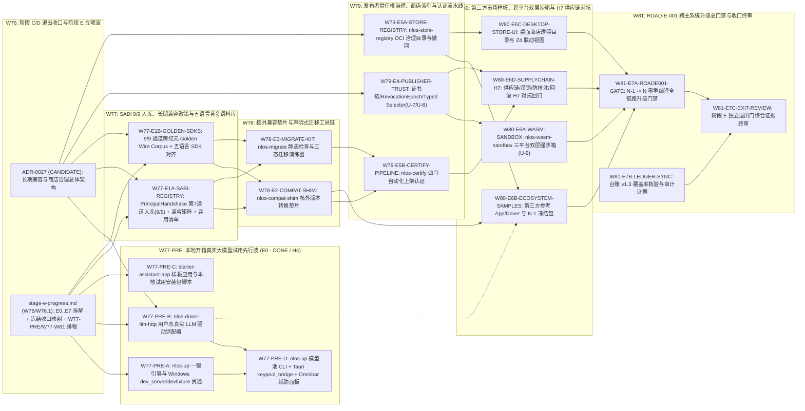

# 阶段 E 权威进度单（兼容制度与生态规模化）

> **状态：`IN_PROGRESS / NOT EXITED`（2026-10-29 `W76` 立项启动，2026-10-30 `W76.1` 增量纳管剩余协议契约冻结收口与 `E0` 先行波；2026-10-30 `W77-PRE` / `W77-PRE.1` 已完成先行开箱试用工作包 `E0` / 里程碑 `M-E0.5` 并落盘 `H4` 证据 [E-TRIAL-001](../evidence/stage-e/e-trial-001-llm-http-driver.md) 与 [E-TRIAL-002](../evidence/stage-e/e-trial-002-quickstart-and-starter-app.md)；2026-10-30 `W77` 已完成核心工作包 `E1` / 里程碑 `M-E1` 并落盘 `H4` 证据 [E-SABI-001](../evidence/stage-e/e-sabi-001-version-matrix-and-deprecation.md) 与 [E-SABI-002](../evidence/stage-e/e-sabi-002-five-lang-golden-corpus.md)——达成 `9/9` SABI 通道全量入冻、`N / N-1 / N-2` 兼容矩阵、`deprecation-manifest.yaml` 弃用遥测与五语言 `v1.0` 黄金不可变语料库；后续兼容垫片与商店治理工作包 `E2`..`E7` 仍处于 `NOT_STARTED` / `DESIGN` 规划态；阶段 C 与阶段 D 已于 `W76` 经维护者正式批复 `EXITED` 并完成向阶段 E 的基线交接；至 [§E.5.5](#e55-阶段-e-退出门禁检查表) 全部六项硬性退出条件满足并获维护者显式批准前，严禁将本状态改为 `EXITED`）。** 本文件为阶段 E（兼容制度与生态规模化）的唯一权威进度、工作包拆解与依赖感知并行编排台账，依据 [06-架构设计总纲-v0.5.md](../design/06-架构设计总纲-v0.5.md) §28.5、§9、§15、§23、§29、§30，结合前序阶段 B/C/D 交接清单（[stage-b-progress.md](./stage-b-progress.md)、[stage-c-progress.md](./stage-c-progress.md)、[stage-d-progress.md](./stage-d-progress.md)）及未知与残余风险清单 [exit-unknown-risks.md](./exit-unknown-risks.md) 编制。立项快照基线 `HEAD = 626e46d`（含 `W75` 远端全绿基线 `481ae0f` 及 `W76` 前序提交 `6141dd1..626e46d`，2026-10-29），`W76.1` 增量规划修订基线 `HEAD = 3507631`（2026-10-30），`W77-PRE` 收口集成基线 `HEAD = ccf119e`（2026-10-30），`W77-PRE.1` 直连 `glm-5.3` 锁定与桌面 `Z3` Omnibar 主入口接线校准基线 `HEAD = 44fd32e`（2026-10-30），`W77` 双车道合流基线 `HEAD = 0d1ccce`（2026-10-30）。
>
> **机器台账口径绑定**：绑定 [ledger-schema.md](./ledger-schema.md) **`v1.3`**（`ledger-schema.md` `v1.2 -> v1.3` 与 `scripts/lint_claims.py` / `scripts/test_lint_claims.py` 纯增量升级已于 `W76` `W76-SCHEMA-V13` 提交 `ed64ae3` 提前落地，`44/44` 单测通过：`claims.yaml` 的 `stage` 枚举新增 `"E"`、`source` 允许引用 `stage-e-progress.md`、`risks.yaml` 允许 `RISK-E-NN`、`evidence-index.yaml` 双向索引覆盖 `docs/evidence/stage-e/` 及 `docs/evidence/stage-e/reviews/`；`W77-PRE` 与 `W77` 已将 `E0`、`E1` 四份 `H4` 证据同步入账 [evidence-index.yaml](./evidence-index.yaml)（`192/192`，`0 ERROR`）；严守 `Claim <= Evidence` 纪律，`E2`..`E7` 未验证前不提前录入任何 `stage: "E"` 空产声明，阶段 E 全量机器台账覆盖核验与回填排入 `W81` `E7` 收口波次 `W81-E7B-LEDGER-SYNC` + `W81-INT`）。
>
> **同波权威总体架构决策记录（交叉绑定）**：
> - 阶段 E 总体架构决策记录：[ADR-0027](./adrs/0027-stage-e-sabi-long-term-compatibility-and-store-governance.md)（状态：`CANDIDATE`，`E0` 用户态模型驱动与开箱试用边界及 `E1` `9/9` SABI 通道冻结、版本兼容/弃用矩阵与五语言 `v1.0` 黄金语料库已于 `W77-PRE` / `W77` 达成 `H4` 验证，后续核心工作包 `E2`..`E7` 仍为 `DESIGN`；确立第 7 通道 `nlos.sabi.PrincipalHandshake` 入冻补齐 9/9 通道冻结、`SABI v1-beta -> v1.0` 长期稳定契约与 `ACTIVE -> DEPRECATED -> SUNSET` 弃用制度、核外无特权兼容垫片 `nlos-compat-shim` 与迁移检查器 `nlos-migrate`、不破坏微内核边界的 `E0` 用户态真实 LLM 驱动与本机开箱引导、三级发布者信任域与 `nlos-store-registry` / `nlos-certify` 认证流水线、以及 `[ROAD-E-001]` 主系统 `N-1 -> N` 零重编译跨版本升级不破坏门禁）。
>
> **前序阶段收官评审与风险基线（只读引用）**：阶段 B 收官评审 [W31-G](../evidence/stage-b/reviews/w31g-road-b004-gates.md)、[W33-H](../evidence/stage-b/reviews/w33h-road-b001-b002.md)、[W34-A](../evidence/stage-b/reviews/w34a-six-gate-matrix.md)；阶段 C 单机与跨物理主机收官终审 [W67](../evidence/stage-c/reviews/w67-stage-c-exit-gates.md)、[W73](../evidence/stage-c/reviews/w73-stage-c-xhost-exit-review.md)；阶段 D 完整自然语言桌面收官终审 [D-ROAD-001](../evidence/stage-d/d-road-001-non-developer-multi-app-e2e-gate.md)、[W74](../evidence/stage-d/reviews/w74-stage-d-exit-gates.md)；机器台账与风险基线 [claims.yaml](./claims.yaml)、[risks.yaml](./risks.yaml)、[evidence-index.yaml](./evidence-index.yaml)、[exit-unknown-risks.md](./exit-unknown-risks.md)。

---

## E.1 定位、前序阶段（B / C / D）交接基线

### E.1.1 阶段定位与规范性需求全量映射

阶段 E 将 NLOS 从「阶段 B/C/D 同仓同步编译的一方完整分布式桌面系统」推进为**具备长期二进制/线协议兼容承诺与受治理第三方应用/驱动市场的现代通用操作系统生态**。按 [06-架构设计总纲-v0.5.md](../design/06-架构设计总纲-v0.5.md) §28 路线拓扑，阶段 E 汇聚承接阶段 C（分布式现代系统）与阶段 D（完整自然语言桌面）两路成果。

[v0.5 §28.5](../design/06-架构设计总纲-v0.5.md) 规定阶段 E **必须交付**（逐字誊录）：

1. 长期 SABI/Package/Driver 兼容政策；
2. Application Store 与 publisher 治理；
3. 认证、迁移、兼容层和生态工具；
4. 第三方 Driver/Application 市场。

**阶段 E 退出门**（[v0.5 §28.5](../design/06-架构设计总纲-v0.5.md) 逐字誊录）：

- `[ROAD-E-001]` **系统能力增长主要来自第三方生态，升级无需生态整体重写。**

**工程化可证伪判据**：主系统核心（`N-1 -> N`）原地升级不得破坏历史稳定接口承诺——针对 `N-1` 纪元构建并经商店认证冻结签名的第三方多组件 Application 与用户态 Driver 包，在**零源码修改、零重新编译、零重新签名**条件下，必须在升级后的 `N` 主系统上完整通过既有持久状态恢复、`Z4` 策略授权、SABI IPC 调用、核外兼容垫片协议桥接、热插拔/崩溃对账、事务更新回滚与零残留卸载全链路契约验证。

**规范性需求全量映射表**（阶段 E 实现车道必须逐条绑定 Requirement ID 交付 conformance / adversarial 测试与独立 Evidence）：

| 规范章节 | Requirement ID | 规范核心不变量摘要 | 承接工作包 |
|---|---|---|---|
| §28.5 | `ROAD-E-001` | 系统能力增长主要来自第三方生态，主系统升级无需第三方生态整体重写或重编译 | `E7`（总门禁终验），`E0`、`E1`..`E6` 共同支撑 |
| §9 | `COMPAT-VER-001`、`COMPAT-VER-002` | 每个 envelope/schema 包含 `(name, major, minor)` 与扩展规则；未知 `major` 或未知 `critical` 字段/flag 强制拒绝，未知 `non-critical` 扩展安全忽略但完整保留 round-trip 语义 | `E1`、`E2`、`E7` |
| §9 | `COMPAT-DEPRECATE-001` | 稳定契约明确定义弃用期（`ACTIVE -> DEPRECATED -> SUNSET`，最少双周期预告）、能力协商、迁移路径与 conformance 黄金向量 | `E1`、`E3`、`E7` |
| §9.1–§9.2 | `KABI-IDEM-001`、`KABI-HANDLE-001`、`KABI-SVC-001`、`KABI-ERR-001`、`KABI-UNCERTAIN-001` | KABI 严守最小受控能力边界，禁止新增 provider-specific syscall；第三方生态与外部模型驱动统一经 SABI 与 generic I/O 编程；`E_UNCERTAIN` 严禁换新幂等键盲目重做 | `E0`、`E1`、`E2`、`E5` |
| §9.3 | `SABI-DISC-001`、`SABI-COMMON-001`、`SABI-RECEIPT-001`、`SABI-AUTH-001`、`SABI-TRANSPORT-001`、`SABI-CONFORM-001` | 第三方应用强制经 `ServiceDirectory` + 版本/特性协商获取服务；完整继承 capability、异步 `Operation`、取消、幂等、不可变 `Receipt` 与授权摘要绑定；`APPLICATION_PLATFORM` 与 `DESKTOP` 完整满足最小服务族一致性 | `E0`、`E1`、`E2`、`E5`、`E7` |
| §15.1 | `DRV-NEGO-001`、`DRV-BOUND-001`、`DRV-ACTIVE-001`、`DRV-CRED-001`、`DRV-PROTO-001`、`DRV-LIFE-001`、`DRV-SHIM-001`、`DRV-DISC-001` | 用户态 Driver 特性协商与 `EffectDescriptor` 声明；可信 `EnforcementShim`（托管凭据、校验权限/预留激活令牌/围栏）与不可信 `ProviderAdapter` 及核外协议转换垫片物理分离；驱动崩溃后未决操作默认置 `UNCERTAIN` 直至对账；MCP/A2A/OpenAI 兼容接口封装为版本化扩展 | `E0`、`E2`、`E5`、`E6`、`E7` |
| §23.1–§23.2 | `PKG-SEP-001`、`PKG-IMM-001`、`PKG-SEED-001`、`PKG-UPDATE-001`、`PKG-UNINSTALL-001`、`PKG-OCI-001`、`PKG-MULTI-001`、`PKG-APPID-001` | 内容寻址不可变签名包（零烘焙可变记忆/密钥）；`PackageId` / `ApplicationId` / `InstallationId` 严格分离与防抢注；更新强制支持迁移分类、健康检查与原子回滚（不可逆迁移须预备份并经 `Z4` 确认）；卸载彻底清理后台/权限/缓存并保护用户数据；OCI 仅作内容寻址层，商店治理独立承担发布者身份、审核、权限透明与恶意撤回；支持多组件复合包 | `E0`、`E3`、`E4`、`E5`、`E6`、`E7` |
| §6 / §7 / §24.2 | `TCB-BYPASS-001`、`TCB-EGRESS-001`、`TCB-DOWNGRADE-001`、`CAP-UNFORGE-001`、`CAP-ATTEN-001`、`CAP-REVOKE-001`、`TUI-CONSENT-001` | 第三方不可信负载默认拒绝网络外发且零原始凭据暴露；未完全中介路径强制降档并在回执与 `Z4` 可信 UI 显式提示；包吊销或卸载立即触发关联 Capability 撤销 | `E0`、`E4`、`E5`、`E6` |
| §29 / §30 | `NLOS-DEFER-001`、`EVID-SCOPE-001`、`EVID-NONLINEAR-001`、`EVID-NEG-001`、`EVID-REPRO-001`、`EVID-GEN-001` | 延后项不等于从接口删除；兼容、安全、性能证据按 `H0–H8` 分域独立登记，反例与适用限制同等持久化 | `E1`、`E7` |

### E.1.2 前序阶段（B / C / D）已验证基座接收盘点

阶段 E 直接构建在前序阶段已落盘验证的生产级模块之上，严禁重复造轮子或绕开既有权威路径：

1. **阶段 B 基座（`W34-D` `EXITED`）**：[crates/nlos-schema](../../crates/nlos-schema) 有界编解码与 [ADR-0014](./adrs/0014-schema-channel-freeze-v1-beta.md) 通道冻结注册表、四语言 [sdk/](../../sdk) 线协议探针（[B-SCHEMA-002](../evidence/stage-b/b-schema-002-cross-language-generation.md)）、[crates/nlos-package](../../crates/nlos-package) 与 [crates/nlos-application](../../crates/nlos-application) 包生命周期引擎、以及 [ADR-0015](./adrs/0015-dual-layer-untrusted-execution-isolation.md) 双层沙箱选型基线（[B-SANDBOX-001](../evidence/stage-b/b-sandbox-001-isolation-comparison.md)）。
2. **阶段 C 基座（`W76` 经维护者批复 `EXITED`）**：单机多进程与跨物理主机蜂窝集群控制面（[W67](../evidence/stage-c/reviews/w67-stage-c-exit-gates.md) + [W73](../evidence/stage-c/reviews/w73-stage-c-xhost-exit-review.md)，[ADR-0026](./adrs/0026-cross-physical-host-transport-and-consensus-expansion.md)）、[crates/nlos-capability](../../crates/nlos-capability) KEK 托管签名库 `SigningKeyCustodyVault`（[C-CUSTODY-001](../evidence/stage-c/c-custody-001-key-custody-gateway-reconciliation.md)）、[crates/nlos-driver-mock](../../crates/nlos-driver-mock) 跨进程 `OutOfProcessProviderDriver` 与 [ADR-0024](./adrs/0024-driver-provider-payload-codec-freeze.md) `DriverProvider` v1.0 冻结通道（[C-PROVIDER-001](../evidence/stage-c/c-provider-001-real-process-provider-codec.md)）、以及 [examples/sample-app/README.md](../../examples/sample-app/README.md) 载荷执行闭环（[C-APP-PAYLOAD-001](../evidence/stage-c/c-app-payload-001-sample-cli-execution.md)）。
3. **阶段 D 基座（`W76` 经维护者批复 `EXITED`）**：[desktop/README.md](../../desktop/README.md) 五平面 `Z0–Z4` 中性工业工作站桌面（[ADR-0025](./adrs/0025-stage-d-hybrid-desktop-compositor-and-trusted-ui-layering.md)）、`[UI-PARITY-001]` 12 域显控同构脊柱、`Z4` UAC/Polkit 实心安全确认屏、`ChooserGrant` 受限选择器、离线自治表面及 `[ROAD-D-001]` 非开发者多应用端到端门禁（[D-ROAD-001](../evidence/stage-d/d-road-001-non-developer-multi-app-e2e-gate.md) + [W74](../evidence/stage-d/reviews/w74-stage-d-exit-gates.md)）。

### E.1.3 前序阶段诚实延续边界与跨阶段移交台账（严禁遗漏或夸大）

遵循 `AGENTS.md` 第 7 条与 [exit-unknown-risks.md](./exit-unknown-risks.md) 口径，阶段 C 与阶段 D 退出时显式登记的全部残余风险与未知边界均原样结转至阶段 E 视野下管理，逐项定性如下（严禁把既有局部证据外推为全量闭合）：

| 来源条目与风险 ID | 已验证事实边界（阶段 B/C/D 已闭合部分） | 延续至阶段 E 期间的真实未决残域 | 阶段 E 处置归属与诚实护栏 |
|---|---|---|---|
| **`#16 C-POWER-LOSS` / `U-4`（`RISK-B-02` `durable-state-loss`）** | Layer-1（APFS 语义校准）与 Layer-2（`dm-flakey` 块层故障注入，CI 常设每日守护含自然 `schedule` Run `40798612701` 与 `workflow_dispatch` Run `40868450278` 双双 `success`）已验证通过 | **Layer-3+ 真实双机/真盘物理掉电台架与 M4/M6/M8 物理存储介质校准**尚未执行 | **保留为独立物理硬件台架专项（`E-deferred` 常设硬件门）**：在具备真实可编程电源/物理双机真盘台架后专项补齐；严禁以进程 `kill -9` 或虚拟块设备故障冒充真实物理断电证据 |
| **`U-1` / `#5 C-SCALE-RELEASE`（`RISK-B-07` `scale-impersonation`）** | [B-SCALE-RELEASE-001](../evidence/stage-b/b-scale-release-001.md) §6.1 已于 `W76`（`e77c094`，Run `40868357139`）完成 Ubuntu / macOS / Windows 三平台 CI `--release` 五探针实测数字回填（闭合 `U-1` 多平台 CI `--release` 基线半边），且 [C-BENCH-001](../evidence/stage-c/c-bench-001-road-c002-distributed-benchmark.md) Windows `--release` 8-Cell `10K/100K_LOGICAL`（`SQLite WAL+FULL`）实盘基线已闭环 | **`1M_LOGICAL` 裸金属/真实跨机 WAN 大规模集群实测**、Linux/macOS 8-Cell 分片基准及单分片 `O(N/S)` 扫描二级索引化尚未完成 | **保留为硬件集群规模专项（`E-deferred` 规模实证门）**：继续严格维持无边界生产容量口号禁令，严禁以共享云端 CI runner 测试结果冒充百万级逻辑对象实证 |
| **`RISK-B-05`（`premature-format-freeze`）** | [crates/nlos-schema](../../crates/nlos-schema) `REGISTRY` 共 9 个已注册 SABI 通道现已 **全部 9/9 为 `frozen: true`**（前 6 通道依 [ADR-0014](./adrs/0014-schema-channel-freeze-v1-beta.md) `v1-beta` additive 冻结，第 8 通道 `DriverProvider` v1.0 依 [ADR-0024](./adrs/0024-driver-provider-payload-codec-freeze.md) 冻结，第 9 通道 `ChannelControl` v1.0 依 `W73` `L-002` 冻结，**第 7 通道 `PrincipalHandshake` v1.0 已于 `W77` 经对端证明扩展槽审计与五语言黄金向量锁定翻转为 `frozen: true`**，见 [E-SABI-001](../evidence/stage-e/e-sabi-001-version-matrix-and-deprecation.md)、[E-SABI-002](../evidence/stage-e/e-sabi-002-five-lang-golden-corpus.md)） | SABI 全表面虽已达成 `9/9` 通道级入冻与 `v1.0` 五语言黄金语料库锁定，但尚未经核外垫片 `nlos-compat-shim`（`W78`）桥接与 `[ROAD-E-001]` `N-1 -> N` 零重编译升级演练（`W81`）检验，仍维持 `ADR-0014` `v1-beta` / `v1.0-rc` 候选锁 | **两步受控收口（第一步已于 `W77` 完成）**：(1) **`W77`（`DONE` / `H4`）**已完成 `nlos.sabi.PrincipalHandshake` 扩展槽审查、翻转 `frozen: true`（**9/9 SABI 通道全量入冻**）、落地 `N / N-1 / N-2` 兼容矩阵、`deprecation-manifest.yaml` 与五语言 `v1.0` 黄金不可变语料库；(2) **`W78 -> W81`（决策点 `E2`）**待实证核外 `nlos-compat-shim`（`W78`）与 `[ROAD-E-001]` `N-1 -> N` 零重编译升级门禁（`W81`）并获维护者签字后，正式晋升 `SABI v1.0` 长期冻结承诺并闭合 `RISK-B-05`（在此之前维持 `partial`） |
| **`U-7` / `U-8`（`#7 C-SELECTOR` 生态 Typed Selector 扩展与授权门）** | 阶段 B/C 已闭合 `Application` / `Artifact` typed selector 前片，阶段 D 已在桌面 `L2/L3` 展示已解析句柄摘要 | `Package / Skill / Tool / Model / Topic / 外部服务` 的版本化 Typed Selector -> `GenerationHandle` 权威解析（拦截 `latest` 浮动标签充当已授权依赖）及 `WAITING_AUTHORIZATION` 物化门负路径强制执行尚未落地 | **直接纳入阶段 E `E-core`（`E4` + `E5`）正式闭合**：与商店包依赖锁定、权限重授权及上架审计联动实现并补齐负路径测试 |
| **`U-9`（`#2 C-APP-PAYLOAD` 第三方不可信负载强沙箱隔离）** | `examples/sample-app` CLI 全周期与确定性驱动回执已闭环；阶段 B `exp8` 完成 macOS 单平台 Wasmtime 对比初测 | 面向不可信第三方代码的 Windows / macOS / Linux 三平台「独立宿主 Process + Wasmtime 能力白名单」双层强沙箱生产接线与逃逸对抗回归尚未完成 | **直接纳入阶段 E `E-core`（`E6` `nlos-wasm-sandbox`）正式闭合**：作为 `COMMUNITY_SANDBOXED` 与未授信第三方组件的硬性运行时底座；未闭合前严禁宣称任意不可信原生二进制免 OS 沙箱裸跑 |
| **`RISK-B-06` / `U-3` 发行残域 + `RISK-B-09`（供应链与桌面原生签名公证）** | 跨平台五阶段工业工作站交互战役、CJK IME 探针与 1,000 轮零泄漏浸泡已在阶段 D 闭合 `U-3` 主体；`W76`（`6141dd1` / `6dc79eb`，经三平台 CI Run `40868357139` 13/13 验证）已合入并清零全部 6 个存量 Dependabot PR（`#30/#31/#35/#36/#37/#38`） | 桌面宿主 OS 原生安装器商业代码签名/公证（Windows Authenticode / Apple Developer ID Notarization）、物理 macOS 触控板人工巡检、以及第三方依赖树周期自动化安全/许可证复审门仍开 | **分域治理**：内部 `llmos.package` 发布者证书链、吊销与供应链对抗纳入 `E4`/`E5`/`E6`；第三方依赖许可证/供应链自动化审计纳入 `E5`/`E7` CI 门（落地前 `RISK-B-09` 维持 `open`）；外部商业 CA 硬件令牌的宿主 OS 安装器公证列为 `E-deferred` 发行凭据边界（严禁将内部 Ed25519 包签名冒充 Apple/Microsoft 原生公证） |
| **`RISK-B-11` / `U-5` 物理残域、`RISK-B-10` / `U-2` 残域、`RISK-B-08`** | 跨主机 mTLS/偏斜包络/Raft 共识、同权限 Windows 进程树实杀、全库知识外化均已验证 | 远端失联主机不可逆外部物理副作用擦除（需硬件 STONITH/设备重置）、Windows 跨权限/Job Object breakaway 回收、单人维护集中度（`RISK-B-08`） | **原样诚实保留于 [exit-unknown-risks.md](./exit-unknown-risks.md)**：第三方 Driver 认证在 `E5` 强制核查 `EffectDescriptor` 可逆性声明与 `QuarantineDisposition` 边界，绝不掩盖不可逆外部副作用 |

#### 冻结与软件层挂起遗留项一站式收口映射表（`W76.1` 维护者指令排期）

为确保全部软件层可闭合的协议契约冻结项、跨阶段挂起遗留项与本机开箱真实可试用缺口均具备唯一、机械可追踪的承接车道，同时与依赖外部物理硬件、商业资质或组织人力的 `E-deferred` 边界严格区分，汇总一站式收口映射如下：

| 类别与序号 | 待收口契约冻结 / 软件挂起遗留项 | 代码与台账当前真实状态 | 绑定收口波次、工作包与专属车道 | 闭合机械验收判据 | 规划态当前状态 |
|---|---|---|---|---|---|
| **软件可闭合 (0)** | **本机连接真实外部/本地大模型的开箱可试用“最后一公里”（关联 `U-10` 用户态真实 LLM HTTP 适配面）** | `W77-PRE` 已交付 `nlos-up`（含 `pool-status`/`chat`/`intent`）、Windows Named Pipe `devfixture`/`dev_server`、`nlos-driver-llm-http`、桌面 `keypool_bridge`/Omnibar 辅助面板与 `starter-assistant-app` | **`W77-PRE`**（`E0`：`W77-PRE-0-SCAFFOLD` / `W77-PRE-A` / `W77-PRE-B` / `W77-PRE-C` / `W77-PRE-D` + `W77-PRE-INT`） | 跨平台一键初始化 `~/.llmos` 并唤起桌面/CLI；`nlos-driver-llm-http` 经 `LlmEnforcementShim` 托管脱敏凭据与 `nlos-resource` v8 五维 Token 预算回执连通本机 `127.0.0.1:8317` `glm-keypool` / OpenAI-compatible 端点；桌面 Omnibar 支持 `[DUI-OFFLINE-001]` 离线回退与 `[NL-AMBIG-001]` 破坏性升级；内置样板应用跑通多步 `TaskPlan` 与 `Artifact` 因果读写 | **`DONE`**（`W77-PRE`，保障等级：`H4`；[E-TRIAL-001](../evidence/stage-e/e-trial-001-llm-http-driver.md)、[E-TRIAL-002](../evidence/stage-e/e-trial-002-quickstart-and-starter-app.md)） |
| **软件可闭合 (1)** | **`SABI_PRINCIPAL_HANDSHAKE_V1`（第 7 通道 `nlos.sabi.PrincipalHandshake`）`frozen: false -> true`** | `W77`（`8c4ad8c2a` + `0d1ccce5b`）已完成 `PrincipalHandshake` 双握手消息扩展槽与 `3,911 B` 帧余量审计，翻转 `SABI_PRINCIPAL_HANDSHAKE_V1.frozen = true`，并锁定五语言（Rust/TS/Python/Go/C#）`v1.0` 九通道黄金语料库与 `check_golden_immutability.py` | **`W77`**（`E1`：`W77-E1A-SABI-REGISTRY` + `W77-E1B-GOLDEN-SDKS` + `W77-INT`） | 完成 peer attestation 扩展槽审查与 Rust/TS/Python/Go/C# 五语言握手黄金向量钉死，翻转 `SABI_PRINCIPAL_HANDSHAKE_V1.frozen = true`，达成 **9/9 SABI 通道全量入冻** | **`DONE`**（`W77`，保障等级：`H4`；[E-SABI-001](../evidence/stage-e/e-sabi-001-version-matrix-and-deprecation.md)、[E-SABI-002](../evidence/stage-e/e-sabi-002-five-lang-golden-corpus.md)） |
| **软件可闭合 (2)** | **`SABI v1-beta -> v1.0` 正式长期冻结与 `RISK-B-05` 收口** | 第一步（`W77` 9/9 通道入冻 + `deprecation-manifest.yaml` + 五语言 `v1.0` 黄金语料库）已完成；`RISK-B-05` 按决策点 `E2` 审慎护栏维持 `partial` | **`W77 -> W78 -> W81`**（`E1` + `E2` + `E7` + **决策点 `E2`**） | 依次跑通五语言跨纪元黄金语料库与弃用清单（`W77`，已完成）、核外 `nlos-compat-shim`（`W78`）、`[ROAD-E-001]` `N-1 -> N` 零重编译升级门禁（`W81`）并获维护者签字，正式晋升 `SABI v1.0` 长期冻结承诺并闭合 `RISK-B-05` | `IN_PROGRESS`（`W77` 第一步 `DONE` / `H4`；待 `W78` + `W81` 决策点 `E2` 收口） |
| **软件可闭合 (3)** | **`U-7` / `U-8` 生态 Typed Selector 不可变句柄锁定与 `WAITING_AUTHORIZATION` 负路径门** | `Application` / `Artifact` 前片已证，跨生态 `Package/Skill/Tool/Model/Topic/外部服务` 选择器锁定与物化授权负路径未落 | **`W79`**（`E4` `W79-E4-PUBLISHER-TRUST` + `E5` `W79-E5A/E5B`） | 落地跨生态 Typed Selector -> `(PackageDigest, GenerationHandle)` 权威解析（拒绝 `latest` 浮动标签冒充已授权依赖）与 `WAITING_AUTHORIZATION` 物化门负路径强制拦截测试 | `NOT_STARTED`（`DESIGN`） |
| **软件可闭合 (4)** | **`U-9` 三平台 `Process + Wasmtime` 双层 Wasm 强沙箱直跑** | `sample-app` CLI 载荷与 macOS 单机 `exp8` 对比初测已证，三平台双层强沙箱生产接线与逃逸对抗未落 | **`W80`**（`E6` `W80-E6A-WASM-SANDBOX`，`crates/nlos-wasm-sandbox`） | Windows / macOS / Linux 三平台落地「独立宿主 Process + Wasmtime WASI 白名单 + 内存页/CPU fuel 硬限 + 零宿主环境继承」并跑通路径/网络/配额逃逸对抗矩阵 | `NOT_STARTED`（`DESIGN`） |
| **软件可闭合 (5)** | **`RISK-B-09` 第三方依赖许可证与供应链自动化 CI 审计门** | 锁文件在库且 `W76` 已清空全部 6 个存量 Dependabot PR，`RISK-B-09` 当前 `open` | **`W79 -> W81`**（`E5` `W79-E5B-CERTIFY-PIPELINE` + `E7` `W81-E7B-LEDGER-SYNC` / `W81-INT`） | 落地 Cargo / npm 第三方依赖树许可证、漏洞与锁文件一致性常设 CI 自动化审计门及上架包供应链纯净度扫描，同步复审收口 `RISK-B-09` | `NOT_STARTED`（`DESIGN`） |
| **外部物理/资质/组织边界 (`E-deferred`)** | **(a) `C-POWER-LOSS`/`U-4` 真机断电台架；(b) `U-1` 多机裸金属 `1M_LOGICAL` WAN；(c) 商业 CA 硬件令牌安装包公证签名；(d) `RISK-B-08` 单人维护依赖** | Layer-2 `dm-flakey`、三平台 CI `--release` 五探针、内部 Ed25519 包签名与全库 188 份证据外化均已就位；上述 4 项分别受制于专用可编程断电硬件、多机裸金属 WAN 台架、外部商业 CA 付费 USB 硬件令牌及第二人类维护者接入 | **诚实挂入 `E-deferred` / [exit-unknown-risks.md](./exit-unknown-risks.md) 常设边界**（不伪造软件替代闭合） | 严禁以虚拟断电、共享云 runner、内部自签证书或本地试用未公证安装包冒充上述四项外部物理/商业/组织实证；待对应外部硬件台架、商业凭据或第二维护者到位后专项退役 | 诚实分域保留（`P0 = 0`） |

---

## E.2 `E-core` 与 `E-deferred` 范围切分

### E.2.1 状态语义与证据分级纪律

完全沿用 [stage-b-progress.md](./stage-b-progress.md)、[stage-c-progress.md](./stage-c-progress.md) 与 [stage-d-progress.md](./stage-d-progress.md) 的工作项状态机（`DONE` / `PARTIAL_PASS` / `IN_PROGRESS` / `READY` / `BLOCKED` / `NOT_STARTED`）及 `v0.5 §30` `H0–H8` 证据阶梯（阶段 E 核心终验等级为 **`H7` 安全/兼容 conformance**）。

**铁律（`AGENTS.md` 第 7 条）**：截至 `2026-10-30 W77`，已完成先行本地开箱试用工作包 **`E0`（`E-TRIAL-BOOTSTRAP`）** 与兼容治理首包 **`E1`（`E-SABI-POLICY-CORPUS`）** 并落盘四份 `H4` 实测证据（[E-TRIAL-001](../evidence/stage-e/e-trial-001-llm-http-driver.md)、[E-TRIAL-002](../evidence/stage-e/e-trial-002-quickstart-and-starter-app.md)、[E-SABI-001](../evidence/stage-e/e-sabi-001-version-matrix-and-deprecation.md)、[E-SABI-002](../evidence/stage-e/e-sabi-002-five-lang-golden-corpus.md)）；后续六个核心工作包（**`E2`..`E7`**）尚未落地业务代码，当前状态一律如实保持 **`NOT_STARTED`**，当前保障等级一律为 **`DESIGN`**。

### E.2.2 `E-core` 八大核心工作包矩阵（`E0` + `E1`..`E7`）

| 工作包 ID | 工作包名称 | 映射 `v0.5` Requirement ID | 目标产物 Crate / 目录范围 | 目标证据阶梯 | 计划波次 | 当前状态与保障等级 |
|---|---|---|---|---|---|---|
| **`E0`**（`E-TRIAL-BOOTSTRAP`） | 本地开箱真实大模型试用闭环：一键本机初始化与跨平台联调启动器（`nlos-up` + Windows Named Pipe 开发夹具贯通 + Windows GNU UCRT64 桌面编译环境注入）、真实外部/本地 LLM HTTP 用户态驱动适配器（`default_model` 与 `fast_intent_model` 统一直锁 `glm-5.3`）、桌面 `Z3` 命令面板主入口模型池实盘桥接与辅助拆解卡片、开箱生产力样板应用与本地试用安装包构建配置 | `KABI-SVC-001`、`SABI-DISC-001`、`SABI-AUTH-001`、`SABI-RECEIPT-001`、`DRV-NEGO-001`、`DRV-CRED-001`、`DRV-PROTO-001`、`DRV-LIFE-001`、`DRV-SHIM-001`、`PKG-IMM-001`、`PKG-MULTI-001`、`TCB-EGRESS-001`、`TUI-CONSENT-001` | `crates/nlos-up/`、`desktop/src-tauri/examples/dev_server.rs`、`desktop/src-tauri/src/devfixture.rs`、`crates/nlos-driver-llm-http/`、`desktop/src-tauri/src/keypool_bridge.rs`、`desktop/src/main.ts`、`desktop/src/views/omnibar/`、`examples/starter-assistant-app/`、`desktop/scripts/build-trial-bundle.*`、`docs/developers/quickstart-trial.md`、`docs/evidence/stage-e/e-trial-001-llm-http-driver.md`、`docs/evidence/stage-e/e-trial-002-quickstart-and-starter-app.md` | `DESIGN -> H3 -> H4` | `W77-PRE` / `W77-PRE.1`（`2026-10-30` 已先行收口） | **`DONE`**（保障等级：`H4`；证据：[E-TRIAL-001](../evidence/stage-e/e-trial-001-llm-http-driver.md)、[E-TRIAL-002](../evidence/stage-e/e-trial-002-quickstart-and-starter-app.md)） |
| **`E1`**（`E-SABI-POLICY-CORPUS`） | 第 7 通道 `PrincipalHandshake` 入冻补齐 9/9 通道冻结、SABI v1.0 长期兼容规范、跨纪元五语言黄金线协议语料库与机器可读弃用清单机制 | `COMPAT-VER-001`、`COMPAT-VER-002`、`COMPAT-DEPRECATE-001`、`KABI-SVC-001`、`SABI-DISC-001`、`SABI-COMMON-001`、`SABI-CONFORM-001`、`EVID-GEN-001` | `schema/nlos/sabi/v1/deprecation-manifest.yaml`、`schema/golden/epochs/v1.0/`、`crates/nlos-schema/`（含 `SABI_PRINCIPAL_HANDSHAKE_V1` `frozen: true`、`version_matrix.rs`、`deprecation.rs`）、`crates/nlos-service-directory/`、`sdk/{typescript,python,go,csharp}/`、`tests/conformance/`、`tools/check_golden_immutability.py`、`docs/evidence/stage-e/e-sabi-{001,002}-*.md` | `DESIGN -> H2 -> H4 -> H7` | `W77`（`2026-10-30` 已收口） | **`DONE`**（保障等级：`H4`；证据：[E-SABI-001](../evidence/stage-e/e-sabi-001-version-matrix-and-deprecation.md)、[E-SABI-002](../evidence/stage-e/e-sabi-002-five-lang-golden-corpus.md)） |
| **`E2`**（`E-COMPAT-SHIM`） | 核外版本化兼容垫片（`nlos-compat-shim`：SABI Epoch Adapter Cell 与 `DRV-SHIM-001` 驱动协议转换层） | `DRV-NEGO-001`、`DRV-PROTO-001`、`DRV-SHIM-001`、`DRV-BOUND-001`、`DRV-CRED-001`、`SABI-DISC-001`、`SABI-TRANSPORT-001`、`COMPAT-VER-002` | `crates/nlos-compat-shim/`（新建核外无特权转换 crate）、`docs/evidence/stage-e/e-shim-*.md` | `DESIGN -> H3 -> H4 -> H7` | `W78` | **`NOT_STARTED`**（保障等级：`DESIGN`） |
| **`E3`**（`E-MIGRATE-KIT`） | 声明式契约升级静态检查器、包清单审计与三态数据容器迁移演练工具链（`nlos-migrate`） | `COMPAT-DEPRECATE-001`、`PKG-UPDATE-001`、`PKG-SEED-001`、`PKG-MULTI-001`、`DRV-LIFE-001` | `crates/nlos-migrate/`（新建 CLI 与库 crate）、`tools/sabi-compat-diff/`、`docs/evidence/stage-e/e-migrate-*.md` | `DESIGN -> H3 -> H4` | `W78` | **`NOT_STARTED`**（保障等级：`DESIGN`） |
| **`E4`**（`E-PUBLISHER-TRUST`） | 三级发布者信任域、Ed25519 分层证书链、单调吊销纪元（`RevocationEpoch`）与生态 Typed Selector 锁定（闭合 `U-7`/`U-8`） | `PKG-IMM-001`、`PKG-APPID-001`、`CAP-UNFORGE-001`、`CAP-ATTEN-001`、`CAP-REVOKE-001`、`TCB-DOWNGRADE-001` | `crates/nlos-publisher-trust/`（新建 crate，衔接 `nlos-capability::custody`）、`crates/nlos-plan/src/ecosystem_selector.rs`、`docs/evidence/stage-e/e-trust-*.md` | `DESIGN -> H4 -> H7` | `W79` | **`NOT_STARTED`**（保障等级：`DESIGN`） |
| **`E5`**（`E-STORE-CERTIFY`） | OCI 内容寻址商店治理注册表（`nlos-store-registry`）与四门自动化上架认证流水线（`nlos-certify`） | `PKG-OCI-001`、`PKG-MULTI-001`、`PKG-SEP-001`、`PKG-UPDATE-001`、`PKG-UNINSTALL-001`、`SABI-CONFORM-001`、`DRV-LIFE-001`、`DUI-ASSOC-001` | `crates/nlos-store-registry/`（新建 crate）、`crates/nlos-certify/`（新建 crate）、`docs/evidence/stage-e/e-store-*.md`、`docs/evidence/stage-e/e-certify-*.md` | `DESIGN -> H4 -> H7` | `W79` | **`NOT_STARTED`**（保障等级：`DESIGN`） |
| **`E6`**（`E-MARKET-SANDBOX-H7`） | 跨平台双层 Wasm 强沙箱生产接线（闭合 `U-9`）、解耦第三方参考 App/Driver 市场样板包、桌面商店透明视图与供应链 `H7` 对抗回归 | `DRV-PROTO-001`、`DRV-LIFE-001`、`DRV-DISC-001`、`PKG-MULTI-001`、`TCB-BYPASS-001`、`TCB-EGRESS-001`、`TCB-DOWNGRADE-001`、`TUI-CONSENT-001` | `crates/nlos-wasm-sandbox/`（新建 crate）、`examples/ecosystem-apps/`、`examples/ecosystem-drivers/`、`desktop/src/views/store-catalog/`、`desktop/src-tauri/src/store_catalog.rs`、`docs/evidence/stage-e/e-sandbox-*.md`、`e-market-*.md`、`e-security-*.md` | `DESIGN -> H4 -> H5 -> H7` | `W80` | **`NOT_STARTED`**（保障等级：`DESIGN`） |
| **`E7`**（`E-UPGRADE-GATE-ROADE001`） | `[ROAD-E-001]` 主系统 `N-1 -> N` 零重编译跨版本升级全链路门禁、`ledger-schema v1.3` 阶段 E 台账覆盖审计回填与独立退出终审 | `ROAD-E-001`、`COMPAT-VER-001`、`COMPAT-VER-002`、`COMPAT-DEPRECATE-001`、`DRV-SHIM-001`、`PKG-UPDATE-001`、`PKG-UNINSTALL-001`、`EVID-SCOPE-001`、`EVID-REPRO-001` | `tests/stage_e_road_e001_upgrade_gate/`、`scripts/run_road_e001_upgrade_matrix.py`、`tools/verify_stage_e_ledger_coverage.py`、`docs/evidence/stage-e/e-ledger-001-v13-conformance-audit.md`、`docs/evidence/stage-e/e-road-001-*.md`、`docs/evidence/stage-e/reviews/w81-stage-e-exit-gates.md`（注：`ledger-schema v1.3` 与 `lint_claims.py` 增量升级已于 `W76` `ed64ae3` 提前落地） | `DESIGN -> H7` | `W81` | **`NOT_STARTED`**（保障等级：`DESIGN`） |

#### 各工作包关键验收契约（摘要）

0. **`E0`（`E-TRIAL-BOOTSTRAP`，先行波次 `W77-PRE` / `W77-PRE.1` — `DONE` / `H4`）**：
   - 已交付一键本机初始化与跨平台联调启动器 [crates/nlos-up](../../crates/nlos-up)（`init | env | daemon | desktop | pool-status | chat | intent`，`15/15` 测试通过，含 `W77-PRE.1` `5fbe33b` Windows GNU MSYS2 UCRT64 `windres`/`gcc` 环境变量自动注入 `augment_desktop_child_env` 与首次缺失 `node_modules` 时的 `npm ci` 预检），并补齐 [desktop/src-tauri/examples/dev_server.rs](../../desktop/src-tauri/examples/dev_server.rs) 与 [desktop/src-tauri/src/devfixture.rs](../../desktop/src-tauri/src/devfixture.rs) 的 Windows Named Pipe 开发夹具支持（`llmos-desktop --lib --features dev-fixture` `21/21` 通过，消除 `#[cfg(unix)]` 平台断层）；
   - 已交付真实外部/本地 LLM HTTP/1.1 用户态驱动适配器 [crates/nlos-driver-llm-http](../../crates/nlos-driver-llm-http)（`13/13` 测试通过，零新增第三方依赖；`W77-PRE.1` `5fbe33b` 经 `resolve_primary_model` 将 `default_model` 与 `fast_intent_model` 统一直接锁定为 `glm-5.3`，默认选型阶段自动跳过 `*-flash`）及桌面端桥接 [desktop/src-tauri/src/keypool_bridge.rs](../../desktop/src-tauri/src/keypool_bridge.rs)（`4/4` 测试通过）、桌面主入口 [desktop/src/main.ts](../../desktop/src/main.ts) `Z3` `OmnibarPaletteController` 实盘直连 `inspectLlmKeyPoolStatus` / `assistIntentWithKeyPool`（`d2f4989`）与 [desktop/src/views/omnibar](../../desktop/src/views/omnibar) 实心 `4px` 模型池状态条/辅助拆解卡片（Suites `1..10` `727` 项断言 + `tsc && vite build` 全绿）：严格遵循 [ADR-0024](./adrs/0024-driver-provider-payload-codec-freeze.md) 与 `KABI-SVC-001` / `DRV-CRED-001` / `DRV-SHIM-001`（由 `LlmEnforcementShim` 托管脱敏凭据并联动 `nlos-resource` v8 五维 `LlmTokenBudget` 包含式 `reasoning_tokens` 守恒回执、诚实打标 `PROVIDER_ISOLATION_UNVERIFIED`、强制执行 `[NL-AMBIG-001]` 破坏性升级与 `[DUI-OFFLINE-001]` 离线确定性回退），并在本机 `http://127.0.0.1:8317` `glm-keypool`（纯 `glm-5.3` 零 `--model` 标志覆盖）完成 6 步脱敏实盘冒烟闭环（`seq 1..3`，`cumulative_total_tokens: 796 -> 1397 -> 1894`，[E-TRIAL-001](../evidence/stage-e/e-trial-001-llm-http-driver.md)）；
   - 已交付零私有内核依赖参考生产力样板应用包 [examples/starter-assistant-app](../../examples/starter-assistant-app/README.md)（`v1.0.0` / `v1.1.0` `CONFORMANT` 包树、多步 `TaskPlan` + 五维 `LlmTokenBudget` + `ArtifactStore` 因果血缘 + `SameMajor` 热升级与干净卸载，`5/5` 测试通过）、Tauri 本地未公证试用打包与预检脚本 `desktop/scripts/build-trial-bundle.{ps1,sh}`（含 Windows GNU UCRT64 `windres`/`gcc` 自动注入）及跨平台双模式 GUI 试用指南 [quickstart-trial.md](../developers/quickstart-trial.md)（[E-TRIAL-002](../evidence/stage-e/e-trial-002-quickstart-and-starter-app.md)）。

1. **`E1`（`E-SABI-POLICY-CORPUS`）**：
   - 完成 `crates/nlos-schema` `REGISTRY` 中唯一仍为 `frozen: false` 的第 7 通道 `nlos.sabi.PrincipalHandshake`（`SABI_PRINCIPAL_HANDSHAKE_V1`）peer attestation 扩展槽审查与五语言握手黄金向量钉死，将其翻转为 `frozen: true`，达成 **9/9 SABI 通道全量入冻**；
   - 建立 `schema/nlos/sabi/v1/deprecation-manifest.yaml` 机器可读弃用登记表，实现 `ACTIVE -> DEPRECATED -> SUNSET`（强制 `earliest_sunset_epoch >= deprecated_in_epoch + 2`）状态校验与协商期 `DeprecationWarningReceipt` 遥测；
   - 建立 `schema/golden/epochs/v1.0/` 只读快照黄金向量库及防篡改 CI lint，覆盖 Rust、TypeScript、Python、Go、C# 五套编解码器对未知 `noncritical_extensions` 字节无损 round-trip 保留及未知 `major` / 未知 `critical_extensions` 的确定性 `E_ABI_VERSION` / fail-closed 拒绝（`COMPAT-VER-001`、`COMPAT-VER-002`）。

2. **`E2`（`E-COMPAT-SHIM`）**：
   - 在核心权威 crate 之外独立构建无特权转换层 `crates/nlos-compat-shim`，严禁向 `nlos-cell` / `nlos-task` / `nlos-capability` 塞入历史包版本分支；
   - 根据 `llmos.package` 声明的 `target_sabi_epoch` 与 `DRV-NEGO-001` 协商结果按需挂载 `N-1` / `N-2` 协议转换实例，并通过旁路攻击测试证明转换垫片不持有原始凭据、无法伪造 `Capability` / `Reservation` / `UsageReceipt`（`DRV-SHIM-001`、`DRV-CRED-001`）。

3. **`E3`（`E-MIGRATE-KIT`）**：
   - 交付 `nlos-migrate` CLI 与库：支持对第三方包目录执行契约断代扫描、弃用符号定位、版本化扩展合规检查与结构化升级建议输出；
   - 提供 `PKG-UPDATE-001` 三种数据迁移模式（`BACKWARD_COMPATIBLE_WINDOW`、`SNAPSHOT_ASSISTED_ROLLBACK`、`IRREVERSIBLE`）的本地沙箱演练器，强制拦截未配置预备份或绕过 `Z4` 确认的不可逆迁移包。

4. **`E4`（`E-PUBLISHER-TRUST`）**：
   - 基于 `SigningKeyCustodyVault` 构建三级信任域（`PLATFORM_CORE` / `CERTIFIED_PUBLISHER` / `COMMUNITY_SANDBOXED`）Ed25519 证书链校验器、密钥轮换回执与单调递增 `revocation_epoch` 签名吊销列表（防旧索引冻结与重放攻击）；
   - 实现 `(PublisherId, ApplicationId)` 首次注册归属锁定以阻断同名应用劫持（`PKG-APPID-001`），并在 `nlos-plan` 补齐跨生态 `Package / Skill / Tool / Model / Topic / 外部服务` Typed Selector 到不可变摘要/代际句柄的权威解析与 `WAITING_AUTHORIZATION` 负路径门控（闭合 `U-7` / `U-8`）。

5. **`E5`（`E-STORE-CERTIFY`）**：
   - 构建 `crates/nlos-store-registry`：在 OCI 内容寻址层之上实现商店元数据索引、多组件复合包清单（`PKG-MULTI-001`）、权限与目的透明度账本、渠道轨道（`stable` / `candidate` / `recalled`）与三级 `RecallAdvisory` 撤回联动（`PKG-OCI-001`）；
   - 构建 `crates/nlos-certify` 四门自动化认证流水线：依次执行 SABI/Driver 一致性校验、最小权限与零内嵌密钥/零静默关联篡改扫描、健康检查失败自动原子回滚演练（`PKG-UPDATE-001`）、以及后台/权限/缓存零残留卸载审计（`PKG-UNINSTALL-001`），全部通过后签发不可变 `StoreCertificationReceipt`。

6. **`E6`（`E-MARKET-SANDBOX-H7`）**：
   - 构建 `crates/nlos-wasm-sandbox`：在 Windows / macOS / Linux 三平台落地「独立宿主 Process + Wasmtime WASI 白名单 + 内存页上限 + CPU fuel/epoch 配额 + 零宿主环境变量泄漏」双层强沙箱并跑通逃逸负向测试，正式闭合 `U-9`；
   - 交付零内核私有依赖的第三方参考市场样板包（至少 2 个多组件 Application 与 2 个用户态 Driver 适配器，含冻结签名的 `N-1` 基线制品包供 `W81` 消费）；
   - 在桌面端遵循 [ADR-0025](./adrs/0025-stage-d-hybrid-desktop-compositor-and-trusted-ui-layering.md) `Graphite / Paper` 实心工业工作站规范（零毛玻璃、零 Emoji）新增受控商店目录与权限透明检视面，安装/不可逆升级/降档沙箱一律走 `ADR-0011` 认证控制脊柱与 `Z4` 实心安全确认屏；
   - 执行 `H7` 供应链与沙箱对抗回归套件（覆盖篡改包层、伪造叶证书、重放过期 `RevocationEpoch`、抢注 `ApplicationId`、恶意升级崩溃、卸载权限残留与 Wasm 路径/网络逃逸）。

7. **`E7`（`E-UPGRADE-GATE-ROADE001`）**：
   - 落地 `[ROAD-E-001]` 可复现跨版本升级总门禁：在 `N-1` 基线安装运行冻结签名的第三方参考 Application 与用户态 Driver 包并建立持久态 -> 原地升级主系统至 `N`（含 KABI 内部演进、SABI additive 扩列与 `DEPRECATED` 垫片桥接场景，第三方 `.nlos-pkg` 零重编译、零重签）-> 验证持久恢复、授权、IPC 调用、热插拔/崩溃 `UNCERTAIN` 对账、更新回滚与干净卸载 100% 通过；
   - 基于 `W76`（`W76-SCHEMA-V13`，`ed64ae3`，`44/44` 单测）已提前落地的 `ledger-schema.md` `v1.3` 与 `lint_claims.py`，交付阶段 E 台账覆盖率机械核验器并由 `W81-INT` 完成 `stage: "E"`、`RISK-E-01`..`05` 与 `docs/evidence/stage-e/` 全量回填（`0 ERROR`），产出独立退出门综合证据终审报告 `w81-stage-e-exit-gates.md`。

### E.2.3 `E-deferred` 显式延后与阶段外边界（`NLOS-DEFER-001`）

依据 [06-架构设计总纲-v0.5.md](../design/06-架构设计总纲-v0.5.md) §29.1 永久非目标与 §29.2 延后目标，以下事项明确划出阶段 E 核心阻塞范围（同时严守 `NLOS-DEFER-001` 保留可扩展契约接缝，不从对象模型中删除）：

| 边界项 | 定性与排除/延后依据 | 保留的系统契约接缝 |
|---|---|---|
| **商业收银台、法币支付网关、税务发票与广告竞价后台** | `v0.5 §29.1` 永久非目标（不把商业定价与市场运营规则硬编码进内核） | `nlos-store-registry` 保留不透明签名 `EntitlementToken` 核验接口，不绑定任何外部支付通道 |
| **全球跨组织主权联邦清算与多商店根 CA 政治互认治理** | `v0.5 §29.2` 延后目标 | `nlos-publisher-trust` 支持配置化信任锚集合（Trust Anchor Set），默认单平台根 CA 闭环 |
| **宿主硬件内核级（Ring-0）设备驱动与裸机引导（Bare-Metal Boot）** | `v0.5 §29.1` / `§29.2` | 全部第三方驱动遵循 §15 用户态 `DriverProvider` + `EnforcementShim` 模型 |
| **Apple Developer ID 在线公证 / Microsoft EV 硬件令牌商业发行签名** | 依赖外部商业 CA 付费账户与物理硬件 USB Token，属发行工程凭据门（`RISK-B-06` 发行残域） | 构建脚本预留外部签名钩子，内部严格使用 `nlos-publisher-trust` Ed25519 校验包完整性 |
| **Layer-3+ 物理真机断电台架（`U-4`）与裸金属跨机 `1M_LOGICAL` WAN 压测（`U-1`）** | 依赖专用可编程断电硬件与多机裸金属集群物理台架 | Layer-2 `dm-flakey` 与三平台 CI `scale-probe` 常设门持续运行，台账诚实维持范围限定声明 |

---

## E.3 波次规划（`W77-PRE` 先行波 + `W77`–`W81`）与互斥写集编排

### E.3.1 阶段 E 依赖感知并行拓扑（Mermaid `flowchart LR`）

遵循 [项目知识渐进式披露与自动 CRUD 规则 §6.1](./project-knowledge-progressive-disclosure.md#61-子-agent-编排与依赖感知并行)（`[PD-ORCH-001..006]`），阶段 E 自 `W76` / `W76.1` 规划锁定后，设置一个可按维护者优先级先行实施（或与 `W77` 正交推进）的本地开箱试用先行波（`W77-PRE`）及五个写集严格正交的兼容与生态治理主线波次（`W77 -> W81`）：

### E.3.2 `W76` / `W77-PRE` / `W77`–`W81` 逐波并行排程与写集严格互斥表

> **多轨编排硬约束（`[PD-ORCH-003]` / `[PD-ORCH-004]`）**：同波并行子 Agent 均在独立 Git Worktree 中执行，其声明写集必须满足两两交集为空（`WriteSet_i ∩ WriteSet_j = empty`）。凡触及共享入口文件（根 `Cargo.toml` / `Cargo.lock`、`desktop/src/main.ts`、`desktop/src-tauri/src/lib.rs`、`docs/management/README.md`、`claims.yaml`、`risks.yaml`、`evidence-index.yaml`、`exit-unknown-risks.md` 及本进度单）的粘合更新，**一律严禁下放给并发功能车道**，统一由每波屏障处的单一集成器（`W*-INT` / `Z-integrator`）串行合并并执行全仓验证门。

| 波次 | 并行车道 ID | 归属工作包 | 严格独占写集（Exclusive Write-Set） | 核心交付与定向验收门 | 同波写集互斥证明 |
|---|---|---|---|---|---|
| **`W76`**（立项波） | `W76-STAGE-E-PLAN` | Stage E 立项与总体设计 | `docs/management/stage-e-progress.md`、`docs/management/adrs/0027-stage-e-sabi-long-term-compatibility-and-store-governance.md` | 新建阶段 E 权威进度单与 `ADR-0027`（`CANDIDATE` / `DESIGN`）；零 Emoji、100% 本地相对链接存在性自检与 `git diff --check` 零空白错误 | 仅新建 2 个阶段 E 专属文档，不触碰 `README.md`、`stage-c/d-progress.md`、`claims.yaml` 等共享文件（由 `Z-integrator` 统一合流） |
| **`W76.1`**（当前计划修订子波） | `W76R1-STAGE-E-PLAN` | 冻结收口映射与 `E0` 先行波排期纳管 | `docs/management/stage-e-progress.md`、`docs/management/adrs/0027-stage-e-sabi-long-term-compatibility-and-store-governance.md`、`docs/management/README.md`、`docs/management/risks.yaml`、`docs/management/exit-unknown-risks.md` | 显式纳管 `PrincipalHandshake` 第 7 通道入冻（9/9）与 `SABI v1-beta -> v1.0`（`RISK-B-05`）收口排期、软件层挂起遗留项一站式映射表，以及 `E0`（`W77-PRE`）本地开箱真实大模型试用先行波（全量维持 `NOT_STARTED` / `DESIGN`） | 独占阶段 E 规划与管理/风险同步 5 文件，不触碰 `claims.yaml`、`evidence-index.yaml` 或任何代码目录 |
| **`W77-PRE`**（本地开箱试用先行波：**`DONE`** / `H4`，`f6b94f5..ccf119e` + `W77-PRE-INT`） | `W77-PRE-A`（前置骨架 `W77-PRE-0-SCAFFOLD` `f6b94f5`；实现 `1dcdf8c`） | `E0`（一键本机初始化与跨平台联调启动器） | `crates/nlos-up/**`、`desktop/src-tauri/examples/dev_server.rs`、`desktop/src-tauri/src/devfixture.rs` | **已完成（`DONE`）**：交付一键引导 CLI `nlos-up`（`init | env | daemon | desktop`），补齐 `devfixture.rs` 与 `dev_server.rs` Windows Named Pipe 支持（`llmos-desktop --lib --features dev-fixture` `21/21` 通过） | 并行阶段 `A` / `B` / `C` 三车道分别独占 `crates/nlos-up` + `devfixture`/`dev_server`、`crates/nlos-driver-llm-http`、`examples/starter-assistant-app` + `desktop/scripts/build-trial-bundle.*` + `quickstart-trial.md`，交集严格为空；跨层桥接车道 `W77-PRE-D` 在 `A+B` 合流屏障后串行启动，最终由 `W77-PRE-INT` 独占更新证据索引、进度单与双语 `README` |
| **`W77-PRE`**（**`DONE`** / `H4`） | `W77-PRE-B`（`1aba801` + `e481bed`） | `E0`（真实外部/本地 LLM HTTP/1.1 用户态驱动适配器） | `crates/nlos-driver-llm-http/**`、`docs/evidence/stage-e/e-trial-001-llm-http-driver.md` | **已完成（`DONE`）**：纯安全 Rust `#![forbid(unsafe_code)]` RFC 8259 JSON + Tokio HTTP/1.1 驱动、4 层 `glm-keypool` v2 自动发现 `/api/coding/paas/v4`、`DirectKeyPoolScheduler`、`LlmEnforcementShim` 凭据脱敏与五维 `LlmTokenBudget` 包含式 `reasoning_tokens` 守恒回执、`PROVIDER_ISOLATION_UNVERIFIED`、`[NL-AMBIG-001]` 硬护栏与 `nlos-llm-pool-cli`（`13/13` 测试通过，[E-TRIAL-001](../evidence/stage-e/e-trial-001-llm-http-driver.md)） | 同上（独占 `crates/nlos-driver-llm-http/**` 与 `e-trial-001-llm-http-driver.md`） |
| **`W77-PRE`**（**`DONE`** / `H4`） | `W77-PRE-C`（`da1db75`） | `E0`（开箱生产力样板应用与本地试用安装包构建配置） | `examples/starter-assistant-app/**`、`desktop/scripts/build-trial-bundle.*`、`docs/developers/quickstart-trial.md`、`docs/evidence/stage-e/e-trial-002-quickstart-and-starter-app.md` | **已完成（`DONE`）**：交付 `starter-assistant-app`（`v1.0.0` / `v1.1.0` `CONFORMANT` 包树、多步 `TaskPlan` + 五维 `LlmTokenBudget` + `ArtifactStore` 因果血缘 + `SameMajor` 热升级与干净卸载，`5/5` 测试通过）、`build-trial-bundle.{ps1,sh}` 与 `quickstart-trial.md`（[E-TRIAL-002](../evidence/stage-e/e-trial-002-quickstart-and-starter-app.md)） | 同上（独占 `examples/starter-assistant-app/**`、`desktop/scripts/build-trial-bundle.*`、`docs/developers/quickstart-trial.md` 与 `e-trial-002` 证据） |
| **`W77-PRE` / `W77-PRE.1`**（**`DONE`** / `H4`） | `W77-PRE-D`（`a66e916` + `ccf119e`）+ `W77-PRE-INT`（`57b0475`）+ `W77-PRE.1`（`5fbe33b` + `d2f4989` + `W77-PRE1-INT`） | `E0`（CLI/Tauri 模型池五维预算桥接、`Z3` Omnibar 主入口实盘直连、纯 `glm-5.3` 默认锁定与本机实盘冒烟收口） | `crates/nlos-up/**`、`crates/nlos-driver-llm-http/**`、`desktop/src-tauri/src/{keypool_bridge.rs,lib.rs}`、`desktop/src-tauri/tests/keypool_bridge_side.rs`、`desktop/src/{main.ts,types.ts,ipc.ts,views/omnibar/**}`；波末 `W77-PRE-INT` / `W77-PRE1-INT` 独占治理/证据索引文件 | **已完成（`DONE`）**：`nlos-up` 新增 `pool-status | chat | intent` 与 Windows GNU UCRT64 `windres`/`gcc` 桌面环境自动注入（`15/15` 通过）；`resolve_primary_model` 将 `default_model` 与 `fast_intent_model` 统一直锁 `glm-5.3`（跳过 `*-flash` 自动选取）；Tauri 注册 `llm_keypool_inspect_status` / `llm_keypool_assist_intent` / `llm_keypool_chat`（`keypool_bridge_side` `4/4` 通过，支持 `[DUI-OFFLINE-001]` 离线确定性回退）；`desktop/src/main.ts` 将 `Z3` Omnibar 主入口直连接线至 `keypool_bridge`（`727` 断言 + `tsc && vite build` 全绿）；`W77-PRE1-INT` 完成本机 `127.0.0.1:8317` `glm-keypool` 纯 `glm-5.3`（零 `--model` 标志）6 步脱敏实盘联调（`seq 1..3`，`cumulative_total_tokens: 796 -> 1397 -> 1894`）与 `evidence-index.yaml`（`190/190`）校验 | 在 `W77-PRE-A..C` 合流屏障后串行执行，`W77-PRE.1` `A/B` 车道写集严格不相交并由 `W77-PRE1-INT` 独占收口 |
| **`W77`**（9/9 入冻、兼容策略与黄金语料波：**`DONE`** / `H4`，`8c4ad8c2a..0d1ccce5b` + `W77-INT`） | `W77-E1A-SABI-REGISTRY`（`8c4ad8c2a`） | `E1`（前半） | `schema/nlos/sabi/v1/deprecation-manifest.yaml`、`crates/nlos-schema/**`、`crates/nlos-service-directory/**`、`docs/evidence/stage-e/e-sabi-001-version-matrix-and-deprecation.md` | **已完成（`DONE`）**：完成第 7 通道 `nlos.sabi.PrincipalHandshake`（`SABI_PRINCIPAL_HANDSHAKE_V1`）对端证明扩展槽与 `3,911 B` 帧余量审查并翻转为 `frozen: true`（达成 **9/9 SABI 通道全量入冻**）；落地 `N / N-1 / N-2` `VersionCompatibilityPolicy`、`COMPAT-VER-002` 未知关键扩展拒绝与未知非关键扩展无损透传、纯安全 Rust `deprecation-manifest.yaml` 状态机校验器与 `nlos-service-directory` 有界 `DeprecationWarningReceipt` 遥测（`nlos-schema` `49/49`、`nlos-service-directory` `10/10` 通过，[E-SABI-001](../evidence/stage-e/e-sabi-001-version-matrix-and-deprecation.md)） | `crates/{nlos-schema,nlos-service-directory}` + `deprecation-manifest.yaml` vs `schema/golden/epochs` + `sdk/` + `tests/conformance` + `tools/check_golden_immutability.py`：两车道路径完全不相交；波末由 `W77-INT` 串行合流跨车道 Rust 黄金校验、CI 门禁与共享治理台账 |
| **`W77`**（**`DONE`** / `H4`） | `W77-E1B-GOLDEN-SDKS`（`0d1ccce5b`） | `E1`（后半） | `schema/golden/epochs/**`、`sdk/{typescript,python,go,csharp}/**`、`tests/conformance/**`、`tools/check_golden_immutability.py`、`docs/evidence/stage-e/e-sabi-002-five-lang-golden-corpus.md` | **已完成（`DONE`）**：建立 `schema/golden/epochs/v1.0/` 全 9/9 通道 11 条黄金向量与双哈希 `manifest.json`（同时锁定 7 个根级历史黄金零漂移），补齐 `PrincipalHandshake` 双握手消息与其余全通道在 Rust/TS/Python/Go 1.27.0（`30/30`）/C# .NET 8.0.424（`30/30`）五语言的正向确定性编码、解码往返、未知字段 `a00607` 保持与 `COMPAT-VER-002` 对抗矩阵，并交付 `tools/check_golden_immutability.py`（`7/7` 篡改拦截单测，[E-SABI-002](../evidence/stage-e/e-sabi-002-five-lang-golden-corpus.md)） | 同上（独立 Git Worktree 执行，独占 `schema/golden/epochs/`、`sdk/`、`tests/conformance/` 与防篡改脚本） |
| **`W78`**（核外兼容垫片与迁移工具波） | `W78-E2-COMPAT-SHIM` | `E2` | `crates/nlos-compat-shim/**`、`docs/evidence/stage-e/e-shim-001-out-of-core-epoch-adapter.md` | 新建核外无特权转换 crate `nlos-compat-shim`：支持按 `target_sabi_epoch` 动态桥接历史 SABI 与 `DriverProvider` 帧，实证零凭据持有与零 Capability/Reservation 旁路（`DRV-SHIM-001`） | 两个全新独立 crate 目录（`crates/nlos-compat-shim` vs `crates/nlos-migrate` + `tools/sabi-compat-diff`）及各自独立证据文件，交集严格为空；根 `Cargo.toml` 成员注册与 `ADR-0027` 晋升 `ACCEPTED` 审查由 `W78-INT` 串行完成 |
| **`W78`** | `W78-E3-MIGRATE-KIT` | `E3` | `crates/nlos-migrate/**`、`tools/sabi-compat-diff/**`、`docs/evidence/stage-e/e-migrate-001-static-checker-and-rollbacks.md` | 新建 `nlos-migrate` CLI 与库：实现第三方 Manifest / 弃用接口静态诊断、升级处方生成及 `PKG-UPDATE-001` 三态数据容器迁移回滚沙箱演练器 | 同上（独占 `crates/nlos-migrate` 与 `tools/sabi-compat-diff`） |
| **`W79`**（发布者治理与商店认证波） | `W79-E4-PUBLISHER-TRUST` | `E4` | `crates/nlos-publisher-trust/**`、`crates/nlos-plan/src/ecosystem_selector.rs`、`crates/nlos-plan/tests/ecosystem_selector_gate.rs`、`docs/evidence/stage-e/e-trust-001-publisher-pki-revocation-and-selectors.md` | 落地三级发布者 Ed25519 证书链、单调 `RevocationEpoch` 防回滚吊销列表、`(PublisherId, ApplicationId)` 防抢注账本及生态 Typed Selector 不可变句柄解析（闭合 `U-7`/`U-8`） | 三条车道分别独占 `nlos-publisher-trust`（含 `nlos-plan` 独立新模块文件）、`nlos-store-registry`、`nlos-certify` 三个互不重叠目录；`nlos-plan/src/lib.rs` 单行导出与根 `Cargo.toml` 注册归 `W79-INT` |
| **`W79`** | `W79-E5A-STORE-REGISTRY` | `E5`（前半） | `crates/nlos-store-registry/**`、`docs/evidence/stage-e/e-store-001-oci-index-and-entitlement-ledger.md` | 落地基于 OCI 内容寻址层的商店治理注册表：多组件包索引、权限/目的透明度视图、更新轨道与 `RecallAdvisory` 三级撤回状态机 | 同上（独占 `crates/nlos-store-registry`） |
| **`W79`** | `W79-E5B-CERTIFY-PIPELINE` | `E5`（后半） | `crates/nlos-certify/**`、`docs/evidence/stage-e/e-certify-001-automated-conformance-and-uninstall-gate.md` | 落地 `nlos-certify` 四门自动化上架认证器（SABI/Driver conformance、最小权限与零密钥烘培扫描、健康检查失败原子回滚、卸载零残留审计）与签名认证回执 | 同上（独占 `crates/nlos-certify`） |
| **`W80`**（第三方市场样板、强沙箱与 `H7` 对抗波） | `W80-E6A-WASM-SANDBOX` | `E6`（沙箱） | `crates/nlos-wasm-sandbox/**`、`docs/evidence/stage-e/e-sandbox-001-cross-platform-wasm-process-isolation.md` | 落地三平台「独立宿主 Process + Wasmtime WASI 白名单 + 内存页/CPU fuel 硬限 + 零宿主环境继承」生产隔离层并跑通逃逸拦截矩阵（闭合 `U-9`） | 四条并行车道严格落在 `crates/nlos-wasm-sandbox`、`examples/ecosystem-*`、`desktop/{src/views/store-catalog,src-tauri/src/store_catalog.rs}`、`crates/nlos-certify/tests/h7_*` 四个完全不相交子树；桌面壳 `main.ts`/`lib.rs` 挂载归 `W80-INT` |
| **`W80`** | `W80-E6B-ECOSYSTEM-SAMPLES` | `E6`（样板包） | `examples/ecosystem-apps/**`、`examples/ecosystem-drivers/**`、`docs/evidence/stage-e/e-market-001-reference-apps-and-drivers.md` | 构建零内核私有依赖的第三方参考多组件 Application（`>= 2`）与用户态 Driver（`>= 2`，含 MCP / OpenAI-compatible 扩展适配器），并封存冻结签名的 `N-1` `.nlos-pkg` 基准包 | 同上（独占 `examples/ecosystem-apps` 与 `examples/ecosystem-drivers`） |
| **`W80`** | `W80-E6C-DESKTOP-STORE-UI` | `E6`（桌面商店面） | `desktop/src/views/store-catalog/**`、`desktop/src-tauri/src/store_catalog.rs`、`desktop/src-tauri/tests/store_catalog_trust_side.rs`、`docs/evidence/stage-e/e-market-002-desktop-store-transparency-ui.md` | 落地工业工作站风格（`Graphite / Paper` 实心、零毛玻璃、零 Emoji）桌面商店浏览、发布者证书与权限透明检视面板，强制对接 `ADR-0011` 控制脊柱与 `Z4` 实心安全确认屏 | 同上（独占 `store-catalog/` 与 `store_catalog.rs`） |
| **`W80`** | `W80-E6D-SUPPLYCHAIN-H7` | `E6`（`H7` 对抗） | `crates/nlos-certify/tests/h7_supply_chain_adversarial.rs`、`docs/evidence/stage-e/e-security-001-h7-supply-chain-and-revocation-adversarial.md` | 执行 `H7` 供应链与兼容负向对抗矩阵：篡改 OCI blob、伪造证书链、重放旧 `RevocationEpoch`、跨发布者抢注 `ApplicationId`、恶意升级崩溃回滚与卸载权限残留攻击测试 | 同上（独占 `crates/nlos-certify/tests/h7_supply_chain_adversarial.rs` 与对应安全证据） |
| **`W81`**（`[ROAD-E-001]` 终验与阶段收口波） | `W81-E7A-ROADE001-GATE` | `E7`（退出门实证） | `tests/stage_e_road_e001_upgrade_gate/**`、`scripts/run_road_e001_upgrade_matrix.py`、`docs/evidence/stage-e/e-road-001-zero-recompile-host-upgrade-gate.md` | 落地并实跑 `[ROAD-E-001]` 主系统 `N-1 -> N` 零重编译跨版本升级全链路门禁（安装 -> 建态 -> 原地升级主系统 -> 零重编译恢复/授权/IPC/垫片协商/热插拔/回滚/卸载） | 端到端升级测试树 vs `tools/verify_stage_e_ledger_coverage.py` + `e-ledger-001` 审计证据 vs 独立终审报告：三车道写集严格互斥；最终由 `W81-INT` 基于 `W76`（`ed64ae3`）已落地的 `ledger-schema v1.3` 串行回填 `claims.yaml`（`stage: "E"`）、`risks.yaml`（`RISK-E-01..05`）、`exit-unknown-risks.md`、`evidence-index.yaml` 与 `ADR-0027`（晋升 `VERIFIED`），呈请维护者批复 `EXITED` |
| **`W81`** | `W81-E7B-LEDGER-SYNC` | `E7`（台账覆盖核验） | `tools/verify_stage_e_ledger_coverage.py`、`docs/evidence/stage-e/e-ledger-001-v13-conformance-audit.md` | 基于 `W76`（`W76-SCHEMA-V13`，`ed64ae3`，`44/44` 单测）已提前落地的 `ledger-schema v1.3` 与 `lint_claims.py`，构建阶段 E Requirement ID / `RISK-E-01..05` / `docs/evidence/stage-e/` 覆盖率核验器与合规审计证据（生成候选清单供 `W81-INT` 串行合入共享台账） | 同上（独占 `tools/verify_stage_e_ledger_coverage.py` 与 `e-ledger-001-v13-conformance-audit.md`，不触碰共享 `claims.yaml`/`risks.yaml`/`evidence-index.yaml`） |
| **`W81`** | `W81-E7C-EXIT-REVIEW` | `E7`（独立终审） | `docs/evidence/stage-e/reviews/w81-stage-e-exit-gates.md` | 独立核查 `v0.5 §28.5` 四大交付物、`[ROAD-E-001]`、`E0` + `E1`..`E7` 全部证据、零 Emoji 与全仓断链扫描、`P0 = 0` 及 [§E.5.5](#e55-阶段-e-退出门禁检查表) 六项退出门满足度 | 同上（独占阶段 E 独立终审报告文件） |

---

## E.4 关键架构决策点（`E0`–`E4`）

为防止实现车道在未决边界上自行发明规范，阶段 E 设立五项关键架构决策点（`E0`–`E4`），在未获更新裁定前一律强制执行**默认审慎护栏（Default Prudent Guardrail）**：

| 决策点 ID | 决策议题 | 触发时机与前置条件 | 候选路径 | 默认审慎护栏与当前状态 |
|---|---|---|---|---|
| **`E0`** | 阶段 E 立项治理、开箱试用先行波隔离与 `ADR-0027` 基线 | `W76` 阶段 C / 阶段 D 获批 `EXITED` 启动阶段 E 及 `W76.1` 维护者指令排入计划时触发 | (a) 直接进入零散代码开发或把厂商 LLM API 硬编码进内核；(b) 先行落地 `stage-e-progress.md` 与 `ADR-0027`（`CANDIDATE` / `DESIGN`），锁定 `E0` + `E1..E7` 八工作包与 `W77-PRE` / `W77–W81` 互斥车道后再进入编码，且 `E0` 真实 LLM 驱动严格运行于用户态 `DriverProvider` + `EnforcementShim` 边界之外 | **已按路径 b 执行生效（`2026-10-30 W77-PRE`）**：`E0`（`W77-PRE`）已在微内核零厂商 API 侵入（`KABI-SVC-001`）与 `LlmEnforcementShim` 脱敏托管边界下达成 **`DONE`（`H4`）**；兼容与生态主线 **`E1`..`E7`** 继续严格保持 **`NOT_STARTED` / `DESIGN`**，严禁越级外推 |
| **`E1`** | SABI 历史兼容滚动窗口深度与核外垫片驻留形态 | `W77` / `W78` 启动前触发 | (a) 仅支持 `N-1` 单版本窗口；(b) 支持 `N-1 / N-2` 最少双发布周期兼容窗口，协议转换统一运行于核外无特权 `nlos-compat-shim` 进程/Cell；(c) 将历史兼容解析写进 `nlos-cell` 核心权威 | **默认审慎护栏（路径 b，严禁路径 c）**：承诺不少于 `N-1 / N-2` 双周期向后兼容与弃用预告，**物理禁止把历史包兼容分支塞入 `nlos-cell` 等核心控制面**，且垫片置于 `EnforcementShim` 不可信外侧（`DRV-SHIM-001`） |
| **`E2`** | `PrincipalHandshake` 第 7 通道入冻与 `SABI v1-beta -> v1.0` 正式长期冻结审定门（`RISK-B-05` 收口门） | 第一步于 `W77` 完成 `nlos.sabi.PrincipalHandshake`（`SABI_PRINCIPAL_HANDSHAKE_V1`）扩展槽审查与五语言黄金向量；第二步于 `W77` 五语言跨纪元黄金语料、`W78` `nlos-compat-shim` 核外垫片与 `W81` `[ROAD-E-001]` `N-1 -> N` 零重编译回归矩阵全部实测通过后触发 | (a) 在 `W77` 将 `PrincipalHandshake` 翻转为 `frozen: true`（达成 9/9 通道入冻）时即单方面宣布 `SABI v1.0` 永久冻结；(b) `W77` 先达成 `REGISTRY` 9/9 通道级入冻但维持 `ADR-0014` `v1-beta` / `v1.0-rc` 候选锁，直至 `W78` 核外垫片与 `W81` 第三方参考包 `N-1 -> N` 零重编译实证全部通过并经维护者签字后，再正式晋升为 `SABI v1.0` 长期冻结承诺并闭合 `RISK-B-05` | **默认审慎护栏（路径 b）**：`W77` 达成 9/9 通道级入冻不等于 `RISK-B-05` 完结；在未完成 `W77 -> W78 -> W81` 全链路跨版本兼容回归与维护者显式审定前，`RISK-B-05` 保持 `partial`，严禁任何车道单方面改写为“已永久冻结” |
| **`E3`** | 社区未认证包（`COMMUNITY_SANDBOXED`）执行沙箱准入门禁 | `W79` 商店策略与 `W80` `nlos-wasm-sandbox`（`U-9`）落地前触发 | (a) 允许未认证第三方包经弹窗警告后直接以宿主原生二进制裸跑；(b) 强制所有 `COMMUNITY_SANDBOXED` 与未授信组件仅允许在「独立宿主 Process + Wasmtime WASI 白名单」双层强沙箱内执行 | **默认审慎护栏（路径 b，Fail-Closed）**：在未证明宿主平台具备等价 OS 内核强沙箱与内存硬限前，拒绝未认证原生 ELF/PE/Mach-O 裸进程执行；任何受控原生驱动桥接若未完全中介，强制打标 `TCB-DOWNGRADE-001` |
| **`E4`** | 发布者根信任轮换、吊销列表新鲜度与离线桌面自治平衡 | `W79` `E4` / `E5` 实施时触发 | (a) 每次启动应用强制联网查询中心化 OCSP，断网即拒绝启动本地应用；(b) 离线根 CA + 单调 `RevocationEpoch` 本地缓存签名吊销包（兼容 `[DUI-OFFLINE-001]` 离线自治），联网同步高危 `RecallAdvisory` 后立即本地隔离并撤销 Capability | **默认审慎护栏（路径 b）**：严禁因远端商店不可达而破坏 `[DUI-OFFLINE-001]` 本地已安装应用离线可用性；同时严防索引降级重放（任何 `revocation_epoch` 回退一律 fail-closed 告警拒绝） |

---

## E.5 里程碑路线、预登记风险与退出门禁

### E.5.1 阶段 E 里程碑路线（`M-E0` / `M-E0.5` / `M-E1`–`M-E5`）

| 里程碑 | 对应波次 | 核心可验证标志 | 当前状态 |
|---|---|---|---|
| **`M-E0`** | `W76` / `W76.1` | 阶段 E 权威进度单与 [ADR-0027](./adrs/0027-stage-e-sabi-long-term-compatibility-and-store-governance.md)（`CANDIDATE`）立项入库，完成 B/C/D 交接边界、契约冻结与挂起项一站式收口映射及 `E0`（`W77-PRE`）先行波排期锁定 | **`IN_PROGRESS`（`W76`/`W76.1` 规划基线交付，保障等级：`DESIGN`）** |
| **`M-E0.5`** | `W77-PRE` | `E0` 本地开箱真实大模型试用闭环：`nlos-up` 一键本机初始化与 Windows/Unix 开发夹具贯通、`nlos-driver-llm-http` 用户态真实 LLM 驱动（`LlmEnforcementShim` 托管脱敏凭据 + `nlos-resource` v8 五维 Token 扣减）与桌面 `keypool_bridge`/Omnibar 辅助面板跑通、`starter-assistant-app` 多步 `TaskPlan`/`Artifact` 读写与本地未公证试用安装包脚本验收落盘 | **`DONE`（`2026-10-30 W77-PRE` 达成，保障等级：`H4`；[E-TRIAL-001](../evidence/stage-e/e-trial-001-llm-http-driver.md)、[E-TRIAL-002](../evidence/stage-e/e-trial-002-quickstart-and-starter-app.md)）** |
| **`M-E1`** | `W77` | `nlos.sabi.PrincipalHandshake` 第 7 通道翻转为 `frozen: true`（达成 **9/9 SABI 通道全量入冻**）、`SABI` 版本兼容矩阵、`ACTIVE -> DEPRECATED -> SUNSET` 机器清单与 Rust/TS/Python/Go/C# 五语言跨纪元 Golden Wire Corpus 全绿 | **`DONE`（`2026-10-30 W77` 达成，保障等级：`H4`；[E-SABI-001](../evidence/stage-e/e-sabi-001-version-matrix-and-deprecation.md)、[E-SABI-002](../evidence/stage-e/e-sabi-002-five-lang-golden-corpus.md)）** |
| **`M-E2`** | `W78` | 核外无特权兼容垫片 `nlos-compat-shim` 与 `nlos-migrate` 静态检查/三态数据迁移回滚演练器验证通过，`ADR-0027` 晋升 `ACCEPTED` | `NOT_STARTED` |
| **`M-E3`** | `W79` | 三级发布者证书链、单调 `RevocationEpoch`、生态 Typed Selector（闭合 `U-7`/`U-8`）、`nlos-store-registry` 与 `nlos-certify` 四门认证流水线闭环 | `NOT_STARTED` |
| **`M-E4`** | `W80` | 三平台 `nlos-wasm-sandbox` 双层强沙箱（闭合 `U-9`）、解耦第三方参考 App/Driver 样板包、桌面商店权限透明视图与 `H7` 供应链对抗矩阵全绿 | `NOT_STARTED` |
| **`M-E5`** | `W81` | `[ROAD-E-001]` 主系统 `N-1 -> N` 零重编译跨版本升级总门禁通过、基于 `ledger-schema v1.3`（`W76` `ed64ae3` 已落地）完成阶段 E 机器台账全量回填且 `lint_claims.py` `0 ERROR`、独立终审完成并呈请维护者批复 `EXITED` | `NOT_STARTED` |

### E.5.2 阶段 E 专项风险预登记台账（`RISK-E-01`–`RISK-E-05`）

以下阶段 E 专项风险按 [管理机制 §9](./README.md#9-风险管理) 九大风险类别预登记于此（`ledger-schema v1.3` 对 `RISK-E-NN` 的支持已于 `W76` `ed64ae3` 提前落地；严守立项期不提前写入无证据支撑条目的纪律，待阶段 E 实施与 `W81` 收口时由 `W81-INT` 同步写入 [risks.yaml](./risks.yaml)）：

| 预登记风险 ID | 风险类别（`README §9`） | 初始严重度 / 状态 | 风险描述 | 计划缓解与退役门禁 |
|---|---|---|---|---|
| `RISK-E-01` | `premature-format-freeze` | `P1` / `open` | 在多语言边界与跨代演进场景未充分暴露前仓促锁定 `SABI v1.0`，导致后续演进被迫破坏二进制契约（联动 `RISK-B-05`） | `W77` 五语言 Golden Wire Corpus + `COMPAT-VER-002` critical/non-critical 分流 + `E2` 决策门延至 `W81` 实证后锁定 |
| `RISK-E-02` | `security-bypass` | `P1` / `open` | 核外协议兼容垫片（`nlos-compat-shim`）在翻译旧版请求时被构造畸形扩展帧诱导越权或绕过配额预扣 | 严守 `DRV-SHIM-001` 将转换垫片置于可信 `EnforcementShim` 外侧，零凭据托管，核心权威二次独立验签与扣减 |
| `RISK-E-03` | `third-party-supply-chain` | `P1` / `open` | 商店元数据遭遇旧索引重放攻击、发布者私钥失窃恶意推包或跨发布者抢注热门 `ApplicationId`（联动 `RISK-B-09`） | 分层 Ed25519 证书链 + 单调 `revocation_epoch` + `(PublisherId, ApplicationId)` 首次注册密码学锁定 + `RecallAdvisory` 紧急吊销 |
| `RISK-E-04` | `security-bypass` | `P1` / `open` | 第三方不可信社区包利用宿主 OS 差异或 WASI 垫片边界缺陷逃逸沙箱（联动 `U-9`） | `W80` `nlos-wasm-sandbox` 锁定 Wasmtime 版本并在三平台实跑路径穿越、网络外连、内存/CPU 配额超限对抗回归 |
| `RISK-E-05` | `durable-state-loss` | `P1` / `open` | 第三方包跨版本升级时数据容器迁移半途崩溃导致用户数据损坏，或将不可逆 schema 变更伪报为可自动回滚 | `nlos-migrate` 与 `nlos-certify` 门 3 强制演练健康检查失败原子回滚，并对 `IRREVERSIBLE` 迁移强制预备份 + `Z4` 用户确认 |

---

### E.5.5 阶段 E 退出门禁检查表

对标 [stage-c-progress.md](./stage-c-progress.md) §C.5.5 与 [stage-d-progress.md](./stage-d-progress.md) §D.5.5，将阶段 E 顶部状态从 `IN_PROGRESS / NOT EXITED` 翻转为 `EXITED`，**必须同时满足下列全部六项硬性退出门禁**：

| 门禁编号 | 硬性退出门禁条款 | 验收证据与机械判据要求 | 当前状态（`W76` 基线） |
|---|---|---|---|
| **门禁 1** | **`[ROAD-E-001]` 主系统 `N-1 -> N` 零重编译跨版本升级零破坏实证** | 针对 `N-1` 纪元编译并冻结签名的第三方多组件 Application（`>= 2`）与用户态 Driver（`>= 2`）`.nlos-pkg` 制品包，在**未重编译、未重打包、未重签**条件下，跨主系统原地升级至 `N` 后完整通过持久态与 `UserData` 恢复、`Z4` 授权、SABI IPC 调用、`nlos-compat-shim` 核外转换、`DRV-LIFE-001` 驱动崩溃 `UNCERTAIN` 对账与热插拔、事务更新回滚及零残留卸载端到端自动化验证（证据落盘 `docs/evidence/stage-e/e-road-001-*.md`） | `OPEN`（`NOT_STARTED`） |
| **门禁 2** | **`H7` 供应链、沙箱隔离与兼容对抗回归全部通过** | 完整通过 `H7` 级安全与兼容负向测试：未知 `major` / 未知 `critical` 扩展 fail-closed 拒绝（`COMPAT-VER-002`）、五语言历史黄金向量零篡改、伪造发布者证书/篡改 OCI 层/重放旧 `RevocationEpoch`/抢注 `ApplicationId` 100% 拦截、`nlos-certify` 四门坏包拒绝、以及三平台双层 Wasm 沙箱逃逸拦截（闭合 `U-7`、`U-8`、`U-9`） | `OPEN`（`NOT_STARTED`） |
| **门禁 3** | **基于 `ledger-schema v1.3` 完成阶段 E 机器台账全量回填并达成 `lint_claims.py` `0 ERROR`** | 在 `W76`（`W76-SCHEMA-V13`，`ed64ae3`，`44/44` 单测）已按 `FROZEN-additive` 规则落地 [ledger-schema.md](./ledger-schema.md) `v1.3` 与 `lint_claims.py` 扩域（支持 `stage: "E"`、`RISK-E-NN` 与 `docs/evidence/stage-e/` 双向索引）基础上，阶段 E 全部 Requirement ID、`E0` + `E1`..`E7`、`ROAD-E-001`、`RISK-E-01`..`05` 与 `docs/evidence/stage-e/` 如实回填 [claims.yaml](./claims.yaml)、[risks.yaml](./risks.yaml) 与 [evidence-index.yaml](./evidence-index.yaml)，`python scripts/lint_claims.py` 与 `python -m unittest scripts.test_lint_claims` 双双 `0 ERROR`（`Claim <= Evidence`） | `OPEN`（`v1.3` 规范与校验器已于 `W76` `ed64ae3` 就绪，阶段 E 条目回填 `NOT_STARTED`） |
| **门禁 4** | **全仓开放 `P0` 风险为 `0` 且未知/残余风险清单同源同步** | 全仓范围内未决 `P0` 风险严格等于 `0`；[risks.yaml](./risks.yaml) 与 [exit-unknown-risks.md](./exit-unknown-risks.md) 同波完成 `RISK-B-05`、`RISK-B-09`、`U-7`、`U-8`、`U-9` 及 `RISK-E-01`..`RISK-E-05` 的退役或分域保留裁定，且对未具备物理台架的硬件专项（如 `U-1`、`U-4`）保持诚实边界声明，零夸大、零掩盖 | `OPEN`（当前 `P0 = 0`，阶段 E 风险待随实施验证更新） |
| **门禁 5** | **远端三平台 CI 与常设门全绿** | Ubuntu / macOS / Windows 远端 GitHub Actions 全仓 Rust 工作区测试、`desktop`（`tsc` + `vite build` + `src-tauri` 测试）、五语言 SDK Golden Conformance 门禁与夜间 `scale-probe` 常设门保持全绿，并回填可核查的 CI run 记录 | `OPEN`（`NOT_STARTED`） |
| **门禁 6** | **管理机制 §7 三件套齐备并获维护者显式批准退出** | 阶段 E 独立退出门综合证据终审报告（`docs/evidence/stage-e/reviews/w81-stage-e-exit-gates.md`）+ 同源更新后的未知风险清单 + **维护者显式退出批准（Maintainer Explicit Sign-Off）**全部齐备；任何 Agent 严禁自行将阶段状态翻转为 `EXITED` | `OPEN`（`NOT_STARTED`） |

---

## E.6 波次增量日志与关联权威入口

### E.6.1 `W76` 阶段 E 立项与总体设计记录（2026-10-29）

于 `W75` 远端全绿基线 `481ae0f`（Run [40843567735](https://github.com/cty12356541/llmos/actions/runs/40843567735) 9/9 全绿）上，经维护者显式批复（「都可以做，不过你做好顺序安排」与「继续」）正式翻转阶段 C 与阶段 D 为 `EXITED` 并启动阶段 E，`W76` 全波次互斥车道、云端验证与 Windows 双缺陷根治收口如下：

| 车道 ID | 任务角色 | 声明写集 | 交付摘要与诚实保障等级 |
|---|---|---|---|
| `W76-DEPS-CARGO` | Rust 存量 Dependabot 补丁更新合入（`6141dd1`） | 根 `Cargo.toml`、`Cargo.lock`、`fuzz/Cargo.lock` | 合入 PR `#30`/`#35`/`#36`/`#38`（`protoc-bin-vendored 3.3.0`、`sha2 0.11.1`、`minicbor 2.3.1`、`tokio 1.54.1`、`rust-version = "1.97"`）并同步双锁文件 |
| `W76-DEPS-NPM` | npm 存量 Dependabot 工具链升级合入（`6dc79eb`） | `package.json`、`package-lock.json` | 合入 PR `#31`/`#37`（`@types/node 26.6.5`、`@bufbuild/buf 1.75.0`），跨语言生成物零漂移；GitHub 全部 6 个存量 Dependabot PR 清零 |
| `W76-SCHEMA-V13` | 机器台账 Schema 与校验器 `v1.2 -> v1.3` 纯增量扩域（`ed64ae3`） | `docs/management/ledger-schema.md`、`scripts/lint_claims.py`、`scripts/test_lint_claims.py` | 按 `FROZEN-additive` 纪律新增 `stage: "E"`、`stage-e-progress.md` 来源引用、`RISK-E-NN` 与 `docs/evidence/stage-e/` 双向索引支持，`test_lint_claims` `44/44 OK` |
| `W76-STAGE-E-PLAN` | 阶段 E 权威进度单与总体架构 ADR 起草（`bbaa1e6`） | `docs/management/stage-e-progress.md`、`docs/management/adrs/0027-stage-e-sabi-long-term-compatibility-and-store-governance.md` | 起草本进度单（承接 B/C/D 基座与 `U-1`/`U-4`/`RISK-B-05`/`U-7`/`U-8`/`U-9` 延续边界，切分 `E1`..`E7` 与 `E-deferred`，编排 `W77–W81` 互斥写集车道，确立 `E0–E4` 决策护栏与 `§E.5.5` 六项退出门禁）及 [ADR-0027](./adrs/0027-stage-e-sabi-long-term-compatibility-and-store-governance.md) 四大架构支柱（状态：`CANDIDATE`，保障等级：`DESIGN`） |
| `W76-CLOUD-DISPATCH` | 四条云端 GitHub Actions 工作流全绿实证（基线 `ed64ae3`） | 远端 CI 执行与日志采证（零仓库文件直接写入） | `Deploy to GitHub Pages` Run [40868267903](https://github.com/cty12356541/llmos/actions/runs/40868267903) `success`、`Schema fuzz smoke` Run [40868267928](https://github.com/cty12356541/llmos/actions/runs/40868267928) `success`、`Power-loss simulation (Layer 2)` 自然 `schedule` Run [40798612701](https://github.com/cty12356541/llmos/actions/runs/40798612701) 与 `workflow_dispatch` Run [40868450278](https://github.com/cty12356541/llmos/actions/runs/40868450278) 双 `success`、`Rust cross-platform verification` `workflow_dispatch` Run [40868357139](https://github.com/cty12356541/llmos/actions/runs/40868357139) **13/13 全部 `completed / success`**（含三平台 `Scale probe release` 与 `Scale probe (include-ignored)`；诚实标注 `workflow_dispatch` 不冒充夜间 `schedule` 事件） |
| `W76-SCALE-BACKFILL` | 三平台 CI `--release` 规模探针实测数字回填（`e77c094`） | `docs/evidence/stage-b/b-scale-release-001.md` | 将 Run `40868357139` Ubuntu / macOS / Windows 三平台 `--release` 五探针 `--nocapture` 实测数字完整回填至 [B-SCALE-RELEASE-001](../evidence/stage-b/b-scale-release-001.md) §6.1，闭合 `U-1` 多平台 CI `--release` 五探针基线半边（维持无边界生产容量口号禁令与 `1M_LOGICAL` 边界） |
| `W76-EXIT-CD-INT` | 阶段 C/D 正式 `EXITED` 翻转、阶段 E 立项合流与机器台账同步（`bbaa1e6`） | `docs/management/{stage-e-progress.md,adrs/0027-*.md,stage-c-progress.md,stage-d-progress.md,stage-b-progress.md,README.md,exit-unknown-risks.md,risks.yaml,claims.yaml,evidence-index.yaml}` | 按维护者显式退出批复将 [stage-c-progress.md](./stage-c-progress.md) 与 [stage-d-progress.md](./stage-d-progress.md) 正式翻转为 `EXITED`，合入阶段 E 立项双文档并接入 `README.md` `§11.3`，同源同步风险清单与机器台账 `v1.3`（`116 claims / 12 risks / 188 evidence-index`，`0 ERROR`） |
| `W76-CBENCH-CTRL-FIX` | C-BENCH 控制面尾部延迟预算同轮 `fsync` 校准与重试汇入（`df47801`） | `crates/nlos-task/tests/c_bench_task_sharded_scale.rs` | 针对推送 `bbaa1e6` 触发 Run [40879356457](https://github.com/cty12356541/llmos/actions/runs/40879356457)（Ubuntu/macOS/MSRV 全绿，Pages Run [40879356540](https://github.com/cty12356541/llmos/actions/runs/40879356540) 全绿）在 `windows-latest` 暴露的 4-vCPU 云盘冷启动 `FlushFileBuffers` 尖峰首轮误 panic：提取 `control_budget_satisfied` 汇入 `scaling_regime_satisfied` 三轮扫掠重试环，保留非 `fsync` 键域点查中位数硬上限 `p50_us < 25_000` 零放宽，并将含 50% `SQLite WAL+FULL` 持久化取消事务的 `p95`/`p99` 尾部按 [B-RUNTIME-002](../evidence/stage-b/b-runtime-002-fiber-scale.md) §6.18 校准为 `max(150ms/500ms, 1.25x 同轮 commit_lat)`，补齐正负向单测 |
| `W76-WIN-PIPE-ACCEPT-FIX` | Windows 命名管道 `accept` 空闲超时保活与反抢注所有权修复（`626e46d`） | `crates/nlos-ipc/src/windows.rs`、`crates/nlos-ipc/tests/windows_named_pipe.rs`、`desktop/src-tauri/tests/ipc_enum_symmetry_side.rs` | 针对同轮 Run `40879356457` `windows-latest` 暴露的监听缺陷：修复 `NamedPipeListenerAdapter::accept` 在 `server.connect().await` 前过早 `self.next.take()` 导致空闲满 5s（`Timeout(Accept)`）或 future 取消时丢弃唯一监听句柄、丢失 `first_pipe_instance` 反抢注所有权并在单线程 `#[tokio::test]` 引发零 yield 死旋卡死的问题；连接成功后先创建并 `replace` 下一实例再读取客户端 PID，新增实机命名管道回归测试 `accept_timeout_and_cancellation_preserve_listener_and_anti_squat_ownership` 与测试监听循环 10ms 退避防护（远端最终 push CI 待本次治理同步合入推送后实跑验证） |

**`W76` 诚实边界声明**：
- 本波次仅完成阶段 E 立项规划、总体架构决策草案及前序基线跨平台缺陷修复（`df47801` / `626e46d`），**零新增阶段 E 运行时功能代码，不声称任何阶段 E 工作包已实现或已验证**；
- `E1`..`E7` 全部处于 `NOT_STARTED`（保障等级 `DESIGN`），`ADR-0027` 处于 `CANDIDATE`；
- 共享管理路由与前序阶段进度单收口翻转（`docs/management/README.md`、`stage-c-progress.md`、`stage-d-progress.md`、`stage-b-progress.md`、`exit-unknown-risks.md`、`risks.yaml`、`claims.yaml`、`evidence-index.yaml`）已由 `W76-EXIT-CD-INT` 单一治理集成车道同提交合流闭环（严禁新增任何 `stage: "E"` 空产声明）。

### E.6.1.1 `W76.1` 冻结收口与本地开箱试用先行波纳管记录（2026-10-30）

于基线 `3507631` 上，维护者审阅剩余协议契约冻结项、软件层挂起遗留项与“本地开箱连接真实大模型试用最后一公里”缺口后，下达明确指令将其正式排入阶段 E 权威计划（先排入计划，严守诚实分级铁律）：

| 车道 ID | 任务角色 | 严格独占写集 | 增量规划纳管摘要与诚实保障等级 |
|---|---|---|---|
| `W76R1-STAGE-E-PLAN` | 阶段 E 契约冻结收口映射与 `E0`（`W77-PRE`）先行波规划修订 | `docs/management/stage-e-progress.md`、`docs/management/adrs/0027-stage-e-sabi-long-term-compatibility-and-store-governance.md`、`docs/management/README.md`、`docs/management/risks.yaml`、`docs/management/exit-unknown-risks.md` | (1) 显式核明 `crates/nlos-schema` `REGISTRY` 9 通道中 8 个已为 `frozen: true`，将唯一 `frozen: false` 的第 7 通道 `nlos.sabi.PrincipalHandshake`（`SABI_PRINCIPAL_HANDSHAKE_V1`）排入 `W77`（`W77-E1A/E1B`）达成 **9/9 SABI 通道全量入冻**，并将 `ADR-0014` `v1-beta -> SABI v1.0` 正式长期冻结（闭合 `RISK-B-05`）绑定至 `W77 -> W78 -> W81`（决策点 `E2`）；(2) 于 §E.1.3 建立冻结与软件层挂起遗留项一站式收口映射表（对比列明 4 项诚实挂在 `E-deferred` 的物理硬件/商业资质/组织边界）；(3) 新增工作包 `E0`（`E-TRIAL-BOOTSTRAP`）、先行波次 `W77-PRE`（`W77-PRE-A` / `W77-PRE-B` / `W77-PRE-C` 三条互斥写集车道）与里程碑 `M-E0.5`；全量新增与修订项均如实标为 **`NOT_STARTED`**（保障等级：**`DESIGN`**），`ADR-0027` 保持 `CANDIDATE`，零 `claims.yaml` / `evidence-index.yaml` 投机录入 |

### E.6.1.2 `W77-PRE` 与 `W77-PRE.1`（`E0`）本地开箱真实大模型（本机 `glm-keypool` 直锁 `glm-5.3`）试用先行波收口记录（2026-10-30）

于 `W76.1` 规划与双语 `README` 同步基线 `bcea13c` 上，按 `[PD-ORCH-001..006]` 依赖感知多轨编排推进先行波次 `W77-PRE` 及校准子波 `W77-PRE.1`（工作包 `E0` `E-TRIAL-BOOTSTRAP` / 里程碑 `M-E0.5`），依次完成前置工作区骨架、三条写集严格互斥并行实现车道（`A/B/C`）、端到端桌面/CLI 桥接车道（`D`）、思维链包含式 Token 守恒实盘校准、纯 `glm-5.3` 默认与快意图模型直锁、桌面主入口 `Z3` Omnibar 实盘接线与 `W77-PRE1-INT` 波屏障 6 步治理收口：

| 车道 ID 与提交 | 任务角色 | 严格独占写集 | 核心交付、验证门与保障等级 |
|---|---|---|---|
| `W77-PRE-0-SCAFFOLD`（`f6b94f5`） | 工作区新 crate 骨架注册 | 根 `Cargo.toml`、`crates/nlos-driver-llm-http/**`（空骨架）、`crates/nlos-up/**`（空骨架） | 在根工作区注册 `crates/nlos-driver-llm-http` 与 `crates/nlos-up`，根 workspace crate 总数由 `37` 增至 **`39`**，**零新增外部第三方依赖** |
| `W77-PRE-A`（`1dcdf8c`） | 跨平台零配置试用引导器与 Windows 开发夹具贯通 | `crates/nlos-up/**`、`desktop/src-tauri/src/devfixture.rs`、`desktop/src-tauri/examples/dev_server.rs` | 实现 `nlos-up`（`init | env | daemon | desktop`：幂等初始化状态根、试用 Ed25519 身份/operator 密钥、默认五维 `LlmTokenBudget`、可选 `--seed-sample-app` 与跨平台守护进程/桌面会话拉起）；补齐 `devfixture.rs` 与 `dev_server.rs` Windows Named Pipe 支持（消除 `#[cfg(unix)]` 平台断层，`llmos-desktop --lib --features dev-fixture` `21/21` 通过） |
| `W77-PRE-B`（`1aba801` + `e481bed`） | 用户态本地 KeyPool HTTP/1.1 模型驱动与五维预算门控垫片 | `crates/nlos-driver-llm-http/**`、`docs/evidence/stage-e/e-trial-001-llm-http-driver.md` | `#![forbid(unsafe_code)]` 纯安全 Rust 有界 RFC 8259 JSON + Tokio HTTP/1.1 客户端、4 层 `glm-keypool` v2 自动发现（`bigmodel.cn` 自动派生 `/api/coding/paas/v4`）与 `DirectKeyPoolScheduler`（粘性会话 + `429`/`401`/`403`/`5xx` 冷却切换）、`SecretCredential` 与 16-hex `SHA-256` 槽位指纹全链路脱敏、`LlmEnforcementShim` 联动 `ResourceAuthority` 五维 `LlmTokenBudget` 预检及 OpenAI/BigModel 包含式 `reasoning_tokens` 守恒回执、`PROVIDER_ISOLATION_UNVERIFIED` 诚实打标、`[NL-AMBIG-001]` 破坏性关键词与思维链截断保底升级、`nlos-llm-pool-cli`（`13/13` 测试通过，[E-TRIAL-001](../evidence/stage-e/e-trial-001-llm-http-driver.md)，保障等级：`H4`） |
| `W77-PRE-C`（`da1db75`） | 参考生产力样板应用、本地试用打包脚本与开箱手册 | `examples/starter-assistant-app/**`、`desktop/scripts/build-trial-bundle.{ps1,sh}`、`docs/developers/quickstart-trial.md`、`docs/evidence/stage-e/e-trial-002-quickstart-and-starter-app.md` | 交付零私有内核依赖生产力样板包 `starter-assistant-app`（`v1.0.0` 双节点与 `v1.1.0` 三节点 `TaskPlan` 模板、`nlos-package` `CONFORMANT` 验签、五维 `LlmTokenBudget` 扣减、`ArtifactStore` 三修订 `ProvenanceSourceTriple` 因果血缘、`SameMajor` 热升级与干净卸载，`5/5` 单测通过）、双平台未公证试用打包预检脚本 `build-trial-bundle.{ps1,sh}` 与开箱指南 `quickstart-trial.md`（[E-TRIAL-002](../evidence/stage-e/e-trial-002-quickstart-and-starter-app.md)，保障等级：`H4`） |
| `W77-PRE-D`（`a66e916` + `ccf119e`） | 一站式模型池 CLI、Tauri 五维预算桥接与 Omnibar 意图辅助面板 | `crates/nlos-up/**`、`desktop/src-tauri/src/{keypool_bridge.rs,lib.rs}`、`desktop/src-tauri/tests/keypool_bridge_side.rs`、`desktop/src/{types.ts,ipc.ts,views/omnibar/**}` | `nlos-up` 新增 `pool-status | chat | intent` 子命令（`11/11` 测试通过，`clippy::pedantic` 零告警）；`desktop/src-tauri` 注册 `llm_keypool_inspect_status`、`llm_keypool_assist_intent`、`llm_keypool_chat`（`keypool_bridge_side` `4/4` 通过，支持 `[DUI-OFFLINE-001]` 离线确定性回退与后台线程池非阻塞执行）；`desktop/src/views/omnibar` 接入实心 `4px` 本地模型池状态条与非权威“模型辅助拆解 / Model Assist”卡片（Suites `1..10` 共 `726` 项断言 + `tsc && vite build` 全绿） |
| `W77-PRE-INT`（`57b0475`） | 首轮本机 `127.0.0.1:8317` `glm-keypool` 冒烟与治理台账入账 | `docs/evidence/stage-e/e-trial-001-llm-http-driver.md`、`docs/developers/quickstart-trial.md`、`docs/management/{evidence-index.yaml,stage-e-progress.md,README.md,adrs/0027-*.md}`、`README.md`、`README.zh-CN.md` | 完成首轮本机 `127.0.0.1:8317` `glm-keypool` 5 步脱敏冒烟并同步 `evidence-index.yaml`（`190/190`，`lint_claims.py` `0 ERROR`，`44/44 OK`）、本进度单（仅将 `E0` / `W77-PRE` / `M-E0.5` 升为 `DONE` `H4`）与双语根 `README` |
| `W77-PRE1-A`（`5fbe33b`） | 号池 `default_model` / `fast_intent_model` 直锁 `glm-5.3` 与跨平台桌面环境修复 | `crates/nlos-driver-llm-http/**`、`crates/nlos-up/**`、`desktop/src-tauri/tests/keypool_bridge_side.rs` | `resolve_primary_model` 将 `default_model` 与 `fast_intent_model` 统一直接锁定为 `glm-5.3`（跳过 `*-flash` 自动选取）；`nlos-up desktop` 新增 `augment_desktop_child_env` 在 Windows GNU MSYS2 UCRT64 环境下自动注入 `windres` `PATH` 与 `gcc` `RUSTFLAGS` 及缺失 `node_modules` `npm ci` 预检（`nlos-up` `15/15` 通过）；收窄 Unix `#[cfg(not(unix))]` 导入并缩短 macOS `SUN_LEN` 临时套接字路径前缀 |
| `W77-PRE1-B`（`d2f4989`） | 桌面主入口 `Z3` Omnibar 直连 `keypool_bridge` 与双模式 GUI 指南同步 | `desktop/src/main.ts`、`desktop/src/views/omnibar/__tests__/omnibar-multimodal.test.ts`、`desktop/scripts/build-trial-bundle.ps1`、`docs/developers/quickstart-trial.md`、`README.md`、`README.zh-CN.md` | 在 `desktop/src/main.ts` 将 `Z3` `OmnibarPaletteController` 直连接入 `inspectLlmKeyPoolStatus` 与 `assistIntentWithKeyPool`（Tauri 在线启动预热状态条，纯浏览器离线预览按 `[DUI-OFFLINE-001]` 零未捕获异常回退，Suites `1..10` `727` 项断言全绿）；`build-trial-bundle.ps1` 同步注入 Windows GNU UCRT64 `windres`/`gcc` 参数；更新双语 `README` 与 `quickstart-trial.md` |
| `W77-PRE1-INT`（波屏障纯 `glm-5.3` 实盘复验与台账校准） | 本机 `127.0.0.1:8317` 纯 `glm-5.3`（零 `--model` 标志）6 步实盘冒烟与证据同步 | `docs/evidence/stage-e/e-trial-001-llm-http-driver.md`、`docs/management/stage-e-progress.md` | 在本机真实运行中的 `http://127.0.0.1:8317` `glm-keypool`（`default_model = glm-5.3`、`fast_intent_model = glm-5.3`，`40/44` 活跃槽位，全程零 `--model` 覆盖）跑通 6 步脱敏实盘冒烟（`pool-status --require-live` -> `chat` `model=glm-5.3` `seq=1` `796` tokens (`25+107+664`) -> 只读 `intent` `model=glm-5.3` `seq=2` `601` tokens (`cumulative=1397`) -> 破坏性 `intent` `model=glm-5.3` `[NL-AMBIG-001]` `IRREVERSIBLE` `seq=3` `497` tokens (`cumulative=1894`) -> `desktop --seed-sample-app --dry-run` Windows Named Pipe `STOPPED service=system_control mode=dry-run` -> `nlos-llm-pool-cli status` `REACHABLE`），同步更新 [E-TRIAL-001](../evidence/stage-e/e-trial-001-llm-http-driver.md) 与本进度单 |

**`W77-PRE` 诚实边界声明**：
- **仅 `E0` / `W77-PRE` / `M-E0.5` 达成 `DONE`（`H4`）**：阶段 E 兼容制度与生态规模化主线工作包 **`E1`..`E7`**（波次 `W77`..`W81`、里程碑 `M-E1`..`M-E5` 与 [§E.5.5](#e55-阶段-e-退出门禁检查表) 全部六项退出门禁）**均保持 `NOT_STARTED` / `OPEN`（`DESIGN`）**，`ADR-0027` 保持 `CANDIDATE`，`claims.yaml` 零 `stage: "E"` 越级声明；
- **外部/本地 HTTP 模型隔离未验证标记（`ADR-0024` / `[TASK-PROVIDER-001]`）**：本机 `glm-keypool`、本地 Ollama 及外部 OpenAI-compatible HTTP 端点不具备硬件飞地证明或零数据留存密码学证明，全链路回执与桌面 `L3` 诊断面如实保留 `PROVIDER_ISOLATION_UNVERIFIED`；
- **本地未公证桌面试用包与商业公证分离（`E-deferred` / `RISK-B-06`）**：`desktop/scripts/build-trial-bundle.{ps1,sh}` 生成的 `--no-sign` 安装包仅限本机开发试用，严禁冒充经 Apple Developer ID 或 Microsoft EV 硬件令牌商业 CA 公证的正式发行安装包。

### E.6.1.3 `W77`（`E1` / 里程碑 `M-E1`）SABI 9/9 通道全量入冻、版本兼容/弃用矩阵与五语言黄金不可变语料库收口记录（2026-10-30）

于 `W77-PRE.1` 基线 `44fd32e` 上，按 `[PD-ORCH-001..006]` 与 `.agentdash/ledger.json` v1.1 双独立 Git Worktree 并行派发 `W77-E1A-SABI-REGISTRY` 与 `W77-E1B-GOLDEN-SDKS`，经屏障 `B77-INT` 单一集成器 `W77-INT` 合流并执行全仓五语言验证收口：

| 车道 ID 与提交 | 任务角色 | 严格独占写集 | 核心交付、验证门与保障等级 |
|---|---|---|---|
| `W77-E1A-SABI-REGISTRY`（`8c4ad8c2a`） | 第 7 通道 `PrincipalHandshake` 9/9 冻结、`N / N-1 / N-2` 兼容矩阵与弃用清单遥测 | `schema/nlos/sabi/v1/deprecation-manifest.yaml`、`crates/nlos-schema/**`、`crates/nlos-service-directory/**`、`docs/evidence/stage-e/e-sabi-001-version-matrix-and-deprecation.md` | 审计 `PrincipalHandshakeChallenge`（字段号 `>= 3` 空闲）、`PrincipalHandshakeAttestation`（字段号 `>= 6` 空闲）与 `185 B / 4096 B`（`3,911 B` 增量余量），将 `SABI_PRINCIPAL_HANDSHAKE_V1.frozen` 翻转为 `true` 达成 **9/9 SABI 通道全冻结**；新增 `MIN_SABI_COMPATIBILITY_WINDOW_EPOCHS = 2`、`MAX_EXTENSION_IDS = 32`、`VersionCompatibilityPolicy`、`COMPAT-VER-002` 未知关键扩展 fail-closed（映射 `SabiErrorCode::AbiVersion` + `RetryDirective::DoNotRetry`）与未知非关键扩展无损往返；新增 `deprecation-manifest.yaml`（9/9 通道 + 26 条契约条目）与零外部依赖 `#![forbid(unsafe_code)]` 纯安全 Rust 状态机校验器（拦截 `InsufficientDeprecationWindow` / `PrematureSunset` / `ReservedSlotReuse`）；在 `nlos-service-directory` 新增 `negotiate_resolve_wire` / `resolve_wire_with_policy` 与有界 `MAX_DEPRECATION_WARNINGS = 256` `DeprecationWarningReceipt` 遥测（`nlos-schema` `48` 项 + `nlos-service-directory` `10` 项 + `buf lint` 全绿，[E-SABI-001](../evidence/stage-e/e-sabi-001-version-matrix-and-deprecation.md)，保障等级：`H4`） |
| `W77-E1B-GOLDEN-SDKS`（`0d1ccce5b`） | `v1.0` 九通道黄金不可变语料库、五语言 SDK 对齐与篡改拦截门禁 | `schema/golden/epochs/v1.0/**`、`sdk/{typescript,python,go,csharp}/**`、`tests/conformance/**`、`tools/check_golden_immutability.py`、`docs/evidence/stage-e/e-sabi-002-five-lang-golden-corpus.md` | 新建 `schema/golden/epochs/v1.0/` 全 9/9 通道 11 条确定性 `.hex` 黄金向量与双哈希 `manifest.json`（同时锁定全部 7 个根级历史 `.hex` 文件零漂移）；在 TypeScript、Python、Go `1.27.0`（`30/30` PASS）、C# `.NET 8.0.424`（`30/30` PASS）补齐 9/9 通道正向确定性编码、解码字段断言、重编码往返、跨九通道未知字段 `a00607` 保持与 `COMPAT-VER-002` 对抗矩阵；新增 `tools/check_golden_immutability.py`（支持 `--check-git-diff`）与 `test_golden_immutability.py` `7/7` 正反向篡改单测（[E-SABI-002](../evidence/stage-e/e-sabi-002-five-lang-golden-corpus.md)，保障等级：`H4`） |
| `W77-INT`（波屏障合流与治理收口） | 跨车道 Rust 黄金语料常设单测、CI 不可变门禁接线与 `M-E1` 台账同步 | `crates/nlos-schema/tests/epoch_v1_0_golden_corpus.rs`、`.github/workflows/rust-cross-platform.yml`、`docs/evidence/stage-e/e-sabi-{001,002}-*.md`、`docs/management/{stage-e-progress.md,adrs/0027-*.md,evidence-index.yaml,risks.yaml,exit-unknown-risks.md,README.md}`、`README.md`、`README.zh-CN.md` | 新增 `epoch_v1_0_golden_corpus.rs` 在 `cargo test --workspace` 常设守护 11 条 `v1.0` 黄金向量与 `nlos-schema` 9/9 冻结注册表及 `VersionCompatibilityPolicy` 双向一致（`nlos-schema` `49/49` 通过）；将 `check_golden_immutability.py` 与篡改单测接入跨平台 CI `rust-cross-platform.yml`；完成主仓五语言全套门禁、`evidence-index.yaml`（`192/192`）与 `lint_claims.py`（`0 ERROR`、`44/44 OK`）收口，达成里程碑 **`M-E1`（`DONE` / `H4`）** |

**`W77` 诚实边界声明**：
- **仅 `E0` 与 `E1`（`M-E0.5` / `M-E1`）达成 `DONE`（`H4`）**：后续工作包 **`E2`..`E7`**（波次 `W78`..`W81`、里程碑 `M-E2`..`M-E5` 与 [§E.5.5](#e55-阶段-e-退出门禁检查表) 六项退出门禁）仍保持 **`NOT_STARTED` / `OPEN`（`DESIGN`）**；
- **严守决策点 `E1` 与 `E2` 审慎护栏**：核外转换沙箱 `crates/nlos-compat-shim` 留待 `W78` 实现；`W77` 达成 `REGISTRY` 9/9 通道级 `frozen: true` 不等于 `SABI v1.0` 永久冻结终审完结，`ADR-0027` 维持 `CANDIDATE`、`RISK-B-05` 维持 `partial`，直至 `W78` 核外垫片与 `W81` `[ROAD-E-001]` `N-1 -> N` 零重编译回归实证通过并获维护者签字；
- **Go 与 C# 探针边界诚实声明**：`sdk/go` 与 `sdk/csharp/llmos-sabi-probe` 已覆盖全部 9/9 通道 `v1.0` 黄金语料确定性编解码与 `COMPAT-VER-002` 校验，但其定位仍为零第三方依赖线协议一致性探针，不含 `LocalRpcService` IPC 传输栈。

### E.6.2 进度更新协议

严格沿用 [stage-b-progress.md](./stage-b-progress.md) §7、[stage-c-progress.md](./stage-c-progress.md) §C.6 与 [stage-d-progress.md](./stage-d-progress.md) §D.6.2 更新纪律：

1. 任一 `E0`..`E7` 工作包或 `W77-PRE` / `W77–W81` 车道状态变化时，必须在同一波屏障集成提交（`W*-INT`）中同步更新本文件 §E.2.2 状态列、§E.3.2 波次执行结果、§E.5 里程碑/门禁表与 §E.6 增量日志，严禁将结论只留在聊天记录或临时文件中；
2. 凡触及阶段 B/C/D 延续边界项（`RISK-B-05`、`RISK-B-09`、`U-7`、`U-8`、`U-9` 等）的实质验证进展，必须同波同步 [exit-unknown-risks.md](./exit-unknown-risks.md) 与 [risks.yaml](./risks.yaml)；
3. 一旦在跨版本升级回归、核外垫片转换、沙箱隔离或供应链对抗测试中发现反例，必须立即按 `[EVID-NEG-001]` 持久化记录反例 Evidence 并降级对应状态，严禁删除反例或带病晋升。

### E.6.3 关联权威入口

- **当前系统架构规范**：[06-架构设计总纲-v0.5.md](../design/06-架构设计总纲-v0.5.md)（§9 兼容契约、§15 Device 与 Driver ABI、§23 Application/Package 与更新模型、§28.5 阶段 E 交付物与 `[ROAD-E-001]`、§29 永久非目标与延后目标、§30 Claim/Evidence 晋升）
- **阶段 E 总体架构决策记录**：[ADR-0027（阶段 E SABI v1.0 长期兼容制度、核外兼容垫片与生态商店治理架构）](./adrs/0027-stage-e-sabi-long-term-compatibility-and-store-governance.md)
- **前序阶段进度与项目管理基线**：[项目管理机制 README.md](./README.md)、[项目知识渐进式披露与自动 CRUD 规则](./project-knowledge-progressive-disclosure.md)、[stage-b-progress.md](./stage-b-progress.md)、[stage-c-progress.md](./stage-c-progress.md)、[stage-d-progress.md](./stage-d-progress.md)
- **直接关联的前序架构决策记录（ADR）**：[ADR-0001](./adrs/0001-stage-b-core-language-and-runtime.md)、[ADR-0003](./adrs/0003-stage-b-idl-and-canonical-encoding.md)、[ADR-0011](./adrs/0011-ipc-principal-auth-signature-passthrough.md)、[ADR-0013](./adrs/0013-cross-authority-verify-then-commit-contract.md)、[ADR-0014](./adrs/0014-schema-channel-freeze-v1-beta.md)、[ADR-0015](./adrs/0015-dual-layer-untrusted-execution-isolation.md)、[ADR-0022](./adrs/0022-operator-root-capability-issuance.md)、[ADR-0024](./adrs/0024-driver-provider-payload-codec-freeze.md)、[ADR-0025](./adrs/0025-stage-d-hybrid-desktop-compositor-and-trusted-ui-layering.md)、[ADR-0026](./adrs/0026-cross-physical-host-transport-and-consensus-expansion.md)
- **既有相关代码、开箱试用与阶段 E 先行证据入口**：[crates/nlos-up](../../crates/nlos-up)、[crates/nlos-driver-llm-http](../../crates/nlos-driver-llm-http)、[examples/starter-assistant-app/README.md](../../examples/starter-assistant-app/README.md)、[quickstart-trial.md](../developers/quickstart-trial.md)、[E-TRIAL-001](../evidence/stage-e/e-trial-001-llm-http-driver.md)、[E-TRIAL-002](../evidence/stage-e/e-trial-002-quickstart-and-starter-app.md)、[E-SABI-001](../evidence/stage-e/e-sabi-001-version-matrix-and-deprecation.md)、[E-SABI-002](../evidence/stage-e/e-sabi-002-five-lang-golden-corpus.md)、[deprecation-manifest.yaml](../../schema/nlos/sabi/v1/deprecation-manifest.yaml)、[crates/nlos-schema](../../crates/nlos-schema)、[crates/nlos-service-directory](../../crates/nlos-service-directory)、[crates/nlos-package](../../crates/nlos-package)、[crates/nlos-application](../../crates/nlos-application)、[crates/nlos-capability](../../crates/nlos-capability)、[crates/nlos-driver-mock](../../crates/nlos-driver-mock)、[desktop/README.md](../../desktop/README.md)、[examples/sample-app/README.md](../../examples/sample-app/README.md)、[sdk/](../../sdk)
- **机器台账、风险清单与前序收官终审**：[ledger-schema.md](./ledger-schema.md)、[claims.yaml](./claims.yaml)、[risks.yaml](./risks.yaml)、[evidence-index.yaml](./evidence-index.yaml)、[exit-unknown-risks.md](./exit-unknown-risks.md)、[W67 阶段 C 单机评审](../evidence/stage-c/reviews/w67-stage-c-exit-gates.md)、[W73 阶段 C 跨主机终审](../evidence/stage-c/reviews/w73-stage-c-xhost-exit-review.md)、[W74 阶段 D 退出终审](../evidence/stage-d/reviews/w74-stage-d-exit-gates.md)
