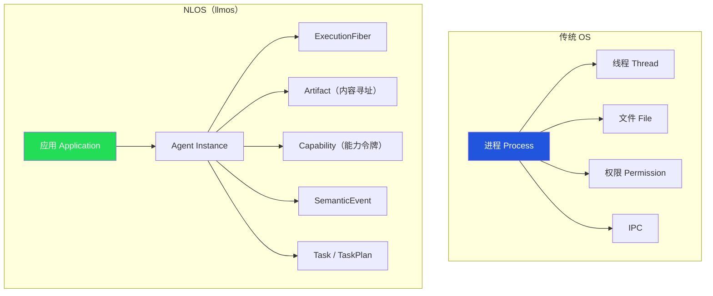
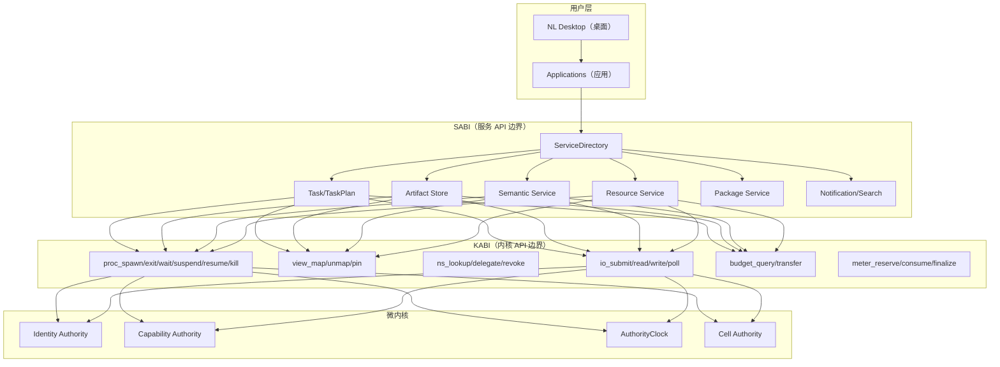
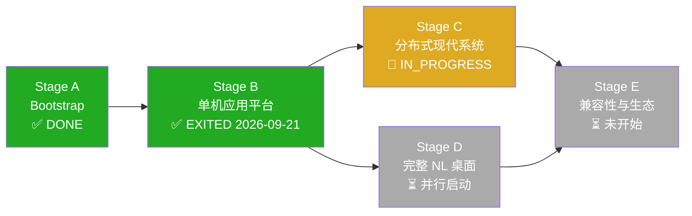
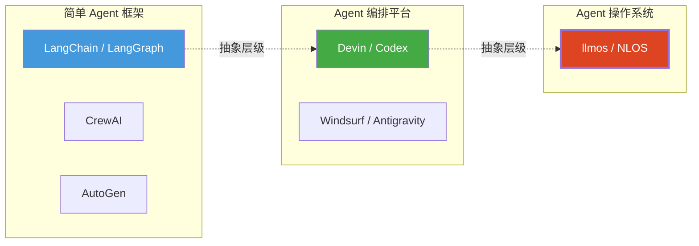

# llmos (NLOS) 项目完整解析

> [!NOTE]
> 本报告基于对仓库全部 36 个 Rust crate、278KB 架构规范（v0.5, 5112 行）、36 篇设计讨论、23 份 ADR、150+ 条 Evidence 记录、CI 管线、SDK、桌面应用和 Git 历史的系统性扫描生成。

---

## 一、项目定位：这到底是什么？

**llmos 的目标是构建一个「自然语言操作系统」(Natural Language Operating System, NLOS)**——不是一个 AI wrapper、不是一个 Agent 框架、不是一个 chatbot 平台，而是一个**真正的、系统级的、以 LLM Agent 为一等公民的操作系统内核与应用平台**。

核心定位用一句话概括：

> **`[NLOS-GOAL-001]` 构建 Windows/macOS 级通用现代 NLOS。**

这意味着它的设计野心是：像 Windows 管理进程/线程/文件/权限那样，管理 **Agent/Task/Artifact/Capability/语义事件**。



---

## 二、设计哲学：第一性原理

项目的核心设计原则可以概括为一句话：

> **"Models propose; kernel enforces identity, power, resources, lifecycle, evidence at non-bypassable boundaries."**
>
> 模型提议；内核在不可绕过的边界上强制执行身份、权力、资源、生命周期和证据。

这直接对标了传统 OS 的核心思想——**内核不信任用户态代码**——但把「用户态代码」换成了「LLM Agent」。

### 2.1 机制迁移方法论

项目采用了一套系统性的「现代系统机制迁移」方法论，从传统 OS 中提取核心机制，映射到 Agent 世界：

| 传统 OS 概念 | NLOS 对应 | 设计理由 |
|---|---|---|
| 进程 (Process) | Application/Process/AgentInstance | Agent 需要隔离的执行上下文 |
| 线程 (Thread) | ExecutionFiber (M:N) | Agent 的并发执行单元，支持挂起/恢复/检查点 |
| 文件系统 | Artifact Store (内容寻址) | Agent 产出物需要不可篡改的版本化存储 |
| 权限/ACL | Capability Token (签名令牌) | 细粒度、可衰减、可撤销的能力授权 |
| IPC/管道 | Channel + Topic + SemanticEvent | Agent 间的结构化通信 |
| cgroup/资源限制 | ResourceAccount + ResourceGroup | Agent 的 token/GPU/API 调用预算 |
| 信号/中断 | SystemControl / TakeoverControl | 跨 Agent 的控制面协议 |
| 包管理器 | Package (签名 + 安装 + 更新) | Agent 应用的分发和信任链 |

### 2.2 五域可信计算基 (TCB)

不是简单的「安全/不安全」二分，而是区分了五个正交的信任域：

1. **Safety TCB** — 内存安全、类型安全（Rust `unsafe_code = "forbid"`）
2. **Epistemic TCB** — 知识一致性、语义断言的真值管理
3. **Update TCB** — 包签名、安装、热更新的信任链
4. **Data/Service TCB** — 数据访问、服务调用的权限边界
5. **Trusted UI TCB** — 用户交互界面的信任锚点

---

## 三、技术架构深度剖析

### 3.1 系统层级



### 3.2 核心对象模型

项目定义了 **70+ 种标称 ID 类型** 和 **28+ 种一等对象**。核心执行层级：

```
Application ⊇ Process ⊇ AgentInstance ⊇ ExecutionFiber / Activation
```

每个层级都有独立的：
- **生命周期状态机**（CREATED → RUNNABLE → RUNNING ↔ BLOCKED → EXITED）
- **持久化权威存储**（各自独立的 SQLite 数据库）
- **Generation fence**（防止 ABA 问题的版本号）
- **签名证据链**（Ed25519 签名的不可篡改记录）

### 3.3 资源守恒模型

这是项目最精巧的设计之一——**不是简单的 rate limiting，而是一套完整的经济学模型**：

```
ResourceAccount（可替代信用） ≠ ResourceGroup（调度隔离容器）
```

资源生命周期遵循严格的协议：

```
Quote → Reserve → Consume → Finalize
```

六种资源需求类型：
1. **Fungible** — 可替代的 token/credit
2. **CPU** — 计算时间
3. **Capacity** — 容量配额
4. **Rate** — 速率限制
5. **CumulativeMeter** — 累积计量
6. **Exclusive** — 独占设备

三级保证层：`OBSERVED` < `BOUNDED_RISK` < `STRICT`

### 3.4 KABI 与 SABI

- **KABI v0.5-alpha**: 27 个内核入口（类比 Linux syscall table）
- **SABI v0.5-alpha**: 21 个服务族（类比 Windows API / POSIX 子系统）

### 3.5 分布式架构（Stage C）

基于 **Cell** 的分布式模型：

- 一个 OS 进程 = 一个 Cell
- Cell 间通过签名事件集合并（ADR-0019 Cross-Cell commit）
- 进程迁移协议（8 步）
- 三族 Lease（QuotaLease / CapacityLease / ExclusiveDeviceLease）
- 双进程双 Cell 拓扑（ADR-0018，已 VERIFIED）

---

## 四、实现现状：代码规模与成熟度

### 4.1 数字概览

| 指标 | 数值 |
|---|---|
| Rust crate 数量 | **36** |
| `.rs` 源文件数 | **482**（crates/）/ 511（全仓库） |
| Rust 代码量 | **~14.6 MB**（纯 .rs） |
| 架构规范 | **278 KB / 5112 行 / 200+ Requirement ID** |
| ADR 数量 | **23**（17 ACCEPTED + 3 VERIFIED + 1 CANDIDATE + 2 其他） |
| 设计讨论 | **36 篇** |
| Evidence 条目 | **150+** |
| 单元/集成测试 | Stage B: **1536 passed / 0 failed / 20 ignored** |
| Fuzz 目标 | **3**（canonical_body, protobuf_envelope, signing_preimage） |
| CI 管线 | **6**（跨平台 + fuzz + 电力中断模拟 + 接管控制长浸泡） |
| SDK 语言 | **4**（Python, TypeScript, Go, C#） |
| 桌面应用 | **Tauri**（TypeScript + Rust） |

### 4.2 阶段进展



**Stage C 九大工作包状态：**

| 工作包 | 状态 | 关键成果 |
|---|---|---|
| **C-CELL** | 🟡 PARTIAL_PASS | Cell 身份/纪元/fencing 已完成 |
| **C-LEASE** | 🟡 PARTIAL_PASS | 三族持久化、对账、迁移已验证 |
| **C-SYNC** | 🟡 PARTIAL_PASS | 签名事件集合并 + 制品同步策略已验证 |
| **C-SHARD** | 🟡 PARTIAL_PASS | Phase 0+1 全 VERIFIED（单主机双进程） |
| **C-MIGRATE** | 🟡 PARTIAL_PASS | 联邦机制 + 8 步迁移协议已验证 |
| **C-FANOUT** | 🟡 PARTIAL_PASS | 层级扇出树/局部归约/Merkle 根 + 六维准入背压 + 四域舱壁（W64） |
| **C-SCHED** | 🟡 PARTIAL_PASS | 三层无全局锁调度 + DRR 队列 + 安全窃取 + 反向背压（W64） |
| **C-PARTITION** | 🔴 NOT_STARTED | — |
| **C-BENCH** | 🔴 NOT_STARTED | — |

### 4.3 每个 Crate 的角色与成熟度

````carousel
### 🟢 核心基础层（高成熟度）

| Crate | 职责 |
|---|---|
| `nlos-types` | 70+ 标称 ID 类型，零运行时依赖 |
| `nlos-canonical` | 确定性 CBOR 签名预映像 |
| `nlos-schema` | Protobuf wire schema + 兼容性验证 |
| `nlos-store` | SQLite WAL/FULL 持久化权威存储（schema v5） |
| `nlos-clock` | 持久化单调时钟（逻辑 tick + wall 高水位） |
| `nlos-ipc` | 有界 IPC（Unix socket + Windows named pipe） |
| `nlos-service-directory` | 确定性服务解析 |

<!-- slide -->

### 🟢 权威层（高成熟度）

| Crate | 职责 |
|---|---|
| `nlos-identity` | Ed25519 密钥生命周期，SQLite schema v4 |
| `nlos-capability` | 持久化能力颁发/衰减/撤销，签名命令 |
| `nlos-task` | 持久化 Task 权威，schema v47+，6 个切片 |
| `nlos-plan` | TaskPlan 不可变摘要链，CAS 状态转换 |
| `nlos-process` | 进程/Agent/隔离域绑定权威 |
| `nlos-artifact` | 内容寻址制品存储 + 跨域同步 |
| `nlos-semantic` | 追加写入语义断言准入 |

<!-- slide -->

### 🟡 协调与运行时层（中等成熟度）

| Crate | 职责 |
|---|---|
| `nlos-operation` | 外部操作注册（generation/cancellation fencing） |
| `nlos-outbox` | 持久化 Outbox 消费者（at-least-once） |
| `nlos-commit-coordinator` | 单节点 Task commit 协调 |
| `nlos-runtime` | 运行时无关 Fiber 契约 |
| `nlos-runtime-tokio` | Tokio M:N Fiber 实现 |
| `nlos-channel` | 有序通道端点权威 |
| `nlos-topic` | 单日志扇出（ADR-0007） |
| `nlos-resource` | Driver/Device/Reservation 绑定 |

<!-- slide -->

### 🟡 分布式层（Stage C 新增，建设中）

| Crate | 职责 |
|---|---|
| `nlos-cell` | Cell 权威（ADR-0018），故障检测，联邦 |
| `nlos-lease` | 三族 Lease 授予 + 迁移 |
| `nlos-wait` | 持久化等待注册表 |

### ❄️ 冻结层

| Crate | 状态 |
|---|---|
| `nlos-search` | F1 冻结，零生产消费者 |
| `nlos-notify` | F1 冻结，零生产消费者 |

### 🔧 集成与工具层

| Crate | 职责 |
|---|---|
| `nlos-slice-k` | 第一个纵向集成切片（端到端 happy path） |
| `nlos-package` | CLI 工具（keygen/build/verify/install/run） |
| `nlos-driver-mock` | 确定性假驱动（测试用） |
| `nlos-store-fault` | SQLite VFS 故障注入（测试用） |
| `nlos-system-control` | SystemControl SABI 适配 |
| `nlos-takeover-control` | TakeoverControl 跨进程接管 |
| `nlos-wait-control` | WaitControl SABI 适配 |
````

---

## 五、工程方法论：严谨程度评估

### 5.1 证据驱动开发

项目采用了我见过的**最严格的 Agent 项目证据方法论**之一：

- **H0–H8 证据等级**：从「设计推理」到「生产环境实测」的 9 级证据分类
- **机器可读 Claims/Risks/Evidence 注册表**（YAML 格式）
- **波次制开发**（Wave-based）：每个 Wave 有明确的读集/写集/验收条件
- **状态严格分级**：`DESIGN` → `PARTIAL_PASS` → `VERIFIED` → `PRODUCTION_PROVEN`，**没有 Evidence 不能升级状态**
- **ADR 生命周期**：`CANDIDATE` → `ACCEPTED` → `VERIFIED`（需要 PoC 证据）

### 5.2 并发与一致性

- 所有权威存储都使用 **SQLite WAL + fsync**，确保单节点持久性
- 跨权威操作使用 **verify-then-commit** 协议（ADR-0013）
- **Generation fence** 防止 ABA 问题
- **CAS（Compare-And-Swap）** 基础的状态转换
- 电力中断模拟 CI（`power-loss-simulation.yml`）

### 5.3 安全设计

- **`unsafe_code = "forbid"`** 全工作区（仅 IPC 和 fault shim 例外）
- **Ed25519 签名**贯穿所有权威操作
- **Capability 令牌**不可伪造、可衰减、可撤销
- **Fuzz 测试**覆盖 canonical body、protobuf envelope、signing preimage

---

## 六、坦诚评估：优势与风险

### 6.1 令人印象深刻的优势

1. **设计深度远超同类项目**
   - 在 Agent 框架满天飞的 2026 年，绝大多数项目还在做「prompt → tool call → response」的循环。llmos 是我见过的唯一一个认真地把操作系统内核设计方法论应用到 Agent 管理上的项目。
   - 278KB 的架构规范、200+ Requirement ID、23 个 ADR——这不是 PPT 架构，而是有代码实现支撑的工程规范。

2. **工程严谨性极高**
   - 证据驱动、波次制开发、机器可读注册表、电力中断模拟——这是工业级系统软件的做法。
   - 1536 个测试全绿，0 失败。

3. **技术选型合理**
   - Rust（安全）+ SQLite（持久化）+ Tokio（异步）+ Ed25519（签名）+ Protobuf+CBOR（序列化）
   - 没有引入不必要的重型依赖（没有 Kubernetes、没有 Kafka、没有 etcd）。

4. **跨平台 + 多语言 SDK**
   - CI 在 Ubuntu/Windows/macOS 三平台运行
   - Python/TypeScript/Go/C# 四语言 SDK + 金色测试向量交叉验证

### 6.2 需要关注的风险

> [!WARNING]
> 以下是作为外部观察者的坦诚评估，不代表项目无法克服这些挑战。

1. **复杂度爆炸风险**
   - 70+ ID 类型、28+ 一等对象、27 KABI + 21 SABI 服务族、6 种资源需求类型——这已经接近一个真实 OS 内核的概念密度。
   - 单人（或小团队）维护这个规模的概念空间，认知负荷极大。
   - 每增加一个新特性，需要在多个权威存储之间保持一致性的成本是超线性增长的。

2. **「规范领先实现」的鸿沟**
   - 278KB 的规范 vs 14.6MB 的代码，比例约 1:53。对于系统软件来说，这个比例暗示**规范中有大量内容尚未被代码覆盖**。
   - Stage C 九大工作包中有 **2 个 NOT_STARTED**（PARTITION、BENCH；FANOUT/SCHED 已于 W64 达 PARTIAL_PASS）。
   - 两个 crate 被明确冻结（search、notify），说明精力有限时的取舍。

3. **缺少真实工作负载验证**
   - 目前的测试全部是**单元测试和集成测试**，没有看到真实 Agent 工作负载（如接入 GPT/Claude/Gemini 执行多步任务）的 benchmark。
   - `examples/` 只有一个 sample-app（包生命周期演示），没有端到端的 Agent 应用示例。
   - 「10K/100K/1M 逻辑规模」的 ScaleProfile 声明了支持规模，但 C-BENCH 尚未开始。

4. **生态与采用路径不明确**
   - 没有 README.md（项目的「门面」缺失）。
   - 没有用户文档、快速入门指南、或 API 参考。
   - SDK 存在但缺少使用示例和文档。
   - 如何让外部开发者为 NLOS 编写 Agent 应用？这个路径目前不清晰。

5. **桌面层（Stage D）进度不明**
   - `desktop/` 有 Tauri 应用骨架和 8 个测试，但相比内核层的 36 个 crate，桌面层显得单薄。
   - Stage D 与 Stage C 并行，但从 Git 历史看，最近的工作集中在 Stage C 分布式层。

---

## 七、与同类项目的对比定位



| 维度 | LangChain 类 | Devin 类 | **llmos (NLOS)** |
|---|---|---|---|
| 抽象层级 | 函数调用链 | 任务编排 | **操作系统内核** |
| 隔离模型 | 无 | 容器/沙箱 | **Capability + Process + Cell** |
| 资源管理 | API key 限速 | 简单配额 | **6 维资源守恒 + Lease** |
| 持久化 | 外部 DB | 外部存储 | **内置 SQLite 权威存储** |
| 分布式 | 无 | 云基础设施 | **Cell 联邦 + 进程迁移** |
| 安全模型 | 基本无 | 沙箱隔离 | **5 域 TCB + 签名能力链** |
| 规范化程度 | 文档级 | 产品级 | **操作系统规范级（200+ Req ID）** |

**llmos 不是在和 LangChain 竞争，它在做一件根本不同的事情。** 如果说 LangChain 是「Agent 的 jQuery」，那 llmos 想做的是「Agent 的 Linux 内核」。

---

## 八、总体判断

**llmos 是一个极具野心、设计深度罕见、工程执行严谨的项目。**

它的核心洞见是正确的：随着 Agent 从「玩具」走向「生产」，我们确实需要操作系统级别的隔离、资源管理、身份认证和生命周期管理——而不是在 Python 脚本里用 try-catch 凑合。

但它面临的最大挑战也很明确：**这实质上是一个人（或极小团队）在重写一个操作系统内核**。历史上，成功的 OS 项目（Linux、Windows NT、macOS/Mach）都需要数十到数百人年的投入。llmos 的规范质量已经达到了专业 OS 设计的水准，但将整个规范落地为生产级实现，需要的工程量是巨大的。

**当前最务实的路径建议**：

1. 补齐 README + 快速入门，降低外部贡献者的进入门槛
2. 优先完成一个**端到端的 Agent 应用 demo**（比如：一个真实的 coding agent 在 NLOS 上运行，展示 Task/Artifact/Capability 的完整生命周期），作为项目的「杀手级演示」
3. Stage C 的 4 个 NOT_STARTED 工作包中，**C-BENCH 应该优先**——没有性能数据，ScaleProfile 的声明就只是设计意图
4. 考虑开放社区贡献（当前仓库看起来是个人项目），吸引对 Agent 安全/隔离感兴趣的系统程序员
