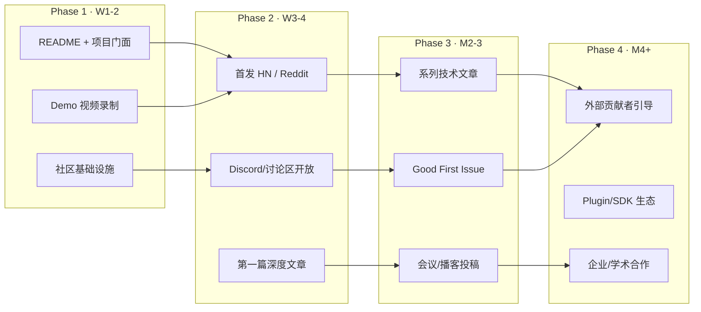

# llmos 推广与社区建设行动计划

> [!IMPORTANT]
> 核心原则：**推广不是开发完了再做的事，而是和开发同步进行的增长飞轮。** 每一个技术里程碑都应该产出一条可传播的内容。

---

## 总览：四阶段并行路线



---

## Phase 1：基础设施搭建（第 1-2 周）

> 与 Stage C 日常开发完全并行，每天抽 1-2 小时即可。

### 1.1 写一份好的 README.md

README 是项目的「首页」，决定了 90% 的人是否会继续看下去。

**推荐结构：**

```markdown
# llmos — Natural Language Operating System

> A Rust microkernel that manages LLM Agents the way Linux manages processes.

[一张架构概览图 or 一个 GIF demo]

## Why?

LangChain manages tool calls. Docker manages containers.
**llmos manages Agents** — with real isolation, capability tokens,
resource budgets, crash recovery, and signed evidence trails.

## Key Features
- 🔒 Capability-based security (Ed25519 signed tokens)
- 💰 6-dimensional resource conservation (token budgets, rate limits, exclusive devices)
- 🔄 Crash recovery with durable authority stores
- 📦 Signed package management (keygen → build → verify → install)
- 🌐 Cell-based distributed federation
- 🧪 1500+ tests, fuzz targets, power-loss simulation CI

## Quick Start (5 minutes)
...（安装 → 运行 demo → 看到输出）

## Architecture at a Glance
...（简化版层级图）

## Current Status
- ✅ Stage B: Single-machine platform (DONE)
- 🔨 Stage C: Distributed system (IN PROGRESS)
- 📋 Stage D: NL Desktop (PLANNED)

## Contributing
...

## License
Apache-2.0
```

> [!TIP]
> **关键原则**：README 的前 5 行决定 80% 的人是否继续往下读。用「一句话类比」（"the way Linux manages processes"）比列 feature 列表有效 100 倍。

### 1.2 录制 Demo 视频（3-5 分钟）

**不需要精美制作，终端录屏 + 旁白即可。** 用 [asciinema](https://asciinema.org/) 或 OBS。

**推荐脚本：**

```
[0:00-0:30] 问题引入
  "如果你同时运行 100 个 AI Agent，怎么防止它们互相干扰？
   怎么给每个 Agent 设预算？怎么在 crash 后自动恢复？
   这就是 llmos 要解决的问题。"

[0:30-1:30] Package 签名与安装
  $ nlos-package keygen --name my-agent
  $ nlos-package build --manifest agent.toml
  $ nlos-package verify my-agent.nlos
  $ nlos-package install my-agent.nlos

[1:30-3:00] Task 生命周期
  - 创建 Task → 分配 Capability → 启动 Fiber
  - 展示 Artifact 产出（内容寻址 hash）
  - 模拟 crash → 展示自动 recovery
  - 展示 ResourceAccount 余额扣减

[3:00-4:00] 分布式（如果 Stage C 就绪）
  - 双进程双 Cell 拓扑
  - 跨 Cell 接管演示

[4:00-4:30] 收尾
  "这只是开始。Star the repo, join the discussion."
```

### 1.3 社区基础设施

| 平台 | 用途 | 优先级 |
|---|---|---|
| **GitHub Discussions** | 技术问答、RFC 讨论 | ⭐⭐⭐ 首选（零成本，与代码同在） |
| **Discord 服务器** | 实时交流、新人引导 | ⭐⭐ 第二步 |
| **Twitter/X** | 进度更新、技术片段 | ⭐⭐ 与文章同步 |
| **知乎专栏** | 中文深度内容 | ⭐⭐ 中文社区 |
| **微信公众号** | 中文社区触达 | ⭐ 可后期考虑 |

**最小动作**：先开 GitHub Discussions（Settings → Features → Discussions），分 4 个 category：
- `Announcements`（公告）
- `Architecture`（架构讨论）
- `Q&A`（使用问题）
- `Show & Tell`（展示）

---

## Phase 2：首次公开亮相（第 3-4 周）

### 2.1 Hacker News 首发

**HN 是高质量技术项目的最佳首发平台。** 一个好的 HN post 可以带来 500-2000 个 GitHub star 和第一批核心贡献者。

**发帖策略：**

- **标题格式**：`Show HN: llmos – A Rust microkernel for managing LLM agents like OS processes`
- **发帖时间**：美西时间周二/周三上午 8-10 点（UTC 15:00-17:00，北京时间 23:00-01:00）
- **正文**：简短介绍（3-5 段），包含核心动机、关键差异点、当前状态、链接
- **发帖后 2 小时内在线**，回复每一条评论（HN 的排名算法重视讨论活跃度）

**预期反响与应对：**

| 可能的评论 | 准备好的回应 |
|---|---|
| "这不就是容器编排吗？" | "容器隔离的是进程，我们隔离的是 Agent 的能力和语义——Capability token 可以精确到单个 API 调用权限" |
| "为什么不直接用 K8s?" | "K8s 管理的粒度是 Pod，我们管理的粒度是单次 Task attempt——包括它的 token 预算、产出物签名、crash recovery" |
| "过度工程了吧？" | "对于 3 个 Agent 确实如此。但当你运行 10K 个 Agent 时，你要么有 OS 级管理，要么就是混乱" |
| "怎么和 LangChain 比？" | "不竞争。LangChain 是 Agent 的应用框架，llmos 是 Agent 的操作系统——就像 Django 和 Linux 的关系" |

### 2.2 Reddit 同步投放

| Subreddit | 侧重点 |
|---|---|
| **r/rust** | Rust 实现细节、`unsafe_code = "forbid"`、SQLite WAL 权威存储 |
| **r/LocalLLaMA** | Agent 管理痛点、资源预算、多 Agent 隔离 |
| **r/MachineLearning** | 架构创新、与传统 OS 的类比 |
| **r/programming** | 整体设计哲学 |

> [!WARNING]
> Reddit 各 sub 有不同的自我推广规则。在 r/rust 发 Show 帖通常受欢迎，但需要先在社区有一些互动历史。建议发帖前先在这些 sub 里参与几周讨论。

### 2.3 中文社区

| 平台 | 内容形式 |
|---|---|
| **知乎** | 长文：「为什么 AI Agent 需要自己的操作系统？」 |
| **V2EX** | 帖子：`[分享] 用 Rust 给 LLM Agent 写了个微内核` |
| **Rust 中文社区** | 技术分享（rustcc.cn / Rust 语言中文社区） |
| **掘金** | 技术文章 |

---

## Phase 3：持续内容输出（第 2-3 个月）

### 3.1 技术文章选题矩阵

按「受众 × 深度」规划一系列文章，**每 1-2 周发一篇**：

| # | 标题方向 | 目标受众 | 平台 | 与开发同步的触发点 |
|---|---|---|---|---|
| 1 | "为什么 AI Agent 需要操作系统级管理" | 泛 AI 开发者 | 知乎/Medium/HN | README 完成时 |
| 2 | "用 Capability Token 替代 API Key：Agent 安全的正确方式" | 安全/后端开发者 | 博客/r/programming | `nlos-capability` 有新特性时 |
| 3 | "SQLite 作为操作系统的持久化权威存储" | 数据库/系统爱好者 | HN/r/sqlite | `nlos-store` 优化时 |
| 4 | "6 维资源守恒：如何给 Agent 做预算管理" | AI 工程师 | 知乎/Medium | Stage C C-LEASE 完成时 |
| 5 | "从 Linux 到 NLOS：现代 OS 概念的 Agent 映射" | 系统程序员 | HN/r/rust | 架构文章 |
| 6 | "Rust Edition 2024 + unsafe_code forbid 实战" | Rust 开发者 | r/rust/博客 | 任何时候 |
| 7 | "电力中断模拟 CI：如何测试 Agent 的 crash recovery" | DevOps/测试工程师 | 博客/HN | CI 有新结果时 |
| 8 | "Cell 联邦：分布式 Agent 管理的去中心化方案" | 分布式系统工程师 | HN/论文预印本 | C-SHARD 完成时 |
| 9 | "Ed25519 签名链贯穿全栈：从 Package 到 Artifact" | 密码学/安全开发者 | 博客 | 任何时候 |
| 10 | "设计一个 OS 的 278KB 规范是什么体验" | 所有技术人 | 知乎/Twitter thread | 趣味向 |

> [!TIP]
> **核心策略：每完成一个技术里程碑，就把它变成一篇文章。** 开发和内容产出共享同一个时间投入——你不是额外花时间写文章，而是把「写给自己的 Evidence」改写成「写给外界的故事」。

### 3.2 会议与播客

| 渠道 | 具体目标 | 时间窗口 |
|---|---|---|
| **RustConf / EuroRust** | 提交 talk proposal（标题如 "Building an OS for AI Agents in Safe Rust"） | CFP 通常提前 3-6 个月 |
| **FOSDEM** | Systems track 或 Rust devroom | 每年 2 月，CFP 约在 10-11 月 |
| **Strange Loop / Systems Distributed** | 架构创新 talk | 视具体时间 |
| **Rustacean Station（播客）** | Rust 项目专访 | 随时可联系 |
| **中文播客（代码之外 / 捕蛇者说）** | 中文技术分享 | 项目有一定知名度后 |

### 3.3 Good First Issues

**这是吸引贡献者的最有效手段。** 从现有代码中挑出 10-15 个低门槛任务：

```markdown
## Good First Issue 候选清单

### 📝 文档类（最低门槛）
- [ ] 为每个无 description 的 crate 补充 Cargo.toml description
- [ ] 为 `nlos-package` CLI 写 --help 文档和 man page
- [ ] 为 SDK (Python/TS/Go/C#) 补充 README 和使用示例
- [ ] 翻译 README 为中文/日文

### 🧪 测试类
- [ ] 为 `nlos-clock` 补充边界条件测试
- [ ] 为 fuzz 目标补充更多种子文件
- [ ] 为 desktop app 补充 Tauri 端 e2e 测试

### 🔧 代码类（中等门槛）
- [ ] `nlos-package` CLI 增加 `list` 子命令
- [ ] `nlos-service-directory` 增加 JSON 输出格式
- [ ] 为 `nlos-ipc` 补充 benchmark
- [ ] `nlos-store` 增加 metrics 导出（OpenMetrics 格式）

### 🏗️ 架构类（较高门槛，适合经验丰富的贡献者）
- [ ] `nlos-search` 解冻并接入 Semantic authority
- [ ] `nlos-notify` 解冻并接入 Topic/Channel
```

**标签规范**：
- `good first issue` — GitHub 会在 Explore 页面推荐
- `help wanted` — 明确欢迎外部贡献
- `documentation` / `testing` / `enhancement` — 分类

---

## Phase 4：生态扩展（第 4 个月+）

### 4.1 Plugin/Agent SDK 生态

**最终目标**：让外部开发者能「为 NLOS 写 Agent 应用」。

路径：
1. 先完善 Python SDK（AI 开发者最熟悉的语言）
2. 提供一个 `nlos-agent-template` 脚手架项目
3. 写一篇 "Build Your First NLOS Agent in 15 Minutes" 教程
4. 在 SDK 里封装常见模式（Task 创建、Artifact 提交、Capability 请求）

### 4.2 学术合作

llmos 的设计深度足以产出学术论文。可以考虑的方向：

- **Capability-based Security for LLM Agents**（安全方向）
- **Resource Conservation Models for Multi-Agent Systems**（系统方向）
- **Durable Authority Stores for Agent State Management**（数据库方向）
- **Cell Federation for Distributed Agent Orchestration**（分布式方向）

**投稿目标**：OSDI / SOSP（顶会，难度大但影响力最高）、ATC / EuroSys（次级但更容易中）、arXiv 预印本（先占坑）

### 4.3 企业/商业化可能性

如果未来考虑商业化：

| 模式 | 说明 |
|---|---|
| **开源核心 + 企业版** | 核心内核 Apache-2.0 开源，企业版提供管理面板、多租户、SLA |
| **托管服务** | "NLOS Cloud"——托管的 Agent 运行平台 |
| **咨询/培训** | 帮助企业在 NLOS 上构建 Agent 系统 |

---

## 与开发节奏的并行排期

| 周次 | 技术开发（Stage C/D） | 推广动作 | 预计额外时间 |
|---|---|---|---|
| **W1** | C-FANOUT 启动 | 写 README.md + 开 GitHub Discussions | 3-4 小时 |
| **W2** | C-FANOUT 推进 | 录 Demo 视频 + 准备 HN 帖子 | 4-5 小时 |
| **W3** | C-SCHED 启动 | **HN/Reddit 首发** + 知乎文章 #1 | 3 小时（发帖日集中） |
| **W4** | C-SCHED 推进 | 回复社区反馈 + 标记 Good First Issues | 2 小时/周 |
| **W5-6** | C-PARTITION | 技术文章 #2（Capability 安全） | 3 小时 |
| **W7-8** | C-BENCH | 技术文章 #3（SQLite 权威存储）+ 性能数据 | 3 小时 |
| **W9-12** | Stage D 桌面 | 文章 #4-5 + 投会议 CFP | 2-3 小时/周 |
| **M4+** | 持续推进 | 稳定节奏：每 2 周一篇文章 + 社区维护 | 2-3 小时/周 |

> [!TIP]
> **总额外时间投入：前 4 周约 12-15 小时，之后稳定在每周 2-3 小时。** 这不是「停下开发去做推广」，而是把开发过程中的思考和成果转化为对外内容。

---

## 快速启动清单

以下是**本周就可以开始做的 5 件事**：

- [ ] 1. 在仓库根目录创建 `README.md`（参照 Phase 1.1 的模板）
- [ ] 2. 在 GitHub Settings 开启 Discussions
- [ ] 3. 给 10 个 crate 的 Cargo.toml 补上缺失的 `description`
- [ ] 4. 标记 5 个 `good first issue`
- [ ] 5. 用 asciinema 录一段 `nlos-package` 的 CLI 操作（2 分钟即可）
