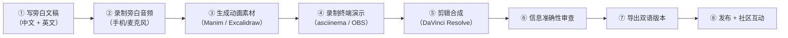

# llmos 视频系列：完整制作方案

> [!IMPORTANT]
> 本文档是**制作执行手册**，不是选题清单。每一节的目标是「读完就能开始动手」。

---

## 第一部分：设计原则——先定规矩再开工

### 1.1 叙事弧线：从「你的 Agent 会出事」到「这就是解法」

8 集不是 8 个独立话题，而是一条**渐进展开的叙事链**：

```
第一幕：冲突建立（E01-E02）
  "你以为 Agent 跑得好好的，其实随时会爆炸"
  ↓
第二幕：核心机制（E03-E06）
  "我们把操作系统的每个核心能力移植到了 Agent 世界"
  ↓
第三幕：工程实证（E07-E08）
  "这不是 PPT，代码在这里，测试在这里"
```

### 1.2 每集的结构公式

每集都遵循同一个框架（观众形成预期后留存更高）：

```
[0:00-0:15]  钩子      → 一个让人「等等，什么？」的事实或场景
[0:15-1:30]  问题      → 把痛点讲透，让观众产生「这确实是个问题」的认同
[1:30-X:00]  机制      → llmos 怎么解决的（核心段落，时长因集而异）
[最后 60s]   锚定      → 一句可以被截图传播的总结 + 下集预告
```

### 1.3 视觉语言规范（全系列统一）

**调色板**：

| 元素 | 颜色 | 用途 |
|---|---|---|
| llmos 核心组件 | `#2D9C5A`（深绿） | 微内核、权威存储 |
| 危险/问题 | `#D94040`（红） | 安全漏洞、崩溃 |
| 外部/对比项 | `#666666`（灰） | LangChain、Docker 等 |
| 强调/亮点 | `#E8A838`（琥珀） | 关键数字、核心概念 |
| 背景 | `#1A1A2E`（深蓝黑） | 全系列统一底色 |

**字体**：
- 标题：JetBrains Mono Bold（代码感）
- 正文：思源黑体（中文）/ Inter（英文）
- 代码：JetBrains Mono Regular

**动画风格**：
- 不用花哨转场，所有元素**淡入 + 从左到右渐进展开**
- 架构图层层叠加（下层先出，上层后出）
- 状态转换用**带箭头的路径动画**，不用跳切

---

## 第二部分：分集详细制作脚本

### E01「你的 AI Agent 没有安全带」（6 分钟）

> **定位**：全系列的「大门」，决定 80% 观众会不会继续看。  
> **目标受众**：所有对 AI 有兴趣的技术人，不需要任何前置知识。  
> **核心信息（只传递这一件事）**：Agent 框架缺少操作系统级管理，这是一个真实的、被忽视的系统性风险。

#### 逐分钟脚本

**[0:00-0:15] 钩子**

画面：黑屏，打字机效果逐字出现——

> 「2026 年，全球 AI Agent 基础设施市场规模 150 亿美元。  
> 但几乎没有人在认真回答一个问题——」

停顿 1 秒。

> 「谁来管这些 Agent？」

画面：标题卡「你的 AI Agent 没有安全带」+ 系列 Logo

---

**[0:15-1:45] 三个场景——建立问题**

画面风格：**简笔动画**，每个场景 30 秒，节奏快。

**场景 1：失控**

```
画面描述：
一个 Agent 图标（机器人头像）坐在电脑前。
对话气泡显示用户指令："请分析这份代码"
Agent 开始工作...
突然，一封恶意邮件飞入画面（prompt injection）
Agent 的眼睛变红，开始疯狂删除文件
文件图标一个个碎裂消失
```

旁白：
> 「一个 Coding Agent 被 prompt injection 触发，开始执行破坏性操作。  
> 当前的防御？在 system prompt 里写'请不要删文件'。」

画面：一行字「Please don't delete files」慢慢被一把橡皮擦掉 → 字幕「这不是安全机制」

---

**场景 2：资源争抢**

```
画面描述：
10 个 Agent 图标排队挤向一扇标着"API"的小门
门上方有一个红色计数器在飞速跳动
突然门关了（429 Too Many Requests）
所有 Agent 同时变灰 → 全部崩溃
```

旁白：
> 「10 个 Agent 同时跑，API 限额爆了，全军覆没。  
> 有预算管理吗？有优先级调度吗？没有。  
> 连哪个 Agent 花了多少钱都不知道。」

---

**场景 3：崩溃无恢复**

```
画面描述：
一个 Agent 在运行（进度条显示 87%）
突然画面闪烁 → 蓝屏 / crash
重启后：进度条归零
右下角显示账单：「已消耗 $47.30 token 费用」
```

旁白：
> 「Agent 跑了 2 小时，崩溃了。  
> 任务状态？丢了。中间产出物？没保存。恢复？重头再来。  
> 而且你要再付一遍钱。」

---

**[1:45-3:00] 类比——历史上同样的问题**

```
画面描述：
年代标签「1960s」滑入
黑白照片：一台大型机
多个程序图标争抢一个 CPU
一个程序崩溃 → 连锁反应 → 所有程序挂掉

过渡动画：年代标签变成「2026」
同样的画面，但图标从"程序"变成"Agent"
```

旁白：
> 「这些问题一点都不新。  
> 1960 年代，多道程序同时运行时遇到了完全一样的困境——  
> 资源争抢、无隔离、一崩全崩。  
> 他们的解决方案是什么？操作系统。  
> 进程隔离、内存保护、权限控制、文件系统——  
> 不是靠'请不要崩溃'，而是靠不可绕过的系统边界。」

画面：Linux 内核图标出现，然后渐变成 llmos 的 Logo

> 「那 Agent 时代的操作系统——在哪里？」

---

**[3:00-5:00] llmos 是什么——层层展开**

画面核心：**架构图动态构建**（这是全系列最重要的视觉资产，后续每集都会复用）

```
动画顺序（从下往上叠加，每层停留 8 秒）：

第 1 层（最先出现）：
  ┌─────────────────────────────────────┐
  │  宿主操作系统  Windows / macOS / Linux │
  └─────────────────────────────────────┘
  旁白："底下是你已有的操作系统"

第 2 层：
  ┌─────────────────────────────────────┐
  │         NLOS 微内核                  │
  │  Identity · Capability · Clock · Cell│
  └─────────────────────────────────────┘
  旁白："微内核。管理身份、能力、时钟。
        每个组件有自己的持久化存储，崩溃不丢数据。"
  → Identity 格子亮绿色，标注 "Ed25519 签名"
  → Capability 格子亮绿色，标注 "不是 API Key"
  → Clock 格子亮绿色，标注 "持久化单调时钟"

第 3 层：
  ┌──────────────────┬──────────────────┐
  │ KABI (内核 API)  │ 27 个入口         │
  │ proc_spawn/exit  │ budget_query     │
  └──────────────────┴──────────────────┘
  旁白："27 个内核入口，就像 Linux 的 syscall table。
        Agent 的每一个关键操作都要过这道关。"

第 4 层：
  ┌──────────────────┬──────────────────┐
  │ SABI (服务 API)  │ 21 个服务族       │
  │ Task · Artifact  │ Semantic · Lease │
  └──────────────────┴──────────────────┘
  旁白："21 个服务族。任务管理、制品存储、语义事件、资源租约……
        所有 Agent 框架用 Python 凑合做的事，这里是系统级实现。"

第 5 层：
  ┌─────────────────────────────────────┐
  │          应用 & Agent SDK            │
  └─────────────────────────────────────┘
  旁白："你的 Agent 应用运行在这里。"

第 6 层（最后出现）：
  ┌─────────────────────────────────────┐
  │              NL 桌面                 │
  └─────────────────────────────────────┘
  旁白："最上面是用户看到的界面——自然语言桌面。"
```

整个架构出现后，**缩小到画面右上角**，三个关键数字淡入画面中央：

```
36 个 Rust crate
2,007 个测试通过
0 unsafe（两个例外）
```

旁白：
> 「这不是概念图。  
> 这是用 Rust 写的、在 Windows/macOS/Linux 三个平台上 CI 全绿的、  
> 真实存在的代码。  
> 36 个 crate，2007 个测试，全工作区禁用 unsafe。」

---

**[5:00-5:45] 锚定——可截图传播的金句**

画面：黑底，白字，逐行出现——

```
LangChain 管理工具调用。
Docker 管理容器。
Kubernetes 管理 Pod。

llmos 管理 Agent。
```

最后一行字号放大 2 倍，颜色变为品牌绿色。

旁白：
> 「LangChain 是 Agent 的 jQuery。  
> llmos 想做的是 Agent 的 Linux 内核。」

---

**[5:45-6:00] 下集预告 + CTA**

画面：下一集标题卡「E02：能力令牌——为什么 API Key 是 Agent 安全的最大漏洞」

旁白：
> 「下一集，我们聊 Agent 安全中最被忽视的问题——  
> 为什么 API Key 不是权限，Capability Token 才是。」

画面底部：GitHub 地址 + Star 按钮动画

---

### E02-E08 脚本规格

> 后续每集遵循同样的格式深度。以下给出每集的**关键画面指令和旁白锚点**，不再逐秒展开（否则文档会过长），但足够让你或动画师直接执行。

#### E02「能力令牌：为什么 API Key 是 Agent 安全的最大漏洞」（8 分钟）

**核心画面**：API Key vs Capability Token 对比动画

```
钩子画面：
  一把金色万能钥匙旋转 → 标注 "API Key"
  旁白："这把钥匙能打开公司所有的门。你确定要交给一个 AI？"

核心动画（分四步展开）：

步骤 1 - 颗粒度差异：
  左屏：API Key = 一把钥匙开所有门（门全打开）
  右屏：Cap Token = 每把钥匙只开一扇门（只有 Task-001 的门打开）

步骤 2 - 衰减（关键概念，用俄罗斯套娃动画）：
  大权限 → 交给子 Agent 时自动缩小 → 再交给孙 Agent 时更小
  旁白："父 Agent 的权限是 '读写项目 A'。
        它给子 Agent 的只能是 '只读项目 A 的 README'。
        不能放大，只能缩小。这叫衰减。"

步骤 3 - 撤销（关键概念，用多米诺骨牌动画）：
  撤销父令牌 → 所有子令牌同时失效 → 标注"即时生效"

步骤 4 - 签名审计（信任链动画）：
  每个令牌上有一个 Ed25519 签名印章
  → 可以追溯到：谁颁发的？什么时候？给了什么权限？
  → 对比 API Key："谁用了你的 sk-...？不知道。"
```

**代码演示段**（录屏，2 分钟）：展示 `nlos-capability` 的 issue → attenuate → revoke 流程

**锚定金句**：
> 「API Key 是一个你无法收回的信任。  
> Capability Token 是一个你随时可以撤销的、有范围的、有签名的、有到期时间的授权。  
> 这不是功能改进——这是安全模型的代际差异。」

**不可曲解检查点**：
- ✅ 说「llmos 用 Capability Token 实现了细粒度权限」
- ❌ 不可说「llmos 比 API Key 安全」（要说清楚是不同层次的安全模型）
- ✅ 说「Anthropic/Google/Microsoft 在应用层做了类似的 token scoping」
- ❌ 不可暗示大厂的方案是错的（是不同抽象层次，各有适用场景）

---

#### E03「崩溃恢复：为什么 Agent 需要 OS 级的持久化」（10 分钟）

**核心画面**：Task 状态机动画 + 终端实录崩溃恢复

```
状态机动画（Manim 生成）：
  PENDING ──→ RUNNING ──→ COMMITTING ──→ DONE
                 │                         ↑
                 ↓                         │
              CRASHED ──→ RECOVERING ──────┘

  每个状态是一个圆形节点
  转换箭头带有触发条件标注
  CRASHED → RECOVERING 路径用品牌绿色高亮，标注"自动"
```

**终端实录**（这是最有说服力的段落）：
```bash
# 脚本化终端操作（提前写好 expect 脚本或 bash 脚本）：

# 1. 启动 Task
cargo run -p nlos-slice-k -- run ...
# 显示日志：Task RUNNING, Fiber processing step 5/10...

# 2. 中途 kill -9（画面分屏，右侧显示进程监视器）
kill -9 $(pgrep nlos)

# 3. 重启同一个 Task（关键时刻，画面全屏）
cargo run -p nlos-slice-k -- run ...
# 日志显示：Recovering from checkpoint... resuming step 5/10...
# 最终：Task DONE ✓
```

**信息准确性要点**：
- ✅ 说「从上次 checkpoint 恢复」
- ❌ 不可说「零数据丢失」（checkpoint 之间有窗口，要诚实）
- ✅ 说「SQLite WAL + fsync 保证持久化」
- ✅ 说「幂等回放——恢复后不会重复执行已完成的步骤」

---

#### E04「资源守恒：给每个 Agent 一本账」（8 分钟）

**核心画面**：资源仪表盘 + 预算耗尽动画

```
仪表盘动画（6 个环形进度条同时显示）：
  ┌─────────────────────────────────────┐
  │  Fungible  [████████░░] 80%  tokens │
  │  CPU       [███░░░░░░░] 30%  compute│
  │  Capacity  [█████░░░░░] 50%  storage│
  │  Rate      [██████░░░░] 60%  calls/m│
  │  Cumul.    [██░░░░░░░░] 20%  月累积 │
  │  Exclusive [🔒 LOCKED]  GPU-0      │
  └─────────────────────────────────────┘
  
  Agent 每次操作时，对应的进度条动态增长
  当某个维度接近满时，颜色从绿变黄变红
  满了之后：不是崩溃，而是弹出 Backpressure 信号
  → 旁白："预算不够了。不是报错崩溃，而是精确告诉你还剩多少。"
```

**关键类比动画**：
```
手机流量套餐类比：
  左屏：手机界面 → "本月流量 5GB，已用 4.8GB，剩余 0.2GB"
  右屏：Agent 界面 → "本次 Task 预算 10,000 token，已用 9,500，剩余 500"
  旁白："你不会给手机无限流量。为什么要给 Agent 无限 token？"
```

**数据驱动段**：引用项目内 exp3/exp4 的真实实验数据图表

---

#### E05「Artifact：每份 Agent 产出都有签名」（7 分钟）

**核心画面**：物流包裹追踪类比

```
类比动画：
  快递包裹从工厂 → 物流中心 → 最终到你手上
  每一站都有扫码记录，你可以查到完整链路
  
  ↓ 过渡 ↓
  
  Agent Artifact 从创建 → 签名 → 存储
  每一步都有 Ed25519 签名记录
  任何人可以验证：谁创建的、什么时候、是否被篡改
```

**终端演示**：`nlos-package verify` 命令实录

---

#### E06「Cell 联邦：当一台机器不够用」（10 分钟）

**核心画面**：细胞分裂类比

```
生物学动画：
  一个细胞 → 分裂成两个 → 各自独立运行 → 但能交换信号
  
  ↓ 映射到 ↓
  
  一个 Cell（进程） → 启动第二个 Cell → 各自有独立的权威存储
  → 通过签名事件集合并通信
  → 进程可以在 Cell 之间迁移（8 步协议动画）
```

**迁移协议动画**（8 步，每步一个状态节点）：
```
Source Cell                    Target Cell
  ① 发起迁移意图 ──────────→
                    ←────────── ② 确认接收能力
  ③ 冻结进程状态 ──────────→
  ④ 传输状态快照 ──────────→
                    ←────────── ⑤ 验证签名 + 重建
                    ←────────── ⑥ 确认就绪
  ⑦ 释放源端资源
                               ⑧ 激活进程 ✓
```

---

#### E07「用 Rust 写操作系统」（10 分钟，Rust 社区专属）

**核心画面**：代码走读，无动画，纯「程序员对程序员」风格

重点段落：
1. `Cargo.toml` 里的 `unsafe_code = "forbid"` + clippy pedantic
2. `nlos-ipc` 里 Windows Named Pipe FFI 为什么是唯一的例外
3. `nlos-store-fault` 的 SQLite VFS 故障注入怎么做
4. 类型系统怎么在编译期阻止 Capability 提权

---

#### E08「从零到一：完整 Demo」（15 分钟，压轴）

**核心画面**：全程终端录屏，右上角叠加架构图标注当前所在层

```
终端左 2/3 | 架构图右 1/3（当前层高亮）

keygen     → Identity 层高亮
build      → Package 层高亮
install    → Application 层高亮
task create → Task 层高亮
fiber run   → Runtime 层高亮
artifact    → Artifact 层高亮
crash+recovery → 所有层依次闪烁，表示全栈恢复
```

---

## 第三部分：制作流水线——怎么实际生产

### 3.1 每集的生产步骤



### 3.2 动画生成方案

**核心工具：Manim（推荐）**

优势：程序化生成动画 → 修改参数即可重新渲染 → 全系列风格统一

```python
# 示例：生成 Task 状态机动画的 Manim 脚本骨架
from manim import *

class TaskStateMachine(Scene):
    def construct(self):
        # 状态节点
        pending  = Circle(radius=0.5, color=GREY).shift(LEFT*4)
        running  = Circle(radius=0.5, color=GREEN).shift(LEFT*1.5)
        crashed  = Circle(radius=0.5, color=RED).shift(DOWN*2)
        recovery = Circle(radius=0.5, color=YELLOW).shift(RIGHT*1.5)
        done     = Circle(radius=0.5, color=GREEN).shift(RIGHT*4)
        
        # 标签
        for node, txt in [(pending,"PENDING"), (running,"RUNNING"),
                          (crashed,"CRASHED"), (recovery,"RECOVERING"),
                          (done,"DONE")]:
            node.add(Text(txt, font_size=18).move_to(node))
        
        # 依次出现
        self.play(Create(pending))
        self.play(Create(Arrow(pending, running)), Create(running))
        # ... 依次添加箭头和节点
        
        # 高亮 crash → recovery 路径
        crash_path = Arrow(crashed, recovery, color=YELLOW)
        self.play(Create(crash_path), Flash(recovery))
```

**可以让 AI（就是我）帮你生成每集的 Manim 脚本。** 你只需要 `pip install manim` 然后 `manim render script.py`。

**辅助工具**：
- 架构图：Excalidraw（手绘风），导出 PNG/SVG 叠加到视频上
- 类比动画：用 Keynote/PowerPoint 做简单过渡，录屏导出
- 终端操作：asciinema 录制 → `agg` 转 GIF/MP4

### 3.3 终端录制自动化

```bash
# 安装
pip install asciinema

# 写好操作脚本（避免打字错误）
cat > demo_script.sh << 'EOF'
#!/bin/bash
# E03 崩溃恢复演示
echo "=== 启动 Task ==="
sleep 1
cargo run -p nlos-slice-k -- run-demo --task crash-recovery
sleep 3
echo "=== 模拟崩溃 ==="
kill -9 $(pgrep -f nlos-slice-k)
sleep 2
echo "=== 恢复运行 ==="
cargo run -p nlos-slice-k -- run-demo --task crash-recovery
EOF

# 录制（通过 expect 脚本自动化按键也行）
asciinema rec demo_e03.cast

# 转换为 GIF（嵌入视频）
# 安装 agg: cargo install --git https://github.com/asciinema/agg
agg demo_e03.cast demo_e03.gif
```

### 3.4 音频录制

**最小设备方案**：
- 手机 + 安静房间 → 录制 → Adobe Podcast AI 降噪（免费，效果很好）
- 或者：任意 USB 麦克风（100-200 元的就够）

**录音技巧**：
- 每段旁白单独录（方便重录和剪辑）
- 语速控制：中文约 200 字/分钟，英文约 140 词/分钟
- 关键句放慢 20%，让观众有时间消化

### 3.5 剪辑合成

**DaVinci Resolve（免费版）工作流**：

```
Timeline 结构（从下到上）：

V1（最底层）：纯色背景（#1A1A2E）
V2：动画素材（Manim 渲染的 MP4）
V3：终端录屏（asciinema 转 MP4）
V4：文字/标注（DaVinci 内置文字工具）
V5：架构图叠加层（右上角常驻小图）
A1：旁白音频
A2：背景音乐（低音量，无人声的 lo-fi / ambient）
```

---

## 第四部分：双语制作流程

### 每集生产两个版本

```
步骤 1：先写中文旁白文稿（因为你用中文思考最自然）
步骤 2：自己翻译为英文文稿（保留技术术语一致性）
步骤 3：录制中文音频
步骤 4：录制英文音频（或用 AI TTS，见下方）
步骤 5：动画素材共用（所有文字用双语版本各渲染一次）
步骤 6：分别导出中文版和英文版
```

**英文音频方案**：
- **方案 A**：自己录（最真实，口音不是问题，技术视频观众不在意）
- **方案 B**：用 AI TTS（ElevenLabs / Azure TTS），英文自然度很高
- **方案 C**：中文音频 + 英文字幕（最省事，YouTube 观众习惯字幕）

---

## 第五部分：信息准确性检查清单

> [!WARNING]
> 每集发布前必须过一遍这个清单。「让人眼前一亮」和「不曲解」之间的平衡，靠这个清单把关。

### 通用检查项（每集都查）

- [ ] **没有把设计目标说成已实现**
  - ✅ 「llmos 的设计目标是……」
  - ❌ 「llmos 已经实现了……」（除非 Evidence 等级 ≥ VERIFIED）
- [ ] **没有贬低竞品来抬高自己**
  - ✅ 「LangChain 解决的问题和 llmos 不同」
  - ❌ 「LangChain 做得不好」
- [ ] **量化数据有出处**
  - 2007 个测试 → stage-c-progress.md（W64 integrator 验证记录，随波次更新）
  - 36 个 crate → Cargo.toml workspace members
  - 150 亿市场 → Precedence Research / Grand View Research
- [ ] **Status 标注正确**
  - Stage B = DONE ✅
  - Stage C = IN PROGRESS 🔨
  - Stage D = PLANNED 📋
  - 每个 C 工作包的 PARTIAL_PASS / NOT_STARTED 标注准确
- [ ] **没有暗示生产就绪**
  - ✅ 「架构规范 v0.5 定义了目标，当前代码实现了部分」
  - ❌ 「可以直接用在生产环境」

### 单集特定检查

| 集数 | 特别注意 |
|---|---|
| E01 | 市场数据引用最新来源；「操作系统」类比是否过度承诺 |
| E02 | Capability Token 机制描述是否与 `nlos-capability` 代码一致 |
| E03 | crash recovery 的恢复粒度要诚实说明（checkpoint 间隔窗口） |
| E04 | 6 维资源模型中哪些已实现、哪些仍是设计，分别标注 |
| E05 | Artifact 签名链描述是否与 `nlos-artifact` 实际代码匹配 |
| E06 | Cell 联邦哪些是 VERIFIED（ADR-0018/0019）、哪些是 CANDIDATE |
| E07 | `unsafe` 的两个例外要诚实说明 |
| E08 | Demo 演示的是真实代码运行还是模拟；如有模拟要标明 |

---

## 第六部分：发布适配——一次制作，多平台裁剪

每集制作完整版后，裁剪适配多平台：

| 输出格式 | 规格 | 平台 | 来源 |
|---|---|---|---|
| 完整版（横屏） | 16:9, 1080p/4K | YouTube, B 站 | 原版 |
| 30s 钩子片段 | 16:9 或 9:16 | Twitter/X, 知乎 | 截取 [0:00-0:30] |
| 60s 精华片段 | 9:16 竖屏 | 抖音, YouTube Shorts, Instagram Reels | 截取核心演示段 |
| 封面图 | 1280×720 | 缩略图 | 从关键帧截取 + 加标题 |
| 文字版 | Markdown | 知乎专栏, 博客 | 旁白文稿改写 |

**竖屏裁剪要点**：
- 架构图重新排版为竖向
- 终端录屏放大字号（竖屏上小字看不清）
- 前 3 秒必须有文字 hook（竖屏刷视频的注意力更短）
