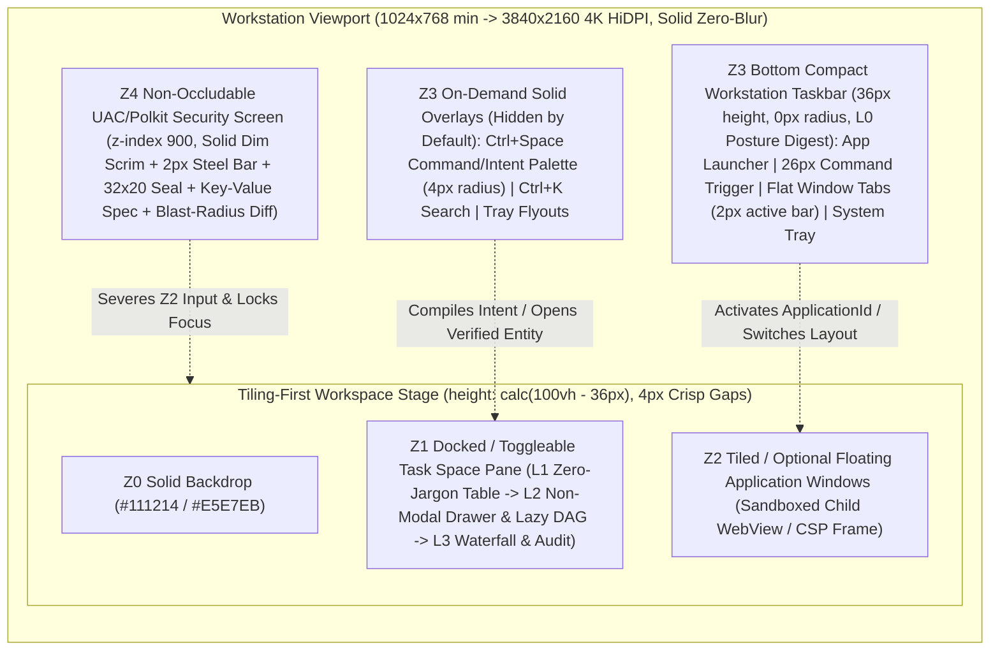

# 阶段 D 完整自然语言桌面视觉系统与交互架构设计规格（Graphite / Paper Industrial Workstation Specification）

- **日期**: 2026-10-26
- **状态**: `DESIGN` only（本文件为阶段 D 实现车道的权威视觉与交互工程蓝图；无阶段 D 新产品代码、无阶段 D 验证 Evidence、不改写当前规范正文。在各 `D-*` 工作包合入并产出可复现测试证据前，严禁将本文件中的任何能力声称为“已实现”或“生产可用”）
- **波次与修订**:
  - `初版`: `W68-D-VISUAL-UX-SPEC`（2026-10-26）
  - `修订 1`: `2026-10-26 W68-R1`（Task `W68R1-WORKSTATION-SPEC`, Attempt 1）——经维护者检视初版原型后显式驳回“AI 生成式科幻毛玻璃仪表盘”风格，全面重构并锁定为 **中性工业工作站（Neutral Industrial Workstation：`Graphite Workstation` 默认深色 + `Paper Workstation` 内建浅色，对标 Windows 11 Pro / Zed IDE 工程标准）**、**平铺优先多窗口工作区 + `36px` 底部紧凑任务栏 + `Ctrl+Space` 按需唤起命令/意图面板** 与 **UAC / Polkit 工作站级实心 `Z4` 系统安全确认屏**。
  - `修订 2（当前生效权威基线）`: `2026-10-26 W68-R2`（Task `W68R2-ADR-UX-SPEC`, Attempt 1）——经维护者于 `W69` 代码实施前下达显控对称与工业级显示架构升级裁定，在 100% 保持 `W68-R1` 反 AI 塑料感实心工作站规则不变的前提下：（1）确立 **`[UI-PARITY-001]` 12 域显控同构不变量（三大铁律：无盲控、无哑看、五大法定不可篡改禁区）** 与完整 12 域显控对齐矩阵，并将后端补面契约扩充为 `IPC-D1..D8`；（2）废止粗糙的 `Standard ↔ Diagnostic` 二元开关（`store/view-mode.ts`），升级为 **`L0 → L1 → L2 → L3` 四级渐进式披露与视口按需游标取数模型（`store/disclosure-model.ts`）**；（3）锚定 `2026-10-26` 查询的对标 **CNCF Headlamp、Dagster、Temporal Web UI、HashiCorp Nomad、Sysinternals Process Explorer / System Informer、Perfetto UI + Terraform Plan Preview** 六大工业级 SOTA 显示机制。
- **写集**: 本文件、同车道架构决策 [ADR-0025](../../management/adrs/0025-stage-d-hybrid-desktop-compositor-and-trusted-ui-layering.md) 与权威进度单 [stage-d-progress.md](../../management/stage-d-progress.md)
- **权威输入与规范依据**:
  - [06-架构设计总纲-v0.5.md](../../design/06-架构设计总纲-v0.5.md)：§24（Intent 编译、`TaskPlan` 惰性物化与手工改图、`Trusted UI`、`ActionReceipt` 与撤销契约）、§25（`Task Space` 状态机、10 层手动调度 `ControlCommand`、§25.4 完整桌面 18 类系统对象与生命周期）、§14/§19（`[CONS-DECL-001]`、`[CONS-CTRL-001]` 非权威搜索边界）、§28.4（阶段 D 必交清单与退出门 `[ROAD-D-001]`）
  - [ADR-0025：阶段 D 混合自然语言桌面合成层、L0–L3 渐进式披露、12 域显控同构与可信 UI 防伪边界（含 `W68-R1` 修订 1 与 `W68-R2` 修订 2）](../../management/adrs/0025-stage-d-hybrid-desktop-compositor-and-trusted-ui-layering.md)
  - [ADR-0026：跨物理机传输与控制面共识扩展](../../management/adrs/0026-cross-physical-host-transport-and-consensus-expansion.md)（维护者裁定 A4：`Stage D || C-XHOST` 并行推进时的跨主机 Cell 拓扑健康与断连自治衔接）
  - [NLOS 站点设计系统 v10.6（`docs/site/DESIGN.md`）](../../site/DESIGN.md)（**显式分叉说明**：该文件仅约束外部营销门户网站的 30 秒高反差叙事；阶段 D 桌面 OS 面向每日连续 10 小时生产力办公，依 `ADR-0025` 修订 1 独立采用零眩光中性工业工作站体系，严禁反向混用站点黑藏青发光冰蓝与液态玻璃样式）
  - [阶段 D 权威进度单（`docs/management/stage-d-progress.md`）](../../management/stage-d-progress.md)（工作包切分、波次依赖与退出门验收）
  - 既有桌面壳与控制面基线：[`desktop/README.md`](../../../desktop/README.md)、[`desktop/src/views/task-space/index.ts`](../../../desktop/src/views/task-space/index.ts)、[`desktop/src/types.ts`](../../../desktop/src/types.ts)、[`desktop/src-tauri/src/lib.rs`](../../../desktop/src-tauri/src/lib.rs)、[`desktop/src-tauri/src/window_lifecycle.rs`](../../../desktop/src-tauri/src/window_lifecycle.rs)、[`crates/nlos-system-control/src/control.rs`](../../../crates/nlos-system-control/src/control.rs)、[`crates/nlos-search/src/lib.rs`](../../../crates/nlos-search/src/lib.rs)

---

## 0. 治理边界、实现前置门与「反 AI 塑料感」工程纪律

根据维护者裁定 **A1–A4**、**`W68-R1` 视觉与空间纠偏裁定**、**`W68-R2` 12 域显控同构与 `L0–L3` 工业级显示裁定** 及 [渐进式披露规则](../../management/project-knowledge-progressive-disclosure.md)：

1. **并行推进纪律（`Stage D || C-XHOST`）**：阶段 D 桌面工作包与阶段 C 跨物理主机扩展（`C-XHOST`，[ADR-0026](../../management/adrs/0026-cross-physical-host-transport-and-consensus-expansion.md)）并行开发，互不阻塞单机本地自治主链（`[DUI-OFFLINE-001]`）；涉及多物理机 `Cell` 拓扑观测的指示器在单机配置下诚实显示“本地就绪”（`L3` 诊断层显示 `LOCAL_SINGLE_NODE`），接入多 Cell 后自动经 `ListCells` / `InspectCellLeases` 投影分片与三族租约水位。
2. **零向后破坏原则**：重构 [`desktop/`](../../../desktop/README.md) 前端与 Tauri 后端时，阶段 B/C 已落地的认证读/写/成本/指标/表面集成测试（`W32-A..F`、`W33-F`、`W39-D`）及 GUI↔CLI `receipt_hex` 字节级等价探针必须保持 100% 绿灯。
3. **诚实分级与显控同构纪律（`[UI-PARITY-001]`）**：凡依赖 `D-IPC-ENUM`（`IPC-D1..D8`）新增只读枚举/订阅 IPC 面的视图模块，在对应后端 IPC 命令合入前严禁在前端伪造模拟数据；合入后必须满足“无盲控、无哑看、法定不可篡改禁区物理锁死”。

### 0.1 反 AI 套路工程纪律检查表（Anti-AI-Tropes Engineering Discipline — 强制阻断门禁）

为彻底清除“AI 生成概念仪表盘”塑料感，所有 `desktop/src/` 样式、模板与组件必须同时通过以下 **7 条硬性工程禁令**（纳入 `D-TOKENS-KIT` 单测与 `D-GATE-006` 自动化门禁，任一违反即判定验收失败）：

| 编号 | 严令封禁的“AI 味”反模式（Banned Anti-Patterns） | 强制执行的工业工作站标准（Mandatory Workstation Standard） | 自动化静态/DOM 审计断言 |
|---|---|---|---|
| **ANTI-AI-01** | 黑底发光青蓝科幻控制台风（`#030710` + `#7FC8FF` 发光标题/外框）、背景 `48px/56px` 科技方格网、环境径向发光色斑（radial glow blobs）、`0 0 28px` 霓虹发光阴影 | 采用中性无色偏石墨灰（`Graphite`）与纸白（`Paper`）实心表面；单一功能蓝（`#2563EB` / `#3B82F6` / `#1D4ED8`）**仅限焦点环、主按钮与 `2px` 激活指示条**，严禁彩色发光标题或霓虹光晕 | 扫描 `desktop/src/**/*.css` 零 `#030710`、零 `#7fc8ff`、零背景网格渐变、零彩色扩散 `box-shadow` |
| **ANTI-AI-02** | `backdrop-filter: blur(...)` 毛玻璃/液态玻璃折射炫技与半透明叠加眩光 | 所有桌面面板、任务栏、窗口、弹出菜单、命令面板与 `Z4` 授权框一律使用 **100% 实心不透明中性表面**，仅以锐利 `1px` 结构分割细线（hairline border）界定层级 | 扫描 `desktop/src/**/*.css` 断言 `backdrop-filter` 与 `-webkit-backdrop-filter` 出现次数严格为 `0` |
| **ANTI-AI-03** | SaaS 网页式居中双列大卡片墙（`max-w-7xl` 卡片流）与屏幕顶部常驻展开的巨型 AI Prompt Box | 默认采用边对边 `4px` 间隙**平铺优先多窗口工作区** + Zed 风格停靠式高密度表格 `Task Space`；命令与自然语言面板默认隐藏，仅由底部 `26px` 紧凑触发槽或 `Ctrl+Space` 按需居中唤起 | 默认工作区视口纵向高度 `calc(100vh - 36px)`，零顶置常驻大输入框，零 `max-w-7xl` 居中卡片容器 |
| **ANTI-AI-04** | `12px–16px` 大圆角卡片或 `999px` 浮夸胶囊气泡 | 严格锁死三档工业几何圆角：**`0px`**（底部 `36px` 任务栏、平铺分割面板、非模态抽屉）、**`4px`**（按钮、输入框、分段控件、标签页、状态标签、命令面板）、**上限 `6px`**（可选浮动窗口与 `Z4` 模态对话框） | CSS token 与内联样式中一切 `border-radius` 取值严格属于 `{0px, 2px, 4px, 6px}`（仅 `6px` 圆形几何状态点允许 `50%`） |
| **ANTI-AI-05** | 在按钮、状态栏、通知或空状态中使用任何卡通 Emoji 字符图标 | 全局 100% 采用 `1.25px–1.5px` 均匀线宽、`14×14px` / `16×16px` 像素对齐的单色几何 SVG 描边图标（`stroke="currentColor"`，`fill="none"`） | 词条目录 `zh-CN.ts`/`en-US.ts` 与全部 `.ts`/`.html` 源码通过 Unicode Extended_Pictographic 正则零命中扫描 |
| **ANTI-AI-06** | 彩虹多色相状态徽章（琥珀/紫/橙/薄荷绿/天蓝彩色胶囊混排） | 常规状态一律采用中性单色文本 + 微型 `6px` 几何 SVG 状态指示符；仅保留克制琥珀色（`#D97706`）**专用于需用户介入确认/输入**，克制深绯红（`#DC2626`）**专用于失败 / 不可逆高危警告** | 状态组件仅消费中性色与 `--nlos-signal-action` / `--nlos-signal-danger` 两枚受控警示 token |
| **ANTI-AI-07** | 在默认普通用户披露层（`L0/L1`，`[ROAD-D-001]`）直接暴露内部架构行话（`Z1`、`TypedIntent`、`0x1F`、`Quota`、`ROAD-D-001`、`ADR-0011`、`TaskAttempt`、`ExecutionFiber`、`receipt_hex`） | 默认 **`L0`（底栏微摘要）与 `L1`（标准工作站表格）** 100% 使用日常清晰办公语言；单对象结构化子图与三水位资源条在 **`L2`（非模态详情抽屉）** 展开；底层拓扑 ID、Attempt/Fiber 瀑布条、Cell 租约与 `receipt_hex` **仅在 `L3`（深度诊断层，`Ctrl/⌘ + Shift + E`）渲染** | E2E 测试在 `data-nlos-disclosure="L0"` 与 `"L1"` 下抓取全屏可见 `innerText`，断言架构黑名单术语零出现 |

---

## 1. `Graphite / Paper` 工业工作站双主题设计 Token 契约（`--nlos-*` CSS Custom Properties）

阶段 D 桌面确立默认深色 **`Graphite Workstation`** 与内建浅色 **`Paper Workstation`** 双套完备实心工业工作站 Token，对标 Windows 11 Pro 工作站与 Zed IDE 的零眩光长时可读性标准。

### 1.1 表面、结构细线、排版墨色与受控功能色完整 CSS 变量表

以下契约直接对应 `D-TOKENS-KIT` 工作包产出的 `desktop/src/styles/tokens.css`：

```css
/* ==========================================================================
   NLOS Desktop Design System v2.0 (W68-R1) — Neutral Industrial Workstation
   Authority: ADR-0025 Revision 1 + Stage D Desktop Visual & UX Spec
   Hard Bans:
     - ZERO backdrop-filter / frosted glass / liquid glass
     - ZERO cyan neon glow, radial blobs, or background tech grids
     - ZERO border-radius > 6px (0px taskbar/tiles, 4px controls, 6px float/dialog)
     - ZERO rainbow status pills or cartoon emojis
   ========================================================================== */

:root,
[data-nlos-theme="graphite-workstation"] {
  color-scheme: dark;

  /* ---- 1. 100% 实心不透明中性工作站表面 (Solid Opaque Neutral Surfaces) ---- */
  --nlos-bg-backdrop: #111214;               /* Z0 工作区底层底板 / 4px 平铺分割槽底色 */
  --nlos-bg-window: #18191c;                 /* Z2 应用窗口画布 / Z1 任务表格主画布 */
  --nlos-bg-chrome: #1e2024;                 /* 面板头 / 30px 窗口标题栏 / 36px 底部任务栏 */
  --nlos-bg-elevated: #23252a;               /* 悬浮菜单 / Ctrl+Space 命令面板 / 托盘浮层 / Z4 安全对话框 */
  --nlos-bg-hover: #2a2d33;                  /* 列表行、标签页与工具按钮悬停态 */
  --nlos-bg-active-row: #252830;             /* 表格选中行实心底色 */
  --nlos-bg-recessed: #111214;               /* 输入框内槽与 Z4 32x20 硬件防伪印章凹槽 */
  --nlos-scrim-z4: rgba(10, 11, 13, 0.78);   /* Z4 不可遮挡安全确认屏实心暗化幕布 (零模糊) */

  /* ---- 2. 1px 结构分割细线与焦点边界 (1px Structural Hairline Borders) ---- */
  --nlos-border-hairline: #2e3138;           /* 全局 1px 结构分割线 / 非焦点窗口边框 */
  --nlos-border-focused: #4b515d;            /* 当前焦点窗口 / 激活浮层 1px 强化边框 */
  --nlos-border-input-focus: #3b82f6;        /* 输入控件激活边框 */

  /* ---- 3. 中性高对比排版墨色 (Neutral Workstation Typography Ink) ---- */
  --nlos-text-primary: #ecedee;              /* 主正文与窗口标题 (vs #18191C 对比度 ~14.7:1, AAA) */
  --nlos-text-secondary: #9da3ae;            /* 次级字段标签、表格元数据 (vs #18191C 对比度 ~6.8:1, AA) */
  --nlos-text-muted: #6b7280;                /* 弱化分隔符、快捷键提示与只读占位文案 */

  /* ---- 4. 单一克制工程蓝功能色 (Single Utilitarian Accent — 严禁用于发光外框或彩色大标题) ---- */
  --nlos-accent-primary: #2563eb;            /* 主提交按钮实心底色 / Z4 顶部 2px 钢蓝安全横梁 */
  --nlos-accent-primary-hover: #1d4ed8;      /* 主按钮悬停底色 */
  --nlos-accent-active: #3b82f6;             /* 2px 键盘焦点环 / 任务栏活动窗口 2px 底边指示条 */
  --nlos-accent-fg: #ffffff;                 /* 主按钮前景白字 (对比度 >= 4.8:1, AA) */

  /* ---- 5. 双极克制警示色与单色常规指示符 (Strict Bipolar Semantic Signals) ---- */
  --nlos-indicator-neutral: #9da3ae;         /* 排队 / 暂停 / 离线等待等常规单色几何符号 */
  --nlos-indicator-active: #ecedee;          /* 正在执行 / 已完成单色高对比几何符号 */
  --nlos-signal-action: #d97706;             /* 严格仅限：需用户介入确认或补充输入 (琥珀色) */
  --nlos-signal-action-text: #f59e0b;        /* 深底高可读待处理提示字 (>= 8.2:1) */
  --nlos-signal-danger: #dc2626;             /* 严格仅限：执行失败 / 隔离围栏 / 不可逆高危警告 (深绯红) */
  --nlos-signal-danger-text: #f87171;        /* 深底高可读失败说明字 (>= 6.4:1) */
  --nlos-signal-danger-fg: #ffffff;          /* 高危破坏性确认按钮白字 */

  /* ---- 6. 零霓虹中性结构阴影 (仅用于浮动窗口、按需命令面板与 Z4 对话框；平铺态为 none) ---- */
  --nlos-shadow-floating:
    0 12px 28px rgba(0, 0, 0, 0.48),
    0 2px 6px rgba(0, 0, 0, 0.32);
  --nlos-shadow-palette:
    0 16px 36px rgba(0, 0, 0, 0.56),
    0 2px 8px rgba(0, 0, 0, 0.36);
  --nlos-shadow-z4-dialog:
    0 20px 48px rgba(0, 0, 0, 0.68),
    0 4px 12px rgba(0, 0, 0, 0.42);
}

/* ==========================================================================
   Paper Workstation (Built-in Light Theme — Zero-Glare Daytime Workstation)
   ========================================================================== */
[data-nlos-theme="paper-workstation"] {
  color-scheme: light;

  --nlos-bg-backdrop: #e5e7eb;               /* Z0 浅灰工作区底板 / 4px 平铺间隙 */
  --nlos-bg-window: #ffffff;                 /* Z2 窗口画布 / Z1 任务表格纯白画布 */
  --nlos-bg-chrome: #f3f4f6;                 /* 面板头 / 30px 窗口标题栏 / 36px 底部任务栏 */
  --nlos-bg-elevated: #ffffff;               /* 悬浮菜单 / Ctrl+Space 命令面板 / Z4 安全对话框 */
  --nlos-bg-hover: #eaecef;                  /* 悬停态实心浅灰 */
  --nlos-bg-active-row: #eff3f8;             /* 表格选中行浅蓝灰底 */
  --nlos-bg-recessed: #f3f4f6;               /* 输入框内槽与 Z4 32x20 硬件防伪印章凹槽 */
  --nlos-scrim-z4: rgba(10, 11, 13, 0.78);   /* 统一高对比实心暗化安全幕布 */

  --nlos-border-hairline: #d1d5db;           /* 1px 结构分割细线 */
  --nlos-border-focused: #9ca3af;            /* 焦点窗口 / 浮层 1px 边框 */
  --nlos-border-input-focus: #1d4ed8;

  --nlos-text-primary: #111827;              /* 主正文 (vs #FFFFFF 对比度 ~17.7:1, AAA) */
  --nlos-text-secondary: #4b5563;            /* 次级文本 (vs #FFFFFF 对比度 ~7.5:1, AAA) */
  --nlos-text-muted: #6b7280;                /* 辅助文本 (vs #FFFFFF 对比度 ~4.8:1, AA) */

  --nlos-accent-primary: #1d4ed8;            /* 单一工程深蓝功能色 */
  --nlos-accent-primary-hover: #1e40af;
  --nlos-accent-active: #1d4ed8;             /* 2px 焦点环 / 2px 激活指示条 */
  --nlos-accent-fg: #ffffff;

  --nlos-indicator-neutral: #4b5563;
  --nlos-indicator-active: #111827;
  --nlos-signal-action: #d97706;             /* 6px 几何指示点与 2px 提示边 */
  --nlos-signal-action-text: #b45309;        /* 白底文本配深琥珀保证 WCAG AA >= 5.0:1 */
  --nlos-signal-danger: #dc2626;             /* 白底对比度 ~4.83:1, 满足 AA */
  --nlos-signal-danger-text: #b91c1c;
  --nlos-signal-danger-fg: #ffffff;

  --nlos-shadow-floating:
    0 10px 24px rgba(17, 24, 39, 0.14),
    0 2px 6px rgba(17, 24, 39, 0.08);
  --nlos-shadow-palette:
    0 14px 32px rgba(17, 24, 39, 0.18),
    0 2px 8px rgba(17, 24, 39, 0.09);
  --nlos-shadow-z4-dialog:
    0 20px 44px rgba(17, 24, 39, 0.26),
    0 4px 12px rgba(17, 24, 39, 0.12);
}

/* ==========================================================================
   Typography, Workstation Geometry, Z-Planes & Motion (Theme-Invariant)
   ========================================================================== */
:root {
  /* ---- 字体栈 (System UI Sans + Engineering Monospace) ---- */
  --nlos-font-sans:
    -apple-system, BlinkMacSystemFont, "Segoe UI Variable Text", "Segoe UI",
    "PingFang SC", "Hiragino Sans GB", "Microsoft YaHei UI", "Noto Sans CJK SC", sans-serif;
  --nlos-font-mono:
    ui-monospace, "Cascadia Mono", "SF Mono", SFMono-Regular, Menlo, Consolas,
    "Liberation Mono", "Noto Sans Mono CJK SC", monospace;

  /* ---- 紧凑工作站字号阶梯 (等宽下限严格 >= 12px) ---- */
  --nlos-fs-mono-xs: 0.75rem;      /* 12px — 绝对最小字号下限：时钟、快捷键 kbd、L3 深度诊断层 ID */
  --nlos-fs-ui-sm: 0.8125rem;      /* 13px — 高密度表格行、任务栏标签、窗口标题栏、按钮 */
  --nlos-fs-ui-base: 0.875rem;     /* 14px — 标准表单、命令面板输入结果、Z4 键值规格表 */
  --nlos-fs-input-cmd: 0.9375rem;  /* 15px — Ctrl+Space 命令与自然语言主输入框 */
  --nlos-fs-title-sm: 1rem;        /* 16px — Z4 安全确认屏标题 / 设置分节标题 (字重 600) */
  --nlos-fs-stat-md: 1.25rem;      /* 20px — 资源监控核心读数 (字重 600, tabular-nums) */

  /* ---- 4px 基准间距与严苛三档圆角 (Strict 0px / 4px / 6px Geometry) ---- */
  --nlos-sp-1: 4px;
  --nlos-sp-2: 8px;
  --nlos-sp-3: 12px;
  --nlos-sp-4: 16px;
  --nlos-sp-5: 24px;

  --nlos-radius-none: 0px;         /* 底部 36px 任务栏、平铺分割容器、L2 详情抽屉与表格行 */
  --nlos-radius-ctrl: 4px;         /* 控件、输入框、按钮、窗口标签、Ctrl+Space 命令面板 */
  --nlos-radius-win: 6px;          /* 全局最大圆角上限：可选浮动窗口与 Z4 安全模态对话框 */

  /* ---- 工作站壳几何尺寸 (Workstation Shell Metrics) ---- */
  --nlos-tile-gap: 4px;            /* 平铺窗口间锐利结构间隙 */
  --nlos-titlebar-h: 30px;         /* Z2 窗口与 Z1 停靠面板紧凑实心标题栏高度 */
  --nlos-taskbar-h: 36px;          /* Z3 底部贴边紧凑工作站任务栏高度 */
  --nlos-taskbar-trigger-h: 26px;  /* 任务栏内嵌命令/NL 触发框高度 */
  --nlos-flyout-w: 360px;          /* 右下角通知/控制中心实心弹出面板宽度 */
  --nlos-inspector-w: 420px;       /* L2 右侧非模态详情抽屉 (Inspector Drawer) 标准宽度 */
  --nlos-palette-max-w: 640px;     /* Ctrl+Space 命令与意图面板最大宽度 */
  --nlos-z4-dialog-w: 520px;       /* Z4 系统安全确认框标准宽度 */

  /* ---- 五平面 Z 轴栈序 (5-Plane Z-Index Contract) ---- */
  --nlos-z0-backdrop: 0;
  --nlos-z1-task-pane: 100;
  --nlos-z2-window-base: 200;      /* Z2 活动窗口在 [200..299] 区间内按 MRU 递增 */
  --nlos-z3-taskbar: 400;          /* 常驻底部 36px 任务栏 */
  --nlos-z3-flyout: 430;           /* 应用启动菜单、通知抽屉与系统控制浮层 */
  --nlos-z3-palette: 460;          /* Ctrl+Space 命令/意图面板与 Ctrl+K 搜索面板 */
  --nlos-z4-security-screen: 900;  /* 最高特权安全确认屏，任何 Z1..Z3 元素严禁 >= 900 */

  /* ---- 克制瞬时过渡 (Crisp Snappy Transitions — 零弹性漂浮感) ---- */
  --nlos-ease-snappy: cubic-bezier(0.2, 0, 0, 1);
  --nlos-dur-fast: 80ms;
  --nlos-dur-base: 140ms;
}

@media (prefers-reduced-motion: reduce) {
  :root {
    --nlos-dur-fast: 0ms;
    --nlos-dur-base: 0ms;
  }
}
```

### 1.2 全状态语义映射表（单色排版 + `6px` 几何 SVG 符号 + 双极警示色纪律）

为彻底根除“彩虹色胶囊墙”，所有状态统一采用 **中性背景（透明或 `--nlos-bg-recessed`）+ `6px` 精确几何 SVG 符号 + `13px` 清晰文字**。彩色信号严格收敛为两极：琥珀色（`#D97706`）仅表示“需要用户操作”，深绯红（`#DC2626`）仅表示“失败或不可逆安全限制”（双编码确保色觉缺陷用户零信息损失）：

| 规范状态枚举（仅在 `L3` 深度诊断层显示枚举名） | `6px` 几何 SVG 指示符 | 绑定信号色 Token | `L1` 默认工作站表格视图文案（`zh-CN` / `en-US`，零行话） |
|---|---|---|---|
| `DRAFT` / `PROPOSED` | 空心圆环 | `--nlos-indicator-neutral` | 草稿待提交 / Draft |
| `WAITING_CONSENT` | 实心琥珀菱形 | **`--nlos-signal-action` (`#D97706`)** | **待您确认权限或费用上限** / Approval Required |
| `WAITING_INPUT` | 空心琥珀菱形 | **`--nlos-signal-action` (`#D97706`)** | **待补充说明** / Input Needed |
| `AUTHORIZED` / `RUNNING` / `COMPLETING` | 实心高对比圆点 | `--nlos-indicator-active` | 正在运行 / Running |
| `WAITING_RESOURCE` | 半填充方框 | `--nlos-indicator-neutral` | 排队等待计算资源 / Queued for Resources |
| `WAITING_NETWORK` | 虚线圆环 | `--nlos-indicator-neutral` | 等待网络连接（本地正常可用） / Waiting for Network |
| `SUSPENDED` / `CANCELLING` / `CANCELLED` | 双竖暂停线 / 斜杠圆 | `--nlos-text-muted` | 已暂停 / 已取消 / Paused · Cancelled |
| `RECOVERING` | 单色闭合弧线 | `--nlos-indicator-neutral` | 正在对账恢复 / Recovering |
| `QUARANTINED` | 实心深绯红方框 | **`--nlos-signal-danger` (`#DC2626`)** | **已受控隔离** / Isolated |
| `DISPUTED` | 实心琥珀三角 | **`--nlos-signal-action` (`#D97706`)** | **结果不一致，待您核对** / Needs Verification |
| `PARTIAL` | 左半实心圆 | `--nlos-indicator-active` | 部分完成（含未完成项） / Partially Completed |
| `COMPLETED` | `1.5px` 单色折线勾号 | `--nlos-indicator-active` | 已完成 / Completed |
| `FAILED` | `1.5px` 深绯红交叉叉号 | **`--nlos-signal-danger` (`#DC2626`)** | **未能完成** / Failed |

### 1.3 硬件仪器级凹陷 `32×20` 单色精密防伪印章（Recessed Hardware-Style Verification Seal）

依据 `W68-R1` 裁定，废除初版 `72×36px` 发光冰蓝彗尾装饰印章，改为嵌入 `Z4` 系统安全确认屏头部的 **`32×20px` 凹陷硬件仪器风单色精密校验印章**：

1. **物理凹槽容器**：宽 `32px`、高 `20px`、`border-radius: 2px`、背景 `var(--nlos-bg-recessed)`（`#111214` / `#F3F4F6`）、边框 `1px solid var(--nlos-border-hairline)`，严禁施加任何外发光阴影或模糊滤镜。
2. **数学 Gerono 双纽线 `1px` 单色示波轨迹**：
   设画布中心 $(C_x, C_y) = (16, 10)$，水平半幅 $A = 11.5\text{px}$，垂直半幅 $B = 5.5\text{px}$：
   $$x(t) = C_x + A \cos(t), \quad y(t) = C_y + B \sin(2t), \quad t \in [0, 2\pi)$$
   底层绘制 `1px` 低对比正交基准刻度十字（`var(--nlos-border-hairline)`），前景以纯单色高对比墨水 `var(--nlos-text-primary)`（`#ECEDEE` / `#111827`）绘制 `1px` 锐利双纽线相位扫描轨迹（周期 $T = 3.6\text{s}$，双中心对称相位点）。
3. **零开销门控与无障碍回退**：
   - `Z4` 未挂载时渲染循环完全不存在（0% CPU/GPU 占用）；
   - `prefers-reduced-motion: reduce` 开启时，不启动动画循环，静态渲染 $1\text{px}$ 高对比闭合双纽线与中心基准点；
   - 无 Canvas 环境回退为等宽纯数学字符 `∞`（`U+221E`，严禁 Emoji 变体）。

---

## 2. 平铺优先工作站线框图、五平面合成几何与全局快捷键

### 2.1 五平面工作站合成架构图（`Z0 → Z4`）



### 2.2 全视口结构化 ASCII 线框图（`1440×900` 平铺工作站态 + 按需命令面板 + `Z4` 安全确认屏）

#### (A) 默认平铺工作站态（`L1` Workstation Table + `L0` `36px` 底部任务栏：3-Pane 平铺 + Nomad 三水位子弹微条 + Headlamp 前置剪枝操作，零内部行话、零 Emoji）

```text
+--------------------------------------------------+--------------------------------------------------+
| [≡] Notes - 周报草稿.md              [_][□][×] | [≡] CodeCompare - 실험结果对比.csv     [_][□][×] | <- 30px Solid Chrome (#1E2024)
+--------------------------------------------------+--------------------------------------------------+
| # 本周实验进展摘要                               | 指标项          | 基线组   | 实验组   | 变化率   | <- Z2 Tiled App Windows
|                                                  | ----------------+----------+----------+--------- |    (#18191C, 0px radius,
| 1. 完成单机控制面与桌面桥接压测记录整理          | 尾延迟 P99 (ms) |   14.2   |   11.8   |  -16.9%  |     4px crisp gap between panes,
| 2. 待核对远端引用文献元数据后定稿导出            | 内存峰值 (MB)   |  128.0   |  119.5   |   -6.6%  |     clipped strictly above 36px bar)
|                                                  | 错误计数        |    0     |    0     |    0.0%  |
| (运行于隔离应用表面，物理裁剪于本矩形窗框内)     |                                                  |
+--------------------------------------------------+--------------------------------------------------+
| [≡] 后台任务面板 (3 项活跃)                    [筛选: 全部 v] [抽屉 L2 Space] [深度诊断 L3 Ctrl+⇧+E] | <- Z1 Docked Task Space Pane (L1)
+-----------------------------------------------------------------------------------------------------+
| 状态            | 任务目标                             | 所属应用    | 资源三水位微条      | 可撤销性   | 合法操作          |
| ----------------+--------------------------------------+-------------+---------------------+------------+------------------ |
| ◆ 待您确认      | 读取 3 份实验归档并更新周报草稿      | Notes       | [·······|] 0/20/20  | 可无损撤销 | [审阅确认] [取消] |
| ● 正在运行      | 本地代码仓库增量索引同步             | RepoIndexer | [████|·· ] 6/12/15  | 可无损撤销 | [暂停]     [抽屉] |
| ◌ 等待网络      | 远端论文引用元数据补全 (本地不受影响)| BibHelper   | [██····| ] 2/8/10   | 可无损撤销 | [暂停]     [取消] |
+=====================================================================================================+
| [⊞ 应用] [ >_ 输入指令或自然语言目标... Ctrl+Space ] | [Notes] [CodeCompare] [任务 3] | [◫ 三栏] [本地就绪] [披露:L1] [深色] [通知 2] 14:32 | <- Z3 36px Bottom Taskbar (L0)
+-----------------------------------------------------------------------------------------------------+
                                                          ^^^^^^ 2px #3B82F6 bottom active bar
```

#### (B) 按需唤起命令与意图面板态（按下 `Ctrl/⌘ + Space` 时居中弹出，`4px` 圆角实心 `#23252A` / `#FFFFFF`，用毕自动收起绝不常驻霸屏）

```text
          +----------------------------------------------------------------------------------+
          | >_ 整理本周实验日志并让笔记应用生成周报草稿，费用上限 20 积分    [语音] [附件] [↵] | <- 4px-radius Solid Palette
          +----------------------------------------------------------------------------------+
          | 识别操作: 整理归档并生成草稿  | 目标应用: Notes  | 费用上限: <= 20 积分 | 可无损撤销 | <- L1 白话预览 (零内部行话)
          +----------------------------------------------------------------------------------+
          | [↵ 下一步：审阅权限与费用确认]                           [Esc 关闭面板，不执行操作] |
          +----------------------------------------------------------------------------------+
```

#### (C) `Z4` 不可遮挡系统安全确认屏（UAC / Polkit 工作站风格：实心暗幕 `rgba(10,11,13,0.78)` + `2px` 钢蓝顶条 + `32×20` 凹陷单色精密印章）

```text
+-----------------------------------------------------------------------------------------------------+
|  ░░░░░░░░░░░░░░░ Z4 SOLID DIM SCRIM rgba(10, 11, 13, 0.78) — ZERO BLUR, Z2 INPUT SEVERED ░░░░░░░░░  |
|  ░░                +============================================================+                ░░  | <- 2px Solid #2563EB Top Bar
|  ░░                | [∞ 32x20] 系统安全确认 · 需要您的授权     [防伪标识: 青松-07] |                ░░  | <- 6px-radius Solid #23252A
|  ░░                +------------------------------------------------------------+                ░░  |
|  ░░                | 请求应用   | Notes（已验证安装签名）                       |                ░░  |
|  ░░                | 授权范围   | 只读访问已选定的 3 份实验日志（仅本次任务有效）|                ░░  |
|  ░░                | 资源上限   | 最多消耗 20 积分（超出自动停止）               |                ░░  |
|  ░░                | 可撤销等级 | 可无损撤销（生成新草稿版本，不修改原始日志）   |                ░░  |
|  ░░                +------------------------------------------------------------+                ░░  |
|  ░░                | 有效范围: (●) 仅本次操作  ( ) 当前任务内  ( ) 本次登录会话  |                ░░  |
|  ░░                |                                                            |                ░░  |
|  ░░                |                              [ 拒绝 (Esc) ]  [ 批准执行 ]  |                ░░  | <- 4px Rectangular Buttons
|  ░░                +------------------------------------------------------------+                ░░  |    (350ms Clickjacking Gate)
+=====================================================================================================+
| [⊞ 应用] [ 安全确认进行中 — 应用窗口输入已锁定 ]                         | [安全锁定中]        14:32 | <- Z3 36px Bottom Taskbar
+-----------------------------------------------------------------------------------------------------+
```

### 2.3 工作站平铺网格与可选浮动窗口几何（Tiling-First Workspace & Snap Geometry）

工作区可用几何严格定义为 `StageRect = { top: 0px, bottom: calc(100vh - 36px), left: 0px, right: 100vw }`，把屏幕顶部至底部任务栏之上的每一行像素全部交给生产力工作区：

| 布局模式（底栏右侧布局切换器可一键切换） | 几何区域（相对于 `StageRect`，平铺间隙统一 `4px`） | 交互行为与 `Z1` / `Z2` 协同语义 |
|---|---|---|
| **3-Pane Workstation Split（默认三栏工作站平铺）** | 上层左右双应用窗（高 `68%`，间隙 `4px`）+ 下层通栏停靠 `Task Space` 表格面板（高 `32%`），或左主窗 `60%` + 右上下双栈 `40%` | 打开多应用与后台任务时的黄金工作站形态：同屏并行编辑对比两个应用，底部高密度表格实时掌控全部任务义务；拖拽 `4px` 分割条可无级调节比例（同步裁剪子 WebView）。 |
| **2-Column Tiled Split（左右双栏平铺）** | 左 `[0, 50% - 2px]` / 右 `[50% + 2px, 100%]`，高 `100%`，`border-radius: 0px` | 适合双应用全高并排或“左应用窗口 + 右 `Task Space` `L2/L3` DAG 与瀑布诊断视图”；支持 `Win/⌃ + Alt + ←/→` 键盘瞬时平铺。 |
| **Quadrants（四象限平铺 `TL / TR / BL / BR`）** | 宽 `50% - 2px`，高 `50% - 2px`，十字 `4px` 间隙，`border-radius: 0px` | 适合 `>= 1920×1080` 显示器四窗口高密度监控与对照。 |
| **Workspace Maximize（安全区内全屏平铺）** | 占满 `StageRect`（`100vw × calc(100vh - 36px)`，`border-radius: 0px`） | 单一应用或全屏 `Task Space` 专注态；**硬性下边界止步于 `calc(100vh - 36px)`，绝不允许覆盖底部 `Z3` 系统任务栏**。 |
| **Optional Floating Window（可选浮动窗口模式）** | 默认 `70% × 76%` 居中或自由拖拽位置，`border-radius: 6px`，`1px solid var(--nlos-border-focused)` | 用户点击窗口标题栏切换为浮动态时启用；上限圆角严格为 `6px`，带克制中性投影，绝不越界覆盖底部 `36px` 任务栏。 |
| **Minimize-to-Taskbar（最小化归入底栏标签）** | 收拢至底部 `36px` 任务栏对应扁平矩形窗口标签 | `Window` 转入 `MINIMIZED`，关联 `Surface` 转入 `HIDDEN`（暂停子视图渲染省电），底栏对应标签移除 `2px` 激活蓝条并保留单色运行点标。 |

### 2.4 全局键盘快捷键规范表（Global Keyboard Shortcuts）

| 快捷键（Windows & Linux / macOS） | 触发平面 | 动作与规范约束 |
|---|---|---|
| `Ctrl + Space` / `⌘ + Space` | `Z3` | 按需唤起或收起居中 `4px` 圆角实心 **Command & Intent Palette**（长按可进入受 `DevicePermissionState` 门控的按住说话语音转写态）。 |
| `Ctrl + K` / `⌘ + K` | `Z3` | 唤起居中实心 **全局候选搜索面板**（代码层强制校验 `0x1F` 非权威位掩码，回车回跳权威视图重验）。 |
| `Space` 或 `Enter`（焦点位于表格/树行时） | `Z1` / `Z2` | 唤起或收起 **`L2` 非模态详情抽屉（Inspector Drawer）**（`L1 ↔ L2`，按选中单对象惰性拉取子图与三水位成本，不丢失主列表位置）。 |
| `Ctrl + Shift + E` / `⌘ + Shift + E` | `Z1` / `Z3` | 一键原地切换 **`L1/L2 ↔ L3` 深度诊断与原始审计层**（`[CTRL-PLAN-001]`，`< 16ms` 零状态丢失，按焦点作用域游标惰性拉取底层拓扑）。 |
| `Ctrl + .` / `⌘ + .` | `Z1` / `Z3` | **安全紧急暂停（Safe Pause）**：对当前焦点 `Task` 或活动 `Operation` 立即编译派发显式 `ControlScope` 的 `pause` `ControlCommand`（`[CTRL-SAFETY-001]`）。 |
| `Ctrl + Shift + M` / `⌘ + Shift + M` | `Z2` / `Z3` | 打开或聚焦 **`TaskManagerSurface` / `ResourceMonitorSurface`** 12 域统一系统控制台窗口。 |
| `Ctrl + ,` / `⌘ + ,` | `Z2` / `Z3` | 打开 **四层系统设置与密钥引用管理（`SettingsDomain` & `KeychainReference`）**。 |
| `Win + Alt + 1 / 2 / 3 / 4` / `⌃ + ⌥ + 1..4` | `Z1` / `Z2` | 一键切换工作站平铺预设：`1` 单窗最大化、`2` 左右双栏、`3` 三栏工作站、`4` 四象限平铺（满足 `WCAG 2.5.7` 免拖拽键盘平铺）。 |
| `Win + Alt + ← / → / ↑ / ↓` / `⌃ + ⌥ + 方向键` | `Z2` | 将当前焦点窗口移入对应平铺槽位、最大化或最小化归入底部任务栏。 |
| `Ctrl + Alt + L` / `⌘ + Ctrl + Q` | `Z4` | 立即锁定当前 `DesktopSession`（`ACTIVE → LOCKED`，使旧会话输入代际立即失效 `[DUI-SESSION-001]`）。 |
| `Escape` | `Z1` / `Z3` / `Z4` | 在 `Z4` 中始终绑定“拒绝 / 取消本次授权请求”；在 `Z3` 中关闭命令面板或托盘浮层；在 `Z1` 中收起 `L2` 非模态详情抽屉。 |
| `F6` / `Shift + F6` | `Z1..Z4` | 在核心无障碍地标（Active App Window → Docked Task Space → Inspector Drawer → Bottom Workstation Taskbar）间循环切换键盘焦点。 |

---

## 2A. 工业级 SOTA 显示参考综合（`2026-10-26`）、`L0–L3` 四级渐进式披露与 `[UI-PARITY-001]` 12 域显控同构矩阵

在 `W69` 代码实现启动前，维护者下达 **`W68-R2` 架构升级裁定（`2026-10-26`）**：彻底淘汰易造成认知跳变与后台轮询风暴的 `Standard ↔ Diagnostic` 二元开关，全面引入锚定外部工业级 SOTA 系统的 **`L0 → L1 → L2 → L3` 四级渐进式披露模型** 与 **`[UI-PARITY-001]` 12 域显控同构契约**，且所有视觉组件严格服从 §0.1 / §1 的 `Graphite / Paper` 实心零模糊、`0/4/6px` 锐利圆角与零 Emoji 纪律。

### 2A.1 六大工业级 SOTA 系统显示机制综合（外部官方工程参考查询日期：`2026-10-26`）

依 [渐进式披露规则 §5.2](../../management/project-knowledge-progressive-disclosure.md) 外部技术参考时效记录要求，本节明确登记对以下 6 套工业级生产系统 UI 架构的调研与裁剪适配（**外部参考查询日期统一为：`2026-10-26`**）：

| 编号 | 对标工业级 SOTA 系统（查询日期：`2026-10-26`） | 提炼的核心显示与交互机制 | 在 NLOS `Graphite / Paper` 桌面中的工程落地形态 |
|---|---|---|---|
| **SOTA-1** | **CNCF Headlamp**（Kubernetes SIG UI，查询日期：`2026-10-26`） | **能力与状态机前置剪枝（Capability & State-Machine Guarded Action Pruning）+ 非模态详情抽屉 + 作用域面包屑** | 渲染任何列表行或详情页前，先执行纯函数 `computeAllowedVerbs(object.state, callerCapabilities, statutoryLocks)`：非法或越权动作在挂载前直接剔除，法定禁改对象显式挂载单色只读锁原因徽标，杜绝“点完才报错”；选中行在右侧（`420px`）或下侧（`36%`）滑出 `0px` 外圆角、`1px` 细线实心 **Inspector Drawer**，顶部常驻 **Scope Breadcrumb Bar**（`System > Workspace > App > Task > Node > Attempt > Fiber`）。 |
| **SOTA-2** | **Dagster**（10K+ Asset Lineage Graph，查询日期：`2026-10-26`） | **自左向右正交 DAG + 可折叠惰性物化超节点（Collapsible Lazy-Window Super-Nodes）** | `TaskPlan` 画布采用严格自左向右（`LR`）`1px` 单色正交折线与 `4px` 圆角实心节点框；凡处于 `[PLAN-LAZY-001]` 物化窗口之外的未物化（`METADATA_ONLY / COLD`）子图，默认自动折叠为一枚 `1px dashed var(--nlos-border-hairline)` 虚线摘要超节点 **`[+N 待物化步骤 · 0 活跃进程]`**，从根源阻断 `10K–100K` 逻辑节点（`[SCALE-LOGICAL-001]`）渲染成毛线团，仅在用户点击展开时按需分页拉取子图。 |
| **SOTA-3** | **Temporal Web UI**（Workflow History & Timeline，查询日期：`2026-10-26`） | **`L1/L2` 紧凑事件里程碑归并 + `L3` 时间比例 Attempt/Phase 堆栈瀑布条** | 在 `L1/L2` 将底层细碎状态跃迁自动归并为清晰白话步骤里程碑；在 `L3` 将并发/重试竞争的 `TaskAttempt`（如 `Attempt #1 SUPERSEDED` vs `Attempt #2 CAS Winner`）以及 `ExecutionFiber` 五段耗时分解（`activeCpuMs` \| `schedulerWaitMs` \| `externalWaitMs` \| `backpressureWaitMs` \| `suspendedMs`）渲染为 `6px` 高、`0px/2px` 锐利分段的水平时间比例单色/双极堆栈瀑布条（配等宽 `tabular-nums` 毫秒读数）。 |
| **SOTA-4** | **HashiCorp Nomad**（Cluster & Allocation Resource Bars，查询日期：`2026-10-26`） | **三水位实心子弹微条（Triple-Watermark Bullet Micro-Bar）** | 用 `72–96px × 6px`、`border-radius: 2px` 的实心单色凹槽微条同时编码三重权威边界：（1）内层高对比实心填充条 = **实际消耗（Actual Usage）**；（2）中层 `1.5px` 垂直刻度卡口 = **调度器实际获批配额或本地可证明租约上限（Effective Granted Quota / Local Cell Lease Cap）**；（3）外层 `1px` 细线凹槽全长 = **申请上限（Requested Ceiling）**。一眼区分真实消耗、调度限流（`[CTRL-PRIORITY-001]`）与跨机断连租约收缩（`ADR-0026`）。 |
| **SOTA-5** | **Sysinternals Process Explorer / System Informer**（查询日期：`2026-10-26`） | **可折叠作业归属树 + 行内微遥测 + 共享故障域徽标** | 在 `TaskManagerSurface` 以可折叠父子树精确呈现 12 域归属与取消传播链（`[TASK-CANCEL-001]`），行内内嵌 `tabular-nums` 微指标与 Nomad 子弹微条；当多个 `AgentInstance` 或 `ExecutionFiber` 共用同一宿主 OS `Process` 时，强制挂载 `1px` 单色边框 **共享故障域徽标（`共享进程域 · SHARED_THREAD_LIKE`）**（闭合 `[TASK-AGENT-001]` / `[TASK-ISO-005]`）。 |
| **SOTA-6** | **Perfetto UI + Terraform Plan Preview**（查询日期：`2026-10-26`） | **视口窗口化游标惰性取数（`O(visible_rows)` LOD）+ 级联爆炸半径 `+ / ~ / -` Diff 预览** | 借鉴 Perfetto 多级 LOD 视口加载纪律，前端 IPC 请求严格收敛于当前披露层级与可见行窗口（折叠行零后台 `N+1` 抓取）；借鉴 Terraform Plan 变更预览，在执行任何级联或破坏性 `ControlCommand` 前，强制在抽屉或 `Z4` 渲染结构化 **`+ / ~ / -` 后代影响差异表**（`+` 新建/重验、`~` 暂停/限流/围栏、`-` 终止/驱逐/清空，闭合 `[CTRL-HIER-001]`）。 |

### 2A.2 `L0 → L1 → L2 → L3` 四级渐进式披露与视口按需惰性取数模型（`store/disclosure-model.ts`）

以单一内存 `DesktopProjectionStore` 上挂载的四级渐进披露状态机 `store/disclosure-model.ts`（根节点属性 `data-nlos-disclosure="L0" | "L1" | "L2" | "L3"`，同源投影切换耗时 `< 16ms`）全面替代原 `store/view-mode.ts`：

| 披露层级 | 承载表面与唤起方式 | 认知负荷与行话纪律（`[ROAD-D-001]` → `[CTRL-PLAN-001]`） | 严格绑定的视口惰性 IPC 取数预算（`O(visible_rows)`） |
|---|---|---|---|
| **`L0` 环境态势微摘要（Ambient Posture）** | 常驻于 `Z3` `36px` 底部工作站任务栏托盘与窗口标签角标 | **100% 零内部架构行话**：仅展示活跃任务计数、待确认琥珀点标、本地/集群简洁连接词与硬件占用灯。 | **仅消费 `PollDesktopWatermarkEvents(since_watermark, limit <= 128)`** 水位摘要与单次健康快照，零列表扇出。 |
| **`L1` 标准工作站表格（Workstation Table）** | `Z1` 默认停靠表格、`Z3` `Ctrl+Space` 白话意图预览、`Ctrl+K` 候选搜索列表 | **100% 零内部架构行话（`[ROAD-D-001]` 硬门禁）**：展示自然语言目标、所属应用、Nomad 三水位微条、可撤销性三态及经 Headlamp 剪枝后的合法行内动作按钮；严禁出现 `Z1`、`TypedIntent`、`0x1F`、`Quota`、`TaskAttempt`、`ExecutionFiber` 或 `receipt_hex`。 | **仅拉取当前视口可见分页**：`ListTasks(limit <= 64)`、`ListInstalledApplications`、`ListNotifications`；未展开任务零子节点、零 Attempt、零 Fiber 请求。 |
| **`L2` 单对象非模态详情抽屉（Scoped Inspector & Lazy DAG）** | 在 `L1` 点击任一资源行或按 `Space` / `Enter`，于右侧（`420px`）或下侧（`36%`）滑出实心 **Inspector Drawer** | **结构化工程摘要（免裸 32B 十六进制串噪声）**：展示 **Scope Breadcrumb Bar**、Temporal 步骤里程碑、Dagster `LR` 正交 DAG（含 `[+N 待物化步骤 · 0 活跃进程]` 可折叠超节点）、`[RCPT-PARTIAL-001]` 逐项结果表与级联动作 **`+ / ~ / -` 爆炸半径预览表**。 | **单目标有界按需取数**：仅针对当前抽屉选中的**单个** `task_id` / `plan_id` 请求 `ListTaskNodes(plan_id, plan_revision)`（折叠超节点不递归拉取）与 `InspectResourceCost`。 |
| **`L3` 深度系统诊断与密码学审计（Deep Diagnostic & Raw Audit）** | 按 `Ctrl/⌘ + Shift + E` 或点击抽屉顶部 `[L3 深度诊断]` 切换开关 | **全保真内核事实暴露（`[CTRL-PLAN-001]`）**：完整展示 13 态节点枚举、Temporal `TaskAttempt` 竞速瀑布条与 `ExecutionFiber` 五段相位瀑布条、Sysinternals 12 域归属树与 `SHARED_THREAD_LIKE` 徽标、跨机 `CellId` + `lease_epoch`、`0x1F` 掩码、显式 `ControlScope` 及底栏 `receipt_hex` + CLI 字节核验器。 | **父作用域游标分页**：仅对当前展开的父节点按 `cursor + limit <= 64` 拉取 `ListTaskAttempts`、`ListProcesses`、`ListExecutionFibers`、`ListOperations`、`ListCells` / `InspectCellLeases` 及原始单点 `Inspect*`。 |

### 2A.3 `[UI-PARITY-001]` 显控同构不变量：修复四类显控失衡与三大铁律

通过对 [`crates/nlos-system-control/src/control.rs`](../../../crates/nlos-system-control/src/control.rs)、[`desktop/src-tauri/src/lib.rs`](../../../desktop/src-tauri/src/lib.rs)、[`desktop/src/types.ts`](../../../desktop/src/types.ts) 与 `v0.5 §25.3–§25.4` 的逐项比对，阶段 D 识别并一次性闭合以下 **4 类显控失衡**：
1. **盲控失衡（有写无列）**：现有 `Pause/Resume/Cancel/Kill/Throttle/Reclaim` 缺乏前置 `ListWorkspaces/Processes/ResourceReservations/Topics/Notifications/Cells` 分页投影，迫使用户手填 32 字符 hex ID 与 `expectedRevision`；
2. **前后端断线失衡（后端已就绪而 Tauri/TS 漏接）**：后端 `control.rs` 已实现且 `types.ts` `OutcomeDto` 已建模 `InspectSearch`、`InspectNotification`、`DisableApplication`、`UninstallApplication`，但 `lib.rs` `generate_handler![]` 未注册前两项读命令，`types.ts` `ControlActionInput` 未接入后两项写命令；
3. **作用域混用失衡（无类型 `*-operation` 重载）**：`ControlActionInput` 以无类型 `targetIdHex` 混装进程强杀、资源限流、工作集回收与任务控制，违背 `§25.3` 分层 `ControlScope` 模型；
4. **哑看与禁区失衡（未区分漏接与法定只读）**：只读行缺少合法动作挂载或显式法定禁改原因说明。

为此确立 **`[UI-PARITY-001]` 显控同构三大铁律**（作为 `D-IPC-ENUM`、各前端视图包与 `D-GATE-002` 的强制验收标准）：

1. **第一铁律：无盲控（No Blind Control）**：UI 暴露的每一项写操作 `ControlCommand` **MUST** 由有界分页 `List*` + `Inspect*` 读投影前置供给 `target_id`、`expected_generation_or_revision` CAS 令牌以及 `[CTRL-HIER-001]` `+ / ~ / -` 后代爆炸半径预览；`L0–L2` 全面废除裸十六进制 ID 手填框（仅 `L3` 原始调试探针保留按 hex 直查）。
2. **第二铁律：无哑看（No Orphan Display）**：`L0–L3` 呈现的每一条资源记录 **MUST** 经 `(object.state ∩ caller_capability)` 计算后挂载精确合法的 `ControlCommand` 操作按钮，**或者**显式展示单色**法定只读 / 不可篡改原因锁标（Statutory Read-Only / Non-Tamperable Lock Reason）**。
3. **第三铁律：五大法定不可篡改禁区（Statutory Non-Tamperable Locks）**：下列五类受 `v0.5` 核心不变量保护的对象，UI **MUST** 物理剔除对应写按钮并展示法定锁原因：
   - **`0x1F` 非权威搜索结果（`[CONS-CTRL-001]`）** → **仅允许** `JumpToAuthoritativeObject`（触发目标 `Inspect*` 重验），**零**写操作按钮；
   - **`IRREVERSIBLE` `ActionReceipt`（`[RCPT-UNDO-001]`）** → `Undo` 按钮物理省略，**仅允许** `查看操作与效果凭证（View Effect Proof）`；
   - **`COMPLETED / ACTIVE` 历史或执行中 `TaskNode`（`[PLAN-CHANGE-001]`）** → DAG 节点图结构锁定只读（`已执行/执行中节点禁止改图`）；
   - **`TaskAttempt`（`v0.5 §25.3` / `[TASK-COMMIT-001]`）** → **严禁人工宣称 commit 成功**，**仅允许** `Cancel / Supersede / RequestReverify`；
   - **`Operation(EFFECT_UNKNOWN)`（`v0.5 §25.3` / `[TASK-EFFECT-003]`）** → **严禁人工改判为已成功或未发生**，**仅允许** `Reconcile / Compensate`。

### 2A.4 12 域完整显控同构对齐矩阵（Complete 12-Domain Display-Control Symmetry Matrix）

| # | 控制与观测域（Domain & `ControlScope`） | 权威读侧投影（`List*` + `Inspect*`） | `L0–L3` 渐进显示形态（含 SOTA 机制） | 合法对等控制动作（`ControlCommand` / 授权流） | 法定不可篡改禁区 / 只读锁（Statutory Lock） | IPC 契约锚点 |
|---|---|---|---|---|---|---|
| **1** | **`System / Device`**（`SYSTEM` / `DEVICE`） | `InspectHealth`、`InspectSemanticHealth`、`InspectResourceHealth`、`Export*Metrics`、`DevicePermissionState` | `L0` 底栏健康与硬件采集实心灯；`L1/L2` `SystemControlCenter` 负载与设备权限表；`L3` 三恢复域 OpenMetrics 与 worker 周期读数 | 电源/性能档位切换（均衡/节能静音/高性能）、暂停后台等级、四类硬件权限一键切断、恢复告警 `Acknowledge*` / `Resume*`（CAS `expected_total_failures`）、安全关机/恢复 | 普通用户与 `Application` 严禁自授 `SYSTEM_CRITICAL`、实时调度或救援保留量（`[CTRL-PRIORITY-001]`） | 既有 `inspect_*` / `ack-*` + `IPC-D8` |
| **2** | **`Workspace / Tenant`**（`WORKSPACE`） | `ListWorkspaces` + `InspectWorkspace`（协同 `SettingsDomain` `workspace` 层） | `L0/L1` 当前工作区名；`L2` Nomad 三水位配额条与通知策略摘要；`L3` 租户边界、并发上限与 CAS `revision` | 配额上限（Quota）、默认 QoS、并发上限、通知策略 CAS 更新（`expected_revision`）；工作区切换、`Archive` 归档与激活 | `ARCHIVED / CLOSED` 工作区锁定新任务准入（仅只读查阅历史制品）；跨工作区数据严禁未授权直通（`[DUI-SESSION-001]`） | `IPC-D6`、`IPC-D8` |
| **3** | **`Application`**（`APPLICATION`） | `ListInstalledApplications` + `InspectApplication` + `present_surfaces`（自动过滤旧代际表面） | `L1` 启动器列表与底栏窗口标签；`L2` 已验签表面集、后台权限与资源抽屉；`L3` `ApplicationId`、`PackageId`、`currentInstallationGeneration`、`packageManifestDigestHex` | 按 `(ApplicationId, InstallationId)` 执行 `Launch / Activate / Terminate`（`[DUI-LAUNCH-001]`）、后台运行开关，**并在前端 `ControlActionInput` 完整接通后端已实现的 `DisableApplication` 与 `UninstallApplication`**（CAS 安装代际，含 `W27-D` 任务活跃门） | 严禁以 `PackageId` 或瞬态 `ProcessId` 冒充应用身份；有活跃未闭合任务时 `Uninstall` 受活跃门确定性阻断；旧代际 `STALE_GENERATION` 表面物理禁输（`[DUI-WINDOW-001]`） | `IPC-D4`、`IPC-D8` |
| **4** | **`Task`**（`TASK`） | `ListTasks` + `InspectTask`（含 `TaskSummaryProjection`） | `L0` 活跃/待确认角标；`L1` 16 态零行话表格 + Nomad 三水位积分微条 + 可撤销性列；`L2` Temporal 里程碑与 `[RCPT-PARTIAL-001]` 子表；`L3` `TaskHead`、`retry_fence_epoch` 与 `receipt_hex` | **显式 `ControlScope::Task`**：`Pause / Resume / Cancel`（附 `+ / ~ / -` 子级影响预览）、失败终态 `Retry`（派生新 `TaskAttempt`，`[TASK-REOPEN-001]`）、需求微调 `Refine`（派生新 `Task generation`）、预算/deadline 变更提议（扩权升 `Z4`） | 严禁将单进程退出伪造为 `Task` 终态（`[TASK-STATE-002]`）；终态任务禁止原地改写伪造“同一次成功” | `IPC-D1`、`IPC-D2`、`IPC-D8` |
| **5** | **`TaskGroup / TaskNode`**（`TASK_GROUP` / `TASK_NODE`） | `ListTaskGroups` + `InspectTaskGroup` + `ListTaskNodes` + `InspectTaskNode` | `L2` **Dagster `LR` 正交 DAG + `1px dashed` 可折叠惰性超节点 `[+N 待物化步骤 · 0 活跃进程]`**；`L3` 13 态节点、`residencyTier`、`membershipGeneration` 与 `cancelEpoch` | 组级 `Pause / Resume / Seal`、`SetFanoutLimit`、新代际重开；节点级经 `materialization_driver` 手工 `Materialize / Evict`，以及**未执行**节点增删、暂停、合并、重排、替换（双路径分流 `[PLAN-CHANGE-001]` / `[PLAN-OVERRIDE-001]`） | **法定禁区：`COMPLETED / ACTIVE` 已执行或执行中历史 `TaskNode` 图结构只读锁定**；`SEALED` 组禁向旧代际追加成员（`[TASK-GROUP-002]`） | `IPC-D1`、`IPC-D3`、`IPC-D8` |
| **6** | **`TaskAttempt`**（`TASK_ATTEMPT`） | `ListTaskAttempts` + Attempt 快照/隔离/输出投影 | `L2` 当前有效候选摘要；`L3` **Temporal 水平时间比例竞速瀑布条**（`Attempt #1 SUPERSEDED` vs `Attempt #2 CAS Winner`）、`isolationDomainIdHex`、`PROVIDER_ISOLATION_UNVERIFIED` 标记 | `Cancel`、`Supersede`（显式淘汰落后候选）、`RequestReverify`（基于权威快照重验） | **法定禁区：严禁人工宣称 `TaskAttempt` commit 成功（`v0.5 §25.3` / `[TASK-COMMIT-001]`）**，物理不渲染“强制提交”按钮 | `IPC-D3`、`IPC-D8` |
| **7** | **`Process / AgentInstance / ExecutionFiber`**（`PROCESS` / `AGENT_INSTANCE` / `EXECUTION_FIBER`） | `ListProcesses` + `InspectProcess` + `ListExecutionFibers` + `InspectExecutionFiber` | `L2` 活跃执行实例计数；`L3` **Sysinternals 可折叠归属树** + **共享故障域徽标（`SHARED_THREAD_LIKE`）** + **Temporal `ExecutionFiber` 五段堆栈瀑布微条**（CPU/调度等待/外部等待/背压/挂起毫秒） | 显式 `Process` 级 `Suspend / Resume / Kill`（`Kill` 强制 5s 两步武装 + 同进程受牵连实例 `+ / ~ / -` 预览）、显式 `ExecutionFiber` 级 `Cancel`（绑定 `fiber_id + generation`）、QoS 与亲和性请求 | `FENCED` 隔离域或旧 `generation` 严禁恢复 `ACTIVE`（`[TASK-ISO-004]`）；强杀单实例不得伪造父 `Task` 已取消（`[CTRL-HIER-001]`） | `IPC-D3`、`IPC-D6`、`IPC-D8` |
| **8** | **`ResourceGroup / Context`**（`RESOURCE_GROUP` / `CONTEXT`） | `ListResourceReservations` + `InspectResource` + `InspectResourceCost` + `Context` 驻留投影 | `L1` 任务行紧凑微条；`L2/L3` **Nomad 三水位实心子弹微条**（`Actual / Effective / Requested`）、`Context` 驻留等级（`COLD..PINNED`）、`pin reason` 与成本五字段核对表 | `Throttle`（`1..=100%` 整数百分比）、`Reclaim` 工作集回收、`Evict` 可重建 `Context`/缓存、调低配额或经 `Z4` 申请扩额，实时读回 `Requested vs Effective`（`[CTRL-PRIORITY-001]`） | 回收/驱逐严禁删除底层不可变 `Artifact` 本体或篡改已冻结 `TaskSnapshot` 读集（`[SCALE-CONTEXT-001]`）；已结清成本回执只读 | `IPC-D6`、`IPC-D8` |
| **9** | **`Topic / Channel`**（`TOPIC` / `CHANNEL`） | `ListTopics` + `InspectTopic` | `L2` 通道积压提示；`L3` 生产者/订阅者数（`activeSubscriptions`）、积压深度、fanout、付费方（payer）、慢消费者与 `policyDigestHex` | `Pause / Throttle / Drain / Close`，以及强制两步确认 + 订阅者影响预览并**必须生成显式数据损失回执（Data-Loss `Receipt`）的 `Purge`**（`v0.5 §25.3`） | 未经显式确认与数据损失 `Receipt` 严禁静默清空 durable 积压；已关闭 `channelGeneration` 禁复用 | `IPC-D6`、`IPC-D8` |
| **10** | **`Operation / Device`**（`OPERATION` / `DEVICE`） | `ListOperations` + `InspectOperation` | `L2` 外部工具/驱动操作阶段；`L3` `operationIdHex`、`generation`、`DurableOperationState`、`cancelEpoch`、`ownerFiberIdHex`、`outcomeReceiptIdHex` | `Pause / Resume / Cancel`、`RetryIfSafe`、`Reconcile`、`Compensate`、`ResetDevice`（生成含清零证明的 `DeviceResetReceipt`） | **法定禁区：`Operation(EFFECT_UNKNOWN)` 严禁人工改判为已成功或未发生（`v0.5 §25.3` / `[TASK-EFFECT-003]`）**，仅开放 `Reconcile / Compensate` | `IPC-D3`、`IPC-D8` |
| **11** | **`Stage C Cell & Distributed Lease`**（`CELL` 分布式拓扑域，衔接 `ADR-0026`） | `ListCells` + `InspectCellLeases`（覆盖 `Quota / Capacity / ExclusiveDevice` 三族租约与 `PartitionAutonomyGate`） | `L0/L1` 底栏白话连接指示；`L2` Nomad 本地可证明剩余租约微条；`L3` `CellId`、`node_boot_generation`、保守偏斜预算 $\text{TTL}_{\text{holder}}$、`QUARANTINED` 冻结项与有界损耗证明 | 经 `CellHost` 发起受控进程迁移请求 `RequestProcessMigration`（遵守 `[SCHED-STEAL-001]` 与八步迁移门控）及分区自治巡检 | **法定禁区：未集齐关闭/栅栏回执前严禁仅凭本地 TTL 流逝解锁 `QUARANTINED` 租约（`[LEASE-TTL-001]` / `[LEASE-LOSS-001]`）** | `IPC-D7` |
| **12** | **`Search & Notification`**（跨切体验域） | **补齐 Tauri `lib.rs` / `ipc.ts` 接线**：`InspectSearch` + `QuerySearchCandidates`（`0x1F`）与 `ListNotifications` + `InspectNotification` | `L1` `Ctrl+K` 白话候选列表与右下角通知抽屉；`L2` 通知关联任务与离线历史分页；`L3` `NON_AUTHORITATIVE · mask=0x1F`、`consistencyClass`、`retractedEventCount`、`pruneWatermarkSequence` | **Search 唯一动作**：`JumpToAuthoritativeObject`（权威 `Inspect*` 重验定位）；**Notification 动作**：一次性核销 `ActionToken` 编译派发 `ControlCommand`（`[DUI-NOTIFY-001]`） | **法定禁区：`0x1F` 搜索候选集绝对只读（`[CONS-CTRL-001]`），零写操作按钮**；已核销 `ActionToken` 永久锁定防重放 | `IPC-D4`、`IPC-D6`、`IPC-D8` |

---

## 3. `v0.5 §25.4` 18 类桌面系统对象与 `§28.4` 核心功能模块详规

### 3.0 18 类桌面系统对象全覆盖映射总表

下表逐一对齐 [06-架构设计总纲-v0.5.md](../../design/06-架构设计总纲-v0.5.md) §25.4 列出的全部 18 个桌面系统对象（17 个具名对象 + `Workspace` 生命周期对象），确保零遗漏：

| # | §25.4 系统对象 | 所属平面 | 生命周期 / 核心状态机 | 权威后端归属与规格章节 |
|---|---|---|---|---|
| 1 | `UserProfile` | `Z3` / `Z4` | 持久身份配置（含个人防钓鱼安全标识 `security_seal_hint`、语言与无障碍偏好） | `IdentityAuthority` + `SettingsDomain`（§3.4, §3.7） |
| 2 | `DesktopSession` | `Z3` / `Z4` | `LOCKED → ACTIVE ↔ SUSPENDED → CLOSED`（锁屏递增 `session_generation`） | Rust `SessionManager` + `FocusAndInputRoute`（§3.7） |
| 3 | `Workspace` | `Z1` / `Z3` | `CREATED → ACTIVE ↔ ARCHIVED → CLOSED`（隔离配额、通知策略与平铺窗口布局集） | `Workspace` 控制器 + `SettingsDomain`（§3.7） |
| 4 | `ApplicationLauncher` | `Z3` | 底部任务栏左端应用菜单与固定槽，严格按 `(ApplicationId, InstallationId)` 激活应用 | `ApplicationAuthority`（§3.3，`[DUI-LAUNCH-001]`） |
| 5 | `SystemControlCenter` | `Z3` | 右下角任务栏实心控制弹出面板（性能档位、后台等级暂停、设备权限总闸、工作区与会话锁） | `nlos-system-control` `ControlCommand`（§3.7，`[DUI-CONTROL-001]`） |
| 6 | `TaskManagerSurface` | `Z2` / `Z1` | 12 域统一可折叠归属树、前置动作剪枝、`+ / ~ / -` 爆炸半径预览、5s 两步武装与回执核验 | `nlos-system-control` + `CellHost`（§2A.4, §3.7，`[DUI-CONTROL-001]`、`[UI-PARITY-001]`） |
| 7 | `ResourceMonitorSurface` | `Z2` | 三恢复域 OpenMetrics + Nomad 三水位子弹微条 + 配额/压力实心折线与原始报文核对 | `nlos-system-control` + `ResourceAuthority`（§2A.1, §3.7） |
| 8 | `Surface` | `Z2` | `REGISTERED → CREATED → PRESENTED ↔ HIDDEN → CLOSED`（绑定安装代际） | `ApplicationAuthority` + [`window_lifecycle.rs`](../../../desktop/src-tauri/src/window_lifecycle.rs)（§3.3） |
| 9 | `Window` | `Z2` | `CREATED → VISIBLE ↔ MINIMIZED → CLOSING → CLOSED`（`30px` 实心标题栏 + 平铺/浮动几何） | Rust `DesktopCompositor`（§2.3, §3.3，`[DUI-WINDOW-001]`） |
| 10 | `FocusAndInputRoute` | 宿主路由 | 跟踪 `(surface_id, surface_gen, session_gen, z4_modal_lock)` 与输入源标签 | Rust 输入路由器（§3.3, §3.4，`[DUI-INPUT-001]`） |
| 11 | `ChooserGrant` | `Z4` | 系统文件/Artifact 选择器签发的 scoped `ArtifactCapability`（带过期时间） | `Z4` Chooser + `nlos-capability`（§3.4，`[DUI-CHOOSER-001]`） |
| 12 | `ClipboardItem` | `Z3` / `Z4` | 绑定 `(content_type, source_app, taint, expiry, user_gesture)` 的受控剪贴项 | Rust 剪贴板守卫（§3.4，`[DUI-CLIP-001]`） |
| 13 | `DragDropTransfer` | `Z2`..`Z4` | 跨表面/跨命令面板拖拽事务（同源免打扰，跨应用敏感 Taint 升 `Z4` 确认） | Rust 拖拽守卫（§3.1, §3.4，`[DUI-CLIP-001]`） |
| 14 | `ContentTypeAssociation` | `Z2` 设置 | MIME/Artifact 类型默认打开应用映射表（包仅能提议，用户可查看与一键撤销） | `SettingsDomain` + `ApplicationAuthority`（§3.7，`[DUI-ASSOC-001]`） |
| 15 | `NotificationAction` | `Z3` | 绑定 `(notification_id, app_id, task_id, one_shot_action_token)` 的快捷动作 | 通知服务 + `ControlCommand`（§3.5，`[DUI-NOTIFY-001]`） |
| 16 | `SettingsDomain` | `Z2` 设置 | `system / user / workspace / application` 四层 CAS 更新与 watch 监听 | `SettingsAuthority` IPC 面（§3.7，`[DUI-SETTINGS-001]`） |
| 17 | `KeychainReference` | `Z2` / `Z4` | 仅向应用暴露 `keychain_ref_id` 句柄的凭据保险箱（零明文泄露） | `IdentityAuthority` / Vault（§3.7，`[DUI-SETTINGS-001]`） |
| 18 | `DevicePermissionState` | `Z3` / `Z4` | 麦克风/摄像头/屏幕采集/位置权限状态机与 `Z3` 底部任务栏托盘硬件占用指示器 | 系统设备权限表 + `Z4` 授权（§3.1, §3.7） |

---

### 3.1 按需唤起命令与意图面板（`Ctrl+Space` Command & Intent Palette，`D-OMNIBAR-MULTIMODAL`）

1. **零霸屏触发与 Zed/VSCode 式紧凑实心形态**：
   - 平时面板完全隐藏，仅在底部 `36px` 任务栏左侧保留一枚 `26px` 高、`4px` 圆角的凹槽触发按钮（`>_ 输入指令或自然语言目标... Ctrl+Space`）。
   - 按下 `Ctrl/⌘ + Space` 或点击触发槽时，在视口中上方（`top: 14vh`，最大宽 `640px`）弹出 `4px` 圆角、`100%` 实心 `var(--nlos-bg-elevated)`、`1px solid var(--nlos-border-focused)` 的 **Command & Intent Palette**（合并结构化系统快捷命令、应用启动与自然语言多步委托）。

2. **多模态输入通道与设备状态可见性**：
   - **紧凑输入槽**：`15px` 无衬线正文，支持自动增高（上限 `4` 行后内滚），支持 `@应用名`、`#文档名` 与 `>` 系统命令前缀补全。
   - **受控语音转写（Voice Push-to-Talk）**：点击单色麦克风 SVG 按钮或长按 `Ctrl/⌘ + Space` 启动语音采集；首次使用经 `Z4` 授予 `DevicePermissionState(MICROPHONE)`，采集期间底部 `Z3` 任务栏右侧托盘点亮实心琥珀色麦克风占用指示器，松开后填入可编辑转写文本（严禁未经用户确认静默执行不可逆指令）。
   - **截图与文件拖入（Multimodal Attachment Tags）**：支持粘贴截图、框选桌面区域或经 `DragDropTransfer` 拖入文件/`Artifact`，渲染为 `4px` 圆角实心单色文件标签（`L1/L2` 显示文件名与大小；`L3` 深度诊断层额外显示 MIME 与 `ContentDigest` 前缀）。

3. **实时意图编译预览与四级披露术语隔离（`[NL-COMPILE-001]`、`[ROAD-D-001]`）**：
   用户输入停顿 `250ms` 或按下预览键时，调用只读预编译接口并在输入框下方以 `1px` 分割线展示紧凑结构化摘要条：
   - **`L1` 默认工作站预览（100% 零内部行话）**：`识别操作: 整理归档并生成草稿 | 目标应用: Notes | 费用上限: <= 20 积分 | 可无损撤销`；
   - **`L2` 影响与歧义展开**：展开受影响目标对象列表、可撤销补偿说明及 Nomad 三水位预算申请预估；
   - **`L3` 深度诊断层（`Ctrl/⌘ + Shift + E` 激活时）**：额外展开 `TypedIntent (nlos.intent.v1)`、`source_request_digest`、`compiler_digest` 与目标 `installation_generation` 选择器。

4. **`[NL-AMBIG-001]` 高风险歧义强制澄清列表**：
   当编译器返回非空 `unresolved_ambiguities` 时，主执行按钮锁定为禁用态，面板下方展开紧凑单选对比表：逐行列出各候选解释的 **影响对象范围**、**所需权限**、**费用上限** 与 **可撤销等级**（不可逆项标 `6px` 深绯红符号），默认预选最小权限可逆项，用户显式选定后方可继续。

5. **轻量即时结果预览与自动下沉**：
   即时查询或单步预览直接在面板下方实心结果区展示，提供 `[固定到后台任务面板]` 按钮；一旦提交进入多步后台任务，命令面板立即自动关闭并将焦点归还当前应用窗口，后台进展由停靠式 `Task Space` 与右下角通知承接（`[TASK-NOTIFY-001]`）。

---

### 3.2 停靠/可切换高密度 `Task Space` 工作站面板：四级渐进披露与 SOTA 可视化（`D-TASK-SPACE-DAG`）

`Z1` `Task Space` 摒弃消费级网页双列大卡片与粗糙的二元开关，采用对标 **CNCF Headlamp、Dagster、Temporal Web UI、HashiCorp Nomad**（参考查询日期：`2026-10-26`，见 §2A.1）的四级渐进披露工程架构（`store/disclosure-model.ts`），完整覆盖 `§25` `[TASK-STATE-001]` 全部 16 态，并严格遵守 `[TASK-STATE-002]`（聚合状态，单进程退出不伪造任务终态）、`[TASK-REOPEN-001]`（失败 `Retry` 派生新 `TaskAttempt`，需求调整 `Refine` 派生新 `Task generation` 并保留历史链）与 `[UI-PARITY-001]` 显控同构不变量。

#### A. `L0` 环境态势微摘要（`Z3` `36px` 底栏标签角标）
- 常驻于底部工作站任务栏 `[任务 N]` 矩形标签与系统托盘区，仅消费 `PollDesktopWatermarkEvents` 水位摘要（零列表轮询），展示活跃任务计数与待用户确认的 `6px` 实心琥珀菱形点标。

#### B. `L1` 标准工作站表格（默认零行话高密度表格，`[ROAD-D-001]`，仅拉取 `ListTasks(limit <= 64)`）

默认以 `0px` 外圆角、`28px–32px` 紧凑行高的实心数据表格停靠于工作区下栏或侧栏（亦可一键最大化为独立工作区标签；未展开行绝不后台抓取子节点/Attempt/Fiber），列结构固定包含 6 项核心事实（`[TASK-VIS-001]`）：
1. **状态列**：`6px` 几何 SVG 状态符 + 零行话白话状态名（需用户确认项以 `#D97706` 琥珀菱形置顶排序；失败或隔离项标 `#DC2626` 深绯红几何符）。
2. **任务目标与阶段里程碑列**：自然语言目标主标题 + 归并后的当前步骤简述（如 `2/3：正在汇总实验数据`）。
3. **所属应用列**：经核验的 `Application` 单色几何图标与人类可读名称。
4. **Nomad 三水位实心子弹微条列（`72–96px × 6px`）**：以 `border-radius: 2px` 实心单色凹槽微条 + 等宽 `tabular-nums` 读数同时编码 **实际消耗 / 实际获批配额（或本地可证明租约上限） / 申请封顶值**（如 `[████|·· ] 6/12/15 积分`，零渐变、零发光）。
5. **`[RCPT-UNDO-001]` 可撤销性三态列与法定禁区**：显式标注 `可无损撤销`、`可补偿回滚`（悬停说明补偿动作）或带深绯红警示点的 `不可逆外部操作`；**依据 `[UI-PARITY-001]` 法定禁区，对 `IRREVERSIBLE` 项物理省略 `Undo` 按钮，仅渲染 `[查看操作与效果凭证]`**。
6. **Headlamp 前置剪枝行内操作列（显式 `ControlScope::Task`）**：先经 `computeAllowedVerbs(task.state, callerCapabilities, statutoryLocks)` 裁剪，仅渲染当前状态合法的 `4px` 圆角紧凑按钮——`[审阅确认]`、`[暂停]`、`[继续]`、`[取消]`、`[重试]`（终态失败时派生新 `TaskAttempt`）、`[微调重跑]`（派生新 `Task generation`）、`[抽屉 L2]`。

#### C. `L2` 单对象非模态详情抽屉与 Dagster 可折叠惰性 DAG（`Space` / 点击行滑出，单目标按需拉取 `ListTaskNodes` + `InspectResourceCost`）

在 `L1` 选中任一任务行按 `Space` / `Enter` 或点击 `[抽屉 L2]`，在工作区右侧（宽 `420px`，可扩展为双栏 `50%`）或下侧（高 `36%`）滑出 `0px` 外圆角、`1px solid var(--nlos-border-hairline)` 实心 **Inspector Drawer**（不打断主表格浏览）：
1. **Headlamp 作用域面包屑（Scope Breadcrumb Bar）**：抽屉顶栏固定展示 `Workspace > Application > Task > TaskGroup > TaskNode`，支持一键回溯父作用域。
2. **Temporal 紧凑步骤里程碑与 `[RCPT-PARTIAL-001]` 逐目标结果表**：当任务处于 `PARTIAL`（部分完成）或含多项子产物时，展开紧凑内嵌子表逐行列出每个目标对象的成功/未完成原因，支持对失败子集一键发起局部重试。
3. **Dagster 风格自左向右（`LR`）正交 `TaskPlan` DAG 画布与可折叠惰性物化超节点（`[PLAN-DAG-001]`、`[PLAN-LAZY-001]`）**：
   - 使用 `1px` 中性单色正交折线（orthogonal connectors）与 `4px` 圆角实心节点框自左向右绘制有向无环图；
   - **可折叠惰性超节点**：凡处于当前物化窗口之外的未物化（`METADATA_ONLY / COLD`）子图，默认自动折叠为一枚 `1px dashed var(--nlos-border-hairline)` 虚线实心摘要框 **`[+N 待物化步骤 · 0 活跃进程]`**，彻底防止 `10K–100K` 逻辑节点（`[SCALE-LOGICAL-001]`）把画布撑成毛线团，仅在点击展开或经 `materialization_driver` 显式触发手工 **`Materialize / Evict`** 时按需拉取该窗口节点；
   - **图形化手工改图、法定只读锁与双路径准入分流（`[PLAN-CHANGE-001]`、`[PLAN-OVERRIDE-001]`）**：
     - **法定只读锁**：已执行或执行中节点（`COMPLETED / ACTIVE`）物理锁定只读，挂载单色锁标 `已执行/执行中节点禁止改图`；
     - **未执行节点编辑**：`DECLARED / BLOCKED_DEPENDENCY / ELIGIBLE` 节点支持暂停分支、调整放置亲和性、调低并发上限、增删替换节点与重连依赖边；
     - **受限 `ControlCommand` 通道**：纯顺序/放置调整或不扩权资源降级直接编译为携带 `plan_revision` CAS 的 `ControlCommand` 派发；
     - **重编译与 `Z4` 重授权通道**：凡新增节点、改变语义目标、引入不可逆副作用、延长 deadline 或提高预算上限，抽屉顶栏亮起实心琥珀提示条 `计划变更涉及权限或预算上浮 · 需重新授权`，提交时生成新 `plan_digest` 并升入 `Z4` 展示新旧计划键值与 **`+ / ~ / -` 爆炸半径差异表**，签发新 `AuthorizationReceipt` 后生效。
4. **Terraform Plan 风格 `+ / ~ / -` 级联爆炸半径预览面板（`[CTRL-HIER-001]`）**：点击任务或分支级 `Pause / Cancel` 前，在抽屉内嵌结构化预览表（如 `~ 2 个运行中节点将挂起`、`- 1 个外部待定操作将请求安全取消`），杜绝盲目级联破坏。

#### D. `L3` 深度系统诊断、Temporal 时间瀑布条与密码学审计层（`Ctrl/⌘ + Shift + E`，`[CTRL-PLAN-001]`）

按下 `Ctrl/⌘ + Shift + E`（或点击抽屉顶栏 `[L3 深度诊断]`），在 `< 16ms` 内切换至 `L3` 工程审计层，并仅对当前展开父节点按游标分页（`limit <= 64`）拉取 `ListTaskAttempts`、`ListProcesses`、`ListExecutionFibers`、`ListOperations`：
1. **Temporal 风格 `TaskAttempt` 水平时间比例竞速瀑布条与法定禁改锁（`[TASK-COMMIT-001]`）**：
   - 按真实墙钟时间轴绘制同一任务/节点下各候选 `TaskAttempt` 的水平比例竞速条（直观对比 `Attempt #1 SUPERSEDED` vs `Attempt #2 CAS Winner`），标注 `isolationDomainIdHex`、`retry_fence_epoch` 与 `PROVIDER_ISOLATION_UNVERIFIED` 降级印记；
   - **法定不可篡改禁区**：**物理不渲染任何“人工宣称 Attempt 提交成功”按钮**（显示单色锁标 `法定禁区：Commit 仅由 CAS 权威仲裁`），仅开放合法的 `Cancel / Supersede / RequestReverify`。
2. **Temporal 风格 `ExecutionFiber` 五段相位堆栈瀑布微条与共享故障域徽标**：
   - 将每条 `ExecutionFiber` 的耗时分解渲染为 `6px` 高、`0px/2px` 锐利分段的水平比例堆栈瀑布条：`activeCpuMs` | `schedulerWaitMs` | `externalWaitMs` | `backpressureWaitMs` | `suspendedMs`（配等宽 `tabular-nums` 毫秒读数）；
   - 共用同一宿主 OS `Process` 的多实例强制挂载单色边框 **`共享进程域 · SHARED_THREAD_LIKE`** 徽标（`[TASK-AGENT-001]` / `[TASK-ISO-005]`）。
3. **跨机 `Cell` 租约与 `receipt_hex` 字节核验底栏**：
   - 展示关联 `CellId` + `lease_epoch` + `node_boot_generation`；底栏常驻等宽 `control_command_id`、`receipt_hex` 复制键与 `[核验 CLI 字节一致性]` 探针。

---

### 3.3 平铺优先窗口合成器与 `36px` 底部紧凑工作站任务栏（`D-COMPOSITOR-WM`）

1. **`36px` 底部紧凑工作站任务栏（Bottom Compact Workstation Taskbar，承载 `L0` 环境态势微摘要）**：
   - 贴合视口底边全宽铺满，高 `36px`、`border-radius: 0px`、实心背景 `var(--nlos-bg-chrome)`（`#1E2024` / `#F3F4F6`），顶边 `1px solid var(--nlos-border-hairline)`，由左至右划分为三区：
     - **左区（启动与命令入口）**：`[⊞ 应用]` 启动器按钮（消费 `ListInstalledApplications`，唯一按 `(ApplicationId, InstallationId)` 激活应用 `[DUI-LAUNCH-001]`，严禁混用 `PackageId` 或瞬态 `ProcessId`；右键或 `L2` 抽屉完整接通后端已实现的 `DisableApplication` 与 `UninstallApplication`，满足 `[UI-PARITY-001]`）+ `26px` 高紧凑命令/NL 触发框（`Ctrl+Space`）。
     - **中左区（扁平窗口与任务标签栏）**：以 `4px` 顶/内圆角或平齐矩形排列固定应用与当前打开的 `Window` 标签（显示 `14×14px` 单色 SVG 图标 + 窗口标题），当前焦点窗口底部绘制 **`2px` 实心 `--nlos-accent-active`（`#3B82F6` / `#1D4ED8`）激活横条**；右键菜单展示该应用关联窗口与后台任务计数。
     - **右区（工作站系统托盘，`L0` 零行话微摘要）**：全部采用 `1.25px–1.5px` 单色几何 SVG 图标与紧凑文本按钮，依次为：**平铺布局切换器**（单窗 / 双栏 / 三栏 / 四象限 / 浮动）、**主机/集群连接与离线自治指示器**（`[DUI-OFFLINE-001]`）、**渐进披露层级指示与切换键**（显示当前 `L1 / L2 / L3`，`Ctrl+Shift+E` 直达 `L3` 时亮起 `2px` 底边蓝条）、**主题切换键**（`Graphite` / `Paper`）、**硬件采集状态灯**（麦克风/摄像头/录屏激活时显示 `DevicePermissionState` 实心点）、**通知中心弹出键**（显示未读数字角标，无铃铛 Emoji）以及 **`12px` 等宽时钟**（点击弹出日历与 `SystemControlCenter`）。
2. **`Window` 实心可信窗框与沙箱 `Surface` 裁剪绑定（`[DUI-WINDOW-001]`）**：
   - 每个 `Z2` 窗口顶部具有 `30px` 高实心可信标题栏（由 `llmos-shell` 绘制，应用不可覆盖）：左侧显示已验签应用单色图标与窗口标题（`L3` 深度诊断层开启时额外追加等宽 `gen:<N>` 与 `SurfaceId`），右侧提供最小化、平铺槽位菜单、安全区最大化/浮动切换与关闭按钮。
   - 窗口生命周期严格驱动 [`SurfaceLifecycle`](../../../desktop/src-tauri/src/window_lifecycle.rs)，且 Rust `SurfaceHostAdapter` 实时将子 WebView 裁剪在 `[0, viewport_height - 36px]` 内的窗口内容框中。
3. **过期代际自动灰化与输入切断围栏（Stale Generation Fence）**：
   - 当包升级推进 `current_installation_generation` 或应用被禁用时，Rust `FocusAndInputRoute` 立即拒绝该旧代际 `SurfaceId` 的一切输入；前端窗框将内层视口置为 `filter: grayscale(1) opacity(0.45); pointer-events: none;`，并在标题栏下方固定一条实心单色提示栏：`应用已更新至新版本，旧窗口已停止接收输入 [重新加载新版本] [关闭窗口]`（`L3` 深度诊断层同步显示 `gen:1 -> gen:2`）。

---

### 3.4 `Z4` UAC / Polkit 工作站级系统安全确认屏（`D-TRUSTED-UI`）

`Z4` 采用严肃操作系统（Windows UAC / Linux Polkit 工程级）实心对话框解剖结构，零毛玻璃、零霓虹发光：
- **全屏实心暗化幕布**：`background: rgba(10, 11, 13, 0.78)`（无 `backdrop-filter`），挂载瞬间同步切断全部 `Z2` 子视图输入并在底部 `Z3` 任务栏显示“安全确认进行中”；
- **对话框壳体**：宽 `520px`、`border-radius: 6px`、实心背景 `var(--nlos-bg-elevated)`（`#23252A` / `#FFFFFF`）、边框 `1px solid var(--nlos-border-focused)`，顶部贯穿一条 **`2px` 实心钢蓝安全横梁（`var(--nlos-accent-primary)`）**；
- **防伪头部**：左侧嵌入 §1.3 定义的 **`32×20` 凹陷单色精密 Gerono 示波印章**，中部为 `16px` 半粗体标题，右侧展示用户私密防钓鱼标识 `UserProfile.security_seal_hint`（不可信应用无法读取）；
- **350ms 防点击劫持武装门（Input Arming Guard）**：弹窗出现的前 `350ms` 内，主批准按钮处于只读武装态（忽略点击/空格/回车），`Escape` 拒绝键全程零延迟响应。

`Z4` 统一承载三类高安全交互：

1. **权限授予、计划改图重授权与高危爆炸半径确认框（`[TUI-CONSENT-001]`、`[NL-PROPOSE-001]`、`[NL-BIND-001]`、`[PLAN-OVERRIDE-001]`、`[CTRL-HIER-001]`）**：
   - 核心区采用 `1px` 细线网格的**四行结构化键值规格表（Structured Key-Value Specification Table）**：
     - **请求应用（Application）**：人类可读应用名与签名核验状态（`L3` 深度诊断层展开 `ApplicationId`、`PrincipalId`、`InstallationGeneration` 与 `manifest_digest`）；
     - **授权范围（Scope）**：精确操作目的、作用目标与有效期；
     - **资源上限（Resource Ceiling）**：明确费用/算力封顶值（`L1/L2` 零 `Quota` / `GuaranteeTier` 术语，`L3` 展示完整账本字段）；
     - **可撤销等级（Reversibility）**：明确标注 `可无损撤销`、`可补偿回滚` 或以 `#DC2626` 深绯红竖条强调 `不可逆外部操作`。
   - **Terraform Plan 风格结构化 `+ / ~ / -` 爆炸半径差异表**：当授权涉及计划改图重授权（新旧 `plan_digest` 对比）、`Topic Purge` 数据清空确认或高危级联操作时，键值表下方展开紧凑 `+ / ~ / -` 影响明细行（对 `Topic Purge` 显式提示将生成永久可审计的 **Data-Loss `Receipt`**）。
   - 底部提供范围衰减单选组（`仅本次操作` / `当前任务内` / `本次登录会话`）与 `4px` 圆角矩形按钮（`[拒绝 (Esc)]` vs `[批准执行]`）。
2. **Scoped 文件与 Artifact 选择器（`ChooserGrant`，`[TUI-CHOOSER-001]`、`[DUI-CHOOSER-001]`）**：
   - 在 `Z4` 实心对话框内渲染双栏紧凑文件/Artifact 选择表与安全预览窗，页脚明确提示：`仅向 [Notes] 授予已选 2 项内容的只读访问权（24 小时有效），不公开磁盘目录路径`，确认后仅返回 scoped `ArtifactCapability` 句柄列表。
3. **Taint-Aware 跨应用剪贴板与拖拽放行框（`ClipboardItem` & `DragDropTransfer`，`[DUI-CLIP-001]`）**：
   - 同源粘贴或携带真实用户手势的 `PUBLIC` 文本跨应用粘贴免打扰直接放行；凡携带敏感污染标签（`SENSITIVE / CONFIDENTIAL / KEYCHAIN_HANDLE`）或缺失用户手势的跨应用读取，立即弹出紧凑 `Z4` 键值确认框拦截，经用户显式点击 `[仅允许粘贴这一次]` 后生成审计回执放行。

---

### 3.5 右下角通知弹出面板（一次性 `ActionToken`）与离线/集群托盘指示器（`D-NOTIFY-SEARCH-OFFLINE`）

1. **右下角实心通知横幅与历史弹出面板（`[TASK-NOTIFY-001]`、`[DUI-NOTIFY-001]`，`ListNotifications` + `InspectNotification`）**：
   - 在 Tauri `lib.rs` / `ipc.ts` 完整补齐后端已实现的 `inspect_notification` 并接入 `ListNotifications` 有界分页（`IPC-D6` / `IPC-D8`）；后台任务进入待确认、待补充输入、部分完成、结果分歧、失败或完成时，在右下角（底部 `36px` 任务栏正上方 `8px` 处）弹出 `4px` 圆角实心通知卡，并归档至底栏右侧 `[通知]` 弹出抽屉（`L3` 额外显示 `pruneWatermarkSequence` 与 `retractedEventCount`）。
   - **防伪内联动作按钮（One-Shot `NotificationAction`）**：快捷按钮严格绑定 `(notification_id, source_application_id, task_id, action_token_nonce)`，点击后后端一次性核销该 `ActionToken` 并走标准认证 `ControlCommand` 路径（已核销项永久锁定为只读防重放）。
2. **本地优先离线自治与 Stage C 主机/集群连接指示器（`[DUI-OFFLINE-001]` + [ADR-0026](../../management/adrs/0026-cross-physical-host-transport-and-consensus-expansion.md)，`ListCells` + `InspectCellLeases`）**：
   - **零全屏断网封锁**：断网或远端物理机 `Cell` 分区时，应用启动器、本地平铺窗口、本地 Artifact、本地任务、设置、本地搜索与通知历史 100% 正常可用；仅远端依赖任务行显示单色虚线圆环 `等待网络连接（本地正常可用）`。
   - **底栏托盘连接指示器与 Cell 租约渐进披露（`IPC-D7`）**：
     - `L0/L1` 显示简洁无行话状态：`本地就绪` / `离线 · 本地可用` / `集群 3/3 在线` / 琥珀点标 `集群 2/3（部分离线）`；
     - `L2` 点击展开实心连接详情浮层，以 **Nomad 三水位实心子弹微条**展示本地可证明剩余租约额度；
     - `L3` 完整展示各 `CellId`、`node_boot_generation`、`lease_epoch`、`Quota / Capacity / ExclusiveDevice` 三族租约状态、`PartitionAutonomyGate`、有界损耗证明以及 `QUARANTINED` 冻结项（**法定禁区**：未集齐关闭/栅栏回执前严禁仅凭本地 TTL 流逝解锁 `QUARANTINED` 租约）。

---

### 3.6 全局非权威候选搜索面板（`Ctrl+K`，`[CONS-CTRL-001]`、`[UI-PARITY-001]`）

按下 `Ctrl/⌘ + K` 在视口中上方弹出 `4px` 圆角实心搜索面板，完整接通 `InspectSearch`（`IPC-D8` 补齐 Tauri 注册）与 [`crates/nlos-search`](../../../crates/nlos-search/src/lib.rs) `QuerySearchCandidates` 多 Cell 联邦候选归并接口：

1. **代码级硬围栏与四级披露诚实展示（闭合 `[CONS-CTRL-001]` 且严守 `[ROAD-D-001]` 零行话禁令）**：
   - **代码层强制校验**：前端 DTO 解码器对每份搜索响应执行硬断言 `nonAuthoritativeRestrictionsBits === 0x1f`（不等于 `0x1f` 立即 fail-closed 报错并丢弃候选集）；
   - **`L1/L2` 零行话文案**：面板右上角固定显示清晰日常说明 `候选搜索预览 · 回车打开原记录核实`（绝不向普通用户抛裸十六进制 `0x1F`）；当多节点查询部分超时时诚实提示 `部分远端节点未响应，当前仅显示已返回结果`；
   - **`L3` 深度诊断徽标**：开启 `L3` 后，右上角同步追加等宽技术标签 `NON_AUTHORITATIVE · mask=0x1F · consistency=...`、索引统计与超时 `CellId` 明细。
2. **`[UI-PARITY-001]` 法定不可篡改禁区：强制唯一跳转重验（`[TASK-SNAPSHOT-003]`）**：
   - **零写操作按钮硬锁**：搜索结果列表行物理剔除一切删除、扣费、暂停、取消、授权或提交写按钮，挂载单色只读说明 `候选预览只读 · 打开原对象后可操作`；点击或回车**唯一触发** `JumpToAuthoritativeObject`，先调用目标权威 `Inspect*` 接口核验对象未撤回且代际有效，再于对应窗口或 `Task Space` 行中高亮定位。

---

### 3.7 系统控制中心、12 域统一任务/资源监控树、四层设置域、Keychain 保险箱、无障碍与国际化（`D-CONTROL-SETTINGS-A11Y`）

1. **`SystemControlCenter`（底栏右下角实心控制弹出面板，`[DUI-CONTROL-001]`）**：
   - 点击底栏托盘系统区弹出 `360px` 宽、`6px` 圆角实心控制面板：包含性能策略分段开关（均衡 / 节能静音 / 高性能，`[CTRL-PRIORITY-001]`）、后台任务等级暂停开关、四类硬件权限总闸（麦克风 / 摄像头 / 屏幕采集 / 位置 `DevicePermissionState` 实时占用进程与一键切断）、三域恢复告警确认/恢复入口、外观主题切换（`Graphite 深色` / `Paper 浅色` / `跟随系统`）、`Workspace` 切换器（消费 `ListWorkspaces`）与会话锁屏键。
2. **`TaskManagerSurface` 与 `ResourceMonitorSurface`（12 域统一手动调度与遥测工作台，`§25.3` + `§2A.4`）**：
   - 作为标准 `Z2` 平铺/浮动工作站窗口运行，融合 **Sysinternals Process Explorer / CNCF Headlamp / HashiCorp Nomad / Perfetto UI / Terraform Plan**（参考查询日期：`2026-10-26`）五大工业级范式，统一贯通 §2A.4 定义的全部 **12 个控制与观测域**（`System/Device`、`Workspace/Tenant`、`Application`、`Task`、`TaskGroup/TaskNode`、`TaskAttempt`、`Process/AgentInstance/ExecutionFiber`、`ResourceGroup/Context`、`Topic/Channel`、`Operation/Device`、`Stage C Cell & Distributed Lease`、`Search & Notification` 审计态）：
     - **Perfetto 风格 `O(visible_rows)` 视口游标惰性取数**：仅拉取当前展开父节点与可见窗口分页（`limit <= 64`），折叠子树零后台 `N+1` 轮询；
     - **Headlamp 作用域面包屑、前置动作剪枝与五大法定禁区锁标**：顶部常驻 `Scope Breadcrumb Bar`，每行按显式 `ControlScope` 计算合法动作集（消除无类型 `*-operation` 混用与手填 hex 框）；对 `Operation(EFFECT_UNKNOWN)` 物理禁止人工改判成功/未发生（仅开放 `Reconcile / Compensate`），对 `TaskAttempt` 物理禁止人工宣称 commit 成功；
     - **Sysinternals 可折叠作业归属树与共享故障域徽标**：清晰呈现父子归属与取消传播链，行内内嵌 `tabular-nums` 微指标，共用宿主 `Process` 的多实例强制渲染 **`共享进程域 · SHARED_THREAD_LIKE`** 单色徽标；
     - **Nomad `72–96px × 6px` 三水位实心子弹微条**：对每个 `Workspace`、`Task`、`ResourceGroup/Context` 与 `Cell` 租约直观对比 `Actual Usage / Effective Granted Quota (or Local Lease Cap) / Requested Ceiling`（闭合 `[CTRL-PRIORITY-001]` 降级反馈与 `ADR-0026` 租约可视化）；
     - **Terraform Plan `+ / ~ / -` 爆炸半径预览、5 秒两步武装与数据损失回执**：执行 `Kill / Purge / Disable / Uninstall / Reset / RequestProcessMigration` 前，在右侧 `L2` 实心抽屉强制渲染后代 `+ / ~ / -` 影响表，高危动作执行 **5 秒两步武装确认**（`[CTRL-SAFETY-001]`），其中 `Topic Purge` 强制确认后必须产出显式 **Data-Loss `Receipt`**；
     - **在途对账门（`[CTRL-RECOVERY-001]`）**：命令超时或连接瞬断时锁定为 `正在核对状态` 并按原 `control_command_id` 权威对账，严禁盲目重发。
3. **四层 `SettingsDomain`、默认关联管理与 `KeychainReference` 保险箱（`[DUI-SETTINGS-001]`、`[DUI-ASSOC-001]`、`[DUI-SESSION-001]`）**：
   - 左侧紧凑导航树 + 右侧实心表单行，支持 `System · User · Workspace · Application` 四层作用域对比与携带 `expected_revision` 的 CAS 更新（含 `user.appearance.theme = "graphite-workstation" | "paper-workstation" | "system"` watch 实时同步）；
   - 独立提供可审查、可一键撤销的 `ContentTypeAssociation` 默认打开方式映射表（`[DUI-ASSOC-001]`）；
   - `KeychainReference` 保险箱仅展示凭据名称、句柄引用、已授权按引用使用的应用列表与一键吊销键，新密钥录入经 `Z4` 直写底层密钥库，前端内存与日志零明文密钥驻留；
   - 会话锁屏（`DesktopSession → LOCKED`）立即清空敏感投影缓存、递增 `session_generation` 废止旧会话输入路由，并在 `Z4` 渲染极简实心工作站解锁屏。
4. **`WCAG 2.2 AA` 无障碍树与 `zh-CN / en-US` 双语国际化（`[TUI-EXT-001]`）**：
   - 严格映射 ARIA 地标（`<main aria-label="Workspace">`、`<section role="region" aria-label="Window: ...">`、`<section role="region" aria-label="Task Space">`、`<aside role="complementary" aria-label="Inspector Drawer">`、`<footer role="contentinfo" aria-label="Workstation Taskbar">`、`Z4` `<dialog role="alertdialog" aria-modal="true">` 焦点陷阱）与双通道 `aria-live`；
   - 所有交互按钮热区 `>= 26×26px`（任务栏内按钮最小 `26px` 高配水平内边距保证触控/指针命中，`WCAG 2.5.8` 合规），一切平铺分割拖拽、抽屉宽度调节与 DAG 连线编辑均提供完整键盘菜单等价操作（`WCAG 2.5.7`）；
   - 编译期类型安全双语词条表 `zh-CN` / `en-US` 100% 键对齐，零 Emoji，数字全面启用 `font-variant-numeric: tabular-nums`。

---

## 4. 前端与 Tauri 2 模块化工程蓝图、IPC 补面清单与阶段 D 工作包映射

### 4.1 `desktop/` 阶段 D 模块化目录演进蓝图

在保持 `desktop/Cargo.toml` 独立 workspace 根与既有测试集 100% 兼容的前提下，按中性工业工作站架构组织目录：

```text
desktop/
├── index.html
├── package.json / tsconfig.json / vite.config.ts
├── src/
│   ├── main.ts                          # 壳启动器：初始化 Graphite/Paper 主题、i18n、Store、Z0..Z4 挂载与全局快捷键
│   ├── styles/
│   │   ├── tokens.css                   # [D-TOKENS-KIT] §1.1 Graphite/Paper 实心工业工作站双主题 CSS 变量 (零 blur)
│   │   ├── surfaces-and-borders.css     # [D-TOKENS-KIT] 100% 实心表面、1px 结构细线、0/4/6px 控件与高密度表格原子样式
│   │   └── planes-layout.css            # [D-COMPOSITOR-WM] 4px 平铺网格、分割条、36px 底栏与浮动窗口几何样式
│   ├── store/
│   │   ├── projection-store.ts          # 单一权威规范化只读投影存储 (12 域规范化实体缓存)
│   │   ├── disclosure-model.ts          # [W68-R2] L0->L1->L2->L3 四级渐进披露状态机、O(visible_rows) 取数门控与 computeAllowedVerbs 剪枝器
│   │   └── command-reconciler.ts        # [CTRL-RECOVERY-001] 显式 ControlScope 命令在途追踪与超时/UNKNOWN 权威对账
│   ├── i18n/
│   │   ├── index.ts                     # 类型安全词条解析器与 Intl tabular-nums 格式化
│   │   ├── zh-CN.ts                     # 简体中文完整词条表 (L0/L1 零内部架构行话、零 Emoji)
│   │   └── en-US.ts                     # 英文完整词条表 (L0/L1 零内部架构行话、零 Emoji)
│   ├── ui/
│   │   ├── icons.ts                     # [D-TOKENS-KIT] 1.25px-1.5px 单色几何 SVG 线性图标集 (严禁 Emoji)
│   │   ├── verification-seal.ts         # [D-TOKENS-KIT] 32x20 凹陷硬件风单色 Gerono 示波防伪印章 + 静态/U+221E 兜底
│   │   ├── status-indicator.ts          # §1.2 6px 几何 SVG 符号 + 双极克制警示色状态单元 + 法定只读锁徽标
│   │   ├── bullet-micro-bar.ts          # [SOTA Nomad] 72-96px x 6px 实心三水位子弹微条 (Actual / Effective / Requested)
│   │   ├── waterfall-bar.ts             # [SOTA Temporal] L3 水平时间比例 Attempt 竞速条与 Fiber 五段相位堆栈瀑布条
│   │   ├── inspector-drawer.ts          # [SOTA Headlamp] L2 420px/36% 实心非模态详情抽屉与 Scope Breadcrumb Bar
│   │   ├── blast-radius-diff.ts         # [SOTA Terraform] 级联与高危操作 + / ~ / - 爆炸半径结构化预览表
│   │   └── receipt-audit-bar.ts         # L3 深度诊断层专用 receipt_hex 展示、复制与 CLI 字节等价核验底栏
│   ├── planes/
│   │   ├── z0-backdrop/                 # 纯实心 #111214 / #E5E7EB 中性工作区底板
│   │   ├── z1-task-space/               # [D-TASK-SPACE-DAG] L1 零行话表格 + L2 详情抽屉 & Dagster 惰性超节点 DAG + L3 瀑布审计
│   │   ├── z2-compositor/               # [D-COMPOSITOR-WM] 30px 实心可信窗框、4px 平铺分割器与过期代际灰化围栏
│   │   ├── z3-chrome/
│   │   │   ├── bottom-taskbar.ts        # [D-COMPOSITOR-WM] 36px 贴边任务栏 (L0 微摘要)：启动器、26px 命令触发槽、窗口标签、系统托盘
│   │   │   ├── command-palette.ts       # [D-OMNIBAR-MULTIMODAL] Ctrl+Space 按需 4px 实心命令/意图面板 + 歧义澄清表 + 多模态附件
│   │   │   ├── search-palette.ts        # [D-NOTIFY-SEARCH-OFFLINE] Ctrl+K 候选搜索面板 (InspectSearch + 0x1F 绝对只读跳转锁)
│   │   │   └── notification-flyout.ts   # [D-NOTIFY-SEARCH-OFFLINE] 右下角实心通知横幅 + ListNotifications 抽屉 + 一次性 ActionToken
│   │   └── z4-trusted-ui/               # [D-TRUSTED-UI] UAC/Polkit 安全确认屏、350ms 武装门、键值表、+ / ~ / - 差异表、ChooserGrant、Taint 门控
│   └── views/
│       ├── task-space/                  # (保留阶段 B/C 兼容导出并汇入 z1-task-space)
│       ├── control-center/              # [D-CONTROL-SETTINGS-A11Y] 右下角控制浮层 + 12 域 Sysinternals 归属树 TaskManager & ResourceMonitor
│       └── settings-vault/              # [D-CONTROL-SETTINGS-A11Y] 4 层 SettingsDomain CAS + ContentTypeAssociation + KeychainReference
└── src-tauri/
    ├── src/
    │   ├── lib.rs                       # 注册既有 W32..W39 命令 + IPC-D8 漏接补齐 (inspect_search/notification) + IPC-D1..D7 分页桥接
    │   ├── ipc.rs                       # ADR-0011 认证 IPC 唯一派发客户端 (扩展 12 域有界分页枚举、显式 ControlScope 与增量订阅)
    │   ├── dto.rs                       # SABI ControlReceipt / Intent / SearchEnvelope / CellLease -> 前端 DTO 穷尽投影
    │   ├── error.rs                     # 类型化 DesktopError (零 unwrap)
    │   ├── surfaces.rs                  # ApplicationAuthority 表面与后台任务投影
    │   ├── window_lifecycle.rs          # SurfaceLifecycle + WindowLifecycle 状态机
    │   ├── compositor.rs                # [D-COMPOSITOR-WM] SurfaceHostAdapter、平铺/底栏几何裁剪与 Z3/Z4 遮挡隐藏闸门
    │   ├── input_router.rs              # [D-COMPOSITOR-WM / D-TRUSTED-UI] FocusAndInputRoute、代际围栏与 Z4 模态输入锁
    │   └── transfer_guard.rs            # [D-TRUSTED-UI] ChooserGrant 句柄签发桥与 Clipboard/DragDrop Taint 守卫
    └── tests/
        ├── authenticated_read_side.rs   # (既有测试保持 100% 不变)
        ├── authenticated_write_side.rs
        ├── authenticated_permission_side.rs
        ├── resource_monitor_metrics_side.rs
        ├── surface_presentation_side.rs
        └── stage_d_*.rs                 # 各 D-* 工作包对应的 D-GATE-001..006 集成验证套件
```

### 4.2 闭合 `TASK_SPACE_GAPS` 与实现 `[UI-PARITY-001]` 12 域显控同构所需的 IPC 补面（`IPC-D1..D8`，`D-IPC-ENUM`）

为彻底消除 [`desktop/src/views/task-space/index.ts`](../../../desktop/src/views/task-space/index.ts) 登记的三项 `TASK_SPACE_GAPS`、根治 §2A.3 识别的 4 类显控失衡并遵循 [ADR-0014](../../management/adrs/0014-schema-channel-freeze-v1-beta.md) additive 兼容规则，`D-IPC-ENUM` 在 `nlos-schema` / `nlos-system-control` / `CellHost` 及 `desktop/src-tauri` + `desktop/src` 上完整交付 **`IPC-D1..D8`**（全部经 `ADR-0011` 认证入口并产出确定性 `ControlReceipt`）：

| 编号 | 新增 / 补接 IPC 命令与契约 | 闭合的历史缺口与对应 12 域支撑 | 有界性、CAS 与确定性契约 |
|---|---|---|---|
| **IPC-D1** | `ListTasks { cursor, limit <= 64, state_filter?, workspace_id? }` & `ListTaskGroups` | **闭合 `TASK_SPACE_GAPS[0]`**（支撑域 4/5 `L1` 任务表格与任务组枚举，无需仅靠恢复巡检读取 `escalated` 告警） | 按 `(updated_at_ms DESC, task_id ASC)` 稳定游标分页，返回 `next_cursor` 与 `truncated` 布尔位，绝无无界全表扫描。 |
| **IPC-D2** | 扩充 `TaskSummaryProjection`（携带 `application_id`、`installation_generation`、`plan_revision`、`task_state`、`undo_class`、`reservation_id?`、`cell_id?`） | **闭合 `TASK_SPACE_GAPS[1]`**（此前 `tasks` 表已有 `application_id / plan_revision` 列但 IPC 投影未携带） | Additive 扩展消息字段；旧版 CLI/客户端忽略未知非关键扩展字段或按新子命令消费，既有 `InspectTask` 黄金回执字节零破坏。 |
| **IPC-D3** | `ListTaskNodes { plan_id, plan_revision, window_cursor?, limit <= 64 }`、`ListTaskAttempts { task_id }`、`ListExecutionFibers { parent_scope, cursor, limit <= 64 }`、`ListOperations { parent_scope, cursor, limit <= 64 }` | **闭合 `TASK_SPACE_GAPS[2]`**（支撑域 5/6/7/10 的 `L2` Dagster 可折叠惰性超节点 DAG 与 `L3` Temporal Attempt/Fiber 瀑布条，显式区分 `NOT_FOUND` 与 `STALE_GENERATION`） | 严格限定在给定 `plan_id` / `task_id` / `process_id` 父作用域内有界分页（单页上限 `64` 条）；未展开超节点零递归拉取。 |
| **IPC-D4** | `ListInstalledApplications { cursor, limit <= 64 }` & `QuerySearchCandidates`（桥接 `nlos-search`） | 支撑域 3 `ApplicationLauncher` 动态枚举全部已安装应用及域 12 `Ctrl+K` 候选搜索面板 | 搜索回执原样透传 `non_authoritative_restrictions_bits = 0x1F`、`achieved_consistency` 与失败分片列表。 |
| **IPC-D5** | `PollDesktopWatermarkEvents { since_watermark, limit <= 128 }`（带可选长轮询/流式通知唤醒） | 驱动 `L0` 底栏微摘要、`L1` `Task Space` 表格、右下角通知与设置 watch 实时增量更新，替代全表高频轮询 | 以单调水位游标拉取变更集摘要，断线重连后从上次水位无缝补齐，回退路径仍兼容手动单点 `Inspect*`。 |
| **IPC-D6** | `ListWorkspaces`（配 `InspectWorkspace`）、`ListProcesses`、`ListResourceReservations`、`ListTopics`、`ListNotifications`（统一 `cursor + limit <= 64`） | **消除域 2 / 7 / 8 / 9 / 12 盲控缺口（`[UI-PARITY-001]` 第一铁律）**：为 `Pause/Resume/Cancel/Kill/Throttle/Reclaim/Purge` 提供权威前置列表、当前 CAS `revision/generation` 与 Nomad 三水位字段，彻底废除手填 32 字符 hex ID | 全部采用确定性排序游标分页（`limit <= 64`），每条投影行直接携带对应写命令所需的 `expected_generation` / `expected_revision` CAS 令牌与 `SHARED_THREAD_LIKE` 共享故障域标记。 |
| **IPC-D7** | `ListCells` & `InspectCellLeases`（覆盖 `Quota / Capacity / ExclusiveDevice` 三族租约与 `PartitionAutonomyGate`）+ `RequestProcessMigration`（`W69` 在 `nlos-system-control` 内通过可插拔 `CellTopologyInspector` / `CellLeaseInspector` trait 暴露只读接缝，`W71/W72` 注入真实 `CellHost`） | **贯通域 11 `Stage C Cell & Distributed Lease`（衔接 [ADR-0026](../../management/adrs/0026-cross-physical-host-transport-and-consensus-expansion.md)）**：支撑分布式 Cell 拓扑观测、本地可证明剩余租约微条与受控跨机进程迁移，同时维持 `W69` 写集与 `C-NET-TRANSPORT` 100% 正交（`∩ = ∅`） | 单机模式下确定性返回 `LOCAL_SINGLE_NODE` 快照；多 Cell 模式下原样透传 `lease_epoch`、`node_boot_generation`、`QUARANTINED` 栅栏锁与 `[SCHED-STEAL-001]` 八步迁移门控回执。 |
| **IPC-D8** | **Tauri 与前端显控接线对称补齐 + 显式 `ControlScope` 消歧与爆炸半径预演**：（1）在 [`desktop/src-tauri/src/lib.rs`](../../../desktop/src-tauri/src/lib.rs) `generate_handler![]` 与 `desktop/src/ipc.ts` 补接后端已实现的 `inspect_search`、`inspect_notification`；（2）在 [`desktop/src/types.ts`](../../../desktop/src/types.ts) `ControlActionInput` 补接后端已实现的 `disable-application`、`uninstall-application`；（3）将无类型 `*-operation` `targetIdHex` 重载重构为显式带类型的 `ControlScope`（`System / Workspace / Application / Task / TaskGroup / TaskNode / TaskAttempt / Process / ExecutionFiber / ResourceGroup / Topic / Operation / Cell`）+ `+ / ~ / -` 后代爆炸半径 dry-run 预览字段与 `Topic Purge` Data-Loss `Receipt` 绑定 | **闭合 §2A.3 第 2、3、4 类显控失衡**，确保 12 域每一条合法写命令均有精确作用域、前置剪枝与爆炸半径预览，且五大法定禁区在类型层与 UI 层双重锁死 | 100% 保持既有 `W32..W39` Tauri 命令名与 CLI 黄金回执向后兼容；新增显式 `ControlScope` 变体与 `PreviewControlBlastRadius` 只读干跑均产出可复现确定性字节流。 |

### 4.3 阶段 D 八大工作包（`D-*`）职责、写集与验收门清洁映射表

本设计规格按最小耦合边界一对一拆解至 [阶段 D 权威进度单](../../management/stage-d-progress.md) 的 8 个独立工作包：

| 工作包 ID | 覆盖本规格章节 | 核心交付物与写集边界 | 前置依赖 | 对应验收门 |
|---|---|---|---|---|
| **`D-TOKENS-KIT`** | §0.1, §1.1–§1.3, §2A.1 | `tokens.css`（`Graphite` + `Paper` 实心工业工作站双主题）、`1px` 细线与 `0/4/6px` 控件样式、`1.25px–1.5px` 单色几何 SVG 图标集、`6px` 双极状态符与法定只读锁徽标、**凹陷硬件风 `32×20` 单色 Gerono 防伪印章**、**Nomad `72–96px × 6px` 三水位实心子弹微条**、**Temporal 时间比例瀑布条与 Headlamp 实心非模态抽屉原子组件**及反 AI 套路（零 `blur`/零 Emoji/AA 对比度）单测 | 无（首波可立即启动） | `D-GATE-006`（反 AI 纪律 & AA 对比度门） |
| **`D-IPC-ENUM`** | §2A.3–§2A.4, §4.2 | 完整交付 **`IPC-D1..D8`**：闭合三项 `TASK_SPACE_GAPS`（`IPC-D1..D5`）、补齐 5 类有界 `List*`（`IPC-D6`）、补齐 Stage C `ListCells / InspectCellLeases / RequestProcessMigration`（`IPC-D7`）、补接 Tauri/TS 漏接的 `inspect_search / inspect_notification / disable-application / uninstall-application` 并引入显式 `ControlScope` + `+ / ~ / -` 爆炸半径预览（`IPC-D8`），配套 CLI↔IPC 字节等价测试 | 无（首波与 `D-TOKENS-KIT` 并行） | `D-GATE-002`（12 域枚举与显控回执 CLI 等价门） |
| **`D-COMPOSITOR-WM`** | §2.1–§2.4, §2A.2, §3.3 | 五平面 `Z0..Z4` 容器骨架、`store/disclosure-model.ts`（`L0→L1→L2→L3` 四级渐进披露状态机与 `computeAllowedVerbs` 前置剪枝器）、`SurfaceHostAdapter`（子 WebView 平铺裁剪与底栏避让）、`4px` 间隙平铺优先窗口管理器、`36px` 底部贴边工作站任务栏（`L0` 微摘要 + `ApplicationLauncher` 含 `Disable/Uninstall` + `26px` 命令触发框 + 窗口标签 + 披露指示器）、过期代际灰化与 `FocusAndInputRoute` | `D-TOKENS-KIT`, `D-IPC-ENUM` | `D-GATE-001`（窗口裁剪与过期代际围栏） |
| **`D-OMNIBAR-MULTIMODAL`** | §3.1 | 按需唤起的 `Ctrl+Space` `4px` 圆角实心 **Command & Intent Palette**（平时隐藏零霸屏）、受控语音/截图/文件附件标签、`L1/L2/L3` 渐进意图预览（`L1` 零行话，`L3` 显示 `TypedIntent`）、`[NL-AMBIG-001]` 歧义对比澄清表与即时结果预览区 | `D-TOKENS-KIT`, `D-COMPOSITOR-WM` | `D-GATE-002`, `D-GATE-006`（意图编译、歧义阻断与 `L0/L1` 零行话门） |
| **`D-TASK-SPACE-DAG`** | §2A.1–§2A.4, §3.2 | `DesktopProjectionStore`（Perfetto `O(visible_rows)` 视口游标取数）、`L1` 零行话高密度表格（Nomad 三水位微条、`[RCPT-UNDO-001]` `IRREVERSIBLE` 物理省略 `Undo`、Headlamp 剪枝动作）、`L2` 非模态 **Inspector Drawer**（Scope Breadcrumb、`[RCPT-PARTIAL-001]` 子表、**Dagster `LR` 正交 DAG + `[+N 待物化步骤 · 0 活跃进程]` 可折叠超节点**、`materialization_driver` `Materialize/Evict`、`COMPLETED/ACTIVE` 只读锁、双路径改图与 `+ / ~ / -` 预览）以及 `L3` **Temporal `TaskAttempt` 竞速瀑布条（法定禁人工 commit）与 `ExecutionFiber` 五段堆栈瀑布条** | `D-IPC-ENUM`, `D-COMPOSITOR-WM` | `D-GATE-002`, `D-GATE-006`（`[ROAD-D-001]`、`[UI-PARITY-001]` & 惰性 DAG 改图门） |
| **`D-TRUSTED-UI`** | §3.4 | `Z4` UAC/Polkit 实心系统安全确认屏（`rgba(10,11,13,0.78)` 暗幕、`6px` 实心框、`2px` 钢蓝顶条、`32×20` 凹陷单色印章、四行键值规格表、**Terraform Plan `+ / ~ / -` 爆炸半径与 Data-Loss `Receipt` 差异表**、`350ms` 防劫持门）、Scoped `ChooserGrant` 选择器、`ClipboardItem`/`DragDropTransfer` 跨应用 Taint 拦截确认框 | `D-TOKENS-KIT`, `D-COMPOSITOR-WM` | `D-GATE-001`, `D-GATE-003`（防伪、选择器与剪贴板最小权限） |
| **`D-NOTIFY-SEARCH-OFFLINE`** | §2A.3–§2A.4, §3.5, §3.6 | 右下角实心通知横幅与 `ListNotifications / InspectNotification` 抽屉、一次性 `ActionToken` 快捷响应、`Ctrl+K` 实心搜索面板（`InspectSearch` + `0x1F` 硬校验 + **`[UI-PARITY-001]` 零写按钮唯一跳转重验锁**）、`[DUI-OFFLINE-001]` 本地断网自治与 Stage C `ListCells / InspectCellLeases` 托盘租约指示器 | `D-IPC-ENUM`, `D-COMPOSITOR-WM` | `D-GATE-004`, `D-GATE-005`（非权威搜索只读锁与断网自治门） |
| **`D-CONTROL-SETTINGS-A11Y`** | §2A.4, §3.7 | 底栏右下角 `SystemControlCenter`、**12 域统一 Sysinternals 可折叠归属树 `TaskManagerSurface` / `ResourceMonitorSurface`**（Headlamp 前置剪枝与五大法定禁区锁、`SHARED_THREAD_LIKE` 共享故障域徽标、Nomad 三水位微条、Perfetto 视口取数、Terraform `+ / ~ / -` 预览、5s 两步武装、`Topic Purge` Data-Loss `Receipt`、`Operation(EFFECT_UNKNOWN)` 只允许 `Reconcile/Compensate`、`[CTRL-RECOVERY-001]` 对账）、4 层 `SettingsDomain` CAS + `ContentTypeAssociation` + `KeychainReference`、`DesktopSession` 锁屏、`WCAG 2.2 AA` 全键盘无障碍与 `zh-CN`/`en-US` 零 Emoji 词条验收 | `D-COMPOSITOR-WM`, `D-TRUSTED-UI` | `D-GATE-002`, `D-GATE-006`（12 域显控同构与阶段 D 完整退出门合拢） |
