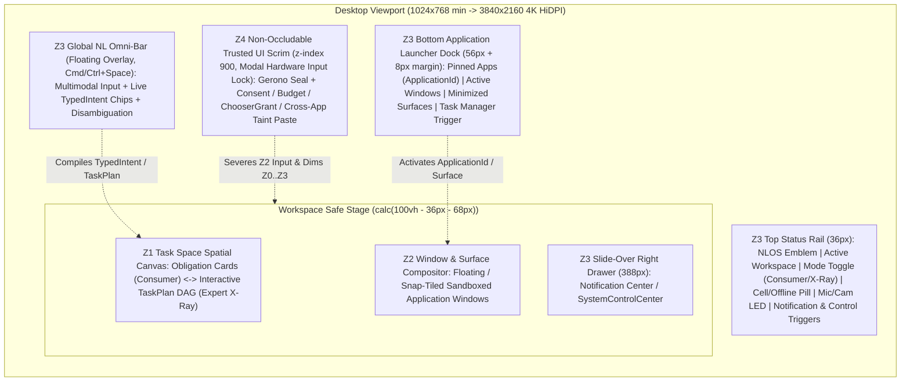

# 阶段 D 完整自然语言桌面视觉系统与交互架构设计规格（Glacier Hybrid Desktop Specification）

- **日期**: 2026-10-26
- **状态**: `DESIGN` only（本文件为阶段 D 实现车道的权威视觉与交互工程蓝图；无阶段 D 新产品代码、无阶段 D 验证 Evidence、不改写当前规范正文。在各 `D-*` 工作包合入并产出可复现测试证据前，严禁将本文件中的任何能力声称为“已实现”或“生产可用”）
- **波次**: `W68-D-VISUAL-UX-SPEC`（Task `W68-D-VISUAL-UX-SPEC`, Attempt 1）
- **写集**: 本文件与同车道架构决策 [ADR-0025](../../management/adrs/0025-stage-d-hybrid-desktop-compositor-and-trusted-ui-layering.md)
- **权威输入与规范依据**:
  - [06-架构设计总纲-v0.5.md](../../design/06-架构设计总纲-v0.5.md)：§24（Intent 编译、`TaskPlan` 惰性物化与手工改图、`Trusted UI`、`ActionReceipt` 与撤销契约）、§25（`Task Space` 状态机、10 层手动调度 `ControlCommand`、§25.4 完整桌面 18 类系统对象与生命周期）、§14/§19（`[CONS-DECL-001]`、`[CONS-CTRL-001]` 非权威搜索边界）、§28.4（阶段 D 必交清单与退出门 `[ROAD-D-001]`）
  - [ADR-0025：阶段 D 混合自然语言桌面合成层、双模透视与可信 UI 防伪边界](../../management/adrs/0025-stage-d-hybrid-desktop-compositor-and-trusted-ui-layering.md)（维护者裁定 A1–A3 正式架构定案）
  - [ADR-0026：跨物理机传输与控制面共识扩展](../../management/adrs/0026-cross-physical-host-transport-and-consensus-expansion.md)（维护者裁定 A4：`Stage D || C-XHOST` 并行推进时的跨主机 Cell 拓扑健康与断连自治衔接）
  - [NLOS 站点设计系统 v10.6（`docs/site/DESIGN.md`）](../../site/DESIGN.md)（实测色彩、液态玻璃、轻字重排版、等宽工程纹理、细线流场与 Gerono 双纽线 `∞` 视觉契约）
  - [阶段 D 权威进度单（`docs/management/stage-d-progress.md`）](../../management/stage-d-progress.md)（工作包切分、波次依赖与退出门验收）
  - 既有桌面壳实现基线：[`desktop/README.md`](../../../desktop/README.md)、[`desktop/src/views/task-space/index.ts`](../../../desktop/src/views/task-space/index.ts)、[`desktop/src-tauri/src/lib.rs`](../../../desktop/src-tauri/src/lib.rs)、[`desktop/src-tauri/src/window_lifecycle.rs`](../../../desktop/src-tauri/src/window_lifecycle.rs)、[`crates/nlos-search/src/lib.rs`](../../../crates/nlos-search/src/lib.rs)

---

## 0. 治理边界与实现前置门（Governance & Waiting Gates）

根据维护者裁定 **A1–A4** 与 [渐进式披露规则](../../management/project-knowledge-progressive-disclosure.md)：

1. **并行推进纪律（`Stage D || C-XHOST`）**：阶段 D 桌面工作包与阶段 C 跨物理主机扩展（`C-XHOST`，[ADR-0026](../../management/adrs/0026-cross-physical-host-transport-and-consensus-expansion.md)）并行开发，互不阻塞单机本地自治主链（`[DUI-OFFLINE-001]`）；涉及多物理机 `Cell` 拓扑观测的徽标在本地单机配置下诚实显示 `LOCAL_SINGLE_NODE`，接入多 Cell 后自动投影分片与租约水位。
2. **零向后破坏原则**：重构 [`desktop/`](../../../desktop/README.md) 前端与 Tauri 后端时，阶段 B/C 已落地的认证读/写/成本/指标/表面集成测试（`W32-A..F`、`W33-F`、`W39-D`）及 GUI↔CLI `receipt_hex` 字节级等价探针必须保持 100% 绿灯。
3. **诚实分级纪律**：凡依赖 `D-IPC-ENUM` 新增只读枚举/订阅 IPC 面的视图模块，在对应后端 IPC 命令合入前严禁在前端伪造模拟数据；未接线能力一律渲染类型化缺口状态卡。

---

## 1. Glacier 双主题设计 Token 契约（`--nlos-*` CSS Custom Properties）

阶段 D 桌面完整继承并演进 [`docs/site/DESIGN.md`](../../site/DESIGN.md) v10.6 的 **“极暗藏青底 + 单一冰蓝主轴 + 高透液态玻璃 + 300 轻字重展示标题 + ≥12px 等宽工程纹理 + 零装饰性渐变”** 美学体系，建立默认深色 **`Abyssal Glacier`** 与内建浅色 **`Daylight Glacier`** 双套完备 Token。

### 1.1 色彩、表面、液态玻璃与阴影完整 CSS 变量表

以下契约直接对应 `D-TOKENS-KIT` 工作包产出的 `desktop/src/styles/tokens.css`：

```css
/* ==========================================================================
   NLOS Desktop Design System v1.0 — Glacier Dual-Theme Token Contract
   Source Authority: docs/site/DESIGN.md v10.6 + ADR-0025
   Strict Rule: ZERO decorative purple/teal/rainbow gradients.
   Monospace floor: >= 12px (0.75rem) across all viewports.
   ========================================================================== */

:root,
[data-nlos-theme="abyssal-glacier"] {
  color-scheme: dark;

  /* ---- 1. 画布与表面层级 (Surfaces & Canvas) ---- */
  --nlos-bg-canvas: #030710;                 /* Z0 极暗藏青主底色 (实测 rgb(3,7,16)) */
  --nlos-bg-band: #0d1322;                   /* Z1/Z3 次级区块带 (实测 rgb(13,19,34)) */
  --nlos-surface-1: #0a1220;                 /* 基础实心容器面 */
  --nlos-surface-2: #0d1626;                 /* 悬浮面板/二级容器面 */
  --nlos-surface-3: #161f34;                 /* 交互激活/表头/代码块底面 */
  --nlos-scrim-z4: rgba(3, 7, 16, 0.82);     /* Z4 安全幕布遮罩底 */

  /* ---- 2. 液态玻璃材质 (Liquid Glass: tint alpha <= 0.07) ---- */
  --nlos-glass-bg:
    linear-gradient(
      135deg,
      rgba(255, 255, 255, 0.042),
      rgba(255, 255, 255, 0.014) 42%,
      rgba(255, 255, 255, 0) 60%
    ),
    rgba(214, 238, 255, 0.032);
  --nlos-glass-bg-strong:
    linear-gradient(
      135deg,
      rgba(255, 255, 255, 0.060),
      rgba(255, 255, 255, 0.020) 42%,
      rgba(255, 255, 255, 0) 60%
    ),
    rgba(214, 238, 255, 0.052);
  --nlos-glass-chrome-z3:
    linear-gradient(
      180deg,
      rgba(255, 255, 255, 0.055),
      rgba(214, 238, 255, 0.028)
    ),
    rgba(10, 18, 32, 0.68);                  /* Z3 顶栏/Dock/Omni-Bar 保证跨复杂窗口可读性 */
  --nlos-glass-z4-dialog:
    linear-gradient(
      145deg,
      rgba(127, 200, 255, 0.085),
      rgba(255, 255, 255, 0.024) 48%,
      rgba(3, 7, 16, 0.92)
    ),
    #07101f;                                 /* Z4 最高可信度防伪模态面 */
  --nlos-glass-blur: 16px;
  --nlos-glass-blur-heavy: 22px;
  --nlos-glass-saturate: 2.0;

  /* ---- 3. 镜面描边与结构边界 (Borders & Specular Edges) ---- */
  --nlos-border-subtle: #161f34;             /* 隐性结构分隔线 (1px) */
  --nlos-border-visible: #2f4b68;            /* 可见控件/窗口描边 (1px) */
  --nlos-border-strong: #1e3c5a;             /* 焦点外环辅线 (2px) */
  --nlos-glass-highlight: rgba(255, 255, 255, 0.40);
  --nlos-glass-edge-top: rgba(255, 255, 255, 0.46);
  --nlos-glass-edge-bottom: rgba(127, 200, 255, 0.11);
  --nlos-glass-edge-top-hover: rgba(255, 255, 255, 0.64);
  --nlos-glass-edge-bottom-hover: rgba(127, 200, 255, 0.22);
  --nlos-border-z4-seal: #7fc8ff;            /* Z4 防伪光框主描边 */
  --nlos-focus-ring: #7fc8ff;                /* 键盘无障碍焦点环 (2px solid, offset 2px) */

  /* ---- 4. 文本与主交互墨色 (Ink & Typography Colors) ---- */
  --nlos-ink-primary: #7fc8ff;               /* 冰蓝主标题/系统锚点 (WCAG contrast vs #030710: 11.4:1) */
  --nlos-ink-dim: rgba(127, 200, 255, 0.58);
  --nlos-ink-faint: rgba(127, 200, 255, 0.12);
  --nlos-text-strong: #ffffff;               /* 最高强调值/关键金额与主标题焦点 (19.8:1) */
  --nlos-text-primary: #cce9ff;              /* 标准正文 (15.6:1) */
  --nlos-text-secondary: rgba(204, 233, 255, 0.68); /* 次级说明正文 (>= 7.2:1) */
  --nlos-text-muted: rgba(204, 233, 255, 0.50);     /* 辅助元数据 (>= 4.6:1, 满足 AA) */
  --nlos-cta-bg: #e5f4ff;                    /* 主按钮冰白底 */
  --nlos-cta-fg: #030710;                    /* 主按钮深藏青字 (17.5:1) */
  --nlos-cta-bg-hover: #ffffff;

  /* ---- 5. 语义状态色 (Semantic State Tokens — 仅用于 1px 胶囊边与 6px 状态点) ---- */
  --nlos-state-running-fg: #7fc8ff;
  --nlos-state-running-bg: rgba(127, 200, 255, 0.12);
  --nlos-state-running-border: rgba(127, 200, 255, 0.45);

  --nlos-state-consent-fg: #e5f4ff;
  --nlos-state-consent-bg: rgba(127, 200, 255, 0.18);
  --nlos-state-consent-border: #7fc8ff;

  --nlos-state-resource-fg: #f0b866;         /* WAITING_RESOURCE: 钢琥珀预警 */
  --nlos-state-resource-bg: rgba(240, 184, 102, 0.11);
  --nlos-state-resource-border: rgba(240, 184, 102, 0.44);

  --nlos-state-network-fg: #9ec0e6;          /* WAITING_NETWORK: 离线自治待联网雾钢蓝 */
  --nlos-state-network-bg: rgba(158, 192, 230, 0.10);
  --nlos-state-network-border: rgba(158, 192, 230, 0.42);

  --nlos-state-quarantined-fg: #f29a6b;      /* QUARANTINED: 隔离围栏赭橙 */
  --nlos-state-quarantined-bg: rgba(242, 154, 107, 0.12);
  --nlos-state-quarantined-border: rgba(242, 154, 107, 0.48);

  --nlos-state-disputed-fg: #c2bef2;         /* DISPUTED: 多方回执分歧冷紫钢 (非渐变) */
  --nlos-state-disputed-bg: rgba(194, 190, 242, 0.12);
  --nlos-state-disputed-border: rgba(194, 190, 242, 0.46);

  --nlos-state-completed-fg: #75dfb8;        /* COMPLETED: 冰薄荷终态 */
  --nlos-state-completed-bg: rgba(117, 223, 184, 0.10);
  --nlos-state-completed-border: rgba(117, 223, 184, 0.40);

  --nlos-state-failed-fg: #ff858d;           /* FAILED: 尸检红高可读前景 */
  --nlos-state-failed-accent: #e5636c;       /* 承自 DESIGN.md --danger */
  --nlos-state-failed-bg: rgba(229, 99, 108, 0.13);
  --nlos-state-failed-border: rgba(229, 99, 108, 0.52);

  /* ---- 6. 层级阴影与防伪光晕 (Elevation & Z4 Seal Glow) ---- */
  --nlos-shadow-card:
    0 6px 24px -8px rgba(0, 0, 0, 0.52),
    inset 0 1px 0 0 var(--nlos-glass-highlight);
  --nlos-shadow-window:
    0 18px 48px -12px rgba(0, 0, 0, 0.72),
    0 0 0 1px var(--nlos-border-visible),
    inset 0 1px 0 0 rgba(255, 255, 255, 0.28);
  --nlos-shadow-omnibar:
    0 20px 56px -10px rgba(0, 0, 0, 0.78),
    0 0 0 1px rgba(127, 200, 255, 0.36),
    inset 0 1px 0 0 rgba(255, 255, 255, 0.44);
  --nlos-shadow-z4-seal:
    0 28px 80px -12px rgba(0, 0, 0, 0.88),
    0 0 0 1px #7fc8ff,
    0 0 28px rgba(127, 200, 255, 0.24),
    inset 0 1px 0 0 rgba(255, 255, 255, 0.52);
}

/* ==========================================================================
   Daylight Glacier (Built-in Light Theme — DESIGN.md #F2FAFF / #006DDD)
   ========================================================================== */
[data-nlos-theme="daylight-glacier"] {
  color-scheme: light;

  --nlos-bg-canvas: #f2faff;                 /* 冰川浅底 (实测 rgb(242,250,255)) */
  --nlos-bg-band: #e5f3fc;                   /* 浅色区块带 */
  --nlos-surface-1: #ffffff;                 /* 纯净卡片面 */
  --nlos-surface-2: #f7fcff;                 /* 次级容器面 */
  --nlos-surface-3: #dceefa;                 /* 激活/表头/代码底面 */
  --nlos-scrim-z4: rgba(230, 243, 252, 0.86);

  --nlos-glass-bg:
    linear-gradient(
      135deg,
      rgba(255, 255, 255, 0.78),
      rgba(255, 255, 255, 0.52) 55%,
      rgba(242, 250, 255, 0.46)
    ),
    rgba(255, 255, 255, 0.62);
  --nlos-glass-bg-strong:
    linear-gradient(
      135deg,
      rgba(255, 255, 255, 0.90),
      rgba(242, 250, 255, 0.76)
    ),
    rgba(255, 255, 255, 0.78);
  --nlos-glass-chrome-z3: rgba(246, 252, 255, 0.84);
  --nlos-glass-z4-dialog: #ffffff;
  --nlos-glass-saturate: 1.45;

  --nlos-border-subtle: rgba(3, 7, 16, 0.11);
  --nlos-border-visible: rgba(3, 7, 16, 0.22);
  --nlos-border-strong: rgba(0, 109, 221, 0.42);
  --nlos-glass-highlight: rgba(255, 255, 255, 0.92);
  --nlos-glass-edge-top: rgba(255, 255, 255, 0.95);
  --nlos-glass-edge-bottom: rgba(3, 7, 16, 0.09);
  --nlos-glass-edge-top-hover: #ffffff;
  --nlos-glass-edge-bottom-hover: rgba(0, 109, 221, 0.28);
  --nlos-border-z4-seal: #006ddd;
  --nlos-focus-ring: #006ddd;

  --nlos-ink-primary: #006ddd;               /* 实测浅底强调蓝 (WCAG contrast vs #F2FAFF: 5.12:1) */
  --nlos-ink-dim: rgba(0, 109, 221, 0.68);
  --nlos-ink-faint: rgba(0, 109, 221, 0.09);
  --nlos-text-strong: #030710;               /* 极暗藏青黑字 (18.8:1) */
  --nlos-text-primary: #081120;              /* 正文主色 (17.4:1) */
  --nlos-text-secondary: rgba(3, 7, 16, 0.68); /* 次级正文 (>= 7.1:1) */
  --nlos-text-muted: rgba(3, 7, 16, 0.54);     /* 辅助元数据 (>= 4.7:1, 满足 AA) */
  --nlos-cta-bg: #006ddd;
  --nlos-cta-fg: #ffffff;                    /* 对比度 5.4:1 */
  --nlos-cta-bg-hover: #0058b3;

  --nlos-state-running-fg: #0058b3;
  --nlos-state-running-bg: rgba(0, 109, 221, 0.10);
  --nlos-state-running-border: rgba(0, 109, 221, 0.42);

  --nlos-state-consent-fg: #004a99;
  --nlos-state-consent-bg: rgba(0, 109, 221, 0.14);
  --nlos-state-consent-border: #006ddd;

  --nlos-state-resource-fg: #8a4f00;
  --nlos-state-resource-bg: rgba(184, 108, 0, 0.10);
  --nlos-state-resource-border: rgba(184, 108, 0, 0.40);

  --nlos-state-network-fg: #34506e;
  --nlos-state-network-bg: rgba(52, 80, 110, 0.09);
  --nlos-state-network-border: rgba(52, 80, 110, 0.36);

  --nlos-state-quarantined-fg: #9e3c06;
  --nlos-state-quarantined-bg: rgba(181, 71, 8, 0.10);
  --nlos-state-quarantined-border: rgba(181, 71, 8, 0.42);

  --nlos-state-disputed-fg: #463ea8;
  --nlos-state-disputed-bg: rgba(78, 70, 180, 0.10);
  --nlos-state-disputed-border: rgba(78, 70, 180, 0.38);

  --nlos-state-completed-fg: #0b6b4b;
  --nlos-state-completed-bg: rgba(14, 122, 86, 0.10);
  --nlos-state-completed-border: rgba(14, 122, 86, 0.38);

  --nlos-state-failed-fg: #b41e2c;
  --nlos-state-failed-accent: #c82838;
  --nlos-state-failed-bg: rgba(200, 40, 56, 0.10);
  --nlos-state-failed-border: rgba(200, 40, 56, 0.44);

  --nlos-shadow-card:
    0 4px 18px -6px rgba(3, 7, 16, 0.10),
    inset 0 1px 0 0 var(--nlos-glass-highlight);
  --nlos-shadow-window:
    0 16px 42px -10px rgba(3, 7, 16, 0.18),
    0 0 0 1px var(--nlos-border-visible);
  --nlos-shadow-omnibar:
    0 18px 48px -10px rgba(3, 7, 16, 0.20),
    0 0 0 1px rgba(0, 109, 221, 0.38);
  --nlos-shadow-z4-seal:
    0 24px 68px -12px rgba(3, 7, 16, 0.28),
    0 0 0 2px #006ddd,
    0 0 24px rgba(0, 109, 221, 0.18);
}

/* ==========================================================================
   Typography, Geometry, Z-Planes & Motion Tokens (Theme-Invariant)
   ========================================================================== */
:root {
  /* ---- 字体栈 (Font Stacks) ---- */
  --nlos-font-display:
    -apple-system, BlinkMacSystemFont, "SF Pro Display", "Segoe UI Variable Display",
    "PingFang SC", "Hiragino Sans GB", "Microsoft YaHei", "Noto Sans CJK SC", sans-serif;
  --nlos-font-sans:
    -apple-system, BlinkMacSystemFont, "SF Pro Text", "Segoe UI",
    "PingFang SC", "Hiragino Sans GB", "Microsoft YaHei", "Noto Sans CJK SC", sans-serif;
  --nlos-font-mono:
    ui-monospace, "SF Mono", SFMono-Regular, "Cascadia Mono", Menlo, Consolas,
    "Liberation Mono", "Noto Sans Mono CJK SC", monospace;

  /* ---- 字号与行高阶梯 (Type Scale — 等宽下限严格 >= 12px) ---- */
  --nlos-fs-mono-floor: 0.75rem;   /* 12px — 绝对最小字号下限，严禁 10px/11px */
  --nlos-fs-mono-sm: 0.8125rem;    /* 13px — 表格、回执 hex、代际标签 */
  --nlos-fs-ui-sm: 0.8125rem;      /* 13px — 紧凑按钮、辅助说明 */
  --nlos-fs-ui-base: 0.875rem;     /* 14px — 桌面标准控件与列表正文 */
  --nlos-fs-card-body: 0.9375rem;  /* 15px — Consumer 义务卡主文案 */
  --nlos-fs-reading: 1rem;         /* 16px — 详情阅读与设置说明 (行高 1.55) */
  --nlos-fs-title-sm: 1.0625rem;   /* 17px — 卡片/窗口标题 (字重 500) */
  --nlos-fs-title-md: 1.375rem;    /* 22px — 抽屉/模态框主标题 (字重 300, -0.02em) */
  --nlos-fs-display-lg: 2rem;      /* 32px — 空闲舞台问候/大数字指标 (字重 300, -0.03em) */
  --nlos-fs-stat-hero: 2.75rem;    /* 44px — 资源/配额核心读数 (字重 300, tabular-nums) */

  /* ---- 间距与几何圆角 (Spacing & Radii — 6px 占绝对主导) ---- */
  --nlos-sp-1: 4px;
  --nlos-sp-2: 8px;
  --nlos-sp-3: 12px;
  --nlos-sp-4: 16px;
  --nlos-sp-5: 24px;
  --nlos-sp-6: 32px;
  --nlos-sp-7: 48px;

  --nlos-radius-xs: 4px;           /* 内嵌代码片/快捷键 kbd */
  --nlos-radius-s: 6px;            /* 主导圆角：按钮、输入框、义务卡、设置行 */
  --nlos-radius-m: 8px;            /* Z2 窗口外框、Omni-Bar、Z4 安全模态框 */
  --nlos-radius-pill: 999px;       /* 状态胶囊与非权威搜索徽标 */

  /* ---- 桌面壳安全区几何 (Shell Safe-Area Geometry) ---- */
  --nlos-rail-h: 36px;             /* Z3 顶部状态轨高度 */
  --nlos-dock-h: 56px;             /* Z3 底部 Dock 本体高度 */
  --nlos-dock-margin-b: 8px;       /* Dock 距视口底边悬浮留白 */
  --nlos-dock-safe-h: 68px;        /* Z1/Z2 底部安全避让总高 */
  --nlos-drawer-w: 388px;          /* 右侧通知/控制抽屉标准宽 */
  --nlos-omnibar-max-w: 720px;     /* 全局 Omni-Bar 最大宽 */

  /* ---- 五平面 Z 轴栈序 (5-Plane Z-Index Contract) ---- */
  --nlos-z0-ambient: 0;
  --nlos-z1-task-space: 100;
  --nlos-z2-window-base: 200;      /* Z2 活动窗口在 [200..299] 区间内按 MRU 递增 */
  --nlos-z3-chrome-rail: 400;
  --nlos-z3-chrome-dock: 410;
  --nlos-z3-chrome-drawer: 430;
  --nlos-z3-omnibar: 460;
  --nlos-z4-trusted-scrim: 900;    /* 最高特权安全幕布，任何 Z1..Z3 浮层严禁 >= 900 */

  /* ---- 动效曲线与时长 (Motion Curves — DESIGN.md power3.out) ---- */
  --nlos-ease-power3-out: cubic-bezier(0.215, 0.61, 0.355, 1);
  --nlos-ease-standard: cubic-bezier(0.22, 0.61, 0.36, 1);
  --nlos-dur-fast: 140ms;
  --nlos-dur-base: 220ms;
  --nlos-dur-enter: 380ms;         /* 桌面面板入场上限 (位移 6-8px, 弱模糊 <= 1.25px) */
}

/* ---- 透明度与毛玻璃降级兜底 ---- */
@supports not (backdrop-filter: blur(1px)) {
  :root,
  [data-nlos-theme="abyssal-glacier"] {
    --nlos-glass-bg: rgba(10, 18, 32, 0.96);
    --nlos-glass-bg-strong: rgba(13, 22, 38, 0.98);
    --nlos-glass-chrome-z3: rgba(8, 14, 26, 0.98);
  }
  [data-nlos-theme="daylight-glacier"] {
    --nlos-glass-bg: rgba(255, 255, 255, 0.97);
    --nlos-glass-bg-strong: #ffffff;
    --nlos-glass-chrome-z3: rgba(246, 252, 255, 0.98);
  }
}

@media (prefers-reduced-transparency: reduce) {
  :root,
  [data-nlos-theme="abyssal-glacier"] {
    --nlos-glass-blur: 0px;
    --nlos-glass-blur-heavy: 0px;
    --nlos-glass-bg: #0a1220;
    --nlos-glass-bg-strong: #0d1626;
    --nlos-glass-chrome-z3: #08101d;
  }
  [data-nlos-theme="daylight-glacier"] {
    --nlos-glass-blur: 0px;
    --nlos-glass-blur-heavy: 0px;
    --nlos-glass-bg: #ffffff;
    --nlos-glass-bg-strong: #f7fcff;
    --nlos-glass-chrome-z3: #eaf5fc;
  }
}

@media (prefers-reduced-motion: reduce) {
  :root {
    --nlos-dur-fast: 0ms;
    --nlos-dur-base: 0ms;
    --nlos-dur-enter: 0ms;
  }
}
```

### 1.2 全状态语义映射表（`§25` `Task` 状态机 + 隔离态）

为防止色相泛滥，所有状态胶囊统一采用 `1px solid var(--nlos-state-*-border)` + `6px` 几何状态指示符 + `12px` 等宽大写英文/双语标签（语义同时靠形状与文字传达，色盲用户零信息损失）：

| 规范状态枚举 | 形状指示符 | 绑定色彩族 | Consumer 模式人类可读文案（`zh-CN` / `en-US`） |
|---|---|---|---|
| `DRAFT` / `PROPOSED` | 空心圆 `○` | `--nlos-ink-dim` | 待启动草稿 / Draft Proposal |
| `WAITING_CONSENT` | 双环星点 `◉` | `state-consent` | **需要您确认权限或预算** / Waiting for Approval |
| `AUTHORIZED` / `RUNNING` / `COMPLETING` | 实心冰蓝脉冲点 `●` | `state-running` | 正在执行 / Running |
| `WAITING_INPUT` | 菱形提示 `◆` | `state-consent` | **等待补充说明** / Needs Input |
| `WAITING_RESOURCE` | 半满方框 `◧` | `state-resource` | 排队等待算力或配额 / Waiting for Quota |
| `WAITING_NETWORK` | 虚线圆环 `◌` | `state-network` | 等待网络连接（本地继续可用） / Waiting for Network |
| `SUSPENDED` / `CANCELLING` / `CANCELLED` | 双竖暂停杠 `‖` / `×` | `--nlos-text-muted` | 已暂停 / 已取消 / Paused · Cancelled |
| `RECOVERING` | 顺时针弧矢 `↻` | `state-resource` | 自动对账恢复中 / Recovering |
| `QUARANTINED` | 双斜杠隔离框 `[//]` | `state-quarantined` | **已安全隔离限制** / Quarantined |
| `DISPUTED` | 分叉天平 `⚖` | `state-disputed` | **结果待核验（存在分歧）** / Disputed Receipt |
| `PARTIAL` | 半实心圆 `◐` | `state-resource` | 部分完成（含未成功项） / Partially Completed |
| `COMPLETED` | 精确勾号 `✓` | `state-completed` | 已完成 / Completed |
| `FAILED` | 尸检十字章 `✕` | `state-failed` | 未能完成 / Failed |

### 1.3 Gerono 双纽线（`∞`）动态 Canvas 防伪印章规格

承袭 [`DESIGN.md`](../../site/DESIGN.md) v10.5 / v10.5.1，桌面在两处关键系统锚点使用 **Gerono 双纽线（Lemniscate of Gerono）** 参数绘制原生标志与防伪印章：（a）`Z3` 顶部状态轨最左侧 `NLOS` 系统主徽标（`28×16px` 紧凑静态/轻呼吸态）；（b）`Z4` 可信安全确认框顶部中央 **动态防伪印章（`72×36px`）**：

1. **参数方程与中心十字光轴**：
   设画布几何中心为 $(C_x, C_y)$，水平半幅 $A$ 与垂直半幅 $B$ 保持 $A : B = 2.15 : 1$（`Z4` 印章中取 $A = 28\text{px}, B = 13\text{px}$）：
   $$x(t) = C_x + A \cos(t), \quad y(t) = C_y + B \sin(2t), \quad t \in [0, 2\pi)$$
   底层绘制正交十字细光轴（水平轴长 $: $ 垂直轴长 $= 1.54 : 1$），双纽线中心自交点与十字交点、中心高亮星点严格同坐标 $(C_x, C_y)$。
2. **双中心反演对称彗尾（Dual Symmetric Comet Tails）**：
   - 先以 `1px` 低亮底线（深色 `rgba(127, 200, 255, 0.22)` / 浅色 `rgba(0, 109, 221, 0.22)`）绘制完整闭合双纽线；
   - 主彗尾沿参数 $t_0(\tau) = 2\pi (\tau \bmod T) / T$（周期 $T = 4.8\text{s}$）切分 **62 段**渐亮弧段，线宽从尾端 `0.8px` 过渡至头部 `2.0px`，透明度从 `0.02` 指数递增至 `0.98`；
   - 第二条彗尾逐段执行严格中心反演 $P_2(t) = P(\pi - t) = 2C - P_1(t)$，保证左右两翼的位置、尾长、曲率与光度在任意时刻 **100% 中心对称**。
3. **帧率门控与多层降级兜底**：
   - `Z4` 未打开时循环完全停止（零后台 GPU/CPU 消耗）；`Z4` 激活期间以 `60fps` 运行（文档失焦或隐藏时通过 `visibilitychange` 立即暂停）；
   - `prefers-reduced-motion: reduce` 激活时，不启动 `requestAnimationFrame`，一次性渲染 $t_0 = \pi / 4$ 处的静态高对比双彗尾定格帧；
   - Canvas 上下文不可用时，回退为内联纯数学 Unicode 字形 `∞`（`U+221E`，严禁使用带外圆环的 Emoji `♾︎`）。

---

## 2. 空间桌面线框图、五平面合成几何与全局快捷键

### 2.1 五平面空间合成架构图（`Z0 → Z4`）



### 2.2 全视口结构化 ASCII 线框图（1440×900 混合工作态 + Z4 防伪态示意）

```text
+------------------------------------------------------------------------------------------------------+
| [∞ NLOS]  Workspace: Personal ▾  |  [Consumer ● / X-Ray ⌘⇧E]     [LOCAL · 2 CELLS OK] [🎙] [🔔 2] [⚙] | <- Z3 Top Status Rail (36px)
+------------------------------------------------------------------------------------------------------+
|                                                                                                      |
|    +--------------------------------------------------------------------------------------------+    |
|    | ⌘Space  "整理本周实验日志并让笔记应用生成周报草稿，预算不超过 20 积分"       [🎙] [📎] [↵] |    | <- Z3 Omni-Bar Overlay
|    | INTENT: summarize_and_draft · APP: Notes (app_8f2a) · BOUND: <= 20 credits · [REVERSIBLE]  |    |
|    +--------------------------------------------------------------------------------------------+    |
|                                                                                                      |
|  +-- Z1: TASK SPACE (Active Obligations) --------+  +-- Z2: APP WINDOW (Sandboxed Surface) --------+ |
|  |                                               |  | [●] Notes — 周报草稿.md   [gen:3] [_][□][✕]  | | <- Trusted Z2 Frame
|  |  [◉ 需要您确认] 跨应用读取实验归档并写入周报  |  | +------------------------------------------+ | |
|  |  应用: Notes · 预计消耗: <= 20 积分           |  | |                                          | | |
|  |  可撤销性: [可无损撤销 REVERSIBLE]            |  | |  # 本周实验进展摘要                      | | |
|  |  [在安全窗口中审阅并授权 ↗]      [取消任务]   |  | |  (运行于隔离源 nlos-surface://...        | | |
|  |  -------------------------------------------  |  | |   物理裁剪于此内框，无法越界绘制到 Z3/Z4)| | |
|  |  [● 正在执行] 本地代码仓库索引增量同步        |  | |                                          | | |
|  |  应用: RepoIndexer · 消耗: 6 / 15 [████░░░░]  |  | |                                          | | |
|  |  [暂停 ⌘.]  [展开详情]                        |  | +------------------------------------------+ | |
|  |                                               |  +----------------------------------------------+ |
|  |  [◌ 等待网络] 远端论文引用元数据补全          |                                                   |
|  |  本地草稿已就绪；恢复联网后自动续传           |                                                   |
|  +-----------------------------------------------+                                                   |
|                                                                                                      |
|                  +----------------------------------------------------------------+                  |
|                  |  [Apps ⊞] | [Notes ●] [RepoIndexer ●] [Files] | [📊 系统与任务] |                  | <- Z3 Launcher Dock (56px)
|                  +----------------------------------------------------------------+                  |
+------------------------------------------------------------------------------------------------------+

=== 当点击 [在安全窗口中审阅并授权] 或触发权限/ChooserGrant 时，Z4 全屏不可遮挡幕布接管焦点 ===

+------------------------------------------------------------------------------------------------------+
| [∞ NLOS]  [🔒 TRUSTED SECURITY PROMPT · Z4 ACTIVE — 应用窗口输入已物理隔离]           [Seal: 蓝鲸-07] | <- Z3 顶栏硬件信标同步点亮
+------------------------------------------------------------------------------------------------------+
|  ░░░░░░░░░░░░░░░░░░░░░░░ Z4 SECURITY SCRIM (backdrop-filter: blur(22px)) ░░░░░░░░░░░░░░░░░░░░░░░░░░  |
|  ░░               +--------------------------------------------------------------+               ░░  |
|  ░░               |                   [  Canvas Gerono ∞ Seal  ]                 |               ░░  |
|  ░░               |              系统可信授权确认 · TRUSTED CONSENT              |               ░░  |
|  ░░               |  请求应用: Notes (ApplicationId: 8f2a...c901 · gen 3 · 已验签)|               ░░  |
|  ░░               |  操作目的: 读取 3 份实验日志 Artifact 并创建《周报草稿.md》  |               ░░  |
|  ░░               |  权限范围: Artifact.Read (仅限选定 3 项) · 有效期: 本任务内  |               ░░  |
|  ░░               |  资源上限: <= 20 积分 (GuaranteeTier: BOUNDED)               |               ░░  |
|  ░░               |  副作用级: REVERSIBLE (生成新草稿修订版，不覆盖原日志)       |               ░░  |
|  ░░               |                                                              |               ░░  |
|  ░░               |  [ 拒绝 (Esc) ]            [ 仅本次任务批准 (350ms 防劫持) ] |               ░░  |
|  ░░               +--------------------------------------------------------------+               ░░  |
+------------------------------------------------------------------------------------------------------+
```

### 2.3 视口网格与 `Z2` 窗口磁吸平铺区（Window Snap Zones）

工作舞台安全区严格定义为 `StageRect = { top: 36px, bottom: calc(100vh - 68px), left: 0, right: 100vw }`。`Z2` 窗口管理器支持指针拖拽至边缘磁吸与纯键盘快捷键平铺，所有预设几何均留出 `8px` 呼吸间隙（露出底层 `Z0` 流场与 `Z1` 状态边缘光）：

| 磁吸/布局模式 | 几何区域（相对于 `StageRect`） | 交互行为与 `Z1` 协同语义 |
|---|---|---|
| **Stage-Center Float（默认舞台居中悬浮）** | 宽 `72%`（最大 `1120px`），高 `82%`，居中对齐 | 打开单个应用时的默认态；两侧微露 `Z1` 任务状态边缘，点击舞台空白处可一键切回 `Z1` 全景。 |
| **Stage-Split Hybrid（左任务空间 + 右应用窗口）** | `Z1` 固定左半屏 `44%`，活动 `Z2` 窗口磁吸右半屏 `56%` | 混合自然语言桌面的黄金工作态：左侧实时观察多任务进度或 DAG，右侧操作目标应用表面。 |
| **Left Half / Right Half（左右二分屏）** | 左 `[8px, 50% - 4px]` / 右 `[50% + 4px, 100% - 8px]`，高 `100% - 16px` | 拖拽窗口标题栏至视口左/右边缘 `<= 16px` 触发冰蓝 `1px` 预览虚框，松手磁吸。 |
| **Quadrants（四象限平铺 `TL / TR / BL / BR`）** | 宽 `50% - 12px`，高 `50% - 12px` | 拖拽窗口至视口四角触发，适合高分辨率屏幕（`>= 1920×1080`）多应用对比。 |
| **Workspace Maximize（安全区内最大化）** | 占满 `StageRect`（留 `4px` 外边距） | 铺满工作舞台，但**绝不遮挡 `Z3` 顶部 36px 状态轨与底部 Dock**，防止全屏应用伪造系统壳。 |
| **Minimize-to-Dock（最小化归槽）** | 收拢至底部 `Z3` Dock 对应 `ApplicationId` 槽位 | `Window` 状态转入 `MINIMIZED`，关联 `Surface` 转入 `HIDDEN`（停止子表面帧渲染以省电），Dock 图标下方亮起冰蓝小圆点。 |

### 2.4 全局键盘快捷键规范表（Global Keyboard Shortcuts）

| 快捷键（macOS / Windows & Linux） | 触发平面 | 动作与规范约束 |
|---|---|---|
| `⌘ + Space` / `Ctrl + Space` | `Z3` | 唤起或收起 **全局自然语言 Omni-Bar**（长按可进入按住说话语音输入态，受 `DevicePermissionState` 门控）。 |
| `⌘ + K` / `Ctrl + K` | `Z3` | 唤起 **全局非权威 Spotlight 搜索与快捷跳转面板**（强制带 `NON-AUTHORITATIVE · 0x1F` 徽标）。 |
| `⌘ + Shift + E` / `Ctrl + Shift + E` | `Z1` / `Z3` | 一键原地切换 **Consumer Clean Mode ↔ Expert X-Ray Mode**（`[CTRL-PLAN-001]`，零状态丢失）。 |
| `⌘ + .` / `Ctrl + .` | `Z1` / `Z3` | **安全紧急暂停（Safe Pause）**：对当前焦点 `Task` 或活动 `Operation` 立即编译派发 `pause` `ControlCommand`（`[CTRL-SAFETY-001]`）。 |
| `⌘ + Shift + M` / `Ctrl + Shift + M` | `Z2` / `Z3` | 打开或聚焦 **`TaskManagerSurface` / `ResourceMonitorSurface`** 十层系统控制台。 |
| `⌘ + ,` / `Ctrl + ,` | `Z2` / `Z3` | 打开 **四层系统设置与密钥引用管理（`SettingsDomain` & `KeychainReference`）**。 |
| `⌃ + ⌥ + ← / →` / `Win + Alt + ← / →` | `Z2` | 将当前焦点 `Z2` 窗口磁吸至左半屏 / 右半屏（满足 `WCAG 2.5.7` 免拖拽键盘平铺）。 |
| `⌃ + ⌥ + ↑ / ↓` / `Win + Alt + ↑ / ↓` | `Z2` | 将当前焦点 `Z2` 窗口在安全区内最大化 / 还原或最小化至 Dock。 |
| `⌘ + L` / `Ctrl + Alt + L` | `Z4` | 立即锁定当前 `DesktopSession`（`ACTIVE → LOCKED`，使旧会话输入代际立即失效 `[DUI-SESSION-001]`）。 |
| `Escape` | `Z3` / `Z4` | 在 `Z4` 中始终绑定“安全拒绝 / 取消本次授权请求”（零副作用退出）；在 `Z3` 中关闭当前浮层抽屉。 |
| `F6` / `Shift + F6` | `Z1..Z4` | 在五大无障碍地标（Top Rail → Omni-Bar → Task Space → Active App Window → Dock）间循环跳转焦点。 |

---

## 3. `v0.5 §25.4` 18 类桌面系统对象与 `§28.4` 核心功能模块详规

### 3.0 18 类桌面系统对象全覆盖映射总表

下表逐一对齐 [06-架构设计总纲-v0.5.md](../../design/06-架构设计总纲-v0.5.md) §25.4 列出的全部 18 个桌面系统对象（17 个具名对象 + `Workspace` 生命周期对象），确保零遗漏：

| # | §25.4 系统对象 | 所属平面 | 生命周期 / 核心状态机 | 权威后端归属与规格章节 |
|---|---|---|---|---|
| 1 | `UserProfile` | `Z3` / `Z4` | 持久身份配置（含个人防钓鱼安全印记 `security_seal_hint`、语言与无障碍偏好） | `IdentityAuthority` + `SettingsDomain`（§3.4, §3.7） |
| 2 | `DesktopSession` | `Z3` / `Z4` | `LOCKED → ACTIVE ↔ SUSPENDED → CLOSED`（锁屏递增 `session_generation`） | Rust `SessionManager` + `FocusAndInputRoute`（§3.7） |
| 3 | `Workspace` | `Z1` / `Z3` | `CREATED → ACTIVE ↔ ARCHIVED → CLOSED`（隔离配额、通知策略与窗口布局集） | `Workspace` 控制器 + `SettingsDomain`（§3.7） |
| 4 | `ApplicationLauncher` | `Z3` | 按 `(ApplicationId, InstallationId)` 激活应用，展示运行态与后台任务计数 | `ApplicationAuthority`（§3.3，`[DUI-LAUNCH-001]`） |
| 5 | `SystemControlCenter` | `Z3` | 快捷控制抽屉（性能档位、后台等级暂停、设备权限总闸、工作区与会话锁） | `nlos-system-control` `ControlCommand`（§3.7，`[DUI-CONTROL-001]`） |
| 6 | `TaskManagerSurface` | `Z2` / `Z1` | §25.3 十层对象浏览与受控调度（暂停/取消/强杀两步武装/回执核验） | `nlos-system-control`（§3.7，`[DUI-CONTROL-001]`） |
| 7 | `ResourceMonitorSurface` | `Z2` | 三恢复域 OpenMetrics + 配额/水位/压力实时仪表盘与原始报文核对 | `nlos-system-control` + `ResourceAuthority`（§3.7） |
| 8 | `Surface` | `Z2` | `REGISTERED → CREATED → PRESENTED ↔ HIDDEN → CLOSED`（绑定安装代际） | `ApplicationAuthority` + [`window_lifecycle.rs`](../../../desktop/src-tauri/src/window_lifecycle.rs)（§3.3） |
| 9 | `Window` | `Z2` | `CREATED → VISIBLE ↔ MINIMIZED → CLOSING → CLOSED`（可信外框 + 磁吸几何） | Rust `DesktopCompositor`（§2.3, §3.3，`[DUI-WINDOW-001]`） |
| 10 | `FocusAndInputRoute` | 宿主路由 | 跟踪 `(surface_id, surface_gen, session_gen, z4_modal_lock)` 与输入源标签 | Rust 输入路由器（§3.3, §3.4，`[DUI-INPUT-001]`） |
| 11 | `ChooserGrant` | `Z4` | 系统文件/Artifact 选择器签发的 scoped `ArtifactCapability`（带过期时间） | `Z4` Chooser + `nlos-capability`（§3.4，`[DUI-CHOOSER-001]`） |
| 12 | `ClipboardItem` | `Z3` / `Z4` | 绑定 `(content_type, source_app, taint, expiry, user_gesture)` 的受控剪贴项 | Rust 剪贴板守卫（§3.4，`[DUI-CLIP-001]`） |
| 13 | `DragDropTransfer` | `Z2`..`Z4` | 跨表面/跨 Omni-Bar 拖拽事务（同源免打扰，跨应用敏感 Taint 升 `Z4` 确认） | Rust 拖拽守卫（§3.1, §3.4，`[DUI-CLIP-001]`） |
| 14 | `ContentTypeAssociation` | `Z2` 设置 | MIME/Artifact 类型默认打开应用映射表（包仅能提议，用户可查看与一键撤销） | `SettingsDomain` + `ApplicationAuthority`（§3.7，`[DUI-ASSOC-001]`） |
| 15 | `NotificationAction` | `Z3` | 绑定 `(notification_id, app_id, task_id, one_shot_action_token)` 的快捷动作 | 通知服务 + `ControlCommand`（§3.5，`[DUI-NOTIFY-001]`） |
| 16 | `SettingsDomain` | `Z2` 设置 | `system / user / workspace / application` 四层 CAS 更新与 watch 监听 | `SettingsAuthority` IPC 面（§3.7，`[DUI-SETTINGS-001]`） |
| 17 | `KeychainReference` | `Z2` / `Z4` | 仅向应用暴露 `keychain_ref_id` 句柄的凭据保险箱（零明文泄露） | `IdentityAuthority` / Vault（§3.7，`[DUI-SETTINGS-001]`） |
| 18 | `DevicePermissionState` | `Z3` / `Z4` | 麦克风/摄像头/屏幕采集/位置权限状态机与 `Z3` 顶栏硬件占用指示灯 | 系统设备权限表 + `Z4` 授权（§3.1, §3.7） |

---

### 3.1 全局自然语言 Omni-Bar 与多模态输入输出托盘（`D-OMNIBAR-MULTIMODAL`）

1. **多模态输入通道与设备状态可见性**：
   - **自然语言文本槽**：`16px` 正文字号，支持多行自动撑高（上限 `5` 行后内滚），支持 `@Application`、`#Artifact` 与 `/command` 结构化补全建议。
   - **受控语音流（Voice Push-to-Talk）**：点击麦克风图标或长按 `⌘/Ctrl + Space` 启动本地/受控语音采集；首次使用由 `Z4` 授予 `DevicePermissionState(MICROPHONE)`，采集期间 `Z3` 顶部状态轨点亮常驻冰蓝脉冲麦克风指示灯，松开后展示实时可编辑转写文本（绝不未经用户过目直接静默执行不可逆指令）。
   - **图像/屏幕选区与文件拖入（Multimodal Attachment Pills）**：支持粘贴截图、框选桌面局部区域或通过 `DragDropTransfer` 拖入本地文件/`Artifact`。每个附件渲染为带 MIME 类型、字节大小与 `ContentDigest` 前缀（X-Ray 模式可见）的 `6px` 圆角胶囊。

2. **实时 `TypedIntent` 编译预览芯片（`[NL-COMPILE-001]`）**：
   用户输入停顿 `280ms` 或按下预览键时，前端调用只读预编译接口获取候选 `TypedIntent`，在输入框正下方渲染一行高信噪比工程纹理摘要栏：
   - **Consumer 视图**：`目标应用: Notes` · `动作: 整理并生成草稿` · `预计成本上限: <= 20 积分` · `可无损撤销`；
   - **Expert X-Ray 视图**：额外追加 `schema: nlos.intent.v1`、`source_request_digest`、`compiler_digest` 与目标 `generation` 选择器。

3. **`[NL-AMBIG-001]` 高风险歧义强制澄清面板**：
   当 `TypedIntent.unresolved_ambiguities` 非空（例如用户说“清理旧备份”，同时匹配“移入可恢复归档（0 外部副作用）”与“永久物理删除 12 个归档对象（`IRREVERSIBLE`）”），Omni-Bar **严禁激活直接执行按钮**，而是在下方原地展开并列候选澄清卡：
   - 每张候选卡显式标出：**作用范围（对象数量）**、**权限变化**、**预计成本上限** 与 **可撤销等级（`REVERSIBLE` vs `IRREVERSIBLE`）**；
   - 默认高亮最小权限/可逆选项，用户必须显式点选其一重新绑定 `TypedIntent` 后方可进入提案准入。

4. **多模态输出托盘（Multimodal Output Tray）**：
   对于轻量即时问答或快速 Artifact 预览，Omni-Bar 下方直接滑出结果托盘（支持结构化 Markdown/表格、生成图片缩略图、TTS 语音播报进度条及“固定到 `Task Space` 持续追踪”按钮）；一旦任务转入后台多步执行，自动下沉为 `Z1` `Task Space` 义务卡片，Omni-Bar 立即释放且不阻塞后续操作（`[TASK-NOTIFY-001]`）。

---

### 3.2 `Task Space` 双模空间画布（`D-TASK-SPACE-DAG`）

`Z1` `Task Space` 是桌面的常驻核心舞台，覆盖 `§25` `[TASK-STATE-001]` 全部生命周期状态，并严格遵守 `[TASK-STATE-002]`（聚合状态，单进程退出不伪造任务终态）与 `[TASK-REOPEN-001]`（终态任务“重试”创建新 `TaskAttempt`，“修改目标”创建新 `Task generation`，并保留历史回执链跳转）。

#### A. Consumer Clean Mode（默认零行话义务卡片视图，`[ROAD-D-001]`）

画布按行动紧迫度分为三组垂直语义泳道（窄屏自动流式降为单列）：**① 待您决定（`WAITING_CONSENT` / `WAITING_INPUT` / `DISPUTED`）**、**② 正在进行（`RUNNING` / `WAITING_RESOURCE` / `WAITING_NETWORK` / `RECOVERING`）**、**③ 近期完成与中止（`COMPLETED` / `PARTIAL` / `FAILED` / `CANCELLED`）**。

每张 **Consumer 义务卡** 严格包含以下 6 项核心要素（`[TASK-VIS-001]`）：
1. **真实应用归属与自然语言目标标题**：左上角显示经核验的 `Application` 图标与人类可读名称，主标题使用 `15px` 清晰展示任务目标。
2. **状态胶囊与阶段进度说明**：使用 §1.2 标准状态点与白话进展（如“已完成 2/3 步：正在汇总实验数据”）。
3. **实时有界预算计量条（Bounded Cost Meter）**：以纯色 `4px` 细进度条渲染 `usage_high_water / upper_bound`（例如 `已用 14 / 上限 20 积分`），无任何呼吸霓虹渐变。
4. **`[RCPT-UNDO-001]` 可撤销性诚实徽章**：每张卡片及操作确认框恒显三态徽章之一：
   - `[↺ 可无损撤销 · REVERSIBLE]`：点击“撤销”可精确回退至上一 `Artifact` 代际；
   - `[⇄ 可补偿回滚 · COMPENSATABLE]`：明确提示“外部操作已发生，点击将执行冲正/补偿流程（如发送取消通知邮件）”；
   - `[! 不可逆外部效果 · IRREVERSIBLE]`：**物理禁用伪造的“撤销”按钮**，仅提供“查看已发生效果凭证”，杜绝 UI 假象掩盖真实外部副作用。
5. **`[RCPT-PARTIAL-001]` 逐目标部分失败展开清单**：当状态为 `PARTIAL` 时，严禁显示笼统绿色勾号，卡片内嵌列出成功目标数与失败目标数（如 `8 项已同步 · 2 项因权限不足跳过`），支持逐项查看或对失败子集发起新 `TaskAttempt`。
6. **直接受控动作栏**：提供 `暂停`、`继续`、`取消`、`打开产出物` 或 `审阅授权（跳转 Z4）` 按钮——后台 100% 编译为 `ControlCommand`。

#### B. Expert X-Ray Mode（专家透视与交互式 `TaskPlan` DAG 编辑器，`[CTRL-PLAN-001]`）

按下 `⌘/Ctrl + Shift + E`（或点击单张卡片右上角 `[X-RAY]` 切换键），卡片平滑展开为三栏工程透视工作台：

1. **交互式 `TaskPlan` DAG 画布（`[PLAN-DAG-001]`、`[PLAN-LAZY-001]`、`[PLAN-CHANGE-001]`、`[PLAN-OVERRIDE-001]`）**：
   - 使用 1px 冰蓝贝塞尔连接线与等宽节点框绘制完整有向无环图，实时标注每个 `TaskNode` 的 13 种精确状态（`DECLARED`、`BLOCKED_DEPENDENCY`、`ELIGIBLE`、`WAITING_AUTHORIZATION`、`WAITING_RESOURCE`、`MATERIALIZING`、`ACTIVE`、`CHECKPOINTED`、`EVICTED`、`REHYDRATING`、`COMPLETED`、`FAILED`、`CANCELLED`）及驻留层级（`residencyTier`）。
   - 用冰蓝虚线围栏框出当前 **惰性物化窗口（Materialization Window，`[PLAN-LAZY-001]`）**，直观展示窗口外节点处于 `0 Process / 0 Context Pin` 仅元数据态。
   - **图形化手工改图与双路径准入分流（`[PLAN-CHANGE-001]`）**：
     - 已进入 `ACTIVE / COMPLETED` 的节点锁定为历史只读态（显示锁定图标与原 `declared_revision`，禁止静默篡改）；
     - 对尚未执行的节点（`DECLARED / BLOCKED_DEPENDENCY / ELIGIBLE`），专家可执行 **暂停分支、调整显示/放置亲和性、收紧 fanout 上限、增删节点、替换节点角色或重连依赖边**；
     - **受限 `ControlCommand` 快速通道**：若改动仅涉及显示顺序、本地 placement 建议或在不扩大权限前提下**调低**配额/并发度，工具栏显示 `[直接应用受限调度 ControlCommand]`，经认证 IPC 直接更新；
     - **重编译与 `Z4` 重授权触发通道**：一旦改动新增了 `TaskNode`、改变了目标语义/输出契约、引入不可逆副作用、延长 deadline 或提高了资源上界，画布顶部立即亮起 `PLAN REVISION DIFF · RE-AUTHORIZATION REQUIRED` 横幅，点击提交后先生成新 `plan_digest` 提案并强制弹出 `Z4` 差异对比授权框（高亮新增权限与预算差额），签发新 `AuthorizationReceipt` 后方可生效（`[PLAN-OVERRIDE-001]`）。
2. **`TaskAttempt` 竞速泳道与 `TaskHead` CAS 仲裁轨**：
   - 并列展示同一任务或节点下的多个候选 `TaskAttempt`（如 `Attempt #1 [SUPERSEDED]` vs `Attempt #2 [WINNER · TaskHead CAS Committed]`），清晰标出各自快照水位、隔离域 `isolationDomainIdHex` 与 `LogicalEffect` 围栏纪元（`retry_fence_epoch`），不允许人工把失败 Attempt 强行标为已提交。
3. **跨层资源、协程与分布式 `Cell` 页脚**：
   - 显示绑定的 `Process`、`AgentInstance`、`ExecutionFiber`（含 `activeCpuMs`、`schedulerWaitMs`、`backpressureWaitMs` 及共享进程故障域提示）与所属 **`CellId` + `lease_epoch` 分片徽标**；
   - 底部恒显等宽 `control_command_id`、`receipt_hex` 一键复制按钮与 `[核验 CLI 字节一致性]` 触发器。

---

### 3.3 `Window` & `Surface` 合成器与 `ApplicationLauncher` Dock（`D-COMPOSITOR-WM`）

1. **`ApplicationLauncher` Dock 与全屏应用抽屉（`[DUI-LAUNCH-001]`）**：
   - 底部居中悬浮 `56px` 高液态玻璃 Dock：左侧为“全部应用网格（Apps Grid）”入口，中部为用户固定与当前运行中的 `Application` 图标，右侧分隔线后为回收/归档暂存槽与“系统与任务控制台（`TaskManagerSurface`）”常驻入口。
   - **严格身份纪律**：Dock 槽位、右键菜单与启动命令唯一绑定 `(ApplicationId, InstallationId)`，绝不以包文件 `PackageId` 或某个瞬态 `ProcessId` 作为启动键。右键悬停卡片展示该应用当前激活的窗口列表与后台 `Task` 数量（对应 `SurfacesPresentationDto.backgroundTasks`）。
2. **`Window` 外框与沙箱 `Surface` 视口绑定（`[DUI-WINDOW-001]`）**：
   - 每个 `Z2` 窗口顶部具有 `34px` 系统可信标题栏（由 `llmos-shell` 绘制，应用不可覆盖）：左侧显示已验证应用图标、声明 `title` 与只读代际胶囊 `gen:<N>`；右侧提供最小化、分屏磁吸菜单、安全区最大化与关闭按钮。
   - 窗口生命周期严格驱动 [`SurfaceLifecycle`](../../../desktop/src-tauri/src/window_lifecycle.rs)：创建窗口推进 `REGISTERED → CREATED → PRESENTED`；最小化推进 `Window: MINIMIZED` + `Surface: PRESENTED → HIDDEN`；关闭窗口推进 `Window: CLOSING → CLOSED` + `Surface: CLOSED` 并通知宿主销毁对应子 WebView / 沙箱容器。
3. **过期代际自动灰化与输入切断围栏（Stale Generation Dimming Fence）**：
   - 当包热更新推进 `ApplicationAuthority.current_installation_generation`（如从 `gen:1` 升至 `gen:2`），或应用被禁用（`status = disabled`）时，仍打开的 `gen:1` 表面立即触发围栏：
     - Rust `FocusAndInputRoute` 立即将该 `SurfaceId` 的输入路由置为拒绝态；
     - 前端 `Z2` 窗框立即对内层视口施加 `filter: grayscale(0.85) opacity(0.50); pointer-events: none;`，并在系统标题栏下方弹出不可关闭的冰蓝条幅：`表面代际已过期 (gen:1 → gen:2) · 旧表面已停止接收输入 [重新加载新代际表面] [关闭窗口]`。

---

### 3.4 `Z4` `Trusted UI` 安全幕布：权限确认、预算审批、`ChooserGrant` 与污染感知剪贴板（`D-TRUSTED-UI`）

`Z4` 是整套桌面的最高信任锚点，遵循统一防伪解剖结构：
- **顶部防伪头**：居中动态 **Gerono `∞` Canvas 印章** + 右上角 `UserProfile.security_seal_hint`（用户自定义防钓鱼词/图形徽记，应用不可读）+ 同步点亮 `Z3` 顶栏硬件信标；
- **密码学身份条**：展示 `Application` 人类可读名、图标及等宽可展开的 `ApplicationId`、`PrincipalId`、`InstallationGeneration` 与 `package_manifest_digest` 前后 8 位；
- **350ms 输入武装保护**：弹窗挂载前 `350ms` 内，主批准按钮显示细线倒计时环并忽略点击/空格/回车，`Escape` 拒绝键全程零延迟可用。

`Z4` 承载三类核心安全模态框：

1. **权限授予与高风险 `ActionProposal` / 预算审批框（`[TUI-CONSENT-001]`、`[NL-PROPOSE-001]`、`[NL-BIND-001]`）**：
   - 逐行结构化列出：**为什么需要（Purpose）**、**精确作用目标与预期修订号（Target Objects & Revisions）**、**申请的 `Capability` 列表**、**资源与金额上限（Resource Upper Bound & `GuaranteeTier`）**、**有效期（`valid_until`）** 以及 **可撤销性警告（若为 `IRREVERSIBLE`，以 `--nlos-state-failed-border` 醒目框出不可逆后果）**；
   - 提供显式范围衰减单选组（Scope Attenuation）：`仅本次操作有效（推荐）` / `在当前任务生命周期内有效` / `在当前工作区会话有效`；用户批准后签发绑定精确 `proposal_digest` 的 `AuthorizationReceipt`。
2. **Scoped 文件与 Artifact 选择器（`ChooserGrant`，`[TUI-CHOOSER-001]`、`[DUI-CHOOSER-001]`）**：
   - 当应用请求打开、导入、导出或分享对象时，由 `Z4` 渲染系统级 `Artifact` / 文件浏览器（支持按工作区、类型、最近修改过滤与安全只读预览）；
   - 选择器页脚明确公示将授予应用的最小权限：`将向 [Notes] 授予选定 2 个对象的只读能力 (READ_ONLY · 24h 后自动失效)，不暴露磁盘路径`；
   - 确认后仅向调用方返回 `ChooserGrant`（scoped `ArtifactCapability` 句柄列表），应用全程无法获知 `/Users/...` 或 `D:\...` 宿主真实路径，更无法遍历未选中兄弟文件。
3. **Taint-Aware 跨应用剪贴板与拖拽放行框（`ClipboardItem` & `DragDropTransfer`，`[DUI-CLIP-001]`）**：
   - 系统剪贴板与拖拽通道为每次复制/拖起记录完整五元组：`(content_type, source_application_id, taint_class, expires_at, user_gesture_token)`；
   - **免打扰快路径**：同一 `ApplicationId` 内部粘贴，或 `taint_class == PUBLIC` 且携带有效用户手势（如真实 `Ctrl+V` / 指针释放）的跨应用普通文本粘贴，直接放行并在 `Z3` 顶栏闪现 `1.2s` 轻量来源提示（`已粘贴自 Notes`）；
   - **敏感跨应用拦截路径**：若条目携带 `SENSITIVE / CONFIDENTIAL / KEYCHAIN_HANDLE` 污染标签、缺少真实用户手势（后台脚本静默读剪贴板），或已临近 `expires_at`，立即拦截并弹出紧凑型 `Z4` 跨应用传输确认卡：`应用 [ExternalMailer] 请求读取来自 [HealthVault] 的受保护剪贴板内容 (类型: text/plain · 标签: SENSITIVE) [拒绝] [仅允许粘贴这一次]`。

---

### 3.5 通知中心、一次性 `ActionToken` 与离线自治/跨机拓扑体验（`D-NOTIFY-SEARCH-OFFLINE`）

1. **右上角瞬态 Toast 与通知历史抽屉（`[TASK-NOTIFY-001]`、`[DUI-NOTIFY-001]`）**：
   - 无论原 Omni-Bar 对话或应用窗口是否关闭，后台 `Task` 进入 `WAITING_CONSENT`、`WAITING_INPUT`、`PARTIAL`、`DISPUTED`、`FAILED`、`COMPLETED` 或三域恢复告警升级（`durable_escalated`）时，均在右上角（`Z3`）滑入非阻塞通知卡，并持久化沉淀至右侧通知中心历史流（对应 `OutcomeDto::notification_inspected` 水位）。
   - **防伪内联动作按钮（One-Shot `NotificationAction`）**：通知卡上的快捷按钮（如 `[确认恢复告警]`、`[暂停任务]`、`[打开审批框]`）在后端严格绑定 `(notification_id, source_application_id, task_id, action_token_nonce)`。点击后一次性销毁该 `ActionToken` 并编译为认证 `ControlCommand`（若涉及新权限/成本则跳转 `Z4`），彻底阻止恶意应用伪造通知回调劫持其他应用的任务。
2. **本地优先离线自治与跨主机 `Cell` 健康指示（`[DUI-OFFLINE-001]` + [ADR-0026](../../management/adrs/0026-cross-physical-host-transport-and-consensus-expansion.md)）**：
   - **绝对禁止全屏断网锁屏**：当宿主机断开互联网或远端物理机 `Cell` 网络分区时，`ApplicationLauncher`、本地 `Application` 窗口、本地 `Artifact` 读写、本地模型/工具驱动的 `Task`、`SettingsDomain`、本地 `nlos-search` 与通知历史保持 **100% 正常响应**。
   - **局部精确降级徽标**：仅对明确依赖外部公网 Provider 或远端不可达 `Cell` 分片的特定 `TaskNode` / `Action` 挂载虚线边框胶囊 `[◌ WAITING_NETWORK · 本地配额与其余任务不受影响]`，支持一键切换本地后备模型或挂起等待网络恢复。
   - **`Z3` 顶栏自治与拓扑胶囊（Autonomy & Cell Topology Pill）**：
     - 单机模式显示 `[LOCAL · AUTONOMOUS]`（离线时切换为 `[OFFLINE · LOCAL READY]`）；
     - 多 Cell / 跨物理机模式（衔接 `ADR-0026`）显示 `[CELLS 3/3 · EPOCH 14]`，若发生跨机分区则变为琥珀点标 `[CELLS 2/3 · PARTITION BOUNDED]`，点击可展开各 `CellId` 的租约剩余时长、本地可证明剩余额度（`DIST-LOCAL-001`）与故障分片摘要。

---

### 3.6 全局非权威 Spotlight 搜索面板（`⌘/Ctrl + K`，`[CONS-CTRL-001]`）

全局搜索面板悬浮于 `Z3` 中上方，直接消费 [`crates/nlos-search`](../../../crates/nlos-search/src/lib.rs) 只读查询与多 Cell 联邦候选归并接口：

1. **强制非权威视觉护栏（Mandatory `NON-AUTHORITATIVE · 0x1F` Pill）**：
   - 搜索框右侧与每组候选结果页眉恒定渲染一枚不可隐藏的等宽胶囊徽标：**`CANDIDATE DISCOVERY · NON-AUTHORITATIVE (0x1F)`**；
   - 前端解码层对返回信封执行硬断言：`nonAuthoritativeRestrictionsBits === 0x1f`（对应五项全禁布尔位 `SearchUseRestrictions::NON_AUTHORITATIVE`）。若任何响应位掩码不等于 `0x1f`，前端搜索组件立即触发 fail-closed 报错并丢弃结果。
2. **一致性等级与联邦分片失败透明披露（`[CONS-DECL-001]`、`[DIST-FAIL-001]`）**：
   - 搜索栏提供一致性切换开关：`快速派生索引 (Eventual / Derived)` vs `签名向量检查点有界快照 (Checkpoint-Bounded Snapshot)`；
   - 在多 `Cell` 联邦查询（`FederatedSearchReport`）出现部分远端分片超时/断连时，顶部如实列出 `FederatedPartialEventual · 1 个远端 Cell 分片未响应 (cell_02: Timeout)`，绝不把残缺候选集伪装成全局完整结果。
3. **一键回跳权威对象重验（One-Click Authoritative Jump，`[TASK-SNAPSHOT-003]`）**：
   - 搜索命中项（任务、语义断言事件、Artifact、应用、设置项）**严禁提供任何直接删除、扣费、授权或提交按钮**；
   - 回车或点击命中项唯一触发 **`JumpToAuthoritativeObject(target_kind, candidate_id, expected_checkpoint?)`**：系统自动调用对应权威读接口（`InspectTask` / `InspectApplication` / `SemanticAuthority` 事件与撤回核验）核实该对象当前未撤回且代际有效后，在 `Task Space` 或对应权威窗口中高亮定位该实体（若在索引建立后已被撤回，诚实提示“该候选断言已在权威账本中撤回 `[SEM-RETRACT-004]`”）。

---

### 3.7 系统控制中心、十层任务/资源监控、四层设置域、Keychain 保险箱、无障碍与国际化（`D-CONTROL-SETTINGS-A11Y`）

1. **`SystemControlCenter`（`Z3` 右上角快捷控制面板，`[DUI-CONTROL-001]`）**：
   - 提供模块化玻璃控制磁贴：**系统性能与电源策略**（均衡 / 低功耗静默 / 高吞吐，`[CTRL-PRIORITY-001]` 显示 requested vs effective 值）、**后台任务等级一键冻结**、**四项硬件设备权限总闸**（麦克风 / 摄像头 / 屏幕录制 / 位置 `DevicePermissionState` 实时占用进程与一键切断）、**Glacier 明暗主题切换**（Abyssal / Daylight / 跟随系统）、**`Workspace` 快速切换器** 与 **锁定会话 / 切换用户（`DesktopSession`）**。
2. **`TaskManagerSurface` 与 `ResourceMonitorSurface`（十层全量手动调度台，`§25.3`）**：
   - 在保留现有 `W32-A..E` 恢复巡检、OpenMetrics 导出与一致性自检全部能力的基础上，升级为完整的 **10 层树状/表格联合控制台**：
     `System/Device → Workspace/Tenant → Application → Task → TaskGroup/TaskNode → TaskAttempt → Process/AgentInstance/ExecutionFiber → ResourceGroup/Context → Topic/Channel → Operation/Device`。
   - **层级爆炸半径预览（`[CTRL-HIER-001]`）**：对上层对象（如 `Application` 或 `TaskGroup`）点击暂停/取消时，右侧预览卡先列出将受级联影响的非分离（non-detached）子任务与进程数量；对 `kill`、`purge`（显示数据损失警告）与 `reset` 执行严格的两步 5 秒武装确认（`[CTRL-SAFETY-001]`）。
   - **超时/断连权威状态对账（`[CTRL-RECOVERY-001]`）**：当任何 `ControlCommand` 派发超时或 IPC 瞬断时，界面将该动作标记为 `RECONCILING (UNKNOWN)` 并锁定同目标重复按钮，通过原 `control_command_id` 轮询对账权威回执，**严禁将 `UNKNOWN` 当作未执行而盲目重发**；批量控制操作逐行展示每目标 `SUCCEEDED / REJECTED / PENDING / UNKNOWN` 明细表。
3. **四层 `SettingsDomain`、默认关联管理与 `KeychainReference` 保险箱（`[DUI-SETTINGS-001]`、`[DUI-ASSOC-001]`、`[DUI-SESSION-001]`）**：
   - **四层作用域级联与 CAS 更新**：设置界面顶部提供作用域切换轨 `System · User · Workspace · Application`，每项设置显示当前生效值来源（如 `继承自 Workspace · rev:12`），修改提交携带 `expected_revision` 执行 compare-exchange（并发冲突时提示合并新值，禁止静默覆盖），并通过 watch 流实时刷新桌面外观或策略。
   - **可审查可撤销的 `ContentTypeAssociation` 表（`[DUI-ASSOC-001]`）**：单独设立“文件与 Artifact 类型默认打开方式”专页，列出所有 MIME / schema 类型的当前绑定 `ApplicationId` 及待处理的安装包关联提议（`AssociationProposal`）。应用安装包只能提交提议卡，只有用户在设置页或首次打开时显式确认才会生效，且随时可一键撤销或重置。
   - **`KeychainReference` 仅句柄凭据保险箱（`[DUI-SETTINGS-001]`）**：凭据管理页仅展示凭据别名、`keychain_ref_id` 句柄、允许按引用借用该句柄的已授权 `ApplicationId` 列表、最近一次使用时间戳与 `[立即吊销引用权限]` 按钮。录入新密钥通过 `Z4` 安全密码槽直接写入底层密钥库，**前端状态树、日志与任何应用 IPC 载荷中永远不出现明文密钥字节**。
   - **多用户会话锁与代际失效（`[DUI-SESSION-001]`）**：执行锁屏（`DesktopSession → LOCKED`）或切换 `UserProfile` 时，立即清空前端内存敏感投影缓存、递增 `session_generation` 使旧会话未决输入与临时 UI 能力全部失效，并在 `Z4` 渲染极简 Glacier 锁屏界面。
4. **`WCAG 2.2 AA` 无障碍树与 `zh-CN / en-US` 双语国际化（`[TUI-EXT-001]`）**：
   - **语义化无障碍树（Accessibility Tree）**：五大区域严格映射 ARIA 地标（`<header role="banner">`、`<div role="search">`、`<main aria-label="Task Space">`、`<section role="region" aria-label="Window: ...">`、`<nav aria-label="Application Dock">`、`Z4` `<dialog role="alertdialog" aria-modal="true">` 焦点陷阱）。后台任务关键跃迁与安全提示接入双通道 `aria-live`（普通进展 `polite`，`Z4` 权限拦截与故障告警 `assertive`）。所有可点击目标尺寸 `>= 28×28px`（高于 `WCAG 2.5.8` `24×24px` 要求），所有拖拽操作（分屏、DAG 连线编辑）均提供完整键盘菜单等价路径（`WCAG 2.5.7`）。
   - **类型化国际化架构（`zh-CN` / `en-US`）**：前端建立编译期类型安全的词条目录 `I18nCatalog`（零运行时散落硬编码文案），默认提供简体中文（`zh-CN`）与英文（`en-US`）100% 键对齐覆盖；时间戳、字节量与配额数字经 `Intl.DateTimeFormat` / `Intl.NumberFormat` 格式化（数字统一启用 `font-variant-numeric: tabular-nums` 防止跳动）；后端错误统一基于类型化 `DesktopError.code` / `SabiFailure.code` 映射双语人类可读解释，同时在折叠详情中保留原始英文码供排障。

---

## 4. 前端与 Tauri 2 模块化工程蓝图、IPC 补面清单与阶段 D 工作包映射

### 4.1 `desktop/` 阶段 D 模块化目录演进蓝图

在保持 `desktop/Cargo.toml` 独立 workspace 根与既有测试集 100% 兼容的前提下，将当前单文件扁平视图重构为分层架构：

```text
desktop/
├── index.html
├── package.json / tsconfig.json / vite.config.ts
├── src/
│   ├── main.ts                          # 壳启动器：初始化主题、i18n、Store、Z0..Z4 五平面挂载与快捷键守护
│   ├── styles/
│   │   ├── tokens.css                   # [D-TOKENS-KIT] §1.1 Glacier 双主题与无障碍回退完整 CSS 变量
│   │   ├── glass-and-surfaces.css       # [D-TOKENS-KIT] 液态玻璃、1px 镜面描边环、卡片与表格原子样式
│   │   └── planes-layout.css            # [D-COMPOSITOR-WM] Z0..Z4 几何网格、磁吸预览框与响应式断点
│   ├── store/
│   │   ├── projection-store.ts          # 单一权威规范化只读投影存储 (Task/Plan/Window/Notification/Settings)
│   │   ├── view-mode.ts                 # Consumer <-> Expert X-Ray 双模纯函数选择器 (Cmd/Ctrl+Shift+E)
│   │   └── command-reconciler.ts        # [CTRL-RECOVERY-001] ControlCommandId 在途追踪与超时/UNKNOWN 对账
│   ├── i18n/
│   │   ├── index.ts                     # 类型安全词条解析器与 Intl tabular-nums 格式化
│   │   ├── zh-CN.ts                     # 简体中文完整词条表
│   │   └── en-US.ts                     # 英文完整词条表
│   ├── components/
│   │   ├── gerono-seal.ts               # [D-TOKENS-KIT] Gerono 双纽线 ∞ Canvas 动态印章 + 静态/Unicode 兜底
│   │   ├── state-pill.ts                # §1.2 13 态几何符号 + 单色纪律状态胶囊
│   │   └── receipt-audit-bar.ts         # 通用 receipt_hex 展示、复制与 CLI 字节等价核验底栏
│   ├── planes/
│   │   ├── z0-ambient/                  # 极光细线流场背景与静态 CSS 兜底
│   │   ├── z1-task-space/               # [D-TASK-SPACE-DAG] Consumer 义务卡泳道 + Expert TaskPlan DAG 交互编辑器
│   │   ├── z2-compositor/               # [D-COMPOSITOR-WM] 可信 Window 外框、磁吸分屏控制与过期代际灰化围栏
│   │   ├── z3-chrome/
│   │   │   ├── top-status-rail.ts       # 顶栏：NLOS 徽记、工作区、双模开关、Cell/离线胶囊、硬件占用灯
│   │   │   ├── omni-bar.ts              # [D-OMNIBAR-MULTIMODAL] 自然语言/语音/拖拽输入 + TypedIntent 预览 + 歧义卡
│   │   │   ├── launcher-dock.ts         # [D-COMPOSITOR-WM] 按 ApplicationId/InstallationId 激活的 Dock 与应用网格
│   │   │   ├── spotlight-search.ts      # [D-NOTIFY-SEARCH-OFFLINE] 强制 0x1F 非权威全局搜索与回跳重验
│   │   │   └── notification-drawer.ts   # [D-NOTIFY-SEARCH-OFFLINE] Toast 队列 + 通知历史 + 一次性 ActionToken 按钮
│   │   └── z4-trusted-ui/               # [D-TRUSTED-UI] 350ms 防劫持门、权限/预算审批、ChooserGrant、Taint 剪贴板确认、锁屏
│   └── views/
│       ├── task-space/                  # (保留兼容并汇入 z1-task-space)
│       ├── control-center/              # [D-CONTROL-SETTINGS-A11Y] SystemControlCenter + 10 层 TaskManager + ResourceMonitor
│       └── settings-vault/              # [D-CONTROL-SETTINGS-A11Y] 4 层 SettingsDomain CAS + ContentTypeAssociation + KeychainReference
└── src-tauri/
    ├── src/
    │   ├── lib.rs                       # 注册既有 W32..W39 命令 + Stage D 新增受控桥接命令
    │   ├── ipc.rs                       # ADR-0011 认证 IPC 唯一派发客户端 (扩展分页枚举与增量订阅)
    │   ├── dto.rs                       # SABI ControlReceipt / Intent / SearchEnvelope -> 前端 DTO 穷尽投影
    │   ├── error.rs                     # 类型化 DesktopError (零 unwrap)
    │   ├── surfaces.rs                  # ApplicationAuthority 表面与后台任务投影
    │   ├── window_lifecycle.rs          # SurfaceLifecycle + WindowLifecycle 状态机
    │   ├── compositor.rs                # [D-COMPOSITOR-WM] SurfaceHostAdapter、子 WebView 几何裁剪与 Z4 原生隐藏闸门
    │   ├── input_router.rs              # [D-COMPOSITOR-WM / D-TRUSTED-UI] FocusAndInputRoute、代际围栏与 Z4 模态输入锁
    │   └── transfer_guard.rs            # [D-TRUSTED-UI] ChooserGrant 句柄签发桥与 Clipboard/DragDrop Taint 守卫
    └── tests/
        ├── authenticated_read_side.rs   # (既有测试保持 100% 不变)
        ├── authenticated_write_side.rs
        ├── authenticated_permission_side.rs
        ├── resource_monitor_metrics_side.rs
        ├── surface_presentation_side.rs
        └── stage_d_*.rs                 # 各 D-* 工作包对应的 D-GATE-001..006 集成验证套件
```

### 4.2 闭合 `TASK_SPACE_GAPS` 与支撑完整桌面所需的后端只读/订阅 IPC 补面（`D-IPC-ENUM`）

为彻底消除 [`desktop/src/views/task-space/index.ts`](../../../desktop/src/views/task-space/index.ts) 登记的三项 `TASK_SPACE_GAPS` 并遵循 [ADR-0014](../../management/adrs/0014-schema-channel-freeze-v1-beta.md) additive 兼容规则，`D-IPC-ENUM` 需在 `nlos-schema` / `nlos-system-control` 及对应本地权威上补齐以下只读枚举与增量观察面（全部经 `ADR-0011` 认证入口并产出确定性 `ControlReceipt`）：

| 编号 | 新增只读 / 观察命令 | 闭合的历史缺口 / 支撑能力 | 有界性与确定性契约 |
|---|---|---|---|
| **IPC-D1** | `ListTasks { cursor, limit <= 64, state_filter?, workspace_id? }` & `ListTaskGroups` | **闭合 `TASK_SPACE_GAPS[0]`**（此前仅能从三域恢复巡检读取 `escalated` 告警行，无法枚举正常运行/待确认/已完成任务） | 按 `(updated_at_ms DESC, task_id ASC)` 稳定游标分页，返回 `next_cursor` 与 `truncated` 布尔位，绝无无界全表扫描。 |
| **IPC-D2** | 扩充 `TaskSummaryProjection`（携带 `application_id`、`installation_generation`、`plan_revision`、`task_state`、`undo_class`、`reservation_id?`、`cell_id?`） | **闭合 `TASK_SPACE_GAPS[1]`**（此前 `tasks` 表已有 `application_id / plan_revision` 列但 IPC 投影未携带） | Additive 扩展消息字段；旧版 CLI/客户端忽略未知非关键扩展字段或按新子命令消费，既有 `InspectTask` 黄金回执字节零破坏。 |
| **IPC-D3** | `ListTaskNodes { plan_id, plan_revision }`、`ListTaskAttempts { task_id }`、`ListExecutionFibers { parent_scope, cursor, limit }`、`ListOperations { parent_scope, cursor, limit }` | **闭合 `TASK_SPACE_GAPS[2]`**（支撑 `TaskPlan` DAG 全图渲染、Attempt 竞速泳道与十层控制树展开，显式区分 `NOT_FOUND` 与 `STALE_GENERATION`） | 严格限定在给定 `plan_id` / `task_id` / `process_id` 父作用域内有界分页（单页上限 `64` 条）。 |
| **IPC-D4** | `ListInstalledApplications { cursor, limit }` & `QuerySearchCandidates`（桥接 `nlos-search`） | 支撑 `ApplicationLauncher` Dock 动态枚举全部已安装应用及 `⌘/Ctrl+K` 非权威搜索面板 | 搜索回执原样透传 `non_authoritative_restrictions_bits = 0x1F`、`achieved_consistency` 与失败分片列表。 |
| **IPC-D5** | `PollDesktopWatermarkEvents { since_watermark, limit <= 128 }`（带可选长轮询/流式通知唤醒） | 驱动 `Task Space`、通知 Toast 与设置 watch 实时增量更新，替代全表高频轮询 | 以单调水位游标拉取变更集摘要，断线重连后从上次水位无缝补齐，回退路径仍兼容手动单点 `Inspect*`。 |

### 4.3 阶段 D 八大工作包（`D-*`）职责、写集与验收门清洁映射表

本设计规格的所有章节按最小耦合边界一对一拆解至 [阶段 D 权威进度单](../../management/stage-d-progress.md) 的 8 个独立工作包，供后续实现波次按依赖图并行派发：

| 工作包 ID | 覆盖本规格章节 | 核心交付物与写集边界 | 前置依赖 | 对应验收门 |
|---|---|---|---|---|
| **`D-TOKENS-KIT`** | §1.1, §1.2, §1.3 | `tokens.css`（Abyssal + Daylight 双主题）、液态玻璃/无障碍降级样式、13 态状态胶囊组件、**Gerono 双纽线 `∞` Canvas 动态印章组件**及双主题对比度自动化单测 | 无（首波可立即启动） | `D-GATE-006`（Token & AA 对比度门） |
| **`D-IPC-ENUM`** | §4.2 | `nlos-schema` / `nlos-system-control` additive 只读分页枚举（`IPC-D1..D5`），闭合三项 `TASK_SPACE_GAPS`，配套 CLI 与认证 IPC 字节等价测试 | 无（首波与 `D-TOKENS-KIT` 并行） | `D-GATE-002`（枚举回执 CLI 等价门） |
| **`D-COMPOSITOR-WM`** | §2.1–§2.4, §3.3 | 五平面 `Z0..Z4` 容器骨架、`SurfaceHostAdapter`（子 WebView / 沙箱容器裁剪）、`Window` 磁吸平铺管理、`ApplicationLauncher` Dock、过期代际灰化与 `FocusAndInputRoute` 基础焦点路由 | `D-TOKENS-KIT`, `D-IPC-ENUM` | `D-GATE-001`（窗口裁剪与过期代际围栏） |
| **`D-OMNIBAR-MULTIMODAL`** | §3.1 | `Z3` 全局自然语言 Omni-Bar、受控语音/截图/文件拖入胶囊、实时 `TypedIntent` 编译芯片预览、`[NL-AMBIG-001]` 高风险歧义对比澄清卡与多模态输出托盘 | `D-TOKENS-KIT`, `D-COMPOSITOR-WM` | `D-GATE-002`（意图编译与歧义阻断测试） |
| **`D-TASK-SPACE-DAG`** | §3.2 | `DesktopProjectionStore`、Consumer 零行话义务卡（成本条、`[RCPT-UNDO-001]` 徽章、逐目标部分失败清单）与 `⌘/Ctrl+Shift+E` Expert X-Ray（交互式 `TaskPlan` DAG 编辑器、双路径重授权触发、Attempt 竞速泳道） | `D-IPC-ENUM`, `D-COMPOSITOR-WM` | `D-GATE-002`, `D-GATE-006`（`[ROAD-D-001]` & DAG 改图门） |
| **`D-TRUSTED-UI`** | §3.4 | `Z4` 不可遮挡安全幕布、350ms 防劫持武装门、权限与预算审批框、Scoped `ChooserGrant` 选择器、`ClipboardItem`/`DragDropTransfer` 跨应用 Taint 拦截确认框 | `D-TOKENS-KIT`, `D-COMPOSITOR-WM` | `D-GATE-001`, `D-GATE-003`（防伪、选择器与剪贴板最小权限） |
| **`D-NOTIFY-SEARCH-OFFLINE`** | §3.5, §3.6 | 右侧通知中心与 Toast、一次性 `ActionToken` 快捷响应、`⌘/Ctrl+K` 强制 `0x1F` 非权威 Spotlight 搜索与权威回跳重验、`[DUI-OFFLINE-001]` 本地断网自治与跨机 `Cell` 拓扑胶囊（衔接 `ADR-0026`） | `D-IPC-ENUM`, `D-COMPOSITOR-WM` | `D-GATE-004`, `D-GATE-005`（非权威搜索与断网自治门） |
| **`D-CONTROL-SETTINGS-A11Y`** | §3.7 | `SystemControlCenter`、升级版 10 层 `TaskManagerSurface` / `ResourceMonitorSurface`（含爆炸半径预览与 `UNKNOWN` 对账）、4 层 `SettingsDomain` CAS + `ContentTypeAssociation` 撤销页 + `KeychainReference` 句柄保险箱、`DesktopSession` 锁屏、`WCAG 2.2 AA` 全键盘无障碍与 `zh-CN`/`en-US` 词条验收 | `D-COMPOSITOR-WM`, `D-TRUSTED-UI` | `D-GATE-002`, `D-GATE-006`（阶段 D 完整退出门合拢） |
